# Schema docs

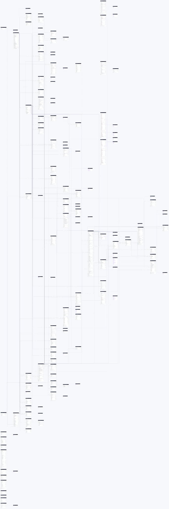

<details>
<summary>The whole schema as SQL</summary>

```sql
CREATE SCHEMA IF NOT EXISTS "public";

CREATE TYPE "AuthenticationMethod" AS ENUM ('GITHUB', 'MAGIC_LINK', 'GOOGLE', 'SSO');

CREATE TYPE "OrganizationAccessTokenType" AS ENUM ('USER', 'SYSTEM');

CREATE TYPE "OrgMemberRole" AS ENUM ('ADMIN', 'MEMBER');

CREATE TYPE "ApiKeyIssuer" AS ENUM ('USER', 'SYSTEM');

CREATE TYPE "RuntimeEnvironmentType" AS ENUM ('PRODUCTION', 'STAGING', 'DEVELOPMENT', 'PREVIEW');

CREATE TYPE "EnvironmentPauseSource" AS ENUM ('BILLING_LIMIT', 'ADMIN_BAN');

CREATE TYPE "ProjectVersion" AS ENUM ('V2', 'V3');

CREATE TYPE "EnvironmentKeyWrappingProvider" AS ENUM ('PLATFORM_KEYRING', 'AWS_KMS');

CREATE TYPE "SecretStoreProvider" AS ENUM ('DATABASE', 'AWS_PARAM_STORE');

CREATE TYPE "OidcSigningKeyStatus" AS ENUM ('STAGED', 'ACTIVE', 'RETIRED');

CREATE TYPE "OidcSigningKeyPurpose" AS ENUM ('EXTERNAL_OIDC', 'INTERNAL_RUN');

CREATE TYPE "TaskTriggerSource" AS ENUM ('STANDARD', 'SCHEDULED', 'AGENT', 'WEBHOOK');

CREATE TYPE "WebhookEndpointStatus" AS ENUM ('ACTIVE', 'INACTIVE', 'DELETING');

CREATE TYPE "WebhookDeliveryStatus" AS ENUM ('PENDING', 'PROCESSING', 'SUCCEEDED', 'FAILED', 'FILTERED', 'UNMATCHED');

CREATE TYPE "TaskRunStatus" AS ENUM ('DELAYED', 'PENDING', 'PENDING_VERSION', 'WAITING_FOR_DEPLOY', 'DEQUEUED', 'EXECUTING', 'WAITING_TO_RESUME', 'RETRYING_AFTER_FAILURE', 'PAUSED', 'CANCELED', 'INTERRUPTED', 'COMPLETED_SUCCESSFULLY', 'COMPLETED_WITH_ERRORS', 'SYSTEM_FAILURE', 'CRASHED', 'EXPIRED', 'TIMED_OUT');

CREATE TYPE "RunEngineVersion" AS ENUM ('V1', 'V2');

CREATE TYPE "TaskRunExecutionStatus" AS ENUM ('RUN_CREATED', 'DELAYED', 'QUEUED', 'QUEUED_EXECUTING', 'PENDING_EXECUTING', 'EXECUTING', 'EXECUTING_WITH_WAITPOINTS', 'SUSPENDED', 'PENDING_CANCEL', 'FINISHED');

CREATE TYPE "TaskRunCheckpointType" AS ENUM ('DOCKER', 'KUBERNETES', 'COMPUTE');

CREATE TYPE "WaitpointType" AS ENUM ('RUN', 'DATETIME', 'MANUAL', 'BATCH');

CREATE TYPE "WaitpointStatus" AS ENUM ('PENDING', 'COMPLETED');

CREATE TYPE "WorkerInstanceGroupType" AS ENUM ('MANAGED', 'UNMANAGED');

CREATE TYPE "WorkloadType" AS ENUM ('CONTAINER', 'MICROVM');

CREATE TYPE "TaskRunAttemptStatus" AS ENUM ('PENDING', 'EXECUTING', 'PAUSED', 'FAILED', 'CANCELED', 'COMPLETED');

CREATE TYPE "TaskEventLevel" AS ENUM ('TRACE', 'DEBUG', 'LOG', 'INFO', 'WARN', 'ERROR');

CREATE TYPE "TaskEventKind" AS ENUM ('UNSPECIFIED', 'INTERNAL', 'SERVER', 'CLIENT', 'PRODUCER', 'CONSUMER', 'UNRECOGNIZED', 'LOG');

CREATE TYPE "TaskEventStatus" AS ENUM ('UNSET', 'OK', 'ERROR', 'UNRECOGNIZED');

CREATE TYPE "TaskQueueType" AS ENUM ('VIRTUAL', 'NAMED');

CREATE TYPE "TaskQueueVersion" AS ENUM ('V1', 'V2');

CREATE TYPE "TaskQueueConcurrencyVersion" AS ENUM ('V1', 'V2');

CREATE TYPE "TaskQueueRole" AS ENUM ('QUEUE', 'LIMIT');

CREATE TYPE "BatchTaskRunStatus" AS ENUM ('PENDING', 'PROCESSING', 'COMPLETED', 'PARTIAL_FAILED', 'ABORTED');

CREATE TYPE "BatchTaskRunItemStatus" AS ENUM ('PENDING', 'FAILED', 'CANCELED', 'COMPLETED');

CREATE TYPE "CheckpointType" AS ENUM ('DOCKER', 'KUBERNETES');

CREATE TYPE "CheckpointRestoreEventType" AS ENUM ('CHECKPOINT', 'RESTORE');

CREATE TYPE "WorkerDeploymentType" AS ENUM ('MANAGED', 'UNMANAGED', 'V1');

CREATE TYPE "WorkerDeploymentStatus" AS ENUM ('PENDING', 'INSTALLING', 'BUILDING', 'DEPLOYING', 'DEPLOYED', 'FAILED', 'CANCELED', 'TIMED_OUT');

CREATE TYPE "ScheduleType" AS ENUM ('DECLARATIVE', 'IMPERATIVE');

CREATE TYPE "ScheduleGeneratorType" AS ENUM ('CRON');

CREATE TYPE "ProjectAlertChannelType" AS ENUM ('EMAIL', 'SLACK', 'WEBHOOK');

CREATE TYPE "ProjectAlertType" AS ENUM ('TASK_RUN', 'TASK_RUN_ATTEMPT', 'DEPLOYMENT_FAILURE', 'DEPLOYMENT_SUCCESS', 'ERROR_GROUP', 'DASHBOARD_AGENT_WATCH');

CREATE TYPE "ProjectAlertStatus" AS ENUM ('PENDING', 'SENT', 'FAILED');

CREATE TYPE "IntegrationService" AS ENUM ('SLACK', 'VERCEL');

CREATE TYPE "BulkActionType" AS ENUM ('CANCEL', 'REPLAY');

CREATE TYPE "BulkActionStatus" AS ENUM ('PENDING', 'COMPLETED', 'ABORTED');

CREATE TYPE "BulkActionNotificationType" AS ENUM ('NONE', 'EMAIL');

CREATE TYPE "BulkActionItemStatus" AS ENUM ('PENDING', 'COMPLETED', 'FAILED');

CREATE TYPE "GithubRepositorySelection" AS ENUM ('ALL', 'SELECTED');

CREATE TYPE "TrustedDeployScope" AS ENUM ('ANY', 'BRANCH', 'TAG', 'ENVIRONMENT');

CREATE TYPE "ImpersonationAuditLogAction" AS ENUM ('START', 'STOP');

CREATE TYPE "SupportAccessMode" AS ENUM ('ALLOW', 'REQUIRES_REQUEST');

CREATE TYPE "SupportAccessRequestStatus" AS ENUM ('PENDING', 'APPROVED', 'CANCELLED');

CREATE TYPE "CustomerQuerySource" AS ENUM ('DASHBOARD', 'API');

CREATE TYPE "CustomerQueryScope" AS ENUM ('ORGANIZATION', 'PROJECT', 'ENVIRONMENT');

CREATE TYPE "PlatformNotificationSurface" AS ENUM ('WEBAPP', 'CLI');

CREATE TYPE "PlatformNotificationScope" AS ENUM ('USER', 'PROJECT', 'ORGANIZATION', 'GLOBAL');

CREATE TYPE "ErrorGroupStatus" AS ENUM ('UNRESOLVED', 'RESOLVED', 'IGNORED');

CREATE TYPE "DataStoreKind" AS ENUM ('CLICKHOUSE');

CREATE TABLE "User" (
    "id" TEXT NOT NULL,
    "email" TEXT NOT NULL,
    "pendingEmail" TEXT,
    "authenticationMethod" "AuthenticationMethod" NOT NULL,
    "authenticationProfile" JSONB,
    "authenticationExtraParams" JSONB,
    "authIdentifier" TEXT,
    "displayName" TEXT,
    "name" TEXT,
    "avatarUrl" TEXT,
    "admin" BOOLEAN NOT NULL DEFAULT false,
    "dashboardPreferences" JSONB,
    "createdAt" TIMESTAMP(3) NOT NULL DEFAULT CURRENT_TIMESTAMP,
    "updatedAt" TIMESTAMP(3) NOT NULL,
    "isOnCloudWaitlist" BOOLEAN NOT NULL DEFAULT false,
    "featureCloud" BOOLEAN NOT NULL DEFAULT false,
    "isOnHostedRepoWaitlist" BOOLEAN NOT NULL DEFAULT false,
    "marketingEmails" BOOLEAN NOT NULL DEFAULT true,
    "confirmedBasicDetails" BOOLEAN NOT NULL DEFAULT false,
    "referralSource" TEXT,
    "onboardingData" JSONB,
    "mfaEnabledAt" TIMESTAMP(3),
    "mfaSecretReferenceId" TEXT,
    "mfaLastUsedCode" TEXT,
    "sessionDuration" INTEGER NOT NULL DEFAULT 31556952,
    "nextSessionEnd" TIMESTAMP(3),
    "invitationCodeId" TEXT,

    CONSTRAINT "User_pkey" PRIMARY KEY ("id")
);

CREATE TABLE "MfaBackupCode" (
    "id" TEXT NOT NULL,
    "code" TEXT NOT NULL,
    "userId" TEXT NOT NULL,
    "usedAt" TIMESTAMP(3),
    "createdAt" TIMESTAMP(3) NOT NULL DEFAULT CURRENT_TIMESTAMP,
    "updatedAt" TIMESTAMP(3) NOT NULL,

    CONSTRAINT "MfaBackupCode_pkey" PRIMARY KEY ("id")
);

CREATE TABLE "InvitationCode" (
    "id" TEXT NOT NULL,
    "code" TEXT NOT NULL,
    "createdAt" TIMESTAMP(3) NOT NULL DEFAULT CURRENT_TIMESTAMP,

    CONSTRAINT "InvitationCode_pkey" PRIMARY KEY ("id")
);

CREATE TABLE "AuthorizationCode" (
    "id" TEXT NOT NULL,
    "code" TEXT NOT NULL,
    "personalAccessTokenId" TEXT,
    "requesterIp" TEXT,
    "codeChallenge" TEXT,
    "callbackPort" INTEGER,
    "approvalCodeHash" TEXT,
    "createdAt" TIMESTAMP(3) NOT NULL DEFAULT CURRENT_TIMESTAMP,
    "updatedAt" TIMESTAMP(3) NOT NULL,

    CONSTRAINT "AuthorizationCode_pkey" PRIMARY KEY ("id")
);

CREATE TABLE "PersonalAccessToken" (
    "id" TEXT NOT NULL,
    "name" TEXT NOT NULL,
    "encryptedToken" JSONB NOT NULL,
    "obfuscatedToken" TEXT NOT NULL,
    "hashedToken" TEXT NOT NULL,
    "userId" TEXT NOT NULL,
    "revokedAt" TIMESTAMP(3),
    "lastAccessedAt" TIMESTAMP(3),
    "expiresAt" TIMESTAMP(3),
    "idleTimeoutSeconds" INTEGER,
    "expiryReminderSentAt" TIMESTAMP(3),
    "expiredNoticeSentAt" TIMESTAMP(3),
    "createdAt" TIMESTAMP(3) NOT NULL DEFAULT CURRENT_TIMESTAMP,
    "updatedAt" TIMESTAMP(3) NOT NULL,

    CONSTRAINT "PersonalAccessToken_pkey" PRIMARY KEY ("id")
);

CREATE TABLE "OrganizationAccessToken" (
    "id" TEXT NOT NULL,
    "name" TEXT NOT NULL,
    "type" "OrganizationAccessTokenType" NOT NULL DEFAULT 'USER',
    "hashedToken" TEXT NOT NULL,
    "organizationId" TEXT NOT NULL,
    "expiresAt" TIMESTAMP(3),
    "revokedAt" TIMESTAMP(3),
    "lastAccessedAt" TIMESTAMP(3),
    "createdAt" TIMESTAMP(3) NOT NULL DEFAULT CURRENT_TIMESTAMP,
    "updatedAt" TIMESTAMP(3) NOT NULL,

    CONSTRAINT "OrganizationAccessToken_pkey" PRIMARY KEY ("id")
);

CREATE TABLE "Organization" (
    "id" TEXT NOT NULL,
    "slug" TEXT NOT NULL,
    "title" TEXT NOT NULL,
    "maximumExecutionTimePerRunInMs" INTEGER NOT NULL DEFAULT 900000,
    "maximumConcurrencyLimit" INTEGER NOT NULL DEFAULT 10,
    "maximumSchedulesLimit" INTEGER NOT NULL DEFAULT 5,
    "maximumDevQueueSize" INTEGER,
    "maximumDeployedQueueSize" INTEGER,
    "createdAt" TIMESTAMP(3) NOT NULL DEFAULT CURRENT_TIMESTAMP,
    "updatedAt" TIMESTAMP(3) NOT NULL,
    "deletedAt" TIMESTAMP(3),
    "companySize" TEXT,
    "onboardingData" JSONB,
    "avatar" JSONB,
    "runsEnabled" BOOLEAN NOT NULL DEFAULT true,
    "v3Enabled" BOOLEAN NOT NULL DEFAULT false,
    "v2Enabled" BOOLEAN NOT NULL DEFAULT false,
    "v2MarqsEnabled" BOOLEAN NOT NULL DEFAULT false,
    "hasRequestedV3" BOOLEAN NOT NULL DEFAULT false,
    "apiRateLimiterConfig" JSONB,
    "realtimeRateLimiterConfig" JSONB,
    "batchRateLimitConfig" JSONB,
    "batchQueueConcurrencyConfig" JSONB,
    "webhookLimitsConfig" JSONB,
    "featureFlags" JSONB,
    "maximumProjectCount" INTEGER NOT NULL DEFAULT 25,
    "maxSessionDuration" INTEGER,
    "streamBasinName" TEXT,
    "supportAccessMode" "SupportAccessMode" NOT NULL DEFAULT 'ALLOW',
    "supportAccessModeUpdatedAt" TIMESTAMP(3),
    "supportAccessModeUpdatedById" TEXT,

    CONSTRAINT "Organization_pkey" PRIMARY KEY ("id")
);

CREATE TABLE "OrgMember" (
    "id" TEXT NOT NULL,
    "organizationId" TEXT NOT NULL,
    "userId" TEXT NOT NULL,
    "role" "OrgMemberRole" NOT NULL DEFAULT 'MEMBER',
    "createdAt" TIMESTAMP(3) NOT NULL DEFAULT CURRENT_TIMESTAMP,
    "updatedAt" TIMESTAMP(3) NOT NULL,

    CONSTRAINT "OrgMember_pkey" PRIMARY KEY ("id")
);

CREATE TABLE "OrgMemberInvite" (
    "id" TEXT NOT NULL,
    "token" TEXT NOT NULL,
    "email" TEXT NOT NULL,
    "role" "OrgMemberRole" NOT NULL DEFAULT 'MEMBER',
    "rbacRoleId" TEXT,
    "organizationId" TEXT NOT NULL,
    "inviterId" TEXT NOT NULL,
    "createdAt" TIMESTAMP(3) NOT NULL DEFAULT CURRENT_TIMESTAMP,
    "updatedAt" TIMESTAMP(3) NOT NULL,

    CONSTRAINT "OrgMemberInvite_pkey" PRIMARY KEY ("id")
);

CREATE TABLE "RuntimeEnvironment" (
    "id" TEXT NOT NULL,
    "slug" TEXT NOT NULL,
    "apiKey" TEXT NOT NULL,
    "rootApiKeyHiddenAt" TIMESTAMP(3),
    "pkApiKey" TEXT NOT NULL,
    "type" "RuntimeEnvironmentType" NOT NULL DEFAULT 'DEVELOPMENT',
    "isBranchableEnvironment" BOOLEAN NOT NULL DEFAULT false,
    "branchName" TEXT,
    "parentEnvironmentId" TEXT,
    "previewAutoArchiveAfterDays" INTEGER,
    "previewAutoArchiveExcludedBranches" TEXT[] DEFAULT ARRAY[]::TEXT[],
    "previewAutoArchiveNextCheckAt" TIMESTAMP(3),
    "previewAutoArchiveCursorCreatedAt" TIMESTAMP(3),
    "previewAutoArchiveCursorId" TEXT,
    "git" JSONB,
    "archivedAt" TIMESTAMP(3),
    "shortcode" TEXT NOT NULL,
    "maximumConcurrencyLimit" INTEGER NOT NULL DEFAULT 5,
    "concurrencyLimitBurstFactor" DECIMAL(4,2) NOT NULL DEFAULT 2.00,
    "paused" BOOLEAN NOT NULL DEFAULT false,
    "pauseSource" "EnvironmentPauseSource",
    "autoEnableInternalSources" BOOLEAN NOT NULL DEFAULT true,
    "organizationId" TEXT NOT NULL,
    "projectId" TEXT NOT NULL,
    "orgMemberId" TEXT,
    "createdAt" TIMESTAMP(3) NOT NULL DEFAULT CURRENT_TIMESTAMP,
    "updatedAt" TIMESTAMP(3) NOT NULL,
    "builtInEnvironmentVariableOverrides" JSONB,
    "tunnelId" TEXT,
    "currentSessionId" TEXT,

    CONSTRAINT "RuntimeEnvironment_pkey" PRIMARY KEY ("id")
);

CREATE TABLE "api_keys" (
    "id" TEXT NOT NULL,
    "name" TEXT NOT NULL,
    "key_hash" TEXT NOT NULL,
    "last_four" TEXT NOT NULL,
    "description" TEXT,
    "runtime_environment_id" TEXT NOT NULL,
    "created_by_user_id" TEXT,
    "issued_by" "ApiKeyIssuer" NOT NULL DEFAULT 'USER',
    "preset_id" TEXT,
    "scopes" TEXT[],
    "allowed_ip_ranges" TEXT[] DEFAULT ARRAY[]::TEXT[],
    "last_used_at" TIMESTAMP(3),
    "last_used_ip" TEXT,
    "revoked_at" TIMESTAMP(3),
    "expires_at" TIMESTAMP(3),
    "updated_at" TIMESTAMP(3) NOT NULL,
    "created_at" TIMESTAMP(3) NOT NULL DEFAULT CURRENT_TIMESTAMP,

    CONSTRAINT "api_keys_pkey" PRIMARY KEY ("id")
);

CREATE TABLE "RevokedApiKey" (
    "id" TEXT NOT NULL,
    "apiKey" TEXT NOT NULL,
    "runtimeEnvironmentId" TEXT NOT NULL,
    "expiresAt" TIMESTAMP(3) NOT NULL,
    "createdAt" TIMESTAMP(3) NOT NULL DEFAULT CURRENT_TIMESTAMP,

    CONSTRAINT "RevokedApiKey_pkey" PRIMARY KEY ("id")
);

CREATE TABLE "Project" (
    "id" TEXT NOT NULL,
    "slug" TEXT NOT NULL,
    "name" TEXT NOT NULL,
    "externalRef" TEXT NOT NULL,
    "organizationId" TEXT NOT NULL,
    "createdAt" TIMESTAMP(3) NOT NULL DEFAULT CURRENT_TIMESTAMP,
    "updatedAt" TIMESTAMP(3) NOT NULL,
    "deletedAt" TIMESTAMP(3),
    "initializedAt" TIMESTAMP(3),
    "defaultRuntime" TEXT,
    "version" "ProjectVersion" NOT NULL DEFAULT 'V2',
    "engine" "RunEngineVersion" NOT NULL DEFAULT 'V1',
    "builderProjectId" TEXT,
    "defaultWorkerGroupId" TEXT,
    "allowedMasterQueues" TEXT[] DEFAULT ARRAY[]::TEXT[],
    "buildSettings" JSONB,
    "onboardingData" JSONB,

    CONSTRAINT "Project_pkey" PRIMARY KEY ("id")
);

CREATE TABLE "EnvironmentEncryptionPolicy" (
    "environmentId" TEXT NOT NULL,
    "revision" INTEGER NOT NULL DEFAULT 0,
    "wrappingProvider" "EnvironmentKeyWrappingProvider",
    "wrappingKeyReference" TEXT,
    "activeKeyId" TEXT,

    CONSTRAINT "EnvironmentEncryptionPolicy_pkey" PRIMARY KEY ("environmentId")
);

CREATE TABLE "EnvironmentEncryptionKey" (
    "id" TEXT NOT NULL,
    "environmentId" TEXT NOT NULL,
    "wrappedKey" JSONB NOT NULL,
    "wrappingProvider" "EnvironmentKeyWrappingProvider" NOT NULL,
    "wrappingKeyReference" TEXT NOT NULL,
    "revision" INTEGER NOT NULL DEFAULT 0,
    "createdAt" TIMESTAMP(3) NOT NULL DEFAULT CURRENT_TIMESTAMP,

    CONSTRAINT "EnvironmentEncryptionKey_pkey" PRIMARY KEY ("id")
);

CREATE TABLE "SecretReference" (
    "id" TEXT NOT NULL,
    "key" TEXT NOT NULL,
    "provider" "SecretStoreProvider" NOT NULL DEFAULT 'DATABASE',
    "createdAt" TIMESTAMP(3) NOT NULL DEFAULT CURRENT_TIMESTAMP,
    "updatedAt" TIMESTAMP(3) NOT NULL,

    CONSTRAINT "SecretReference_pkey" PRIMARY KEY ("id")
);

CREATE TABLE "SecretStore" (
    "key" TEXT NOT NULL,
    "value" JSONB NOT NULL,
    "version" TEXT NOT NULL DEFAULT '1',
    "createdAt" TIMESTAMP(3) NOT NULL DEFAULT CURRENT_TIMESTAMP,
    "updatedAt" TIMESTAMP(3) NOT NULL
);

CREATE TABLE "OidcSigningKey" (
    "id" TEXT NOT NULL,
    "kid" TEXT NOT NULL,
    "purpose" "OidcSigningKeyPurpose" NOT NULL DEFAULT 'EXTERNAL_OIDC',
    "status" "OidcSigningKeyStatus" NOT NULL,
    "publicJwk" JSONB NOT NULL,
    "readyAt" TIMESTAMP(3) NOT NULL,
    "publicUntil" TIMESTAMP(3),
    "generatedByUserId" TEXT NOT NULL,
    "activatedAt" TIMESTAMP(3),
    "activatedByUserId" TEXT,
    "retiredAt" TIMESTAMP(3),
    "retiredByUserId" TEXT,
    "createdAt" TIMESTAMP(3) NOT NULL DEFAULT CURRENT_TIMESTAMP,
    "updatedAt" TIMESTAMP(3) NOT NULL,

    CONSTRAINT "OidcSigningKey_pkey" PRIMARY KEY ("id")
);

CREATE TABLE "DataMigration" (
    "id" TEXT NOT NULL,
    "name" TEXT NOT NULL,
    "createdAt" TIMESTAMP(3) NOT NULL DEFAULT CURRENT_TIMESTAMP,
    "updatedAt" TIMESTAMP(3) NOT NULL,
    "completedAt" TIMESTAMP(3),

    CONSTRAINT "DataMigration_pkey" PRIMARY KEY ("id")
);

CREATE TABLE "BackgroundWorker" (
    "id" TEXT NOT NULL,
    "friendlyId" TEXT NOT NULL,
    "engine" "RunEngineVersion" NOT NULL DEFAULT 'V1',
    "contentHash" TEXT NOT NULL,
    "sdkVersion" TEXT NOT NULL DEFAULT 'unknown',
    "cliVersion" TEXT NOT NULL DEFAULT 'unknown',
    "projectId" TEXT NOT NULL,
    "runtimeEnvironmentId" TEXT NOT NULL,
    "version" TEXT NOT NULL,
    "metadata" JSONB NOT NULL,
    "runtime" TEXT,
    "runtimeVersion" TEXT,
    "createdAt" TIMESTAMP(3) NOT NULL DEFAULT CURRENT_TIMESTAMP,
    "updatedAt" TIMESTAMP(3) NOT NULL,
    "workerGroupId" TEXT,
    "supportsLazyAttempts" BOOLEAN NOT NULL DEFAULT false,

    CONSTRAINT "BackgroundWorker_pkey" PRIMARY KEY ("id")
);

CREATE TABLE "BackgroundWorkerFile" (
    "id" TEXT NOT NULL,
    "friendlyId" TEXT NOT NULL,
    "filePath" TEXT NOT NULL,
    "contentHash" TEXT NOT NULL,
    "contents" BYTEA NOT NULL,
    "projectId" TEXT NOT NULL,
    "createdAt" TIMESTAMP(3) NOT NULL DEFAULT CURRENT_TIMESTAMP,

    CONSTRAINT "BackgroundWorkerFile_pkey" PRIMARY KEY ("id")
);

CREATE TABLE "prompts" (
    "id" TEXT NOT NULL,
    "friendly_id" TEXT NOT NULL,
    "slug" TEXT NOT NULL,
    "description" TEXT,
    "type" TEXT NOT NULL DEFAULT 'text',
    "organizationId" TEXT NOT NULL,
    "projectId" TEXT NOT NULL,
    "runtimeEnvironmentId" TEXT NOT NULL,
    "filePath" TEXT,
    "exportName" TEXT,
    "variableSchema" JSONB,
    "defaultModel" TEXT,
    "defaultConfig" JSONB,
    "tags" TEXT[] DEFAULT ARRAY[]::TEXT[],
    "archivedAt" TIMESTAMP(3),
    "createdAt" TIMESTAMP(3) NOT NULL DEFAULT CURRENT_TIMESTAMP,
    "updatedAt" TIMESTAMP(3) NOT NULL,

    CONSTRAINT "prompts_pkey" PRIMARY KEY ("id")
);

CREATE TABLE "prompt_versions" (
    "id" TEXT NOT NULL,
    "version" INTEGER NOT NULL,
    "promptId" TEXT NOT NULL,
    "textContent" TEXT,
    "chatContent" JSONB,
    "model" TEXT,
    "config" JSONB,
    "source" TEXT NOT NULL,
    "commitMessage" TEXT,
    "contentHash" TEXT NOT NULL,
    "labels" TEXT[] DEFAULT ARRAY[]::TEXT[],
    "workerId" TEXT,
    "createdBy" TEXT,
    "createdAt" TIMESTAMP(3) NOT NULL DEFAULT CURRENT_TIMESTAMP,

    CONSTRAINT "prompt_versions_pkey" PRIMARY KEY ("id")
);

CREATE TABLE "BackgroundWorkerTask" (
    "id" TEXT NOT NULL,
    "slug" TEXT NOT NULL,
    "description" TEXT,
    "friendlyId" TEXT NOT NULL,
    "filePath" TEXT NOT NULL,
    "exportName" TEXT,
    "workerId" TEXT NOT NULL,
    "projectId" TEXT NOT NULL,
    "fileId" TEXT,
    "runtimeEnvironmentId" TEXT NOT NULL,
    "createdAt" TIMESTAMP(3) NOT NULL DEFAULT CURRENT_TIMESTAMP,
    "updatedAt" TIMESTAMP(3) NOT NULL,
    "queueConfig" JSONB,
    "retryConfig" JSONB,
    "machineConfig" JSONB,
    "gates" JSONB,
    "queueId" TEXT,
    "maxDurationInSeconds" INTEGER,
    "ttl" TEXT,
    "triggerSource" "TaskTriggerSource" NOT NULL DEFAULT 'STANDARD',
    "config" JSONB,
    "payloadSchema" JSONB,

    CONSTRAINT "BackgroundWorkerTask_pkey" PRIMARY KEY ("id")
);

CREATE TABLE "WebhookEndpoint" (
    "id" TEXT NOT NULL,
    "friendlyId" TEXT NOT NULL,
    "opaqueId" TEXT NOT NULL,
    "organizationId" TEXT NOT NULL,
    "projectId" TEXT NOT NULL,
    "runtimeEnvironmentId" TEXT NOT NULL,
    "environmentType" "RuntimeEnvironmentType" NOT NULL,
    "endpointTenantId" TEXT NOT NULL DEFAULT '',
    "endpointExternalRef" TEXT NOT NULL DEFAULT '',
    "source" TEXT NOT NULL,
    "declaredId" TEXT NOT NULL,
    "routingTargets" JSONB NOT NULL DEFAULT '[]',
    "verifierArtifact" JSONB NOT NULL,
    "metadata" JSONB NOT NULL DEFAULT '{}',
    "secretProvisioning" TEXT NOT NULL DEFAULT 'either',
    "setupPrompt" TEXT,
    "signingSecretKey" TEXT,
    "status" "WebhookEndpointStatus" NOT NULL DEFAULT 'ACTIVE',
    "manuallyDeactivatedAt" TIMESTAMP(3),
    "createdAt" TIMESTAMP(3) NOT NULL DEFAULT CURRENT_TIMESTAMP,
    "updatedAt" TIMESTAMP(3) NOT NULL,

    CONSTRAINT "WebhookEndpoint_pkey" PRIMARY KEY ("id")
);

CREATE TABLE "WebhookDelivery" (
    "id" TEXT NOT NULL,
    "friendlyId" TEXT NOT NULL,
    "webhookEndpointId" TEXT NOT NULL,
    "organizationId" TEXT NOT NULL,
    "projectId" TEXT NOT NULL,
    "runtimeEnvironmentId" TEXT NOT NULL,
    "environmentType" "RuntimeEnvironmentType" NOT NULL,
    "externalDeliveryId" TEXT NOT NULL,
    "idempotencyKey" TEXT NOT NULL,
    "runId" TEXT,
    "status" "WebhookDeliveryStatus" NOT NULL DEFAULT 'PENDING',
    "isTest" BOOLEAN NOT NULL DEFAULT false,
    "parsedEvent" JSONB,
    "headers" JSONB,
    "rawBodyHash" TEXT,
    "errorMessage" TEXT,
    "filterReason" TEXT,
    "targets" JSONB NOT NULL DEFAULT '[]',
    "createdAt" TIMESTAMP(3) NOT NULL DEFAULT CURRENT_TIMESTAMP,
    "updatedAt" TIMESTAMP(3) NOT NULL,
    "processedAt" TIMESTAMP(3),
    "retentionDays" INTEGER NOT NULL DEFAULT 30,

    CONSTRAINT "WebhookDelivery_pkey" PRIMARY KEY ("id","createdAt","retentionDays")
);

CREATE TABLE "Alert" (
    "id" TEXT NOT NULL,
    "organizationId" TEXT NOT NULL,
    "projectId" TEXT NOT NULL,
    "environmentId" TEXT NOT NULL,
    "capabilityKey" TEXT NOT NULL,
    "params" JSONB NOT NULL,
    "condition" JSONB NOT NULL,
    "query" TEXT,
    "expiresAt" TIMESTAMPTZ(6),
    "lifecycle" TEXT NOT NULL DEFAULT 'active',
    "attention" TEXT NOT NULL DEFAULT 'clear',
    "observedCondition" TEXT NOT NULL DEFAULT 'unknown',
    "observedConditionChangedAt" TIMESTAMPTZ(6),
    "pendingMetSince" TIMESTAMPTZ(6),
    "evaluatorState" JSONB,
    "evaluationLeaseId" TEXT,
    "evaluationLeaseUntil" TIMESTAMPTZ(6),
    "lastEvaluatedAt" TIMESTAMPTZ(6),
    "nextEvaluationAt" TIMESTAMPTZ(6),
    "notifiers" JSONB NOT NULL DEFAULT '[]',
    "name" TEXT,
    "createdBy" TEXT NOT NULL,
    "createdAt" TIMESTAMPTZ(6) NOT NULL DEFAULT CURRENT_TIMESTAMP,
    "updatedAt" TIMESTAMPTZ(6) NOT NULL DEFAULT CURRENT_TIMESTAMP,
    "resolvedAt" TIMESTAMPTZ(6),
    "resolvedBy" TEXT,
    "stoppedAt" TIMESTAMPTZ(6),
    "stoppedBy" TEXT,
    "lastOccurrenceAt" TIMESTAMPTZ(6),
    "occurrencesSinceRaise" INTEGER NOT NULL DEFAULT 0,
    "occurrencesTotal" BIGINT NOT NULL DEFAULT 0,
    "groupId" TEXT,

    CONSTRAINT "Alert_pkey" PRIMARY KEY ("id")
);

CREATE TABLE "AlertEvent" (
    "id" TEXT NOT NULL,
    "alertId" TEXT NOT NULL,
    "type" TEXT NOT NULL,
    "at" TIMESTAMPTZ(6) NOT NULL DEFAULT CURRENT_TIMESTAMP,
    "facts" JSONB NOT NULL DEFAULT '{}',
    "actorId" TEXT,
    "sourceEventId" TEXT,

    CONSTRAINT "AlertEvent_pkey" PRIMARY KEY ("id","at")
);

CREATE TABLE "AlertOccurrenceSeen" (
    "alertId" TEXT NOT NULL,
    "sourceEventId" TEXT NOT NULL,
    "rowTime" TIMESTAMPTZ(6) NOT NULL,
    "seenAt" TIMESTAMPTZ(6) NOT NULL DEFAULT CURRENT_TIMESTAMP,
    "expiresAt" TIMESTAMPTZ(6) NOT NULL,

    CONSTRAINT "AlertOccurrenceSeen_pkey" PRIMARY KEY ("alertId","sourceEventId")
);

CREATE TABLE "AlertDelivery" (
    "id" TEXT NOT NULL,
    "alertEventId" TEXT NOT NULL,
    "eventAt" TIMESTAMPTZ(6) NOT NULL,
    "notifierId" TEXT NOT NULL,
    "notifier" JSONB NOT NULL,
    "status" TEXT NOT NULL DEFAULT 'pending',
    "claimId" TEXT,
    "claimedAt" TIMESTAMPTZ(6),
    "deliveredAt" TIMESTAMPTZ(6),
    "failureReason" TEXT,
    "providerMetadata" JSONB,
    "attempts" INTEGER NOT NULL DEFAULT 0,
    "firstAttemptAt" TIMESTAMPTZ(6),
    "createdAt" TIMESTAMPTZ(6) NOT NULL DEFAULT CURRENT_TIMESTAMP,

    CONSTRAINT "AlertDelivery_pkey" PRIMARY KEY ("id","eventAt")
);

CREATE TABLE "PlaygroundConversation" (
    "id" TEXT NOT NULL,
    "chatId" TEXT NOT NULL,
    "title" TEXT NOT NULL DEFAULT 'New conversation',
    "agentSlug" TEXT NOT NULL,
    "runId" TEXT,
    "clientData" JSONB,
    "messages" JSONB,
    "lastEventId" TEXT,
    "projectId" TEXT NOT NULL,
    "runtimeEnvironmentId" TEXT NOT NULL,
    "userId" TEXT NOT NULL,
    "createdAt" TIMESTAMP(3) NOT NULL DEFAULT CURRENT_TIMESTAMP,
    "updatedAt" TIMESTAMP(3) NOT NULL,

    CONSTRAINT "PlaygroundConversation_pkey" PRIMARY KEY ("id")
);

CREATE TABLE "Session" (
    "id" TEXT NOT NULL,
    "friendlyId" TEXT NOT NULL,
    "externalId" TEXT,
    "type" TEXT NOT NULL,
    "projectId" TEXT NOT NULL,
    "runtimeEnvironmentId" TEXT NOT NULL,
    "environmentType" "RuntimeEnvironmentType" NOT NULL,
    "organizationId" TEXT NOT NULL,
    "taskIdentifier" TEXT NOT NULL,
    "triggerConfig" JSONB NOT NULL,
    "isTest" BOOLEAN NOT NULL DEFAULT false,
    "tags" TEXT[] DEFAULT ARRAY[]::TEXT[],
    "metadata" JSONB,
    "currentRunId" TEXT,
    "currentRunVersion" INTEGER NOT NULL DEFAULT 0,
    "closedAt" TIMESTAMP(3),
    "closedReason" TEXT,
    "expiresAt" TIMESTAMP(3),
    "createdAt" TIMESTAMP(3) NOT NULL DEFAULT CURRENT_TIMESTAMP,
    "updatedAt" TIMESTAMP(3) NOT NULL,
    "streamBasinName" TEXT,
    "chatSnapshotStoragePath" TEXT,

    CONSTRAINT "Session_pkey" PRIMARY KEY ("id")
);

CREATE TABLE "SessionRun" (
    "id" TEXT NOT NULL,
    "sessionId" TEXT NOT NULL,
    "runId" TEXT NOT NULL,
    "reason" TEXT NOT NULL,
    "triggeredAt" TIMESTAMP(3) NOT NULL DEFAULT CURRENT_TIMESTAMP,

    CONSTRAINT "SessionRun_pkey" PRIMARY KEY ("id")
);

CREATE TABLE "TaskRun" (
    "id" TEXT NOT NULL,
    "number" INTEGER NOT NULL DEFAULT 0,
    "friendlyId" TEXT NOT NULL,
    "engine" "RunEngineVersion" NOT NULL DEFAULT 'V1',
    "status" "TaskRunStatus" NOT NULL DEFAULT 'PENDING',
    "statusReason" TEXT,
    "idempotencyKey" TEXT,
    "idempotencyKeyExpiresAt" TIMESTAMP(3),
    "idempotencyKeyOptions" JSONB,
    "debounce" JSONB,
    "taskIdentifier" TEXT NOT NULL,
    "isTest" BOOLEAN NOT NULL DEFAULT false,
    "payload" TEXT NOT NULL,
    "payloadType" TEXT NOT NULL DEFAULT 'application/json',
    "context" JSONB,
    "traceContext" JSONB,
    "traceId" TEXT NOT NULL,
    "spanId" TEXT NOT NULL,
    "runtimeEnvironmentId" TEXT NOT NULL,
    "environmentType" "RuntimeEnvironmentType",
    "projectId" TEXT NOT NULL,
    "organizationId" TEXT,
    "queue" TEXT NOT NULL,
    "lockedQueueId" TEXT,
    "masterQueue" TEXT NOT NULL DEFAULT 'main',
    "region" TEXT,
    "secondaryMasterQueue" TEXT,
    "attemptNumber" INTEGER,
    "createdAt" TIMESTAMP(3) NOT NULL DEFAULT CURRENT_TIMESTAMP,
    "updatedAt" TIMESTAMP(3) NOT NULL,
    "runTags" TEXT[],
    "taskVersion" TEXT,
    "sdkVersion" TEXT,
    "cliVersion" TEXT,
    "startedAt" TIMESTAMP(3),
    "executedAt" TIMESTAMP(3),
    "completedAt" TIMESTAMP(3),
    "machinePreset" TEXT,
    "usageDurationMs" INTEGER NOT NULL DEFAULT 0,
    "costInCents" DOUBLE PRECISION NOT NULL DEFAULT 0,
    "baseCostInCents" DOUBLE PRECISION NOT NULL DEFAULT 0,
    "lockedAt" TIMESTAMP(3),
    "lockedById" TEXT,
    "lockedToVersionId" TEXT,
    "priorityMs" INTEGER NOT NULL DEFAULT 0,
    "concurrencyKey" TEXT,
    "gates" JSONB,
    "delayUntil" TIMESTAMP(3),
    "queuedAt" TIMESTAMP(3),
    "ttl" TEXT,
    "expiredAt" TIMESTAMP(3),
    "maxAttempts" INTEGER,
    "lockedRetryConfig" JSONB,
    "oneTimeUseToken" TEXT,
    "taskEventStore" TEXT NOT NULL DEFAULT 'taskEvent',
    "queueTimestamp" TIMESTAMP(3),
    "scheduleInstanceId" TEXT,
    "scheduleId" TEXT,
    "bulkActionGroupIds" TEXT[] DEFAULT ARRAY[]::TEXT[],
    "logsDeletedAt" TIMESTAMP(3),
    "replayedFromTaskRunFriendlyId" TEXT,
    "rootTaskRunId" TEXT,
    "parentTaskRunId" TEXT,
    "parentTaskRunAttemptId" TEXT,
    "batchId" TEXT,
    "resumeParentOnCompletion" BOOLEAN NOT NULL DEFAULT false,
    "depth" INTEGER NOT NULL DEFAULT 0,
    "parentSpanId" TEXT,
    "runChainState" JSONB,
    "seedMetadata" TEXT,
    "seedMetadataType" TEXT NOT NULL DEFAULT 'application/json',
    "metadata" TEXT,
    "metadataType" TEXT NOT NULL DEFAULT 'application/json',
    "metadataVersion" INTEGER NOT NULL DEFAULT 1,
    "annotations" JSONB,
    "isWarmStart" BOOLEAN,
    "output" TEXT,
    "outputType" TEXT NOT NULL DEFAULT 'application/json',
    "error" JSONB,
    "planType" TEXT,
    "maxDurationInSeconds" INTEGER,
    "realtimeStreamsVersion" TEXT NOT NULL DEFAULT 'v1',
    "realtimeStreams" TEXT[] DEFAULT ARRAY[]::TEXT[],
    "streamBasinName" TEXT,

    CONSTRAINT "TaskRun_pkey" PRIMARY KEY ("id")
);

CREATE TABLE "TaskRunTemplate" (
    "id" TEXT NOT NULL,
    "taskSlug" TEXT NOT NULL,
    "triggerSource" "TaskTriggerSource" NOT NULL,
    "label" TEXT NOT NULL,
    "payload" TEXT,
    "payloadType" TEXT NOT NULL DEFAULT 'application/json',
    "metadata" TEXT,
    "metadataType" TEXT NOT NULL DEFAULT 'application/json',
    "queue" TEXT,
    "concurrencyKey" TEXT,
    "ttlSeconds" INTEGER,
    "maxAttempts" INTEGER,
    "maxDurationSeconds" INTEGER,
    "tags" TEXT[],
    "machinePreset" TEXT,
    "projectId" TEXT NOT NULL,
    "organizationId" TEXT NOT NULL,
    "createdAt" TIMESTAMP(3) NOT NULL DEFAULT CURRENT_TIMESTAMP,
    "updatedAt" TIMESTAMP(3) NOT NULL,

    CONSTRAINT "TaskRunTemplate_pkey" PRIMARY KEY ("id")
);

CREATE TABLE "TaskRunExecutionSnapshot" (
    "id" TEXT NOT NULL,
    "engine" "RunEngineVersion" NOT NULL DEFAULT 'V2',
    "executionStatus" "TaskRunExecutionStatus" NOT NULL,
    "description" TEXT NOT NULL,
    "isValid" BOOLEAN NOT NULL DEFAULT true,
    "error" TEXT,
    "previousSnapshotId" TEXT,
    "runId" TEXT NOT NULL,
    "runStatus" "TaskRunStatus" NOT NULL,
    "batchId" TEXT,
    "attemptNumber" INTEGER,
    "environmentId" TEXT NOT NULL,
    "environmentType" "RuntimeEnvironmentType" NOT NULL,
    "projectId" TEXT NOT NULL,
    "organizationId" TEXT NOT NULL,
    "completedWaitpointOrder" TEXT[],
    "checkpointId" TEXT,
    "workerId" TEXT,
    "runnerId" TEXT,
    "createdAt" TIMESTAMP(3) NOT NULL DEFAULT CURRENT_TIMESTAMP,
    "updatedAt" TIMESTAMP(3) NOT NULL,
    "lastHeartbeatAt" TIMESTAMP(3),
    "metadata" JSONB,

    CONSTRAINT "TaskRunExecutionSnapshot_pkey" PRIMARY KEY ("id")
);

CREATE TABLE "TaskRunCheckpoint" (
    "id" TEXT NOT NULL,
    "friendlyId" TEXT NOT NULL,
    "type" "TaskRunCheckpointType" NOT NULL,
    "location" TEXT NOT NULL,
    "imageRef" TEXT,
    "reason" TEXT,
    "metadata" TEXT,
    "projectId" TEXT NOT NULL,
    "runtimeEnvironmentId" TEXT NOT NULL,
    "createdAt" TIMESTAMP(3) NOT NULL DEFAULT CURRENT_TIMESTAMP,
    "updatedAt" TIMESTAMP(3) NOT NULL,

    CONSTRAINT "TaskRunCheckpoint_pkey" PRIMARY KEY ("id")
);

CREATE TABLE "Waitpoint" (
    "id" TEXT NOT NULL,
    "friendlyId" TEXT NOT NULL,
    "type" "WaitpointType" NOT NULL,
    "status" "WaitpointStatus" NOT NULL DEFAULT 'PENDING',
    "completedAt" TIMESTAMP(3),
    "idempotencyKey" TEXT NOT NULL,
    "userProvidedIdempotencyKey" BOOLEAN NOT NULL,
    "idempotencyKeyExpiresAt" TIMESTAMP(3),
    "inactiveIdempotencyKey" TEXT,
    "completedByTaskRunId" TEXT,
    "completedAfter" TIMESTAMP(3),
    "completedByBatchId" TEXT,
    "output" TEXT,
    "outputType" TEXT NOT NULL DEFAULT 'application/json',
    "outputIsError" BOOLEAN NOT NULL DEFAULT false,
    "projectId" TEXT NOT NULL,
    "environmentId" TEXT NOT NULL,
    "createdAt" TIMESTAMP(3) NOT NULL DEFAULT CURRENT_TIMESTAMP,
    "updatedAt" TIMESTAMP(3) NOT NULL,
    "tags" TEXT[],

    CONSTRAINT "Waitpoint_pkey" PRIMARY KEY ("id")
);

CREATE TABLE "TaskRunWaitpoint" (
    "id" TEXT NOT NULL,
    "taskRunId" TEXT NOT NULL,
    "waitpointId" TEXT NOT NULL,
    "projectId" TEXT NOT NULL,
    "spanIdToComplete" TEXT,
    "batchId" TEXT,
    "batchIndex" INTEGER,
    "createdAt" TIMESTAMP(3) NOT NULL DEFAULT CURRENT_TIMESTAMP,
    "updatedAt" TIMESTAMP(3) NOT NULL,

    CONSTRAINT "TaskRunWaitpoint_pkey" PRIMARY KEY ("id")
);

CREATE TABLE "WaitpointTag" (
    "id" TEXT NOT NULL,
    "name" TEXT NOT NULL,
    "environmentId" TEXT NOT NULL,
    "projectId" TEXT NOT NULL,
    "createdAt" TIMESTAMP(3) NOT NULL DEFAULT CURRENT_TIMESTAMP,

    CONSTRAINT "WaitpointTag_pkey" PRIMARY KEY ("id")
);

CREATE TABLE "FeatureFlag" (
    "id" TEXT NOT NULL,
    "key" TEXT NOT NULL,
    "value" JSONB,
    "createdAt" TIMESTAMP(3) NOT NULL DEFAULT CURRENT_TIMESTAMP,
    "updatedAt" TIMESTAMP(3) NOT NULL,

    CONSTRAINT "FeatureFlag_pkey" PRIMARY KEY ("id")
);

CREATE TABLE "WorkerInstance" (
    "id" TEXT NOT NULL,
    "name" TEXT NOT NULL,
    "resourceIdentifier" TEXT NOT NULL,
    "metadata" JSONB,
    "workerGroupId" TEXT NOT NULL,
    "organizationId" TEXT,
    "projectId" TEXT,
    "environmentId" TEXT,
    "deploymentId" TEXT,
    "createdAt" TIMESTAMP(3) NOT NULL DEFAULT CURRENT_TIMESTAMP,
    "updatedAt" TIMESTAMP(3) NOT NULL,
    "lastDequeueAt" TIMESTAMP(3),
    "lastHeartbeatAt" TIMESTAMP(3),

    CONSTRAINT "WorkerInstance_pkey" PRIMARY KEY ("id")
);

CREATE TABLE "WorkerInstanceGroup" (
    "id" TEXT NOT NULL,
    "type" "WorkerInstanceGroupType" NOT NULL,
    "name" TEXT NOT NULL,
    "masterQueue" TEXT NOT NULL,
    "description" TEXT,
    "hidden" BOOLEAN NOT NULL DEFAULT false,
    "tokenId" TEXT NOT NULL,
    "organizationId" TEXT,
    "projectId" TEXT,
    "cloudProvider" TEXT,
    "location" TEXT,
    "staticIPs" TEXT,
    "workloadType" "WorkloadType" NOT NULL DEFAULT 'CONTAINER',
    "region" TEXT,
    "enableFastPath" BOOLEAN NOT NULL DEFAULT false,
    "createdAt" TIMESTAMP(3) NOT NULL DEFAULT CURRENT_TIMESTAMP,
    "updatedAt" TIMESTAMP(3) NOT NULL,

    CONSTRAINT "WorkerInstanceGroup_pkey" PRIMARY KEY ("id")
);

CREATE TABLE "WorkerGroupToken" (
    "id" TEXT NOT NULL,
    "tokenHash" TEXT NOT NULL,
    "previousTokenHash" TEXT,
    "previousTokenValidUntil" TIMESTAMP(3),
    "createdAt" TIMESTAMP(3) NOT NULL DEFAULT CURRENT_TIMESTAMP,
    "updatedAt" TIMESTAMP(3) NOT NULL,

    CONSTRAINT "WorkerGroupToken_pkey" PRIMARY KEY ("id")
);

CREATE TABLE "TaskRunTag" (
    "id" TEXT NOT NULL,
    "name" TEXT NOT NULL,
    "friendlyId" TEXT NOT NULL,
    "projectId" TEXT NOT NULL,
    "createdAt" TIMESTAMP(3) NOT NULL DEFAULT CURRENT_TIMESTAMP,

    CONSTRAINT "TaskRunTag_pkey" PRIMARY KEY ("id")
);

CREATE TABLE "TaskRunDependency" (
    "id" TEXT NOT NULL,
    "taskRunId" TEXT NOT NULL,
    "checkpointEventId" TEXT,
    "dependentAttemptId" TEXT,
    "dependentBatchRunId" TEXT,
    "createdAt" TIMESTAMP(3) NOT NULL DEFAULT CURRENT_TIMESTAMP,
    "updatedAt" TIMESTAMP(3) NOT NULL,
    "resumedAt" TIMESTAMP(3),

    CONSTRAINT "TaskRunDependency_pkey" PRIMARY KEY ("id")
);

CREATE TABLE "TaskRunCounter" (
    "taskIdentifier" TEXT NOT NULL,
    "lastNumber" INTEGER NOT NULL DEFAULT 0,

    CONSTRAINT "TaskRunCounter_pkey" PRIMARY KEY ("taskIdentifier")
);

CREATE TABLE "TaskRunNumberCounter" (
    "id" TEXT NOT NULL,
    "taskIdentifier" TEXT NOT NULL,
    "environmentId" TEXT NOT NULL,
    "lastNumber" INTEGER NOT NULL DEFAULT 0,

    CONSTRAINT "TaskRunNumberCounter_pkey" PRIMARY KEY ("id")
);

CREATE TABLE "TaskRunAttempt" (
    "id" TEXT NOT NULL,
    "number" INTEGER NOT NULL DEFAULT 0,
    "friendlyId" TEXT NOT NULL,
    "taskRunId" TEXT NOT NULL,
    "backgroundWorkerId" TEXT NOT NULL,
    "backgroundWorkerTaskId" TEXT NOT NULL,
    "runtimeEnvironmentId" TEXT NOT NULL,
    "queueId" TEXT NOT NULL,
    "status" "TaskRunAttemptStatus" NOT NULL DEFAULT 'PENDING',
    "createdAt" TIMESTAMP(3) NOT NULL DEFAULT CURRENT_TIMESTAMP,
    "updatedAt" TIMESTAMP(3) NOT NULL,
    "startedAt" TIMESTAMP(3),
    "completedAt" TIMESTAMP(3),
    "usageDurationMs" INTEGER NOT NULL DEFAULT 0,
    "error" JSONB,
    "output" TEXT,
    "outputType" TEXT NOT NULL DEFAULT 'application/json',

    CONSTRAINT "TaskRunAttempt_pkey" PRIMARY KEY ("id")
);

CREATE TABLE "TaskEvent" (
    "id" TEXT NOT NULL,
    "message" TEXT NOT NULL,
    "traceId" TEXT NOT NULL,
    "spanId" TEXT NOT NULL,
    "parentId" TEXT,
    "tracestate" TEXT,
    "isError" BOOLEAN NOT NULL DEFAULT false,
    "isPartial" BOOLEAN NOT NULL DEFAULT false,
    "isCancelled" BOOLEAN NOT NULL DEFAULT false,
    "isDebug" BOOLEAN NOT NULL DEFAULT false,
    "serviceName" TEXT NOT NULL,
    "serviceNamespace" TEXT NOT NULL,
    "level" "TaskEventLevel" NOT NULL DEFAULT 'TRACE',
    "kind" "TaskEventKind" NOT NULL DEFAULT 'INTERNAL',
    "status" "TaskEventStatus" NOT NULL DEFAULT 'UNSET',
    "links" JSONB,
    "events" JSONB,
    "startTime" BIGINT NOT NULL,
    "duration" BIGINT NOT NULL DEFAULT 0,
    "attemptId" TEXT,
    "attemptNumber" INTEGER,
    "environmentId" TEXT NOT NULL,
    "environmentType" "RuntimeEnvironmentType" NOT NULL,
    "organizationId" TEXT NOT NULL,
    "projectId" TEXT NOT NULL,
    "projectRef" TEXT NOT NULL,
    "runId" TEXT NOT NULL,
    "runIsTest" BOOLEAN NOT NULL DEFAULT false,
    "idempotencyKey" TEXT,
    "taskSlug" TEXT NOT NULL,
    "taskPath" TEXT,
    "taskExportName" TEXT,
    "workerId" TEXT,
    "workerVersion" TEXT,
    "queueId" TEXT,
    "queueName" TEXT,
    "batchId" TEXT,
    "properties" JSONB NOT NULL,
    "metadata" JSONB,
    "style" JSONB,
    "output" JSONB,
    "outputType" TEXT,
    "payload" JSONB,
    "payloadType" TEXT,
    "createdAt" TIMESTAMP(3) NOT NULL DEFAULT CURRENT_TIMESTAMP,
    "usageDurationMs" INTEGER NOT NULL DEFAULT 0,
    "usageCostInCents" DOUBLE PRECISION NOT NULL DEFAULT 0,
    "machinePreset" TEXT,
    "machinePresetCpu" DOUBLE PRECISION,
    "machinePresetMemory" DOUBLE PRECISION,
    "machinePresetCentsPerMs" DOUBLE PRECISION,

    CONSTRAINT "TaskEvent_pkey" PRIMARY KEY ("id")
);

CREATE TABLE "TaskQueue" (
    "id" TEXT NOT NULL,
    "friendlyId" TEXT NOT NULL,
    "name" TEXT NOT NULL,
    "type" "TaskQueueType" NOT NULL DEFAULT 'VIRTUAL',
    "version" "TaskQueueVersion" NOT NULL DEFAULT 'V1',
    "orderableName" TEXT,
    "concurrencyVersion" "TaskQueueConcurrencyVersion" NOT NULL DEFAULT 'V1',
    "role" "TaskQueueRole" NOT NULL DEFAULT 'QUEUE',
    "projectId" TEXT NOT NULL,
    "runtimeEnvironmentId" TEXT NOT NULL,
    "concurrencyLimit" INTEGER,
    "concurrencyLimitOverriddenAt" TIMESTAMP(3),
    "concurrencyLimitOverriddenBy" TEXT,
    "concurrencyLimitBase" INTEGER,
    "concurrencyLimitOverridePercent" DECIMAL(5,2),
    "totalConcurrencyLimit" INTEGER,
    "totalConcurrencyLimitOverriddenAt" TIMESTAMP(3),
    "totalConcurrencyLimitOverriddenBy" TEXT,
    "totalConcurrencyLimitBase" INTEGER,
    "rateLimit" JSONB,
    "paused" BOOLEAN NOT NULL DEFAULT false,
    "archivedAt" TIMESTAMP(3),
    "createdAt" TIMESTAMP(3) NOT NULL DEFAULT CURRENT_TIMESTAMP,
    "updatedAt" TIMESTAMP(3) NOT NULL,

    CONSTRAINT "TaskQueue_pkey" PRIMARY KEY ("id")
);

CREATE TABLE "BatchTaskRun" (
    "id" TEXT NOT NULL,
    "friendlyId" TEXT NOT NULL,
    "idempotencyKey" TEXT,
    "idempotencyKeyExpiresAt" TIMESTAMP(3),
    "status" "BatchTaskRunStatus" NOT NULL DEFAULT 'PENDING',
    "runtimeEnvironmentId" TEXT NOT NULL,
    "createdAt" TIMESTAMP(3) NOT NULL DEFAULT CURRENT_TIMESTAMP,
    "updatedAt" TIMESTAMP(3) NOT NULL,
    "runIds" TEXT[] DEFAULT ARRAY[]::TEXT[],
    "runCount" INTEGER NOT NULL DEFAULT 0,
    "payload" TEXT,
    "payloadType" TEXT NOT NULL DEFAULT 'application/json',
    "options" JSONB,
    "batchVersion" TEXT NOT NULL DEFAULT 'v1',
    "sealed" BOOLEAN NOT NULL DEFAULT false,
    "sealedAt" TIMESTAMP(3),
    "expectedCount" INTEGER NOT NULL DEFAULT 0,
    "completedCount" INTEGER NOT NULL DEFAULT 0,
    "completedAt" TIMESTAMP(3),
    "resumedAt" TIMESTAMP(3),
    "processingJobsCount" INTEGER NOT NULL DEFAULT 0,
    "processingJobsExpectedCount" INTEGER NOT NULL DEFAULT 0,
    "oneTimeUseToken" TEXT,
    "processingStartedAt" TIMESTAMP(3),
    "processingCompletedAt" TIMESTAMP(3),
    "successfulRunCount" INTEGER,
    "failedRunCount" INTEGER,
    "taskIdentifier" TEXT,
    "checkpointEventId" TEXT,
    "dependentTaskAttemptId" TEXT,

    CONSTRAINT "BatchTaskRun_pkey" PRIMARY KEY ("id")
);

CREATE TABLE "BatchTaskRunItem" (
    "id" TEXT NOT NULL,
    "status" "BatchTaskRunItemStatus" NOT NULL DEFAULT 'PENDING',
    "batchTaskRunId" TEXT NOT NULL,
    "taskRunId" TEXT NOT NULL,
    "taskRunAttemptId" TEXT,
    "createdAt" TIMESTAMP(3) NOT NULL DEFAULT CURRENT_TIMESTAMP,
    "updatedAt" TIMESTAMP(3) NOT NULL,
    "completedAt" TIMESTAMP(3),

    CONSTRAINT "BatchTaskRunItem_pkey" PRIMARY KEY ("id")
);

CREATE TABLE "BatchTaskRunError" (
    "id" TEXT NOT NULL,
    "batchTaskRunId" TEXT NOT NULL,
    "index" INTEGER NOT NULL,
    "taskIdentifier" TEXT NOT NULL,
    "payload" TEXT,
    "options" JSONB,
    "error" TEXT NOT NULL,
    "errorCode" TEXT,
    "createdAt" TIMESTAMP(3) NOT NULL DEFAULT CURRENT_TIMESTAMP,

    CONSTRAINT "BatchTaskRunError_pkey" PRIMARY KEY ("id")
);

CREATE TABLE "EnvironmentVariable" (
    "id" TEXT NOT NULL,
    "friendlyId" TEXT NOT NULL,
    "key" TEXT NOT NULL,
    "projectId" TEXT NOT NULL,
    "createdAt" TIMESTAMP(3) NOT NULL DEFAULT CURRENT_TIMESTAMP,
    "updatedAt" TIMESTAMP(3) NOT NULL,

    CONSTRAINT "EnvironmentVariable_pkey" PRIMARY KEY ("id")
);

CREATE TABLE "EnvironmentVariableValue" (
    "id" TEXT NOT NULL,
    "valueReferenceId" TEXT,
    "variableId" TEXT NOT NULL,
    "environmentId" TEXT NOT NULL,
    "isSecret" BOOLEAN NOT NULL DEFAULT false,
    "createdAt" TIMESTAMP(3) NOT NULL DEFAULT CURRENT_TIMESTAMP,
    "updatedAt" TIMESTAMP(3) NOT NULL,
    "version" INTEGER NOT NULL DEFAULT 1,
    "lastUpdatedBy" JSONB,

    CONSTRAINT "EnvironmentVariableValue_pkey" PRIMARY KEY ("id")
);

CREATE TABLE "Checkpoint" (
    "id" TEXT NOT NULL,
    "friendlyId" TEXT NOT NULL,
    "type" "CheckpointType" NOT NULL,
    "location" TEXT NOT NULL,
    "imageRef" TEXT NOT NULL,
    "reason" TEXT,
    "metadata" TEXT,
    "runId" TEXT NOT NULL,
    "attemptId" TEXT NOT NULL,
    "attemptNumber" INTEGER,
    "projectId" TEXT NOT NULL,
    "runtimeEnvironmentId" TEXT NOT NULL,
    "createdAt" TIMESTAMP(3) NOT NULL DEFAULT CURRENT_TIMESTAMP,
    "updatedAt" TIMESTAMP(3) NOT NULL,

    CONSTRAINT "Checkpoint_pkey" PRIMARY KEY ("id")
);

CREATE TABLE "CheckpointRestoreEvent" (
    "id" TEXT NOT NULL,
    "type" "CheckpointRestoreEventType" NOT NULL,
    "reason" TEXT,
    "metadata" TEXT,
    "checkpointId" TEXT NOT NULL,
    "runId" TEXT NOT NULL,
    "attemptId" TEXT NOT NULL,
    "projectId" TEXT NOT NULL,
    "runtimeEnvironmentId" TEXT NOT NULL,
    "createdAt" TIMESTAMP(3) NOT NULL DEFAULT CURRENT_TIMESTAMP,
    "updatedAt" TIMESTAMP(3) NOT NULL,

    CONSTRAINT "CheckpointRestoreEvent_pkey" PRIMARY KEY ("id")
);

CREATE TABLE "WorkerDeployment" (
    "id" TEXT NOT NULL,
    "contentHash" TEXT NOT NULL,
    "friendlyId" TEXT NOT NULL,
    "shortCode" TEXT NOT NULL,
    "version" TEXT NOT NULL,
    "runtime" TEXT,
    "runtimeVersion" TEXT,
    "cliVersion" TEXT,
    "imageReference" TEXT,
    "imagePlatform" TEXT NOT NULL DEFAULT 'linux/amd64',
    "templateKey" TEXT,
    "indexObjectKey" TEXT,
    "indexSha256" TEXT,
    "indexFormatVersion" INTEGER,
    "externalBuildData" JSONB,
    "buildServerMetadata" JSONB,
    "buildEnvVars" JSONB,
    "status" "WorkerDeploymentStatus" NOT NULL DEFAULT 'PENDING',
    "type" "WorkerDeploymentType" NOT NULL DEFAULT 'V1',
    "projectId" TEXT NOT NULL,
    "environmentId" TEXT NOT NULL,
    "workerId" TEXT,
    "triggeredById" TEXT,
    "triggeredVia" TEXT,
    "commitSHA" TEXT,
    "externalId" TEXT,
    "startedAt" TIMESTAMP(3),
    "installedAt" TIMESTAMP(3),
    "builtAt" TIMESTAMP(3),
    "deployedAt" TIMESTAMP(3),
    "failedAt" TIMESTAMP(3),
    "errorData" JSONB,
    "canceledAt" TIMESTAMP(3),
    "canceledReason" TEXT,
    "git" JSONB,
    "createdAt" TIMESTAMP(3) NOT NULL DEFAULT CURRENT_TIMESTAMP,
    "updatedAt" TIMESTAMP(3) NOT NULL,

    CONSTRAINT "WorkerDeployment_pkey" PRIMARY KEY ("id")
);

CREATE TABLE "WorkerDeploymentPromotion" (
    "id" TEXT NOT NULL,
    "label" TEXT NOT NULL,
    "deploymentId" TEXT NOT NULL,
    "environmentId" TEXT NOT NULL,

    CONSTRAINT "WorkerDeploymentPromotion_pkey" PRIMARY KEY ("id")
);

CREATE TABLE "TaskSchedule" (
    "id" TEXT NOT NULL,
    "type" "ScheduleType" NOT NULL DEFAULT 'IMPERATIVE',
    "friendlyId" TEXT NOT NULL,
    "taskIdentifier" TEXT NOT NULL,
    "deduplicationKey" TEXT NOT NULL,
    "userProvidedDeduplicationKey" BOOLEAN NOT NULL DEFAULT false,
    "generatorExpression" TEXT NOT NULL,
    "generatorDescription" TEXT NOT NULL DEFAULT '',
    "generatorType" "ScheduleGeneratorType" NOT NULL DEFAULT 'CRON',
    "timezone" TEXT NOT NULL DEFAULT 'UTC',
    "windowDurationSeconds" INTEGER,
    "windowPercentage" INTEGER,
    "defaultWindowDurationSeconds" INTEGER,
    "minimumWindowDurationSeconds" INTEGER,
    "externalId" TEXT,
    "lastRunTriggeredAt" TIMESTAMP(3),
    "projectId" TEXT NOT NULL,
    "createdAt" TIMESTAMP(3) NOT NULL DEFAULT CURRENT_TIMESTAMP,
    "updatedAt" TIMESTAMP(3) NOT NULL,
    "active" BOOLEAN NOT NULL DEFAULT true,

    CONSTRAINT "TaskSchedule_pkey" PRIMARY KEY ("id")
);

CREATE TABLE "TaskScheduleInstance" (
    "id" TEXT NOT NULL,
    "taskScheduleId" TEXT NOT NULL,
    "environmentId" TEXT NOT NULL,
    "projectId" TEXT NOT NULL,
    "schedulePhase" INTEGER,
    "createdAt" TIMESTAMP(3) NOT NULL DEFAULT CURRENT_TIMESTAMP,
    "updatedAt" TIMESTAMP(3) NOT NULL,
    "active" BOOLEAN NOT NULL DEFAULT true,
    "lastScheduledTimestamp" TIMESTAMP(3),
    "nextScheduledTimestamp" TIMESTAMP(3),

    CONSTRAINT "TaskScheduleInstance_pkey" PRIMARY KEY ("id")
);

CREATE TABLE "RuntimeEnvironmentSession" (
    "id" TEXT NOT NULL,
    "ipAddress" TEXT NOT NULL,
    "environmentId" TEXT NOT NULL,
    "createdAt" TIMESTAMP(3) NOT NULL DEFAULT CURRENT_TIMESTAMP,
    "updatedAt" TIMESTAMP(3) NOT NULL,
    "disconnectedAt" TIMESTAMP(3),

    CONSTRAINT "RuntimeEnvironmentSession_pkey" PRIMARY KEY ("id")
);

CREATE TABLE "ProjectAlertChannel" (
    "id" TEXT NOT NULL,
    "friendlyId" TEXT NOT NULL,
    "deduplicationKey" TEXT NOT NULL,
    "userProvidedDeduplicationKey" BOOLEAN NOT NULL DEFAULT false,
    "integrationId" TEXT,
    "enabled" BOOLEAN NOT NULL DEFAULT true,
    "type" "ProjectAlertChannelType" NOT NULL,
    "name" TEXT NOT NULL,
    "properties" JSONB NOT NULL,
    "alertTypes" "ProjectAlertType"[],
    "environmentTypes" "RuntimeEnvironmentType"[] DEFAULT ARRAY['STAGING', 'PRODUCTION']::"RuntimeEnvironmentType"[],
    "errorAlertConfig" JSONB,
    "projectId" TEXT NOT NULL,
    "createdAt" TIMESTAMP(3) NOT NULL DEFAULT CURRENT_TIMESTAMP,
    "updatedAt" TIMESTAMP(3) NOT NULL,

    CONSTRAINT "ProjectAlertChannel_pkey" PRIMARY KEY ("id")
);

CREATE TABLE "ProjectAlert" (
    "id" TEXT NOT NULL,
    "friendlyId" TEXT NOT NULL,
    "projectId" TEXT NOT NULL,
    "environmentId" TEXT NOT NULL,
    "channelId" TEXT NOT NULL,
    "status" "ProjectAlertStatus" NOT NULL DEFAULT 'PENDING',
    "type" "ProjectAlertType" NOT NULL,
    "taskRunAttemptId" TEXT,
    "taskRunId" TEXT,
    "workerDeploymentId" TEXT,
    "createdAt" TIMESTAMP(3) NOT NULL DEFAULT CURRENT_TIMESTAMP,
    "updatedAt" TIMESTAMP(3) NOT NULL,

    CONSTRAINT "ProjectAlert_pkey" PRIMARY KEY ("id")
);

CREATE TABLE "ProjectAlertStorage" (
    "id" TEXT NOT NULL,
    "projectId" TEXT NOT NULL,
    "alertChannelId" TEXT NOT NULL,
    "alertType" "ProjectAlertType" NOT NULL,
    "storageId" TEXT NOT NULL,
    "storageData" JSONB NOT NULL,
    "createdAt" TIMESTAMP(3) NOT NULL DEFAULT CURRENT_TIMESTAMP,
    "updatedAt" TIMESTAMP(3) NOT NULL,

    CONSTRAINT "ProjectAlertStorage_pkey" PRIMARY KEY ("id")
);

CREATE TABLE "OrganizationIntegration" (
    "id" TEXT NOT NULL,
    "friendlyId" TEXT NOT NULL,
    "service" "IntegrationService" NOT NULL,
    "externalOrganizationId" TEXT,
    "integrationData" JSONB NOT NULL,
    "tokenReferenceId" TEXT NOT NULL,
    "organizationId" TEXT NOT NULL,
    "createdAt" TIMESTAMP(3) NOT NULL DEFAULT CURRENT_TIMESTAMP,
    "updatedAt" TIMESTAMP(3) NOT NULL,
    "deletedAt" TIMESTAMP(3),

    CONSTRAINT "OrganizationIntegration_pkey" PRIMARY KEY ("id")
);

CREATE TABLE "OrganizationProjectIntegration" (
    "id" TEXT NOT NULL,
    "organizationIntegrationId" TEXT NOT NULL,
    "projectId" TEXT NOT NULL,
    "externalEntityId" TEXT NOT NULL,
    "integrationData" JSONB NOT NULL,
    "installedBy" TEXT,
    "createdAt" TIMESTAMP(3) NOT NULL DEFAULT CURRENT_TIMESTAMP,
    "updatedAt" TIMESTAMP(3) NOT NULL,
    "deletedAt" TIMESTAMP(3),

    CONSTRAINT "OrganizationProjectIntegration_pkey" PRIMARY KEY ("id")
);

CREATE TABLE "BulkActionGroup" (
    "id" TEXT NOT NULL,
    "friendlyId" TEXT NOT NULL,
    "projectId" TEXT NOT NULL,
    "environmentId" TEXT,
    "type" "BulkActionType" NOT NULL,
    "status" "BulkActionStatus" NOT NULL DEFAULT 'PENDING',
    "queryName" TEXT,
    "params" JSONB,
    "dedupeKey" TEXT,
    "cursor" JSONB,
    "successCount" INTEGER NOT NULL DEFAULT 0,
    "failureCount" INTEGER NOT NULL DEFAULT 0,
    "totalCount" INTEGER NOT NULL DEFAULT 0,
    "completionNotification" "BulkActionNotificationType" NOT NULL DEFAULT 'NONE',
    "userId" TEXT,
    "name" TEXT,
    "completedAt" TIMESTAMP(3),
    "createdAt" TIMESTAMP(3) NOT NULL DEFAULT CURRENT_TIMESTAMP,
    "updatedAt" TIMESTAMP(3) NOT NULL,

    CONSTRAINT "BulkActionGroup_pkey" PRIMARY KEY ("id")
);

CREATE TABLE "BulkActionItem" (
    "id" TEXT NOT NULL,
    "friendlyId" TEXT,
    "groupId" TEXT NOT NULL,
    "type" "BulkActionType" NOT NULL,
    "status" "BulkActionItemStatus" NOT NULL DEFAULT 'PENDING',
    "sourceRunId" TEXT NOT NULL,
    "destinationRunId" TEXT,
    "error" TEXT,
    "createdAt" TIMESTAMP(3) NOT NULL DEFAULT CURRENT_TIMESTAMP,
    "updatedAt" TIMESTAMP(3) NOT NULL,

    CONSTRAINT "BulkActionItem_pkey" PRIMARY KEY ("id")
);

CREATE TABLE "RealtimeStreamChunk" (
    "id" TEXT NOT NULL,
    "key" TEXT NOT NULL,
    "value" TEXT NOT NULL,
    "sequence" INTEGER NOT NULL,
    "runId" TEXT NOT NULL,
    "createdAt" TIMESTAMP(3) NOT NULL DEFAULT CURRENT_TIMESTAMP,

    CONSTRAINT "RealtimeStreamChunk_pkey" PRIMARY KEY ("id")
);

CREATE TABLE "TaskEventPartitioned" (
    "id" TEXT NOT NULL,
    "message" TEXT NOT NULL,
    "traceId" TEXT NOT NULL,
    "spanId" TEXT NOT NULL,
    "parentId" TEXT,
    "tracestate" TEXT,
    "isError" BOOLEAN NOT NULL DEFAULT false,
    "isPartial" BOOLEAN NOT NULL DEFAULT false,
    "isCancelled" BOOLEAN NOT NULL DEFAULT false,
    "serviceName" TEXT NOT NULL,
    "serviceNamespace" TEXT NOT NULL,
    "level" "TaskEventLevel" NOT NULL DEFAULT 'TRACE',
    "kind" "TaskEventKind" NOT NULL DEFAULT 'INTERNAL',
    "status" "TaskEventStatus" NOT NULL DEFAULT 'UNSET',
    "links" JSONB,
    "events" JSONB,
    "startTime" BIGINT NOT NULL,
    "duration" BIGINT NOT NULL DEFAULT 0,
    "attemptId" TEXT,
    "attemptNumber" INTEGER,
    "environmentId" TEXT NOT NULL,
    "environmentType" "RuntimeEnvironmentType" NOT NULL,
    "organizationId" TEXT NOT NULL,
    "projectId" TEXT NOT NULL,
    "projectRef" TEXT NOT NULL,
    "runId" TEXT NOT NULL,
    "runIsTest" BOOLEAN NOT NULL DEFAULT false,
    "idempotencyKey" TEXT,
    "taskSlug" TEXT NOT NULL,
    "taskPath" TEXT,
    "taskExportName" TEXT,
    "workerId" TEXT,
    "workerVersion" TEXT,
    "queueId" TEXT,
    "queueName" TEXT,
    "batchId" TEXT,
    "properties" JSONB NOT NULL,
    "metadata" JSONB,
    "style" JSONB,
    "output" JSONB,
    "outputType" TEXT,
    "payload" JSONB,
    "payloadType" TEXT,
    "createdAt" TIMESTAMP(3) NOT NULL DEFAULT CURRENT_TIMESTAMP,
    "usageDurationMs" INTEGER NOT NULL DEFAULT 0,
    "usageCostInCents" DOUBLE PRECISION NOT NULL DEFAULT 0,
    "machinePreset" TEXT,
    "machinePresetCpu" DOUBLE PRECISION,
    "machinePresetMemory" DOUBLE PRECISION,
    "machinePresetCentsPerMs" DOUBLE PRECISION,

    CONSTRAINT "TaskEventPartitioned_pkey" PRIMARY KEY ("id","createdAt")
);

CREATE TABLE "GithubAppInstallation" (
    "id" TEXT NOT NULL,
    "appInstallationId" BIGINT NOT NULL,
    "targetId" BIGINT NOT NULL,
    "targetType" TEXT NOT NULL,
    "accountHandle" TEXT NOT NULL,
    "permissions" JSONB,
    "repositorySelection" "GithubRepositorySelection" NOT NULL,
    "installedBy" TEXT,
    "installedByUserId" TEXT,
    "organizationId" TEXT NOT NULL,
    "deletedAt" TIMESTAMP(3),
    "suspendedAt" TIMESTAMP(3),
    "createdAt" TIMESTAMP(3) NOT NULL DEFAULT CURRENT_TIMESTAMP,
    "updatedAt" TIMESTAMP(3) NOT NULL,

    CONSTRAINT "GithubAppInstallation_pkey" PRIMARY KEY ("id")
);

CREATE TABLE "GithubRepository" (
    "id" TEXT NOT NULL,
    "githubId" BIGINT NOT NULL,
    "name" TEXT NOT NULL,
    "fullName" TEXT NOT NULL,
    "htmlUrl" TEXT NOT NULL,
    "private" BOOLEAN NOT NULL,
    "defaultBranch" TEXT NOT NULL,
    "installationId" TEXT NOT NULL,
    "createdAt" TIMESTAMP(3) NOT NULL DEFAULT CURRENT_TIMESTAMP,
    "updatedAt" TIMESTAMP(3) NOT NULL,

    CONSTRAINT "GithubRepository_pkey" PRIMARY KEY ("id")
);

CREATE TABLE "TrustedDeployRepository" (
    "id" TEXT NOT NULL,
    "projectId" TEXT NOT NULL,
    "issuer" TEXT NOT NULL DEFAULT 'https://token.actions.githubusercontent.com',
    "repositoryOwner" TEXT NOT NULL,
    "repositoryName" TEXT NOT NULL,
    "repositoryId" TEXT,
    "repositoryOwnerId" TEXT,
    "createdAt" TIMESTAMP(3) NOT NULL DEFAULT CURRENT_TIMESTAMP,
    "updatedAt" TIMESTAMP(3) NOT NULL,

    CONSTRAINT "TrustedDeployRepository_pkey" PRIMARY KEY ("id")
);

CREATE TABLE "TrustedDeployEnvironment" (
    "id" TEXT NOT NULL,
    "trustedDeployRepositoryId" TEXT NOT NULL,
    "runtimeEnvironmentId" TEXT NOT NULL,
    "enabled" BOOLEAN NOT NULL DEFAULT false,
    "scope" "TrustedDeployScope" NOT NULL,
    "scopeValue" TEXT,
    "additionalClaims" JSONB NOT NULL DEFAULT '{}',
    "createdAt" TIMESTAMP(3) NOT NULL DEFAULT CURRENT_TIMESTAMP,
    "updatedAt" TIMESTAMP(3) NOT NULL,

    CONSTRAINT "TrustedDeployEnvironment_pkey" PRIMARY KEY ("id")
);

CREATE TABLE "ConnectedGithubRepository" (
    "id" TEXT NOT NULL,
    "projectId" TEXT NOT NULL,
    "repositoryId" TEXT NOT NULL,
    "branchTracking" JSONB NOT NULL,
    "previewDeploymentsEnabled" BOOLEAN NOT NULL DEFAULT true,
    "buildFilters" JSONB,
    "createdAt" TIMESTAMP(3) NOT NULL DEFAULT CURRENT_TIMESTAMP,
    "updatedAt" TIMESTAMP(3) NOT NULL,

    CONSTRAINT "ConnectedGithubRepository_pkey" PRIMARY KEY ("id")
);

CREATE TABLE "ImpersonationAuditLog" (
    "id" TEXT NOT NULL,
    "action" "ImpersonationAuditLogAction" NOT NULL,
    "adminId" TEXT NOT NULL,
    "targetId" TEXT NOT NULL,
    "ipAddress" TEXT,
    "createdAt" TIMESTAMP(3) NOT NULL DEFAULT CURRENT_TIMESTAMP,

    CONSTRAINT "ImpersonationAuditLog_pkey" PRIMARY KEY ("id")
);

CREATE TABLE "SupportAccessRequest" (
    "id" TEXT NOT NULL,
    "organizationId" TEXT NOT NULL,
    "requestedById" TEXT,
    "reason" TEXT NOT NULL,
    "status" "SupportAccessRequestStatus" NOT NULL DEFAULT 'PENDING',
    "approvedById" TEXT,
    "approvedAt" TIMESTAMP(3),
    "expiresAt" TIMESTAMP(3),
    "cancelledById" TEXT,
    "cancelledAt" TIMESTAMP(3),
    "createdAt" TIMESTAMP(3) NOT NULL DEFAULT CURRENT_TIMESTAMP,
    "updatedAt" TIMESTAMP(3) NOT NULL,

    CONSTRAINT "SupportAccessRequest_pkey" PRIMARY KEY ("id")
);

CREATE TABLE "CustomerQuery" (
    "id" TEXT NOT NULL,
    "query" TEXT NOT NULL,
    "scope" "CustomerQueryScope" NOT NULL,
    "stats" JSONB NOT NULL,
    "title" TEXT,
    "source" "CustomerQuerySource" NOT NULL DEFAULT 'DASHBOARD',
    "organizationId" TEXT NOT NULL,
    "projectId" TEXT,
    "environmentId" TEXT,
    "userId" TEXT,
    "filterPeriod" TEXT,
    "filterFrom" TIMESTAMP(3),
    "filterTo" TIMESTAMP(3),
    "createdAt" TIMESTAMP(3) NOT NULL DEFAULT CURRENT_TIMESTAMP,

    CONSTRAINT "CustomerQuery_pkey" PRIMARY KEY ("id")
);

CREATE TABLE "IntegrationDeployment" (
    "id" TEXT NOT NULL,
    "integrationName" TEXT NOT NULL,
    "integrationDeploymentId" TEXT NOT NULL,
    "commitSHA" TEXT NOT NULL,
    "deploymentId" TEXT,
    "status" TEXT,
    "createdAt" TIMESTAMP(3) NOT NULL DEFAULT CURRENT_TIMESTAMP,
    "updatedAt" TIMESTAMP(3) NOT NULL,

    CONSTRAINT "IntegrationDeployment_pkey" PRIMARY KEY ("id")
);

CREATE TABLE "MetricsDashboard" (
    "id" TEXT NOT NULL,
    "friendlyId" TEXT NOT NULL,
    "title" TEXT NOT NULL,
    "description" TEXT NOT NULL DEFAULT '',
    "organizationId" TEXT NOT NULL,
    "projectId" TEXT,
    "ownerId" TEXT,
    "createdAt" TIMESTAMP(3) NOT NULL DEFAULT CURRENT_TIMESTAMP,
    "updatedAt" TIMESTAMP(3) NOT NULL,
    "layout" TEXT NOT NULL,

    CONSTRAINT "MetricsDashboard_pkey" PRIMARY KEY ("id")
);

CREATE TABLE "llm_models" (
    "id" TEXT NOT NULL,
    "friendly_id" TEXT NOT NULL,
    "project_id" TEXT,
    "model_name" TEXT NOT NULL,
    "match_pattern" TEXT NOT NULL,
    "start_date" TIMESTAMP(3),
    "source" TEXT NOT NULL DEFAULT 'default',
    "created_at" TIMESTAMP(3) NOT NULL DEFAULT CURRENT_TIMESTAMP,
    "updated_at" TIMESTAMP(3) NOT NULL,
    "provider" TEXT,
    "description" TEXT,
    "context_window" INTEGER,
    "max_output_tokens" INTEGER,
    "capabilities" TEXT[] DEFAULT ARRAY[]::TEXT[],
    "is_hidden" BOOLEAN NOT NULL DEFAULT false,
    "base_model_name" TEXT,
    "pricing_unit" TEXT,

    CONSTRAINT "llm_models_pkey" PRIMARY KEY ("id")
);

CREATE TABLE "llm_pricing_tiers" (
    "id" TEXT NOT NULL,
    "model_id" TEXT NOT NULL,
    "name" TEXT NOT NULL,
    "is_default" BOOLEAN NOT NULL DEFAULT true,
    "priority" INTEGER NOT NULL DEFAULT 0,
    "conditions" JSONB NOT NULL DEFAULT '[]',

    CONSTRAINT "llm_pricing_tiers_pkey" PRIMARY KEY ("id")
);

CREATE TABLE "llm_prices" (
    "id" TEXT NOT NULL,
    "model_id" TEXT NOT NULL,
    "pricing_tier_id" TEXT NOT NULL,
    "usage_type" TEXT NOT NULL,
    "price" DECIMAL(20,12) NOT NULL,

    CONSTRAINT "llm_prices_pkey" PRIMARY KEY ("id")
);

CREATE TABLE "PlatformNotification" (
    "id" TEXT NOT NULL,
    "friendlyId" TEXT NOT NULL,
    "title" TEXT NOT NULL,
    "payload" JSONB NOT NULL,
    "surface" "PlatformNotificationSurface" NOT NULL,
    "scope" "PlatformNotificationScope" NOT NULL,
    "userId" TEXT,
    "organizationId" TEXT,
    "projectId" TEXT,
    "startsAt" TIMESTAMP(3) NOT NULL,
    "endsAt" TIMESTAMP(3) NOT NULL,
    "cliMaxDaysAfterFirstSeen" INTEGER,
    "cliMaxShowCount" INTEGER,
    "cliShowEvery" INTEGER,
    "priority" INTEGER NOT NULL DEFAULT 0,
    "isDraft" BOOLEAN NOT NULL DEFAULT false,
    "archivedAt" TIMESTAMP(3),
    "createdAt" TIMESTAMP(3) NOT NULL DEFAULT CURRENT_TIMESTAMP,
    "updatedAt" TIMESTAMP(3) NOT NULL,

    CONSTRAINT "PlatformNotification_pkey" PRIMARY KEY ("id")
);

CREATE TABLE "PlatformNotificationInteraction" (
    "id" TEXT NOT NULL,
    "notificationId" TEXT NOT NULL,
    "userId" TEXT NOT NULL,
    "firstSeenAt" TIMESTAMP(3) NOT NULL DEFAULT CURRENT_TIMESTAMP,
    "showCount" INTEGER NOT NULL DEFAULT 1,
    "webappDismissedAt" TIMESTAMP(3),
    "webappClickedAt" TIMESTAMP(3),
    "cliDismissedAt" TIMESTAMP(3),
    "createdAt" TIMESTAMP(3) NOT NULL DEFAULT CURRENT_TIMESTAMP,
    "updatedAt" TIMESTAMP(3) NOT NULL,

    CONSTRAINT "PlatformNotificationInteraction_pkey" PRIMARY KEY ("id")
);

CREATE TABLE "ErrorGroupState" (
    "id" TEXT NOT NULL,
    "organizationId" TEXT NOT NULL,
    "projectId" TEXT NOT NULL,
    "environmentId" TEXT,
    "taskIdentifier" TEXT NOT NULL,
    "errorFingerprint" TEXT NOT NULL,
    "status" "ErrorGroupStatus" NOT NULL DEFAULT 'UNRESOLVED',
    "ignoredUntil" TIMESTAMP(3),
    "ignoredUntilOccurrenceRate" INTEGER,
    "ignoredUntilTotalOccurrences" INTEGER,
    "ignoredAtOccurrenceCount" BIGINT,
    "ignoredAt" TIMESTAMP(3),
    "ignoredReason" TEXT,
    "ignoredByUserId" TEXT,
    "resolvedAt" TIMESTAMP(3),
    "resolvedInVersion" TEXT,
    "resolvedBy" TEXT,
    "createdAt" TIMESTAMP(3) NOT NULL DEFAULT CURRENT_TIMESTAMP,
    "updatedAt" TIMESTAMP(3) NOT NULL,

    CONSTRAINT "ErrorGroupState_pkey" PRIMARY KEY ("id")
);

CREATE TABLE "TaskIdentifier" (
    "id" TEXT NOT NULL,
    "runtimeEnvironmentId" TEXT NOT NULL,
    "projectId" TEXT NOT NULL,
    "slug" TEXT NOT NULL,
    "currentTriggerSource" "TaskTriggerSource" NOT NULL DEFAULT 'STANDARD',
    "currentWorkerId" TEXT,
    "firstSeenAt" TIMESTAMP(3) NOT NULL DEFAULT CURRENT_TIMESTAMP,
    "lastSeenAt" TIMESTAMP(3) NOT NULL DEFAULT CURRENT_TIMESTAMP,
    "isInLatestDeployment" BOOLEAN NOT NULL DEFAULT true,

    CONSTRAINT "TaskIdentifier_pkey" PRIMARY KEY ("id")
);

CREATE TABLE "OrganizationDataStore" (
    "id" TEXT NOT NULL,
    "key" TEXT NOT NULL,
    "organizationIds" TEXT[],
    "kind" "DataStoreKind" NOT NULL,
    "config" JSONB NOT NULL,
    "createdAt" TIMESTAMP(3) NOT NULL DEFAULT CURRENT_TIMESTAMP,
    "updatedAt" TIMESTAMP(3) NOT NULL,

    CONSTRAINT "OrganizationDataStore_pkey" PRIMARY KEY ("id")
);

CREATE TABLE "_BackgroundWorkerToBackgroundWorkerFile" (
    "A" TEXT NOT NULL,
    "B" TEXT NOT NULL,

    CONSTRAINT "_BackgroundWorkerToBackgroundWorkerFile_AB_pkey" PRIMARY KEY ("A","B")
);

CREATE TABLE "_BackgroundWorkerToTaskQueue" (
    "A" TEXT NOT NULL,
    "B" TEXT NOT NULL,

    CONSTRAINT "_BackgroundWorkerToTaskQueue_AB_pkey" PRIMARY KEY ("A","B")
);

CREATE TABLE "_WaitpointRunConnections" (
    "A" TEXT NOT NULL,
    "B" TEXT NOT NULL,

    CONSTRAINT "_WaitpointRunConnections_AB_pkey" PRIMARY KEY ("A","B")
);

CREATE TABLE "_completedWaitpoints" (
    "A" TEXT NOT NULL,
    "B" TEXT NOT NULL,

    CONSTRAINT "_completedWaitpoints_AB_pkey" PRIMARY KEY ("A","B")
);

CREATE UNIQUE INDEX "User_email_key" ON "User"("email");

CREATE UNIQUE INDEX "User_authIdentifier_key" ON "User"("authIdentifier");

CREATE UNIQUE INDEX "MfaBackupCode_userId_code_key" ON "MfaBackupCode"("userId", "code");

CREATE UNIQUE INDEX "InvitationCode_code_key" ON "InvitationCode"("code");

CREATE UNIQUE INDEX "AuthorizationCode_code_key" ON "AuthorizationCode"("code");

CREATE UNIQUE INDEX "PersonalAccessToken_hashedToken_key" ON "PersonalAccessToken"("hashedToken");

CREATE INDEX "PersonalAccessToken_userId_idx" ON "PersonalAccessToken"("userId");

CREATE UNIQUE INDEX "OrganizationAccessToken_hashedToken_key" ON "OrganizationAccessToken"("hashedToken");

CREATE INDEX "OrganizationAccessToken_organizationId_type_createdAt_idx" ON "OrganizationAccessToken"("organizationId", "type", "createdAt" DESC);

CREATE UNIQUE INDEX "Organization_slug_key" ON "Organization"("slug");

CREATE INDEX "OrgMember_userId_idx" ON "OrgMember"("userId");

CREATE UNIQUE INDEX "OrgMember_organizationId_userId_key" ON "OrgMember"("organizationId", "userId");

CREATE UNIQUE INDEX "OrgMemberInvite_token_key" ON "OrgMemberInvite"("token");

CREATE UNIQUE INDEX "OrgMemberInvite_organizationId_email_key" ON "OrgMemberInvite"("organizationId", "email");

CREATE UNIQUE INDEX "RuntimeEnvironment_apiKey_key" ON "RuntimeEnvironment"("apiKey");

CREATE UNIQUE INDEX "RuntimeEnvironment_pkApiKey_key" ON "RuntimeEnvironment"("pkApiKey");

CREATE INDEX "RuntimeEnvironment_parentEnvironmentId_idx" ON "RuntimeEnvironment"("parentEnvironmentId");

CREATE INDEX "RuntimeEnvironment_projectId_idx" ON "RuntimeEnvironment"("projectId");

CREATE INDEX "RuntimeEnvironment_organizationId_idx" ON "RuntimeEnvironment"("organizationId");

CREATE UNIQUE INDEX "RuntimeEnvironment_projectId_slug_orgMemberId_key" ON "RuntimeEnvironment"("projectId", "slug", "orgMemberId");

CREATE UNIQUE INDEX "RuntimeEnvironment_projectId_shortcode_key" ON "RuntimeEnvironment"("projectId", "shortcode");

CREATE UNIQUE INDEX "api_keys_key_hash_key" ON "api_keys"("key_hash");

CREATE INDEX "api_keys_runtime_environment_id_revoked_at_created_at_idx" ON "api_keys"("runtime_environment_id", "revoked_at", "created_at" DESC);

CREATE INDEX "api_keys_env_issued_by_revoked_at_created_at_idx" ON "api_keys"("runtime_environment_id", "issued_by", "revoked_at", "created_at" DESC);

CREATE INDEX "RevokedApiKey_apiKey_idx" ON "RevokedApiKey"("apiKey");

CREATE INDEX "RevokedApiKey_runtimeEnvironmentId_idx" ON "RevokedApiKey"("runtimeEnvironmentId");

CREATE UNIQUE INDEX "Project_slug_key" ON "Project"("slug");

CREATE UNIQUE INDEX "Project_externalRef_key" ON "Project"("externalRef");

CREATE INDEX "EnvironmentEncryptionKey_environmentId_idx" ON "EnvironmentEncryptionKey"("environmentId");

CREATE UNIQUE INDEX "EnvironmentEncryptionKey_id_environmentId_key" ON "EnvironmentEncryptionKey"("id", "environmentId");

CREATE UNIQUE INDEX "SecretReference_key_key" ON "SecretReference"("key");

CREATE UNIQUE INDEX "SecretStore_key_key" ON "SecretStore"("key");

CREATE INDEX "SecretStore_key_idx" ON "SecretStore"("key" text_pattern_ops);

CREATE UNIQUE INDEX "OidcSigningKey_kid_key" ON "OidcSigningKey"("kid");

CREATE UNIQUE INDEX "DataMigration_name_key" ON "DataMigration"("name");

CREATE UNIQUE INDEX "BackgroundWorker_friendlyId_key" ON "BackgroundWorker"("friendlyId");

CREATE INDEX "BackgroundWorker_runtimeEnvironmentId_idx" ON "BackgroundWorker"("runtimeEnvironmentId");

CREATE INDEX "BackgroundWorker_runtimeEnvironmentId_createdAt_idx" ON "BackgroundWorker"("runtimeEnvironmentId", "createdAt" DESC);

CREATE UNIQUE INDEX "BackgroundWorker_projectId_runtimeEnvironmentId_version_key" ON "BackgroundWorker"("projectId", "runtimeEnvironmentId", "version");

CREATE UNIQUE INDEX "BackgroundWorkerFile_friendlyId_key" ON "BackgroundWorkerFile"("friendlyId");

CREATE UNIQUE INDEX "BackgroundWorkerFile_projectId_contentHash_key" ON "BackgroundWorkerFile"("projectId", "contentHash");

CREATE UNIQUE INDEX "prompts_friendly_id_key" ON "prompts"("friendly_id");

CREATE INDEX "prompts_projectId_idx" ON "prompts"("projectId");

CREATE INDEX "prompts_runtimeEnvironmentId_idx" ON "prompts"("runtimeEnvironmentId");

CREATE UNIQUE INDEX "prompts_projectId_runtimeEnvironmentId_slug_key" ON "prompts"("projectId", "runtimeEnvironmentId", "slug");

CREATE INDEX "prompt_versions_promptId_idx" ON "prompt_versions"("promptId");

CREATE INDEX "prompt_versions_contentHash_idx" ON "prompt_versions"("contentHash");

CREATE UNIQUE INDEX "prompt_versions_promptId_version_key" ON "prompt_versions"("promptId", "version");

CREATE UNIQUE INDEX "BackgroundWorkerTask_friendlyId_key" ON "BackgroundWorkerTask"("friendlyId");

CREATE INDEX "BackgroundWorkerTask_projectId_slug_idx" ON "BackgroundWorkerTask"("projectId", "slug");

CREATE INDEX "BackgroundWorkerTask_projectId_slug_createdAt_idx" ON "BackgroundWorkerTask"("projectId", "slug", "createdAt");

CREATE INDEX "BackgroundWorkerTask_runtimeEnvironmentId_projectId_idx" ON "BackgroundWorkerTask"("runtimeEnvironmentId", "projectId");

CREATE INDEX "BackgroundWorkerTask_runtimeEnvironmentId_slug_triggerSourc_idx" ON "BackgroundWorkerTask"("runtimeEnvironmentId", "slug", "triggerSource");

CREATE UNIQUE INDEX "BackgroundWorkerTask_workerId_slug_key" ON "BackgroundWorkerTask"("workerId", "slug");

CREATE UNIQUE INDEX "WebhookEndpoint_friendlyId_key" ON "WebhookEndpoint"("friendlyId");

CREATE UNIQUE INDEX "WebhookEndpoint_opaqueId_key" ON "WebhookEndpoint"("opaqueId");

CREATE INDEX "WebhookEndpoint_runtimeEnvironmentId_source_idx" ON "WebhookEndpoint"("runtimeEnvironmentId", "source");

CREATE INDEX "WebhookEndpoint_projectId_createdAt_idx" ON "WebhookEndpoint"("projectId", "createdAt" DESC);

CREATE UNIQUE INDEX "WebhookEndpoint_runtimeEnvironmentId_declaredId_endpointTen_key" ON "WebhookEndpoint"("runtimeEnvironmentId", "declaredId", "endpointTenantId", "endpointExternalRef");

CREATE INDEX "WebhookDelivery_webhookEndpointId_createdAt_idx" ON "WebhookDelivery"("webhookEndpointId", "createdAt" DESC);

CREATE INDEX "Alert_environmentId_lifecycle_idx" ON "Alert"("environmentId", "lifecycle");

CREATE INDEX "Alert_lifecycle_evaluationLeaseUntil_idx" ON "Alert"("lifecycle", "evaluationLeaseUntil");

CREATE INDEX "Alert_projectId_idx" ON "Alert"("projectId");

CREATE INDEX "Alert_organizationId_idx" ON "Alert"("organizationId");

CREATE INDEX "Alert_groupId_idx" ON "Alert"("groupId");

CREATE INDEX "AlertEvent_alertId_at_idx" ON "AlertEvent"("alertId", "at" DESC);

CREATE INDEX "AlertOccurrenceSeen_expiresAt_idx" ON "AlertOccurrenceSeen"("expiresAt");

CREATE INDEX "AlertDelivery_status_createdAt_idx" ON "AlertDelivery"("status", "createdAt");

CREATE INDEX "AlertDelivery_status_claimedAt_idx" ON "AlertDelivery"("status", "claimedAt");

CREATE UNIQUE INDEX "AlertDelivery_alertEventId_notifierId_eventAt_key" ON "AlertDelivery"("alertEventId", "notifierId", "eventAt");

CREATE INDEX "PlaygroundConversation_runtimeEnvironmentId_agentSlug_updat_idx" ON "PlaygroundConversation"("runtimeEnvironmentId", "agentSlug", "updatedAt" DESC);

CREATE INDEX "PlaygroundConversation_userId_runtimeEnvironmentId_idx" ON "PlaygroundConversation"("userId", "runtimeEnvironmentId");

CREATE UNIQUE INDEX "PlaygroundConversation_chatId_runtimeEnvironmentId_key" ON "PlaygroundConversation"("chatId", "runtimeEnvironmentId");

CREATE UNIQUE INDEX "Session_friendlyId_key" ON "Session"("friendlyId");

CREATE INDEX "Session_expiresAt_idx" ON "Session"("expiresAt");

CREATE INDEX "Session_currentRunId_idx" ON "Session"("currentRunId");

CREATE UNIQUE INDEX "Session_runtimeEnvironmentId_externalId_key" ON "Session"("runtimeEnvironmentId", "externalId");

CREATE UNIQUE INDEX "SessionRun_runId_key" ON "SessionRun"("runId");

CREATE INDEX "SessionRun_sessionId_idx" ON "SessionRun"("sessionId");

CREATE INDEX "SessionRun_sessionId_triggeredAt_id_idx" ON "SessionRun"("sessionId", "triggeredAt", "id");

CREATE UNIQUE INDEX "TaskRun_friendlyId_key" ON "TaskRun"("friendlyId");

CREATE INDEX "TaskRun_parentTaskRunId_idx" ON "TaskRun"("parentTaskRunId");

CREATE INDEX "TaskRun_spanId_idx" ON "TaskRun"("spanId");

CREATE INDEX "TaskRun_parentSpanId_idx" ON "TaskRun"("parentSpanId");

CREATE INDEX "TaskRun_runTags_idx" ON "TaskRun" USING GIN ("runTags" array_ops);

CREATE INDEX "TaskRun_runtimeEnvironmentId_batchId_idx" ON "TaskRun"("runtimeEnvironmentId", "batchId");

CREATE INDEX "TaskRun_runtimeEnvironmentId_createdAt_idx" ON "TaskRun"("runtimeEnvironmentId", "createdAt" DESC);

CREATE INDEX "TaskRun_createdAt_idx" ON "TaskRun" USING BRIN ("createdAt");

CREATE UNIQUE INDEX "TaskRun_oneTimeUseToken_key" ON "TaskRun"("oneTimeUseToken");

CREATE UNIQUE INDEX "TaskRun_runtimeEnvironmentId_taskIdentifier_idempotencyKey_key" ON "TaskRun"("runtimeEnvironmentId", "taskIdentifier", "idempotencyKey");

CREATE INDEX "TaskRunTemplate_projectId_taskSlug_triggerSource_createdAt_idx" ON "TaskRunTemplate"("projectId", "taskSlug", "triggerSource", "createdAt" DESC);

CREATE INDEX "TaskRunExecutionSnapshot_runId_isValid_createdAt_idx" ON "TaskRunExecutionSnapshot"("runId", "isValid", "createdAt" DESC);

CREATE UNIQUE INDEX "TaskRunCheckpoint_friendlyId_key" ON "TaskRunCheckpoint"("friendlyId");

CREATE UNIQUE INDEX "Waitpoint_friendlyId_key" ON "Waitpoint"("friendlyId");

CREATE UNIQUE INDEX "Waitpoint_completedByTaskRunId_key" ON "Waitpoint"("completedByTaskRunId");

CREATE INDEX "Waitpoint_completedByBatchId_idx" ON "Waitpoint"("completedByBatchId");

CREATE INDEX "Waitpoint_environmentId_type_createdAt_idx" ON "Waitpoint"("environmentId", "type", "createdAt" DESC);

CREATE INDEX "Waitpoint_environmentId_type_status_idx" ON "Waitpoint"("environmentId", "type", "status");

CREATE INDEX "Waitpoint_environmentId_type_id_idx" ON "Waitpoint"("environmentId", "type", "id" DESC);

CREATE UNIQUE INDEX "Waitpoint_environmentId_idempotencyKey_key" ON "Waitpoint"("environmentId", "idempotencyKey");

CREATE INDEX "TaskRunWaitpoint_taskRunId_idx" ON "TaskRunWaitpoint"("taskRunId");

CREATE INDEX "TaskRunWaitpoint_waitpointId_idx" ON "TaskRunWaitpoint"("waitpointId");

CREATE UNIQUE INDEX "TaskRunWaitpoint_taskRunId_waitpointId_batchIndex_key" ON "TaskRunWaitpoint"("taskRunId", "waitpointId", "batchIndex");

CREATE UNIQUE INDEX "WaitpointTag_environmentId_name_key" ON "WaitpointTag"("environmentId", "name");

CREATE UNIQUE INDEX "FeatureFlag_key_key" ON "FeatureFlag"("key");

CREATE UNIQUE INDEX "WorkerInstance_workerGroupId_resourceIdentifier_key" ON "WorkerInstance"("workerGroupId", "resourceIdentifier");

CREATE UNIQUE INDEX "WorkerInstanceGroup_masterQueue_key" ON "WorkerInstanceGroup"("masterQueue");

CREATE UNIQUE INDEX "WorkerInstanceGroup_tokenId_key" ON "WorkerInstanceGroup"("tokenId");

CREATE UNIQUE INDEX "WorkerGroupToken_tokenHash_key" ON "WorkerGroupToken"("tokenHash");

CREATE UNIQUE INDEX "WorkerGroupToken_previousTokenHash_key" ON "WorkerGroupToken"("previousTokenHash");

CREATE UNIQUE INDEX "TaskRunTag_friendlyId_key" ON "TaskRunTag"("friendlyId");

CREATE INDEX "TaskRunTag_name_id_idx" ON "TaskRunTag"("name", "id");

CREATE UNIQUE INDEX "TaskRunTag_projectId_name_key" ON "TaskRunTag"("projectId", "name");

CREATE UNIQUE INDEX "TaskRunDependency_taskRunId_key" ON "TaskRunDependency"("taskRunId");

CREATE UNIQUE INDEX "TaskRunDependency_checkpointEventId_key" ON "TaskRunDependency"("checkpointEventId");

CREATE INDEX "TaskRunDependency_dependentAttemptId_idx" ON "TaskRunDependency"("dependentAttemptId");

CREATE INDEX "TaskRunDependency_dependentBatchRunId_idx" ON "TaskRunDependency"("dependentBatchRunId");

CREATE UNIQUE INDEX "TaskRunNumberCounter_taskIdentifier_environmentId_key" ON "TaskRunNumberCounter"("taskIdentifier", "environmentId");

CREATE UNIQUE INDEX "TaskRunAttempt_friendlyId_key" ON "TaskRunAttempt"("friendlyId");

CREATE INDEX "TaskRunAttempt_taskRunId_idx" ON "TaskRunAttempt"("taskRunId");

CREATE UNIQUE INDEX "TaskRunAttempt_taskRunId_number_key" ON "TaskRunAttempt"("taskRunId", "number");

CREATE INDEX "TaskEvent_traceId_idx" ON "TaskEvent"("traceId");

CREATE INDEX "TaskEvent_spanId_idx" ON "TaskEvent"("spanId");

CREATE INDEX "TaskEvent_runId_idx" ON "TaskEvent"("runId");

CREATE UNIQUE INDEX "TaskQueue_friendlyId_key" ON "TaskQueue"("friendlyId");

CREATE UNIQUE INDEX "TaskQueue_runtimeEnvironmentId_name_key" ON "TaskQueue"("runtimeEnvironmentId", "name");

CREATE UNIQUE INDEX "BatchTaskRun_friendlyId_key" ON "BatchTaskRun"("friendlyId");

CREATE UNIQUE INDEX "BatchTaskRun_checkpointEventId_key" ON "BatchTaskRun"("checkpointEventId");

CREATE INDEX "BatchTaskRun_dependentTaskAttemptId_idx" ON "BatchTaskRun"("dependentTaskAttemptId");

CREATE INDEX "BatchTaskRun_runtimeEnvironmentId_id_idx" ON "BatchTaskRun"("runtimeEnvironmentId", "id" DESC);

CREATE INDEX "BatchTaskRun_runtimeEnvironmentId_createdAt_id_idx" ON "BatchTaskRun"("runtimeEnvironmentId", "createdAt" DESC, "id" DESC);

CREATE UNIQUE INDEX "BatchTaskRun_oneTimeUseToken_key" ON "BatchTaskRun"("oneTimeUseToken");

CREATE UNIQUE INDEX "BatchTaskRun_runtimeEnvironmentId_idempotencyKey_key" ON "BatchTaskRun"("runtimeEnvironmentId", "idempotencyKey");

CREATE INDEX "idx_batchtaskrunitem_taskrunattempt" ON "BatchTaskRunItem"("taskRunAttemptId");

CREATE INDEX "idx_batchtaskrunitem_taskrun" ON "BatchTaskRunItem"("taskRunId");

CREATE UNIQUE INDEX "BatchTaskRunItem_batchTaskRunId_taskRunId_key" ON "BatchTaskRunItem"("batchTaskRunId", "taskRunId");

CREATE INDEX "BatchTaskRunError_batchTaskRunId_idx" ON "BatchTaskRunError"("batchTaskRunId");

CREATE UNIQUE INDEX "BatchTaskRunError_batchTaskRunId_index_key" ON "BatchTaskRunError"("batchTaskRunId", "index");

CREATE UNIQUE INDEX "EnvironmentVariable_friendlyId_key" ON "EnvironmentVariable"("friendlyId");

CREATE UNIQUE INDEX "EnvironmentVariable_projectId_key_key" ON "EnvironmentVariable"("projectId", "key");

CREATE INDEX "EnvironmentVariableValue_environmentId_idx" ON "EnvironmentVariableValue"("environmentId");

CREATE INDEX "EnvironmentVariableValue_valueReferenceId_idx" ON "EnvironmentVariableValue"("valueReferenceId");

CREATE INDEX "EnvironmentVariableValue_environmentId_updatedAt_variableId_idx" ON "EnvironmentVariableValue"("environmentId", "updatedAt" DESC, "variableId");

CREATE UNIQUE INDEX "EnvironmentVariableValue_variableId_environmentId_key" ON "EnvironmentVariableValue"("variableId", "environmentId");

CREATE UNIQUE INDEX "Checkpoint_friendlyId_key" ON "Checkpoint"("friendlyId");

CREATE INDEX "Checkpoint_attemptId_idx" ON "Checkpoint"("attemptId");

CREATE INDEX "Checkpoint_runId_idx" ON "Checkpoint"("runId");

CREATE INDEX "CheckpointRestoreEvent_checkpointId_idx" ON "CheckpointRestoreEvent"("checkpointId");

CREATE INDEX "CheckpointRestoreEvent_runId_idx" ON "CheckpointRestoreEvent"("runId");

CREATE UNIQUE INDEX "WorkerDeployment_friendlyId_key" ON "WorkerDeployment"("friendlyId");

CREATE UNIQUE INDEX "WorkerDeployment_workerId_key" ON "WorkerDeployment"("workerId");

CREATE INDEX "WorkerDeployment_commitSHA_idx" ON "WorkerDeployment"("commitSHA");

CREATE INDEX "WorkerDeployment_environmentId_createdAt_idx" ON "WorkerDeployment"("environmentId", "createdAt");

CREATE INDEX "WorkerDeployment_environmentId_status_id_idx" ON "WorkerDeployment"("environmentId", "status", "id");

CREATE INDEX "WorkerDeployment_environmentId_externalId_idx" ON "WorkerDeployment"("environmentId", "externalId");

CREATE UNIQUE INDEX "WorkerDeployment_projectId_shortCode_key" ON "WorkerDeployment"("projectId", "shortCode");

CREATE UNIQUE INDEX "WorkerDeployment_environmentId_version_key" ON "WorkerDeployment"("environmentId", "version");

CREATE UNIQUE INDEX "WorkerDeploymentPromotion_environmentId_label_key" ON "WorkerDeploymentPromotion"("environmentId", "label");

CREATE UNIQUE INDEX "TaskSchedule_friendlyId_key" ON "TaskSchedule"("friendlyId");

CREATE INDEX "TaskSchedule_projectId_idx" ON "TaskSchedule"("projectId");

CREATE INDEX "TaskSchedule_projectId_createdAt_idx" ON "TaskSchedule"("projectId", "createdAt" DESC);

CREATE UNIQUE INDEX "TaskSchedule_projectId_deduplicationKey_key" ON "TaskSchedule"("projectId", "deduplicationKey");

CREATE INDEX "TaskScheduleInstance_environmentId_idx" ON "TaskScheduleInstance"("environmentId");

CREATE INDEX "TaskScheduleInstance_projectId_active_idx" ON "TaskScheduleInstance"("projectId", "active");

CREATE UNIQUE INDEX "TaskScheduleInstance_taskScheduleId_environmentId_key" ON "TaskScheduleInstance"("taskScheduleId", "environmentId");

CREATE UNIQUE INDEX "ProjectAlertChannel_friendlyId_key" ON "ProjectAlertChannel"("friendlyId");

CREATE UNIQUE INDEX "ProjectAlertChannel_projectId_deduplicationKey_key" ON "ProjectAlertChannel"("projectId", "deduplicationKey");

CREATE UNIQUE INDEX "ProjectAlert_friendlyId_key" ON "ProjectAlert"("friendlyId");

CREATE INDEX "ProjectAlert_channelId_idx" ON "ProjectAlert"("channelId");

CREATE INDEX "ProjectAlertStorage_alertChannelId_alertType_storageId_idx" ON "ProjectAlertStorage"("alertChannelId", "alertType", "storageId");

CREATE UNIQUE INDEX "OrganizationIntegration_friendlyId_key" ON "OrganizationIntegration"("friendlyId");

CREATE INDEX "OrganizationIntegration_externalOrganizationId_idx" ON "OrganizationIntegration"("externalOrganizationId");

CREATE INDEX "OrganizationProjectIntegration_projectId_idx" ON "OrganizationProjectIntegration"("projectId");

CREATE INDEX "OrganizationProjectIntegration_projectId_organizationIntegr_idx" ON "OrganizationProjectIntegration"("projectId", "organizationIntegrationId");

CREATE INDEX "OrganizationProjectIntegration_externalEntityId_idx" ON "OrganizationProjectIntegration"("externalEntityId");

CREATE UNIQUE INDEX "BulkActionGroup_friendlyId_key" ON "BulkActionGroup"("friendlyId");

CREATE INDEX "BulkActionGroup_environmentId_createdAt_idx" ON "BulkActionGroup"("environmentId", "createdAt" DESC);

CREATE INDEX "BulkActionGroup_environmentId_type_dedupeKey_idx" ON "BulkActionGroup"("environmentId", "type", "dedupeKey");

CREATE INDEX "BulkActionGroup_environmentId_status_type_idx" ON "BulkActionGroup"("environmentId", "status", "type");

CREATE INDEX "RealtimeStreamChunk_runId_idx" ON "RealtimeStreamChunk"("runId");

CREATE INDEX "RealtimeStreamChunk_createdAt_idx" ON "RealtimeStreamChunk"("createdAt");

CREATE INDEX "TaskEventPartitioned_traceId_idx" ON "TaskEventPartitioned"("traceId");

CREATE INDEX "TaskEventPartitioned_spanId_idx" ON "TaskEventPartitioned"("spanId");

CREATE INDEX "TaskEventPartitioned_runId_idx" ON "TaskEventPartitioned"("runId");

CREATE UNIQUE INDEX "GithubAppInstallation_appInstallationId_key" ON "GithubAppInstallation"("appInstallationId");

CREATE INDEX "GithubAppInstallation_organizationId_idx" ON "GithubAppInstallation"("organizationId");

CREATE INDEX "GithubRepository_installationId_idx" ON "GithubRepository"("installationId");

CREATE UNIQUE INDEX "GithubRepository_installationId_githubId_key" ON "GithubRepository"("installationId", "githubId");

CREATE UNIQUE INDEX "TrustedDeployRepository_projectId_key" ON "TrustedDeployRepository"("projectId");

CREATE UNIQUE INDEX "TrustedDeployEnvironment_runtimeEnvironmentId_key" ON "TrustedDeployEnvironment"("runtimeEnvironmentId");

CREATE INDEX "TrustedDeployEnvironment_trustedDeployRepositoryId_idx" ON "TrustedDeployEnvironment"("trustedDeployRepositoryId");

CREATE INDEX "ConnectedGithubRepository_repositoryId_idx" ON "ConnectedGithubRepository"("repositoryId");

CREATE UNIQUE INDEX "ConnectedGithubRepository_projectId_key" ON "ConnectedGithubRepository"("projectId");

CREATE INDEX "ImpersonationAuditLog_adminId_idx" ON "ImpersonationAuditLog"("adminId");

CREATE INDEX "ImpersonationAuditLog_targetId_idx" ON "ImpersonationAuditLog"("targetId");

CREATE INDEX "ImpersonationAuditLog_createdAt_idx" ON "ImpersonationAuditLog"("createdAt");

CREATE INDEX "SupportAccessRequest_organizationId_status_expiresAt_idx" ON "SupportAccessRequest"("organizationId", "status", "expiresAt");

CREATE INDEX "SupportAccessRequest_requestedById_idx" ON "SupportAccessRequest"("requestedById");

CREATE INDEX "SupportAccessRequest_approvedById_idx" ON "SupportAccessRequest"("approvedById");

CREATE INDEX "CustomerQuery_organizationId_createdAt_idx" ON "CustomerQuery"("organizationId", "createdAt" DESC);

CREATE INDEX "CustomerQuery_createdAt_idx" ON "CustomerQuery"("createdAt");

CREATE INDEX "IntegrationDeployment_commitSHA_idx" ON "IntegrationDeployment"("commitSHA");

CREATE INDEX "IntegrationDeployment_deploymentId_idx" ON "IntegrationDeployment"("deploymentId");

CREATE UNIQUE INDEX "MetricsDashboard_friendlyId_key" ON "MetricsDashboard"("friendlyId");

CREATE INDEX "MetricsDashboard_projectId_createdAt_idx" ON "MetricsDashboard"("projectId", "createdAt" DESC);

CREATE UNIQUE INDEX "llm_models_friendly_id_key" ON "llm_models"("friendly_id");

CREATE INDEX "llm_models_project_id_idx" ON "llm_models"("project_id");

CREATE UNIQUE INDEX "llm_models_project_id_model_name_start_date_key" ON "llm_models"("project_id", "model_name", "start_date");

CREATE UNIQUE INDEX "llm_pricing_tiers_model_id_priority_key" ON "llm_pricing_tiers"("model_id", "priority");

CREATE UNIQUE INDEX "llm_pricing_tiers_model_id_name_key" ON "llm_pricing_tiers"("model_id", "name");

CREATE UNIQUE INDEX "llm_prices_model_id_usage_type_pricing_tier_id_key" ON "llm_prices"("model_id", "usage_type", "pricing_tier_id");

CREATE UNIQUE INDEX "PlatformNotification_friendlyId_key" ON "PlatformNotification"("friendlyId");

CREATE INDEX "PlatformNotification_surface_scope_startsAt_idx" ON "PlatformNotification"("surface", "scope", "startsAt");

CREATE UNIQUE INDEX "PlatformNotificationInteraction_notificationId_userId_key" ON "PlatformNotificationInteraction"("notificationId", "userId");

CREATE INDEX "ErrorGroupState_environmentId_status_idx" ON "ErrorGroupState"("environmentId", "status");

CREATE UNIQUE INDEX "ErrorGroupState_environmentId_taskIdentifier_errorFingerpri_key" ON "ErrorGroupState"("environmentId", "taskIdentifier", "errorFingerprint");

CREATE INDEX "TaskIdentifier_runtimeEnvironmentId_isInLatestDeployment_idx" ON "TaskIdentifier"("runtimeEnvironmentId", "isInLatestDeployment");

CREATE UNIQUE INDEX "TaskIdentifier_runtimeEnvironmentId_slug_key" ON "TaskIdentifier"("runtimeEnvironmentId", "slug");

CREATE UNIQUE INDEX "OrganizationDataStore_key_key" ON "OrganizationDataStore"("key");

CREATE INDEX "OrganizationDataStore_kind_idx" ON "OrganizationDataStore"("kind");

CREATE INDEX "_BackgroundWorkerToBackgroundWorkerFile_B_index" ON "_BackgroundWorkerToBackgroundWorkerFile"("B");

CREATE INDEX "_BackgroundWorkerToTaskQueue_B_index" ON "_BackgroundWorkerToTaskQueue"("B");

CREATE INDEX "_WaitpointRunConnections_B_index" ON "_WaitpointRunConnections"("B");

CREATE INDEX "_completedWaitpoints_B_index" ON "_completedWaitpoints"("B");

ALTER TABLE "User" ADD CONSTRAINT "User_mfaSecretReferenceId_fkey" FOREIGN KEY ("mfaSecretReferenceId") REFERENCES "SecretReference"("id") ON DELETE SET NULL ON UPDATE CASCADE;

ALTER TABLE "User" ADD CONSTRAINT "User_invitationCodeId_fkey" FOREIGN KEY ("invitationCodeId") REFERENCES "InvitationCode"("id") ON DELETE SET NULL ON UPDATE CASCADE;

ALTER TABLE "MfaBackupCode" ADD CONSTRAINT "MfaBackupCode_userId_fkey" FOREIGN KEY ("userId") REFERENCES "User"("id") ON DELETE RESTRICT ON UPDATE CASCADE;

ALTER TABLE "AuthorizationCode" ADD CONSTRAINT "AuthorizationCode_personalAccessTokenId_fkey" FOREIGN KEY ("personalAccessTokenId") REFERENCES "PersonalAccessToken"("id") ON DELETE CASCADE ON UPDATE CASCADE;

ALTER TABLE "PersonalAccessToken" ADD CONSTRAINT "PersonalAccessToken_userId_fkey" FOREIGN KEY ("userId") REFERENCES "User"("id") ON DELETE RESTRICT ON UPDATE CASCADE;

ALTER TABLE "OrganizationAccessToken" ADD CONSTRAINT "OrganizationAccessToken_organizationId_fkey" FOREIGN KEY ("organizationId") REFERENCES "Organization"("id") ON DELETE RESTRICT ON UPDATE CASCADE;

ALTER TABLE "OrgMember" ADD CONSTRAINT "OrgMember_organizationId_fkey" FOREIGN KEY ("organizationId") REFERENCES "Organization"("id") ON DELETE CASCADE ON UPDATE CASCADE;

ALTER TABLE "OrgMember" ADD CONSTRAINT "OrgMember_userId_fkey" FOREIGN KEY ("userId") REFERENCES "User"("id") ON DELETE CASCADE ON UPDATE CASCADE;

ALTER TABLE "OrgMemberInvite" ADD CONSTRAINT "OrgMemberInvite_organizationId_fkey" FOREIGN KEY ("organizationId") REFERENCES "Organization"("id") ON DELETE CASCADE ON UPDATE CASCADE;

ALTER TABLE "OrgMemberInvite" ADD CONSTRAINT "OrgMemberInvite_inviterId_fkey" FOREIGN KEY ("inviterId") REFERENCES "User"("id") ON DELETE CASCADE ON UPDATE CASCADE;

ALTER TABLE "RuntimeEnvironment" ADD CONSTRAINT "RuntimeEnvironment_parentEnvironmentId_fkey" FOREIGN KEY ("parentEnvironmentId") REFERENCES "RuntimeEnvironment"("id") ON DELETE CASCADE ON UPDATE CASCADE;

ALTER TABLE "RuntimeEnvironment" ADD CONSTRAINT "RuntimeEnvironment_organizationId_fkey" FOREIGN KEY ("organizationId") REFERENCES "Organization"("id") ON DELETE CASCADE ON UPDATE CASCADE;

ALTER TABLE "RuntimeEnvironment" ADD CONSTRAINT "RuntimeEnvironment_projectId_fkey" FOREIGN KEY ("projectId") REFERENCES "Project"("id") ON DELETE CASCADE ON UPDATE CASCADE;

ALTER TABLE "RuntimeEnvironment" ADD CONSTRAINT "RuntimeEnvironment_orgMemberId_fkey" FOREIGN KEY ("orgMemberId") REFERENCES "OrgMember"("id") ON DELETE SET NULL ON UPDATE CASCADE;

ALTER TABLE "RuntimeEnvironment" ADD CONSTRAINT "RuntimeEnvironment_currentSessionId_fkey" FOREIGN KEY ("currentSessionId") REFERENCES "RuntimeEnvironmentSession"("id") ON DELETE SET NULL ON UPDATE CASCADE;

ALTER TABLE "api_keys" ADD CONSTRAINT "api_keys_runtime_environment_id_fkey" FOREIGN KEY ("runtime_environment_id") REFERENCES "RuntimeEnvironment"("id") ON DELETE CASCADE ON UPDATE CASCADE;

ALTER TABLE "api_keys" ADD CONSTRAINT "api_keys_created_by_user_id_fkey" FOREIGN KEY ("created_by_user_id") REFERENCES "User"("id") ON DELETE SET NULL ON UPDATE CASCADE;

ALTER TABLE "RevokedApiKey" ADD CONSTRAINT "RevokedApiKey_runtimeEnvironmentId_fkey" FOREIGN KEY ("runtimeEnvironmentId") REFERENCES "RuntimeEnvironment"("id") ON DELETE CASCADE ON UPDATE CASCADE;

ALTER TABLE "Project" ADD CONSTRAINT "Project_organizationId_fkey" FOREIGN KEY ("organizationId") REFERENCES "Organization"("id") ON DELETE CASCADE ON UPDATE CASCADE;

ALTER TABLE "Project" ADD CONSTRAINT "Project_defaultWorkerGroupId_fkey" FOREIGN KEY ("defaultWorkerGroupId") REFERENCES "WorkerInstanceGroup"("id") ON DELETE SET NULL ON UPDATE CASCADE;

ALTER TABLE "EnvironmentEncryptionPolicy" ADD CONSTRAINT "EnvironmentEncryptionPolicy_environmentId_fkey" FOREIGN KEY ("environmentId") REFERENCES "RuntimeEnvironment"("id") ON DELETE CASCADE ON UPDATE CASCADE;

ALTER TABLE "EnvironmentEncryptionPolicy" ADD CONSTRAINT "EnvironmentEncryptionPolicy_activeKeyId_environmentId_fkey" FOREIGN KEY ("activeKeyId", "environmentId") REFERENCES "EnvironmentEncryptionKey"("id", "environmentId") ON DELETE NO ACTION ON UPDATE NO ACTION;

ALTER TABLE "EnvironmentEncryptionKey" ADD CONSTRAINT "EnvironmentEncryptionKey_environmentId_fkey" FOREIGN KEY ("environmentId") REFERENCES "RuntimeEnvironment"("id") ON DELETE CASCADE ON UPDATE CASCADE;

ALTER TABLE "BackgroundWorker" ADD CONSTRAINT "BackgroundWorker_projectId_fkey" FOREIGN KEY ("projectId") REFERENCES "Project"("id") ON DELETE CASCADE ON UPDATE CASCADE;

ALTER TABLE "BackgroundWorker" ADD CONSTRAINT "BackgroundWorker_runtimeEnvironmentId_fkey" FOREIGN KEY ("runtimeEnvironmentId") REFERENCES "RuntimeEnvironment"("id") ON DELETE CASCADE ON UPDATE CASCADE;

ALTER TABLE "BackgroundWorker" ADD CONSTRAINT "BackgroundWorker_workerGroupId_fkey" FOREIGN KEY ("workerGroupId") REFERENCES "WorkerInstanceGroup"("id") ON DELETE SET NULL ON UPDATE CASCADE;

ALTER TABLE "BackgroundWorkerFile" ADD CONSTRAINT "BackgroundWorkerFile_projectId_fkey" FOREIGN KEY ("projectId") REFERENCES "Project"("id") ON DELETE CASCADE ON UPDATE CASCADE;

ALTER TABLE "prompts" ADD CONSTRAINT "prompts_organizationId_fkey" FOREIGN KEY ("organizationId") REFERENCES "Organization"("id") ON DELETE CASCADE ON UPDATE CASCADE;

ALTER TABLE "prompts" ADD CONSTRAINT "prompts_projectId_fkey" FOREIGN KEY ("projectId") REFERENCES "Project"("id") ON DELETE CASCADE ON UPDATE CASCADE;

ALTER TABLE "prompts" ADD CONSTRAINT "prompts_runtimeEnvironmentId_fkey" FOREIGN KEY ("runtimeEnvironmentId") REFERENCES "RuntimeEnvironment"("id") ON DELETE CASCADE ON UPDATE CASCADE;

ALTER TABLE "prompt_versions" ADD CONSTRAINT "prompt_versions_promptId_fkey" FOREIGN KEY ("promptId") REFERENCES "prompts"("id") ON DELETE CASCADE ON UPDATE CASCADE;

ALTER TABLE "prompt_versions" ADD CONSTRAINT "prompt_versions_workerId_fkey" FOREIGN KEY ("workerId") REFERENCES "BackgroundWorker"("id") ON DELETE SET NULL ON UPDATE CASCADE;

ALTER TABLE "BackgroundWorkerTask" ADD CONSTRAINT "BackgroundWorkerTask_workerId_fkey" FOREIGN KEY ("workerId") REFERENCES "BackgroundWorker"("id") ON DELETE CASCADE ON UPDATE CASCADE;

ALTER TABLE "BackgroundWorkerTask" ADD CONSTRAINT "BackgroundWorkerTask_projectId_fkey" FOREIGN KEY ("projectId") REFERENCES "Project"("id") ON DELETE CASCADE ON UPDATE CASCADE;

ALTER TABLE "BackgroundWorkerTask" ADD CONSTRAINT "BackgroundWorkerTask_fileId_fkey" FOREIGN KEY ("fileId") REFERENCES "BackgroundWorkerFile"("id") ON DELETE CASCADE ON UPDATE CASCADE;

ALTER TABLE "BackgroundWorkerTask" ADD CONSTRAINT "BackgroundWorkerTask_runtimeEnvironmentId_fkey" FOREIGN KEY ("runtimeEnvironmentId") REFERENCES "RuntimeEnvironment"("id") ON DELETE CASCADE ON UPDATE CASCADE;

ALTER TABLE "BackgroundWorkerTask" ADD CONSTRAINT "BackgroundWorkerTask_queueId_fkey" FOREIGN KEY ("queueId") REFERENCES "TaskQueue"("id") ON DELETE SET NULL ON UPDATE CASCADE;

ALTER TABLE "PlaygroundConversation" ADD CONSTRAINT "PlaygroundConversation_runId_fkey" FOREIGN KEY ("runId") REFERENCES "TaskRun"("id") ON DELETE SET NULL ON UPDATE CASCADE;

ALTER TABLE "PlaygroundConversation" ADD CONSTRAINT "PlaygroundConversation_projectId_fkey" FOREIGN KEY ("projectId") REFERENCES "Project"("id") ON DELETE CASCADE ON UPDATE CASCADE;

ALTER TABLE "PlaygroundConversation" ADD CONSTRAINT "PlaygroundConversation_runtimeEnvironmentId_fkey" FOREIGN KEY ("runtimeEnvironmentId") REFERENCES "RuntimeEnvironment"("id") ON DELETE CASCADE ON UPDATE CASCADE;

ALTER TABLE "SessionRun" ADD CONSTRAINT "SessionRun_sessionId_fkey" FOREIGN KEY ("sessionId") REFERENCES "Session"("id") ON DELETE CASCADE ON UPDATE CASCADE;

ALTER TABLE "TaskRun" ADD CONSTRAINT "TaskRun_runtimeEnvironmentId_fkey" FOREIGN KEY ("runtimeEnvironmentId") REFERENCES "RuntimeEnvironment"("id") ON DELETE CASCADE ON UPDATE CASCADE;

ALTER TABLE "TaskRun" ADD CONSTRAINT "TaskRun_projectId_fkey" FOREIGN KEY ("projectId") REFERENCES "Project"("id") ON DELETE CASCADE ON UPDATE CASCADE;

ALTER TABLE "TaskRun" ADD CONSTRAINT "TaskRun_lockedById_fkey" FOREIGN KEY ("lockedById") REFERENCES "BackgroundWorkerTask"("id") ON DELETE SET NULL ON UPDATE CASCADE;

ALTER TABLE "TaskRun" ADD CONSTRAINT "TaskRun_lockedToVersionId_fkey" FOREIGN KEY ("lockedToVersionId") REFERENCES "BackgroundWorker"("id") ON DELETE SET NULL ON UPDATE CASCADE;

ALTER TABLE "TaskRun" ADD CONSTRAINT "TaskRun_rootTaskRunId_fkey" FOREIGN KEY ("rootTaskRunId") REFERENCES "TaskRun"("id") ON DELETE SET NULL ON UPDATE NO ACTION;

ALTER TABLE "TaskRun" ADD CONSTRAINT "TaskRun_parentTaskRunId_fkey" FOREIGN KEY ("parentTaskRunId") REFERENCES "TaskRun"("id") ON DELETE SET NULL ON UPDATE NO ACTION;

ALTER TABLE "TaskRun" ADD CONSTRAINT "TaskRun_parentTaskRunAttemptId_fkey" FOREIGN KEY ("parentTaskRunAttemptId") REFERENCES "TaskRunAttempt"("id") ON DELETE SET NULL ON UPDATE NO ACTION;

ALTER TABLE "TaskRun" ADD CONSTRAINT "TaskRun_batchId_fkey" FOREIGN KEY ("batchId") REFERENCES "BatchTaskRun"("id") ON DELETE SET NULL ON UPDATE NO ACTION;

ALTER TABLE "TaskRunExecutionSnapshot" ADD CONSTRAINT "TaskRunExecutionSnapshot_runId_fkey" FOREIGN KEY ("runId") REFERENCES "TaskRun"("id") ON DELETE RESTRICT ON UPDATE CASCADE;

ALTER TABLE "TaskRunExecutionSnapshot" ADD CONSTRAINT "TaskRunExecutionSnapshot_checkpointId_fkey" FOREIGN KEY ("checkpointId") REFERENCES "TaskRunCheckpoint"("id") ON DELETE SET NULL ON UPDATE CASCADE;

ALTER TABLE "TaskRunCheckpoint" ADD CONSTRAINT "TaskRunCheckpoint_projectId_fkey" FOREIGN KEY ("projectId") REFERENCES "Project"("id") ON DELETE CASCADE ON UPDATE CASCADE;

ALTER TABLE "TaskRunCheckpoint" ADD CONSTRAINT "TaskRunCheckpoint_runtimeEnvironmentId_fkey" FOREIGN KEY ("runtimeEnvironmentId") REFERENCES "RuntimeEnvironment"("id") ON DELETE CASCADE ON UPDATE CASCADE;

ALTER TABLE "Waitpoint" ADD CONSTRAINT "Waitpoint_completedByTaskRunId_fkey" FOREIGN KEY ("completedByTaskRunId") REFERENCES "TaskRun"("id") ON DELETE SET NULL ON UPDATE CASCADE;

ALTER TABLE "Waitpoint" ADD CONSTRAINT "Waitpoint_completedByBatchId_fkey" FOREIGN KEY ("completedByBatchId") REFERENCES "BatchTaskRun"("id") ON DELETE SET NULL ON UPDATE CASCADE;

ALTER TABLE "Waitpoint" ADD CONSTRAINT "Waitpoint_projectId_fkey" FOREIGN KEY ("projectId") REFERENCES "Project"("id") ON DELETE CASCADE ON UPDATE CASCADE;

ALTER TABLE "Waitpoint" ADD CONSTRAINT "Waitpoint_environmentId_fkey" FOREIGN KEY ("environmentId") REFERENCES "RuntimeEnvironment"("id") ON DELETE CASCADE ON UPDATE CASCADE;

ALTER TABLE "TaskRunWaitpoint" ADD CONSTRAINT "TaskRunWaitpoint_taskRunId_fkey" FOREIGN KEY ("taskRunId") REFERENCES "TaskRun"("id") ON DELETE RESTRICT ON UPDATE CASCADE;

ALTER TABLE "TaskRunWaitpoint" ADD CONSTRAINT "TaskRunWaitpoint_waitpointId_fkey" FOREIGN KEY ("waitpointId") REFERENCES "Waitpoint"("id") ON DELETE RESTRICT ON UPDATE CASCADE;

ALTER TABLE "TaskRunWaitpoint" ADD CONSTRAINT "TaskRunWaitpoint_projectId_fkey" FOREIGN KEY ("projectId") REFERENCES "Project"("id") ON DELETE CASCADE ON UPDATE CASCADE;

ALTER TABLE "TaskRunWaitpoint" ADD CONSTRAINT "TaskRunWaitpoint_batchId_fkey" FOREIGN KEY ("batchId") REFERENCES "BatchTaskRun"("id") ON DELETE SET NULL ON UPDATE CASCADE;

ALTER TABLE "WaitpointTag" ADD CONSTRAINT "WaitpointTag_environmentId_fkey" FOREIGN KEY ("environmentId") REFERENCES "RuntimeEnvironment"("id") ON DELETE CASCADE ON UPDATE CASCADE;

ALTER TABLE "WaitpointTag" ADD CONSTRAINT "WaitpointTag_projectId_fkey" FOREIGN KEY ("projectId") REFERENCES "Project"("id") ON DELETE CASCADE ON UPDATE CASCADE;

ALTER TABLE "WorkerInstance" ADD CONSTRAINT "WorkerInstance_workerGroupId_fkey" FOREIGN KEY ("workerGroupId") REFERENCES "WorkerInstanceGroup"("id") ON DELETE RESTRICT ON UPDATE CASCADE;

ALTER TABLE "WorkerInstance" ADD CONSTRAINT "WorkerInstance_organizationId_fkey" FOREIGN KEY ("organizationId") REFERENCES "Organization"("id") ON DELETE CASCADE ON UPDATE CASCADE;

ALTER TABLE "WorkerInstance" ADD CONSTRAINT "WorkerInstance_projectId_fkey" FOREIGN KEY ("projectId") REFERENCES "Project"("id") ON DELETE CASCADE ON UPDATE CASCADE;

ALTER TABLE "WorkerInstance" ADD CONSTRAINT "WorkerInstance_environmentId_fkey" FOREIGN KEY ("environmentId") REFERENCES "RuntimeEnvironment"("id") ON DELETE CASCADE ON UPDATE CASCADE;

ALTER TABLE "WorkerInstance" ADD CONSTRAINT "WorkerInstance_deploymentId_fkey" FOREIGN KEY ("deploymentId") REFERENCES "WorkerDeployment"("id") ON DELETE SET NULL ON UPDATE CASCADE;

ALTER TABLE "WorkerInstanceGroup" ADD CONSTRAINT "WorkerInstanceGroup_tokenId_fkey" FOREIGN KEY ("tokenId") REFERENCES "WorkerGroupToken"("id") ON DELETE CASCADE ON UPDATE CASCADE;

ALTER TABLE "WorkerInstanceGroup" ADD CONSTRAINT "WorkerInstanceGroup_organizationId_fkey" FOREIGN KEY ("organizationId") REFERENCES "Organization"("id") ON DELETE CASCADE ON UPDATE CASCADE;

ALTER TABLE "WorkerInstanceGroup" ADD CONSTRAINT "WorkerInstanceGroup_projectId_fkey" FOREIGN KEY ("projectId") REFERENCES "Project"("id") ON DELETE CASCADE ON UPDATE CASCADE;

ALTER TABLE "TaskRunTag" ADD CONSTRAINT "TaskRunTag_projectId_fkey" FOREIGN KEY ("projectId") REFERENCES "Project"("id") ON DELETE CASCADE ON UPDATE CASCADE;

ALTER TABLE "TaskRunDependency" ADD CONSTRAINT "TaskRunDependency_taskRunId_fkey" FOREIGN KEY ("taskRunId") REFERENCES "TaskRun"("id") ON DELETE CASCADE ON UPDATE CASCADE;

ALTER TABLE "TaskRunDependency" ADD CONSTRAINT "TaskRunDependency_checkpointEventId_fkey" FOREIGN KEY ("checkpointEventId") REFERENCES "CheckpointRestoreEvent"("id") ON DELETE CASCADE ON UPDATE CASCADE;

ALTER TABLE "TaskRunDependency" ADD CONSTRAINT "TaskRunDependency_dependentAttemptId_fkey" FOREIGN KEY ("dependentAttemptId") REFERENCES "TaskRunAttempt"("id") ON DELETE SET NULL ON UPDATE CASCADE;

ALTER TABLE "TaskRunDependency" ADD CONSTRAINT "TaskRunDependency_dependentBatchRunId_fkey" FOREIGN KEY ("dependentBatchRunId") REFERENCES "BatchTaskRun"("id") ON DELETE SET NULL ON UPDATE CASCADE;

ALTER TABLE "TaskRunNumberCounter" ADD CONSTRAINT "TaskRunNumberCounter_environmentId_fkey" FOREIGN KEY ("environmentId") REFERENCES "RuntimeEnvironment"("id") ON DELETE CASCADE ON UPDATE CASCADE;

ALTER TABLE "TaskRunAttempt" ADD CONSTRAINT "TaskRunAttempt_taskRunId_fkey" FOREIGN KEY ("taskRunId") REFERENCES "TaskRun"("id") ON DELETE CASCADE ON UPDATE CASCADE;

ALTER TABLE "TaskRunAttempt" ADD CONSTRAINT "TaskRunAttempt_backgroundWorkerId_fkey" FOREIGN KEY ("backgroundWorkerId") REFERENCES "BackgroundWorker"("id") ON DELETE CASCADE ON UPDATE CASCADE;

ALTER TABLE "TaskRunAttempt" ADD CONSTRAINT "TaskRunAttempt_backgroundWorkerTaskId_fkey" FOREIGN KEY ("backgroundWorkerTaskId") REFERENCES "BackgroundWorkerTask"("id") ON DELETE CASCADE ON UPDATE CASCADE;

ALTER TABLE "TaskRunAttempt" ADD CONSTRAINT "TaskRunAttempt_runtimeEnvironmentId_fkey" FOREIGN KEY ("runtimeEnvironmentId") REFERENCES "RuntimeEnvironment"("id") ON DELETE CASCADE ON UPDATE CASCADE;

ALTER TABLE "TaskRunAttempt" ADD CONSTRAINT "TaskRunAttempt_queueId_fkey" FOREIGN KEY ("queueId") REFERENCES "TaskQueue"("id") ON DELETE CASCADE ON UPDATE CASCADE;

ALTER TABLE "TaskQueue" ADD CONSTRAINT "TaskQueue_projectId_fkey" FOREIGN KEY ("projectId") REFERENCES "Project"("id") ON DELETE CASCADE ON UPDATE CASCADE;

ALTER TABLE "TaskQueue" ADD CONSTRAINT "TaskQueue_runtimeEnvironmentId_fkey" FOREIGN KEY ("runtimeEnvironmentId") REFERENCES "RuntimeEnvironment"("id") ON DELETE CASCADE ON UPDATE CASCADE;

ALTER TABLE "BatchTaskRun" ADD CONSTRAINT "BatchTaskRun_checkpointEventId_fkey" FOREIGN KEY ("checkpointEventId") REFERENCES "CheckpointRestoreEvent"("id") ON DELETE CASCADE ON UPDATE CASCADE;

ALTER TABLE "BatchTaskRun" ADD CONSTRAINT "BatchTaskRun_dependentTaskAttemptId_fkey" FOREIGN KEY ("dependentTaskAttemptId") REFERENCES "TaskRunAttempt"("id") ON DELETE CASCADE ON UPDATE CASCADE;

ALTER TABLE "BatchTaskRunItem" ADD CONSTRAINT "BatchTaskRunItem_batchTaskRunId_fkey" FOREIGN KEY ("batchTaskRunId") REFERENCES "BatchTaskRun"("id") ON DELETE CASCADE ON UPDATE CASCADE;

ALTER TABLE "BatchTaskRunItem" ADD CONSTRAINT "BatchTaskRunItem_taskRunId_fkey" FOREIGN KEY ("taskRunId") REFERENCES "TaskRun"("id") ON DELETE CASCADE ON UPDATE CASCADE;

ALTER TABLE "BatchTaskRunItem" ADD CONSTRAINT "BatchTaskRunItem_taskRunAttemptId_fkey" FOREIGN KEY ("taskRunAttemptId") REFERENCES "TaskRunAttempt"("id") ON DELETE SET NULL ON UPDATE CASCADE;

ALTER TABLE "BatchTaskRunError" ADD CONSTRAINT "BatchTaskRunError_batchTaskRunId_fkey" FOREIGN KEY ("batchTaskRunId") REFERENCES "BatchTaskRun"("id") ON DELETE CASCADE ON UPDATE CASCADE;

ALTER TABLE "EnvironmentVariable" ADD CONSTRAINT "EnvironmentVariable_projectId_fkey" FOREIGN KEY ("projectId") REFERENCES "Project"("id") ON DELETE CASCADE ON UPDATE CASCADE;

ALTER TABLE "EnvironmentVariableValue" ADD CONSTRAINT "EnvironmentVariableValue_valueReferenceId_fkey" FOREIGN KEY ("valueReferenceId") REFERENCES "SecretReference"("id") ON DELETE SET NULL ON UPDATE CASCADE;

ALTER TABLE "EnvironmentVariableValue" ADD CONSTRAINT "EnvironmentVariableValue_variableId_fkey" FOREIGN KEY ("variableId") REFERENCES "EnvironmentVariable"("id") ON DELETE CASCADE ON UPDATE CASCADE;

ALTER TABLE "EnvironmentVariableValue" ADD CONSTRAINT "EnvironmentVariableValue_environmentId_fkey" FOREIGN KEY ("environmentId") REFERENCES "RuntimeEnvironment"("id") ON DELETE CASCADE ON UPDATE CASCADE;

ALTER TABLE "Checkpoint" ADD CONSTRAINT "Checkpoint_runId_fkey" FOREIGN KEY ("runId") REFERENCES "TaskRun"("id") ON DELETE CASCADE ON UPDATE CASCADE;

ALTER TABLE "Checkpoint" ADD CONSTRAINT "Checkpoint_attemptId_fkey" FOREIGN KEY ("attemptId") REFERENCES "TaskRunAttempt"("id") ON DELETE CASCADE ON UPDATE CASCADE;

ALTER TABLE "Checkpoint" ADD CONSTRAINT "Checkpoint_projectId_fkey" FOREIGN KEY ("projectId") REFERENCES "Project"("id") ON DELETE CASCADE ON UPDATE CASCADE;

ALTER TABLE "Checkpoint" ADD CONSTRAINT "Checkpoint_runtimeEnvironmentId_fkey" FOREIGN KEY ("runtimeEnvironmentId") REFERENCES "RuntimeEnvironment"("id") ON DELETE CASCADE ON UPDATE CASCADE;

ALTER TABLE "CheckpointRestoreEvent" ADD CONSTRAINT "CheckpointRestoreEvent_checkpointId_fkey" FOREIGN KEY ("checkpointId") REFERENCES "Checkpoint"("id") ON DELETE CASCADE ON UPDATE CASCADE;

ALTER TABLE "CheckpointRestoreEvent" ADD CONSTRAINT "CheckpointRestoreEvent_runId_fkey" FOREIGN KEY ("runId") REFERENCES "TaskRun"("id") ON DELETE CASCADE ON UPDATE CASCADE;

ALTER TABLE "CheckpointRestoreEvent" ADD CONSTRAINT "CheckpointRestoreEvent_attemptId_fkey" FOREIGN KEY ("attemptId") REFERENCES "TaskRunAttempt"("id") ON DELETE CASCADE ON UPDATE CASCADE;

ALTER TABLE "CheckpointRestoreEvent" ADD CONSTRAINT "CheckpointRestoreEvent_projectId_fkey" FOREIGN KEY ("projectId") REFERENCES "Project"("id") ON DELETE CASCADE ON UPDATE CASCADE;

ALTER TABLE "CheckpointRestoreEvent" ADD CONSTRAINT "CheckpointRestoreEvent_runtimeEnvironmentId_fkey" FOREIGN KEY ("runtimeEnvironmentId") REFERENCES "RuntimeEnvironment"("id") ON DELETE CASCADE ON UPDATE CASCADE;

ALTER TABLE "WorkerDeployment" ADD CONSTRAINT "WorkerDeployment_projectId_fkey" FOREIGN KEY ("projectId") REFERENCES "Project"("id") ON DELETE CASCADE ON UPDATE CASCADE;

ALTER TABLE "WorkerDeployment" ADD CONSTRAINT "WorkerDeployment_environmentId_fkey" FOREIGN KEY ("environmentId") REFERENCES "RuntimeEnvironment"("id") ON DELETE CASCADE ON UPDATE CASCADE;

ALTER TABLE "WorkerDeployment" ADD CONSTRAINT "WorkerDeployment_workerId_fkey" FOREIGN KEY ("workerId") REFERENCES "BackgroundWorker"("id") ON DELETE CASCADE ON UPDATE CASCADE;

ALTER TABLE "WorkerDeployment" ADD CONSTRAINT "WorkerDeployment_triggeredById_fkey" FOREIGN KEY ("triggeredById") REFERENCES "User"("id") ON DELETE SET NULL ON UPDATE CASCADE;

ALTER TABLE "WorkerDeploymentPromotion" ADD CONSTRAINT "WorkerDeploymentPromotion_deploymentId_fkey" FOREIGN KEY ("deploymentId") REFERENCES "WorkerDeployment"("id") ON DELETE CASCADE ON UPDATE CASCADE;

ALTER TABLE "WorkerDeploymentPromotion" ADD CONSTRAINT "WorkerDeploymentPromotion_environmentId_fkey" FOREIGN KEY ("environmentId") REFERENCES "RuntimeEnvironment"("id") ON DELETE CASCADE ON UPDATE CASCADE;

ALTER TABLE "TaskSchedule" ADD CONSTRAINT "TaskSchedule_projectId_fkey" FOREIGN KEY ("projectId") REFERENCES "Project"("id") ON DELETE CASCADE ON UPDATE CASCADE;

ALTER TABLE "TaskScheduleInstance" ADD CONSTRAINT "TaskScheduleInstance_taskScheduleId_fkey" FOREIGN KEY ("taskScheduleId") REFERENCES "TaskSchedule"("id") ON DELETE CASCADE ON UPDATE CASCADE;

ALTER TABLE "TaskScheduleInstance" ADD CONSTRAINT "TaskScheduleInstance_environmentId_fkey" FOREIGN KEY ("environmentId") REFERENCES "RuntimeEnvironment"("id") ON DELETE CASCADE ON UPDATE CASCADE;

ALTER TABLE "TaskScheduleInstance" ADD CONSTRAINT "TaskScheduleInstance_projectId_fkey" FOREIGN KEY ("projectId") REFERENCES "Project"("id") ON DELETE CASCADE ON UPDATE CASCADE;

ALTER TABLE "RuntimeEnvironmentSession" ADD CONSTRAINT "RuntimeEnvironmentSession_environmentId_fkey" FOREIGN KEY ("environmentId") REFERENCES "RuntimeEnvironment"("id") ON DELETE CASCADE ON UPDATE CASCADE;

ALTER TABLE "ProjectAlertChannel" ADD CONSTRAINT "ProjectAlertChannel_integrationId_fkey" FOREIGN KEY ("integrationId") REFERENCES "OrganizationIntegration"("id") ON DELETE SET NULL ON UPDATE CASCADE;

ALTER TABLE "ProjectAlertChannel" ADD CONSTRAINT "ProjectAlertChannel_projectId_fkey" FOREIGN KEY ("projectId") REFERENCES "Project"("id") ON DELETE CASCADE ON UPDATE CASCADE;

ALTER TABLE "ProjectAlert" ADD CONSTRAINT "ProjectAlert_projectId_fkey" FOREIGN KEY ("projectId") REFERENCES "Project"("id") ON DELETE CASCADE ON UPDATE CASCADE;

ALTER TABLE "ProjectAlert" ADD CONSTRAINT "ProjectAlert_environmentId_fkey" FOREIGN KEY ("environmentId") REFERENCES "RuntimeEnvironment"("id") ON DELETE CASCADE ON UPDATE CASCADE;

ALTER TABLE "ProjectAlert" ADD CONSTRAINT "ProjectAlert_channelId_fkey" FOREIGN KEY ("channelId") REFERENCES "ProjectAlertChannel"("id") ON DELETE CASCADE ON UPDATE CASCADE;

ALTER TABLE "ProjectAlert" ADD CONSTRAINT "ProjectAlert_workerDeploymentId_fkey" FOREIGN KEY ("workerDeploymentId") REFERENCES "WorkerDeployment"("id") ON DELETE CASCADE ON UPDATE CASCADE;

ALTER TABLE "ProjectAlertStorage" ADD CONSTRAINT "ProjectAlertStorage_projectId_fkey" FOREIGN KEY ("projectId") REFERENCES "Project"("id") ON DELETE CASCADE ON UPDATE CASCADE;

ALTER TABLE "ProjectAlertStorage" ADD CONSTRAINT "ProjectAlertStorage_alertChannelId_fkey" FOREIGN KEY ("alertChannelId") REFERENCES "ProjectAlertChannel"("id") ON DELETE CASCADE ON UPDATE CASCADE;

ALTER TABLE "OrganizationIntegration" ADD CONSTRAINT "OrganizationIntegration_tokenReferenceId_fkey" FOREIGN KEY ("tokenReferenceId") REFERENCES "SecretReference"("id") ON DELETE CASCADE ON UPDATE CASCADE;

ALTER TABLE "OrganizationIntegration" ADD CONSTRAINT "OrganizationIntegration_organizationId_fkey" FOREIGN KEY ("organizationId") REFERENCES "Organization"("id") ON DELETE CASCADE ON UPDATE CASCADE;

ALTER TABLE "OrganizationProjectIntegration" ADD CONSTRAINT "OrganizationProjectIntegration_organizationIntegrationId_fkey" FOREIGN KEY ("organizationIntegrationId") REFERENCES "OrganizationIntegration"("id") ON DELETE CASCADE ON UPDATE CASCADE;

ALTER TABLE "OrganizationProjectIntegration" ADD CONSTRAINT "OrganizationProjectIntegration_projectId_fkey" FOREIGN KEY ("projectId") REFERENCES "Project"("id") ON DELETE CASCADE ON UPDATE CASCADE;

ALTER TABLE "BulkActionGroup" ADD CONSTRAINT "BulkActionGroup_projectId_fkey" FOREIGN KEY ("projectId") REFERENCES "Project"("id") ON DELETE CASCADE ON UPDATE CASCADE;

ALTER TABLE "BulkActionGroup" ADD CONSTRAINT "BulkActionGroup_environmentId_fkey" FOREIGN KEY ("environmentId") REFERENCES "RuntimeEnvironment"("id") ON DELETE CASCADE ON UPDATE CASCADE;

ALTER TABLE "BulkActionGroup" ADD CONSTRAINT "BulkActionGroup_userId_fkey" FOREIGN KEY ("userId") REFERENCES "User"("id") ON DELETE SET NULL ON UPDATE CASCADE;

ALTER TABLE "BulkActionItem" ADD CONSTRAINT "BulkActionItem_sourceRunId_fkey" FOREIGN KEY ("sourceRunId") REFERENCES "TaskRun"("id") ON DELETE CASCADE ON UPDATE CASCADE;

ALTER TABLE "BulkActionItem" ADD CONSTRAINT "BulkActionItem_destinationRunId_fkey" FOREIGN KEY ("destinationRunId") REFERENCES "TaskRun"("id") ON DELETE CASCADE ON UPDATE CASCADE;

ALTER TABLE "GithubAppInstallation" ADD CONSTRAINT "GithubAppInstallation_organizationId_fkey" FOREIGN KEY ("organizationId") REFERENCES "Organization"("id") ON DELETE RESTRICT ON UPDATE CASCADE;

ALTER TABLE "GithubRepository" ADD CONSTRAINT "GithubRepository_installationId_fkey" FOREIGN KEY ("installationId") REFERENCES "GithubAppInstallation"("id") ON DELETE CASCADE ON UPDATE CASCADE;

ALTER TABLE "TrustedDeployRepository" ADD CONSTRAINT "TrustedDeployRepository_projectId_fkey" FOREIGN KEY ("projectId") REFERENCES "Project"("id") ON DELETE CASCADE ON UPDATE CASCADE;

ALTER TABLE "TrustedDeployEnvironment" ADD CONSTRAINT "TrustedDeployEnvironment_trustedDeployRepositoryId_fkey" FOREIGN KEY ("trustedDeployRepositoryId") REFERENCES "TrustedDeployRepository"("id") ON DELETE CASCADE ON UPDATE CASCADE;

ALTER TABLE "TrustedDeployEnvironment" ADD CONSTRAINT "TrustedDeployEnvironment_runtimeEnvironmentId_fkey" FOREIGN KEY ("runtimeEnvironmentId") REFERENCES "RuntimeEnvironment"("id") ON DELETE CASCADE ON UPDATE CASCADE;

ALTER TABLE "ConnectedGithubRepository" ADD CONSTRAINT "ConnectedGithubRepository_projectId_fkey" FOREIGN KEY ("projectId") REFERENCES "Project"("id") ON DELETE CASCADE ON UPDATE CASCADE;

ALTER TABLE "ConnectedGithubRepository" ADD CONSTRAINT "ConnectedGithubRepository_repositoryId_fkey" FOREIGN KEY ("repositoryId") REFERENCES "GithubRepository"("id") ON DELETE CASCADE ON UPDATE CASCADE;

ALTER TABLE "ImpersonationAuditLog" ADD CONSTRAINT "ImpersonationAuditLog_adminId_fkey" FOREIGN KEY ("adminId") REFERENCES "User"("id") ON DELETE CASCADE ON UPDATE CASCADE;

ALTER TABLE "ImpersonationAuditLog" ADD CONSTRAINT "ImpersonationAuditLog_targetId_fkey" FOREIGN KEY ("targetId") REFERENCES "User"("id") ON DELETE CASCADE ON UPDATE CASCADE;

ALTER TABLE "SupportAccessRequest" ADD CONSTRAINT "SupportAccessRequest_organizationId_fkey" FOREIGN KEY ("organizationId") REFERENCES "Organization"("id") ON DELETE CASCADE ON UPDATE CASCADE;

ALTER TABLE "SupportAccessRequest" ADD CONSTRAINT "SupportAccessRequest_requestedById_fkey" FOREIGN KEY ("requestedById") REFERENCES "User"("id") ON DELETE SET NULL ON UPDATE CASCADE;

ALTER TABLE "SupportAccessRequest" ADD CONSTRAINT "SupportAccessRequest_approvedById_fkey" FOREIGN KEY ("approvedById") REFERENCES "User"("id") ON DELETE SET NULL ON UPDATE CASCADE;

ALTER TABLE "CustomerQuery" ADD CONSTRAINT "CustomerQuery_organizationId_fkey" FOREIGN KEY ("organizationId") REFERENCES "Organization"("id") ON DELETE CASCADE ON UPDATE CASCADE;

ALTER TABLE "CustomerQuery" ADD CONSTRAINT "CustomerQuery_projectId_fkey" FOREIGN KEY ("projectId") REFERENCES "Project"("id") ON DELETE CASCADE ON UPDATE CASCADE;

ALTER TABLE "CustomerQuery" ADD CONSTRAINT "CustomerQuery_environmentId_fkey" FOREIGN KEY ("environmentId") REFERENCES "RuntimeEnvironment"("id") ON DELETE CASCADE ON UPDATE CASCADE;

ALTER TABLE "CustomerQuery" ADD CONSTRAINT "CustomerQuery_userId_fkey" FOREIGN KEY ("userId") REFERENCES "User"("id") ON DELETE SET NULL ON UPDATE CASCADE;

ALTER TABLE "IntegrationDeployment" ADD CONSTRAINT "IntegrationDeployment_deploymentId_fkey" FOREIGN KEY ("deploymentId") REFERENCES "WorkerDeployment"("id") ON DELETE SET NULL ON UPDATE CASCADE;

ALTER TABLE "MetricsDashboard" ADD CONSTRAINT "MetricsDashboard_organizationId_fkey" FOREIGN KEY ("organizationId") REFERENCES "Organization"("id") ON DELETE CASCADE ON UPDATE CASCADE;

ALTER TABLE "MetricsDashboard" ADD CONSTRAINT "MetricsDashboard_projectId_fkey" FOREIGN KEY ("projectId") REFERENCES "Project"("id") ON DELETE CASCADE ON UPDATE CASCADE;

ALTER TABLE "MetricsDashboard" ADD CONSTRAINT "MetricsDashboard_ownerId_fkey" FOREIGN KEY ("ownerId") REFERENCES "User"("id") ON DELETE SET NULL ON UPDATE CASCADE;

ALTER TABLE "llm_models" ADD CONSTRAINT "llm_models_project_id_fkey" FOREIGN KEY ("project_id") REFERENCES "Project"("id") ON DELETE CASCADE ON UPDATE CASCADE;

ALTER TABLE "llm_pricing_tiers" ADD CONSTRAINT "llm_pricing_tiers_model_id_fkey" FOREIGN KEY ("model_id") REFERENCES "llm_models"("id") ON DELETE CASCADE ON UPDATE CASCADE;

ALTER TABLE "llm_prices" ADD CONSTRAINT "llm_prices_model_id_fkey" FOREIGN KEY ("model_id") REFERENCES "llm_models"("id") ON DELETE CASCADE ON UPDATE CASCADE;

ALTER TABLE "llm_prices" ADD CONSTRAINT "llm_prices_pricing_tier_id_fkey" FOREIGN KEY ("pricing_tier_id") REFERENCES "llm_pricing_tiers"("id") ON DELETE CASCADE ON UPDATE CASCADE;

ALTER TABLE "PlatformNotification" ADD CONSTRAINT "PlatformNotification_userId_fkey" FOREIGN KEY ("userId") REFERENCES "User"("id") ON DELETE CASCADE ON UPDATE CASCADE;

ALTER TABLE "PlatformNotification" ADD CONSTRAINT "PlatformNotification_organizationId_fkey" FOREIGN KEY ("organizationId") REFERENCES "Organization"("id") ON DELETE CASCADE ON UPDATE CASCADE;

ALTER TABLE "PlatformNotification" ADD CONSTRAINT "PlatformNotification_projectId_fkey" FOREIGN KEY ("projectId") REFERENCES "Project"("id") ON DELETE CASCADE ON UPDATE CASCADE;

ALTER TABLE "PlatformNotificationInteraction" ADD CONSTRAINT "PlatformNotificationInteraction_notificationId_fkey" FOREIGN KEY ("notificationId") REFERENCES "PlatformNotification"("id") ON DELETE CASCADE ON UPDATE CASCADE;

ALTER TABLE "PlatformNotificationInteraction" ADD CONSTRAINT "PlatformNotificationInteraction_userId_fkey" FOREIGN KEY ("userId") REFERENCES "User"("id") ON DELETE CASCADE ON UPDATE CASCADE;

ALTER TABLE "ErrorGroupState" ADD CONSTRAINT "ErrorGroupState_organizationId_fkey" FOREIGN KEY ("organizationId") REFERENCES "Organization"("id") ON DELETE CASCADE ON UPDATE CASCADE;

ALTER TABLE "ErrorGroupState" ADD CONSTRAINT "ErrorGroupState_projectId_fkey" FOREIGN KEY ("projectId") REFERENCES "Project"("id") ON DELETE CASCADE ON UPDATE CASCADE;

ALTER TABLE "ErrorGroupState" ADD CONSTRAINT "ErrorGroupState_environmentId_fkey" FOREIGN KEY ("environmentId") REFERENCES "RuntimeEnvironment"("id") ON DELETE CASCADE ON UPDATE CASCADE;

ALTER TABLE "TaskIdentifier" ADD CONSTRAINT "TaskIdentifier_runtimeEnvironmentId_fkey" FOREIGN KEY ("runtimeEnvironmentId") REFERENCES "RuntimeEnvironment"("id") ON DELETE CASCADE ON UPDATE CASCADE;

ALTER TABLE "TaskIdentifier" ADD CONSTRAINT "TaskIdentifier_projectId_fkey" FOREIGN KEY ("projectId") REFERENCES "Project"("id") ON DELETE CASCADE ON UPDATE CASCADE;

ALTER TABLE "TaskIdentifier" ADD CONSTRAINT "TaskIdentifier_currentWorkerId_fkey" FOREIGN KEY ("currentWorkerId") REFERENCES "BackgroundWorker"("id") ON DELETE SET NULL ON UPDATE CASCADE;

ALTER TABLE "_BackgroundWorkerToBackgroundWorkerFile" ADD CONSTRAINT "_BackgroundWorkerToBackgroundWorkerFile_A_fkey" FOREIGN KEY ("A") REFERENCES "BackgroundWorker"("id") ON DELETE CASCADE ON UPDATE CASCADE;

ALTER TABLE "_BackgroundWorkerToBackgroundWorkerFile" ADD CONSTRAINT "_BackgroundWorkerToBackgroundWorkerFile_B_fkey" FOREIGN KEY ("B") REFERENCES "BackgroundWorkerFile"("id") ON DELETE CASCADE ON UPDATE CASCADE;

ALTER TABLE "_BackgroundWorkerToTaskQueue" ADD CONSTRAINT "_BackgroundWorkerToTaskQueue_A_fkey" FOREIGN KEY ("A") REFERENCES "BackgroundWorker"("id") ON DELETE CASCADE ON UPDATE CASCADE;

ALTER TABLE "_BackgroundWorkerToTaskQueue" ADD CONSTRAINT "_BackgroundWorkerToTaskQueue_B_fkey" FOREIGN KEY ("B") REFERENCES "TaskQueue"("id") ON DELETE CASCADE ON UPDATE CASCADE;

ALTER TABLE "_WaitpointRunConnections" ADD CONSTRAINT "_WaitpointRunConnections_A_fkey" FOREIGN KEY ("A") REFERENCES "TaskRun"("id") ON DELETE CASCADE ON UPDATE CASCADE;

ALTER TABLE "_WaitpointRunConnections" ADD CONSTRAINT "_WaitpointRunConnections_B_fkey" FOREIGN KEY ("B") REFERENCES "Waitpoint"("id") ON DELETE CASCADE ON UPDATE CASCADE;

ALTER TABLE "_completedWaitpoints" ADD CONSTRAINT "_completedWaitpoints_A_fkey" FOREIGN KEY ("A") REFERENCES "TaskRunExecutionSnapshot"("id") ON DELETE CASCADE ON UPDATE CASCADE;

ALTER TABLE "_completedWaitpoints" ADD CONSTRAINT "_completedWaitpoints_B_fkey" FOREIGN KEY ("B") REFERENCES "Waitpoint"("id") ON DELETE CASCADE ON UPDATE CASCADE;
```

</details>

## Contents

| Model                                                                     | Table                             | Description                                                                                                                                                                                                                                                                                                                                                                                  |
| ------------------------------------------------------------------------- | --------------------------------- | -------------------------------------------------------------------------------------------------------------------------------------------------------------------------------------------------------------------------------------------------------------------------------------------------------------------------------------------------------------------------------------------- |
| [User](#model-User)                                                       | `User`                            |                                                                                                                                                                                                                                                                                                                                                                                              |
| [MfaBackupCode](#model-MfaBackupCode)                                     | `MfaBackupCode`                   |                                                                                                                                                                                                                                                                                                                                                                                              |
| [InvitationCode](#model-InvitationCode)                                   | `InvitationCode`                  |                                                                                                                                                                                                                                                                                                                                                                                              |
| [AuthorizationCode](#model-AuthorizationCode)                             | `AuthorizationCode`               | Used to generate PersonalAccessTokens, they're one-time use                                                                                                                                                                                                                                                                                                                                  |
| [PersonalAccessToken](#model-PersonalAccessToken)                         | `PersonalAccessToken`             |                                                                                                                                                                                                                                                                                                                                                                                              |
| [OrganizationAccessToken](#model-OrganizationAccessToken)                 | `OrganizationAccessToken`         |                                                                                                                                                                                                                                                                                                                                                                                              |
| [Organization](#model-Organization)                                       | `Organization`                    |                                                                                                                                                                                                                                                                                                                                                                                              |
| [OrgMember](#model-OrgMember)                                             | `OrgMember`                       |                                                                                                                                                                                                                                                                                                                                                                                              |
| [OrgMemberInvite](#model-OrgMemberInvite)                                 | `OrgMemberInvite`                 |                                                                                                                                                                                                                                                                                                                                                                                              |
| [RuntimeEnvironment](#model-RuntimeEnvironment)                           | `RuntimeEnvironment`              |                                                                                                                                                                                                                                                                                                                                                                                              |
| [ApiKey](#model-ApiKey)                                                   | `api_keys`                        |                                                                                                                                                                                                                                                                                                                                                                                              |
| [RevokedApiKey](#model-RevokedApiKey)                                     | `RevokedApiKey`                   | Records of previously-valid API keys that are still accepted for authentication during a grace window after rotation. Extend or end the grace period by updating `expiresAt`.                                                                                                                                                                                                                |
| [Project](#model-Project)                                                 | `Project`                         |                                                                                                                                                                                                                                                                                                                                                                                              |
| [EnvironmentEncryptionPolicy](#model-EnvironmentEncryptionPolicy)         | `EnvironmentEncryptionPolicy`     |                                                                                                                                                                                                                                                                                                                                                                                              |
| [EnvironmentEncryptionKey](#model-EnvironmentEncryptionKey)               | `EnvironmentEncryptionKey`        |                                                                                                                                                                                                                                                                                                                                                                                              |
| [SecretReference](#model-SecretReference)                                 | `SecretReference`                 |                                                                                                                                                                                                                                                                                                                                                                                              |
| [SecretStore](#model-SecretStore)                                         | `SecretStore`                     |                                                                                                                                                                                                                                                                                                                                                                                              |
| [OidcSigningKey](#model-OidcSigningKey)                                   | `OidcSigningKey`                  |                                                                                                                                                                                                                                                                                                                                                                                              |
| [DataMigration](#model-DataMigration)                                     | `DataMigration`                   |                                                                                                                                                                                                                                                                                                                                                                                              |
| [BackgroundWorker](#model-BackgroundWorker)                               | `BackgroundWorker`                |                                                                                                                                                                                                                                                                                                                                                                                              |
| [BackgroundWorkerFile](#model-BackgroundWorkerFile)                       | `BackgroundWorkerFile`            |                                                                                                                                                                                                                                                                                                                                                                                              |
| [Prompt](#model-Prompt)                                                   | `prompts`                         |                                                                                                                                                                                                                                                                                                                                                                                              |
| [PromptVersion](#model-PromptVersion)                                     | `prompt_versions`                 |                                                                                                                                                                                                                                                                                                                                                                                              |
| [BackgroundWorkerTask](#model-BackgroundWorkerTask)                       | `BackgroundWorkerTask`            |                                                                                                                                                                                                                                                                                                                                                                                              |
| [WebhookEndpoint](#model-WebhookEndpoint)                                 | `WebhookEndpoint`                 |                                                                                                                                                                                                                                                                                                                                                                                              |
| [WebhookDelivery](#model-WebhookDelivery)                                 | `WebhookDelivery`                 |                                                                                                                                                                                                                                                                                                                                                                                              |
| [Alert](#model-Alert)                                                     | `Alert`                           |                                                                                                                                                                                                                                                                                                                                                                                              |
| [AlertEvent](#model-AlertEvent)                                           | `AlertEvent`                      | RANGE-partitioned by month on `at` (see migration).                                                                                                                                                                                                                                                                                                                                          |
| [AlertOccurrenceSeen](#model-AlertOccurrenceSeen)                         | `AlertOccurrenceSeen`             |                                                                                                                                                                                                                                                                                                                                                                                              |
| [AlertDelivery](#model-AlertDelivery)                                     | `AlertDelivery`                   | RANGE-partitioned by month on `eventAt` (see migration).                                                                                                                                                                                                                                                                                                                                     |
| [PlaygroundConversation](#model-PlaygroundConversation)                   | `PlaygroundConversation`          |                                                                                                                                                                                                                                                                                                                                                                                              |
| [Session](#model-Session)                                                 | `Session`                         | Durable, typed, bidirectional I/O primitive. Owns two S2 streams (.out / .in). The row is essentially static — no status, no counters, no pointers. No foreign keys: project/runtimeEnvironment/organization ids are plain scalar columns (matches TaskRun pattern). List-style queries are served from ClickHouse, not Postgres, so only point-lookup indexes live here.                    |
| [SessionRun](#model-SessionRun)                                           | `SessionRun`                      | Historical record of every run a Session has owned. Append-only — rows are inserted on each `ensureRunForSession` claim, never updated. Lets us reconstruct the run timeline of a chat for debugging / dashboard surfaces. The relation cascades on Session delete (tied to the session lifecycle) but `runId` is a plain string column with no FK to TaskRun so run pruning is independent. |
| [TaskRun](#model-TaskRun)                                                 | `TaskRun`                         |                                                                                                                                                                                                                                                                                                                                                                                              |
| [TaskRunTemplate](#model-TaskRunTemplate)                                 | `TaskRunTemplate`                 |                                                                                                                                                                                                                                                                                                                                                                                              |
| [TaskRunExecutionSnapshot](#model-TaskRunExecutionSnapshot)               | `TaskRunExecutionSnapshot`        | Used by the RunEngine during TaskRun execution It has the required information to transactionally progress a run through states, and prevent side effects like heartbeats failing a run that has progressed. It is optimised for performance and is designed to be cleared at some point, so there are no cascading relationships to other models.                                           |
| [TaskRunCheckpoint](#model-TaskRunCheckpoint)                             | `TaskRunCheckpoint`               |                                                                                                                                                                                                                                                                                                                                                                                              |
| [Waitpoint](#model-Waitpoint)                                             | `Waitpoint`                       | A Waitpoint blocks a run from continuing until it's completed If there's a waitpoint blocking a run, it shouldn't be in the queue                                                                                                                                                                                                                                                            |
| [TaskRunWaitpoint](#model-TaskRunWaitpoint)                               | `TaskRunWaitpoint`                |                                                                                                                                                                                                                                                                                                                                                                                              |
| [WaitpointTag](#model-WaitpointTag)                                       | `WaitpointTag`                    |                                                                                                                                                                                                                                                                                                                                                                                              |
| [FeatureFlag](#model-FeatureFlag)                                         | `FeatureFlag`                     |                                                                                                                                                                                                                                                                                                                                                                                              |
| [WorkerInstance](#model-WorkerInstance)                                   | `WorkerInstance`                  |                                                                                                                                                                                                                                                                                                                                                                                              |
| [WorkerInstanceGroup](#model-WorkerInstanceGroup)                         | `WorkerInstanceGroup`             |                                                                                                                                                                                                                                                                                                                                                                                              |
| [WorkerGroupToken](#model-WorkerGroupToken)                               | `WorkerGroupToken`                |                                                                                                                                                                                                                                                                                                                                                                                              |
| [TaskRunTag](#model-TaskRunTag)                                           | `TaskRunTag`                      |                                                                                                                                                                                                                                                                                                                                                                                              |
| [TaskRunDependency](#model-TaskRunDependency)                             | `TaskRunDependency`               | This is used for triggerAndWait and batchTriggerAndWait. The taskRun is the child task, it points at a parent attempt or a batch                                                                                                                                                                                                                                                             |
| [TaskRunCounter](#model-TaskRunCounter)                                   | `TaskRunCounter`                  | deprecated, we hadn't included the project id in the unique constraint                                                                                                                                                                                                                                                                                                                       |
| [TaskRunNumberCounter](#model-TaskRunNumberCounter)                       | `TaskRunNumberCounter`            | Used for the TaskRun number (e.g. #1,421)                                                                                                                                                                                                                                                                                                                                                    |
| [TaskRunAttempt](#model-TaskRunAttempt)                                   | `TaskRunAttempt`                  | This is not used from engine v2+, attempts use the TaskRunExecutionSnapshot and TaskRun                                                                                                                                                                                                                                                                                                      |
| [TaskEvent](#model-TaskEvent)                                             | `TaskEvent`                       | This is the unified otel span/log model that will eventually be replaced by clickhouse                                                                                                                                                                                                                                                                                                       |
| [TaskQueue](#model-TaskQueue)                                             | `TaskQueue`                       |                                                                                                                                                                                                                                                                                                                                                                                              |
| [BatchTaskRun](#model-BatchTaskRun)                                       | `BatchTaskRun`                    |                                                                                                                                                                                                                                                                                                                                                                                              |
| [BatchTaskRunItem](#model-BatchTaskRunItem)                               | `BatchTaskRunItem`                | Used in engine V1 only                                                                                                                                                                                                                                                                                                                                                                       |
| [BatchTaskRunError](#model-BatchTaskRunError)                             | `BatchTaskRunError`               | Track individual run creation failures in batch processing (Run Engine v2)                                                                                                                                                                                                                                                                                                                   |
| [EnvironmentVariable](#model-EnvironmentVariable)                         | `EnvironmentVariable`             |                                                                                                                                                                                                                                                                                                                                                                                              |
| [EnvironmentVariableValue](#model-EnvironmentVariableValue)               | `EnvironmentVariableValue`        |                                                                                                                                                                                                                                                                                                                                                                                              |
| [Checkpoint](#model-Checkpoint)                                           | `Checkpoint`                      |                                                                                                                                                                                                                                                                                                                                                                                              |
| [CheckpointRestoreEvent](#model-CheckpointRestoreEvent)                   | `CheckpointRestoreEvent`          |                                                                                                                                                                                                                                                                                                                                                                                              |
| [WorkerDeployment](#model-WorkerDeployment)                               | `WorkerDeployment`                |                                                                                                                                                                                                                                                                                                                                                                                              |
| [WorkerDeploymentPromotion](#model-WorkerDeploymentPromotion)             | `WorkerDeploymentPromotion`       |                                                                                                                                                                                                                                                                                                                                                                                              |
| [TaskSchedule](#model-TaskSchedule)                                       | `TaskSchedule`                    | Schedules can be attached to tasks to trigger them on a schedule                                                                                                                                                                                                                                                                                                                             |
| [TaskScheduleInstance](#model-TaskScheduleInstance)                       | `TaskScheduleInstance`            | An instance links a schedule with an environment                                                                                                                                                                                                                                                                                                                                             |
| [RuntimeEnvironmentSession](#model-RuntimeEnvironmentSession)             | `RuntimeEnvironmentSession`       |                                                                                                                                                                                                                                                                                                                                                                                              |
| [ProjectAlertChannel](#model-ProjectAlertChannel)                         | `ProjectAlertChannel`             |                                                                                                                                                                                                                                                                                                                                                                                              |
| [ProjectAlert](#model-ProjectAlert)                                       | `ProjectAlert`                    |                                                                                                                                                                                                                                                                                                                                                                                              |
| [ProjectAlertStorage](#model-ProjectAlertStorage)                         | `ProjectAlertStorage`             |                                                                                                                                                                                                                                                                                                                                                                                              |
| [OrganizationIntegration](#model-OrganizationIntegration)                 | `OrganizationIntegration`         |                                                                                                                                                                                                                                                                                                                                                                                              |
| [OrganizationProjectIntegration](#model-OrganizationProjectIntegration)   | `OrganizationProjectIntegration`  |                                                                                                                                                                                                                                                                                                                                                                                              |
| [BulkActionGroup](#model-BulkActionGroup)                                 | `BulkActionGroup`                 | Bulk actions, like canceling and replaying runs                                                                                                                                                                                                                                                                                                                                              |
| [BulkActionItem](#model-BulkActionItem)                                   | `BulkActionItem`                  |                                                                                                                                                                                                                                                                                                                                                                                              |
| [RealtimeStreamChunk](#model-RealtimeStreamChunk)                         | `RealtimeStreamChunk`             |                                                                                                                                                                                                                                                                                                                                                                                              |
| [TaskEventPartitioned](#model-TaskEventPartitioned)                       | `TaskEventPartitioned`            | This is the unified otel span/log model that will eventually be replaced by clickhouse                                                                                                                                                                                                                                                                                                       |
| [GithubAppInstallation](#model-GithubAppInstallation)                     | `GithubAppInstallation`           |                                                                                                                                                                                                                                                                                                                                                                                              |
| [GithubRepository](#model-GithubRepository)                               | `GithubRepository`                |                                                                                                                                                                                                                                                                                                                                                                                              |
| [TrustedDeployRepository](#model-TrustedDeployRepository)                 | `TrustedDeployRepository`         |                                                                                                                                                                                                                                                                                                                                                                                              |
| [TrustedDeployEnvironment](#model-TrustedDeployEnvironment)               | `TrustedDeployEnvironment`        |                                                                                                                                                                                                                                                                                                                                                                                              |
| [ConnectedGithubRepository](#model-ConnectedGithubRepository)             | `ConnectedGithubRepository`       |                                                                                                                                                                                                                                                                                                                                                                                              |
| [ImpersonationAuditLog](#model-ImpersonationAuditLog)                     | `ImpersonationAuditLog`           |                                                                                                                                                                                                                                                                                                                                                                                              |
| [SupportAccessRequest](#model-SupportAccessRequest)                       | `SupportAccessRequest`            |                                                                                                                                                                                                                                                                                                                                                                                              |
| [CustomerQuery](#model-CustomerQuery)                                     | `CustomerQuery`                   |                                                                                                                                                                                                                                                                                                                                                                                              |
| [IntegrationDeployment](#model-IntegrationDeployment)                     | `IntegrationDeployment`           |                                                                                                                                                                                                                                                                                                                                                                                              |
| [MetricsDashboard](#model-MetricsDashboard)                               | `MetricsDashboard`                | A user-defined metrics dashboard                                                                                                                                                                                                                                                                                                                                                             |
| [LlmModel](#model-LlmModel)                                               | `llm_models`                      | A known LLM model or model pattern for cost tracking                                                                                                                                                                                                                                                                                                                                         |
| [LlmPricingTier](#model-LlmPricingTier)                                   | `llm_pricing_tiers`               | A pricing tier for a model (supports volume-based or conditional pricing)                                                                                                                                                                                                                                                                                                                    |
| [LlmPrice](#model-LlmPrice)                                               | `llm_prices`                      | A price point for a usage type within a pricing tier                                                                                                                                                                                                                                                                                                                                         |
| [PlatformNotification](#model-PlatformNotification)                       | `PlatformNotification`            | Admin-created notification definitions                                                                                                                                                                                                                                                                                                                                                       |
| [PlatformNotificationInteraction](#model-PlatformNotificationInteraction) | `PlatformNotificationInteraction` | Per-user tracking of notification views and dismissals                                                                                                                                                                                                                                                                                                                                       |
| [ErrorGroupState](#model-ErrorGroupState)                                 | `ErrorGroupState`                 | * * Error group state is used to track when a user has interacted with an error (ignored/resolved) * The actual error data is in ClickHouse.                                                                                                                                                                                                                                                 |
| [TaskIdentifier](#model-TaskIdentifier)                                   | `TaskIdentifier`                  |                                                                                                                                                                                                                                                                                                                                                                                              |
| [OrganizationDataStore](#model-OrganizationDataStore)                     | `OrganizationDataStore`           | Defines org-scoped data store overrides (e.g. dedicated ClickHouse for HIPAA orgs). Multiple organizations can share a single data store row via organizationIds.                                                                                                                                                                                                                            |

| Enum                                                                   | Name in the database             | Description                                                                       |
| ---------------------------------------------------------------------- | -------------------------------- | --------------------------------------------------------------------------------- |
| [AuthenticationMethod](#enum-AuthenticationMethod)                     | `AuthenticationMethod`           |                                                                                   |
| [OrganizationAccessTokenType](#enum-OrganizationAccessTokenType)       | `OrganizationAccessTokenType`    |                                                                                   |
| [OrgMemberRole](#enum-OrgMemberRole)                                   | `OrgMemberRole`                  |                                                                                   |
| [ApiKeyIssuer](#enum-ApiKeyIssuer)                                     | `ApiKeyIssuer`                   |                                                                                   |
| [RuntimeEnvironmentType](#enum-RuntimeEnvironmentType)                 | `RuntimeEnvironmentType`         |                                                                                   |
| [EnvironmentPauseSource](#enum-EnvironmentPauseSource)                 | `EnvironmentPauseSource`         |                                                                                   |
| [ProjectVersion](#enum-ProjectVersion)                                 | `ProjectVersion`                 |                                                                                   |
| [EnvironmentKeyWrappingProvider](#enum-EnvironmentKeyWrappingProvider) | `EnvironmentKeyWrappingProvider` |                                                                                   |
| [SecretStoreProvider](#enum-SecretStoreProvider)                       | `SecretStoreProvider`            |                                                                                   |
| [OidcSigningKeyStatus](#enum-OidcSigningKeyStatus)                     | `OidcSigningKeyStatus`           |                                                                                   |
| [OidcSigningKeyPurpose](#enum-OidcSigningKeyPurpose)                   | `OidcSigningKeyPurpose`          | Each purpose is a separate key set with its own issuer, rotation and publication. |
| [TaskTriggerSource](#enum-TaskTriggerSource)                           | `TaskTriggerSource`              |                                                                                   |
| [WebhookEndpointStatus](#enum-WebhookEndpointStatus)                   | `WebhookEndpointStatus`          |                                                                                   |
| [WebhookDeliveryStatus](#enum-WebhookDeliveryStatus)                   | `WebhookDeliveryStatus`          |                                                                                   |
| [TaskRunStatus](#enum-TaskRunStatus)                                   | `TaskRunStatus`                  |                                                                                   |
| [RunEngineVersion](#enum-RunEngineVersion)                             | `RunEngineVersion`               |                                                                                   |
| [TaskRunExecutionStatus](#enum-TaskRunExecutionStatus)                 | `TaskRunExecutionStatus`         |                                                                                   |
| [TaskRunCheckpointType](#enum-TaskRunCheckpointType)                   | `TaskRunCheckpointType`          |                                                                                   |
| [WaitpointType](#enum-WaitpointType)                                   | `WaitpointType`                  |                                                                                   |
| [WaitpointStatus](#enum-WaitpointStatus)                               | `WaitpointStatus`                |                                                                                   |
| [WorkerInstanceGroupType](#enum-WorkerInstanceGroupType)               | `WorkerInstanceGroupType`        |                                                                                   |
| [WorkloadType](#enum-WorkloadType)                                     | `WorkloadType`                   |                                                                                   |
| [TaskRunAttemptStatus](#enum-TaskRunAttemptStatus)                     | `TaskRunAttemptStatus`           |                                                                                   |
| [TaskEventLevel](#enum-TaskEventLevel)                                 | `TaskEventLevel`                 |                                                                                   |
| [TaskEventKind](#enum-TaskEventKind)                                   | `TaskEventKind`                  |                                                                                   |
| [TaskEventStatus](#enum-TaskEventStatus)                               | `TaskEventStatus`                |                                                                                   |
| [TaskQueueType](#enum-TaskQueueType)                                   | `TaskQueueType`                  |                                                                                   |
| [TaskQueueVersion](#enum-TaskQueueVersion)                             | `TaskQueueVersion`               |                                                                                   |
| [TaskQueueConcurrencyVersion](#enum-TaskQueueConcurrencyVersion)       | `TaskQueueConcurrencyVersion`    |                                                                                   |
| [TaskQueueRole](#enum-TaskQueueRole)                                   | `TaskQueueRole`                  |                                                                                   |
| [BatchTaskRunStatus](#enum-BatchTaskRunStatus)                         | `BatchTaskRunStatus`             |                                                                                   |
| [BatchTaskRunItemStatus](#enum-BatchTaskRunItemStatus)                 | `BatchTaskRunItemStatus`         |                                                                                   |
| [CheckpointType](#enum-CheckpointType)                                 | `CheckpointType`                 |                                                                                   |
| [CheckpointRestoreEventType](#enum-CheckpointRestoreEventType)         | `CheckpointRestoreEventType`     |                                                                                   |
| [WorkerDeploymentType](#enum-WorkerDeploymentType)                     | `WorkerDeploymentType`           |                                                                                   |
| [WorkerDeploymentStatus](#enum-WorkerDeploymentStatus)                 | `WorkerDeploymentStatus`         |                                                                                   |
| [ScheduleType](#enum-ScheduleType)                                     | `ScheduleType`                   |                                                                                   |
| [ScheduleGeneratorType](#enum-ScheduleGeneratorType)                   | `ScheduleGeneratorType`          |                                                                                   |
| [ProjectAlertChannelType](#enum-ProjectAlertChannelType)               | `ProjectAlertChannelType`        |                                                                                   |
| [ProjectAlertType](#enum-ProjectAlertType)                             | `ProjectAlertType`               |                                                                                   |
| [ProjectAlertStatus](#enum-ProjectAlertStatus)                         | `ProjectAlertStatus`             |                                                                                   |
| [IntegrationService](#enum-IntegrationService)                         | `IntegrationService`             |                                                                                   |
| [BulkActionType](#enum-BulkActionType)                                 | `BulkActionType`                 |                                                                                   |
| [BulkActionStatus](#enum-BulkActionStatus)                             | `BulkActionStatus`               |                                                                                   |
| [BulkActionNotificationType](#enum-BulkActionNotificationType)         | `BulkActionNotificationType`     |                                                                                   |
| [BulkActionItemStatus](#enum-BulkActionItemStatus)                     | `BulkActionItemStatus`           |                                                                                   |
| [GithubRepositorySelection](#enum-GithubRepositorySelection)           | `GithubRepositorySelection`      |                                                                                   |
| [TrustedDeployScope](#enum-TrustedDeployScope)                         | `TrustedDeployScope`             |                                                                                   |
| [ImpersonationAuditLogAction](#enum-ImpersonationAuditLogAction)       | `ImpersonationAuditLogAction`    |                                                                                   |
| [SupportAccessMode](#enum-SupportAccessMode)                           | `SupportAccessMode`              |                                                                                   |
| [SupportAccessRequestStatus](#enum-SupportAccessRequestStatus)         | `SupportAccessRequestStatus`     |                                                                                   |
| [CustomerQuerySource](#enum-CustomerQuerySource)                       | `CustomerQuerySource`            |                                                                                   |
| [CustomerQueryScope](#enum-CustomerQueryScope)                         | `CustomerQueryScope`             |                                                                                   |
| [PlatformNotificationSurface](#enum-PlatformNotificationSurface)       | `PlatformNotificationSurface`    |                                                                                   |
| [PlatformNotificationScope](#enum-PlatformNotificationScope)           | `PlatformNotificationScope`      |                                                                                   |
| [ErrorGroupStatus](#enum-ErrorGroupStatus)                             | `ErrorGroupStatus`               |                                                                                   |
| [DataStoreKind](#enum-DataStoreKind)                                   | `DataStoreKind`                  |                                                                                   |

## Models

<a id="model-User"></a>

### User

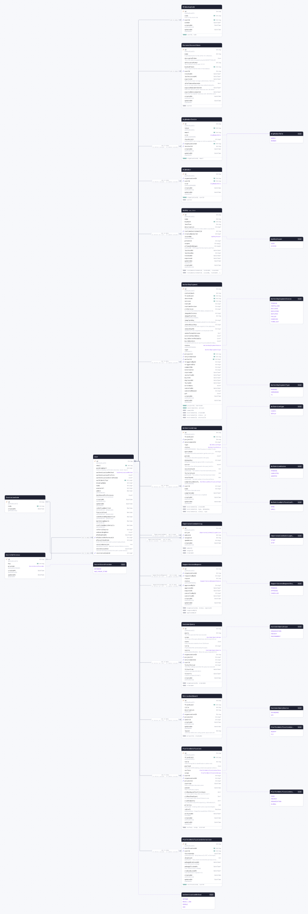

| Field                       | Type                                                 | Constraints                                         | Default      | Description                                                                                                                                                                                                                                                                                                                                                                                                                   |
| --------------------------- | ---------------------------------------------------- | --------------------------------------------------- | ------------ | ----------------------------------------------------------------------------------------------------------------------------------------------------------------------------------------------------------------------------------------------------------------------------------------------------------------------------------------------------------------------------------------------------------------------------- |
| `id`                        | `String`                                             | PK NOT NULL                                         | `cuid(1)`    |                                                                                                                                                                                                                                                                                                                                                                                                                               |
| `email`                     | `String`                                             | UNIQUE NOT NULL                                     |              |                                                                                                                                                                                                                                                                                                                                                                                                                               |
| `pendingEmail`              | `String`                                             | NULL                                                |              | Address awaiting confirmation; becomes `email` only after a link sent to it is opened                                                                                                                                                                                                                                                                                                                                         |
| `authenticationMethod`      | [`AuthenticationMethod`](#enum-AuthenticationMethod) | NOT NULL                                            |              |                                                                                                                                                                                                                                                                                                                                                                                                                               |
| `authenticationProfile`     | `Json`                                               | NULL                                                |              |                                                                                                                                                                                                                                                                                                                                                                                                                               |
| `authenticationExtraParams` | `Json`                                               | NULL                                                |              |                                                                                                                                                                                                                                                                                                                                                                                                                               |
| `authIdentifier`            | `String`                                             | UNIQUE NULL                                         |              |                                                                                                                                                                                                                                                                                                                                                                                                                               |
| `displayName`               | `String`                                             | NULL                                                |              |                                                                                                                                                                                                                                                                                                                                                                                                                               |
| `name`                      | `String`                                             | NULL                                                |              |                                                                                                                                                                                                                                                                                                                                                                                                                               |
| `avatarUrl`                 | `String`                                             | NULL                                                |              |                                                                                                                                                                                                                                                                                                                                                                                                                               |
| `admin`                     | `Boolean`                                            | NOT NULL                                            | `false`      |                                                                                                                                                                                                                                                                                                                                                                                                                               |
| `dashboardPreferences`      | `Json`                                               | NULL                                                |              | Preferences for the dashboard                                                                                                                                                                                                                                                                                                                                                                                                 |
| `createdAt`                 | `DateTime`                                           | NOT NULL                                            | `now()`      |                                                                                                                                                                                                                                                                                                                                                                                                                               |
| `updatedAt`                 | `DateTime`                                           | NOT NULL                                            | `@updatedAt` |                                                                                                                                                                                                                                                                                                                                                                                                                               |
| `isOnCloudWaitlist`         | `Boolean`                                            | NOT NULL                                            | `false`      | @deprecated                                                                                                                                                                                                                                                                                                                                                                                                                   |
| `featureCloud`              | `Boolean`                                            | NOT NULL                                            | `false`      | @deprecated                                                                                                                                                                                                                                                                                                                                                                                                                   |
| `isOnHostedRepoWaitlist`    | `Boolean`                                            | NOT NULL                                            | `false`      | @deprecated                                                                                                                                                                                                                                                                                                                                                                                                                   |
| `marketingEmails`           | `Boolean`                                            | NOT NULL                                            | `true`       |                                                                                                                                                                                                                                                                                                                                                                                                                               |
| `confirmedBasicDetails`     | `Boolean`                                            | NOT NULL                                            | `false`      |                                                                                                                                                                                                                                                                                                                                                                                                                               |
| `referralSource`            | `String`                                             | NULL                                                |              |                                                                                                                                                                                                                                                                                                                                                                                                                               |
| `onboardingData`            | `Json`                                               | NULL                                                |              |                                                                                                                                                                                                                                                                                                                                                                                                                               |
| `mfaEnabledAt`              | `DateTime`                                           | NULL                                                |              |                                                                                                                                                                                                                                                                                                                                                                                                                               |
| `mfaSecretReferenceId`      | `String`                                             | NULL → [SecretReference.id](#model-SecretReference) |              |                                                                                                                                                                                                                                                                                                                                                                                                                               |
| `mfaLastUsedCode`           | `String`                                             | NULL                                                |              | Hash of the last used code to prevent replay attacks                                                                                                                                                                                                                                                                                                                                                                          |
| `sessionDuration`           | `Int`                                                | NOT NULL                                            | `31556952`   | Maximum session lifetime in seconds for this user. Default = 1 year (Gregorian). May be further restricted by Organization.maxSessionDuration on any of the user's orgs.                                                                                                                                                                                                                                                      |
| `nextSessionEnd`            | `DateTime`                                           | NULL                                                |              | Absolute timestamp at which the user's current session must end. Written at login (and any time the effective duration is recomputed) and shortened when an admin lowers an org cap. Read on requireUser / getUser; null is treated as "no enforced deadline" (legacy sessions from before this shipped). Read-on-demand has zero per-request DB cost — the value piggybacks on the User fetch that requireUser already does. |
| `invitationCodeId`          | `String`                                             | NULL → [InvitationCode.id](#model-InvitationCode)   |              |                                                                                                                                                                                                                                                                                                                                                                                                                               |

#### References

- `mfaSecretReferenceId` → [SecretReference.id](#model-SecretReference) (many-to-one)
- `invitationCodeId` → [InvitationCode.id](#model-InvitationCode) (many-to-one)

#### Referenced by

- `id` ← [MfaBackupCode.userId](#model-MfaBackupCode) (one-to-many)
- `id` ← [PersonalAccessToken.userId](#model-PersonalAccessToken) (one-to-many)
- `id` ← [OrgMember.userId](#model-OrgMember) (one-to-many, on delete Cascade, on update Cascade)
- `id` ← [OrgMemberInvite.inviterId](#model-OrgMemberInvite) (one-to-many, on delete Cascade, on update Cascade)
- `id` ← [ApiKey.createdByUserId](#model-ApiKey) (one-to-many, on delete SetNull, on update Cascade)
- `id` ← [WorkerDeployment.triggeredById](#model-WorkerDeployment) (one-to-many, on delete SetNull, on update Cascade)
- `id` ← [BulkActionGroup.userId](#model-BulkActionGroup) (one-to-many, on delete SetNull, on update Cascade)
- `id` ← [ImpersonationAuditLog.adminId](#model-ImpersonationAuditLog) (one-to-many, on delete Cascade, on update Cascade)
- `id` ← [ImpersonationAuditLog.targetId](#model-ImpersonationAuditLog) (one-to-many, on delete Cascade, on update Cascade)
- `id` ← [SupportAccessRequest.requestedById](#model-SupportAccessRequest) (one-to-many, on delete SetNull, on update Cascade)
- `id` ← [SupportAccessRequest.approvedById](#model-SupportAccessRequest) (one-to-many, on delete SetNull, on update Cascade)
- `id` ← [CustomerQuery.userId](#model-CustomerQuery) (one-to-many, on delete SetNull, on update Cascade)
- `id` ← [MetricsDashboard.ownerId](#model-MetricsDashboard) (one-to-many, on delete SetNull, on update Cascade)
- `id` ← [PlatformNotification.userId](#model-PlatformNotification) (one-to-many, on delete Cascade, on update Cascade)
- `id` ← [PlatformNotificationInteraction.userId](#model-PlatformNotificationInteraction) (one-to-many, on delete Cascade, on update Cascade)

#### Definition

```sql
CREATE TABLE "User" (
    "id" TEXT NOT NULL,
    "email" TEXT NOT NULL,
    "pendingEmail" TEXT,
    "authenticationMethod" "AuthenticationMethod" NOT NULL,
    "authenticationProfile" JSONB,
    "authenticationExtraParams" JSONB,
    "authIdentifier" TEXT,
    "displayName" TEXT,
    "name" TEXT,
    "avatarUrl" TEXT,
    "admin" BOOLEAN NOT NULL DEFAULT false,
    "dashboardPreferences" JSONB,
    "createdAt" TIMESTAMP(3) NOT NULL DEFAULT CURRENT_TIMESTAMP,
    "updatedAt" TIMESTAMP(3) NOT NULL,
    "isOnCloudWaitlist" BOOLEAN NOT NULL DEFAULT false,
    "featureCloud" BOOLEAN NOT NULL DEFAULT false,
    "isOnHostedRepoWaitlist" BOOLEAN NOT NULL DEFAULT false,
    "marketingEmails" BOOLEAN NOT NULL DEFAULT true,
    "confirmedBasicDetails" BOOLEAN NOT NULL DEFAULT false,
    "referralSource" TEXT,
    "onboardingData" JSONB,
    "mfaEnabledAt" TIMESTAMP(3),
    "mfaSecretReferenceId" TEXT,
    "mfaLastUsedCode" TEXT,
    "sessionDuration" INTEGER NOT NULL DEFAULT 31556952,
    "nextSessionEnd" TIMESTAMP(3),
    "invitationCodeId" TEXT,

    CONSTRAINT "User_pkey" PRIMARY KEY ("id")
);

CREATE UNIQUE INDEX "User_email_key" ON "User"("email");

CREATE UNIQUE INDEX "User_authIdentifier_key" ON "User"("authIdentifier");

ALTER TABLE "User" ADD CONSTRAINT "User_mfaSecretReferenceId_fkey" FOREIGN KEY ("mfaSecretReferenceId") REFERENCES "SecretReference"("id") ON DELETE SET NULL ON UPDATE CASCADE;

ALTER TABLE "User" ADD CONSTRAINT "User_invitationCodeId_fkey" FOREIGN KEY ("invitationCodeId") REFERENCES "InvitationCode"("id") ON DELETE SET NULL ON UPDATE CASCADE;
```

<details>
<summary>Queries and their SQL</summary>

**findMany**: Every row

```ts
await prisma.user.findMany();
```

```sql
SELECT
  "public"."User"."id",
  "public"."User"."email",
  "public"."User"."pendingEmail",
  "public"."User"."authenticationMethod"::text,
  "public"."User"."authenticationProfile",
  "public"."User"."authenticationExtraParams",
  "public"."User"."authIdentifier",
  "public"."User"."displayName",
  "public"."User"."name",
  "public"."User"."avatarUrl",
  "public"."User"."admin",
  "public"."User"."dashboardPreferences",
  "public"."User"."createdAt",
  "public"."User"."updatedAt",
  "public"."User"."isOnCloudWaitlist",
  "public"."User"."featureCloud",
  "public"."User"."isOnHostedRepoWaitlist",
  "public"."User"."marketingEmails",
  "public"."User"."confirmedBasicDetails",
  "public"."User"."referralSource",
  "public"."User"."onboardingData",
  "public"."User"."mfaEnabledAt",
  "public"."User"."mfaSecretReferenceId",
  "public"."User"."mfaLastUsedCode",
  "public"."User"."sessionDuration",
  "public"."User"."nextSessionEnd",
  "public"."User"."invitationCodeId"
FROM
  "public"."User"
WHERE
  1 = 1
OFFSET
  $1
-- params: ["0"]
```

**count**: How many rows there are

```ts
await prisma.user.count();
```

```sql
SELECT
  COUNT(*) AS "_count$_all"
FROM
  (
    SELECT
      "public"."User"."id"
    FROM
      "public"."User"
    WHERE
      1 = 1
    OFFSET
      $1
  ) AS "sub"
-- params: ["0"]
```

**findMany**: Every row with its relations

```ts
await prisma.user.findMany({
  include: {
    orgMemberships: true,
    sentInvites: true,
    mfaSecretReference: true,
    invitationCode: true,
    personalAccessTokens: true,
    createdApiKeys: true,
    deployments: true,
    backupCodes: true,
    bulkActions: true,
    impersonationsPerformed: true,
    impersonationsReceived: true,
    supportAccessRequestsMade: true,
    supportAccessRequestsApproved: true,
    customerQueries: true,
    metricsDashboards: true,
    platformNotifications: true,
    platformNotificationInteractions: true,
  },
});
```

```sql
SELECT
  "public"."User"."id",
  "public"."User"."email",
  "public"."User"."pendingEmail",
  "public"."User"."authenticationMethod"::text,
  "public"."User"."authenticationProfile",
  "public"."User"."authenticationExtraParams",
  "public"."User"."authIdentifier",
  "public"."User"."displayName",
  "public"."User"."name",
  "public"."User"."avatarUrl",
  "public"."User"."admin",
  "public"."User"."dashboardPreferences",
  "public"."User"."createdAt",
  "public"."User"."updatedAt",
  "public"."User"."isOnCloudWaitlist",
  "public"."User"."featureCloud",
  "public"."User"."isOnHostedRepoWaitlist",
  "public"."User"."marketingEmails",
  "public"."User"."confirmedBasicDetails",
  "public"."User"."referralSource",
  "public"."User"."onboardingData",
  "public"."User"."mfaEnabledAt",
  "public"."User"."mfaSecretReferenceId",
  "public"."User"."mfaLastUsedCode",
  "public"."User"."sessionDuration",
  "public"."User"."nextSessionEnd",
  "public"."User"."invitationCodeId"
FROM
  "public"."User"
WHERE
  1 = 1
OFFSET
  $1
-- params: ["0"]

SELECT
  "public"."OrgMember"."id",
  "public"."OrgMember"."organizationId",
  "public"."OrgMember"."userId",
  "public"."OrgMember"."role"::text,
  "public"."OrgMember"."createdAt",
  "public"."OrgMember"."updatedAt"
FROM
  "public"."OrgMember"
WHERE
  "public"."OrgMember"."userId" IN ($1)
OFFSET
  $2
-- params: ["<id of the rows above>","0"]

SELECT
  "public"."OrgMemberInvite"."id",
  "public"."OrgMemberInvite"."token",
  "public"."OrgMemberInvite"."email",
  "public"."OrgMemberInvite"."role"::text,
  "public"."OrgMemberInvite"."rbacRoleId",
  "public"."OrgMemberInvite"."organizationId",
  "public"."OrgMemberInvite"."inviterId",
  "public"."OrgMemberInvite"."createdAt",
  "public"."OrgMemberInvite"."updatedAt"
FROM
  "public"."OrgMemberInvite"
WHERE
  "public"."OrgMemberInvite"."inviterId" IN ($1)
OFFSET
  $2
-- params: ["<id of the rows above>","0"]

SELECT
  "public"."SecretReference"."id",
  "public"."SecretReference"."key",
  "public"."SecretReference"."provider"::text,
  "public"."SecretReference"."createdAt",
  "public"."SecretReference"."updatedAt"
FROM
  "public"."SecretReference"
WHERE
  "public"."SecretReference"."id" IN ($1)
OFFSET
  $2
-- params: ["<mfaSecretReferenceId of the rows above>","0"]

SELECT
  "public"."InvitationCode"."id",
  "public"."InvitationCode"."code",
  "public"."InvitationCode"."createdAt"
FROM
  "public"."InvitationCode"
WHERE
  "public"."InvitationCode"."id" IN ($1)
OFFSET
  $2
-- params: ["<invitationCodeId of the rows above>","0"]

SELECT
  "public"."PersonalAccessToken"."id",
  "public"."PersonalAccessToken"."name",
  "public"."PersonalAccessToken"."encryptedToken",
  "public"."PersonalAccessToken"."obfuscatedToken",
  "public"."PersonalAccessToken"."hashedToken",
  "public"."PersonalAccessToken"."userId",
  "public"."PersonalAccessToken"."revokedAt",
  "public"."PersonalAccessToken"."lastAccessedAt",
  "public"."PersonalAccessToken"."expiresAt",
  "public"."PersonalAccessToken"."idleTimeoutSeconds",
  "public"."PersonalAccessToken"."expiryReminderSentAt",
  "public"."PersonalAccessToken"."expiredNoticeSentAt",
  "public"."PersonalAccessToken"."createdAt",
  "public"."PersonalAccessToken"."updatedAt"
FROM
  "public"."PersonalAccessToken"
WHERE
  "public"."PersonalAccessToken"."userId" IN ($1)
OFFSET
  $2
-- params: ["<id of the rows above>","0"]

SELECT
  "public"."api_keys"."id",
  "public"."api_keys"."name",
  "public"."api_keys"."key_hash",
  "public"."api_keys"."last_four",
  "public"."api_keys"."description",
  "public"."api_keys"."runtime_environment_id",
  "public"."api_keys"."created_by_user_id",
  "public"."api_keys"."issued_by"::text,
  "public"."api_keys"."preset_id",
  "public"."api_keys"."scopes",
  "public"."api_keys"."allowed_ip_ranges",
  "public"."api_keys"."last_used_at",
  "public"."api_keys"."last_used_ip",
  "public"."api_keys"."revoked_at",
  "public"."api_keys"."expires_at",
  "public"."api_keys"."updated_at",
  "public"."api_keys"."created_at"
FROM
  "public"."api_keys"
WHERE
  "public"."api_keys"."created_by_user_id" IN ($1)
OFFSET
  $2
-- params: ["<id of the rows above>","0"]

SELECT
  "public"."WorkerDeployment"."id",
  "public"."WorkerDeployment"."contentHash",
  "public"."WorkerDeployment"."friendlyId",
  "public"."WorkerDeployment"."shortCode",
  "public"."WorkerDeployment"."version",
  "public"."WorkerDeployment"."runtime",
  "public"."WorkerDeployment"."runtimeVersion",
  "public"."WorkerDeployment"."cliVersion",
  "public"."WorkerDeployment"."imageReference",
  "public"."WorkerDeployment"."imagePlatform",
  "public"."WorkerDeployment"."templateKey",
  "public"."WorkerDeployment"."indexObjectKey",
  "public"."WorkerDeployment"."indexSha256",
  "public"."WorkerDeployment"."indexFormatVersion",
  "public"."WorkerDeployment"."externalBuildData",
  "public"."WorkerDeployment"."buildServerMetadata",
  "public"."WorkerDeployment"."buildEnvVars",
  "public"."WorkerDeployment"."status"::text,
  "public"."WorkerDeployment"."type"::text,
  "public"."WorkerDeployment"."projectId",
  "public"."WorkerDeployment"."environmentId",
  "public"."WorkerDeployment"."workerId",
  "public"."WorkerDeployment"."triggeredById",
  "public"."WorkerDeployment"."triggeredVia",
  "public"."WorkerDeployment"."commitSHA",
  "public"."WorkerDeployment"."externalId",
  "public"."WorkerDeployment"."startedAt",
  "public"."WorkerDeployment"."installedAt",
  "public"."WorkerDeployment"."builtAt",
  "public"."WorkerDeployment"."deployedAt",
  "public"."WorkerDeployment"."failedAt",
  "public"."WorkerDeployment"."errorData",
  "public"."WorkerDeployment"."canceledAt",
  "public"."WorkerDeployment"."canceledReason",
  "public"."WorkerDeployment"."git",
  "public"."WorkerDeployment"."createdAt",
  "public"."WorkerDeployment"."updatedAt"
FROM
  "public"."WorkerDeployment"
WHERE
  "public"."WorkerDeployment"."triggeredById" IN ($1)
OFFSET
  $2
-- params: ["<id of the rows above>","0"]

SELECT
  "public"."MfaBackupCode"."id",
  "public"."MfaBackupCode"."code",
  "public"."MfaBackupCode"."userId",
  "public"."MfaBackupCode"."usedAt",
  "public"."MfaBackupCode"."createdAt",
  "public"."MfaBackupCode"."updatedAt"
FROM
  "public"."MfaBackupCode"
WHERE
  "public"."MfaBackupCode"."userId" IN ($1)
OFFSET
  $2
-- params: ["<id of the rows above>","0"]

SELECT
  "public"."BulkActionGroup"."id",
  "public"."BulkActionGroup"."friendlyId",
  "public"."BulkActionGroup"."projectId",
  "public"."BulkActionGroup"."environmentId",
  "public"."BulkActionGroup"."type"::text,
  "public"."BulkActionGroup"."status"::text,
  "public"."BulkActionGroup"."queryName",
  "public"."BulkActionGroup"."params",
  "public"."BulkActionGroup"."dedupeKey",
  "public"."BulkActionGroup"."cursor",
  "public"."BulkActionGroup"."successCount",
  "public"."BulkActionGroup"."failureCount",
  "public"."BulkActionGroup"."totalCount",
  "public"."BulkActionGroup"."completionNotification"::text,
  "public"."BulkActionGroup"."userId",
  "public"."BulkActionGroup"."name",
  "public"."BulkActionGroup"."completedAt",
  "public"."BulkActionGroup"."createdAt",
  "public"."BulkActionGroup"."updatedAt"
FROM
  "public"."BulkActionGroup"
WHERE
  "public"."BulkActionGroup"."userId" IN ($1)
OFFSET
  $2
-- params: ["<id of the rows above>","0"]

SELECT
  "public"."ImpersonationAuditLog"."id",
  "public"."ImpersonationAuditLog"."action"::text,
  "public"."ImpersonationAuditLog"."adminId",
  "public"."ImpersonationAuditLog"."targetId",
  "public"."ImpersonationAuditLog"."ipAddress",
  "public"."ImpersonationAuditLog"."createdAt"
FROM
  "public"."ImpersonationAuditLog"
WHERE
  "public"."ImpersonationAuditLog"."adminId" IN ($1)
OFFSET
  $2
-- params: ["<id of the rows above>","0"]

SELECT
  "public"."ImpersonationAuditLog"."id",
  "public"."ImpersonationAuditLog"."action"::text,
  "public"."ImpersonationAuditLog"."adminId",
  "public"."ImpersonationAuditLog"."targetId",
  "public"."ImpersonationAuditLog"."ipAddress",
  "public"."ImpersonationAuditLog"."createdAt"
FROM
  "public"."ImpersonationAuditLog"
WHERE
  "public"."ImpersonationAuditLog"."targetId" IN ($1)
OFFSET
  $2
-- params: ["<id of the rows above>","0"]

SELECT
  "public"."SupportAccessRequest"."id",
  "public"."SupportAccessRequest"."organizationId",
  "public"."SupportAccessRequest"."requestedById",
  "public"."SupportAccessRequest"."reason",
  "public"."SupportAccessRequest"."status"::text,
  "public"."SupportAccessRequest"."approvedById",
  "public"."SupportAccessRequest"."approvedAt",
  "public"."SupportAccessRequest"."expiresAt",
  "public"."SupportAccessRequest"."cancelledById",
  "public"."SupportAccessRequest"."cancelledAt",
  "public"."SupportAccessRequest"."createdAt",
  "public"."SupportAccessRequest"."updatedAt"
FROM
  "public"."SupportAccessRequest"
WHERE
  "public"."SupportAccessRequest"."requestedById" IN ($1)
OFFSET
  $2
-- params: ["<id of the rows above>","0"]

SELECT
  "public"."SupportAccessRequest"."id",
  "public"."SupportAccessRequest"."organizationId",
  "public"."SupportAccessRequest"."requestedById",
  "public"."SupportAccessRequest"."reason",
  "public"."SupportAccessRequest"."status"::text,
  "public"."SupportAccessRequest"."approvedById",
  "public"."SupportAccessRequest"."approvedAt",
  "public"."SupportAccessRequest"."expiresAt",
  "public"."SupportAccessRequest"."cancelledById",
  "public"."SupportAccessRequest"."cancelledAt",
  "public"."SupportAccessRequest"."createdAt",
  "public"."SupportAccessRequest"."updatedAt"
FROM
  "public"."SupportAccessRequest"
WHERE
  "public"."SupportAccessRequest"."approvedById" IN ($1)
OFFSET
  $2
-- params: ["<id of the rows above>","0"]

SELECT
  "public"."CustomerQuery"."id",
  "public"."CustomerQuery"."query",
  "public"."CustomerQuery"."scope"::text,
  "public"."CustomerQuery"."stats",
  "public"."CustomerQuery"."title",
  "public"."CustomerQuery"."source"::text,
  "public"."CustomerQuery"."organizationId",
  "public"."CustomerQuery"."projectId",
  "public"."CustomerQuery"."environmentId",
  "public"."CustomerQuery"."userId",
  "public"."CustomerQuery"."filterPeriod",
  "public"."CustomerQuery"."filterFrom",
  "public"."CustomerQuery"."filterTo",
  "public"."CustomerQuery"."createdAt"
FROM
  "public"."CustomerQuery"
WHERE
  "public"."CustomerQuery"."userId" IN ($1)
OFFSET
  $2
-- params: ["<id of the rows above>","0"]

SELECT
  "public"."MetricsDashboard"."id",
  "public"."MetricsDashboard"."friendlyId",
  "public"."MetricsDashboard"."title",
  "public"."MetricsDashboard"."description",
  "public"."MetricsDashboard"."organizationId",
  "public"."MetricsDashboard"."projectId",
  "public"."MetricsDashboard"."ownerId",
  "public"."MetricsDashboard"."createdAt",
  "public"."MetricsDashboard"."updatedAt",
  "public"."MetricsDashboard"."layout"
FROM
  "public"."MetricsDashboard"
WHERE
  "public"."MetricsDashboard"."ownerId" IN ($1)
OFFSET
  $2
-- params: ["<id of the rows above>","0"]

SELECT
  "public"."PlatformNotification"."id",
  "public"."PlatformNotification"."friendlyId",
  "public"."PlatformNotification"."title",
  "public"."PlatformNotification"."payload",
  "public"."PlatformNotification"."surface"::text,
  "public"."PlatformNotification"."scope"::text,
  "public"."PlatformNotification"."userId",
  "public"."PlatformNotification"."organizationId",
  "public"."PlatformNotification"."projectId",
  "public"."PlatformNotification"."startsAt",
  "public"."PlatformNotification"."endsAt",
  "public"."PlatformNotification"."cliMaxDaysAfterFirstSeen",
  "public"."PlatformNotification"."cliMaxShowCount",
  "public"."PlatformNotification"."cliShowEvery",
  "public"."PlatformNotification"."priority",
  "public"."PlatformNotification"."isDraft",
  "public"."PlatformNotification"."archivedAt",
  "public"."PlatformNotification"."createdAt",
  "public"."PlatformNotification"."updatedAt"
FROM
  "public"."PlatformNotification"
WHERE
  "public"."PlatformNotification"."userId" IN ($1)
OFFSET
  $2
-- params: ["<id of the rows above>","0"]

SELECT
  "public"."PlatformNotificationInteraction"."id",
  "public"."PlatformNotificationInteraction"."notificationId",
  "public"."PlatformNotificationInteraction"."userId",
  "public"."PlatformNotificationInteraction"."firstSeenAt",
  "public"."PlatformNotificationInteraction"."showCount",
  "public"."PlatformNotificationInteraction"."webappDismissedAt",
  "public"."PlatformNotificationInteraction"."webappClickedAt",
  "public"."PlatformNotificationInteraction"."cliDismissedAt",
  "public"."PlatformNotificationInteraction"."createdAt",
  "public"."PlatformNotificationInteraction"."updatedAt"
FROM
  "public"."PlatformNotificationInteraction"
WHERE
  "public"."PlatformNotificationInteraction"."userId" IN ($1)
OFFSET
  $2
-- params: ["<id of the rows above>","0"]
```

**findUnique**: One row by what is unique to it

```ts
await prisma.user.findUnique({ where: { id: "example" } });
```

```sql
SELECT
  "public"."User"."id",
  "public"."User"."email",
  "public"."User"."pendingEmail",
  "public"."User"."authenticationMethod"::text,
  "public"."User"."authenticationProfile",
  "public"."User"."authenticationExtraParams",
  "public"."User"."authIdentifier",
  "public"."User"."displayName",
  "public"."User"."name",
  "public"."User"."avatarUrl",
  "public"."User"."admin",
  "public"."User"."dashboardPreferences",
  "public"."User"."createdAt",
  "public"."User"."updatedAt",
  "public"."User"."isOnCloudWaitlist",
  "public"."User"."featureCloud",
  "public"."User"."isOnHostedRepoWaitlist",
  "public"."User"."marketingEmails",
  "public"."User"."confirmedBasicDetails",
  "public"."User"."referralSource",
  "public"."User"."onboardingData",
  "public"."User"."mfaEnabledAt",
  "public"."User"."mfaSecretReferenceId",
  "public"."User"."mfaLastUsedCode",
  "public"."User"."sessionDuration",
  "public"."User"."nextSessionEnd",
  "public"."User"."invitationCodeId"
FROM
  "public"."User"
WHERE
  (
    "public"."User"."id" = $1
    AND 1 = 1
  )
LIMIT
  $2
OFFSET
  $3
-- params: ["example","1","0"]
```

**create**: Create a row

```ts
await prisma.user.create({ data: { email: "example", authenticationMethod: "GITHUB" } });
```

```sql
INSERT INTO
  "public"."User" (
    "id",
    "email",
    "authenticationMethod",
    "admin",
    "createdAt",
    "updatedAt",
    "isOnCloudWaitlist",
    "featureCloud",
    "isOnHostedRepoWaitlist",
    "marketingEmails",
    "confirmedBasicDetails",
    "sessionDuration"
  )
VALUES
  (
    $1,
    $2,
    CAST($3::text AS "public"."AuthenticationMethod"),
    $4,
    $5,
    $6,
    $7,
    $8,
    $9,
    $10,
    $11,
    $12
  )
RETURNING
  "public"."User"."id",
  "public"."User"."email",
  "public"."User"."pendingEmail",
  "public"."User"."authenticationMethod"::text,
  "public"."User"."authenticationProfile",
  "public"."User"."authenticationExtraParams",
  "public"."User"."authIdentifier",
  "public"."User"."displayName",
  "public"."User"."name",
  "public"."User"."avatarUrl",
  "public"."User"."admin",
  "public"."User"."dashboardPreferences",
  "public"."User"."createdAt",
  "public"."User"."updatedAt",
  "public"."User"."isOnCloudWaitlist",
  "public"."User"."featureCloud",
  "public"."User"."isOnHostedRepoWaitlist",
  "public"."User"."marketingEmails",
  "public"."User"."confirmedBasicDetails",
  "public"."User"."referralSource",
  "public"."User"."onboardingData",
  "public"."User"."mfaEnabledAt",
  "public"."User"."mfaSecretReferenceId",
  "public"."User"."mfaLastUsedCode",
  "public"."User"."sessionDuration",
  "public"."User"."nextSessionEnd",
  "public"."User"."invitationCodeId"
-- params: ["<cuid(1)>","example","GITHUB",false,"<now()>","<now()>",false,false,false,true,false,"31556952"]
```

**update**: Update a row

```ts
await prisma.user.update({ where: { id: "example" }, data: { email: "example" } });
```

```sql
UPDATE "public"."User"
SET
  "email" = $1,
  "updatedAt" = $2
WHERE
  (
    "public"."User"."id" = $3
    AND 1 = 1
  )
RETURNING
  "public"."User"."id",
  "public"."User"."email",
  "public"."User"."pendingEmail",
  "public"."User"."authenticationMethod"::text,
  "public"."User"."authenticationProfile",
  "public"."User"."authenticationExtraParams",
  "public"."User"."authIdentifier",
  "public"."User"."displayName",
  "public"."User"."name",
  "public"."User"."avatarUrl",
  "public"."User"."admin",
  "public"."User"."dashboardPreferences",
  "public"."User"."createdAt",
  "public"."User"."updatedAt",
  "public"."User"."isOnCloudWaitlist",
  "public"."User"."featureCloud",
  "public"."User"."isOnHostedRepoWaitlist",
  "public"."User"."marketingEmails",
  "public"."User"."confirmedBasicDetails",
  "public"."User"."referralSource",
  "public"."User"."onboardingData",
  "public"."User"."mfaEnabledAt",
  "public"."User"."mfaSecretReferenceId",
  "public"."User"."mfaLastUsedCode",
  "public"."User"."sessionDuration",
  "public"."User"."nextSessionEnd",
  "public"."User"."invitationCodeId"
-- params: ["example",{"prisma__type":"generatorCall","prisma__value":{"name":"now","args":[],"returnType":{"type":"DateTime"}}},"example"]
```

**delete**: Delete a row

```ts
await prisma.user.delete({ where: { id: "example" } });
```

```sql
DELETE FROM "public"."User"
WHERE
  (
    "public"."User"."id" = $1
    AND 1 = 1
  )
RETURNING
  "public"."User"."id",
  "public"."User"."email",
  "public"."User"."pendingEmail",
  "public"."User"."authenticationMethod"::text,
  "public"."User"."authenticationProfile",
  "public"."User"."authenticationExtraParams",
  "public"."User"."authIdentifier",
  "public"."User"."displayName",
  "public"."User"."name",
  "public"."User"."avatarUrl",
  "public"."User"."admin",
  "public"."User"."dashboardPreferences",
  "public"."User"."createdAt",
  "public"."User"."updatedAt",
  "public"."User"."isOnCloudWaitlist",
  "public"."User"."featureCloud",
  "public"."User"."isOnHostedRepoWaitlist",
  "public"."User"."marketingEmails",
  "public"."User"."confirmedBasicDetails",
  "public"."User"."referralSource",
  "public"."User"."onboardingData",
  "public"."User"."mfaEnabledAt",
  "public"."User"."mfaSecretReferenceId",
  "public"."User"."mfaLastUsedCode",
  "public"."User"."sessionDuration",
  "public"."User"."nextSessionEnd",
  "public"."User"."invitationCodeId"
-- params: ["example"]
```

</details>

<a id="model-MfaBackupCode"></a>

### MfaBackupCode

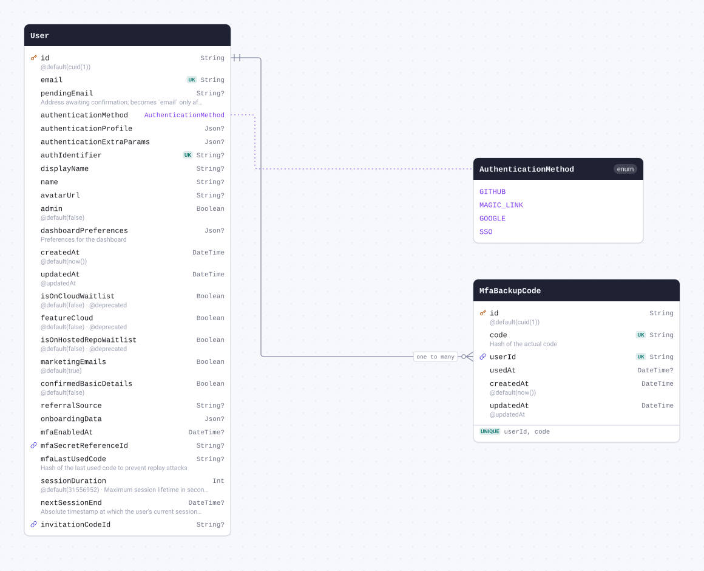

| Field       | Type       | Constraints                       | Default      | Description             |
| ----------- | ---------- | --------------------------------- | ------------ | ----------------------- |
| `id`        | `String`   | PK NOT NULL                       | `cuid(1)`    |                         |
| `code`      | `String`   | NOT NULL                          |              | Hash of the actual code |
| `userId`    | `String`   | NOT NULL → [User.id](#model-User) |              |                         |
| `usedAt`    | `DateTime` | NULL                              |              |                         |
| `createdAt` | `DateTime` | NOT NULL                          | `now()`      |                         |
| `updatedAt` | `DateTime` | NOT NULL                          | `@updatedAt` |                         |

#### Indexes

- `@@unique([userId, code])`

#### References

- `userId` → [User.id](#model-User) (many-to-one)

#### Definition

```sql
CREATE TABLE "MfaBackupCode" (
    "id" TEXT NOT NULL,
    "code" TEXT NOT NULL,
    "userId" TEXT NOT NULL,
    "usedAt" TIMESTAMP(3),
    "createdAt" TIMESTAMP(3) NOT NULL DEFAULT CURRENT_TIMESTAMP,
    "updatedAt" TIMESTAMP(3) NOT NULL,

    CONSTRAINT "MfaBackupCode_pkey" PRIMARY KEY ("id")
);

CREATE UNIQUE INDEX "MfaBackupCode_userId_code_key" ON "MfaBackupCode"("userId", "code");

ALTER TABLE "MfaBackupCode" ADD CONSTRAINT "MfaBackupCode_userId_fkey" FOREIGN KEY ("userId") REFERENCES "User"("id") ON DELETE RESTRICT ON UPDATE CASCADE;
```

<details>
<summary>Queries and their SQL</summary>

**findMany**: Every row

```ts
await prisma.mfaBackupCode.findMany();
```

```sql
SELECT
  "public"."MfaBackupCode"."id",
  "public"."MfaBackupCode"."code",
  "public"."MfaBackupCode"."userId",
  "public"."MfaBackupCode"."usedAt",
  "public"."MfaBackupCode"."createdAt",
  "public"."MfaBackupCode"."updatedAt"
FROM
  "public"."MfaBackupCode"
WHERE
  1 = 1
OFFSET
  $1
-- params: ["0"]
```

**count**: How many rows there are

```ts
await prisma.mfaBackupCode.count();
```

```sql
SELECT
  COUNT(*) AS "_count$_all"
FROM
  (
    SELECT
      "public"."MfaBackupCode"."id"
    FROM
      "public"."MfaBackupCode"
    WHERE
      1 = 1
    OFFSET
      $1
  ) AS "sub"
-- params: ["0"]
```

**findMany**: Every row with its relations

```ts
await prisma.mfaBackupCode.findMany({ include: { user: true } });
```

```sql
SELECT
  "public"."MfaBackupCode"."id",
  "public"."MfaBackupCode"."code",
  "public"."MfaBackupCode"."userId",
  "public"."MfaBackupCode"."usedAt",
  "public"."MfaBackupCode"."createdAt",
  "public"."MfaBackupCode"."updatedAt"
FROM
  "public"."MfaBackupCode"
WHERE
  1 = 1
OFFSET
  $1
-- params: ["0"]

SELECT
  "public"."User"."id",
  "public"."User"."email",
  "public"."User"."pendingEmail",
  "public"."User"."authenticationMethod"::text,
  "public"."User"."authenticationProfile",
  "public"."User"."authenticationExtraParams",
  "public"."User"."authIdentifier",
  "public"."User"."displayName",
  "public"."User"."name",
  "public"."User"."avatarUrl",
  "public"."User"."admin",
  "public"."User"."dashboardPreferences",
  "public"."User"."createdAt",
  "public"."User"."updatedAt",
  "public"."User"."isOnCloudWaitlist",
  "public"."User"."featureCloud",
  "public"."User"."isOnHostedRepoWaitlist",
  "public"."User"."marketingEmails",
  "public"."User"."confirmedBasicDetails",
  "public"."User"."referralSource",
  "public"."User"."onboardingData",
  "public"."User"."mfaEnabledAt",
  "public"."User"."mfaSecretReferenceId",
  "public"."User"."mfaLastUsedCode",
  "public"."User"."sessionDuration",
  "public"."User"."nextSessionEnd",
  "public"."User"."invitationCodeId"
FROM
  "public"."User"
WHERE
  "public"."User"."id" IN ($1)
OFFSET
  $2
-- params: ["<userId of the rows above>","0"]
```

**findUnique**: One row by what is unique to it

```ts
await prisma.mfaBackupCode.findUnique({ where: { id: "example" } });
```

```sql
SELECT
  "public"."MfaBackupCode"."id",
  "public"."MfaBackupCode"."code",
  "public"."MfaBackupCode"."userId",
  "public"."MfaBackupCode"."usedAt",
  "public"."MfaBackupCode"."createdAt",
  "public"."MfaBackupCode"."updatedAt"
FROM
  "public"."MfaBackupCode"
WHERE
  (
    "public"."MfaBackupCode"."id" = $1
    AND 1 = 1
  )
LIMIT
  $2
OFFSET
  $3
-- params: ["example","1","0"]
```

**create**: Create a row

```ts
await prisma.mfaBackupCode.create({ data: { code: "example", userId: "example" } });
```

```sql
INSERT INTO
  "public"."MfaBackupCode" ("id", "code", "userId", "createdAt", "updatedAt")
VALUES
  ($1, $2, $3, $4, $5)
RETURNING
  "public"."MfaBackupCode"."id",
  "public"."MfaBackupCode"."code",
  "public"."MfaBackupCode"."userId",
  "public"."MfaBackupCode"."usedAt",
  "public"."MfaBackupCode"."createdAt",
  "public"."MfaBackupCode"."updatedAt"
-- params: ["<cuid(1)>","example","example","<now()>","<now()>"]
```

**update**: Update a row

```ts
await prisma.mfaBackupCode.update({ where: { id: "example" }, data: { code: "example" } });
```

```sql
UPDATE "public"."MfaBackupCode"
SET
  "code" = $1,
  "updatedAt" = $2
WHERE
  (
    "public"."MfaBackupCode"."id" = $3
    AND 1 = 1
  )
RETURNING
  "public"."MfaBackupCode"."id",
  "public"."MfaBackupCode"."code",
  "public"."MfaBackupCode"."userId",
  "public"."MfaBackupCode"."usedAt",
  "public"."MfaBackupCode"."createdAt",
  "public"."MfaBackupCode"."updatedAt"
-- params: ["example",{"prisma__type":"generatorCall","prisma__value":{"name":"now","args":[],"returnType":{"type":"DateTime"}}},"example"]
```

**delete**: Delete a row

```ts
await prisma.mfaBackupCode.delete({ where: { id: "example" } });
```

```sql
DELETE FROM "public"."MfaBackupCode"
WHERE
  (
    "public"."MfaBackupCode"."id" = $1
    AND 1 = 1
  )
RETURNING
  "public"."MfaBackupCode"."id",
  "public"."MfaBackupCode"."code",
  "public"."MfaBackupCode"."userId",
  "public"."MfaBackupCode"."usedAt",
  "public"."MfaBackupCode"."createdAt",
  "public"."MfaBackupCode"."updatedAt"
-- params: ["example"]
```

</details>

<a id="model-InvitationCode"></a>

### InvitationCode

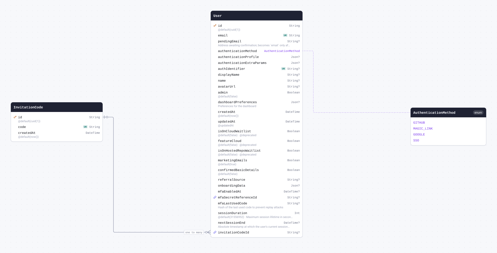

| Field       | Type       | Constraints     | Default   | Description |
| ----------- | ---------- | --------------- | --------- | ----------- |
| `id`        | `String`   | PK NOT NULL     | `cuid(1)` |             |
| `code`      | `String`   | UNIQUE NOT NULL |           |             |
| `createdAt` | `DateTime` | NOT NULL        | `now()`   |             |

#### Referenced by

- `id` ← [User.invitationCodeId](#model-User) (one-to-many)

#### Definition

```sql
CREATE TABLE "InvitationCode" (
    "id" TEXT NOT NULL,
    "code" TEXT NOT NULL,
    "createdAt" TIMESTAMP(3) NOT NULL DEFAULT CURRENT_TIMESTAMP,

    CONSTRAINT "InvitationCode_pkey" PRIMARY KEY ("id")
);

CREATE UNIQUE INDEX "InvitationCode_code_key" ON "InvitationCode"("code");
```

<details>
<summary>Queries and their SQL</summary>

**findMany**: Every row

```ts
await prisma.invitationCode.findMany();
```

```sql
SELECT
  "public"."InvitationCode"."id",
  "public"."InvitationCode"."code",
  "public"."InvitationCode"."createdAt"
FROM
  "public"."InvitationCode"
WHERE
  1 = 1
OFFSET
  $1
-- params: ["0"]
```

**count**: How many rows there are

```ts
await prisma.invitationCode.count();
```

```sql
SELECT
  COUNT(*) AS "_count$_all"
FROM
  (
    SELECT
      "public"."InvitationCode"."id"
    FROM
      "public"."InvitationCode"
    WHERE
      1 = 1
    OFFSET
      $1
  ) AS "sub"
-- params: ["0"]
```

**findMany**: Every row with its relations

```ts
await prisma.invitationCode.findMany({ include: { users: true } });
```

```sql
SELECT
  "public"."InvitationCode"."id",
  "public"."InvitationCode"."code",
  "public"."InvitationCode"."createdAt"
FROM
  "public"."InvitationCode"
WHERE
  1 = 1
OFFSET
  $1
-- params: ["0"]

SELECT
  "public"."User"."id",
  "public"."User"."email",
  "public"."User"."pendingEmail",
  "public"."User"."authenticationMethod"::text,
  "public"."User"."authenticationProfile",
  "public"."User"."authenticationExtraParams",
  "public"."User"."authIdentifier",
  "public"."User"."displayName",
  "public"."User"."name",
  "public"."User"."avatarUrl",
  "public"."User"."admin",
  "public"."User"."dashboardPreferences",
  "public"."User"."createdAt",
  "public"."User"."updatedAt",
  "public"."User"."isOnCloudWaitlist",
  "public"."User"."featureCloud",
  "public"."User"."isOnHostedRepoWaitlist",
  "public"."User"."marketingEmails",
  "public"."User"."confirmedBasicDetails",
  "public"."User"."referralSource",
  "public"."User"."onboardingData",
  "public"."User"."mfaEnabledAt",
  "public"."User"."mfaSecretReferenceId",
  "public"."User"."mfaLastUsedCode",
  "public"."User"."sessionDuration",
  "public"."User"."nextSessionEnd",
  "public"."User"."invitationCodeId"
FROM
  "public"."User"
WHERE
  "public"."User"."invitationCodeId" IN ($1)
OFFSET
  $2
-- params: ["<id of the rows above>","0"]
```

**findUnique**: One row by what is unique to it

```ts
await prisma.invitationCode.findUnique({ where: { id: "example" } });
```

```sql
SELECT
  "public"."InvitationCode"."id",
  "public"."InvitationCode"."code",
  "public"."InvitationCode"."createdAt"
FROM
  "public"."InvitationCode"
WHERE
  (
    "public"."InvitationCode"."id" = $1
    AND 1 = 1
  )
LIMIT
  $2
OFFSET
  $3
-- params: ["example","1","0"]
```

**create**: Create a row

```ts
await prisma.invitationCode.create({ data: { code: "example" } });
```

```sql
INSERT INTO
  "public"."InvitationCode" ("id", "code", "createdAt")
VALUES
  ($1, $2, $3)
RETURNING
  "public"."InvitationCode"."id",
  "public"."InvitationCode"."code",
  "public"."InvitationCode"."createdAt"
-- params: ["<cuid(1)>","example","<now()>"]
```

**update**: Update a row

```ts
await prisma.invitationCode.update({ where: { id: "example" }, data: { code: "example" } });
```

```sql
UPDATE "public"."InvitationCode"
SET
  "code" = $1
WHERE
  (
    "public"."InvitationCode"."id" = $2
    AND 1 = 1
  )
RETURNING
  "public"."InvitationCode"."id",
  "public"."InvitationCode"."code",
  "public"."InvitationCode"."createdAt"
-- params: ["example","example"]
```

**delete**: Delete a row

```ts
await prisma.invitationCode.delete({ where: { id: "example" } });
```

```sql
DELETE FROM "public"."InvitationCode"
WHERE
  (
    "public"."InvitationCode"."id" = $1
    AND 1 = 1
  )
RETURNING
  "public"."InvitationCode"."id",
  "public"."InvitationCode"."code",
  "public"."InvitationCode"."createdAt"
-- params: ["example"]
```

</details>

<a id="model-AuthorizationCode"></a>

### AuthorizationCode

Used to generate PersonalAccessTokens, they're one-time use

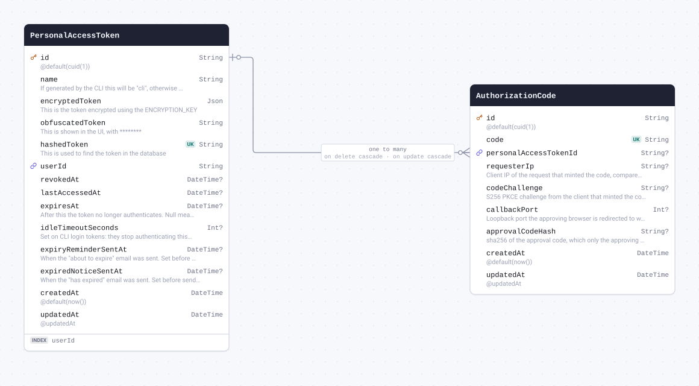

| Field                   | Type       | Constraints                                                 | Default      | Description                                                                                                                     |
| ----------------------- | ---------- | ----------------------------------------------------------- | ------------ | ------------------------------------------------------------------------------------------------------------------------------- |
| `id`                    | `String`   | PK NOT NULL                                                 | `cuid(1)`    |                                                                                                                                 |
| `code`                  | `String`   | UNIQUE NOT NULL                                             |              |                                                                                                                                 |
| `personalAccessTokenId` | `String`   | NULL → [PersonalAccessToken.id](#model-PersonalAccessToken) |              |                                                                                                                                 |
| `requesterIp`           | `String`   | NULL                                                        |              | Client IP of the request that minted the code, compared with the approving browser's IP. Deleted with the code once it expires. |
| `codeChallenge`         | `String`   | NULL                                                        |              | S256 PKCE challenge from the client that minted the code. Null for codes minted by CLIs that predate it.                        |
| `callbackPort`          | `Int`      | NULL                                                        |              | Loopback port the approving browser is redirected to with the approval code. Null means the user pastes it.                     |
| `approvalCodeHash`      | `String`   | NULL                                                        |              | sha256 of the approval code, which only the approving browser ever sees.                                                        |
| `createdAt`             | `DateTime` | NOT NULL                                                    | `now()`      |                                                                                                                                 |
| `updatedAt`             | `DateTime` | NOT NULL                                                    | `@updatedAt` |                                                                                                                                 |

#### References

- `personalAccessTokenId` → [PersonalAccessToken.id](#model-PersonalAccessToken) (many-to-one, on delete Cascade, on update Cascade)

#### Definition

```sql
CREATE TABLE "AuthorizationCode" (
    "id" TEXT NOT NULL,
    "code" TEXT NOT NULL,
    "personalAccessTokenId" TEXT,
    "requesterIp" TEXT,
    "codeChallenge" TEXT,
    "callbackPort" INTEGER,
    "approvalCodeHash" TEXT,
    "createdAt" TIMESTAMP(3) NOT NULL DEFAULT CURRENT_TIMESTAMP,
    "updatedAt" TIMESTAMP(3) NOT NULL,

    CONSTRAINT "AuthorizationCode_pkey" PRIMARY KEY ("id")
);

CREATE UNIQUE INDEX "AuthorizationCode_code_key" ON "AuthorizationCode"("code");

ALTER TABLE "AuthorizationCode" ADD CONSTRAINT "AuthorizationCode_personalAccessTokenId_fkey" FOREIGN KEY ("personalAccessTokenId") REFERENCES "PersonalAccessToken"("id") ON DELETE CASCADE ON UPDATE CASCADE;
```

<details>
<summary>Queries and their SQL</summary>

**findMany**: Every row

```ts
await prisma.authorizationCode.findMany();
```

```sql
SELECT
  "public"."AuthorizationCode"."id",
  "public"."AuthorizationCode"."code",
  "public"."AuthorizationCode"."personalAccessTokenId",
  "public"."AuthorizationCode"."requesterIp",
  "public"."AuthorizationCode"."codeChallenge",
  "public"."AuthorizationCode"."callbackPort",
  "public"."AuthorizationCode"."approvalCodeHash",
  "public"."AuthorizationCode"."createdAt",
  "public"."AuthorizationCode"."updatedAt"
FROM
  "public"."AuthorizationCode"
WHERE
  1 = 1
OFFSET
  $1
-- params: ["0"]
```

**count**: How many rows there are

```ts
await prisma.authorizationCode.count();
```

```sql
SELECT
  COUNT(*) AS "_count$_all"
FROM
  (
    SELECT
      "public"."AuthorizationCode"."id"
    FROM
      "public"."AuthorizationCode"
    WHERE
      1 = 1
    OFFSET
      $1
  ) AS "sub"
-- params: ["0"]
```

**findMany**: Every row with its relations

```ts
await prisma.authorizationCode.findMany({ include: { personalAccessToken: true } });
```

```sql
SELECT
  "public"."AuthorizationCode"."id",
  "public"."AuthorizationCode"."code",
  "public"."AuthorizationCode"."personalAccessTokenId",
  "public"."AuthorizationCode"."requesterIp",
  "public"."AuthorizationCode"."codeChallenge",
  "public"."AuthorizationCode"."callbackPort",
  "public"."AuthorizationCode"."approvalCodeHash",
  "public"."AuthorizationCode"."createdAt",
  "public"."AuthorizationCode"."updatedAt"
FROM
  "public"."AuthorizationCode"
WHERE
  1 = 1
OFFSET
  $1
-- params: ["0"]

SELECT
  "public"."PersonalAccessToken"."id",
  "public"."PersonalAccessToken"."name",
  "public"."PersonalAccessToken"."encryptedToken",
  "public"."PersonalAccessToken"."obfuscatedToken",
  "public"."PersonalAccessToken"."hashedToken",
  "public"."PersonalAccessToken"."userId",
  "public"."PersonalAccessToken"."revokedAt",
  "public"."PersonalAccessToken"."lastAccessedAt",
  "public"."PersonalAccessToken"."expiresAt",
  "public"."PersonalAccessToken"."idleTimeoutSeconds",
  "public"."PersonalAccessToken"."expiryReminderSentAt",
  "public"."PersonalAccessToken"."expiredNoticeSentAt",
  "public"."PersonalAccessToken"."createdAt",
  "public"."PersonalAccessToken"."updatedAt"
FROM
  "public"."PersonalAccessToken"
WHERE
  "public"."PersonalAccessToken"."id" IN ($1)
OFFSET
  $2
-- params: ["<personalAccessTokenId of the rows above>","0"]
```

**findUnique**: One row by what is unique to it

```ts
await prisma.authorizationCode.findUnique({ where: { id: "example" } });
```

```sql
SELECT
  "public"."AuthorizationCode"."id",
  "public"."AuthorizationCode"."code",
  "public"."AuthorizationCode"."personalAccessTokenId",
  "public"."AuthorizationCode"."requesterIp",
  "public"."AuthorizationCode"."codeChallenge",
  "public"."AuthorizationCode"."callbackPort",
  "public"."AuthorizationCode"."approvalCodeHash",
  "public"."AuthorizationCode"."createdAt",
  "public"."AuthorizationCode"."updatedAt"
FROM
  "public"."AuthorizationCode"
WHERE
  (
    "public"."AuthorizationCode"."id" = $1
    AND 1 = 1
  )
LIMIT
  $2
OFFSET
  $3
-- params: ["example","1","0"]
```

**create**: Create a row

```ts
await prisma.authorizationCode.create({ data: { code: "example" } });
```

```sql
INSERT INTO
  "public"."AuthorizationCode" ("id", "code", "createdAt", "updatedAt")
VALUES
  ($1, $2, $3, $4)
RETURNING
  "public"."AuthorizationCode"."id",
  "public"."AuthorizationCode"."code",
  "public"."AuthorizationCode"."personalAccessTokenId",
  "public"."AuthorizationCode"."requesterIp",
  "public"."AuthorizationCode"."codeChallenge",
  "public"."AuthorizationCode"."callbackPort",
  "public"."AuthorizationCode"."approvalCodeHash",
  "public"."AuthorizationCode"."createdAt",
  "public"."AuthorizationCode"."updatedAt"
-- params: ["<cuid(1)>","example","<now()>","<now()>"]
```

**update**: Update a row

```ts
await prisma.authorizationCode.update({ where: { id: "example" }, data: { code: "example" } });
```

```sql
UPDATE "public"."AuthorizationCode"
SET
  "code" = $1,
  "updatedAt" = $2
WHERE
  (
    "public"."AuthorizationCode"."id" = $3
    AND 1 = 1
  )
RETURNING
  "public"."AuthorizationCode"."id",
  "public"."AuthorizationCode"."code",
  "public"."AuthorizationCode"."personalAccessTokenId",
  "public"."AuthorizationCode"."requesterIp",
  "public"."AuthorizationCode"."codeChallenge",
  "public"."AuthorizationCode"."callbackPort",
  "public"."AuthorizationCode"."approvalCodeHash",
  "public"."AuthorizationCode"."createdAt",
  "public"."AuthorizationCode"."updatedAt"
-- params: ["example",{"prisma__type":"generatorCall","prisma__value":{"name":"now","args":[],"returnType":{"type":"DateTime"}}},"example"]
```

**delete**: Delete a row

```ts
await prisma.authorizationCode.delete({ where: { id: "example" } });
```

```sql
DELETE FROM "public"."AuthorizationCode"
WHERE
  (
    "public"."AuthorizationCode"."id" = $1
    AND 1 = 1
  )
RETURNING
  "public"."AuthorizationCode"."id",
  "public"."AuthorizationCode"."code",
  "public"."AuthorizationCode"."personalAccessTokenId",
  "public"."AuthorizationCode"."requesterIp",
  "public"."AuthorizationCode"."codeChallenge",
  "public"."AuthorizationCode"."callbackPort",
  "public"."AuthorizationCode"."approvalCodeHash",
  "public"."AuthorizationCode"."createdAt",
  "public"."AuthorizationCode"."updatedAt"
-- params: ["example"]
```

</details>

<a id="model-PersonalAccessToken"></a>

### PersonalAccessToken

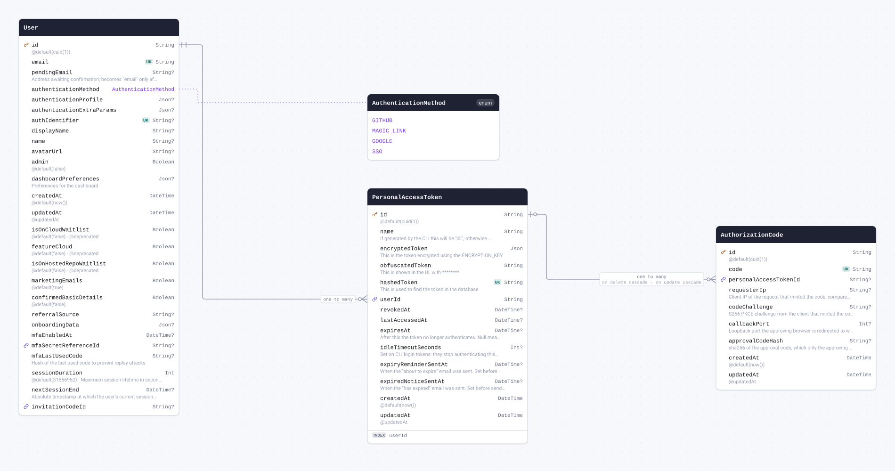

| Field                  | Type       | Constraints                       | Default      | Description                                                                                                                                      |
| ---------------------- | ---------- | --------------------------------- | ------------ | ------------------------------------------------------------------------------------------------------------------------------------------------ |
| `id`                   | `String`   | PK NOT NULL                       | `cuid(1)`    |                                                                                                                                                  |
| `name`                 | `String`   | NOT NULL                          |              | If generated by the CLI this will be "cli", otherwise user-provided                                                                              |
| `encryptedToken`       | `Json`     | NOT NULL                          |              | This is the token encrypted using the ENCRYPTION_KEY                                                                                             |
| `obfuscatedToken`      | `String`   | NOT NULL                          |              | This is shown in the UI, with ********                                                                                                           |
| `hashedToken`          | `String`   | UNIQUE NOT NULL                   |              | This is used to find the token in the database                                                                                                   |
| `userId`               | `String`   | NOT NULL → [User.id](#model-User) |              |                                                                                                                                                  |
| `revokedAt`            | `DateTime` | NULL                              |              |                                                                                                                                                  |
| `lastAccessedAt`       | `DateTime` | NULL                              |              |                                                                                                                                                  |
| `expiresAt`            | `DateTime` | NULL                              |              | After this the token no longer authenticates. Null means it never expires.                                                                       |
| `idleTimeoutSeconds`   | `Int`      | NULL                              |              | Set on CLI login tokens: they stop authenticating this many seconds after their last use (or creation, if never used). Null means no idle limit. |
| `expiryReminderSentAt` | `DateTime` | NULL                              |              | When the "about to expire" email was sent. Set before sending, so it's sent at most once.                                                        |
| `expiredNoticeSentAt`  | `DateTime` | NULL                              |              | When the "has expired" email was sent. Set before sending, so it's sent at most once.                                                            |
| `createdAt`            | `DateTime` | NOT NULL                          | `now()`      |                                                                                                                                                  |
| `updatedAt`            | `DateTime` | NOT NULL                          | `@updatedAt` |                                                                                                                                                  |

#### Indexes

- `@@index([userId])`

#### References

- `userId` → [User.id](#model-User) (many-to-one)

#### Referenced by

- `id` ← [AuthorizationCode.personalAccessTokenId](#model-AuthorizationCode) (one-to-many, on delete Cascade, on update Cascade)

#### Definition

```sql
CREATE TABLE "PersonalAccessToken" (
    "id" TEXT NOT NULL,
    "name" TEXT NOT NULL,
    "encryptedToken" JSONB NOT NULL,
    "obfuscatedToken" TEXT NOT NULL,
    "hashedToken" TEXT NOT NULL,
    "userId" TEXT NOT NULL,
    "revokedAt" TIMESTAMP(3),
    "lastAccessedAt" TIMESTAMP(3),
    "expiresAt" TIMESTAMP(3),
    "idleTimeoutSeconds" INTEGER,
    "expiryReminderSentAt" TIMESTAMP(3),
    "expiredNoticeSentAt" TIMESTAMP(3),
    "createdAt" TIMESTAMP(3) NOT NULL DEFAULT CURRENT_TIMESTAMP,
    "updatedAt" TIMESTAMP(3) NOT NULL,

    CONSTRAINT "PersonalAccessToken_pkey" PRIMARY KEY ("id")
);

CREATE UNIQUE INDEX "PersonalAccessToken_hashedToken_key" ON "PersonalAccessToken"("hashedToken");

CREATE INDEX "PersonalAccessToken_userId_idx" ON "PersonalAccessToken"("userId");

ALTER TABLE "PersonalAccessToken" ADD CONSTRAINT "PersonalAccessToken_userId_fkey" FOREIGN KEY ("userId") REFERENCES "User"("id") ON DELETE RESTRICT ON UPDATE CASCADE;
```

<details>
<summary>Queries and their SQL</summary>

**findMany**: Every row

```ts
await prisma.personalAccessToken.findMany();
```

```sql
SELECT
  "public"."PersonalAccessToken"."id",
  "public"."PersonalAccessToken"."name",
  "public"."PersonalAccessToken"."encryptedToken",
  "public"."PersonalAccessToken"."obfuscatedToken",
  "public"."PersonalAccessToken"."hashedToken",
  "public"."PersonalAccessToken"."userId",
  "public"."PersonalAccessToken"."revokedAt",
  "public"."PersonalAccessToken"."lastAccessedAt",
  "public"."PersonalAccessToken"."expiresAt",
  "public"."PersonalAccessToken"."idleTimeoutSeconds",
  "public"."PersonalAccessToken"."expiryReminderSentAt",
  "public"."PersonalAccessToken"."expiredNoticeSentAt",
  "public"."PersonalAccessToken"."createdAt",
  "public"."PersonalAccessToken"."updatedAt"
FROM
  "public"."PersonalAccessToken"
WHERE
  1 = 1
OFFSET
  $1
-- params: ["0"]
```

**count**: How many rows there are

```ts
await prisma.personalAccessToken.count();
```

```sql
SELECT
  COUNT(*) AS "_count$_all"
FROM
  (
    SELECT
      "public"."PersonalAccessToken"."id"
    FROM
      "public"."PersonalAccessToken"
    WHERE
      1 = 1
    OFFSET
      $1
  ) AS "sub"
-- params: ["0"]
```

**findMany**: Every row with its relations

```ts
await prisma.personalAccessToken.findMany({ include: { user: true, authorizationCodes: true } });
```

```sql
SELECT
  "public"."PersonalAccessToken"."id",
  "public"."PersonalAccessToken"."name",
  "public"."PersonalAccessToken"."encryptedToken",
  "public"."PersonalAccessToken"."obfuscatedToken",
  "public"."PersonalAccessToken"."hashedToken",
  "public"."PersonalAccessToken"."userId",
  "public"."PersonalAccessToken"."revokedAt",
  "public"."PersonalAccessToken"."lastAccessedAt",
  "public"."PersonalAccessToken"."expiresAt",
  "public"."PersonalAccessToken"."idleTimeoutSeconds",
  "public"."PersonalAccessToken"."expiryReminderSentAt",
  "public"."PersonalAccessToken"."expiredNoticeSentAt",
  "public"."PersonalAccessToken"."createdAt",
  "public"."PersonalAccessToken"."updatedAt"
FROM
  "public"."PersonalAccessToken"
WHERE
  1 = 1
OFFSET
  $1
-- params: ["0"]

SELECT
  "public"."User"."id",
  "public"."User"."email",
  "public"."User"."pendingEmail",
  "public"."User"."authenticationMethod"::text,
  "public"."User"."authenticationProfile",
  "public"."User"."authenticationExtraParams",
  "public"."User"."authIdentifier",
  "public"."User"."displayName",
  "public"."User"."name",
  "public"."User"."avatarUrl",
  "public"."User"."admin",
  "public"."User"."dashboardPreferences",
  "public"."User"."createdAt",
  "public"."User"."updatedAt",
  "public"."User"."isOnCloudWaitlist",
  "public"."User"."featureCloud",
  "public"."User"."isOnHostedRepoWaitlist",
  "public"."User"."marketingEmails",
  "public"."User"."confirmedBasicDetails",
  "public"."User"."referralSource",
  "public"."User"."onboardingData",
  "public"."User"."mfaEnabledAt",
  "public"."User"."mfaSecretReferenceId",
  "public"."User"."mfaLastUsedCode",
  "public"."User"."sessionDuration",
  "public"."User"."nextSessionEnd",
  "public"."User"."invitationCodeId"
FROM
  "public"."User"
WHERE
  "public"."User"."id" IN ($1)
OFFSET
  $2
-- params: ["<userId of the rows above>","0"]

SELECT
  "public"."AuthorizationCode"."id",
  "public"."AuthorizationCode"."code",
  "public"."AuthorizationCode"."personalAccessTokenId",
  "public"."AuthorizationCode"."requesterIp",
  "public"."AuthorizationCode"."codeChallenge",
  "public"."AuthorizationCode"."callbackPort",
  "public"."AuthorizationCode"."approvalCodeHash",
  "public"."AuthorizationCode"."createdAt",
  "public"."AuthorizationCode"."updatedAt"
FROM
  "public"."AuthorizationCode"
WHERE
  "public"."AuthorizationCode"."personalAccessTokenId" IN ($1)
OFFSET
  $2
-- params: ["<id of the rows above>","0"]
```

**findUnique**: One row by what is unique to it

```ts
await prisma.personalAccessToken.findUnique({ where: { id: "example" } });
```

```sql
SELECT
  "public"."PersonalAccessToken"."id",
  "public"."PersonalAccessToken"."name",
  "public"."PersonalAccessToken"."encryptedToken",
  "public"."PersonalAccessToken"."obfuscatedToken",
  "public"."PersonalAccessToken"."hashedToken",
  "public"."PersonalAccessToken"."userId",
  "public"."PersonalAccessToken"."revokedAt",
  "public"."PersonalAccessToken"."lastAccessedAt",
  "public"."PersonalAccessToken"."expiresAt",
  "public"."PersonalAccessToken"."idleTimeoutSeconds",
  "public"."PersonalAccessToken"."expiryReminderSentAt",
  "public"."PersonalAccessToken"."expiredNoticeSentAt",
  "public"."PersonalAccessToken"."createdAt",
  "public"."PersonalAccessToken"."updatedAt"
FROM
  "public"."PersonalAccessToken"
WHERE
  (
    "public"."PersonalAccessToken"."id" = $1
    AND 1 = 1
  )
LIMIT
  $2
OFFSET
  $3
-- params: ["example","1","0"]
```

**create**: Create a row

```ts
await prisma.personalAccessToken.create({
  data: {
    name: "example",
    encryptedToken: {},
    obfuscatedToken: "example",
    hashedToken: "example",
    userId: "example",
  },
});
```

```sql
INSERT INTO
  "public"."PersonalAccessToken" (
    "id",
    "name",
    "encryptedToken",
    "obfuscatedToken",
    "hashedToken",
    "userId",
    "createdAt",
    "updatedAt"
  )
VALUES
  ($1, $2, $3, $4, $5, $6, $7, $8)
RETURNING
  "public"."PersonalAccessToken"."id",
  "public"."PersonalAccessToken"."name",
  "public"."PersonalAccessToken"."encryptedToken",
  "public"."PersonalAccessToken"."obfuscatedToken",
  "public"."PersonalAccessToken"."hashedToken",
  "public"."PersonalAccessToken"."userId",
  "public"."PersonalAccessToken"."revokedAt",
  "public"."PersonalAccessToken"."lastAccessedAt",
  "public"."PersonalAccessToken"."expiresAt",
  "public"."PersonalAccessToken"."idleTimeoutSeconds",
  "public"."PersonalAccessToken"."expiryReminderSentAt",
  "public"."PersonalAccessToken"."expiredNoticeSentAt",
  "public"."PersonalAccessToken"."createdAt",
  "public"."PersonalAccessToken"."updatedAt"
-- params: ["<cuid(1)>","example","{}","example","example","example","<now()>","<now()>"]
```

**update**: Update a row

```ts
await prisma.personalAccessToken.update({ where: { id: "example" }, data: { name: "example" } });
```

```sql
UPDATE "public"."PersonalAccessToken"
SET
  "name" = $1,
  "updatedAt" = $2
WHERE
  (
    "public"."PersonalAccessToken"."id" = $3
    AND 1 = 1
  )
RETURNING
  "public"."PersonalAccessToken"."id",
  "public"."PersonalAccessToken"."name",
  "public"."PersonalAccessToken"."encryptedToken",
  "public"."PersonalAccessToken"."obfuscatedToken",
  "public"."PersonalAccessToken"."hashedToken",
  "public"."PersonalAccessToken"."userId",
  "public"."PersonalAccessToken"."revokedAt",
  "public"."PersonalAccessToken"."lastAccessedAt",
  "public"."PersonalAccessToken"."expiresAt",
  "public"."PersonalAccessToken"."idleTimeoutSeconds",
  "public"."PersonalAccessToken"."expiryReminderSentAt",
  "public"."PersonalAccessToken"."expiredNoticeSentAt",
  "public"."PersonalAccessToken"."createdAt",
  "public"."PersonalAccessToken"."updatedAt"
-- params: ["example",{"prisma__type":"generatorCall","prisma__value":{"name":"now","args":[],"returnType":{"type":"DateTime"}}},"example"]
```

**delete**: Delete a row

```ts
await prisma.personalAccessToken.delete({ where: { id: "example" } });
```

```sql
DELETE FROM "public"."PersonalAccessToken"
WHERE
  (
    "public"."PersonalAccessToken"."id" = $1
    AND 1 = 1
  )
RETURNING
  "public"."PersonalAccessToken"."id",
  "public"."PersonalAccessToken"."name",
  "public"."PersonalAccessToken"."encryptedToken",
  "public"."PersonalAccessToken"."obfuscatedToken",
  "public"."PersonalAccessToken"."hashedToken",
  "public"."PersonalAccessToken"."userId",
  "public"."PersonalAccessToken"."revokedAt",
  "public"."PersonalAccessToken"."lastAccessedAt",
  "public"."PersonalAccessToken"."expiresAt",
  "public"."PersonalAccessToken"."idleTimeoutSeconds",
  "public"."PersonalAccessToken"."expiryReminderSentAt",
  "public"."PersonalAccessToken"."expiredNoticeSentAt",
  "public"."PersonalAccessToken"."createdAt",
  "public"."PersonalAccessToken"."updatedAt"
-- params: ["example"]
```

</details>

<a id="model-OrganizationAccessToken"></a>

### OrganizationAccessToken

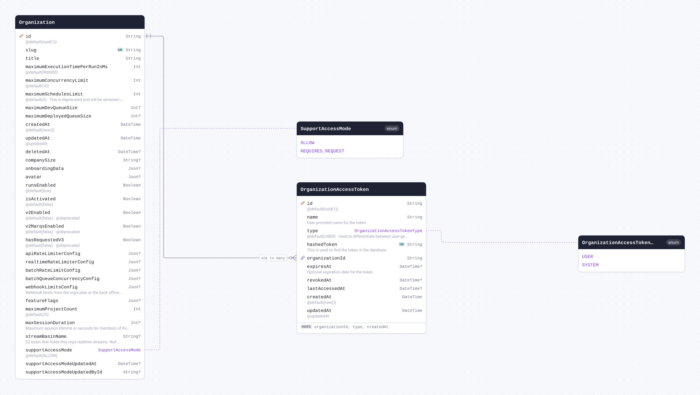

| Field            | Type                                                               | Constraints                                       | Default      | Description                                                              |
| ---------------- | ------------------------------------------------------------------ | ------------------------------------------------- | ------------ | ------------------------------------------------------------------------ |
| `id`             | `String`                                                           | PK NOT NULL                                       | `cuid(1)`    |                                                                          |
| `name`           | `String`                                                           | NOT NULL                                          |              | User-provided name for the token                                         |
| `type`           | [`OrganizationAccessTokenType`](#enum-OrganizationAccessTokenType) | NOT NULL                                          | `USER`       | Used to differentiate between user-generated and system-generated tokens |
| `hashedToken`    | `String`                                                           | UNIQUE NOT NULL                                   |              | This is used to find the token in the database                           |
| `organizationId` | `String`                                                           | NOT NULL → [Organization.id](#model-Organization) |              |                                                                          |
| `expiresAt`      | `DateTime`                                                         | NULL                                              |              | Optional expiration date for the token                                   |
| `revokedAt`      | `DateTime`                                                         | NULL                                              |              |                                                                          |
| `lastAccessedAt` | `DateTime`                                                         | NULL                                              |              |                                                                          |
| `createdAt`      | `DateTime`                                                         | NOT NULL                                          | `now()`      |                                                                          |
| `updatedAt`      | `DateTime`                                                         | NOT NULL                                          | `@updatedAt` |                                                                          |

#### Indexes

- `@@index([organizationId, type, createdAt])`

#### References

- `organizationId` → [Organization.id](#model-Organization) (many-to-one)

#### Definition

```sql
CREATE TABLE "OrganizationAccessToken" (
    "id" TEXT NOT NULL,
    "name" TEXT NOT NULL,
    "type" "OrganizationAccessTokenType" NOT NULL DEFAULT 'USER',
    "hashedToken" TEXT NOT NULL,
    "organizationId" TEXT NOT NULL,
    "expiresAt" TIMESTAMP(3),
    "revokedAt" TIMESTAMP(3),
    "lastAccessedAt" TIMESTAMP(3),
    "createdAt" TIMESTAMP(3) NOT NULL DEFAULT CURRENT_TIMESTAMP,
    "updatedAt" TIMESTAMP(3) NOT NULL,

    CONSTRAINT "OrganizationAccessToken_pkey" PRIMARY KEY ("id")
);

CREATE UNIQUE INDEX "OrganizationAccessToken_hashedToken_key" ON "OrganizationAccessToken"("hashedToken");

CREATE INDEX "OrganizationAccessToken_organizationId_type_createdAt_idx" ON "OrganizationAccessToken"("organizationId", "type", "createdAt" DESC);

ALTER TABLE "OrganizationAccessToken" ADD CONSTRAINT "OrganizationAccessToken_organizationId_fkey" FOREIGN KEY ("organizationId") REFERENCES "Organization"("id") ON DELETE RESTRICT ON UPDATE CASCADE;
```

<details>
<summary>Queries and their SQL</summary>

**findMany**: Every row

```ts
await prisma.organizationAccessToken.findMany();
```

```sql
SELECT
  "public"."OrganizationAccessToken"."id",
  "public"."OrganizationAccessToken"."name",
  "public"."OrganizationAccessToken"."type"::text,
  "public"."OrganizationAccessToken"."hashedToken",
  "public"."OrganizationAccessToken"."organizationId",
  "public"."OrganizationAccessToken"."expiresAt",
  "public"."OrganizationAccessToken"."revokedAt",
  "public"."OrganizationAccessToken"."lastAccessedAt",
  "public"."OrganizationAccessToken"."createdAt",
  "public"."OrganizationAccessToken"."updatedAt"
FROM
  "public"."OrganizationAccessToken"
WHERE
  1 = 1
OFFSET
  $1
-- params: ["0"]
```

**count**: How many rows there are

```ts
await prisma.organizationAccessToken.count();
```

```sql
SELECT
  COUNT(*) AS "_count$_all"
FROM
  (
    SELECT
      "public"."OrganizationAccessToken"."id"
    FROM
      "public"."OrganizationAccessToken"
    WHERE
      1 = 1
    OFFSET
      $1
  ) AS "sub"
-- params: ["0"]
```

**findMany**: Every row with its relations

```ts
await prisma.organizationAccessToken.findMany({ include: { organization: true } });
```

```sql
SELECT
  "public"."OrganizationAccessToken"."id",
  "public"."OrganizationAccessToken"."name",
  "public"."OrganizationAccessToken"."type"::text,
  "public"."OrganizationAccessToken"."hashedToken",
  "public"."OrganizationAccessToken"."organizationId",
  "public"."OrganizationAccessToken"."expiresAt",
  "public"."OrganizationAccessToken"."revokedAt",
  "public"."OrganizationAccessToken"."lastAccessedAt",
  "public"."OrganizationAccessToken"."createdAt",
  "public"."OrganizationAccessToken"."updatedAt"
FROM
  "public"."OrganizationAccessToken"
WHERE
  1 = 1
OFFSET
  $1
-- params: ["0"]

SELECT
  "public"."Organization"."id",
  "public"."Organization"."slug",
  "public"."Organization"."title",
  "public"."Organization"."maximumExecutionTimePerRunInMs",
  "public"."Organization"."maximumConcurrencyLimit",
  "public"."Organization"."maximumSchedulesLimit",
  "public"."Organization"."maximumDevQueueSize",
  "public"."Organization"."maximumDeployedQueueSize",
  "public"."Organization"."createdAt",
  "public"."Organization"."updatedAt",
  "public"."Organization"."deletedAt",
  "public"."Organization"."companySize",
  "public"."Organization"."onboardingData",
  "public"."Organization"."avatar",
  "public"."Organization"."runsEnabled",
  "public"."Organization"."v3Enabled",
  "public"."Organization"."v2Enabled",
  "public"."Organization"."v2MarqsEnabled",
  "public"."Organization"."hasRequestedV3",
  "public"."Organization"."apiRateLimiterConfig",
  "public"."Organization"."realtimeRateLimiterConfig",
  "public"."Organization"."batchRateLimitConfig",
  "public"."Organization"."batchQueueConcurrencyConfig",
  "public"."Organization"."webhookLimitsConfig",
  "public"."Organization"."featureFlags",
  "public"."Organization"."maximumProjectCount",
  "public"."Organization"."maxSessionDuration",
  "public"."Organization"."streamBasinName",
  "public"."Organization"."supportAccessMode"::text,
  "public"."Organization"."supportAccessModeUpdatedAt",
  "public"."Organization"."supportAccessModeUpdatedById"
FROM
  "public"."Organization"
WHERE
  "public"."Organization"."id" IN ($1)
OFFSET
  $2
-- params: ["<organizationId of the rows above>","0"]
```

**findUnique**: One row by what is unique to it

```ts
await prisma.organizationAccessToken.findUnique({ where: { id: "example" } });
```

```sql
SELECT
  "public"."OrganizationAccessToken"."id",
  "public"."OrganizationAccessToken"."name",
  "public"."OrganizationAccessToken"."type"::text,
  "public"."OrganizationAccessToken"."hashedToken",
  "public"."OrganizationAccessToken"."organizationId",
  "public"."OrganizationAccessToken"."expiresAt",
  "public"."OrganizationAccessToken"."revokedAt",
  "public"."OrganizationAccessToken"."lastAccessedAt",
  "public"."OrganizationAccessToken"."createdAt",
  "public"."OrganizationAccessToken"."updatedAt"
FROM
  "public"."OrganizationAccessToken"
WHERE
  (
    "public"."OrganizationAccessToken"."id" = $1
    AND 1 = 1
  )
LIMIT
  $2
OFFSET
  $3
-- params: ["example","1","0"]
```

**create**: Create a row

```ts
await prisma.organizationAccessToken.create({
  data: { name: "example", hashedToken: "example", organizationId: "example" },
});
```

```sql
INSERT INTO
  "public"."OrganizationAccessToken" (
    "id",
    "name",
    "type",
    "hashedToken",
    "organizationId",
    "createdAt",
    "updatedAt"
  )
VALUES
  (
    $1,
    $2,
    CAST(
      $3::text AS "public"."OrganizationAccessTokenType"
    ),
    $4,
    $5,
    $6,
    $7
  )
RETURNING
  "public"."OrganizationAccessToken"."id",
  "public"."OrganizationAccessToken"."name",
  "public"."OrganizationAccessToken"."type"::text,
  "public"."OrganizationAccessToken"."hashedToken",
  "public"."OrganizationAccessToken"."organizationId",
  "public"."OrganizationAccessToken"."expiresAt",
  "public"."OrganizationAccessToken"."revokedAt",
  "public"."OrganizationAccessToken"."lastAccessedAt",
  "public"."OrganizationAccessToken"."createdAt",
  "public"."OrganizationAccessToken"."updatedAt"
-- params: ["<cuid(1)>","example","USER","example","example","<now()>","<now()>"]
```

**update**: Update a row

```ts
await prisma.organizationAccessToken.update({
  where: { id: "example" },
  data: { name: "example" },
});
```

```sql
UPDATE "public"."OrganizationAccessToken"
SET
  "name" = $1,
  "updatedAt" = $2
WHERE
  (
    "public"."OrganizationAccessToken"."id" = $3
    AND 1 = 1
  )
RETURNING
  "public"."OrganizationAccessToken"."id",
  "public"."OrganizationAccessToken"."name",
  "public"."OrganizationAccessToken"."type"::text,
  "public"."OrganizationAccessToken"."hashedToken",
  "public"."OrganizationAccessToken"."organizationId",
  "public"."OrganizationAccessToken"."expiresAt",
  "public"."OrganizationAccessToken"."revokedAt",
  "public"."OrganizationAccessToken"."lastAccessedAt",
  "public"."OrganizationAccessToken"."createdAt",
  "public"."OrganizationAccessToken"."updatedAt"
-- params: ["example",{"prisma__type":"generatorCall","prisma__value":{"name":"now","args":[],"returnType":{"type":"DateTime"}}},"example"]
```

**delete**: Delete a row

```ts
await prisma.organizationAccessToken.delete({ where: { id: "example" } });
```

```sql
DELETE FROM "public"."OrganizationAccessToken"
WHERE
  (
    "public"."OrganizationAccessToken"."id" = $1
    AND 1 = 1
  )
RETURNING
  "public"."OrganizationAccessToken"."id",
  "public"."OrganizationAccessToken"."name",
  "public"."OrganizationAccessToken"."type"::text,
  "public"."OrganizationAccessToken"."hashedToken",
  "public"."OrganizationAccessToken"."organizationId",
  "public"."OrganizationAccessToken"."expiresAt",
  "public"."OrganizationAccessToken"."revokedAt",
  "public"."OrganizationAccessToken"."lastAccessedAt",
  "public"."OrganizationAccessToken"."createdAt",
  "public"."OrganizationAccessToken"."updatedAt"
-- params: ["example"]
```

</details>

<a id="model-Organization"></a>

### Organization

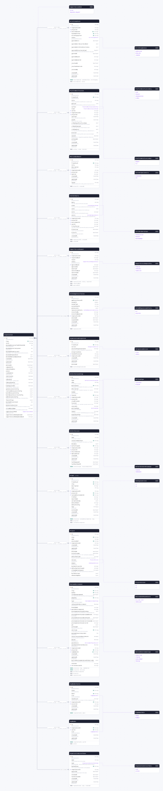

| Field                            | Type                                           | Constraints     | Default      | Description                                                                                                                                                                                                                                                                                    |
| -------------------------------- | ---------------------------------------------- | --------------- | ------------ | ---------------------------------------------------------------------------------------------------------------------------------------------------------------------------------------------------------------------------------------------------------------------------------------------- |
| `id`                             | `String`                                       | PK NOT NULL     | `cuid(1)`    |                                                                                                                                                                                                                                                                                                |
| `slug`                           | `String`                                       | UNIQUE NOT NULL |              |                                                                                                                                                                                                                                                                                                |
| `title`                          | `String`                                       | NOT NULL        |              |                                                                                                                                                                                                                                                                                                |
| `maximumExecutionTimePerRunInMs` | `Int`                                          | NOT NULL        | `900000`     |                                                                                                                                                                                                                                                                                                |
| `maximumConcurrencyLimit`        | `Int`                                          | NOT NULL        | `10`         |                                                                                                                                                                                                                                                                                                |
| `maximumSchedulesLimit`          | `Int`                                          | NOT NULL        | `5`          | This is deprecated and will be removed in the future                                                                                                                                                                                                                                           |
| `maximumDevQueueSize`            | `Int`                                          | NULL            |              |                                                                                                                                                                                                                                                                                                |
| `maximumDeployedQueueSize`       | `Int`                                          | NULL            |              |                                                                                                                                                                                                                                                                                                |
| `createdAt`                      | `DateTime`                                     | NOT NULL        | `now()`      |                                                                                                                                                                                                                                                                                                |
| `updatedAt`                      | `DateTime`                                     | NOT NULL        | `@updatedAt` |                                                                                                                                                                                                                                                                                                |
| `deletedAt`                      | `DateTime`                                     | NULL            |              |                                                                                                                                                                                                                                                                                                |
| `companySize`                    | `String`                                       | NULL            |              |                                                                                                                                                                                                                                                                                                |
| `onboardingData`                 | `Json`                                         | NULL            |              |                                                                                                                                                                                                                                                                                                |
| `avatar`                         | `Json`                                         | NULL            |              |                                                                                                                                                                                                                                                                                                |
| `runsEnabled`                    | `Boolean`                                      | NOT NULL        | `true`       |                                                                                                                                                                                                                                                                                                |
| `isActivated` (`v3Enabled`)      | `Boolean`                                      | NOT NULL        | `false`      |                                                                                                                                                                                                                                                                                                |
| `v2Enabled`                      | `Boolean`                                      | NOT NULL        | `false`      | @deprecated                                                                                                                                                                                                                                                                                    |
| `v2MarqsEnabled`                 | `Boolean`                                      | NOT NULL        | `false`      | @deprecated                                                                                                                                                                                                                                                                                    |
| `hasRequestedV3`                 | `Boolean`                                      | NOT NULL        | `false`      | @deprecated                                                                                                                                                                                                                                                                                    |
| `apiRateLimiterConfig`           | `Json`                                         | NULL            |              |                                                                                                                                                                                                                                                                                                |
| `realtimeRateLimiterConfig`      | `Json`                                         | NULL            |              |                                                                                                                                                                                                                                                                                                |
| `batchRateLimitConfig`           | `Json`                                         | NULL            |              |                                                                                                                                                                                                                                                                                                |
| `batchQueueConcurrencyConfig`    | `Json`                                         | NULL            |              |                                                                                                                                                                                                                                                                                                |
| `webhookLimitsConfig`            | `Json`                                         | NULL            |              | Webhook limits from the org's plan or the back office: { maxWaitersPerEnvironment, maxWaitersPerEndpoint, concurrency }. Null uses the env defaults.                                                                                                                                           |
| `featureFlags`                   | `Json`                                         | NULL            |              |                                                                                                                                                                                                                                                                                                |
| `maximumProjectCount`            | `Int`                                          | NOT NULL        | `25`         |                                                                                                                                                                                                                                                                                                |
| `maxSessionDuration`             | `Int`                                          | NULL            |              | Maximum session lifetime in seconds for members of this organization. When set, caps each member's User.sessionDuration. The most restrictive cap across all of a user's orgs (excluding nulls) wins.                                                                                          |
| `streamBasinName`                | `String`                                       | NULL            |              | S2 basin that holds this org's realtime streams. Null until the per-org basin has been provisioned (OSS / s2-lite installs leave it null forever; reads fall back to the global basin env var). Set once at provisioning time; retention is reconfigured in-place when the org's plan changes. |
| `supportAccessMode`              | [`SupportAccessMode`](#enum-SupportAccessMode) | NOT NULL        | `ALLOW`      |                                                                                                                                                                                                                                                                                                |
| `supportAccessModeUpdatedAt`     | `DateTime`                                     | NULL            |              |                                                                                                                                                                                                                                                                                                |
| `supportAccessModeUpdatedById`   | `String`                                       | NULL            |              |                                                                                                                                                                                                                                                                                                |

#### Referenced by

- `id` ← [OrganizationAccessToken.organizationId](#model-OrganizationAccessToken) (one-to-many)
- `id` ← [OrgMember.organizationId](#model-OrgMember) (one-to-many, on delete Cascade, on update Cascade)
- `id` ← [OrgMemberInvite.organizationId](#model-OrgMemberInvite) (one-to-many, on delete Cascade, on update Cascade)
- `id` ← [RuntimeEnvironment.organizationId](#model-RuntimeEnvironment) (one-to-many, on delete Cascade, on update Cascade)
- `id` ← [Project.organizationId](#model-Project) (one-to-many, on delete Cascade, on update Cascade)
- `id` ← [Prompt.organizationId](#model-Prompt) (one-to-many, on delete Cascade, on update Cascade)
- `id` ← [WorkerInstance.organizationId](#model-WorkerInstance) (one-to-many, on delete Cascade, on update Cascade)
- `id` ← [WorkerInstanceGroup.organizationId](#model-WorkerInstanceGroup) (one-to-many, on delete Cascade, on update Cascade)
- `id` ← [OrganizationIntegration.organizationId](#model-OrganizationIntegration) (one-to-many, on delete Cascade, on update Cascade)
- `id` ← [GithubAppInstallation.organizationId](#model-GithubAppInstallation) (one-to-many)
- `id` ← [SupportAccessRequest.organizationId](#model-SupportAccessRequest) (one-to-many, on delete Cascade, on update Cascade)
- `id` ← [CustomerQuery.organizationId](#model-CustomerQuery) (one-to-many, on delete Cascade, on update Cascade)
- `id` ← [MetricsDashboard.organizationId](#model-MetricsDashboard) (one-to-many, on delete Cascade, on update Cascade)
- `id` ← [PlatformNotification.organizationId](#model-PlatformNotification) (one-to-many, on delete Cascade, on update Cascade)
- `id` ← [ErrorGroupState.organizationId](#model-ErrorGroupState) (one-to-many, on delete Cascade, on update Cascade)

#### Definition

```sql
CREATE TABLE "Organization" (
    "id" TEXT NOT NULL,
    "slug" TEXT NOT NULL,
    "title" TEXT NOT NULL,
    "maximumExecutionTimePerRunInMs" INTEGER NOT NULL DEFAULT 900000,
    "maximumConcurrencyLimit" INTEGER NOT NULL DEFAULT 10,
    "maximumSchedulesLimit" INTEGER NOT NULL DEFAULT 5,
    "maximumDevQueueSize" INTEGER,
    "maximumDeployedQueueSize" INTEGER,
    "createdAt" TIMESTAMP(3) NOT NULL DEFAULT CURRENT_TIMESTAMP,
    "updatedAt" TIMESTAMP(3) NOT NULL,
    "deletedAt" TIMESTAMP(3),
    "companySize" TEXT,
    "onboardingData" JSONB,
    "avatar" JSONB,
    "runsEnabled" BOOLEAN NOT NULL DEFAULT true,
    "v3Enabled" BOOLEAN NOT NULL DEFAULT false,
    "v2Enabled" BOOLEAN NOT NULL DEFAULT false,
    "v2MarqsEnabled" BOOLEAN NOT NULL DEFAULT false,
    "hasRequestedV3" BOOLEAN NOT NULL DEFAULT false,
    "apiRateLimiterConfig" JSONB,
    "realtimeRateLimiterConfig" JSONB,
    "batchRateLimitConfig" JSONB,
    "batchQueueConcurrencyConfig" JSONB,
    "webhookLimitsConfig" JSONB,
    "featureFlags" JSONB,
    "maximumProjectCount" INTEGER NOT NULL DEFAULT 25,
    "maxSessionDuration" INTEGER,
    "streamBasinName" TEXT,
    "supportAccessMode" "SupportAccessMode" NOT NULL DEFAULT 'ALLOW',
    "supportAccessModeUpdatedAt" TIMESTAMP(3),
    "supportAccessModeUpdatedById" TEXT,

    CONSTRAINT "Organization_pkey" PRIMARY KEY ("id")
);

CREATE UNIQUE INDEX "Organization_slug_key" ON "Organization"("slug");
```

<details>
<summary>Queries and their SQL</summary>

**findMany**: Every row

```ts
await prisma.organization.findMany();
```

```sql
SELECT
  "public"."Organization"."id",
  "public"."Organization"."slug",
  "public"."Organization"."title",
  "public"."Organization"."maximumExecutionTimePerRunInMs",
  "public"."Organization"."maximumConcurrencyLimit",
  "public"."Organization"."maximumSchedulesLimit",
  "public"."Organization"."maximumDevQueueSize",
  "public"."Organization"."maximumDeployedQueueSize",
  "public"."Organization"."createdAt",
  "public"."Organization"."updatedAt",
  "public"."Organization"."deletedAt",
  "public"."Organization"."companySize",
  "public"."Organization"."onboardingData",
  "public"."Organization"."avatar",
  "public"."Organization"."runsEnabled",
  "public"."Organization"."v3Enabled",
  "public"."Organization"."v2Enabled",
  "public"."Organization"."v2MarqsEnabled",
  "public"."Organization"."hasRequestedV3",
  "public"."Organization"."apiRateLimiterConfig",
  "public"."Organization"."realtimeRateLimiterConfig",
  "public"."Organization"."batchRateLimitConfig",
  "public"."Organization"."batchQueueConcurrencyConfig",
  "public"."Organization"."webhookLimitsConfig",
  "public"."Organization"."featureFlags",
  "public"."Organization"."maximumProjectCount",
  "public"."Organization"."maxSessionDuration",
  "public"."Organization"."streamBasinName",
  "public"."Organization"."supportAccessMode"::text,
  "public"."Organization"."supportAccessModeUpdatedAt",
  "public"."Organization"."supportAccessModeUpdatedById"
FROM
  "public"."Organization"
WHERE
  1 = 1
OFFSET
  $1
-- params: ["0"]
```

**count**: How many rows there are

```ts
await prisma.organization.count();
```

```sql
SELECT
  COUNT(*) AS "_count$_all"
FROM
  (
    SELECT
      "public"."Organization"."id"
    FROM
      "public"."Organization"
    WHERE
      1 = 1
    OFFSET
      $1
  ) AS "sub"
-- params: ["0"]
```

**findMany**: Every row with its relations

```ts
await prisma.organization.findMany({
  include: {
    environments: true,
    projects: true,
    members: true,
    invites: true,
    organizationIntegrations: true,
    organizationAccessTokens: true,
    workerGroups: true,
    workerInstances: true,
    githubAppInstallations: true,
    customerQueries: true,
    metricsDashboards: true,
    prompts: true,
    platformNotifications: true,
    errorGroupStates: true,
    supportAccessRequests: true,
  },
});
```

```sql
SELECT
  "public"."Organization"."id",
  "public"."Organization"."slug",
  "public"."Organization"."title",
  "public"."Organization"."maximumExecutionTimePerRunInMs",
  "public"."Organization"."maximumConcurrencyLimit",
  "public"."Organization"."maximumSchedulesLimit",
  "public"."Organization"."maximumDevQueueSize",
  "public"."Organization"."maximumDeployedQueueSize",
  "public"."Organization"."createdAt",
  "public"."Organization"."updatedAt",
  "public"."Organization"."deletedAt",
  "public"."Organization"."companySize",
  "public"."Organization"."onboardingData",
  "public"."Organization"."avatar",
  "public"."Organization"."runsEnabled",
  "public"."Organization"."v3Enabled",
  "public"."Organization"."v2Enabled",
  "public"."Organization"."v2MarqsEnabled",
  "public"."Organization"."hasRequestedV3",
  "public"."Organization"."apiRateLimiterConfig",
  "public"."Organization"."realtimeRateLimiterConfig",
  "public"."Organization"."batchRateLimitConfig",
  "public"."Organization"."batchQueueConcurrencyConfig",
  "public"."Organization"."webhookLimitsConfig",
  "public"."Organization"."featureFlags",
  "public"."Organization"."maximumProjectCount",
  "public"."Organization"."maxSessionDuration",
  "public"."Organization"."streamBasinName",
  "public"."Organization"."supportAccessMode"::text,
  "public"."Organization"."supportAccessModeUpdatedAt",
  "public"."Organization"."supportAccessModeUpdatedById"
FROM
  "public"."Organization"
WHERE
  1 = 1
OFFSET
  $1
-- params: ["0"]

SELECT
  "public"."RuntimeEnvironment"."id",
  "public"."RuntimeEnvironment"."slug",
  "public"."RuntimeEnvironment"."apiKey",
  "public"."RuntimeEnvironment"."rootApiKeyHiddenAt",
  "public"."RuntimeEnvironment"."pkApiKey",
  "public"."RuntimeEnvironment"."type"::text,
  "public"."RuntimeEnvironment"."isBranchableEnvironment",
  "public"."RuntimeEnvironment"."branchName",
  "public"."RuntimeEnvironment"."parentEnvironmentId",
  "public"."RuntimeEnvironment"."previewAutoArchiveAfterDays",
  "public"."RuntimeEnvironment"."previewAutoArchiveExcludedBranches",
  "public"."RuntimeEnvironment"."previewAutoArchiveNextCheckAt",
  "public"."RuntimeEnvironment"."previewAutoArchiveCursorCreatedAt",
  "public"."RuntimeEnvironment"."previewAutoArchiveCursorId",
  "public"."RuntimeEnvironment"."git",
  "public"."RuntimeEnvironment"."archivedAt",
  "public"."RuntimeEnvironment"."shortcode",
  "public"."RuntimeEnvironment"."maximumConcurrencyLimit",
  "public"."RuntimeEnvironment"."concurrencyLimitBurstFactor",
  "public"."RuntimeEnvironment"."paused",
  "public"."RuntimeEnvironment"."pauseSource"::text,
  "public"."RuntimeEnvironment"."autoEnableInternalSources",
  "public"."RuntimeEnvironment"."organizationId",
  "public"."RuntimeEnvironment"."projectId",
  "public"."RuntimeEnvironment"."orgMemberId",
  "public"."RuntimeEnvironment"."createdAt",
  "public"."RuntimeEnvironment"."updatedAt",
  "public"."RuntimeEnvironment"."builtInEnvironmentVariableOverrides",
  "public"."RuntimeEnvironment"."tunnelId",
  "public"."RuntimeEnvironment"."currentSessionId"
FROM
  "public"."RuntimeEnvironment"
WHERE
  "public"."RuntimeEnvironment"."organizationId" IN ($1)
OFFSET
  $2
-- params: ["<id of the rows above>","0"]

SELECT
  "public"."Project"."id",
  "public"."Project"."slug",
  "public"."Project"."name",
  "public"."Project"."externalRef",
  "public"."Project"."organizationId",
  "public"."Project"."createdAt",
  "public"."Project"."updatedAt",
  "public"."Project"."deletedAt",
  "public"."Project"."initializedAt",
  "public"."Project"."defaultRuntime",
  "public"."Project"."version"::text,
  "public"."Project"."engine"::text,
  "public"."Project"."builderProjectId",
  "public"."Project"."defaultWorkerGroupId",
  "public"."Project"."allowedMasterQueues",
  "public"."Project"."buildSettings",
  "public"."Project"."onboardingData"
FROM
  "public"."Project"
WHERE
  "public"."Project"."organizationId" IN ($1)
OFFSET
  $2
-- params: ["<id of the rows above>","0"]

SELECT
  "public"."OrgMember"."id",
  "public"."OrgMember"."organizationId",
  "public"."OrgMember"."userId",
  "public"."OrgMember"."role"::text,
  "public"."OrgMember"."createdAt",
  "public"."OrgMember"."updatedAt"
FROM
  "public"."OrgMember"
WHERE
  "public"."OrgMember"."organizationId" IN ($1)
OFFSET
  $2
-- params: ["<id of the rows above>","0"]

SELECT
  "public"."OrgMemberInvite"."id",
  "public"."OrgMemberInvite"."token",
  "public"."OrgMemberInvite"."email",
  "public"."OrgMemberInvite"."role"::text,
  "public"."OrgMemberInvite"."rbacRoleId",
  "public"."OrgMemberInvite"."organizationId",
  "public"."OrgMemberInvite"."inviterId",
  "public"."OrgMemberInvite"."createdAt",
  "public"."OrgMemberInvite"."updatedAt"
FROM
  "public"."OrgMemberInvite"
WHERE
  "public"."OrgMemberInvite"."organizationId" IN ($1)
OFFSET
  $2
-- params: ["<id of the rows above>","0"]

SELECT
  "public"."OrganizationIntegration"."id",
  "public"."OrganizationIntegration"."friendlyId",
  "public"."OrganizationIntegration"."service"::text,
  "public"."OrganizationIntegration"."externalOrganizationId",
  "public"."OrganizationIntegration"."integrationData",
  "public"."OrganizationIntegration"."tokenReferenceId",
  "public"."OrganizationIntegration"."organizationId",
  "public"."OrganizationIntegration"."createdAt",
  "public"."OrganizationIntegration"."updatedAt",
  "public"."OrganizationIntegration"."deletedAt"
FROM
  "public"."OrganizationIntegration"
WHERE
  "public"."OrganizationIntegration"."organizationId" IN ($1)
OFFSET
  $2
-- params: ["<id of the rows above>","0"]

SELECT
  "public"."OrganizationAccessToken"."id",
  "public"."OrganizationAccessToken"."name",
  "public"."OrganizationAccessToken"."type"::text,
  "public"."OrganizationAccessToken"."hashedToken",
  "public"."OrganizationAccessToken"."organizationId",
  "public"."OrganizationAccessToken"."expiresAt",
  "public"."OrganizationAccessToken"."revokedAt",
  "public"."OrganizationAccessToken"."lastAccessedAt",
  "public"."OrganizationAccessToken"."createdAt",
  "public"."OrganizationAccessToken"."updatedAt"
FROM
  "public"."OrganizationAccessToken"
WHERE
  "public"."OrganizationAccessToken"."organizationId" IN ($1)
OFFSET
  $2
-- params: ["<id of the rows above>","0"]

SELECT
  "public"."WorkerInstanceGroup"."id",
  "public"."WorkerInstanceGroup"."type"::text,
  "public"."WorkerInstanceGroup"."name",
  "public"."WorkerInstanceGroup"."masterQueue",
  "public"."WorkerInstanceGroup"."description",
  "public"."WorkerInstanceGroup"."hidden",
  "public"."WorkerInstanceGroup"."tokenId",
  "public"."WorkerInstanceGroup"."organizationId",
  "public"."WorkerInstanceGroup"."projectId",
  "public"."WorkerInstanceGroup"."cloudProvider",
  "public"."WorkerInstanceGroup"."location",
  "public"."WorkerInstanceGroup"."staticIPs",
  "public"."WorkerInstanceGroup"."workloadType"::text,
  "public"."WorkerInstanceGroup"."region",
  "public"."WorkerInstanceGroup"."enableFastPath",
  "public"."WorkerInstanceGroup"."createdAt",
  "public"."WorkerInstanceGroup"."updatedAt"
FROM
  "public"."WorkerInstanceGroup"
WHERE
  "public"."WorkerInstanceGroup"."organizationId" IN ($1)
OFFSET
  $2
-- params: ["<id of the rows above>","0"]

SELECT
  "public"."WorkerInstance"."id",
  "public"."WorkerInstance"."name",
  "public"."WorkerInstance"."resourceIdentifier",
  "public"."WorkerInstance"."metadata",
  "public"."WorkerInstance"."workerGroupId",
  "public"."WorkerInstance"."organizationId",
  "public"."WorkerInstance"."projectId",
  "public"."WorkerInstance"."environmentId",
  "public"."WorkerInstance"."deploymentId",
  "public"."WorkerInstance"."createdAt",
  "public"."WorkerInstance"."updatedAt",
  "public"."WorkerInstance"."lastDequeueAt",
  "public"."WorkerInstance"."lastHeartbeatAt"
FROM
  "public"."WorkerInstance"
WHERE
  "public"."WorkerInstance"."organizationId" IN ($1)
OFFSET
  $2
-- params: ["<id of the rows above>","0"]

SELECT
  "public"."GithubAppInstallation"."id",
  "public"."GithubAppInstallation"."appInstallationId",
  "public"."GithubAppInstallation"."targetId",
  "public"."GithubAppInstallation"."targetType",
  "public"."GithubAppInstallation"."accountHandle",
  "public"."GithubAppInstallation"."permissions",
  "public"."GithubAppInstallation"."repositorySelection"::text,
  "public"."GithubAppInstallation"."installedBy",
  "public"."GithubAppInstallation"."installedByUserId",
  "public"."GithubAppInstallation"."organizationId",
  "public"."GithubAppInstallation"."deletedAt",
  "public"."GithubAppInstallation"."suspendedAt",
  "public"."GithubAppInstallation"."createdAt",
  "public"."GithubAppInstallation"."updatedAt"
FROM
  "public"."GithubAppInstallation"
WHERE
  "public"."GithubAppInstallation"."organizationId" IN ($1)
OFFSET
  $2
-- params: ["<id of the rows above>","0"]

SELECT
  "public"."CustomerQuery"."id",
  "public"."CustomerQuery"."query",
  "public"."CustomerQuery"."scope"::text,
  "public"."CustomerQuery"."stats",
  "public"."CustomerQuery"."title",
  "public"."CustomerQuery"."source"::text,
  "public"."CustomerQuery"."organizationId",
  "public"."CustomerQuery"."projectId",
  "public"."CustomerQuery"."environmentId",
  "public"."CustomerQuery"."userId",
  "public"."CustomerQuery"."filterPeriod",
  "public"."CustomerQuery"."filterFrom",
  "public"."CustomerQuery"."filterTo",
  "public"."CustomerQuery"."createdAt"
FROM
  "public"."CustomerQuery"
WHERE
  "public"."CustomerQuery"."organizationId" IN ($1)
OFFSET
  $2
-- params: ["<id of the rows above>","0"]

SELECT
  "public"."MetricsDashboard"."id",
  "public"."MetricsDashboard"."friendlyId",
  "public"."MetricsDashboard"."title",
  "public"."MetricsDashboard"."description",
  "public"."MetricsDashboard"."organizationId",
  "public"."MetricsDashboard"."projectId",
  "public"."MetricsDashboard"."ownerId",
  "public"."MetricsDashboard"."createdAt",
  "public"."MetricsDashboard"."updatedAt",
  "public"."MetricsDashboard"."layout"
FROM
  "public"."MetricsDashboard"
WHERE
  "public"."MetricsDashboard"."organizationId" IN ($1)
OFFSET
  $2
-- params: ["<id of the rows above>","0"]

SELECT
  "public"."prompts"."id",
  "public"."prompts"."friendly_id",
  "public"."prompts"."slug",
  "public"."prompts"."description",
  "public"."prompts"."type",
  "public"."prompts"."organizationId",
  "public"."prompts"."projectId",
  "public"."prompts"."runtimeEnvironmentId",
  "public"."prompts"."filePath",
  "public"."prompts"."exportName",
  "public"."prompts"."variableSchema",
  "public"."prompts"."defaultModel",
  "public"."prompts"."defaultConfig",
  "public"."prompts"."tags",
  "public"."prompts"."archivedAt",
  "public"."prompts"."createdAt",
  "public"."prompts"."updatedAt"
FROM
  "public"."prompts"
WHERE
  "public"."prompts"."organizationId" IN ($1)
OFFSET
  $2
-- params: ["<id of the rows above>","0"]

SELECT
  "public"."PlatformNotification"."id",
  "public"."PlatformNotification"."friendlyId",
  "public"."PlatformNotification"."title",
  "public"."PlatformNotification"."payload",
  "public"."PlatformNotification"."surface"::text,
  "public"."PlatformNotification"."scope"::text,
  "public"."PlatformNotification"."userId",
  "public"."PlatformNotification"."organizationId",
  "public"."PlatformNotification"."projectId",
  "public"."PlatformNotification"."startsAt",
  "public"."PlatformNotification"."endsAt",
  "public"."PlatformNotification"."cliMaxDaysAfterFirstSeen",
  "public"."PlatformNotification"."cliMaxShowCount",
  "public"."PlatformNotification"."cliShowEvery",
  "public"."PlatformNotification"."priority",
  "public"."PlatformNotification"."isDraft",
  "public"."PlatformNotification"."archivedAt",
  "public"."PlatformNotification"."createdAt",
  "public"."PlatformNotification"."updatedAt"
FROM
  "public"."PlatformNotification"
WHERE
  "public"."PlatformNotification"."organizationId" IN ($1)
OFFSET
  $2
-- params: ["<id of the rows above>","0"]

SELECT
  "public"."ErrorGroupState"."id",
  "public"."ErrorGroupState"."organizationId",
  "public"."ErrorGroupState"."projectId",
  "public"."ErrorGroupState"."environmentId",
  "public"."ErrorGroupState"."taskIdentifier",
  "public"."ErrorGroupState"."errorFingerprint",
  "public"."ErrorGroupState"."status"::text,
  "public"."ErrorGroupState"."ignoredUntil",
  "public"."ErrorGroupState"."ignoredUntilOccurrenceRate",
  "public"."ErrorGroupState"."ignoredUntilTotalOccurrences",
  "public"."ErrorGroupState"."ignoredAtOccurrenceCount",
  "public"."ErrorGroupState"."ignoredAt",
  "public"."ErrorGroupState"."ignoredReason",
  "public"."ErrorGroupState"."ignoredByUserId",
  "public"."ErrorGroupState"."resolvedAt",
  "public"."ErrorGroupState"."resolvedInVersion",
  "public"."ErrorGroupState"."resolvedBy",
  "public"."ErrorGroupState"."createdAt",
  "public"."ErrorGroupState"."updatedAt"
FROM
  "public"."ErrorGroupState"
WHERE
  "public"."ErrorGroupState"."organizationId" IN ($1)
OFFSET
  $2
-- params: ["<id of the rows above>","0"]

SELECT
  "public"."SupportAccessRequest"."id",
  "public"."SupportAccessRequest"."organizationId",
  "public"."SupportAccessRequest"."requestedById",
  "public"."SupportAccessRequest"."reason",
  "public"."SupportAccessRequest"."status"::text,
  "public"."SupportAccessRequest"."approvedById",
  "public"."SupportAccessRequest"."approvedAt",
  "public"."SupportAccessRequest"."expiresAt",
  "public"."SupportAccessRequest"."cancelledById",
  "public"."SupportAccessRequest"."cancelledAt",
  "public"."SupportAccessRequest"."createdAt",
  "public"."SupportAccessRequest"."updatedAt"
FROM
  "public"."SupportAccessRequest"
WHERE
  "public"."SupportAccessRequest"."organizationId" IN ($1)
OFFSET
  $2
-- params: ["<id of the rows above>","0"]
```

**findUnique**: One row by what is unique to it

```ts
await prisma.organization.findUnique({ where: { id: "example" } });
```

```sql
SELECT
  "public"."Organization"."id",
  "public"."Organization"."slug",
  "public"."Organization"."title",
  "public"."Organization"."maximumExecutionTimePerRunInMs",
  "public"."Organization"."maximumConcurrencyLimit",
  "public"."Organization"."maximumSchedulesLimit",
  "public"."Organization"."maximumDevQueueSize",
  "public"."Organization"."maximumDeployedQueueSize",
  "public"."Organization"."createdAt",
  "public"."Organization"."updatedAt",
  "public"."Organization"."deletedAt",
  "public"."Organization"."companySize",
  "public"."Organization"."onboardingData",
  "public"."Organization"."avatar",
  "public"."Organization"."runsEnabled",
  "public"."Organization"."v3Enabled",
  "public"."Organization"."v2Enabled",
  "public"."Organization"."v2MarqsEnabled",
  "public"."Organization"."hasRequestedV3",
  "public"."Organization"."apiRateLimiterConfig",
  "public"."Organization"."realtimeRateLimiterConfig",
  "public"."Organization"."batchRateLimitConfig",
  "public"."Organization"."batchQueueConcurrencyConfig",
  "public"."Organization"."webhookLimitsConfig",
  "public"."Organization"."featureFlags",
  "public"."Organization"."maximumProjectCount",
  "public"."Organization"."maxSessionDuration",
  "public"."Organization"."streamBasinName",
  "public"."Organization"."supportAccessMode"::text,
  "public"."Organization"."supportAccessModeUpdatedAt",
  "public"."Organization"."supportAccessModeUpdatedById"
FROM
  "public"."Organization"
WHERE
  (
    "public"."Organization"."id" = $1
    AND 1 = 1
  )
LIMIT
  $2
OFFSET
  $3
-- params: ["example","1","0"]
```

**create**: Create a row

```ts
await prisma.organization.create({ data: { slug: "example", title: "example" } });
```

```sql
INSERT INTO
  "public"."Organization" (
    "id",
    "slug",
    "title",
    "maximumExecutionTimePerRunInMs",
    "maximumConcurrencyLimit",
    "maximumSchedulesLimit",
    "createdAt",
    "updatedAt",
    "runsEnabled",
    "v3Enabled",
    "v2Enabled",
    "v2MarqsEnabled",
    "hasRequestedV3",
    "maximumProjectCount",
    "supportAccessMode"
  )
VALUES
  (
    $1,
    $2,
    $3,
    $4,
    $5,
    $6,
    $7,
    $8,
    $9,
    $10,
    $11,
    $12,
    $13,
    $14,
    CAST($15::text AS "public"."SupportAccessMode")
  )
RETURNING
  "public"."Organization"."id",
  "public"."Organization"."slug",
  "public"."Organization"."title",
  "public"."Organization"."maximumExecutionTimePerRunInMs",
  "public"."Organization"."maximumConcurrencyLimit",
  "public"."Organization"."maximumSchedulesLimit",
  "public"."Organization"."maximumDevQueueSize",
  "public"."Organization"."maximumDeployedQueueSize",
  "public"."Organization"."createdAt",
  "public"."Organization"."updatedAt",
  "public"."Organization"."deletedAt",
  "public"."Organization"."companySize",
  "public"."Organization"."onboardingData",
  "public"."Organization"."avatar",
  "public"."Organization"."runsEnabled",
  "public"."Organization"."v3Enabled",
  "public"."Organization"."v2Enabled",
  "public"."Organization"."v2MarqsEnabled",
  "public"."Organization"."hasRequestedV3",
  "public"."Organization"."apiRateLimiterConfig",
  "public"."Organization"."realtimeRateLimiterConfig",
  "public"."Organization"."batchRateLimitConfig",
  "public"."Organization"."batchQueueConcurrencyConfig",
  "public"."Organization"."webhookLimitsConfig",
  "public"."Organization"."featureFlags",
  "public"."Organization"."maximumProjectCount",
  "public"."Organization"."maxSessionDuration",
  "public"."Organization"."streamBasinName",
  "public"."Organization"."supportAccessMode"::text,
  "public"."Organization"."supportAccessModeUpdatedAt",
  "public"."Organization"."supportAccessModeUpdatedById"
-- params: ["<cuid(1)>","example","example","900000","10","5","<now()>","<now()>",true,false,false,false,false,"25","ALLOW"]
```

**update**: Update a row

```ts
await prisma.organization.update({ where: { id: "example" }, data: { slug: "example" } });
```

```sql
UPDATE "public"."Organization"
SET
  "slug" = $1,
  "updatedAt" = $2
WHERE
  (
    "public"."Organization"."id" = $3
    AND 1 = 1
  )
RETURNING
  "public"."Organization"."id",
  "public"."Organization"."slug",
  "public"."Organization"."title",
  "public"."Organization"."maximumExecutionTimePerRunInMs",
  "public"."Organization"."maximumConcurrencyLimit",
  "public"."Organization"."maximumSchedulesLimit",
  "public"."Organization"."maximumDevQueueSize",
  "public"."Organization"."maximumDeployedQueueSize",
  "public"."Organization"."createdAt",
  "public"."Organization"."updatedAt",
  "public"."Organization"."deletedAt",
  "public"."Organization"."companySize",
  "public"."Organization"."onboardingData",
  "public"."Organization"."avatar",
  "public"."Organization"."runsEnabled",
  "public"."Organization"."v3Enabled",
  "public"."Organization"."v2Enabled",
  "public"."Organization"."v2MarqsEnabled",
  "public"."Organization"."hasRequestedV3",
  "public"."Organization"."apiRateLimiterConfig",
  "public"."Organization"."realtimeRateLimiterConfig",
  "public"."Organization"."batchRateLimitConfig",
  "public"."Organization"."batchQueueConcurrencyConfig",
  "public"."Organization"."webhookLimitsConfig",
  "public"."Organization"."featureFlags",
  "public"."Organization"."maximumProjectCount",
  "public"."Organization"."maxSessionDuration",
  "public"."Organization"."streamBasinName",
  "public"."Organization"."supportAccessMode"::text,
  "public"."Organization"."supportAccessModeUpdatedAt",
  "public"."Organization"."supportAccessModeUpdatedById"
-- params: ["example",{"prisma__type":"generatorCall","prisma__value":{"name":"now","args":[],"returnType":{"type":"DateTime"}}},"example"]
```

**delete**: Delete a row

```ts
await prisma.organization.delete({ where: { id: "example" } });
```

```sql
DELETE FROM "public"."Organization"
WHERE
  (
    "public"."Organization"."id" = $1
    AND 1 = 1
  )
RETURNING
  "public"."Organization"."id",
  "public"."Organization"."slug",
  "public"."Organization"."title",
  "public"."Organization"."maximumExecutionTimePerRunInMs",
  "public"."Organization"."maximumConcurrencyLimit",
  "public"."Organization"."maximumSchedulesLimit",
  "public"."Organization"."maximumDevQueueSize",
  "public"."Organization"."maximumDeployedQueueSize",
  "public"."Organization"."createdAt",
  "public"."Organization"."updatedAt",
  "public"."Organization"."deletedAt",
  "public"."Organization"."companySize",
  "public"."Organization"."onboardingData",
  "public"."Organization"."avatar",
  "public"."Organization"."runsEnabled",
  "public"."Organization"."v3Enabled",
  "public"."Organization"."v2Enabled",
  "public"."Organization"."v2MarqsEnabled",
  "public"."Organization"."hasRequestedV3",
  "public"."Organization"."apiRateLimiterConfig",
  "public"."Organization"."realtimeRateLimiterConfig",
  "public"."Organization"."batchRateLimitConfig",
  "public"."Organization"."batchQueueConcurrencyConfig",
  "public"."Organization"."webhookLimitsConfig",
  "public"."Organization"."featureFlags",
  "public"."Organization"."maximumProjectCount",
  "public"."Organization"."maxSessionDuration",
  "public"."Organization"."streamBasinName",
  "public"."Organization"."supportAccessMode"::text,
  "public"."Organization"."supportAccessModeUpdatedAt",
  "public"."Organization"."supportAccessModeUpdatedById"
-- params: ["example"]
```

</details>

<a id="model-OrgMember"></a>

### OrgMember

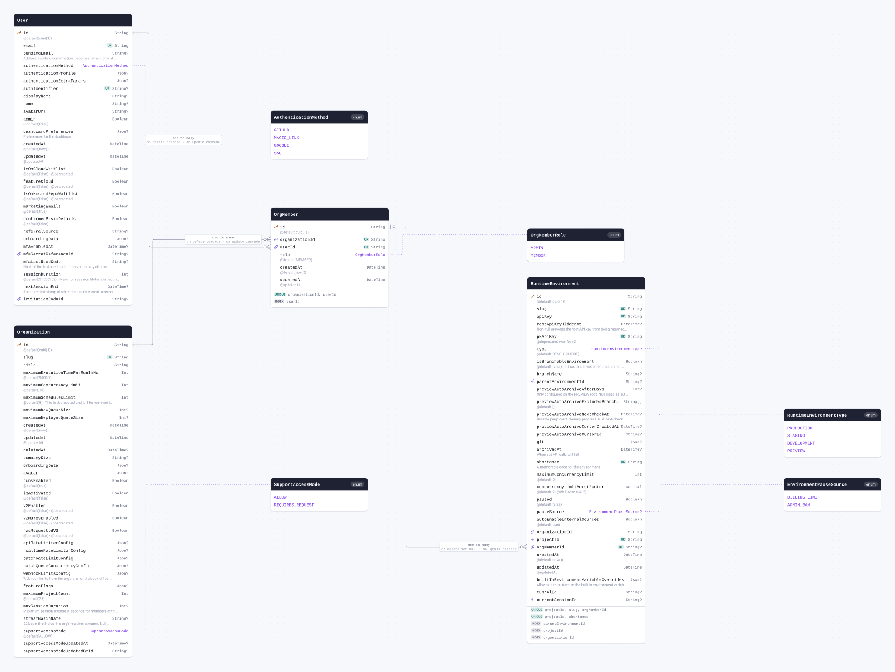

| Field            | Type                                   | Constraints                                       | Default      | Description |
| ---------------- | -------------------------------------- | ------------------------------------------------- | ------------ | ----------- |
| `id`             | `String`                               | PK NOT NULL                                       | `cuid(1)`    |             |
| `organizationId` | `String`                               | NOT NULL → [Organization.id](#model-Organization) |              |             |
| `userId`         | `String`                               | NOT NULL → [User.id](#model-User)                 |              |             |
| `role`           | [`OrgMemberRole`](#enum-OrgMemberRole) | NOT NULL                                          | `MEMBER`     |             |
| `createdAt`      | `DateTime`                             | NOT NULL                                          | `now()`      |             |
| `updatedAt`      | `DateTime`                             | NOT NULL                                          | `@updatedAt` |             |

#### Indexes

- `@@index([userId])`
- `@@unique([organizationId, userId])`

#### References

- `organizationId` → [Organization.id](#model-Organization) (many-to-one, on delete Cascade, on update Cascade)
- `userId` → [User.id](#model-User) (many-to-one, on delete Cascade, on update Cascade)

#### Referenced by

- `id` ← [RuntimeEnvironment.orgMemberId](#model-RuntimeEnvironment) (one-to-many, on delete SetNull, on update Cascade)

#### Definition

```sql
CREATE TABLE "OrgMember" (
    "id" TEXT NOT NULL,
    "organizationId" TEXT NOT NULL,
    "userId" TEXT NOT NULL,
    "role" "OrgMemberRole" NOT NULL DEFAULT 'MEMBER',
    "createdAt" TIMESTAMP(3) NOT NULL DEFAULT CURRENT_TIMESTAMP,
    "updatedAt" TIMESTAMP(3) NOT NULL,

    CONSTRAINT "OrgMember_pkey" PRIMARY KEY ("id")
);

CREATE INDEX "OrgMember_userId_idx" ON "OrgMember"("userId");

CREATE UNIQUE INDEX "OrgMember_organizationId_userId_key" ON "OrgMember"("organizationId", "userId");

ALTER TABLE "OrgMember" ADD CONSTRAINT "OrgMember_organizationId_fkey" FOREIGN KEY ("organizationId") REFERENCES "Organization"("id") ON DELETE CASCADE ON UPDATE CASCADE;

ALTER TABLE "OrgMember" ADD CONSTRAINT "OrgMember_userId_fkey" FOREIGN KEY ("userId") REFERENCES "User"("id") ON DELETE CASCADE ON UPDATE CASCADE;
```

<details>
<summary>Queries and their SQL</summary>

**findMany**: Every row

```ts
await prisma.orgMember.findMany();
```

```sql
SELECT
  "public"."OrgMember"."id",
  "public"."OrgMember"."organizationId",
  "public"."OrgMember"."userId",
  "public"."OrgMember"."role"::text,
  "public"."OrgMember"."createdAt",
  "public"."OrgMember"."updatedAt"
FROM
  "public"."OrgMember"
WHERE
  1 = 1
OFFSET
  $1
-- params: ["0"]
```

**count**: How many rows there are

```ts
await prisma.orgMember.count();
```

```sql
SELECT
  COUNT(*) AS "_count$_all"
FROM
  (
    SELECT
      "public"."OrgMember"."id"
    FROM
      "public"."OrgMember"
    WHERE
      1 = 1
    OFFSET
      $1
  ) AS "sub"
-- params: ["0"]
```

**findMany**: Every row with its relations

```ts
await prisma.orgMember.findMany({
  include: { organization: true, user: true, environments: true },
});
```

```sql
SELECT
  "public"."OrgMember"."id",
  "public"."OrgMember"."organizationId",
  "public"."OrgMember"."userId",
  "public"."OrgMember"."role"::text,
  "public"."OrgMember"."createdAt",
  "public"."OrgMember"."updatedAt"
FROM
  "public"."OrgMember"
WHERE
  1 = 1
OFFSET
  $1
-- params: ["0"]

SELECT
  "public"."Organization"."id",
  "public"."Organization"."slug",
  "public"."Organization"."title",
  "public"."Organization"."maximumExecutionTimePerRunInMs",
  "public"."Organization"."maximumConcurrencyLimit",
  "public"."Organization"."maximumSchedulesLimit",
  "public"."Organization"."maximumDevQueueSize",
  "public"."Organization"."maximumDeployedQueueSize",
  "public"."Organization"."createdAt",
  "public"."Organization"."updatedAt",
  "public"."Organization"."deletedAt",
  "public"."Organization"."companySize",
  "public"."Organization"."onboardingData",
  "public"."Organization"."avatar",
  "public"."Organization"."runsEnabled",
  "public"."Organization"."v3Enabled",
  "public"."Organization"."v2Enabled",
  "public"."Organization"."v2MarqsEnabled",
  "public"."Organization"."hasRequestedV3",
  "public"."Organization"."apiRateLimiterConfig",
  "public"."Organization"."realtimeRateLimiterConfig",
  "public"."Organization"."batchRateLimitConfig",
  "public"."Organization"."batchQueueConcurrencyConfig",
  "public"."Organization"."webhookLimitsConfig",
  "public"."Organization"."featureFlags",
  "public"."Organization"."maximumProjectCount",
  "public"."Organization"."maxSessionDuration",
  "public"."Organization"."streamBasinName",
  "public"."Organization"."supportAccessMode"::text,
  "public"."Organization"."supportAccessModeUpdatedAt",
  "public"."Organization"."supportAccessModeUpdatedById"
FROM
  "public"."Organization"
WHERE
  "public"."Organization"."id" IN ($1)
OFFSET
  $2
-- params: ["<organizationId of the rows above>","0"]

SELECT
  "public"."User"."id",
  "public"."User"."email",
  "public"."User"."pendingEmail",
  "public"."User"."authenticationMethod"::text,
  "public"."User"."authenticationProfile",
  "public"."User"."authenticationExtraParams",
  "public"."User"."authIdentifier",
  "public"."User"."displayName",
  "public"."User"."name",
  "public"."User"."avatarUrl",
  "public"."User"."admin",
  "public"."User"."dashboardPreferences",
  "public"."User"."createdAt",
  "public"."User"."updatedAt",
  "public"."User"."isOnCloudWaitlist",
  "public"."User"."featureCloud",
  "public"."User"."isOnHostedRepoWaitlist",
  "public"."User"."marketingEmails",
  "public"."User"."confirmedBasicDetails",
  "public"."User"."referralSource",
  "public"."User"."onboardingData",
  "public"."User"."mfaEnabledAt",
  "public"."User"."mfaSecretReferenceId",
  "public"."User"."mfaLastUsedCode",
  "public"."User"."sessionDuration",
  "public"."User"."nextSessionEnd",
  "public"."User"."invitationCodeId"
FROM
  "public"."User"
WHERE
  "public"."User"."id" IN ($1)
OFFSET
  $2
-- params: ["<userId of the rows above>","0"]

SELECT
  "public"."RuntimeEnvironment"."id",
  "public"."RuntimeEnvironment"."slug",
  "public"."RuntimeEnvironment"."apiKey",
  "public"."RuntimeEnvironment"."rootApiKeyHiddenAt",
  "public"."RuntimeEnvironment"."pkApiKey",
  "public"."RuntimeEnvironment"."type"::text,
  "public"."RuntimeEnvironment"."isBranchableEnvironment",
  "public"."RuntimeEnvironment"."branchName",
  "public"."RuntimeEnvironment"."parentEnvironmentId",
  "public"."RuntimeEnvironment"."previewAutoArchiveAfterDays",
  "public"."RuntimeEnvironment"."previewAutoArchiveExcludedBranches",
  "public"."RuntimeEnvironment"."previewAutoArchiveNextCheckAt",
  "public"."RuntimeEnvironment"."previewAutoArchiveCursorCreatedAt",
  "public"."RuntimeEnvironment"."previewAutoArchiveCursorId",
  "public"."RuntimeEnvironment"."git",
  "public"."RuntimeEnvironment"."archivedAt",
  "public"."RuntimeEnvironment"."shortcode",
  "public"."RuntimeEnvironment"."maximumConcurrencyLimit",
  "public"."RuntimeEnvironment"."concurrencyLimitBurstFactor",
  "public"."RuntimeEnvironment"."paused",
  "public"."RuntimeEnvironment"."pauseSource"::text,
  "public"."RuntimeEnvironment"."autoEnableInternalSources",
  "public"."RuntimeEnvironment"."organizationId",
  "public"."RuntimeEnvironment"."projectId",
  "public"."RuntimeEnvironment"."orgMemberId",
  "public"."RuntimeEnvironment"."createdAt",
  "public"."RuntimeEnvironment"."updatedAt",
  "public"."RuntimeEnvironment"."builtInEnvironmentVariableOverrides",
  "public"."RuntimeEnvironment"."tunnelId",
  "public"."RuntimeEnvironment"."currentSessionId"
FROM
  "public"."RuntimeEnvironment"
WHERE
  "public"."RuntimeEnvironment"."orgMemberId" IN ($1)
OFFSET
  $2
-- params: ["<id of the rows above>","0"]
```

**findUnique**: One row by what is unique to it

```ts
await prisma.orgMember.findUnique({ where: { id: "example" } });
```

```sql
SELECT
  "public"."OrgMember"."id",
  "public"."OrgMember"."organizationId",
  "public"."OrgMember"."userId",
  "public"."OrgMember"."role"::text,
  "public"."OrgMember"."createdAt",
  "public"."OrgMember"."updatedAt"
FROM
  "public"."OrgMember"
WHERE
  (
    "public"."OrgMember"."id" = $1
    AND 1 = 1
  )
LIMIT
  $2
OFFSET
  $3
-- params: ["example","1","0"]
```

**create**: Create a row

```ts
await prisma.orgMember.create({ data: { organizationId: "example", userId: "example" } });
```

```sql
INSERT INTO
  "public"."OrgMember" (
    "id",
    "organizationId",
    "userId",
    "role",
    "createdAt",
    "updatedAt"
  )
VALUES
  (
    $1,
    $2,
    $3,
    CAST($4::text AS "public"."OrgMemberRole"),
    $5,
    $6
  )
RETURNING
  "public"."OrgMember"."id",
  "public"."OrgMember"."organizationId",
  "public"."OrgMember"."userId",
  "public"."OrgMember"."role"::text,
  "public"."OrgMember"."createdAt",
  "public"."OrgMember"."updatedAt"
-- params: ["<cuid(1)>","example","example","MEMBER","<now()>","<now()>"]
```

**update**: Update a row

```ts
await prisma.orgMember.update({ where: { id: "example" }, data: { role: "ADMIN" } });
```

```sql
UPDATE "public"."OrgMember"
SET
  "role" = CAST($1::text AS "public"."OrgMemberRole"),
  "updatedAt" = $2
WHERE
  (
    "public"."OrgMember"."id" = $3
    AND 1 = 1
  )
RETURNING
  "public"."OrgMember"."id",
  "public"."OrgMember"."organizationId",
  "public"."OrgMember"."userId",
  "public"."OrgMember"."role"::text,
  "public"."OrgMember"."createdAt",
  "public"."OrgMember"."updatedAt"
-- params: ["ADMIN",{"prisma__type":"generatorCall","prisma__value":{"name":"now","args":[],"returnType":{"type":"DateTime"}}},"example"]
```

**delete**: Delete a row

```ts
await prisma.orgMember.delete({ where: { id: "example" } });
```

```sql
DELETE FROM "public"."OrgMember"
WHERE
  (
    "public"."OrgMember"."id" = $1
    AND 1 = 1
  )
RETURNING
  "public"."OrgMember"."id",
  "public"."OrgMember"."organizationId",
  "public"."OrgMember"."userId",
  "public"."OrgMember"."role"::text,
  "public"."OrgMember"."createdAt",
  "public"."OrgMember"."updatedAt"
-- params: ["example"]
```

</details>

<a id="model-OrgMemberInvite"></a>

### OrgMemberInvite

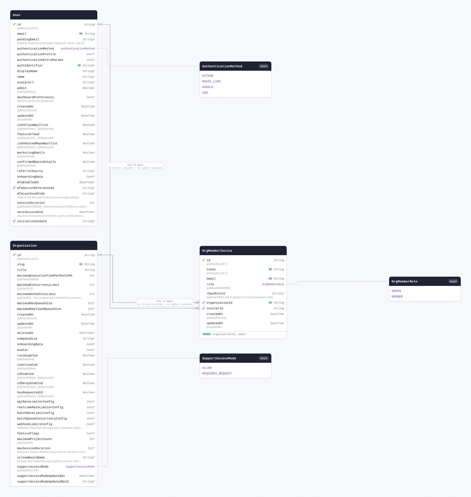

| Field            | Type                                   | Constraints                                       | Default      | Description                                                                                                                                                                                                                                                                                                                                                                                                                                                                   |
| ---------------- | -------------------------------------- | ------------------------------------------------- | ------------ | ----------------------------------------------------------------------------------------------------------------------------------------------------------------------------------------------------------------------------------------------------------------------------------------------------------------------------------------------------------------------------------------------------------------------------------------------------------------------------- |
| `id`             | `String`                               | PK NOT NULL                                       | `cuid(1)`    |                                                                                                                                                                                                                                                                                                                                                                                                                                                                               |
| `token`          | `String`                               | UNIQUE NOT NULL                                   | `cuid(1)`    |                                                                                                                                                                                                                                                                                                                                                                                                                                                                               |
| `email`          | `String`                               | NOT NULL                                          |              |                                                                                                                                                                                                                                                                                                                                                                                                                                                                               |
| `role`           | [`OrgMemberRole`](#enum-OrgMemberRole) | NOT NULL                                          | `MEMBER`     |                                                                                                                                                                                                                                                                                                                                                                                                                                                                               |
| `rbacRoleId`     | `String`                               | NULL                                              |              | Optional RBAC role to assign on invite acceptance. When set, the accept-invite flow calls the loaded RBAC plugin's setUserRole with this id after creating the OrgMember. Null = legacy behaviour, the runtime fallback derives the role from `role` above. Plain text (not an FK) — the RBAC plugin's RbacRole table lives on a separate schema (Drizzle, not Prisma) so we can't model the FK here. Validation happens at write time (action) and read time (acceptInvite). |
| `organizationId` | `String`                               | NOT NULL → [Organization.id](#model-Organization) |              |                                                                                                                                                                                                                                                                                                                                                                                                                                                                               |
| `inviterId`      | `String`                               | NOT NULL → [User.id](#model-User)                 |              |                                                                                                                                                                                                                                                                                                                                                                                                                                                                               |
| `createdAt`      | `DateTime`                             | NOT NULL                                          | `now()`      |                                                                                                                                                                                                                                                                                                                                                                                                                                                                               |
| `updatedAt`      | `DateTime`                             | NOT NULL                                          | `@updatedAt` |                                                                                                                                                                                                                                                                                                                                                                                                                                                                               |

#### Indexes

- `@@unique([organizationId, email])`

#### References

- `organizationId` → [Organization.id](#model-Organization) (many-to-one, on delete Cascade, on update Cascade)
- `inviterId` → [User.id](#model-User) (many-to-one, on delete Cascade, on update Cascade)

#### Definition

```sql
CREATE TABLE "OrgMemberInvite" (
    "id" TEXT NOT NULL,
    "token" TEXT NOT NULL,
    "email" TEXT NOT NULL,
    "role" "OrgMemberRole" NOT NULL DEFAULT 'MEMBER',
    "rbacRoleId" TEXT,
    "organizationId" TEXT NOT NULL,
    "inviterId" TEXT NOT NULL,
    "createdAt" TIMESTAMP(3) NOT NULL DEFAULT CURRENT_TIMESTAMP,
    "updatedAt" TIMESTAMP(3) NOT NULL,

    CONSTRAINT "OrgMemberInvite_pkey" PRIMARY KEY ("id")
);

CREATE UNIQUE INDEX "OrgMemberInvite_token_key" ON "OrgMemberInvite"("token");

CREATE UNIQUE INDEX "OrgMemberInvite_organizationId_email_key" ON "OrgMemberInvite"("organizationId", "email");

ALTER TABLE "OrgMemberInvite" ADD CONSTRAINT "OrgMemberInvite_organizationId_fkey" FOREIGN KEY ("organizationId") REFERENCES "Organization"("id") ON DELETE CASCADE ON UPDATE CASCADE;

ALTER TABLE "OrgMemberInvite" ADD CONSTRAINT "OrgMemberInvite_inviterId_fkey" FOREIGN KEY ("inviterId") REFERENCES "User"("id") ON DELETE CASCADE ON UPDATE CASCADE;
```

<details>
<summary>Queries and their SQL</summary>

**findMany**: Every row

```ts
await prisma.orgMemberInvite.findMany();
```

```sql
SELECT
  "public"."OrgMemberInvite"."id",
  "public"."OrgMemberInvite"."token",
  "public"."OrgMemberInvite"."email",
  "public"."OrgMemberInvite"."role"::text,
  "public"."OrgMemberInvite"."rbacRoleId",
  "public"."OrgMemberInvite"."organizationId",
  "public"."OrgMemberInvite"."inviterId",
  "public"."OrgMemberInvite"."createdAt",
  "public"."OrgMemberInvite"."updatedAt"
FROM
  "public"."OrgMemberInvite"
WHERE
  1 = 1
OFFSET
  $1
-- params: ["0"]
```

**count**: How many rows there are

```ts
await prisma.orgMemberInvite.count();
```

```sql
SELECT
  COUNT(*) AS "_count$_all"
FROM
  (
    SELECT
      "public"."OrgMemberInvite"."id"
    FROM
      "public"."OrgMemberInvite"
    WHERE
      1 = 1
    OFFSET
      $1
  ) AS "sub"
-- params: ["0"]
```

**findMany**: Every row with its relations

```ts
await prisma.orgMemberInvite.findMany({ include: { organization: true, inviter: true } });
```

```sql
SELECT
  "public"."OrgMemberInvite"."id",
  "public"."OrgMemberInvite"."token",
  "public"."OrgMemberInvite"."email",
  "public"."OrgMemberInvite"."role"::text,
  "public"."OrgMemberInvite"."rbacRoleId",
  "public"."OrgMemberInvite"."organizationId",
  "public"."OrgMemberInvite"."inviterId",
  "public"."OrgMemberInvite"."createdAt",
  "public"."OrgMemberInvite"."updatedAt"
FROM
  "public"."OrgMemberInvite"
WHERE
  1 = 1
OFFSET
  $1
-- params: ["0"]

SELECT
  "public"."Organization"."id",
  "public"."Organization"."slug",
  "public"."Organization"."title",
  "public"."Organization"."maximumExecutionTimePerRunInMs",
  "public"."Organization"."maximumConcurrencyLimit",
  "public"."Organization"."maximumSchedulesLimit",
  "public"."Organization"."maximumDevQueueSize",
  "public"."Organization"."maximumDeployedQueueSize",
  "public"."Organization"."createdAt",
  "public"."Organization"."updatedAt",
  "public"."Organization"."deletedAt",
  "public"."Organization"."companySize",
  "public"."Organization"."onboardingData",
  "public"."Organization"."avatar",
  "public"."Organization"."runsEnabled",
  "public"."Organization"."v3Enabled",
  "public"."Organization"."v2Enabled",
  "public"."Organization"."v2MarqsEnabled",
  "public"."Organization"."hasRequestedV3",
  "public"."Organization"."apiRateLimiterConfig",
  "public"."Organization"."realtimeRateLimiterConfig",
  "public"."Organization"."batchRateLimitConfig",
  "public"."Organization"."batchQueueConcurrencyConfig",
  "public"."Organization"."webhookLimitsConfig",
  "public"."Organization"."featureFlags",
  "public"."Organization"."maximumProjectCount",
  "public"."Organization"."maxSessionDuration",
  "public"."Organization"."streamBasinName",
  "public"."Organization"."supportAccessMode"::text,
  "public"."Organization"."supportAccessModeUpdatedAt",
  "public"."Organization"."supportAccessModeUpdatedById"
FROM
  "public"."Organization"
WHERE
  "public"."Organization"."id" IN ($1)
OFFSET
  $2
-- params: ["<organizationId of the rows above>","0"]

SELECT
  "public"."User"."id",
  "public"."User"."email",
  "public"."User"."pendingEmail",
  "public"."User"."authenticationMethod"::text,
  "public"."User"."authenticationProfile",
  "public"."User"."authenticationExtraParams",
  "public"."User"."authIdentifier",
  "public"."User"."displayName",
  "public"."User"."name",
  "public"."User"."avatarUrl",
  "public"."User"."admin",
  "public"."User"."dashboardPreferences",
  "public"."User"."createdAt",
  "public"."User"."updatedAt",
  "public"."User"."isOnCloudWaitlist",
  "public"."User"."featureCloud",
  "public"."User"."isOnHostedRepoWaitlist",
  "public"."User"."marketingEmails",
  "public"."User"."confirmedBasicDetails",
  "public"."User"."referralSource",
  "public"."User"."onboardingData",
  "public"."User"."mfaEnabledAt",
  "public"."User"."mfaSecretReferenceId",
  "public"."User"."mfaLastUsedCode",
  "public"."User"."sessionDuration",
  "public"."User"."nextSessionEnd",
  "public"."User"."invitationCodeId"
FROM
  "public"."User"
WHERE
  "public"."User"."id" IN ($1)
OFFSET
  $2
-- params: ["<inviterId of the rows above>","0"]
```

**findUnique**: One row by what is unique to it

```ts
await prisma.orgMemberInvite.findUnique({ where: { id: "example" } });
```

```sql
SELECT
  "public"."OrgMemberInvite"."id",
  "public"."OrgMemberInvite"."token",
  "public"."OrgMemberInvite"."email",
  "public"."OrgMemberInvite"."role"::text,
  "public"."OrgMemberInvite"."rbacRoleId",
  "public"."OrgMemberInvite"."organizationId",
  "public"."OrgMemberInvite"."inviterId",
  "public"."OrgMemberInvite"."createdAt",
  "public"."OrgMemberInvite"."updatedAt"
FROM
  "public"."OrgMemberInvite"
WHERE
  (
    "public"."OrgMemberInvite"."id" = $1
    AND 1 = 1
  )
LIMIT
  $2
OFFSET
  $3
-- params: ["example","1","0"]
```

**create**: Create a row

```ts
await prisma.orgMemberInvite.create({
  data: { email: "example", organizationId: "example", inviterId: "example" },
});
```

```sql
INSERT INTO
  "public"."OrgMemberInvite" (
    "id",
    "token",
    "email",
    "role",
    "organizationId",
    "inviterId",
    "createdAt",
    "updatedAt"
  )
VALUES
  (
    $1,
    $2,
    $3,
    CAST($4::text AS "public"."OrgMemberRole"),
    $5,
    $6,
    $7,
    $8
  )
RETURNING
  "public"."OrgMemberInvite"."id",
  "public"."OrgMemberInvite"."token",
  "public"."OrgMemberInvite"."email",
  "public"."OrgMemberInvite"."role"::text,
  "public"."OrgMemberInvite"."rbacRoleId",
  "public"."OrgMemberInvite"."organizationId",
  "public"."OrgMemberInvite"."inviterId",
  "public"."OrgMemberInvite"."createdAt",
  "public"."OrgMemberInvite"."updatedAt"
-- params: ["<cuid(1)>","<cuid(1)>","example","MEMBER","example","example","<now()>","<now()>"]
```

**update**: Update a row

```ts
await prisma.orgMemberInvite.update({ where: { id: "example" }, data: { token: "example" } });
```

```sql
UPDATE "public"."OrgMemberInvite"
SET
  "token" = $1,
  "updatedAt" = $2
WHERE
  (
    "public"."OrgMemberInvite"."id" = $3
    AND 1 = 1
  )
RETURNING
  "public"."OrgMemberInvite"."id",
  "public"."OrgMemberInvite"."token",
  "public"."OrgMemberInvite"."email",
  "public"."OrgMemberInvite"."role"::text,
  "public"."OrgMemberInvite"."rbacRoleId",
  "public"."OrgMemberInvite"."organizationId",
  "public"."OrgMemberInvite"."inviterId",
  "public"."OrgMemberInvite"."createdAt",
  "public"."OrgMemberInvite"."updatedAt"
-- params: ["example",{"prisma__type":"generatorCall","prisma__value":{"name":"now","args":[],"returnType":{"type":"DateTime"}}},"example"]
```

**delete**: Delete a row

```ts
await prisma.orgMemberInvite.delete({ where: { id: "example" } });
```

```sql
DELETE FROM "public"."OrgMemberInvite"
WHERE
  (
    "public"."OrgMemberInvite"."id" = $1
    AND 1 = 1
  )
RETURNING
  "public"."OrgMemberInvite"."id",
  "public"."OrgMemberInvite"."token",
  "public"."OrgMemberInvite"."email",
  "public"."OrgMemberInvite"."role"::text,
  "public"."OrgMemberInvite"."rbacRoleId",
  "public"."OrgMemberInvite"."organizationId",
  "public"."OrgMemberInvite"."inviterId",
  "public"."OrgMemberInvite"."createdAt",
  "public"."OrgMemberInvite"."updatedAt"
-- params: ["example"]
```

</details>

<a id="model-RuntimeEnvironment"></a>

### RuntimeEnvironment

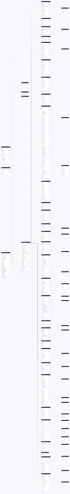

| Field                                 | Type                                                     | Constraints                                                             | Default       | Description                                                                                                                                                                                                  |
| ------------------------------------- | -------------------------------------------------------- | ----------------------------------------------------------------------- | ------------- | ------------------------------------------------------------------------------------------------------------------------------------------------------------------------------------------------------------ |
| `id`                                  | `String`                                                 | PK NOT NULL                                                             | `cuid(1)`     |                                                                                                                                                                                                              |
| `slug`                                | `String`                                                 | NOT NULL                                                                |               |                                                                                                                                                                                                              |
| `apiKey`                              | `String`                                                 | UNIQUE NOT NULL                                                         |               |                                                                                                                                                                                                              |
| `rootApiKeyHiddenAt`                  | `DateTime`                                               | NULL                                                                    |               | Non-null prevents the root API key from being returned to users.                                                                                                                                             |
| `pkApiKey`                            | `String`                                                 | UNIQUE NOT NULL                                                         |               | @deprecated was for v2                                                                                                                                                                                       |
| `type`                                | [`RuntimeEnvironmentType`](#enum-RuntimeEnvironmentType) | NOT NULL                                                                | `DEVELOPMENT` |                                                                                                                                                                                                              |
| `isBranchableEnvironment`             | `Boolean`                                                | NOT NULL                                                                | `false`       | If true, this environment has branches and is treated differently in the dashboard/API NB: this flag is NOT used for Development branches, instead (type, parentEnvironmentId) = (DEVELOPMENT, NULL) is used |
| `branchName`                          | `String`                                                 | NULL                                                                    |               |                                                                                                                                                                                                              |
| `parentEnvironmentId`                 | `String`                                                 | NULL → [RuntimeEnvironment.id](#model-RuntimeEnvironment)               |               |                                                                                                                                                                                                              |
| `previewAutoArchiveAfterDays`         | `Int`                                                    | NULL                                                                    |               | Only configured on the PREVIEW root. Null disables automatic archiving.                                                                                                                                      |
| `previewAutoArchiveExcludedBranches`  | `String[]`                                               | NOT NULL                                                                | `[]`          |                                                                                                                                                                                                              |
| `previewAutoArchiveNextCheckAt`       | `DateTime`                                               | NULL                                                                    |               | Durable per-project cleanup progress. Null next-check disables scheduling.                                                                                                                                   |
| `previewAutoArchiveCursorCreatedAt`   | `DateTime`                                               | NULL                                                                    |               |                                                                                                                                                                                                              |
| `previewAutoArchiveCursorId`          | `String`                                                 | NULL                                                                    |               |                                                                                                                                                                                                              |
| `git`                                 | `Json`                                                   | NULL                                                                    |               |                                                                                                                                                                                                              |
| `archivedAt`                          | `DateTime`                                               | NULL                                                                    |               | When set API calls will fail                                                                                                                                                                                 |
| `shortcode`                           | `String`                                                 | NOT NULL                                                                |               | A memorable code for the environment                                                                                                                                                                         |
| `maximumConcurrencyLimit`             | `Int`                                                    | NOT NULL                                                                | `5`           |                                                                                                                                                                                                              |
| `concurrencyLimitBurstFactor`         | `Decimal` `@db.Decimal(4, 2)`                            | NOT NULL                                                                | `2`           |                                                                                                                                                                                                              |
| `paused`                              | `Boolean`                                                | NOT NULL                                                                | `false`       |                                                                                                                                                                                                              |
| `pauseSource`                         | [`EnvironmentPauseSource`](#enum-EnvironmentPauseSource) | NULL                                                                    |               |                                                                                                                                                                                                              |
| `autoEnableInternalSources`           | `Boolean`                                                | NOT NULL                                                                | `true`        |                                                                                                                                                                                                              |
| `organizationId`                      | `String`                                                 | NOT NULL → [Organization.id](#model-Organization)                       |               |                                                                                                                                                                                                              |
| `projectId`                           | `String`                                                 | NOT NULL → [Project.id](#model-Project)                                 |               |                                                                                                                                                                                                              |
| `orgMemberId`                         | `String`                                                 | NULL → [OrgMember.id](#model-OrgMember)                                 |               |                                                                                                                                                                                                              |
| `createdAt`                           | `DateTime`                                               | NOT NULL                                                                | `now()`       |                                                                                                                                                                                                              |
| `updatedAt`                           | `DateTime`                                               | NOT NULL                                                                | `@updatedAt`  |                                                                                                                                                                                                              |
| `builtInEnvironmentVariableOverrides` | `Json`                                                   | NULL                                                                    |               | Allows us to customize the built-in environment variables for a specific environment, like TRIGGER_OTEL_SPAN_ATTRIBUTE_VALUE_LENGTH_LIMIT                                                                    |
| `tunnelId`                            | `String`                                                 | NULL                                                                    |               |                                                                                                                                                                                                              |
| `currentSessionId`                    | `String`                                                 | NULL → [RuntimeEnvironmentSession.id](#model-RuntimeEnvironmentSession) |               |                                                                                                                                                                                                              |

#### Indexes

- `@@index([parentEnvironmentId])`
- `@@index([projectId])`
- `@@index([organizationId])`
- `@@unique([projectId, slug, orgMemberId])`
- `@@unique([projectId, shortcode])`

#### References

- `parentEnvironmentId` → [RuntimeEnvironment.id](#model-RuntimeEnvironment) (many-to-one, on delete Cascade, on update Cascade)
- `organizationId` → [Organization.id](#model-Organization) (many-to-one, on delete Cascade, on update Cascade)
- `projectId` → [Project.id](#model-Project) (many-to-one, on delete Cascade, on update Cascade)
- `orgMemberId` → [OrgMember.id](#model-OrgMember) (many-to-one, on delete SetNull, on update Cascade)
- `currentSessionId` → [RuntimeEnvironmentSession.id](#model-RuntimeEnvironmentSession) (many-to-one, on delete SetNull, on update Cascade)

#### Referenced by

- `id` ← [RuntimeEnvironment.parentEnvironmentId](#model-RuntimeEnvironment) (one-to-many, on delete Cascade, on update Cascade)
- `id` ← [ApiKey.runtimeEnvironmentId](#model-ApiKey) (one-to-many, on delete Cascade, on update Cascade)
- `id` ← [RevokedApiKey.runtimeEnvironmentId](#model-RevokedApiKey) (one-to-many, on delete Cascade, on update Cascade)
- `id` ← [EnvironmentEncryptionPolicy.environmentId](#model-EnvironmentEncryptionPolicy) (one-to-one, on delete Cascade)
- `id` ← [EnvironmentEncryptionKey.environmentId](#model-EnvironmentEncryptionKey) (one-to-many, on delete Cascade)
- `id` ← [BackgroundWorker.runtimeEnvironmentId](#model-BackgroundWorker) (one-to-many, on delete Cascade, on update Cascade)
- `id` ← [Prompt.runtimeEnvironmentId](#model-Prompt) (one-to-many, on delete Cascade, on update Cascade)
- `id` ← [BackgroundWorkerTask.runtimeEnvironmentId](#model-BackgroundWorkerTask) (one-to-many, on delete Cascade, on update Cascade)
- `id` ← [PlaygroundConversation.runtimeEnvironmentId](#model-PlaygroundConversation) (one-to-many, on delete Cascade, on update Cascade)
- `id` ← [TaskRun.runtimeEnvironmentId](#model-TaskRun) (one-to-many, on delete Cascade, on update Cascade)
- `id` ← [TaskRunCheckpoint.runtimeEnvironmentId](#model-TaskRunCheckpoint) (one-to-many, on delete Cascade, on update Cascade)
- `id` ← [Waitpoint.environmentId](#model-Waitpoint) (one-to-many, on delete Cascade, on update Cascade)
- `id` ← [WaitpointTag.environmentId](#model-WaitpointTag) (one-to-many, on delete Cascade, on update Cascade)
- `id` ← [WorkerInstance.environmentId](#model-WorkerInstance) (one-to-many, on delete Cascade, on update Cascade)
- `id` ← [TaskRunNumberCounter.environmentId](#model-TaskRunNumberCounter) (one-to-many, on delete Cascade, on update Cascade)
- `id` ← [TaskRunAttempt.runtimeEnvironmentId](#model-TaskRunAttempt) (one-to-many, on delete Cascade, on update Cascade)
- `id` ← [TaskQueue.runtimeEnvironmentId](#model-TaskQueue) (one-to-many, on delete Cascade, on update Cascade)
- `id` ← [EnvironmentVariableValue.environmentId](#model-EnvironmentVariableValue) (one-to-many, on delete Cascade, on update Cascade)
- `id` ← [Checkpoint.runtimeEnvironmentId](#model-Checkpoint) (one-to-many, on delete Cascade, on update Cascade)
- `id` ← [CheckpointRestoreEvent.runtimeEnvironmentId](#model-CheckpointRestoreEvent) (one-to-many, on delete Cascade, on update Cascade)
- `id` ← [WorkerDeployment.environmentId](#model-WorkerDeployment) (one-to-many, on delete Cascade, on update Cascade)
- `id` ← [WorkerDeploymentPromotion.environmentId](#model-WorkerDeploymentPromotion) (one-to-many, on delete Cascade, on update Cascade)
- `id` ← [TaskScheduleInstance.environmentId](#model-TaskScheduleInstance) (one-to-many, on delete Cascade, on update Cascade)
- `id` ← [RuntimeEnvironmentSession.environmentId](#model-RuntimeEnvironmentSession) (one-to-many, on delete Cascade, on update Cascade)
- `id` ← [ProjectAlert.environmentId](#model-ProjectAlert) (one-to-many, on delete Cascade, on update Cascade)
- `id` ← [BulkActionGroup.environmentId](#model-BulkActionGroup) (one-to-many, on delete Cascade, on update Cascade)
- `id` ← [TrustedDeployEnvironment.runtimeEnvironmentId](#model-TrustedDeployEnvironment) (one-to-one, on delete Cascade)
- `id` ← [CustomerQuery.environmentId](#model-CustomerQuery) (one-to-many, on delete Cascade, on update Cascade)
- `id` ← [ErrorGroupState.environmentId](#model-ErrorGroupState) (one-to-many, on delete Cascade, on update Cascade)
- `id` ← [TaskIdentifier.runtimeEnvironmentId](#model-TaskIdentifier) (one-to-many, on delete Cascade, on update Cascade)

#### Definition

```sql
CREATE TABLE "RuntimeEnvironment" (
    "id" TEXT NOT NULL,
    "slug" TEXT NOT NULL,
    "apiKey" TEXT NOT NULL,
    "rootApiKeyHiddenAt" TIMESTAMP(3),
    "pkApiKey" TEXT NOT NULL,
    "type" "RuntimeEnvironmentType" NOT NULL DEFAULT 'DEVELOPMENT',
    "isBranchableEnvironment" BOOLEAN NOT NULL DEFAULT false,
    "branchName" TEXT,
    "parentEnvironmentId" TEXT,
    "previewAutoArchiveAfterDays" INTEGER,
    "previewAutoArchiveExcludedBranches" TEXT[] DEFAULT ARRAY[]::TEXT[],
    "previewAutoArchiveNextCheckAt" TIMESTAMP(3),
    "previewAutoArchiveCursorCreatedAt" TIMESTAMP(3),
    "previewAutoArchiveCursorId" TEXT,
    "git" JSONB,
    "archivedAt" TIMESTAMP(3),
    "shortcode" TEXT NOT NULL,
    "maximumConcurrencyLimit" INTEGER NOT NULL DEFAULT 5,
    "concurrencyLimitBurstFactor" DECIMAL(4,2) NOT NULL DEFAULT 2.00,
    "paused" BOOLEAN NOT NULL DEFAULT false,
    "pauseSource" "EnvironmentPauseSource",
    "autoEnableInternalSources" BOOLEAN NOT NULL DEFAULT true,
    "organizationId" TEXT NOT NULL,
    "projectId" TEXT NOT NULL,
    "orgMemberId" TEXT,
    "createdAt" TIMESTAMP(3) NOT NULL DEFAULT CURRENT_TIMESTAMP,
    "updatedAt" TIMESTAMP(3) NOT NULL,
    "builtInEnvironmentVariableOverrides" JSONB,
    "tunnelId" TEXT,
    "currentSessionId" TEXT,

    CONSTRAINT "RuntimeEnvironment_pkey" PRIMARY KEY ("id")
);

CREATE UNIQUE INDEX "RuntimeEnvironment_apiKey_key" ON "RuntimeEnvironment"("apiKey");

CREATE UNIQUE INDEX "RuntimeEnvironment_pkApiKey_key" ON "RuntimeEnvironment"("pkApiKey");

CREATE INDEX "RuntimeEnvironment_parentEnvironmentId_idx" ON "RuntimeEnvironment"("parentEnvironmentId");

CREATE INDEX "RuntimeEnvironment_projectId_idx" ON "RuntimeEnvironment"("projectId");

CREATE INDEX "RuntimeEnvironment_organizationId_idx" ON "RuntimeEnvironment"("organizationId");

CREATE UNIQUE INDEX "RuntimeEnvironment_projectId_slug_orgMemberId_key" ON "RuntimeEnvironment"("projectId", "slug", "orgMemberId");

CREATE UNIQUE INDEX "RuntimeEnvironment_projectId_shortcode_key" ON "RuntimeEnvironment"("projectId", "shortcode");

ALTER TABLE "RuntimeEnvironment" ADD CONSTRAINT "RuntimeEnvironment_parentEnvironmentId_fkey" FOREIGN KEY ("parentEnvironmentId") REFERENCES "RuntimeEnvironment"("id") ON DELETE CASCADE ON UPDATE CASCADE;

ALTER TABLE "RuntimeEnvironment" ADD CONSTRAINT "RuntimeEnvironment_organizationId_fkey" FOREIGN KEY ("organizationId") REFERENCES "Organization"("id") ON DELETE CASCADE ON UPDATE CASCADE;

ALTER TABLE "RuntimeEnvironment" ADD CONSTRAINT "RuntimeEnvironment_projectId_fkey" FOREIGN KEY ("projectId") REFERENCES "Project"("id") ON DELETE CASCADE ON UPDATE CASCADE;

ALTER TABLE "RuntimeEnvironment" ADD CONSTRAINT "RuntimeEnvironment_orgMemberId_fkey" FOREIGN KEY ("orgMemberId") REFERENCES "OrgMember"("id") ON DELETE SET NULL ON UPDATE CASCADE;

ALTER TABLE "RuntimeEnvironment" ADD CONSTRAINT "RuntimeEnvironment_currentSessionId_fkey" FOREIGN KEY ("currentSessionId") REFERENCES "RuntimeEnvironmentSession"("id") ON DELETE SET NULL ON UPDATE CASCADE;
```

<details>
<summary>Queries and their SQL</summary>

**findMany**: Every row

```ts
await prisma.runtimeEnvironment.findMany();
```

```sql
SELECT
  "public"."RuntimeEnvironment"."id",
  "public"."RuntimeEnvironment"."slug",
  "public"."RuntimeEnvironment"."apiKey",
  "public"."RuntimeEnvironment"."rootApiKeyHiddenAt",
  "public"."RuntimeEnvironment"."pkApiKey",
  "public"."RuntimeEnvironment"."type"::text,
  "public"."RuntimeEnvironment"."isBranchableEnvironment",
  "public"."RuntimeEnvironment"."branchName",
  "public"."RuntimeEnvironment"."parentEnvironmentId",
  "public"."RuntimeEnvironment"."previewAutoArchiveAfterDays",
  "public"."RuntimeEnvironment"."previewAutoArchiveExcludedBranches",
  "public"."RuntimeEnvironment"."previewAutoArchiveNextCheckAt",
  "public"."RuntimeEnvironment"."previewAutoArchiveCursorCreatedAt",
  "public"."RuntimeEnvironment"."previewAutoArchiveCursorId",
  "public"."RuntimeEnvironment"."git",
  "public"."RuntimeEnvironment"."archivedAt",
  "public"."RuntimeEnvironment"."shortcode",
  "public"."RuntimeEnvironment"."maximumConcurrencyLimit",
  "public"."RuntimeEnvironment"."concurrencyLimitBurstFactor",
  "public"."RuntimeEnvironment"."paused",
  "public"."RuntimeEnvironment"."pauseSource"::text,
  "public"."RuntimeEnvironment"."autoEnableInternalSources",
  "public"."RuntimeEnvironment"."organizationId",
  "public"."RuntimeEnvironment"."projectId",
  "public"."RuntimeEnvironment"."orgMemberId",
  "public"."RuntimeEnvironment"."createdAt",
  "public"."RuntimeEnvironment"."updatedAt",
  "public"."RuntimeEnvironment"."builtInEnvironmentVariableOverrides",
  "public"."RuntimeEnvironment"."tunnelId",
  "public"."RuntimeEnvironment"."currentSessionId"
FROM
  "public"."RuntimeEnvironment"
WHERE
  1 = 1
OFFSET
  $1
-- params: ["0"]
```

**count**: How many rows there are

```ts
await prisma.runtimeEnvironment.count();
```

```sql
SELECT
  COUNT(*) AS "_count$_all"
FROM
  (
    SELECT
      "public"."RuntimeEnvironment"."id"
    FROM
      "public"."RuntimeEnvironment"
    WHERE
      1 = 1
    OFFSET
      $1
  ) AS "sub"
-- params: ["0"]
```

**findMany**: Every row with its relations

```ts
await prisma.runtimeEnvironment.findMany({
  include: {
    encryptionPolicy: true,
    encryptionKeys: true,
    parentEnvironment: true,
    childEnvironments: true,
    organization: true,
    project: true,
    orgMember: true,
    backgroundWorkers: true,
    backgroundWorkerTasks: true,
    taskRuns: true,
    taskQueues: true,
    environmentVariableValues: true,
    checkpoints: true,
    workerDeployments: true,
    workerDeploymentPromotions: true,
    taskRunAttempts: true,
    CheckpointRestoreEvent: true,
    taskScheduleInstances: true,
    alerts: true,
    sessions: true,
    currentSession: true,
    taskRunNumberCounter: true,
    taskRunCheckpoints: true,
    waitpoints: true,
    workerInstances: true,
    waitpointTags: true,
    BulkActionGroup: true,
    customerQueries: true,
    prompts: true,
    playgroundConversations: true,
    errorGroupStates: true,
    taskIdentifiers: true,
    apiKeys: true,
    revokedApiKeys: true,
    trustedDeployGrant: true,
  },
});
```

```sql
SELECT
  "public"."RuntimeEnvironment"."id",
  "public"."RuntimeEnvironment"."slug",
  "public"."RuntimeEnvironment"."apiKey",
  "public"."RuntimeEnvironment"."rootApiKeyHiddenAt",
  "public"."RuntimeEnvironment"."pkApiKey",
  "public"."RuntimeEnvironment"."type"::text,
  "public"."RuntimeEnvironment"."isBranchableEnvironment",
  "public"."RuntimeEnvironment"."branchName",
  "public"."RuntimeEnvironment"."parentEnvironmentId",
  "public"."RuntimeEnvironment"."previewAutoArchiveAfterDays",
  "public"."RuntimeEnvironment"."previewAutoArchiveExcludedBranches",
  "public"."RuntimeEnvironment"."previewAutoArchiveNextCheckAt",
  "public"."RuntimeEnvironment"."previewAutoArchiveCursorCreatedAt",
  "public"."RuntimeEnvironment"."previewAutoArchiveCursorId",
  "public"."RuntimeEnvironment"."git",
  "public"."RuntimeEnvironment"."archivedAt",
  "public"."RuntimeEnvironment"."shortcode",
  "public"."RuntimeEnvironment"."maximumConcurrencyLimit",
  "public"."RuntimeEnvironment"."concurrencyLimitBurstFactor",
  "public"."RuntimeEnvironment"."paused",
  "public"."RuntimeEnvironment"."pauseSource"::text,
  "public"."RuntimeEnvironment"."autoEnableInternalSources",
  "public"."RuntimeEnvironment"."organizationId",
  "public"."RuntimeEnvironment"."projectId",
  "public"."RuntimeEnvironment"."orgMemberId",
  "public"."RuntimeEnvironment"."createdAt",
  "public"."RuntimeEnvironment"."updatedAt",
  "public"."RuntimeEnvironment"."builtInEnvironmentVariableOverrides",
  "public"."RuntimeEnvironment"."tunnelId",
  "public"."RuntimeEnvironment"."currentSessionId"
FROM
  "public"."RuntimeEnvironment"
WHERE
  1 = 1
OFFSET
  $1
-- params: ["0"]

SELECT
  "public"."EnvironmentEncryptionPolicy"."environmentId",
  "public"."EnvironmentEncryptionPolicy"."revision",
  "public"."EnvironmentEncryptionPolicy"."wrappingProvider"::text,
  "public"."EnvironmentEncryptionPolicy"."wrappingKeyReference",
  "public"."EnvironmentEncryptionPolicy"."activeKeyId"
FROM
  "public"."EnvironmentEncryptionPolicy"
WHERE
  "public"."EnvironmentEncryptionPolicy"."environmentId" IN ($1)
OFFSET
  $2
-- params: ["<id of the rows above>","0"]

SELECT
  "public"."EnvironmentEncryptionKey"."id",
  "public"."EnvironmentEncryptionKey"."environmentId",
  "public"."EnvironmentEncryptionKey"."wrappedKey",
  "public"."EnvironmentEncryptionKey"."wrappingProvider"::text,
  "public"."EnvironmentEncryptionKey"."wrappingKeyReference",
  "public"."EnvironmentEncryptionKey"."revision",
  "public"."EnvironmentEncryptionKey"."createdAt"
FROM
  "public"."EnvironmentEncryptionKey"
WHERE
  "public"."EnvironmentEncryptionKey"."environmentId" IN ($1)
OFFSET
  $2
-- params: ["<id of the rows above>","0"]

SELECT
  "public"."RuntimeEnvironment"."id",
  "public"."RuntimeEnvironment"."slug",
  "public"."RuntimeEnvironment"."apiKey",
  "public"."RuntimeEnvironment"."rootApiKeyHiddenAt",
  "public"."RuntimeEnvironment"."pkApiKey",
  "public"."RuntimeEnvironment"."type"::text,
  "public"."RuntimeEnvironment"."isBranchableEnvironment",
  "public"."RuntimeEnvironment"."branchName",
  "public"."RuntimeEnvironment"."parentEnvironmentId",
  "public"."RuntimeEnvironment"."previewAutoArchiveAfterDays",
  "public"."RuntimeEnvironment"."previewAutoArchiveExcludedBranches",
  "public"."RuntimeEnvironment"."previewAutoArchiveNextCheckAt",
  "public"."RuntimeEnvironment"."previewAutoArchiveCursorCreatedAt",
  "public"."RuntimeEnvironment"."previewAutoArchiveCursorId",
  "public"."RuntimeEnvironment"."git",
  "public"."RuntimeEnvironment"."archivedAt",
  "public"."RuntimeEnvironment"."shortcode",
  "public"."RuntimeEnvironment"."maximumConcurrencyLimit",
  "public"."RuntimeEnvironment"."concurrencyLimitBurstFactor",
  "public"."RuntimeEnvironment"."paused",
  "public"."RuntimeEnvironment"."pauseSource"::text,
  "public"."RuntimeEnvironment"."autoEnableInternalSources",
  "public"."RuntimeEnvironment"."organizationId",
  "public"."RuntimeEnvironment"."projectId",
  "public"."RuntimeEnvironment"."orgMemberId",
  "public"."RuntimeEnvironment"."createdAt",
  "public"."RuntimeEnvironment"."updatedAt",
  "public"."RuntimeEnvironment"."builtInEnvironmentVariableOverrides",
  "public"."RuntimeEnvironment"."tunnelId",
  "public"."RuntimeEnvironment"."currentSessionId"
FROM
  "public"."RuntimeEnvironment"
WHERE
  "public"."RuntimeEnvironment"."id" IN ($1)
OFFSET
  $2
-- params: ["<parentEnvironmentId of the rows above>","0"]

SELECT
  "public"."RuntimeEnvironment"."id",
  "public"."RuntimeEnvironment"."slug",
  "public"."RuntimeEnvironment"."apiKey",
  "public"."RuntimeEnvironment"."rootApiKeyHiddenAt",
  "public"."RuntimeEnvironment"."pkApiKey",
  "public"."RuntimeEnvironment"."type"::text,
  "public"."RuntimeEnvironment"."isBranchableEnvironment",
  "public"."RuntimeEnvironment"."branchName",
  "public"."RuntimeEnvironment"."parentEnvironmentId",
  "public"."RuntimeEnvironment"."previewAutoArchiveAfterDays",
  "public"."RuntimeEnvironment"."previewAutoArchiveExcludedBranches",
  "public"."RuntimeEnvironment"."previewAutoArchiveNextCheckAt",
  "public"."RuntimeEnvironment"."previewAutoArchiveCursorCreatedAt",
  "public"."RuntimeEnvironment"."previewAutoArchiveCursorId",
  "public"."RuntimeEnvironment"."git",
  "public"."RuntimeEnvironment"."archivedAt",
  "public"."RuntimeEnvironment"."shortcode",
  "public"."RuntimeEnvironment"."maximumConcurrencyLimit",
  "public"."RuntimeEnvironment"."concurrencyLimitBurstFactor",
  "public"."RuntimeEnvironment"."paused",
  "public"."RuntimeEnvironment"."pauseSource"::text,
  "public"."RuntimeEnvironment"."autoEnableInternalSources",
  "public"."RuntimeEnvironment"."organizationId",
  "public"."RuntimeEnvironment"."projectId",
  "public"."RuntimeEnvironment"."orgMemberId",
  "public"."RuntimeEnvironment"."createdAt",
  "public"."RuntimeEnvironment"."updatedAt",
  "public"."RuntimeEnvironment"."builtInEnvironmentVariableOverrides",
  "public"."RuntimeEnvironment"."tunnelId",
  "public"."RuntimeEnvironment"."currentSessionId"
FROM
  "public"."RuntimeEnvironment"
WHERE
  "public"."RuntimeEnvironment"."parentEnvironmentId" IN ($1)
OFFSET
  $2
-- params: ["<id of the rows above>","0"]

SELECT
  "public"."Organization"."id",
  "public"."Organization"."slug",
  "public"."Organization"."title",
  "public"."Organization"."maximumExecutionTimePerRunInMs",
  "public"."Organization"."maximumConcurrencyLimit",
  "public"."Organization"."maximumSchedulesLimit",
  "public"."Organization"."maximumDevQueueSize",
  "public"."Organization"."maximumDeployedQueueSize",
  "public"."Organization"."createdAt",
  "public"."Organization"."updatedAt",
  "public"."Organization"."deletedAt",
  "public"."Organization"."companySize",
  "public"."Organization"."onboardingData",
  "public"."Organization"."avatar",
  "public"."Organization"."runsEnabled",
  "public"."Organization"."v3Enabled",
  "public"."Organization"."v2Enabled",
  "public"."Organization"."v2MarqsEnabled",
  "public"."Organization"."hasRequestedV3",
  "public"."Organization"."apiRateLimiterConfig",
  "public"."Organization"."realtimeRateLimiterConfig",
  "public"."Organization"."batchRateLimitConfig",
  "public"."Organization"."batchQueueConcurrencyConfig",
  "public"."Organization"."webhookLimitsConfig",
  "public"."Organization"."featureFlags",
  "public"."Organization"."maximumProjectCount",
  "public"."Organization"."maxSessionDuration",
  "public"."Organization"."streamBasinName",
  "public"."Organization"."supportAccessMode"::text,
  "public"."Organization"."supportAccessModeUpdatedAt",
  "public"."Organization"."supportAccessModeUpdatedById"
FROM
  "public"."Organization"
WHERE
  "public"."Organization"."id" IN ($1)
OFFSET
  $2
-- params: ["<organizationId of the rows above>","0"]

SELECT
  "public"."Project"."id",
  "public"."Project"."slug",
  "public"."Project"."name",
  "public"."Project"."externalRef",
  "public"."Project"."organizationId",
  "public"."Project"."createdAt",
  "public"."Project"."updatedAt",
  "public"."Project"."deletedAt",
  "public"."Project"."initializedAt",
  "public"."Project"."defaultRuntime",
  "public"."Project"."version"::text,
  "public"."Project"."engine"::text,
  "public"."Project"."builderProjectId",
  "public"."Project"."defaultWorkerGroupId",
  "public"."Project"."allowedMasterQueues",
  "public"."Project"."buildSettings",
  "public"."Project"."onboardingData"
FROM
  "public"."Project"
WHERE
  "public"."Project"."id" IN ($1)
OFFSET
  $2
-- params: ["<projectId of the rows above>","0"]

SELECT
  "public"."OrgMember"."id",
  "public"."OrgMember"."organizationId",
  "public"."OrgMember"."userId",
  "public"."OrgMember"."role"::text,
  "public"."OrgMember"."createdAt",
  "public"."OrgMember"."updatedAt"
FROM
  "public"."OrgMember"
WHERE
  "public"."OrgMember"."id" IN ($1)
OFFSET
  $2
-- params: ["<orgMemberId of the rows above>","0"]

SELECT
  "public"."BackgroundWorker"."id",
  "public"."BackgroundWorker"."friendlyId",
  "public"."BackgroundWorker"."engine"::text,
  "public"."BackgroundWorker"."contentHash",
  "public"."BackgroundWorker"."sdkVersion",
  "public"."BackgroundWorker"."cliVersion",
  "public"."BackgroundWorker"."projectId",
  "public"."BackgroundWorker"."runtimeEnvironmentId",
  "public"."BackgroundWorker"."version",
  "public"."BackgroundWorker"."metadata",
  "public"."BackgroundWorker"."runtime",
  "public"."BackgroundWorker"."runtimeVersion",
  "public"."BackgroundWorker"."createdAt",
  "public"."BackgroundWorker"."updatedAt",
  "public"."BackgroundWorker"."workerGroupId",
  "public"."BackgroundWorker"."supportsLazyAttempts"
FROM
  "public"."BackgroundWorker"
WHERE
  "public"."BackgroundWorker"."runtimeEnvironmentId" IN ($1)
OFFSET
  $2
-- params: ["<id of the rows above>","0"]

SELECT
  "public"."BackgroundWorkerTask"."id",
  "public"."BackgroundWorkerTask"."slug",
  "public"."BackgroundWorkerTask"."description",
  "public"."BackgroundWorkerTask"."friendlyId",
  "public"."BackgroundWorkerTask"."filePath",
  "public"."BackgroundWorkerTask"."exportName",
  "public"."BackgroundWorkerTask"."workerId",
  "public"."BackgroundWorkerTask"."projectId",
  "public"."BackgroundWorkerTask"."fileId",
  "public"."BackgroundWorkerTask"."runtimeEnvironmentId",
  "public"."BackgroundWorkerTask"."createdAt",
  "public"."BackgroundWorkerTask"."updatedAt",
  "public"."BackgroundWorkerTask"."queueConfig",
  "public"."BackgroundWorkerTask"."retryConfig",
  "public"."BackgroundWorkerTask"."machineConfig",
  "public"."BackgroundWorkerTask"."gates",
  "public"."BackgroundWorkerTask"."queueId",
  "public"."BackgroundWorkerTask"."maxDurationInSeconds",
  "public"."BackgroundWorkerTask"."ttl",
  "public"."BackgroundWorkerTask"."triggerSource"::text,
  "public"."BackgroundWorkerTask"."config",
  "public"."BackgroundWorkerTask"."payloadSchema"
FROM
  "public"."BackgroundWorkerTask"
WHERE
  "public"."BackgroundWorkerTask"."runtimeEnvironmentId" IN ($1)
OFFSET
  $2
-- params: ["<id of the rows above>","0"]

SELECT
  "public"."TaskRun"."id",
  "public"."TaskRun"."number",
  "public"."TaskRun"."friendlyId",
  "public"."TaskRun"."engine"::text,
  "public"."TaskRun"."status"::text,
  "public"."TaskRun"."statusReason",
  "public"."TaskRun"."idempotencyKey",
  "public"."TaskRun"."idempotencyKeyExpiresAt",
  "public"."TaskRun"."idempotencyKeyOptions",
  "public"."TaskRun"."debounce",
  "public"."TaskRun"."taskIdentifier",
  "public"."TaskRun"."isTest",
  "public"."TaskRun"."payload",
  "public"."TaskRun"."payloadType",
  "public"."TaskRun"."context",
  "public"."TaskRun"."traceContext",
  "public"."TaskRun"."traceId",
  "public"."TaskRun"."spanId",
  "public"."TaskRun"."runtimeEnvironmentId",
  "public"."TaskRun"."environmentType"::text,
  "public"."TaskRun"."projectId",
  "public"."TaskRun"."organizationId",
  "public"."TaskRun"."queue",
  "public"."TaskRun"."lockedQueueId",
  "public"."TaskRun"."masterQueue",
  "public"."TaskRun"."region",
  "public"."TaskRun"."secondaryMasterQueue",
  "public"."TaskRun"."attemptNumber",
  "public"."TaskRun"."createdAt",
  "public"."TaskRun"."updatedAt",
  "public"."TaskRun"."runTags",
  "public"."TaskRun"."taskVersion",
  "public"."TaskRun"."sdkVersion",
  "public"."TaskRun"."cliVersion",
  "public"."TaskRun"."startedAt",
  "public"."TaskRun"."executedAt",
  "public"."TaskRun"."completedAt",
  "public"."TaskRun"."machinePreset",
  "public"."TaskRun"."usageDurationMs",
  "public"."TaskRun"."costInCents",
  "public"."TaskRun"."baseCostInCents",
  "public"."TaskRun"."lockedAt",
  "public"."TaskRun"."lockedById",
  "public"."TaskRun"."lockedToVersionId",
  "public"."TaskRun"."priorityMs",
  "public"."TaskRun"."concurrencyKey",
  "public"."TaskRun"."gates",
  "public"."TaskRun"."delayUntil",
  "public"."TaskRun"."queuedAt",
  "public"."TaskRun"."ttl",
  "public"."TaskRun"."expiredAt",
  "public"."TaskRun"."maxAttempts",
  "public"."TaskRun"."lockedRetryConfig",
  "public"."TaskRun"."oneTimeUseToken",
  "public"."TaskRun"."taskEventStore",
  "public"."TaskRun"."queueTimestamp",
  "public"."TaskRun"."scheduleInstanceId",
  "public"."TaskRun"."scheduleId",
  "public"."TaskRun"."bulkActionGroupIds",
  "public"."TaskRun"."logsDeletedAt",
  "public"."TaskRun"."replayedFromTaskRunFriendlyId",
  "public"."TaskRun"."rootTaskRunId",
  "public"."TaskRun"."parentTaskRunId",
  "public"."TaskRun"."parentTaskRunAttemptId",
  "public"."TaskRun"."batchId",
  "public"."TaskRun"."resumeParentOnCompletion",
  "public"."TaskRun"."depth",
  "public"."TaskRun"."parentSpanId",
  "public"."TaskRun"."runChainState",
  "public"."TaskRun"."seedMetadata",
  "public"."TaskRun"."seedMetadataType",
  "public"."TaskRun"."metadata",
  "public"."TaskRun"."metadataType",
  "public"."TaskRun"."metadataVersion",
  "public"."TaskRun"."annotations",
  "public"."TaskRun"."isWarmStart",
  "public"."TaskRun"."output",
  "public"."TaskRun"."outputType",
  "public"."TaskRun"."error",
  "public"."TaskRun"."planType",
  "public"."TaskRun"."maxDurationInSeconds",
  "public"."TaskRun"."realtimeStreamsVersion",
  "public"."TaskRun"."realtimeStreams",
  "public"."TaskRun"."streamBasinName"
FROM
  "public"."TaskRun"
WHERE
  "public"."TaskRun"."runtimeEnvironmentId" IN ($1)
OFFSET
  $2
-- params: ["<id of the rows above>","0"]

SELECT
  "public"."TaskQueue"."id",
  "public"."TaskQueue"."friendlyId",
  "public"."TaskQueue"."name",
  "public"."TaskQueue"."type"::text,
  "public"."TaskQueue"."version"::text,
  "public"."TaskQueue"."orderableName",
  "public"."TaskQueue"."concurrencyVersion"::text,
  "public"."TaskQueue"."role"::text,
  "public"."TaskQueue"."projectId",
  "public"."TaskQueue"."runtimeEnvironmentId",
  "public"."TaskQueue"."concurrencyLimit",
  "public"."TaskQueue"."concurrencyLimitOverriddenAt",
  "public"."TaskQueue"."concurrencyLimitOverriddenBy",
  "public"."TaskQueue"."concurrencyLimitBase",
  "public"."TaskQueue"."concurrencyLimitOverridePercent",
  "public"."TaskQueue"."totalConcurrencyLimit",
  "public"."TaskQueue"."totalConcurrencyLimitOverriddenAt",
  "public"."TaskQueue"."totalConcurrencyLimitOverriddenBy",
  "public"."TaskQueue"."totalConcurrencyLimitBase",
  "public"."TaskQueue"."rateLimit",
  "public"."TaskQueue"."paused",
  "public"."TaskQueue"."archivedAt",
  "public"."TaskQueue"."createdAt",
  "public"."TaskQueue"."updatedAt"
FROM
  "public"."TaskQueue"
WHERE
  "public"."TaskQueue"."runtimeEnvironmentId" IN ($1)
OFFSET
  $2
-- params: ["<id of the rows above>","0"]

SELECT
  "public"."EnvironmentVariableValue"."id",
  "public"."EnvironmentVariableValue"."valueReferenceId",
  "public"."EnvironmentVariableValue"."variableId",
  "public"."EnvironmentVariableValue"."environmentId",
  "public"."EnvironmentVariableValue"."isSecret",
  "public"."EnvironmentVariableValue"."createdAt",
  "public"."EnvironmentVariableValue"."updatedAt",
  "public"."EnvironmentVariableValue"."version",
  "public"."EnvironmentVariableValue"."lastUpdatedBy"
FROM
  "public"."EnvironmentVariableValue"
WHERE
  "public"."EnvironmentVariableValue"."environmentId" IN ($1)
OFFSET
  $2
-- params: ["<id of the rows above>","0"]

SELECT
  "public"."Checkpoint"."id",
  "public"."Checkpoint"."friendlyId",
  "public"."Checkpoint"."type"::text,
  "public"."Checkpoint"."location",
  "public"."Checkpoint"."imageRef",
  "public"."Checkpoint"."reason",
  "public"."Checkpoint"."metadata",
  "public"."Checkpoint"."runId",
  "public"."Checkpoint"."attemptId",
  "public"."Checkpoint"."attemptNumber",
  "public"."Checkpoint"."projectId",
  "public"."Checkpoint"."runtimeEnvironmentId",
  "public"."Checkpoint"."createdAt",
  "public"."Checkpoint"."updatedAt"
FROM
  "public"."Checkpoint"
WHERE
  "public"."Checkpoint"."runtimeEnvironmentId" IN ($1)
OFFSET
  $2
-- params: ["<id of the rows above>","0"]

SELECT
  "public"."WorkerDeployment"."id",
  "public"."WorkerDeployment"."contentHash",
  "public"."WorkerDeployment"."friendlyId",
  "public"."WorkerDeployment"."shortCode",
  "public"."WorkerDeployment"."version",
  "public"."WorkerDeployment"."runtime",
  "public"."WorkerDeployment"."runtimeVersion",
  "public"."WorkerDeployment"."cliVersion",
  "public"."WorkerDeployment"."imageReference",
  "public"."WorkerDeployment"."imagePlatform",
  "public"."WorkerDeployment"."templateKey",
  "public"."WorkerDeployment"."indexObjectKey",
  "public"."WorkerDeployment"."indexSha256",
  "public"."WorkerDeployment"."indexFormatVersion",
  "public"."WorkerDeployment"."externalBuildData",
  "public"."WorkerDeployment"."buildServerMetadata",
  "public"."WorkerDeployment"."buildEnvVars",
  "public"."WorkerDeployment"."status"::text,
  "public"."WorkerDeployment"."type"::text,
  "public"."WorkerDeployment"."projectId",
  "public"."WorkerDeployment"."environmentId",
  "public"."WorkerDeployment"."workerId",
  "public"."WorkerDeployment"."triggeredById",
  "public"."WorkerDeployment"."triggeredVia",
  "public"."WorkerDeployment"."commitSHA",
  "public"."WorkerDeployment"."externalId",
  "public"."WorkerDeployment"."startedAt",
  "public"."WorkerDeployment"."installedAt",
  "public"."WorkerDeployment"."builtAt",
  "public"."WorkerDeployment"."deployedAt",
  "public"."WorkerDeployment"."failedAt",
  "public"."WorkerDeployment"."errorData",
  "public"."WorkerDeployment"."canceledAt",
  "public"."WorkerDeployment"."canceledReason",
  "public"."WorkerDeployment"."git",
  "public"."WorkerDeployment"."createdAt",
  "public"."WorkerDeployment"."updatedAt"
FROM
  "public"."WorkerDeployment"
WHERE
  "public"."WorkerDeployment"."environmentId" IN ($1)
OFFSET
  $2
-- params: ["<id of the rows above>","0"]

SELECT
  "public"."WorkerDeploymentPromotion"."id",
  "public"."WorkerDeploymentPromotion"."label",
  "public"."WorkerDeploymentPromotion"."deploymentId",
  "public"."WorkerDeploymentPromotion"."environmentId"
FROM
  "public"."WorkerDeploymentPromotion"
WHERE
  "public"."WorkerDeploymentPromotion"."environmentId" IN ($1)
OFFSET
  $2
-- params: ["<id of the rows above>","0"]

SELECT
  "public"."TaskRunAttempt"."id",
  "public"."TaskRunAttempt"."number",
  "public"."TaskRunAttempt"."friendlyId",
  "public"."TaskRunAttempt"."taskRunId",
  "public"."TaskRunAttempt"."backgroundWorkerId",
  "public"."TaskRunAttempt"."backgroundWorkerTaskId",
  "public"."TaskRunAttempt"."runtimeEnvironmentId",
  "public"."TaskRunAttempt"."queueId",
  "public"."TaskRunAttempt"."status"::text,
  "public"."TaskRunAttempt"."createdAt",
  "public"."TaskRunAttempt"."updatedAt",
  "public"."TaskRunAttempt"."startedAt",
  "public"."TaskRunAttempt"."completedAt",
  "public"."TaskRunAttempt"."usageDurationMs",
  "public"."TaskRunAttempt"."error",
  "public"."TaskRunAttempt"."output",
  "public"."TaskRunAttempt"."outputType"
FROM
  "public"."TaskRunAttempt"
WHERE
  "public"."TaskRunAttempt"."runtimeEnvironmentId" IN ($1)
OFFSET
  $2
-- params: ["<id of the rows above>","0"]

SELECT
  "public"."CheckpointRestoreEvent"."id",
  "public"."CheckpointRestoreEvent"."type"::text,
  "public"."CheckpointRestoreEvent"."reason",
  "public"."CheckpointRestoreEvent"."metadata",
  "public"."CheckpointRestoreEvent"."checkpointId",
  "public"."CheckpointRestoreEvent"."runId",
  "public"."CheckpointRestoreEvent"."attemptId",
  "public"."CheckpointRestoreEvent"."projectId",
  "public"."CheckpointRestoreEvent"."runtimeEnvironmentId",
  "public"."CheckpointRestoreEvent"."createdAt",
  "public"."CheckpointRestoreEvent"."updatedAt"
FROM
  "public"."CheckpointRestoreEvent"
WHERE
  "public"."CheckpointRestoreEvent"."runtimeEnvironmentId" IN ($1)
OFFSET
  $2
-- params: ["<id of the rows above>","0"]

SELECT
  "public"."TaskScheduleInstance"."id",
  "public"."TaskScheduleInstance"."taskScheduleId",
  "public"."TaskScheduleInstance"."environmentId",
  "public"."TaskScheduleInstance"."projectId",
  "public"."TaskScheduleInstance"."schedulePhase",
  "public"."TaskScheduleInstance"."createdAt",
  "public"."TaskScheduleInstance"."updatedAt",
  "public"."TaskScheduleInstance"."active",
  "public"."TaskScheduleInstance"."lastScheduledTimestamp",
  "public"."TaskScheduleInstance"."nextScheduledTimestamp"
FROM
  "public"."TaskScheduleInstance"
WHERE
  "public"."TaskScheduleInstance"."environmentId" IN ($1)
OFFSET
  $2
-- params: ["<id of the rows above>","0"]

SELECT
  "public"."ProjectAlert"."id",
  "public"."ProjectAlert"."friendlyId",
  "public"."ProjectAlert"."projectId",
  "public"."ProjectAlert"."environmentId",
  "public"."ProjectAlert"."channelId",
  "public"."ProjectAlert"."status"::text,
  "public"."ProjectAlert"."type"::text,
  "public"."ProjectAlert"."taskRunAttemptId",
  "public"."ProjectAlert"."taskRunId",
  "public"."ProjectAlert"."workerDeploymentId",
  "public"."ProjectAlert"."createdAt",
  "public"."ProjectAlert"."updatedAt"
FROM
  "public"."ProjectAlert"
WHERE
  "public"."ProjectAlert"."environmentId" IN ($1)
OFFSET
  $2
-- params: ["<id of the rows above>","0"]

SELECT
  "public"."RuntimeEnvironmentSession"."id",
  "public"."RuntimeEnvironmentSession"."ipAddress",
  "public"."RuntimeEnvironmentSession"."environmentId",
  "public"."RuntimeEnvironmentSession"."createdAt",
  "public"."RuntimeEnvironmentSession"."updatedAt",
  "public"."RuntimeEnvironmentSession"."disconnectedAt"
FROM
  "public"."RuntimeEnvironmentSession"
WHERE
  "public"."RuntimeEnvironmentSession"."environmentId" IN ($1)
OFFSET
  $2
-- params: ["<id of the rows above>","0"]

SELECT
  "public"."RuntimeEnvironmentSession"."id",
  "public"."RuntimeEnvironmentSession"."ipAddress",
  "public"."RuntimeEnvironmentSession"."environmentId",
  "public"."RuntimeEnvironmentSession"."createdAt",
  "public"."RuntimeEnvironmentSession"."updatedAt",
  "public"."RuntimeEnvironmentSession"."disconnectedAt"
FROM
  "public"."RuntimeEnvironmentSession"
WHERE
  "public"."RuntimeEnvironmentSession"."id" IN ($1)
OFFSET
  $2
-- params: ["<currentSessionId of the rows above>","0"]

SELECT
  "public"."TaskRunNumberCounter"."id",
  "public"."TaskRunNumberCounter"."taskIdentifier",
  "public"."TaskRunNumberCounter"."environmentId",
  "public"."TaskRunNumberCounter"."lastNumber"
FROM
  "public"."TaskRunNumberCounter"
WHERE
  "public"."TaskRunNumberCounter"."environmentId" IN ($1)
OFFSET
  $2
-- params: ["<id of the rows above>","0"]

SELECT
  "public"."TaskRunCheckpoint"."id",
  "public"."TaskRunCheckpoint"."friendlyId",
  "public"."TaskRunCheckpoint"."type"::text,
  "public"."TaskRunCheckpoint"."location",
  "public"."TaskRunCheckpoint"."imageRef",
  "public"."TaskRunCheckpoint"."reason",
  "public"."TaskRunCheckpoint"."metadata",
  "public"."TaskRunCheckpoint"."projectId",
  "public"."TaskRunCheckpoint"."runtimeEnvironmentId",
  "public"."TaskRunCheckpoint"."createdAt",
  "public"."TaskRunCheckpoint"."updatedAt"
FROM
  "public"."TaskRunCheckpoint"
WHERE
  "public"."TaskRunCheckpoint"."runtimeEnvironmentId" IN ($1)
OFFSET
  $2
-- params: ["<id of the rows above>","0"]

SELECT
  "public"."Waitpoint"."id",
  "public"."Waitpoint"."friendlyId",
  "public"."Waitpoint"."type"::text,
  "public"."Waitpoint"."status"::text,
  "public"."Waitpoint"."completedAt",
  "public"."Waitpoint"."idempotencyKey",
  "public"."Waitpoint"."userProvidedIdempotencyKey",
  "public"."Waitpoint"."idempotencyKeyExpiresAt",
  "public"."Waitpoint"."inactiveIdempotencyKey",
  "public"."Waitpoint"."completedByTaskRunId",
  "public"."Waitpoint"."completedAfter",
  "public"."Waitpoint"."completedByBatchId",
  "public"."Waitpoint"."output",
  "public"."Waitpoint"."outputType",
  "public"."Waitpoint"."outputIsError",
  "public"."Waitpoint"."projectId",
  "public"."Waitpoint"."environmentId",
  "public"."Waitpoint"."createdAt",
  "public"."Waitpoint"."updatedAt",
  "public"."Waitpoint"."tags"
FROM
  "public"."Waitpoint"
WHERE
  "public"."Waitpoint"."environmentId" IN ($1)
OFFSET
  $2
-- params: ["<id of the rows above>","0"]

SELECT
  "public"."WorkerInstance"."id",
  "public"."WorkerInstance"."name",
  "public"."WorkerInstance"."resourceIdentifier",
  "public"."WorkerInstance"."metadata",
  "public"."WorkerInstance"."workerGroupId",
  "public"."WorkerInstance"."organizationId",
  "public"."WorkerInstance"."projectId",
  "public"."WorkerInstance"."environmentId",
  "public"."WorkerInstance"."deploymentId",
  "public"."WorkerInstance"."createdAt",
  "public"."WorkerInstance"."updatedAt",
  "public"."WorkerInstance"."lastDequeueAt",
  "public"."WorkerInstance"."lastHeartbeatAt"
FROM
  "public"."WorkerInstance"
WHERE
  "public"."WorkerInstance"."environmentId" IN ($1)
OFFSET
  $2
-- params: ["<id of the rows above>","0"]

SELECT
  "public"."WaitpointTag"."id",
  "public"."WaitpointTag"."name",
  "public"."WaitpointTag"."environmentId",
  "public"."WaitpointTag"."projectId",
  "public"."WaitpointTag"."createdAt"
FROM
  "public"."WaitpointTag"
WHERE
  "public"."WaitpointTag"."environmentId" IN ($1)
OFFSET
  $2
-- params: ["<id of the rows above>","0"]

SELECT
  "public"."BulkActionGroup"."id",
  "public"."BulkActionGroup"."friendlyId",
  "public"."BulkActionGroup"."projectId",
  "public"."BulkActionGroup"."environmentId",
  "public"."BulkActionGroup"."type"::text,
  "public"."BulkActionGroup"."status"::text,
  "public"."BulkActionGroup"."queryName",
  "public"."BulkActionGroup"."params",
  "public"."BulkActionGroup"."dedupeKey",
  "public"."BulkActionGroup"."cursor",
  "public"."BulkActionGroup"."successCount",
  "public"."BulkActionGroup"."failureCount",
  "public"."BulkActionGroup"."totalCount",
  "public"."BulkActionGroup"."completionNotification"::text,
  "public"."BulkActionGroup"."userId",
  "public"."BulkActionGroup"."name",
  "public"."BulkActionGroup"."completedAt",
  "public"."BulkActionGroup"."createdAt",
  "public"."BulkActionGroup"."updatedAt"
FROM
  "public"."BulkActionGroup"
WHERE
  "public"."BulkActionGroup"."environmentId" IN ($1)
OFFSET
  $2
-- params: ["<id of the rows above>","0"]

SELECT
  "public"."CustomerQuery"."id",
  "public"."CustomerQuery"."query",
  "public"."CustomerQuery"."scope"::text,
  "public"."CustomerQuery"."stats",
  "public"."CustomerQuery"."title",
  "public"."CustomerQuery"."source"::text,
  "public"."CustomerQuery"."organizationId",
  "public"."CustomerQuery"."projectId",
  "public"."CustomerQuery"."environmentId",
  "public"."CustomerQuery"."userId",
  "public"."CustomerQuery"."filterPeriod",
  "public"."CustomerQuery"."filterFrom",
  "public"."CustomerQuery"."filterTo",
  "public"."CustomerQuery"."createdAt"
FROM
  "public"."CustomerQuery"
WHERE
  "public"."CustomerQuery"."environmentId" IN ($1)
OFFSET
  $2
-- params: ["<id of the rows above>","0"]

SELECT
  "public"."prompts"."id",
  "public"."prompts"."friendly_id",
  "public"."prompts"."slug",
  "public"."prompts"."description",
  "public"."prompts"."type",
  "public"."prompts"."organizationId",
  "public"."prompts"."projectId",
  "public"."prompts"."runtimeEnvironmentId",
  "public"."prompts"."filePath",
  "public"."prompts"."exportName",
  "public"."prompts"."variableSchema",
  "public"."prompts"."defaultModel",
  "public"."prompts"."defaultConfig",
  "public"."prompts"."tags",
  "public"."prompts"."archivedAt",
  "public"."prompts"."createdAt",
  "public"."prompts"."updatedAt"
FROM
  "public"."prompts"
WHERE
  "public"."prompts"."runtimeEnvironmentId" IN ($1)
OFFSET
  $2
-- params: ["<id of the rows above>","0"]

SELECT
  "public"."PlaygroundConversation"."id",
  "public"."PlaygroundConversation"."chatId",
  "public"."PlaygroundConversation"."title",
  "public"."PlaygroundConversation"."agentSlug",
  "public"."PlaygroundConversation"."runId",
  "public"."PlaygroundConversation"."clientData",
  "public"."PlaygroundConversation"."messages",
  "public"."PlaygroundConversation"."lastEventId",
  "public"."PlaygroundConversation"."projectId",
  "public"."PlaygroundConversation"."runtimeEnvironmentId",
  "public"."PlaygroundConversation"."userId",
  "public"."PlaygroundConversation"."createdAt",
  "public"."PlaygroundConversation"."updatedAt"
FROM
  "public"."PlaygroundConversation"
WHERE
  "public"."PlaygroundConversation"."runtimeEnvironmentId" IN ($1)
OFFSET
  $2
-- params: ["<id of the rows above>","0"]

SELECT
  "public"."ErrorGroupState"."id",
  "public"."ErrorGroupState"."organizationId",
  "public"."ErrorGroupState"."projectId",
  "public"."ErrorGroupState"."environmentId",
  "public"."ErrorGroupState"."taskIdentifier",
  "public"."ErrorGroupState"."errorFingerprint",
  "public"."ErrorGroupState"."status"::text,
  "public"."ErrorGroupState"."ignoredUntil",
  "public"."ErrorGroupState"."ignoredUntilOccurrenceRate",
  "public"."ErrorGroupState"."ignoredUntilTotalOccurrences",
  "public"."ErrorGroupState"."ignoredAtOccurrenceCount",
  "public"."ErrorGroupState"."ignoredAt",
  "public"."ErrorGroupState"."ignoredReason",
  "public"."ErrorGroupState"."ignoredByUserId",
  "public"."ErrorGroupState"."resolvedAt",
  "public"."ErrorGroupState"."resolvedInVersion",
  "public"."ErrorGroupState"."resolvedBy",
  "public"."ErrorGroupState"."createdAt",
  "public"."ErrorGroupState"."updatedAt"
FROM
  "public"."ErrorGroupState"
WHERE
  "public"."ErrorGroupState"."environmentId" IN ($1)
OFFSET
  $2
-- params: ["<id of the rows above>","0"]

SELECT
  "public"."TaskIdentifier"."id",
  "public"."TaskIdentifier"."runtimeEnvironmentId",
  "public"."TaskIdentifier"."projectId",
  "public"."TaskIdentifier"."slug",
  "public"."TaskIdentifier"."currentTriggerSource"::text,
  "public"."TaskIdentifier"."currentWorkerId",
  "public"."TaskIdentifier"."firstSeenAt",
  "public"."TaskIdentifier"."lastSeenAt",
  "public"."TaskIdentifier"."isInLatestDeployment"
FROM
  "public"."TaskIdentifier"
WHERE
  "public"."TaskIdentifier"."runtimeEnvironmentId" IN ($1)
OFFSET
  $2
-- params: ["<id of the rows above>","0"]

SELECT
  "public"."api_keys"."id",
  "public"."api_keys"."name",
  "public"."api_keys"."key_hash",
  "public"."api_keys"."last_four",
  "public"."api_keys"."description",
  "public"."api_keys"."runtime_environment_id",
  "public"."api_keys"."created_by_user_id",
  "public"."api_keys"."issued_by"::text,
  "public"."api_keys"."preset_id",
  "public"."api_keys"."scopes",
  "public"."api_keys"."allowed_ip_ranges",
  "public"."api_keys"."last_used_at",
  "public"."api_keys"."last_used_ip",
  "public"."api_keys"."revoked_at",
  "public"."api_keys"."expires_at",
  "public"."api_keys"."updated_at",
  "public"."api_keys"."created_at"
FROM
  "public"."api_keys"
WHERE
  "public"."api_keys"."runtime_environment_id" IN ($1)
OFFSET
  $2
-- params: ["<id of the rows above>","0"]

SELECT
  "public"."RevokedApiKey"."id",
  "public"."RevokedApiKey"."apiKey",
  "public"."RevokedApiKey"."runtimeEnvironmentId",
  "public"."RevokedApiKey"."expiresAt",
  "public"."RevokedApiKey"."createdAt"
FROM
  "public"."RevokedApiKey"
WHERE
  "public"."RevokedApiKey"."runtimeEnvironmentId" IN ($1)
OFFSET
  $2
-- params: ["<id of the rows above>","0"]

SELECT
  "public"."TrustedDeployEnvironment"."id",
  "public"."TrustedDeployEnvironment"."trustedDeployRepositoryId",
  "public"."TrustedDeployEnvironment"."runtimeEnvironmentId",
  "public"."TrustedDeployEnvironment"."enabled",
  "public"."TrustedDeployEnvironment"."scope"::text,
  "public"."TrustedDeployEnvironment"."scopeValue",
  "public"."TrustedDeployEnvironment"."additionalClaims",
  "public"."TrustedDeployEnvironment"."createdAt",
  "public"."TrustedDeployEnvironment"."updatedAt"
FROM
  "public"."TrustedDeployEnvironment"
WHERE
  "public"."TrustedDeployEnvironment"."runtimeEnvironmentId" IN ($1)
OFFSET
  $2
-- params: ["<id of the rows above>","0"]
```

**findUnique**: One row by what is unique to it

```ts
await prisma.runtimeEnvironment.findUnique({ where: { id: "example" } });
```

```sql
SELECT
  "public"."RuntimeEnvironment"."id",
  "public"."RuntimeEnvironment"."slug",
  "public"."RuntimeEnvironment"."apiKey",
  "public"."RuntimeEnvironment"."rootApiKeyHiddenAt",
  "public"."RuntimeEnvironment"."pkApiKey",
  "public"."RuntimeEnvironment"."type"::text,
  "public"."RuntimeEnvironment"."isBranchableEnvironment",
  "public"."RuntimeEnvironment"."branchName",
  "public"."RuntimeEnvironment"."parentEnvironmentId",
  "public"."RuntimeEnvironment"."previewAutoArchiveAfterDays",
  "public"."RuntimeEnvironment"."previewAutoArchiveExcludedBranches",
  "public"."RuntimeEnvironment"."previewAutoArchiveNextCheckAt",
  "public"."RuntimeEnvironment"."previewAutoArchiveCursorCreatedAt",
  "public"."RuntimeEnvironment"."previewAutoArchiveCursorId",
  "public"."RuntimeEnvironment"."git",
  "public"."RuntimeEnvironment"."archivedAt",
  "public"."RuntimeEnvironment"."shortcode",
  "public"."RuntimeEnvironment"."maximumConcurrencyLimit",
  "public"."RuntimeEnvironment"."concurrencyLimitBurstFactor",
  "public"."RuntimeEnvironment"."paused",
  "public"."RuntimeEnvironment"."pauseSource"::text,
  "public"."RuntimeEnvironment"."autoEnableInternalSources",
  "public"."RuntimeEnvironment"."organizationId",
  "public"."RuntimeEnvironment"."projectId",
  "public"."RuntimeEnvironment"."orgMemberId",
  "public"."RuntimeEnvironment"."createdAt",
  "public"."RuntimeEnvironment"."updatedAt",
  "public"."RuntimeEnvironment"."builtInEnvironmentVariableOverrides",
  "public"."RuntimeEnvironment"."tunnelId",
  "public"."RuntimeEnvironment"."currentSessionId"
FROM
  "public"."RuntimeEnvironment"
WHERE
  (
    "public"."RuntimeEnvironment"."id" = $1
    AND 1 = 1
  )
LIMIT
  $2
OFFSET
  $3
-- params: ["example","1","0"]
```

**create**: Create a row

```ts
await prisma.runtimeEnvironment.create({
  data: {
    slug: "example",
    apiKey: "example",
    pkApiKey: "example",
    shortcode: "example",
    organizationId: "example",
    projectId: "example",
  },
});
```

```sql
INSERT INTO
  "public"."RuntimeEnvironment" (
    "id",
    "slug",
    "apiKey",
    "pkApiKey",
    "type",
    "isBranchableEnvironment",
    "previewAutoArchiveExcludedBranches",
    "shortcode",
    "maximumConcurrencyLimit",
    "concurrencyLimitBurstFactor",
    "paused",
    "autoEnableInternalSources",
    "organizationId",
    "projectId",
    "createdAt",
    "updatedAt"
  )
VALUES
  (
    $1,
    $2,
    $3,
    $4,
    CAST($5::text AS "public"."RuntimeEnvironmentType"),
    $6,
    $7,
    $8,
    $9,
    $10,
    $11,
    $12,
    $13,
    $14,
    $15,
    $16
  )
RETURNING
  "public"."RuntimeEnvironment"."id",
  "public"."RuntimeEnvironment"."slug",
  "public"."RuntimeEnvironment"."apiKey",
  "public"."RuntimeEnvironment"."rootApiKeyHiddenAt",
  "public"."RuntimeEnvironment"."pkApiKey",
  "public"."RuntimeEnvironment"."type"::text,
  "public"."RuntimeEnvironment"."isBranchableEnvironment",
  "public"."RuntimeEnvironment"."branchName",
  "public"."RuntimeEnvironment"."parentEnvironmentId",
  "public"."RuntimeEnvironment"."previewAutoArchiveAfterDays",
  "public"."RuntimeEnvironment"."previewAutoArchiveExcludedBranches",
  "public"."RuntimeEnvironment"."previewAutoArchiveNextCheckAt",
  "public"."RuntimeEnvironment"."previewAutoArchiveCursorCreatedAt",
  "public"."RuntimeEnvironment"."previewAutoArchiveCursorId",
  "public"."RuntimeEnvironment"."git",
  "public"."RuntimeEnvironment"."archivedAt",
  "public"."RuntimeEnvironment"."shortcode",
  "public"."RuntimeEnvironment"."maximumConcurrencyLimit",
  "public"."RuntimeEnvironment"."concurrencyLimitBurstFactor",
  "public"."RuntimeEnvironment"."paused",
  "public"."RuntimeEnvironment"."pauseSource"::text,
  "public"."RuntimeEnvironment"."autoEnableInternalSources",
  "public"."RuntimeEnvironment"."organizationId",
  "public"."RuntimeEnvironment"."projectId",
  "public"."RuntimeEnvironment"."orgMemberId",
  "public"."RuntimeEnvironment"."createdAt",
  "public"."RuntimeEnvironment"."updatedAt",
  "public"."RuntimeEnvironment"."builtInEnvironmentVariableOverrides",
  "public"."RuntimeEnvironment"."tunnelId",
  "public"."RuntimeEnvironment"."currentSessionId"
-- params: ["<cuid(1)>","example","example","example","DEVELOPMENT",false,[],"example","5","2.00",false,true,"example","example","<now()>","<now()>"]
```

**update**: Update a row

```ts
await prisma.runtimeEnvironment.update({ where: { id: "example" }, data: { slug: "example" } });
```

```sql
UPDATE "public"."RuntimeEnvironment"
SET
  "slug" = $1,
  "updatedAt" = $2
WHERE
  (
    "public"."RuntimeEnvironment"."id" = $3
    AND 1 = 1
  )
RETURNING
  "public"."RuntimeEnvironment"."id",
  "public"."RuntimeEnvironment"."slug",
  "public"."RuntimeEnvironment"."apiKey",
  "public"."RuntimeEnvironment"."rootApiKeyHiddenAt",
  "public"."RuntimeEnvironment"."pkApiKey",
  "public"."RuntimeEnvironment"."type"::text,
  "public"."RuntimeEnvironment"."isBranchableEnvironment",
  "public"."RuntimeEnvironment"."branchName",
  "public"."RuntimeEnvironment"."parentEnvironmentId",
  "public"."RuntimeEnvironment"."previewAutoArchiveAfterDays",
  "public"."RuntimeEnvironment"."previewAutoArchiveExcludedBranches",
  "public"."RuntimeEnvironment"."previewAutoArchiveNextCheckAt",
  "public"."RuntimeEnvironment"."previewAutoArchiveCursorCreatedAt",
  "public"."RuntimeEnvironment"."previewAutoArchiveCursorId",
  "public"."RuntimeEnvironment"."git",
  "public"."RuntimeEnvironment"."archivedAt",
  "public"."RuntimeEnvironment"."shortcode",
  "public"."RuntimeEnvironment"."maximumConcurrencyLimit",
  "public"."RuntimeEnvironment"."concurrencyLimitBurstFactor",
  "public"."RuntimeEnvironment"."paused",
  "public"."RuntimeEnvironment"."pauseSource"::text,
  "public"."RuntimeEnvironment"."autoEnableInternalSources",
  "public"."RuntimeEnvironment"."organizationId",
  "public"."RuntimeEnvironment"."projectId",
  "public"."RuntimeEnvironment"."orgMemberId",
  "public"."RuntimeEnvironment"."createdAt",
  "public"."RuntimeEnvironment"."updatedAt",
  "public"."RuntimeEnvironment"."builtInEnvironmentVariableOverrides",
  "public"."RuntimeEnvironment"."tunnelId",
  "public"."RuntimeEnvironment"."currentSessionId"
-- params: ["example",{"prisma__type":"generatorCall","prisma__value":{"name":"now","args":[],"returnType":{"type":"DateTime"}}},"example"]
```

**delete**: Delete a row

```ts
await prisma.runtimeEnvironment.delete({ where: { id: "example" } });
```

```sql
DELETE FROM "public"."RuntimeEnvironment"
WHERE
  (
    "public"."RuntimeEnvironment"."id" = $1
    AND 1 = 1
  )
RETURNING
  "public"."RuntimeEnvironment"."id",
  "public"."RuntimeEnvironment"."slug",
  "public"."RuntimeEnvironment"."apiKey",
  "public"."RuntimeEnvironment"."rootApiKeyHiddenAt",
  "public"."RuntimeEnvironment"."pkApiKey",
  "public"."RuntimeEnvironment"."type"::text,
  "public"."RuntimeEnvironment"."isBranchableEnvironment",
  "public"."RuntimeEnvironment"."branchName",
  "public"."RuntimeEnvironment"."parentEnvironmentId",
  "public"."RuntimeEnvironment"."previewAutoArchiveAfterDays",
  "public"."RuntimeEnvironment"."previewAutoArchiveExcludedBranches",
  "public"."RuntimeEnvironment"."previewAutoArchiveNextCheckAt",
  "public"."RuntimeEnvironment"."previewAutoArchiveCursorCreatedAt",
  "public"."RuntimeEnvironment"."previewAutoArchiveCursorId",
  "public"."RuntimeEnvironment"."git",
  "public"."RuntimeEnvironment"."archivedAt",
  "public"."RuntimeEnvironment"."shortcode",
  "public"."RuntimeEnvironment"."maximumConcurrencyLimit",
  "public"."RuntimeEnvironment"."concurrencyLimitBurstFactor",
  "public"."RuntimeEnvironment"."paused",
  "public"."RuntimeEnvironment"."pauseSource"::text,
  "public"."RuntimeEnvironment"."autoEnableInternalSources",
  "public"."RuntimeEnvironment"."organizationId",
  "public"."RuntimeEnvironment"."projectId",
  "public"."RuntimeEnvironment"."orgMemberId",
  "public"."RuntimeEnvironment"."createdAt",
  "public"."RuntimeEnvironment"."updatedAt",
  "public"."RuntimeEnvironment"."builtInEnvironmentVariableOverrides",
  "public"."RuntimeEnvironment"."tunnelId",
  "public"."RuntimeEnvironment"."currentSessionId"
-- params: ["example"]
```

</details>

<a id="model-ApiKey"></a>

### ApiKey

Table `api_keys`.

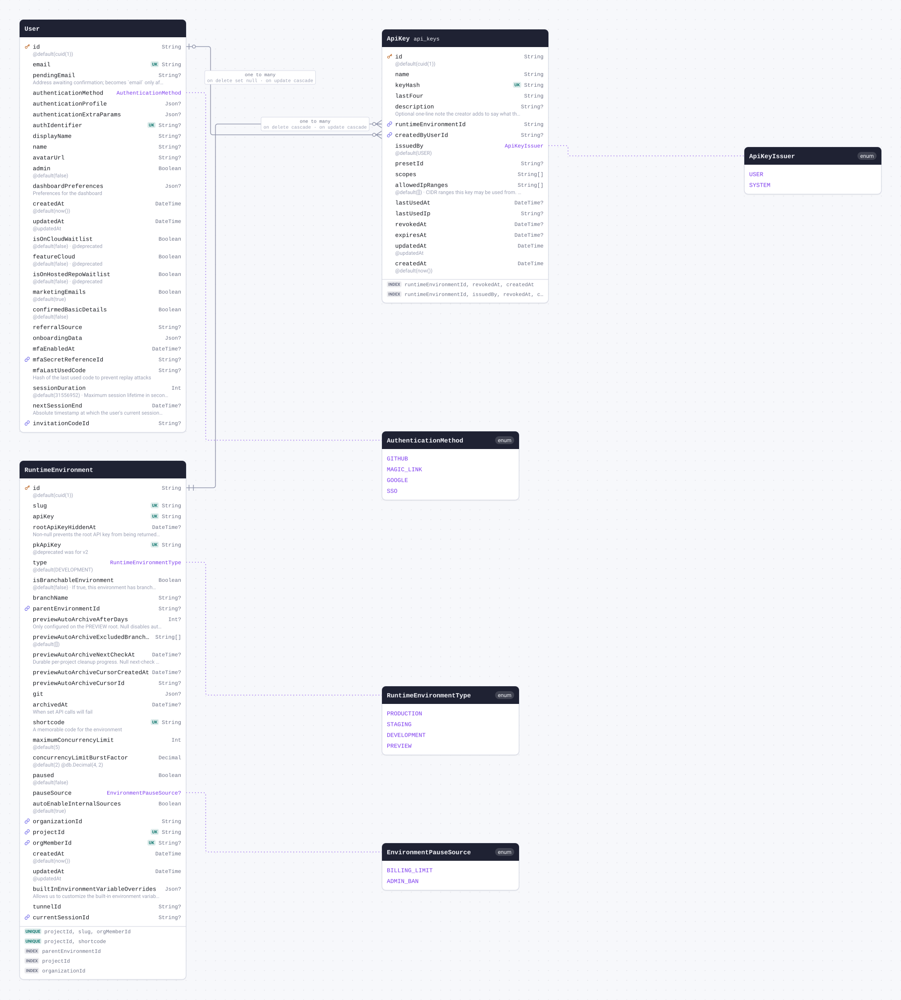

| Field                                             | Type                                 | Constraints                                                   | Default      | Description                                                         |
| ------------------------------------------------- | ------------------------------------ | ------------------------------------------------------------- | ------------ | ------------------------------------------------------------------- |
| `id`                                              | `String`                             | PK NOT NULL                                                   | `cuid(1)`    |                                                                     |
| `name`                                            | `String`                             | NOT NULL                                                      |              |                                                                     |
| `keyHash` (`key_hash`)                            | `String`                             | UNIQUE NOT NULL                                               |              |                                                                     |
| `lastFour` (`last_four`)                          | `String`                             | NOT NULL                                                      |              |                                                                     |
| `description`                                     | `String`                             | NULL                                                          |              | Optional one-line note the creator adds to say what the key is for. |
| `runtimeEnvironmentId` (`runtime_environment_id`) | `String`                             | NOT NULL → [RuntimeEnvironment.id](#model-RuntimeEnvironment) |              |                                                                     |
| `createdByUserId` (`created_by_user_id`)          | `String`                             | NULL → [User.id](#model-User)                                 |              |                                                                     |
| `issuedBy` (`issued_by`)                          | [`ApiKeyIssuer`](#enum-ApiKeyIssuer) | NOT NULL                                                      | `USER`       |                                                                     |
| `presetId` (`preset_id`)                          | `String`                             | NULL                                                          |              |                                                                     |
| `scopes`                                          | `String[]`                           | NOT NULL                                                      |              |                                                                     |
| `allowedIpRanges` (`allowed_ip_ranges`)           | `String[]`                           | NOT NULL                                                      | `[]`         | CIDR ranges this key may be used from. Empty means any IP.          |
| `lastUsedAt` (`last_used_at`)                     | `DateTime`                           | NULL                                                          |              |                                                                     |
| `lastUsedIp` (`last_used_ip`)                     | `String`                             | NULL                                                          |              |                                                                     |
| `revokedAt` (`revoked_at`)                        | `DateTime`                           | NULL                                                          |              |                                                                     |
| `expiresAt` (`expires_at`)                        | `DateTime`                           | NULL                                                          |              |                                                                     |
| `updatedAt` (`updated_at`)                        | `DateTime`                           | NOT NULL                                                      | `@updatedAt` |                                                                     |
| `createdAt` (`created_at`)                        | `DateTime`                           | NOT NULL                                                      | `now()`      |                                                                     |

#### Indexes

- `@@index([runtimeEnvironmentId, revokedAt, createdAt])`
- `@@index([runtimeEnvironmentId, issuedBy, revokedAt, createdAt], map: "api_keys_env_issued_by_revoked_at_created_at_idx")`

#### References

- `runtimeEnvironmentId` → [RuntimeEnvironment.id](#model-RuntimeEnvironment) (many-to-one, on delete Cascade, on update Cascade)
- `createdByUserId` → [User.id](#model-User) (many-to-one, on delete SetNull, on update Cascade)

#### Definition

```sql
CREATE TABLE "api_keys" (
    "id" TEXT NOT NULL,
    "name" TEXT NOT NULL,
    "key_hash" TEXT NOT NULL,
    "last_four" TEXT NOT NULL,
    "description" TEXT,
    "runtime_environment_id" TEXT NOT NULL,
    "created_by_user_id" TEXT,
    "issued_by" "ApiKeyIssuer" NOT NULL DEFAULT 'USER',
    "preset_id" TEXT,
    "scopes" TEXT[],
    "allowed_ip_ranges" TEXT[] DEFAULT ARRAY[]::TEXT[],
    "last_used_at" TIMESTAMP(3),
    "last_used_ip" TEXT,
    "revoked_at" TIMESTAMP(3),
    "expires_at" TIMESTAMP(3),
    "updated_at" TIMESTAMP(3) NOT NULL,
    "created_at" TIMESTAMP(3) NOT NULL DEFAULT CURRENT_TIMESTAMP,

    CONSTRAINT "api_keys_pkey" PRIMARY KEY ("id")
);

CREATE UNIQUE INDEX "api_keys_key_hash_key" ON "api_keys"("key_hash");

CREATE INDEX "api_keys_runtime_environment_id_revoked_at_created_at_idx" ON "api_keys"("runtime_environment_id", "revoked_at", "created_at" DESC);

CREATE INDEX "api_keys_env_issued_by_revoked_at_created_at_idx" ON "api_keys"("runtime_environment_id", "issued_by", "revoked_at", "created_at" DESC);

ALTER TABLE "api_keys" ADD CONSTRAINT "api_keys_runtime_environment_id_fkey" FOREIGN KEY ("runtime_environment_id") REFERENCES "RuntimeEnvironment"("id") ON DELETE CASCADE ON UPDATE CASCADE;

ALTER TABLE "api_keys" ADD CONSTRAINT "api_keys_created_by_user_id_fkey" FOREIGN KEY ("created_by_user_id") REFERENCES "User"("id") ON DELETE SET NULL ON UPDATE CASCADE;
```

<details>
<summary>Queries and their SQL</summary>

**findMany**: Every row

```ts
await prisma.apiKey.findMany();
```

```sql
SELECT
  "public"."api_keys"."id",
  "public"."api_keys"."name",
  "public"."api_keys"."key_hash",
  "public"."api_keys"."last_four",
  "public"."api_keys"."description",
  "public"."api_keys"."runtime_environment_id",
  "public"."api_keys"."created_by_user_id",
  "public"."api_keys"."issued_by"::text,
  "public"."api_keys"."preset_id",
  "public"."api_keys"."scopes",
  "public"."api_keys"."allowed_ip_ranges",
  "public"."api_keys"."last_used_at",
  "public"."api_keys"."last_used_ip",
  "public"."api_keys"."revoked_at",
  "public"."api_keys"."expires_at",
  "public"."api_keys"."updated_at",
  "public"."api_keys"."created_at"
FROM
  "public"."api_keys"
WHERE
  1 = 1
OFFSET
  $1
-- params: ["0"]
```

**count**: How many rows there are

```ts
await prisma.apiKey.count();
```

```sql
SELECT
  COUNT(*) AS "_count$_all"
FROM
  (
    SELECT
      "public"."api_keys"."id"
    FROM
      "public"."api_keys"
    WHERE
      1 = 1
    OFFSET
      $1
  ) AS "sub"
-- params: ["0"]
```

**findMany**: Every row with its relations

```ts
await prisma.apiKey.findMany({ include: { runtimeEnvironment: true, createdBy: true } });
```

```sql
SELECT
  "public"."api_keys"."id",
  "public"."api_keys"."name",
  "public"."api_keys"."key_hash",
  "public"."api_keys"."last_four",
  "public"."api_keys"."description",
  "public"."api_keys"."runtime_environment_id",
  "public"."api_keys"."created_by_user_id",
  "public"."api_keys"."issued_by"::text,
  "public"."api_keys"."preset_id",
  "public"."api_keys"."scopes",
  "public"."api_keys"."allowed_ip_ranges",
  "public"."api_keys"."last_used_at",
  "public"."api_keys"."last_used_ip",
  "public"."api_keys"."revoked_at",
  "public"."api_keys"."expires_at",
  "public"."api_keys"."updated_at",
  "public"."api_keys"."created_at"
FROM
  "public"."api_keys"
WHERE
  1 = 1
OFFSET
  $1
-- params: ["0"]

SELECT
  "public"."RuntimeEnvironment"."id",
  "public"."RuntimeEnvironment"."slug",
  "public"."RuntimeEnvironment"."apiKey",
  "public"."RuntimeEnvironment"."rootApiKeyHiddenAt",
  "public"."RuntimeEnvironment"."pkApiKey",
  "public"."RuntimeEnvironment"."type"::text,
  "public"."RuntimeEnvironment"."isBranchableEnvironment",
  "public"."RuntimeEnvironment"."branchName",
  "public"."RuntimeEnvironment"."parentEnvironmentId",
  "public"."RuntimeEnvironment"."previewAutoArchiveAfterDays",
  "public"."RuntimeEnvironment"."previewAutoArchiveExcludedBranches",
  "public"."RuntimeEnvironment"."previewAutoArchiveNextCheckAt",
  "public"."RuntimeEnvironment"."previewAutoArchiveCursorCreatedAt",
  "public"."RuntimeEnvironment"."previewAutoArchiveCursorId",
  "public"."RuntimeEnvironment"."git",
  "public"."RuntimeEnvironment"."archivedAt",
  "public"."RuntimeEnvironment"."shortcode",
  "public"."RuntimeEnvironment"."maximumConcurrencyLimit",
  "public"."RuntimeEnvironment"."concurrencyLimitBurstFactor",
  "public"."RuntimeEnvironment"."paused",
  "public"."RuntimeEnvironment"."pauseSource"::text,
  "public"."RuntimeEnvironment"."autoEnableInternalSources",
  "public"."RuntimeEnvironment"."organizationId",
  "public"."RuntimeEnvironment"."projectId",
  "public"."RuntimeEnvironment"."orgMemberId",
  "public"."RuntimeEnvironment"."createdAt",
  "public"."RuntimeEnvironment"."updatedAt",
  "public"."RuntimeEnvironment"."builtInEnvironmentVariableOverrides",
  "public"."RuntimeEnvironment"."tunnelId",
  "public"."RuntimeEnvironment"."currentSessionId"
FROM
  "public"."RuntimeEnvironment"
WHERE
  "public"."RuntimeEnvironment"."id" IN ($1)
OFFSET
  $2
-- params: ["<runtimeEnvironmentId of the rows above>","0"]

SELECT
  "public"."User"."id",
  "public"."User"."email",
  "public"."User"."pendingEmail",
  "public"."User"."authenticationMethod"::text,
  "public"."User"."authenticationProfile",
  "public"."User"."authenticationExtraParams",
  "public"."User"."authIdentifier",
  "public"."User"."displayName",
  "public"."User"."name",
  "public"."User"."avatarUrl",
  "public"."User"."admin",
  "public"."User"."dashboardPreferences",
  "public"."User"."createdAt",
  "public"."User"."updatedAt",
  "public"."User"."isOnCloudWaitlist",
  "public"."User"."featureCloud",
  "public"."User"."isOnHostedRepoWaitlist",
  "public"."User"."marketingEmails",
  "public"."User"."confirmedBasicDetails",
  "public"."User"."referralSource",
  "public"."User"."onboardingData",
  "public"."User"."mfaEnabledAt",
  "public"."User"."mfaSecretReferenceId",
  "public"."User"."mfaLastUsedCode",
  "public"."User"."sessionDuration",
  "public"."User"."nextSessionEnd",
  "public"."User"."invitationCodeId"
FROM
  "public"."User"
WHERE
  "public"."User"."id" IN ($1)
OFFSET
  $2
-- params: ["<createdByUserId of the rows above>","0"]
```

**findUnique**: One row by what is unique to it

```ts
await prisma.apiKey.findUnique({ where: { id: "example" } });
```

```sql
SELECT
  "public"."api_keys"."id",
  "public"."api_keys"."name",
  "public"."api_keys"."key_hash",
  "public"."api_keys"."last_four",
  "public"."api_keys"."description",
  "public"."api_keys"."runtime_environment_id",
  "public"."api_keys"."created_by_user_id",
  "public"."api_keys"."issued_by"::text,
  "public"."api_keys"."preset_id",
  "public"."api_keys"."scopes",
  "public"."api_keys"."allowed_ip_ranges",
  "public"."api_keys"."last_used_at",
  "public"."api_keys"."last_used_ip",
  "public"."api_keys"."revoked_at",
  "public"."api_keys"."expires_at",
  "public"."api_keys"."updated_at",
  "public"."api_keys"."created_at"
FROM
  "public"."api_keys"
WHERE
  (
    "public"."api_keys"."id" = $1
    AND 1 = 1
  )
LIMIT
  $2
OFFSET
  $3
-- params: ["example","1","0"]
```

**create**: Create a row

```ts
await prisma.apiKey.create({
  data: {
    name: "example",
    keyHash: "example",
    lastFour: "example",
    runtimeEnvironmentId: "example",
    scopes: ["example"],
  },
});
```

```sql
INSERT INTO
  "public"."api_keys" (
    "id",
    "name",
    "key_hash",
    "last_four",
    "runtime_environment_id",
    "issued_by",
    "scopes",
    "allowed_ip_ranges",
    "updated_at",
    "created_at"
  )
VALUES
  (
    $1,
    $2,
    $3,
    $4,
    $5,
    CAST($6::text AS "public"."ApiKeyIssuer"),
    $7,
    $8,
    $9,
    $10
  )
RETURNING
  "public"."api_keys"."id",
  "public"."api_keys"."name",
  "public"."api_keys"."key_hash",
  "public"."api_keys"."last_four",
  "public"."api_keys"."description",
  "public"."api_keys"."runtime_environment_id",
  "public"."api_keys"."created_by_user_id",
  "public"."api_keys"."issued_by"::text,
  "public"."api_keys"."preset_id",
  "public"."api_keys"."scopes",
  "public"."api_keys"."allowed_ip_ranges",
  "public"."api_keys"."last_used_at",
  "public"."api_keys"."last_used_ip",
  "public"."api_keys"."revoked_at",
  "public"."api_keys"."expires_at",
  "public"."api_keys"."updated_at",
  "public"."api_keys"."created_at"
-- params: ["<cuid(1)>","example","example","example","example","USER",["example"],[],"<now()>","<now()>"]
```

**update**: Update a row

```ts
await prisma.apiKey.update({ where: { id: "example" }, data: { name: "example" } });
```

```sql
UPDATE "public"."api_keys"
SET
  "name" = $1,
  "updated_at" = $2
WHERE
  (
    "public"."api_keys"."id" = $3
    AND 1 = 1
  )
RETURNING
  "public"."api_keys"."id",
  "public"."api_keys"."name",
  "public"."api_keys"."key_hash",
  "public"."api_keys"."last_four",
  "public"."api_keys"."description",
  "public"."api_keys"."runtime_environment_id",
  "public"."api_keys"."created_by_user_id",
  "public"."api_keys"."issued_by"::text,
  "public"."api_keys"."preset_id",
  "public"."api_keys"."scopes",
  "public"."api_keys"."allowed_ip_ranges",
  "public"."api_keys"."last_used_at",
  "public"."api_keys"."last_used_ip",
  "public"."api_keys"."revoked_at",
  "public"."api_keys"."expires_at",
  "public"."api_keys"."updated_at",
  "public"."api_keys"."created_at"
-- params: ["example",{"prisma__type":"generatorCall","prisma__value":{"name":"now","args":[],"returnType":{"type":"DateTime"}}},"example"]
```

**delete**: Delete a row

```ts
await prisma.apiKey.delete({ where: { id: "example" } });
```

```sql
DELETE FROM "public"."api_keys"
WHERE
  (
    "public"."api_keys"."id" = $1
    AND 1 = 1
  )
RETURNING
  "public"."api_keys"."id",
  "public"."api_keys"."name",
  "public"."api_keys"."key_hash",
  "public"."api_keys"."last_four",
  "public"."api_keys"."description",
  "public"."api_keys"."runtime_environment_id",
  "public"."api_keys"."created_by_user_id",
  "public"."api_keys"."issued_by"::text,
  "public"."api_keys"."preset_id",
  "public"."api_keys"."scopes",
  "public"."api_keys"."allowed_ip_ranges",
  "public"."api_keys"."last_used_at",
  "public"."api_keys"."last_used_ip",
  "public"."api_keys"."revoked_at",
  "public"."api_keys"."expires_at",
  "public"."api_keys"."updated_at",
  "public"."api_keys"."created_at"
-- params: ["example"]
```

</details>

<a id="model-RevokedApiKey"></a>

### RevokedApiKey

Records of previously-valid API keys that are still accepted for authentication
during a grace window after rotation. Extend or end the grace period by updating `expiresAt`.

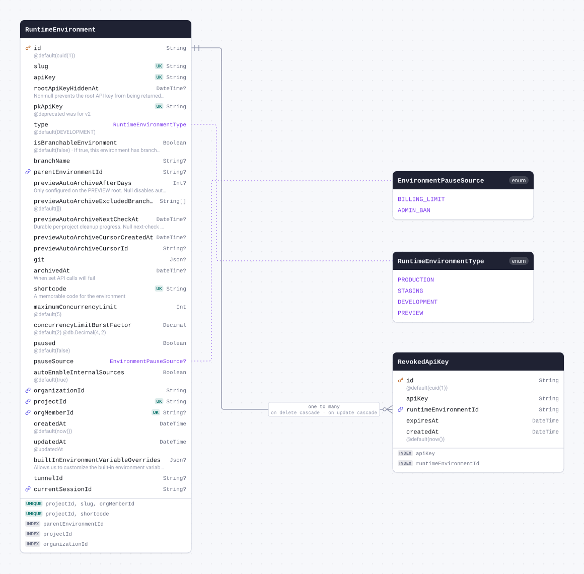

| Field                  | Type       | Constraints                                                   | Default   | Description |
| ---------------------- | ---------- | ------------------------------------------------------------- | --------- | ----------- |
| `id`                   | `String`   | PK NOT NULL                                                   | `cuid(1)` |             |
| `apiKey`               | `String`   | NOT NULL                                                      |           |             |
| `runtimeEnvironmentId` | `String`   | NOT NULL → [RuntimeEnvironment.id](#model-RuntimeEnvironment) |           |             |
| `expiresAt`            | `DateTime` | NOT NULL                                                      |           |             |
| `createdAt`            | `DateTime` | NOT NULL                                                      | `now()`   |             |

#### Indexes

- `@@index([apiKey])`
- `@@index([runtimeEnvironmentId])`

#### References

- `runtimeEnvironmentId` → [RuntimeEnvironment.id](#model-RuntimeEnvironment) (many-to-one, on delete Cascade, on update Cascade)

#### Definition

```sql
CREATE TABLE "RevokedApiKey" (
    "id" TEXT NOT NULL,
    "apiKey" TEXT NOT NULL,
    "runtimeEnvironmentId" TEXT NOT NULL,
    "expiresAt" TIMESTAMP(3) NOT NULL,
    "createdAt" TIMESTAMP(3) NOT NULL DEFAULT CURRENT_TIMESTAMP,

    CONSTRAINT "RevokedApiKey_pkey" PRIMARY KEY ("id")
);

CREATE INDEX "RevokedApiKey_apiKey_idx" ON "RevokedApiKey"("apiKey");

CREATE INDEX "RevokedApiKey_runtimeEnvironmentId_idx" ON "RevokedApiKey"("runtimeEnvironmentId");

ALTER TABLE "RevokedApiKey" ADD CONSTRAINT "RevokedApiKey_runtimeEnvironmentId_fkey" FOREIGN KEY ("runtimeEnvironmentId") REFERENCES "RuntimeEnvironment"("id") ON DELETE CASCADE ON UPDATE CASCADE;
```

<details>
<summary>Queries and their SQL</summary>

**findMany**: Every row

```ts
await prisma.revokedApiKey.findMany();
```

```sql
SELECT
  "public"."RevokedApiKey"."id",
  "public"."RevokedApiKey"."apiKey",
  "public"."RevokedApiKey"."runtimeEnvironmentId",
  "public"."RevokedApiKey"."expiresAt",
  "public"."RevokedApiKey"."createdAt"
FROM
  "public"."RevokedApiKey"
WHERE
  1 = 1
OFFSET
  $1
-- params: ["0"]
```

**count**: How many rows there are

```ts
await prisma.revokedApiKey.count();
```

```sql
SELECT
  COUNT(*) AS "_count$_all"
FROM
  (
    SELECT
      "public"."RevokedApiKey"."id"
    FROM
      "public"."RevokedApiKey"
    WHERE
      1 = 1
    OFFSET
      $1
  ) AS "sub"
-- params: ["0"]
```

**findMany**: Every row with its relations

```ts
await prisma.revokedApiKey.findMany({ include: { runtimeEnvironment: true } });
```

```sql
SELECT
  "public"."RevokedApiKey"."id",
  "public"."RevokedApiKey"."apiKey",
  "public"."RevokedApiKey"."runtimeEnvironmentId",
  "public"."RevokedApiKey"."expiresAt",
  "public"."RevokedApiKey"."createdAt"
FROM
  "public"."RevokedApiKey"
WHERE
  1 = 1
OFFSET
  $1
-- params: ["0"]

SELECT
  "public"."RuntimeEnvironment"."id",
  "public"."RuntimeEnvironment"."slug",
  "public"."RuntimeEnvironment"."apiKey",
  "public"."RuntimeEnvironment"."rootApiKeyHiddenAt",
  "public"."RuntimeEnvironment"."pkApiKey",
  "public"."RuntimeEnvironment"."type"::text,
  "public"."RuntimeEnvironment"."isBranchableEnvironment",
  "public"."RuntimeEnvironment"."branchName",
  "public"."RuntimeEnvironment"."parentEnvironmentId",
  "public"."RuntimeEnvironment"."previewAutoArchiveAfterDays",
  "public"."RuntimeEnvironment"."previewAutoArchiveExcludedBranches",
  "public"."RuntimeEnvironment"."previewAutoArchiveNextCheckAt",
  "public"."RuntimeEnvironment"."previewAutoArchiveCursorCreatedAt",
  "public"."RuntimeEnvironment"."previewAutoArchiveCursorId",
  "public"."RuntimeEnvironment"."git",
  "public"."RuntimeEnvironment"."archivedAt",
  "public"."RuntimeEnvironment"."shortcode",
  "public"."RuntimeEnvironment"."maximumConcurrencyLimit",
  "public"."RuntimeEnvironment"."concurrencyLimitBurstFactor",
  "public"."RuntimeEnvironment"."paused",
  "public"."RuntimeEnvironment"."pauseSource"::text,
  "public"."RuntimeEnvironment"."autoEnableInternalSources",
  "public"."RuntimeEnvironment"."organizationId",
  "public"."RuntimeEnvironment"."projectId",
  "public"."RuntimeEnvironment"."orgMemberId",
  "public"."RuntimeEnvironment"."createdAt",
  "public"."RuntimeEnvironment"."updatedAt",
  "public"."RuntimeEnvironment"."builtInEnvironmentVariableOverrides",
  "public"."RuntimeEnvironment"."tunnelId",
  "public"."RuntimeEnvironment"."currentSessionId"
FROM
  "public"."RuntimeEnvironment"
WHERE
  "public"."RuntimeEnvironment"."id" IN ($1)
OFFSET
  $2
-- params: ["<runtimeEnvironmentId of the rows above>","0"]
```

**findUnique**: One row by what is unique to it

```ts
await prisma.revokedApiKey.findUnique({ where: { id: "example" } });
```

```sql
SELECT
  "public"."RevokedApiKey"."id",
  "public"."RevokedApiKey"."apiKey",
  "public"."RevokedApiKey"."runtimeEnvironmentId",
  "public"."RevokedApiKey"."expiresAt",
  "public"."RevokedApiKey"."createdAt"
FROM
  "public"."RevokedApiKey"
WHERE
  (
    "public"."RevokedApiKey"."id" = $1
    AND 1 = 1
  )
LIMIT
  $2
OFFSET
  $3
-- params: ["example","1","0"]
```

**create**: Create a row

```ts
await prisma.revokedApiKey.create({
  data: {
    apiKey: "example",
    runtimeEnvironmentId: "example",
    expiresAt: new Date("2026-01-01T00:00:00.000Z"),
  },
});
```

```sql
INSERT INTO
  "public"."RevokedApiKey" (
    "id",
    "apiKey",
    "runtimeEnvironmentId",
    "expiresAt",
    "createdAt"
  )
VALUES
  ($1, $2, $3, $4, $5)
RETURNING
  "public"."RevokedApiKey"."id",
  "public"."RevokedApiKey"."apiKey",
  "public"."RevokedApiKey"."runtimeEnvironmentId",
  "public"."RevokedApiKey"."expiresAt",
  "public"."RevokedApiKey"."createdAt"
-- params: ["<cuid(1)>","example","example","2026-01-01T00:00:00.000Z","<now()>"]
```

**update**: Update a row

```ts
await prisma.revokedApiKey.update({ where: { id: "example" }, data: { apiKey: "example" } });
```

```sql
UPDATE "public"."RevokedApiKey"
SET
  "apiKey" = $1
WHERE
  (
    "public"."RevokedApiKey"."id" = $2
    AND 1 = 1
  )
RETURNING
  "public"."RevokedApiKey"."id",
  "public"."RevokedApiKey"."apiKey",
  "public"."RevokedApiKey"."runtimeEnvironmentId",
  "public"."RevokedApiKey"."expiresAt",
  "public"."RevokedApiKey"."createdAt"
-- params: ["example","example"]
```

**delete**: Delete a row

```ts
await prisma.revokedApiKey.delete({ where: { id: "example" } });
```

```sql
DELETE FROM "public"."RevokedApiKey"
WHERE
  (
    "public"."RevokedApiKey"."id" = $1
    AND 1 = 1
  )
RETURNING
  "public"."RevokedApiKey"."id",
  "public"."RevokedApiKey"."apiKey",
  "public"."RevokedApiKey"."runtimeEnvironmentId",
  "public"."RevokedApiKey"."expiresAt",
  "public"."RevokedApiKey"."createdAt"
-- params: ["example"]
```

</details>

<a id="model-Project"></a>

### Project

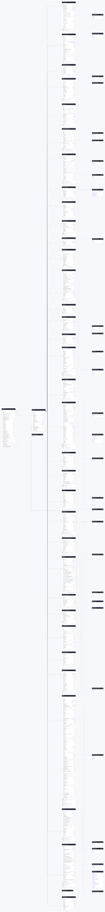

| Field                                         | Type                                         | Constraints                                                 | Default      | Description                                                                                                   |
| --------------------------------------------- | -------------------------------------------- | ----------------------------------------------------------- | ------------ | ------------------------------------------------------------------------------------------------------------- |
| `id`                                          | `String`                                     | PK NOT NULL                                                 | `cuid(1)`    |                                                                                                               |
| `slug`                                        | `String`                                     | UNIQUE NOT NULL                                             |              |                                                                                                               |
| `name`                                        | `String`                                     | NOT NULL                                                    |              |                                                                                                               |
| `externalRef`                                 | `String`                                     | UNIQUE NOT NULL                                             |              |                                                                                                               |
| `organizationId`                              | `String`                                     | NOT NULL → [Organization.id](#model-Organization)           |              |                                                                                                               |
| `createdAt`                                   | `DateTime`                                   | NOT NULL                                                    | `now()`      |                                                                                                               |
| `updatedAt`                                   | `DateTime`                                   | NOT NULL                                                    | `@updatedAt` |                                                                                                               |
| `deletedAt`                                   | `DateTime`                                   | NULL                                                        |              |                                                                                                               |
| `initializedAt`                               | `DateTime`                                   | NULL                                                        |              | Set the first time the CLI `init` command completes against this project. Drives the dev onboarding progress. |
| `defaultRuntime`                              | `String`                                     | NULL                                                        |              | Runtime used when a deployment config does not specify one. Null preserves the legacy Node 20 fallback.       |
| `version`                                     | [`ProjectVersion`](#enum-ProjectVersion)     | NOT NULL                                                    | `V2`         |                                                                                                               |
| `engine`                                      | [`RunEngineVersion`](#enum-RunEngineVersion) | NOT NULL                                                    | `V1`         |                                                                                                               |
| `builderProjectId`                            | `String`                                     | NULL                                                        |              |                                                                                                               |
| `defaultWorkerGroupId`                        | `String`                                     | NULL → [WorkerInstanceGroup.id](#model-WorkerInstanceGroup) |              |                                                                                                               |
| `allowedWorkerQueues` (`allowedMasterQueues`) | `String[]`                                   | NOT NULL                                                    | `[]`         | The master queues they are allowed to use (impacts what they can set as default and trigger runs with)        |
| `buildSettings`                               | `Json`                                       | NULL                                                        |              |                                                                                                               |
| `onboardingData`                              | `Json`                                       | NULL                                                        |              |                                                                                                               |

#### References

- `organizationId` → [Organization.id](#model-Organization) (many-to-one, on delete Cascade, on update Cascade)
- `defaultWorkerGroupId` → [WorkerInstanceGroup.id](#model-WorkerInstanceGroup) (many-to-one)

#### Referenced by

- `id` ← [RuntimeEnvironment.projectId](#model-RuntimeEnvironment) (one-to-many, on delete Cascade, on update Cascade)
- `id` ← [BackgroundWorker.projectId](#model-BackgroundWorker) (one-to-many, on delete Cascade, on update Cascade)
- `id` ← [BackgroundWorkerFile.projectId](#model-BackgroundWorkerFile) (one-to-many, on delete Cascade, on update Cascade)
- `id` ← [Prompt.projectId](#model-Prompt) (one-to-many, on delete Cascade, on update Cascade)
- `id` ← [BackgroundWorkerTask.projectId](#model-BackgroundWorkerTask) (one-to-many, on delete Cascade, on update Cascade)
- `id` ← [PlaygroundConversation.projectId](#model-PlaygroundConversation) (one-to-many, on delete Cascade, on update Cascade)
- `id` ← [TaskRun.projectId](#model-TaskRun) (one-to-many, on delete Cascade, on update Cascade)
- `id` ← [TaskRunCheckpoint.projectId](#model-TaskRunCheckpoint) (one-to-many, on delete Cascade, on update Cascade)
- `id` ← [Waitpoint.projectId](#model-Waitpoint) (one-to-many, on delete Cascade, on update Cascade)
- `id` ← [TaskRunWaitpoint.projectId](#model-TaskRunWaitpoint) (one-to-many, on delete Cascade, on update Cascade)
- `id` ← [WaitpointTag.projectId](#model-WaitpointTag) (one-to-many, on delete Cascade, on update Cascade)
- `id` ← [WorkerInstance.projectId](#model-WorkerInstance) (one-to-many, on delete Cascade, on update Cascade)
- `id` ← [WorkerInstanceGroup.projectId](#model-WorkerInstanceGroup) (one-to-many, on delete Cascade, on update Cascade)
- `id` ← [TaskRunTag.projectId](#model-TaskRunTag) (one-to-many, on delete Cascade, on update Cascade)
- `id` ← [TaskQueue.projectId](#model-TaskQueue) (one-to-many, on delete Cascade, on update Cascade)
- `id` ← [EnvironmentVariable.projectId](#model-EnvironmentVariable) (one-to-many, on delete Cascade, on update Cascade)
- `id` ← [Checkpoint.projectId](#model-Checkpoint) (one-to-many, on delete Cascade, on update Cascade)
- `id` ← [CheckpointRestoreEvent.projectId](#model-CheckpointRestoreEvent) (one-to-many, on delete Cascade, on update Cascade)
- `id` ← [WorkerDeployment.projectId](#model-WorkerDeployment) (one-to-many, on delete Cascade, on update Cascade)
- `id` ← [TaskSchedule.projectId](#model-TaskSchedule) (one-to-many, on delete Cascade, on update Cascade)
- `id` ← [TaskScheduleInstance.projectId](#model-TaskScheduleInstance) (one-to-many, on delete Cascade, on update Cascade)
- `id` ← [ProjectAlertChannel.projectId](#model-ProjectAlertChannel) (one-to-many, on delete Cascade, on update Cascade)
- `id` ← [ProjectAlert.projectId](#model-ProjectAlert) (one-to-many, on delete Cascade, on update Cascade)
- `id` ← [ProjectAlertStorage.projectId](#model-ProjectAlertStorage) (one-to-many, on delete Cascade, on update Cascade)
- `id` ← [OrganizationProjectIntegration.projectId](#model-OrganizationProjectIntegration) (one-to-many, on delete Cascade, on update Cascade)
- `id` ← [BulkActionGroup.projectId](#model-BulkActionGroup) (one-to-many, on delete Cascade, on update Cascade)
- `id` ← [TrustedDeployRepository.projectId](#model-TrustedDeployRepository) (one-to-one, on delete Cascade)
- `id` ← [ConnectedGithubRepository.projectId](#model-ConnectedGithubRepository) (one-to-one, on delete Cascade, on update Cascade)
- `id` ← [CustomerQuery.projectId](#model-CustomerQuery) (one-to-many, on delete Cascade, on update Cascade)
- `id` ← [MetricsDashboard.projectId](#model-MetricsDashboard) (one-to-many, on delete Cascade, on update Cascade)
- `id` ← [LlmModel.projectId](#model-LlmModel) (one-to-many, on delete Cascade)
- `id` ← [PlatformNotification.projectId](#model-PlatformNotification) (one-to-many, on delete Cascade, on update Cascade)
- `id` ← [ErrorGroupState.projectId](#model-ErrorGroupState) (one-to-many, on delete Cascade, on update Cascade)
- `id` ← [TaskIdentifier.projectId](#model-TaskIdentifier) (one-to-many, on delete Cascade, on update Cascade)

#### Definition

```sql
CREATE TABLE "Project" (
    "id" TEXT NOT NULL,
    "slug" TEXT NOT NULL,
    "name" TEXT NOT NULL,
    "externalRef" TEXT NOT NULL,
    "organizationId" TEXT NOT NULL,
    "createdAt" TIMESTAMP(3) NOT NULL DEFAULT CURRENT_TIMESTAMP,
    "updatedAt" TIMESTAMP(3) NOT NULL,
    "deletedAt" TIMESTAMP(3),
    "initializedAt" TIMESTAMP(3),
    "defaultRuntime" TEXT,
    "version" "ProjectVersion" NOT NULL DEFAULT 'V2',
    "engine" "RunEngineVersion" NOT NULL DEFAULT 'V1',
    "builderProjectId" TEXT,
    "defaultWorkerGroupId" TEXT,
    "allowedMasterQueues" TEXT[] DEFAULT ARRAY[]::TEXT[],
    "buildSettings" JSONB,
    "onboardingData" JSONB,

    CONSTRAINT "Project_pkey" PRIMARY KEY ("id")
);

CREATE UNIQUE INDEX "Project_slug_key" ON "Project"("slug");

CREATE UNIQUE INDEX "Project_externalRef_key" ON "Project"("externalRef");

ALTER TABLE "Project" ADD CONSTRAINT "Project_organizationId_fkey" FOREIGN KEY ("organizationId") REFERENCES "Organization"("id") ON DELETE CASCADE ON UPDATE CASCADE;

ALTER TABLE "Project" ADD CONSTRAINT "Project_defaultWorkerGroupId_fkey" FOREIGN KEY ("defaultWorkerGroupId") REFERENCES "WorkerInstanceGroup"("id") ON DELETE SET NULL ON UPDATE CASCADE;
```

<details>
<summary>Queries and their SQL</summary>

**findMany**: Every row

```ts
await prisma.project.findMany();
```

```sql
SELECT
  "public"."Project"."id",
  "public"."Project"."slug",
  "public"."Project"."name",
  "public"."Project"."externalRef",
  "public"."Project"."organizationId",
  "public"."Project"."createdAt",
  "public"."Project"."updatedAt",
  "public"."Project"."deletedAt",
  "public"."Project"."initializedAt",
  "public"."Project"."defaultRuntime",
  "public"."Project"."version"::text,
  "public"."Project"."engine"::text,
  "public"."Project"."builderProjectId",
  "public"."Project"."defaultWorkerGroupId",
  "public"."Project"."allowedMasterQueues",
  "public"."Project"."buildSettings",
  "public"."Project"."onboardingData"
FROM
  "public"."Project"
WHERE
  1 = 1
OFFSET
  $1
-- params: ["0"]
```

**count**: How many rows there are

```ts
await prisma.project.count();
```

```sql
SELECT
  COUNT(*) AS "_count$_all"
FROM
  (
    SELECT
      "public"."Project"."id"
    FROM
      "public"."Project"
    WHERE
      1 = 1
    OFFSET
      $1
  ) AS "sub"
-- params: ["0"]
```

**findMany**: Every row with its relations

```ts
await prisma.project.findMany({
  include: {
    organization: true,
    workerGroups: true,
    workers: true,
    defaultWorkerGroup: true,
    environments: true,
    backgroundWorkers: true,
    backgroundWorkerTasks: true,
    taskRuns: true,
    runTags: true,
    taskQueues: true,
    environmentVariables: true,
    checkpoints: true,
    WorkerDeployment: true,
    CheckpointRestoreEvent: true,
    taskSchedules: true,
    alertChannels: true,
    alerts: true,
    alertStorages: true,
    bulkActionGroups: true,
    BackgroundWorkerFile: true,
    waitpoints: true,
    taskRunWaitpoints: true,
    taskRunCheckpoints: true,
    waitpointTags: true,
    connectedGithubRepository: true,
    trustedDeployRepository: true,
    organizationProjectIntegration: true,
    customerQueries: true,
    playgroundConversations: true,
    taskScheduleInstances: true,
    metricsDashboards: true,
    llmModels: true,
    prompts: true,
    platformNotifications: true,
    errorGroupStates: true,
    taskIdentifiers: true,
  },
});
```

```sql
SELECT
  "public"."Project"."id",
  "public"."Project"."slug",
  "public"."Project"."name",
  "public"."Project"."externalRef",
  "public"."Project"."organizationId",
  "public"."Project"."createdAt",
  "public"."Project"."updatedAt",
  "public"."Project"."deletedAt",
  "public"."Project"."initializedAt",
  "public"."Project"."defaultRuntime",
  "public"."Project"."version"::text,
  "public"."Project"."engine"::text,
  "public"."Project"."builderProjectId",
  "public"."Project"."defaultWorkerGroupId",
  "public"."Project"."allowedMasterQueues",
  "public"."Project"."buildSettings",
  "public"."Project"."onboardingData"
FROM
  "public"."Project"
WHERE
  1 = 1
OFFSET
  $1
-- params: ["0"]

SELECT
  "public"."Organization"."id",
  "public"."Organization"."slug",
  "public"."Organization"."title",
  "public"."Organization"."maximumExecutionTimePerRunInMs",
  "public"."Organization"."maximumConcurrencyLimit",
  "public"."Organization"."maximumSchedulesLimit",
  "public"."Organization"."maximumDevQueueSize",
  "public"."Organization"."maximumDeployedQueueSize",
  "public"."Organization"."createdAt",
  "public"."Organization"."updatedAt",
  "public"."Organization"."deletedAt",
  "public"."Organization"."companySize",
  "public"."Organization"."onboardingData",
  "public"."Organization"."avatar",
  "public"."Organization"."runsEnabled",
  "public"."Organization"."v3Enabled",
  "public"."Organization"."v2Enabled",
  "public"."Organization"."v2MarqsEnabled",
  "public"."Organization"."hasRequestedV3",
  "public"."Organization"."apiRateLimiterConfig",
  "public"."Organization"."realtimeRateLimiterConfig",
  "public"."Organization"."batchRateLimitConfig",
  "public"."Organization"."batchQueueConcurrencyConfig",
  "public"."Organization"."webhookLimitsConfig",
  "public"."Organization"."featureFlags",
  "public"."Organization"."maximumProjectCount",
  "public"."Organization"."maxSessionDuration",
  "public"."Organization"."streamBasinName",
  "public"."Organization"."supportAccessMode"::text,
  "public"."Organization"."supportAccessModeUpdatedAt",
  "public"."Organization"."supportAccessModeUpdatedById"
FROM
  "public"."Organization"
WHERE
  "public"."Organization"."id" IN ($1)
OFFSET
  $2
-- params: ["<organizationId of the rows above>","0"]

SELECT
  "public"."WorkerInstanceGroup"."id",
  "public"."WorkerInstanceGroup"."type"::text,
  "public"."WorkerInstanceGroup"."name",
  "public"."WorkerInstanceGroup"."masterQueue",
  "public"."WorkerInstanceGroup"."description",
  "public"."WorkerInstanceGroup"."hidden",
  "public"."WorkerInstanceGroup"."tokenId",
  "public"."WorkerInstanceGroup"."organizationId",
  "public"."WorkerInstanceGroup"."projectId",
  "public"."WorkerInstanceGroup"."cloudProvider",
  "public"."WorkerInstanceGroup"."location",
  "public"."WorkerInstanceGroup"."staticIPs",
  "public"."WorkerInstanceGroup"."workloadType"::text,
  "public"."WorkerInstanceGroup"."region",
  "public"."WorkerInstanceGroup"."enableFastPath",
  "public"."WorkerInstanceGroup"."createdAt",
  "public"."WorkerInstanceGroup"."updatedAt"
FROM
  "public"."WorkerInstanceGroup"
WHERE
  "public"."WorkerInstanceGroup"."projectId" IN ($1)
OFFSET
  $2
-- params: ["<id of the rows above>","0"]

SELECT
  "public"."WorkerInstance"."id",
  "public"."WorkerInstance"."name",
  "public"."WorkerInstance"."resourceIdentifier",
  "public"."WorkerInstance"."metadata",
  "public"."WorkerInstance"."workerGroupId",
  "public"."WorkerInstance"."organizationId",
  "public"."WorkerInstance"."projectId",
  "public"."WorkerInstance"."environmentId",
  "public"."WorkerInstance"."deploymentId",
  "public"."WorkerInstance"."createdAt",
  "public"."WorkerInstance"."updatedAt",
  "public"."WorkerInstance"."lastDequeueAt",
  "public"."WorkerInstance"."lastHeartbeatAt"
FROM
  "public"."WorkerInstance"
WHERE
  "public"."WorkerInstance"."projectId" IN ($1)
OFFSET
  $2
-- params: ["<id of the rows above>","0"]

SELECT
  "public"."WorkerInstanceGroup"."id",
  "public"."WorkerInstanceGroup"."type"::text,
  "public"."WorkerInstanceGroup"."name",
  "public"."WorkerInstanceGroup"."masterQueue",
  "public"."WorkerInstanceGroup"."description",
  "public"."WorkerInstanceGroup"."hidden",
  "public"."WorkerInstanceGroup"."tokenId",
  "public"."WorkerInstanceGroup"."organizationId",
  "public"."WorkerInstanceGroup"."projectId",
  "public"."WorkerInstanceGroup"."cloudProvider",
  "public"."WorkerInstanceGroup"."location",
  "public"."WorkerInstanceGroup"."staticIPs",
  "public"."WorkerInstanceGroup"."workloadType"::text,
  "public"."WorkerInstanceGroup"."region",
  "public"."WorkerInstanceGroup"."enableFastPath",
  "public"."WorkerInstanceGroup"."createdAt",
  "public"."WorkerInstanceGroup"."updatedAt"
FROM
  "public"."WorkerInstanceGroup"
WHERE
  "public"."WorkerInstanceGroup"."id" IN ($1)
OFFSET
  $2
-- params: ["<defaultWorkerGroupId of the rows above>","0"]

SELECT
  "public"."RuntimeEnvironment"."id",
  "public"."RuntimeEnvironment"."slug",
  "public"."RuntimeEnvironment"."apiKey",
  "public"."RuntimeEnvironment"."rootApiKeyHiddenAt",
  "public"."RuntimeEnvironment"."pkApiKey",
  "public"."RuntimeEnvironment"."type"::text,
  "public"."RuntimeEnvironment"."isBranchableEnvironment",
  "public"."RuntimeEnvironment"."branchName",
  "public"."RuntimeEnvironment"."parentEnvironmentId",
  "public"."RuntimeEnvironment"."previewAutoArchiveAfterDays",
  "public"."RuntimeEnvironment"."previewAutoArchiveExcludedBranches",
  "public"."RuntimeEnvironment"."previewAutoArchiveNextCheckAt",
  "public"."RuntimeEnvironment"."previewAutoArchiveCursorCreatedAt",
  "public"."RuntimeEnvironment"."previewAutoArchiveCursorId",
  "public"."RuntimeEnvironment"."git",
  "public"."RuntimeEnvironment"."archivedAt",
  "public"."RuntimeEnvironment"."shortcode",
  "public"."RuntimeEnvironment"."maximumConcurrencyLimit",
  "public"."RuntimeEnvironment"."concurrencyLimitBurstFactor",
  "public"."RuntimeEnvironment"."paused",
  "public"."RuntimeEnvironment"."pauseSource"::text,
  "public"."RuntimeEnvironment"."autoEnableInternalSources",
  "public"."RuntimeEnvironment"."organizationId",
  "public"."RuntimeEnvironment"."projectId",
  "public"."RuntimeEnvironment"."orgMemberId",
  "public"."RuntimeEnvironment"."createdAt",
  "public"."RuntimeEnvironment"."updatedAt",
  "public"."RuntimeEnvironment"."builtInEnvironmentVariableOverrides",
  "public"."RuntimeEnvironment"."tunnelId",
  "public"."RuntimeEnvironment"."currentSessionId"
FROM
  "public"."RuntimeEnvironment"
WHERE
  "public"."RuntimeEnvironment"."projectId" IN ($1)
OFFSET
  $2
-- params: ["<id of the rows above>","0"]

SELECT
  "public"."BackgroundWorker"."id",
  "public"."BackgroundWorker"."friendlyId",
  "public"."BackgroundWorker"."engine"::text,
  "public"."BackgroundWorker"."contentHash",
  "public"."BackgroundWorker"."sdkVersion",
  "public"."BackgroundWorker"."cliVersion",
  "public"."BackgroundWorker"."projectId",
  "public"."BackgroundWorker"."runtimeEnvironmentId",
  "public"."BackgroundWorker"."version",
  "public"."BackgroundWorker"."metadata",
  "public"."BackgroundWorker"."runtime",
  "public"."BackgroundWorker"."runtimeVersion",
  "public"."BackgroundWorker"."createdAt",
  "public"."BackgroundWorker"."updatedAt",
  "public"."BackgroundWorker"."workerGroupId",
  "public"."BackgroundWorker"."supportsLazyAttempts"
FROM
  "public"."BackgroundWorker"
WHERE
  "public"."BackgroundWorker"."projectId" IN ($1)
OFFSET
  $2
-- params: ["<id of the rows above>","0"]

SELECT
  "public"."BackgroundWorkerTask"."id",
  "public"."BackgroundWorkerTask"."slug",
  "public"."BackgroundWorkerTask"."description",
  "public"."BackgroundWorkerTask"."friendlyId",
  "public"."BackgroundWorkerTask"."filePath",
  "public"."BackgroundWorkerTask"."exportName",
  "public"."BackgroundWorkerTask"."workerId",
  "public"."BackgroundWorkerTask"."projectId",
  "public"."BackgroundWorkerTask"."fileId",
  "public"."BackgroundWorkerTask"."runtimeEnvironmentId",
  "public"."BackgroundWorkerTask"."createdAt",
  "public"."BackgroundWorkerTask"."updatedAt",
  "public"."BackgroundWorkerTask"."queueConfig",
  "public"."BackgroundWorkerTask"."retryConfig",
  "public"."BackgroundWorkerTask"."machineConfig",
  "public"."BackgroundWorkerTask"."gates",
  "public"."BackgroundWorkerTask"."queueId",
  "public"."BackgroundWorkerTask"."maxDurationInSeconds",
  "public"."BackgroundWorkerTask"."ttl",
  "public"."BackgroundWorkerTask"."triggerSource"::text,
  "public"."BackgroundWorkerTask"."config",
  "public"."BackgroundWorkerTask"."payloadSchema"
FROM
  "public"."BackgroundWorkerTask"
WHERE
  "public"."BackgroundWorkerTask"."projectId" IN ($1)
OFFSET
  $2
-- params: ["<id of the rows above>","0"]

SELECT
  "public"."TaskRun"."id",
  "public"."TaskRun"."number",
  "public"."TaskRun"."friendlyId",
  "public"."TaskRun"."engine"::text,
  "public"."TaskRun"."status"::text,
  "public"."TaskRun"."statusReason",
  "public"."TaskRun"."idempotencyKey",
  "public"."TaskRun"."idempotencyKeyExpiresAt",
  "public"."TaskRun"."idempotencyKeyOptions",
  "public"."TaskRun"."debounce",
  "public"."TaskRun"."taskIdentifier",
  "public"."TaskRun"."isTest",
  "public"."TaskRun"."payload",
  "public"."TaskRun"."payloadType",
  "public"."TaskRun"."context",
  "public"."TaskRun"."traceContext",
  "public"."TaskRun"."traceId",
  "public"."TaskRun"."spanId",
  "public"."TaskRun"."runtimeEnvironmentId",
  "public"."TaskRun"."environmentType"::text,
  "public"."TaskRun"."projectId",
  "public"."TaskRun"."organizationId",
  "public"."TaskRun"."queue",
  "public"."TaskRun"."lockedQueueId",
  "public"."TaskRun"."masterQueue",
  "public"."TaskRun"."region",
  "public"."TaskRun"."secondaryMasterQueue",
  "public"."TaskRun"."attemptNumber",
  "public"."TaskRun"."createdAt",
  "public"."TaskRun"."updatedAt",
  "public"."TaskRun"."runTags",
  "public"."TaskRun"."taskVersion",
  "public"."TaskRun"."sdkVersion",
  "public"."TaskRun"."cliVersion",
  "public"."TaskRun"."startedAt",
  "public"."TaskRun"."executedAt",
  "public"."TaskRun"."completedAt",
  "public"."TaskRun"."machinePreset",
  "public"."TaskRun"."usageDurationMs",
  "public"."TaskRun"."costInCents",
  "public"."TaskRun"."baseCostInCents",
  "public"."TaskRun"."lockedAt",
  "public"."TaskRun"."lockedById",
  "public"."TaskRun"."lockedToVersionId",
  "public"."TaskRun"."priorityMs",
  "public"."TaskRun"."concurrencyKey",
  "public"."TaskRun"."gates",
  "public"."TaskRun"."delayUntil",
  "public"."TaskRun"."queuedAt",
  "public"."TaskRun"."ttl",
  "public"."TaskRun"."expiredAt",
  "public"."TaskRun"."maxAttempts",
  "public"."TaskRun"."lockedRetryConfig",
  "public"."TaskRun"."oneTimeUseToken",
  "public"."TaskRun"."taskEventStore",
  "public"."TaskRun"."queueTimestamp",
  "public"."TaskRun"."scheduleInstanceId",
  "public"."TaskRun"."scheduleId",
  "public"."TaskRun"."bulkActionGroupIds",
  "public"."TaskRun"."logsDeletedAt",
  "public"."TaskRun"."replayedFromTaskRunFriendlyId",
  "public"."TaskRun"."rootTaskRunId",
  "public"."TaskRun"."parentTaskRunId",
  "public"."TaskRun"."parentTaskRunAttemptId",
  "public"."TaskRun"."batchId",
  "public"."TaskRun"."resumeParentOnCompletion",
  "public"."TaskRun"."depth",
  "public"."TaskRun"."parentSpanId",
  "public"."TaskRun"."runChainState",
  "public"."TaskRun"."seedMetadata",
  "public"."TaskRun"."seedMetadataType",
  "public"."TaskRun"."metadata",
  "public"."TaskRun"."metadataType",
  "public"."TaskRun"."metadataVersion",
  "public"."TaskRun"."annotations",
  "public"."TaskRun"."isWarmStart",
  "public"."TaskRun"."output",
  "public"."TaskRun"."outputType",
  "public"."TaskRun"."error",
  "public"."TaskRun"."planType",
  "public"."TaskRun"."maxDurationInSeconds",
  "public"."TaskRun"."realtimeStreamsVersion",
  "public"."TaskRun"."realtimeStreams",
  "public"."TaskRun"."streamBasinName"
FROM
  "public"."TaskRun"
WHERE
  "public"."TaskRun"."projectId" IN ($1)
OFFSET
  $2
-- params: ["<id of the rows above>","0"]

SELECT
  "public"."TaskRunTag"."id",
  "public"."TaskRunTag"."name",
  "public"."TaskRunTag"."friendlyId",
  "public"."TaskRunTag"."projectId",
  "public"."TaskRunTag"."createdAt"
FROM
  "public"."TaskRunTag"
WHERE
  "public"."TaskRunTag"."projectId" IN ($1)
OFFSET
  $2
-- params: ["<id of the rows above>","0"]

SELECT
  "public"."TaskQueue"."id",
  "public"."TaskQueue"."friendlyId",
  "public"."TaskQueue"."name",
  "public"."TaskQueue"."type"::text,
  "public"."TaskQueue"."version"::text,
  "public"."TaskQueue"."orderableName",
  "public"."TaskQueue"."concurrencyVersion"::text,
  "public"."TaskQueue"."role"::text,
  "public"."TaskQueue"."projectId",
  "public"."TaskQueue"."runtimeEnvironmentId",
  "public"."TaskQueue"."concurrencyLimit",
  "public"."TaskQueue"."concurrencyLimitOverriddenAt",
  "public"."TaskQueue"."concurrencyLimitOverriddenBy",
  "public"."TaskQueue"."concurrencyLimitBase",
  "public"."TaskQueue"."concurrencyLimitOverridePercent",
  "public"."TaskQueue"."totalConcurrencyLimit",
  "public"."TaskQueue"."totalConcurrencyLimitOverriddenAt",
  "public"."TaskQueue"."totalConcurrencyLimitOverriddenBy",
  "public"."TaskQueue"."totalConcurrencyLimitBase",
  "public"."TaskQueue"."rateLimit",
  "public"."TaskQueue"."paused",
  "public"."TaskQueue"."archivedAt",
  "public"."TaskQueue"."createdAt",
  "public"."TaskQueue"."updatedAt"
FROM
  "public"."TaskQueue"
WHERE
  "public"."TaskQueue"."projectId" IN ($1)
OFFSET
  $2
-- params: ["<id of the rows above>","0"]

SELECT
  "public"."EnvironmentVariable"."id",
  "public"."EnvironmentVariable"."friendlyId",
  "public"."EnvironmentVariable"."key",
  "public"."EnvironmentVariable"."projectId",
  "public"."EnvironmentVariable"."createdAt",
  "public"."EnvironmentVariable"."updatedAt"
FROM
  "public"."EnvironmentVariable"
WHERE
  "public"."EnvironmentVariable"."projectId" IN ($1)
OFFSET
  $2
-- params: ["<id of the rows above>","0"]

SELECT
  "public"."Checkpoint"."id",
  "public"."Checkpoint"."friendlyId",
  "public"."Checkpoint"."type"::text,
  "public"."Checkpoint"."location",
  "public"."Checkpoint"."imageRef",
  "public"."Checkpoint"."reason",
  "public"."Checkpoint"."metadata",
  "public"."Checkpoint"."runId",
  "public"."Checkpoint"."attemptId",
  "public"."Checkpoint"."attemptNumber",
  "public"."Checkpoint"."projectId",
  "public"."Checkpoint"."runtimeEnvironmentId",
  "public"."Checkpoint"."createdAt",
  "public"."Checkpoint"."updatedAt"
FROM
  "public"."Checkpoint"
WHERE
  "public"."Checkpoint"."projectId" IN ($1)
OFFSET
  $2
-- params: ["<id of the rows above>","0"]

SELECT
  "public"."WorkerDeployment"."id",
  "public"."WorkerDeployment"."contentHash",
  "public"."WorkerDeployment"."friendlyId",
  "public"."WorkerDeployment"."shortCode",
  "public"."WorkerDeployment"."version",
  "public"."WorkerDeployment"."runtime",
  "public"."WorkerDeployment"."runtimeVersion",
  "public"."WorkerDeployment"."cliVersion",
  "public"."WorkerDeployment"."imageReference",
  "public"."WorkerDeployment"."imagePlatform",
  "public"."WorkerDeployment"."templateKey",
  "public"."WorkerDeployment"."indexObjectKey",
  "public"."WorkerDeployment"."indexSha256",
  "public"."WorkerDeployment"."indexFormatVersion",
  "public"."WorkerDeployment"."externalBuildData",
  "public"."WorkerDeployment"."buildServerMetadata",
  "public"."WorkerDeployment"."buildEnvVars",
  "public"."WorkerDeployment"."status"::text,
  "public"."WorkerDeployment"."type"::text,
  "public"."WorkerDeployment"."projectId",
  "public"."WorkerDeployment"."environmentId",
  "public"."WorkerDeployment"."workerId",
  "public"."WorkerDeployment"."triggeredById",
  "public"."WorkerDeployment"."triggeredVia",
  "public"."WorkerDeployment"."commitSHA",
  "public"."WorkerDeployment"."externalId",
  "public"."WorkerDeployment"."startedAt",
  "public"."WorkerDeployment"."installedAt",
  "public"."WorkerDeployment"."builtAt",
  "public"."WorkerDeployment"."deployedAt",
  "public"."WorkerDeployment"."failedAt",
  "public"."WorkerDeployment"."errorData",
  "public"."WorkerDeployment"."canceledAt",
  "public"."WorkerDeployment"."canceledReason",
  "public"."WorkerDeployment"."git",
  "public"."WorkerDeployment"."createdAt",
  "public"."WorkerDeployment"."updatedAt"
FROM
  "public"."WorkerDeployment"
WHERE
  "public"."WorkerDeployment"."projectId" IN ($1)
OFFSET
  $2
-- params: ["<id of the rows above>","0"]

SELECT
  "public"."CheckpointRestoreEvent"."id",
  "public"."CheckpointRestoreEvent"."type"::text,
  "public"."CheckpointRestoreEvent"."reason",
  "public"."CheckpointRestoreEvent"."metadata",
  "public"."CheckpointRestoreEvent"."checkpointId",
  "public"."CheckpointRestoreEvent"."runId",
  "public"."CheckpointRestoreEvent"."attemptId",
  "public"."CheckpointRestoreEvent"."projectId",
  "public"."CheckpointRestoreEvent"."runtimeEnvironmentId",
  "public"."CheckpointRestoreEvent"."createdAt",
  "public"."CheckpointRestoreEvent"."updatedAt"
FROM
  "public"."CheckpointRestoreEvent"
WHERE
  "public"."CheckpointRestoreEvent"."projectId" IN ($1)
OFFSET
  $2
-- params: ["<id of the rows above>","0"]

SELECT
  "public"."TaskSchedule"."id",
  "public"."TaskSchedule"."type"::text,
  "public"."TaskSchedule"."friendlyId",
  "public"."TaskSchedule"."taskIdentifier",
  "public"."TaskSchedule"."deduplicationKey",
  "public"."TaskSchedule"."userProvidedDeduplicationKey",
  "public"."TaskSchedule"."generatorExpression",
  "public"."TaskSchedule"."generatorDescription",
  "public"."TaskSchedule"."generatorType"::text,
  "public"."TaskSchedule"."timezone",
  "public"."TaskSchedule"."windowDurationSeconds",
  "public"."TaskSchedule"."windowPercentage",
  "public"."TaskSchedule"."defaultWindowDurationSeconds",
  "public"."TaskSchedule"."minimumWindowDurationSeconds",
  "public"."TaskSchedule"."externalId",
  "public"."TaskSchedule"."lastRunTriggeredAt",
  "public"."TaskSchedule"."projectId",
  "public"."TaskSchedule"."createdAt",
  "public"."TaskSchedule"."updatedAt",
  "public"."TaskSchedule"."active"
FROM
  "public"."TaskSchedule"
WHERE
  "public"."TaskSchedule"."projectId" IN ($1)
OFFSET
  $2
-- params: ["<id of the rows above>","0"]

SELECT
  "public"."ProjectAlertChannel"."id",
  "public"."ProjectAlertChannel"."friendlyId",
  "public"."ProjectAlertChannel"."deduplicationKey",
  "public"."ProjectAlertChannel"."userProvidedDeduplicationKey",
  "public"."ProjectAlertChannel"."integrationId",
  "public"."ProjectAlertChannel"."enabled",
  "public"."ProjectAlertChannel"."type"::text,
  "public"."ProjectAlertChannel"."name",
  "public"."ProjectAlertChannel"."properties",
  "public"."ProjectAlertChannel"."alertTypes"::text[],
  "public"."ProjectAlertChannel"."environmentTypes"::text[],
  "public"."ProjectAlertChannel"."errorAlertConfig",
  "public"."ProjectAlertChannel"."projectId",
  "public"."ProjectAlertChannel"."createdAt",
  "public"."ProjectAlertChannel"."updatedAt"
FROM
  "public"."ProjectAlertChannel"
WHERE
  "public"."ProjectAlertChannel"."projectId" IN ($1)
OFFSET
  $2
-- params: ["<id of the rows above>","0"]

SELECT
  "public"."ProjectAlert"."id",
  "public"."ProjectAlert"."friendlyId",
  "public"."ProjectAlert"."projectId",
  "public"."ProjectAlert"."environmentId",
  "public"."ProjectAlert"."channelId",
  "public"."ProjectAlert"."status"::text,
  "public"."ProjectAlert"."type"::text,
  "public"."ProjectAlert"."taskRunAttemptId",
  "public"."ProjectAlert"."taskRunId",
  "public"."ProjectAlert"."workerDeploymentId",
  "public"."ProjectAlert"."createdAt",
  "public"."ProjectAlert"."updatedAt"
FROM
  "public"."ProjectAlert"
WHERE
  "public"."ProjectAlert"."projectId" IN ($1)
OFFSET
  $2
-- params: ["<id of the rows above>","0"]

SELECT
  "public"."ProjectAlertStorage"."id",
  "public"."ProjectAlertStorage"."projectId",
  "public"."ProjectAlertStorage"."alertChannelId",
  "public"."ProjectAlertStorage"."alertType"::text,
  "public"."ProjectAlertStorage"."storageId",
  "public"."ProjectAlertStorage"."storageData",
  "public"."ProjectAlertStorage"."createdAt",
  "public"."ProjectAlertStorage"."updatedAt"
FROM
  "public"."ProjectAlertStorage"
WHERE
  "public"."ProjectAlertStorage"."projectId" IN ($1)
OFFSET
  $2
-- params: ["<id of the rows above>","0"]

SELECT
  "public"."BulkActionGroup"."id",
  "public"."BulkActionGroup"."friendlyId",
  "public"."BulkActionGroup"."projectId",
  "public"."BulkActionGroup"."environmentId",
  "public"."BulkActionGroup"."type"::text,
  "public"."BulkActionGroup"."status"::text,
  "public"."BulkActionGroup"."queryName",
  "public"."BulkActionGroup"."params",
  "public"."BulkActionGroup"."dedupeKey",
  "public"."BulkActionGroup"."cursor",
  "public"."BulkActionGroup"."successCount",
  "public"."BulkActionGroup"."failureCount",
  "public"."BulkActionGroup"."totalCount",
  "public"."BulkActionGroup"."completionNotification"::text,
  "public"."BulkActionGroup"."userId",
  "public"."BulkActionGroup"."name",
  "public"."BulkActionGroup"."completedAt",
  "public"."BulkActionGroup"."createdAt",
  "public"."BulkActionGroup"."updatedAt"
FROM
  "public"."BulkActionGroup"
WHERE
  "public"."BulkActionGroup"."projectId" IN ($1)
OFFSET
  $2
-- params: ["<id of the rows above>","0"]

SELECT
  "public"."BackgroundWorkerFile"."id",
  "public"."BackgroundWorkerFile"."friendlyId",
  "public"."BackgroundWorkerFile"."filePath",
  "public"."BackgroundWorkerFile"."contentHash",
  "public"."BackgroundWorkerFile"."contents",
  "public"."BackgroundWorkerFile"."projectId",
  "public"."BackgroundWorkerFile"."createdAt"
FROM
  "public"."BackgroundWorkerFile"
WHERE
  "public"."BackgroundWorkerFile"."projectId" IN ($1)
OFFSET
  $2
-- params: ["<id of the rows above>","0"]

SELECT
  "public"."Waitpoint"."id",
  "public"."Waitpoint"."friendlyId",
  "public"."Waitpoint"."type"::text,
  "public"."Waitpoint"."status"::text,
  "public"."Waitpoint"."completedAt",
  "public"."Waitpoint"."idempotencyKey",
  "public"."Waitpoint"."userProvidedIdempotencyKey",
  "public"."Waitpoint"."idempotencyKeyExpiresAt",
  "public"."Waitpoint"."inactiveIdempotencyKey",
  "public"."Waitpoint"."completedByTaskRunId",
  "public"."Waitpoint"."completedAfter",
  "public"."Waitpoint"."completedByBatchId",
  "public"."Waitpoint"."output",
  "public"."Waitpoint"."outputType",
  "public"."Waitpoint"."outputIsError",
  "public"."Waitpoint"."projectId",
  "public"."Waitpoint"."environmentId",
  "public"."Waitpoint"."createdAt",
  "public"."Waitpoint"."updatedAt",
  "public"."Waitpoint"."tags"
FROM
  "public"."Waitpoint"
WHERE
  "public"."Waitpoint"."projectId" IN ($1)
OFFSET
  $2
-- params: ["<id of the rows above>","0"]

SELECT
  "public"."TaskRunWaitpoint"."id",
  "public"."TaskRunWaitpoint"."taskRunId",
  "public"."TaskRunWaitpoint"."waitpointId",
  "public"."TaskRunWaitpoint"."projectId",
  "public"."TaskRunWaitpoint"."spanIdToComplete",
  "public"."TaskRunWaitpoint"."batchId",
  "public"."TaskRunWaitpoint"."batchIndex",
  "public"."TaskRunWaitpoint"."createdAt",
  "public"."TaskRunWaitpoint"."updatedAt"
FROM
  "public"."TaskRunWaitpoint"
WHERE
  "public"."TaskRunWaitpoint"."projectId" IN ($1)
OFFSET
  $2
-- params: ["<id of the rows above>","0"]

SELECT
  "public"."TaskRunCheckpoint"."id",
  "public"."TaskRunCheckpoint"."friendlyId",
  "public"."TaskRunCheckpoint"."type"::text,
  "public"."TaskRunCheckpoint"."location",
  "public"."TaskRunCheckpoint"."imageRef",
  "public"."TaskRunCheckpoint"."reason",
  "public"."TaskRunCheckpoint"."metadata",
  "public"."TaskRunCheckpoint"."projectId",
  "public"."TaskRunCheckpoint"."runtimeEnvironmentId",
  "public"."TaskRunCheckpoint"."createdAt",
  "public"."TaskRunCheckpoint"."updatedAt"
FROM
  "public"."TaskRunCheckpoint"
WHERE
  "public"."TaskRunCheckpoint"."projectId" IN ($1)
OFFSET
  $2
-- params: ["<id of the rows above>","0"]

SELECT
  "public"."WaitpointTag"."id",
  "public"."WaitpointTag"."name",
  "public"."WaitpointTag"."environmentId",
  "public"."WaitpointTag"."projectId",
  "public"."WaitpointTag"."createdAt"
FROM
  "public"."WaitpointTag"
WHERE
  "public"."WaitpointTag"."projectId" IN ($1)
OFFSET
  $2
-- params: ["<id of the rows above>","0"]

SELECT
  "public"."ConnectedGithubRepository"."id",
  "public"."ConnectedGithubRepository"."projectId",
  "public"."ConnectedGithubRepository"."repositoryId",
  "public"."ConnectedGithubRepository"."branchTracking",
  "public"."ConnectedGithubRepository"."previewDeploymentsEnabled",
  "public"."ConnectedGithubRepository"."buildFilters",
  "public"."ConnectedGithubRepository"."createdAt",
  "public"."ConnectedGithubRepository"."updatedAt"
FROM
  "public"."ConnectedGithubRepository"
WHERE
  "public"."ConnectedGithubRepository"."projectId" IN ($1)
OFFSET
  $2
-- params: ["<id of the rows above>","0"]

SELECT
  "public"."TrustedDeployRepository"."id",
  "public"."TrustedDeployRepository"."projectId",
  "public"."TrustedDeployRepository"."issuer",
  "public"."TrustedDeployRepository"."repositoryOwner",
  "public"."TrustedDeployRepository"."repositoryName",
  "public"."TrustedDeployRepository"."repositoryId",
  "public"."TrustedDeployRepository"."repositoryOwnerId",
  "public"."TrustedDeployRepository"."createdAt",
  "public"."TrustedDeployRepository"."updatedAt"
FROM
  "public"."TrustedDeployRepository"
WHERE
  "public"."TrustedDeployRepository"."projectId" IN ($1)
OFFSET
  $2
-- params: ["<id of the rows above>","0"]

SELECT
  "public"."OrganizationProjectIntegration"."id",
  "public"."OrganizationProjectIntegration"."organizationIntegrationId",
  "public"."OrganizationProjectIntegration"."projectId",
  "public"."OrganizationProjectIntegration"."externalEntityId",
  "public"."OrganizationProjectIntegration"."integrationData",
  "public"."OrganizationProjectIntegration"."installedBy",
  "public"."OrganizationProjectIntegration"."createdAt",
  "public"."OrganizationProjectIntegration"."updatedAt",
  "public"."OrganizationProjectIntegration"."deletedAt"
FROM
  "public"."OrganizationProjectIntegration"
WHERE
  "public"."OrganizationProjectIntegration"."projectId" IN ($1)
OFFSET
  $2
-- params: ["<id of the rows above>","0"]

SELECT
  "public"."CustomerQuery"."id",
  "public"."CustomerQuery"."query",
  "public"."CustomerQuery"."scope"::text,
  "public"."CustomerQuery"."stats",
  "public"."CustomerQuery"."title",
  "public"."CustomerQuery"."source"::text,
  "public"."CustomerQuery"."organizationId",
  "public"."CustomerQuery"."projectId",
  "public"."CustomerQuery"."environmentId",
  "public"."CustomerQuery"."userId",
  "public"."CustomerQuery"."filterPeriod",
  "public"."CustomerQuery"."filterFrom",
  "public"."CustomerQuery"."filterTo",
  "public"."CustomerQuery"."createdAt"
FROM
  "public"."CustomerQuery"
WHERE
  "public"."CustomerQuery"."projectId" IN ($1)
OFFSET
  $2
-- params: ["<id of the rows above>","0"]

SELECT
  "public"."PlaygroundConversation"."id",
  "public"."PlaygroundConversation"."chatId",
  "public"."PlaygroundConversation"."title",
  "public"."PlaygroundConversation"."agentSlug",
  "public"."PlaygroundConversation"."runId",
  "public"."PlaygroundConversation"."clientData",
  "public"."PlaygroundConversation"."messages",
  "public"."PlaygroundConversation"."lastEventId",
  "public"."PlaygroundConversation"."projectId",
  "public"."PlaygroundConversation"."runtimeEnvironmentId",
  "public"."PlaygroundConversation"."userId",
  "public"."PlaygroundConversation"."createdAt",
  "public"."PlaygroundConversation"."updatedAt"
FROM
  "public"."PlaygroundConversation"
WHERE
  "public"."PlaygroundConversation"."projectId" IN ($1)
OFFSET
  $2
-- params: ["<id of the rows above>","0"]

SELECT
  "public"."TaskScheduleInstance"."id",
  "public"."TaskScheduleInstance"."taskScheduleId",
  "public"."TaskScheduleInstance"."environmentId",
  "public"."TaskScheduleInstance"."projectId",
  "public"."TaskScheduleInstance"."schedulePhase",
  "public"."TaskScheduleInstance"."createdAt",
  "public"."TaskScheduleInstance"."updatedAt",
  "public"."TaskScheduleInstance"."active",
  "public"."TaskScheduleInstance"."lastScheduledTimestamp",
  "public"."TaskScheduleInstance"."nextScheduledTimestamp"
FROM
  "public"."TaskScheduleInstance"
WHERE
  "public"."TaskScheduleInstance"."projectId" IN ($1)
OFFSET
  $2
-- params: ["<id of the rows above>","0"]

SELECT
  "public"."MetricsDashboard"."id",
  "public"."MetricsDashboard"."friendlyId",
  "public"."MetricsDashboard"."title",
  "public"."MetricsDashboard"."description",
  "public"."MetricsDashboard"."organizationId",
  "public"."MetricsDashboard"."projectId",
  "public"."MetricsDashboard"."ownerId",
  "public"."MetricsDashboard"."createdAt",
  "public"."MetricsDashboard"."updatedAt",
  "public"."MetricsDashboard"."layout"
FROM
  "public"."MetricsDashboard"
WHERE
  "public"."MetricsDashboard"."projectId" IN ($1)
OFFSET
  $2
-- params: ["<id of the rows above>","0"]

SELECT
  "public"."llm_models"."id",
  "public"."llm_models"."friendly_id",
  "public"."llm_models"."project_id",
  "public"."llm_models"."model_name",
  "public"."llm_models"."match_pattern",
  "public"."llm_models"."start_date",
  "public"."llm_models"."source",
  "public"."llm_models"."created_at",
  "public"."llm_models"."updated_at",
  "public"."llm_models"."provider",
  "public"."llm_models"."description",
  "public"."llm_models"."context_window",
  "public"."llm_models"."max_output_tokens",
  "public"."llm_models"."capabilities",
  "public"."llm_models"."is_hidden",
  "public"."llm_models"."base_model_name",
  "public"."llm_models"."pricing_unit"
FROM
  "public"."llm_models"
WHERE
  "public"."llm_models"."project_id" IN ($1)
OFFSET
  $2
-- params: ["<id of the rows above>","0"]

SELECT
  "public"."prompts"."id",
  "public"."prompts"."friendly_id",
  "public"."prompts"."slug",
  "public"."prompts"."description",
  "public"."prompts"."type",
  "public"."prompts"."organizationId",
  "public"."prompts"."projectId",
  "public"."prompts"."runtimeEnvironmentId",
  "public"."prompts"."filePath",
  "public"."prompts"."exportName",
  "public"."prompts"."variableSchema",
  "public"."prompts"."defaultModel",
  "public"."prompts"."defaultConfig",
  "public"."prompts"."tags",
  "public"."prompts"."archivedAt",
  "public"."prompts"."createdAt",
  "public"."prompts"."updatedAt"
FROM
  "public"."prompts"
WHERE
  "public"."prompts"."projectId" IN ($1)
OFFSET
  $2
-- params: ["<id of the rows above>","0"]

SELECT
  "public"."PlatformNotification"."id",
  "public"."PlatformNotification"."friendlyId",
  "public"."PlatformNotification"."title",
  "public"."PlatformNotification"."payload",
  "public"."PlatformNotification"."surface"::text,
  "public"."PlatformNotification"."scope"::text,
  "public"."PlatformNotification"."userId",
  "public"."PlatformNotification"."organizationId",
  "public"."PlatformNotification"."projectId",
  "public"."PlatformNotification"."startsAt",
  "public"."PlatformNotification"."endsAt",
  "public"."PlatformNotification"."cliMaxDaysAfterFirstSeen",
  "public"."PlatformNotification"."cliMaxShowCount",
  "public"."PlatformNotification"."cliShowEvery",
  "public"."PlatformNotification"."priority",
  "public"."PlatformNotification"."isDraft",
  "public"."PlatformNotification"."archivedAt",
  "public"."PlatformNotification"."createdAt",
  "public"."PlatformNotification"."updatedAt"
FROM
  "public"."PlatformNotification"
WHERE
  "public"."PlatformNotification"."projectId" IN ($1)
OFFSET
  $2
-- params: ["<id of the rows above>","0"]

SELECT
  "public"."ErrorGroupState"."id",
  "public"."ErrorGroupState"."organizationId",
  "public"."ErrorGroupState"."projectId",
  "public"."ErrorGroupState"."environmentId",
  "public"."ErrorGroupState"."taskIdentifier",
  "public"."ErrorGroupState"."errorFingerprint",
  "public"."ErrorGroupState"."status"::text,
  "public"."ErrorGroupState"."ignoredUntil",
  "public"."ErrorGroupState"."ignoredUntilOccurrenceRate",
  "public"."ErrorGroupState"."ignoredUntilTotalOccurrences",
  "public"."ErrorGroupState"."ignoredAtOccurrenceCount",
  "public"."ErrorGroupState"."ignoredAt",
  "public"."ErrorGroupState"."ignoredReason",
  "public"."ErrorGroupState"."ignoredByUserId",
  "public"."ErrorGroupState"."resolvedAt",
  "public"."ErrorGroupState"."resolvedInVersion",
  "public"."ErrorGroupState"."resolvedBy",
  "public"."ErrorGroupState"."createdAt",
  "public"."ErrorGroupState"."updatedAt"
FROM
  "public"."ErrorGroupState"
WHERE
  "public"."ErrorGroupState"."projectId" IN ($1)
OFFSET
  $2
-- params: ["<id of the rows above>","0"]

SELECT
  "public"."TaskIdentifier"."id",
  "public"."TaskIdentifier"."runtimeEnvironmentId",
  "public"."TaskIdentifier"."projectId",
  "public"."TaskIdentifier"."slug",
  "public"."TaskIdentifier"."currentTriggerSource"::text,
  "public"."TaskIdentifier"."currentWorkerId",
  "public"."TaskIdentifier"."firstSeenAt",
  "public"."TaskIdentifier"."lastSeenAt",
  "public"."TaskIdentifier"."isInLatestDeployment"
FROM
  "public"."TaskIdentifier"
WHERE
  "public"."TaskIdentifier"."projectId" IN ($1)
OFFSET
  $2
-- params: ["<id of the rows above>","0"]
```

**findUnique**: One row by what is unique to it

```ts
await prisma.project.findUnique({ where: { id: "example" } });
```

```sql
SELECT
  "public"."Project"."id",
  "public"."Project"."slug",
  "public"."Project"."name",
  "public"."Project"."externalRef",
  "public"."Project"."organizationId",
  "public"."Project"."createdAt",
  "public"."Project"."updatedAt",
  "public"."Project"."deletedAt",
  "public"."Project"."initializedAt",
  "public"."Project"."defaultRuntime",
  "public"."Project"."version"::text,
  "public"."Project"."engine"::text,
  "public"."Project"."builderProjectId",
  "public"."Project"."defaultWorkerGroupId",
  "public"."Project"."allowedMasterQueues",
  "public"."Project"."buildSettings",
  "public"."Project"."onboardingData"
FROM
  "public"."Project"
WHERE
  (
    "public"."Project"."id" = $1
    AND 1 = 1
  )
LIMIT
  $2
OFFSET
  $3
-- params: ["example","1","0"]
```

**create**: Create a row

```ts
await prisma.project.create({
  data: { slug: "example", name: "example", externalRef: "example", organizationId: "example" },
});
```

```sql
INSERT INTO
  "public"."Project" (
    "id",
    "slug",
    "name",
    "externalRef",
    "organizationId",
    "createdAt",
    "updatedAt",
    "version",
    "engine",
    "allowedMasterQueues"
  )
VALUES
  (
    $1,
    $2,
    $3,
    $4,
    $5,
    $6,
    $7,
    CAST($8::text AS "public"."ProjectVersion"),
    CAST($9::text AS "public"."RunEngineVersion"),
    $10
  )
RETURNING
  "public"."Project"."id",
  "public"."Project"."slug",
  "public"."Project"."name",
  "public"."Project"."externalRef",
  "public"."Project"."organizationId",
  "public"."Project"."createdAt",
  "public"."Project"."updatedAt",
  "public"."Project"."deletedAt",
  "public"."Project"."initializedAt",
  "public"."Project"."defaultRuntime",
  "public"."Project"."version"::text,
  "public"."Project"."engine"::text,
  "public"."Project"."builderProjectId",
  "public"."Project"."defaultWorkerGroupId",
  "public"."Project"."allowedMasterQueues",
  "public"."Project"."buildSettings",
  "public"."Project"."onboardingData"
-- params: ["<cuid(1)>","example","example","example","example","<now()>","<now()>","V2","V1",[]]
```

**update**: Update a row

```ts
await prisma.project.update({ where: { id: "example" }, data: { slug: "example" } });
```

```sql
UPDATE "public"."Project"
SET
  "slug" = $1,
  "updatedAt" = $2
WHERE
  (
    "public"."Project"."id" = $3
    AND 1 = 1
  )
RETURNING
  "public"."Project"."id",
  "public"."Project"."slug",
  "public"."Project"."name",
  "public"."Project"."externalRef",
  "public"."Project"."organizationId",
  "public"."Project"."createdAt",
  "public"."Project"."updatedAt",
  "public"."Project"."deletedAt",
  "public"."Project"."initializedAt",
  "public"."Project"."defaultRuntime",
  "public"."Project"."version"::text,
  "public"."Project"."engine"::text,
  "public"."Project"."builderProjectId",
  "public"."Project"."defaultWorkerGroupId",
  "public"."Project"."allowedMasterQueues",
  "public"."Project"."buildSettings",
  "public"."Project"."onboardingData"
-- params: ["example",{"prisma__type":"generatorCall","prisma__value":{"name":"now","args":[],"returnType":{"type":"DateTime"}}},"example"]
```

**delete**: Delete a row

```ts
await prisma.project.delete({ where: { id: "example" } });
```

```sql
DELETE FROM "public"."Project"
WHERE
  (
    "public"."Project"."id" = $1
    AND 1 = 1
  )
RETURNING
  "public"."Project"."id",
  "public"."Project"."slug",
  "public"."Project"."name",
  "public"."Project"."externalRef",
  "public"."Project"."organizationId",
  "public"."Project"."createdAt",
  "public"."Project"."updatedAt",
  "public"."Project"."deletedAt",
  "public"."Project"."initializedAt",
  "public"."Project"."defaultRuntime",
  "public"."Project"."version"::text,
  "public"."Project"."engine"::text,
  "public"."Project"."builderProjectId",
  "public"."Project"."defaultWorkerGroupId",
  "public"."Project"."allowedMasterQueues",
  "public"."Project"."buildSettings",
  "public"."Project"."onboardingData"
-- params: ["example"]
```

</details>

<a id="model-EnvironmentEncryptionPolicy"></a>

### EnvironmentEncryptionPolicy

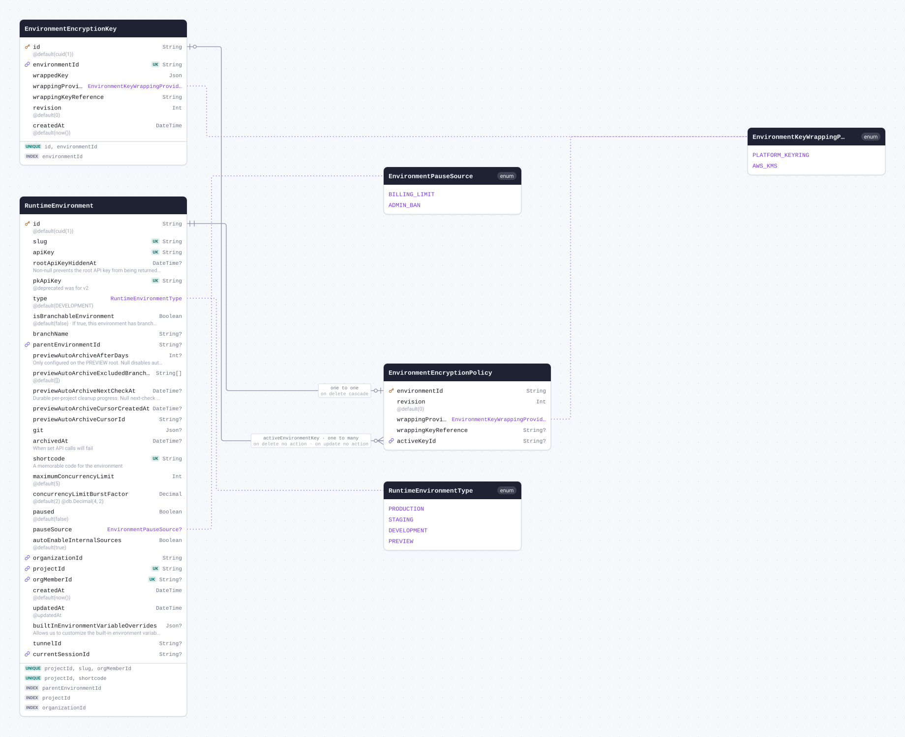

| Field                  | Type                                                                     | Constraints                                                           | Default | Description |
| ---------------------- | ------------------------------------------------------------------------ | --------------------------------------------------------------------- | ------- | ----------- |
| `environmentId`        | `String`                                                                 | PK NOT NULL → [RuntimeEnvironment.id](#model-RuntimeEnvironment)      |         |             |
| `revision`             | `Int`                                                                    | NOT NULL                                                              | `0`     |             |
| `wrappingProvider`     | [`EnvironmentKeyWrappingProvider`](#enum-EnvironmentKeyWrappingProvider) | NULL                                                                  |         |             |
| `wrappingKeyReference` | `String`                                                                 | NULL                                                                  |         |             |
| `activeKeyId`          | `String`                                                                 | NULL → [EnvironmentEncryptionKey.id](#model-EnvironmentEncryptionKey) |         |             |

#### References

- `environmentId` → [RuntimeEnvironment.id](#model-RuntimeEnvironment) (one-to-one, on delete Cascade)
- `activeKeyId` → [EnvironmentEncryptionKey.id](#model-EnvironmentEncryptionKey) (many-to-one, on delete NoAction, on update NoAction)

#### Definition

```sql
CREATE TABLE "EnvironmentEncryptionPolicy" (
    "environmentId" TEXT NOT NULL,
    "revision" INTEGER NOT NULL DEFAULT 0,
    "wrappingProvider" "EnvironmentKeyWrappingProvider",
    "wrappingKeyReference" TEXT,
    "activeKeyId" TEXT,

    CONSTRAINT "EnvironmentEncryptionPolicy_pkey" PRIMARY KEY ("environmentId")
);

ALTER TABLE "EnvironmentEncryptionPolicy" ADD CONSTRAINT "EnvironmentEncryptionPolicy_environmentId_fkey" FOREIGN KEY ("environmentId") REFERENCES "RuntimeEnvironment"("id") ON DELETE CASCADE ON UPDATE CASCADE;

ALTER TABLE "EnvironmentEncryptionPolicy" ADD CONSTRAINT "EnvironmentEncryptionPolicy_activeKeyId_environmentId_fkey" FOREIGN KEY ("activeKeyId", "environmentId") REFERENCES "EnvironmentEncryptionKey"("id", "environmentId") ON DELETE NO ACTION ON UPDATE NO ACTION;
```

<details>
<summary>Queries and their SQL</summary>

**findMany**: Every row

```ts
await prisma.environmentEncryptionPolicy.findMany();
```

```sql
SELECT
  "public"."EnvironmentEncryptionPolicy"."environmentId",
  "public"."EnvironmentEncryptionPolicy"."revision",
  "public"."EnvironmentEncryptionPolicy"."wrappingProvider"::text,
  "public"."EnvironmentEncryptionPolicy"."wrappingKeyReference",
  "public"."EnvironmentEncryptionPolicy"."activeKeyId"
FROM
  "public"."EnvironmentEncryptionPolicy"
WHERE
  1 = 1
OFFSET
  $1
-- params: ["0"]
```

**count**: How many rows there are

```ts
await prisma.environmentEncryptionPolicy.count();
```

```sql
SELECT
  COUNT(*) AS "_count$_all"
FROM
  (
    SELECT
      "public"."EnvironmentEncryptionPolicy"."environmentId"
    FROM
      "public"."EnvironmentEncryptionPolicy"
    WHERE
      1 = 1
    OFFSET
      $1
  ) AS "sub"
-- params: ["0"]
```

**findMany**: Every row with its relations

```ts
await prisma.environmentEncryptionPolicy.findMany({
  include: { environment: true, activeKey: true },
});
```

```sql
SELECT
  "public"."EnvironmentEncryptionPolicy"."environmentId",
  "public"."EnvironmentEncryptionPolicy"."revision",
  "public"."EnvironmentEncryptionPolicy"."wrappingProvider"::text,
  "public"."EnvironmentEncryptionPolicy"."wrappingKeyReference",
  "public"."EnvironmentEncryptionPolicy"."activeKeyId"
FROM
  "public"."EnvironmentEncryptionPolicy"
WHERE
  1 = 1
OFFSET
  $1
-- params: ["0"]

SELECT
  "public"."RuntimeEnvironment"."id",
  "public"."RuntimeEnvironment"."slug",
  "public"."RuntimeEnvironment"."apiKey",
  "public"."RuntimeEnvironment"."rootApiKeyHiddenAt",
  "public"."RuntimeEnvironment"."pkApiKey",
  "public"."RuntimeEnvironment"."type"::text,
  "public"."RuntimeEnvironment"."isBranchableEnvironment",
  "public"."RuntimeEnvironment"."branchName",
  "public"."RuntimeEnvironment"."parentEnvironmentId",
  "public"."RuntimeEnvironment"."previewAutoArchiveAfterDays",
  "public"."RuntimeEnvironment"."previewAutoArchiveExcludedBranches",
  "public"."RuntimeEnvironment"."previewAutoArchiveNextCheckAt",
  "public"."RuntimeEnvironment"."previewAutoArchiveCursorCreatedAt",
  "public"."RuntimeEnvironment"."previewAutoArchiveCursorId",
  "public"."RuntimeEnvironment"."git",
  "public"."RuntimeEnvironment"."archivedAt",
  "public"."RuntimeEnvironment"."shortcode",
  "public"."RuntimeEnvironment"."maximumConcurrencyLimit",
  "public"."RuntimeEnvironment"."concurrencyLimitBurstFactor",
  "public"."RuntimeEnvironment"."paused",
  "public"."RuntimeEnvironment"."pauseSource"::text,
  "public"."RuntimeEnvironment"."autoEnableInternalSources",
  "public"."RuntimeEnvironment"."organizationId",
  "public"."RuntimeEnvironment"."projectId",
  "public"."RuntimeEnvironment"."orgMemberId",
  "public"."RuntimeEnvironment"."createdAt",
  "public"."RuntimeEnvironment"."updatedAt",
  "public"."RuntimeEnvironment"."builtInEnvironmentVariableOverrides",
  "public"."RuntimeEnvironment"."tunnelId",
  "public"."RuntimeEnvironment"."currentSessionId"
FROM
  "public"."RuntimeEnvironment"
WHERE
  "public"."RuntimeEnvironment"."id" IN ($1)
OFFSET
  $2
-- params: ["<environmentId of the rows above>","0"]

SELECT
  "public"."EnvironmentEncryptionKey"."id",
  "public"."EnvironmentEncryptionKey"."environmentId",
  "public"."EnvironmentEncryptionKey"."wrappedKey",
  "public"."EnvironmentEncryptionKey"."wrappingProvider"::text,
  "public"."EnvironmentEncryptionKey"."wrappingKeyReference",
  "public"."EnvironmentEncryptionKey"."revision",
  "public"."EnvironmentEncryptionKey"."createdAt"
FROM
  "public"."EnvironmentEncryptionKey"
WHERE
  (
    "public"."EnvironmentEncryptionKey"."id" IN ($1)
    AND "public"."EnvironmentEncryptionKey"."environmentId" IN ($2)
  )
OFFSET
  $3
-- params: ["<activeKeyId of the rows above>","<environmentId of the rows above>","0"]
```

**findUnique**: One row by what is unique to it

```ts
await prisma.environmentEncryptionPolicy.findUnique({ where: { environmentId: "example" } });
```

```sql
SELECT
  "public"."EnvironmentEncryptionPolicy"."environmentId",
  "public"."EnvironmentEncryptionPolicy"."revision",
  "public"."EnvironmentEncryptionPolicy"."wrappingProvider"::text,
  "public"."EnvironmentEncryptionPolicy"."wrappingKeyReference",
  "public"."EnvironmentEncryptionPolicy"."activeKeyId"
FROM
  "public"."EnvironmentEncryptionPolicy"
WHERE
  (
    "public"."EnvironmentEncryptionPolicy"."environmentId" = $1
    AND 1 = 1
  )
LIMIT
  $2
OFFSET
  $3
-- params: ["example","1","0"]
```

**create**: Create a row

```ts
await prisma.environmentEncryptionPolicy.create({ data: { environmentId: "example" } });
```

```sql
INSERT INTO
  "public"."EnvironmentEncryptionPolicy" ("environmentId", "revision")
VALUES
  ($1, $2)
RETURNING
  "public"."EnvironmentEncryptionPolicy"."environmentId",
  "public"."EnvironmentEncryptionPolicy"."revision",
  "public"."EnvironmentEncryptionPolicy"."wrappingProvider"::text,
  "public"."EnvironmentEncryptionPolicy"."wrappingKeyReference",
  "public"."EnvironmentEncryptionPolicy"."activeKeyId"
-- params: ["example","0"]
```

**update**: Update a row

```ts
await prisma.environmentEncryptionPolicy.update({
  where: { environmentId: "example" },
  data: { revision: 1 },
});
```

```sql
UPDATE "public"."EnvironmentEncryptionPolicy"
SET
  "revision" = $1
WHERE
  (
    "public"."EnvironmentEncryptionPolicy"."environmentId" = $2
    AND 1 = 1
  )
RETURNING
  "public"."EnvironmentEncryptionPolicy"."environmentId",
  "public"."EnvironmentEncryptionPolicy"."revision",
  "public"."EnvironmentEncryptionPolicy"."wrappingProvider"::text,
  "public"."EnvironmentEncryptionPolicy"."wrappingKeyReference",
  "public"."EnvironmentEncryptionPolicy"."activeKeyId"
-- params: ["1","example"]
```

**delete**: Delete a row

```ts
await prisma.environmentEncryptionPolicy.delete({ where: { environmentId: "example" } });
```

```sql
DELETE FROM "public"."EnvironmentEncryptionPolicy"
WHERE
  (
    "public"."EnvironmentEncryptionPolicy"."environmentId" = $1
    AND 1 = 1
  )
RETURNING
  "public"."EnvironmentEncryptionPolicy"."environmentId",
  "public"."EnvironmentEncryptionPolicy"."revision",
  "public"."EnvironmentEncryptionPolicy"."wrappingProvider"::text,
  "public"."EnvironmentEncryptionPolicy"."wrappingKeyReference",
  "public"."EnvironmentEncryptionPolicy"."activeKeyId"
-- params: ["example"]
```

</details>

<a id="model-EnvironmentEncryptionKey"></a>

### EnvironmentEncryptionKey

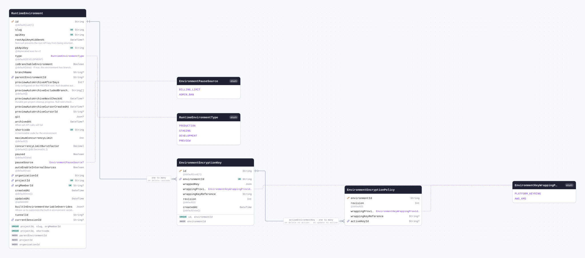

| Field                  | Type                                                                     | Constraints                                                   | Default   | Description |
| ---------------------- | ------------------------------------------------------------------------ | ------------------------------------------------------------- | --------- | ----------- |
| `id`                   | `String`                                                                 | PK NOT NULL                                                   | `cuid(1)` |             |
| `environmentId`        | `String`                                                                 | NOT NULL → [RuntimeEnvironment.id](#model-RuntimeEnvironment) |           |             |
| `wrappedKey`           | `Json`                                                                   | NOT NULL                                                      |           |             |
| `wrappingProvider`     | [`EnvironmentKeyWrappingProvider`](#enum-EnvironmentKeyWrappingProvider) | NOT NULL                                                      |           |             |
| `wrappingKeyReference` | `String`                                                                 | NOT NULL                                                      |           |             |
| `revision`             | `Int`                                                                    | NOT NULL                                                      | `0`       |             |
| `createdAt`            | `DateTime`                                                               | NOT NULL                                                      | `now()`   |             |

#### Indexes

- `@@index([environmentId])`
- `@@unique([id, environmentId])`

#### References

- `environmentId` → [RuntimeEnvironment.id](#model-RuntimeEnvironment) (many-to-one, on delete Cascade)

#### Referenced by

- `id` ← [EnvironmentEncryptionPolicy.activeKeyId](#model-EnvironmentEncryptionPolicy) (one-to-many, on delete NoAction, on update NoAction)

#### Definition

```sql
CREATE TABLE "EnvironmentEncryptionKey" (
    "id" TEXT NOT NULL,
    "environmentId" TEXT NOT NULL,
    "wrappedKey" JSONB NOT NULL,
    "wrappingProvider" "EnvironmentKeyWrappingProvider" NOT NULL,
    "wrappingKeyReference" TEXT NOT NULL,
    "revision" INTEGER NOT NULL DEFAULT 0,
    "createdAt" TIMESTAMP(3) NOT NULL DEFAULT CURRENT_TIMESTAMP,

    CONSTRAINT "EnvironmentEncryptionKey_pkey" PRIMARY KEY ("id")
);

CREATE INDEX "EnvironmentEncryptionKey_environmentId_idx" ON "EnvironmentEncryptionKey"("environmentId");

CREATE UNIQUE INDEX "EnvironmentEncryptionKey_id_environmentId_key" ON "EnvironmentEncryptionKey"("id", "environmentId");

ALTER TABLE "EnvironmentEncryptionKey" ADD CONSTRAINT "EnvironmentEncryptionKey_environmentId_fkey" FOREIGN KEY ("environmentId") REFERENCES "RuntimeEnvironment"("id") ON DELETE CASCADE ON UPDATE CASCADE;
```

<details>
<summary>Queries and their SQL</summary>

**findMany**: Every row

```ts
await prisma.environmentEncryptionKey.findMany();
```

```sql
SELECT
  "public"."EnvironmentEncryptionKey"."id",
  "public"."EnvironmentEncryptionKey"."environmentId",
  "public"."EnvironmentEncryptionKey"."wrappedKey",
  "public"."EnvironmentEncryptionKey"."wrappingProvider"::text,
  "public"."EnvironmentEncryptionKey"."wrappingKeyReference",
  "public"."EnvironmentEncryptionKey"."revision",
  "public"."EnvironmentEncryptionKey"."createdAt"
FROM
  "public"."EnvironmentEncryptionKey"
WHERE
  1 = 1
OFFSET
  $1
-- params: ["0"]
```

**count**: How many rows there are

```ts
await prisma.environmentEncryptionKey.count();
```

```sql
SELECT
  COUNT(*) AS "_count$_all"
FROM
  (
    SELECT
      "public"."EnvironmentEncryptionKey"."id"
    FROM
      "public"."EnvironmentEncryptionKey"
    WHERE
      1 = 1
    OFFSET
      $1
  ) AS "sub"
-- params: ["0"]
```

**findMany**: Every row with its relations

```ts
await prisma.environmentEncryptionKey.findMany({ include: { environment: true, activeFor: true } });
```

```sql
SELECT
  "public"."EnvironmentEncryptionKey"."id",
  "public"."EnvironmentEncryptionKey"."environmentId",
  "public"."EnvironmentEncryptionKey"."wrappedKey",
  "public"."EnvironmentEncryptionKey"."wrappingProvider"::text,
  "public"."EnvironmentEncryptionKey"."wrappingKeyReference",
  "public"."EnvironmentEncryptionKey"."revision",
  "public"."EnvironmentEncryptionKey"."createdAt"
FROM
  "public"."EnvironmentEncryptionKey"
WHERE
  1 = 1
OFFSET
  $1
-- params: ["0"]

SELECT
  "public"."RuntimeEnvironment"."id",
  "public"."RuntimeEnvironment"."slug",
  "public"."RuntimeEnvironment"."apiKey",
  "public"."RuntimeEnvironment"."rootApiKeyHiddenAt",
  "public"."RuntimeEnvironment"."pkApiKey",
  "public"."RuntimeEnvironment"."type"::text,
  "public"."RuntimeEnvironment"."isBranchableEnvironment",
  "public"."RuntimeEnvironment"."branchName",
  "public"."RuntimeEnvironment"."parentEnvironmentId",
  "public"."RuntimeEnvironment"."previewAutoArchiveAfterDays",
  "public"."RuntimeEnvironment"."previewAutoArchiveExcludedBranches",
  "public"."RuntimeEnvironment"."previewAutoArchiveNextCheckAt",
  "public"."RuntimeEnvironment"."previewAutoArchiveCursorCreatedAt",
  "public"."RuntimeEnvironment"."previewAutoArchiveCursorId",
  "public"."RuntimeEnvironment"."git",
  "public"."RuntimeEnvironment"."archivedAt",
  "public"."RuntimeEnvironment"."shortcode",
  "public"."RuntimeEnvironment"."maximumConcurrencyLimit",
  "public"."RuntimeEnvironment"."concurrencyLimitBurstFactor",
  "public"."RuntimeEnvironment"."paused",
  "public"."RuntimeEnvironment"."pauseSource"::text,
  "public"."RuntimeEnvironment"."autoEnableInternalSources",
  "public"."RuntimeEnvironment"."organizationId",
  "public"."RuntimeEnvironment"."projectId",
  "public"."RuntimeEnvironment"."orgMemberId",
  "public"."RuntimeEnvironment"."createdAt",
  "public"."RuntimeEnvironment"."updatedAt",
  "public"."RuntimeEnvironment"."builtInEnvironmentVariableOverrides",
  "public"."RuntimeEnvironment"."tunnelId",
  "public"."RuntimeEnvironment"."currentSessionId"
FROM
  "public"."RuntimeEnvironment"
WHERE
  "public"."RuntimeEnvironment"."id" IN ($1)
OFFSET
  $2
-- params: ["<environmentId of the rows above>","0"]

SELECT
  "public"."EnvironmentEncryptionPolicy"."environmentId",
  "public"."EnvironmentEncryptionPolicy"."revision",
  "public"."EnvironmentEncryptionPolicy"."wrappingProvider"::text,
  "public"."EnvironmentEncryptionPolicy"."wrappingKeyReference",
  "public"."EnvironmentEncryptionPolicy"."activeKeyId"
FROM
  "public"."EnvironmentEncryptionPolicy"
WHERE
  (
    "public"."EnvironmentEncryptionPolicy"."environmentId" IN ($1)
    AND "public"."EnvironmentEncryptionPolicy"."activeKeyId" IN ($2)
  )
OFFSET
  $3
-- params: ["<environmentId of the rows above>","<id of the rows above>","0"]
```

**findUnique**: One row by what is unique to it

```ts
await prisma.environmentEncryptionKey.findUnique({ where: { id: "example" } });
```

```sql
SELECT
  "public"."EnvironmentEncryptionKey"."id",
  "public"."EnvironmentEncryptionKey"."environmentId",
  "public"."EnvironmentEncryptionKey"."wrappedKey",
  "public"."EnvironmentEncryptionKey"."wrappingProvider"::text,
  "public"."EnvironmentEncryptionKey"."wrappingKeyReference",
  "public"."EnvironmentEncryptionKey"."revision",
  "public"."EnvironmentEncryptionKey"."createdAt"
FROM
  "public"."EnvironmentEncryptionKey"
WHERE
  (
    "public"."EnvironmentEncryptionKey"."id" = $1
    AND 1 = 1
  )
LIMIT
  $2
OFFSET
  $3
-- params: ["example","1","0"]
```

**create**: Create a row

```ts
await prisma.environmentEncryptionKey.create({
  data: {
    environmentId: "example",
    wrappedKey: {},
    wrappingProvider: "PLATFORM_KEYRING",
    wrappingKeyReference: "example",
  },
});
```

```sql
INSERT INTO
  "public"."EnvironmentEncryptionKey" (
    "id",
    "environmentId",
    "wrappedKey",
    "wrappingProvider",
    "wrappingKeyReference",
    "revision",
    "createdAt"
  )
VALUES
  (
    $1,
    $2,
    $3,
    CAST(
      $4::text AS "public"."EnvironmentKeyWrappingProvider"
    ),
    $5,
    $6,
    $7
  )
RETURNING
  "public"."EnvironmentEncryptionKey"."id",
  "public"."EnvironmentEncryptionKey"."environmentId",
  "public"."EnvironmentEncryptionKey"."wrappedKey",
  "public"."EnvironmentEncryptionKey"."wrappingProvider"::text,
  "public"."EnvironmentEncryptionKey"."wrappingKeyReference",
  "public"."EnvironmentEncryptionKey"."revision",
  "public"."EnvironmentEncryptionKey"."createdAt"
-- params: ["<cuid(1)>","example","{}","PLATFORM_KEYRING","example","0","<now()>"]
```

**update**: Update a row

```ts
await prisma.environmentEncryptionKey.update({
  where: { id: "example" },
  data: { wrappedKey: {} },
});
```

```sql
UPDATE "public"."EnvironmentEncryptionKey"
SET
  "wrappedKey" = $1
WHERE
  (
    "public"."EnvironmentEncryptionKey"."id" = $2
    AND 1 = 1
  )
RETURNING
  "public"."EnvironmentEncryptionKey"."id",
  "public"."EnvironmentEncryptionKey"."environmentId",
  "public"."EnvironmentEncryptionKey"."wrappedKey",
  "public"."EnvironmentEncryptionKey"."wrappingProvider"::text,
  "public"."EnvironmentEncryptionKey"."wrappingKeyReference",
  "public"."EnvironmentEncryptionKey"."revision",
  "public"."EnvironmentEncryptionKey"."createdAt"
-- params: ["{}","example"]
```

**delete**: Delete a row

```ts
await prisma.environmentEncryptionKey.delete({ where: { id: "example" } });
```

```sql
DELETE FROM "public"."EnvironmentEncryptionKey"
WHERE
  (
    "public"."EnvironmentEncryptionKey"."id" = $1
    AND 1 = 1
  )
RETURNING
  "public"."EnvironmentEncryptionKey"."id",
  "public"."EnvironmentEncryptionKey"."environmentId",
  "public"."EnvironmentEncryptionKey"."wrappedKey",
  "public"."EnvironmentEncryptionKey"."wrappingProvider"::text,
  "public"."EnvironmentEncryptionKey"."wrappingKeyReference",
  "public"."EnvironmentEncryptionKey"."revision",
  "public"."EnvironmentEncryptionKey"."createdAt"
-- params: ["example"]
```

</details>

<a id="model-SecretReference"></a>

### SecretReference

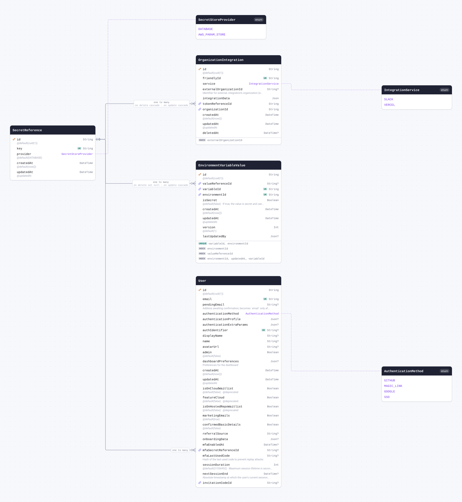

| Field       | Type                                               | Constraints     | Default      | Description |
| ----------- | -------------------------------------------------- | --------------- | ------------ | ----------- |
| `id`        | `String`                                           | PK NOT NULL     | `cuid(1)`    |             |
| `key`       | `String`                                           | UNIQUE NOT NULL |              |             |
| `provider`  | [`SecretStoreProvider`](#enum-SecretStoreProvider) | NOT NULL        | `DATABASE`   |             |
| `createdAt` | `DateTime`                                         | NOT NULL        | `now()`      |             |
| `updatedAt` | `DateTime`                                         | NOT NULL        | `@updatedAt` |             |

#### Referenced by

- `id` ← [User.mfaSecretReferenceId](#model-User) (one-to-many)
- `id` ← [EnvironmentVariableValue.valueReferenceId](#model-EnvironmentVariableValue) (one-to-many, on delete SetNull, on update Cascade)
- `id` ← [OrganizationIntegration.tokenReferenceId](#model-OrganizationIntegration) (one-to-many, on delete Cascade, on update Cascade)

#### Definition

```sql
CREATE TABLE "SecretReference" (
    "id" TEXT NOT NULL,
    "key" TEXT NOT NULL,
    "provider" "SecretStoreProvider" NOT NULL DEFAULT 'DATABASE',
    "createdAt" TIMESTAMP(3) NOT NULL DEFAULT CURRENT_TIMESTAMP,
    "updatedAt" TIMESTAMP(3) NOT NULL,

    CONSTRAINT "SecretReference_pkey" PRIMARY KEY ("id")
);

CREATE UNIQUE INDEX "SecretReference_key_key" ON "SecretReference"("key");
```

<details>
<summary>Queries and their SQL</summary>

**findMany**: Every row

```ts
await prisma.secretReference.findMany();
```

```sql
SELECT
  "public"."SecretReference"."id",
  "public"."SecretReference"."key",
  "public"."SecretReference"."provider"::text,
  "public"."SecretReference"."createdAt",
  "public"."SecretReference"."updatedAt"
FROM
  "public"."SecretReference"
WHERE
  1 = 1
OFFSET
  $1
-- params: ["0"]
```

**count**: How many rows there are

```ts
await prisma.secretReference.count();
```

```sql
SELECT
  COUNT(*) AS "_count$_all"
FROM
  (
    SELECT
      "public"."SecretReference"."id"
    FROM
      "public"."SecretReference"
    WHERE
      1 = 1
    OFFSET
      $1
  ) AS "sub"
-- params: ["0"]
```

**findMany**: Every row with its relations

```ts
await prisma.secretReference.findMany({
  include: { environmentVariableValues: true, OrganizationIntegration: true, User: true },
});
```

```sql
SELECT
  "public"."SecretReference"."id",
  "public"."SecretReference"."key",
  "public"."SecretReference"."provider"::text,
  "public"."SecretReference"."createdAt",
  "public"."SecretReference"."updatedAt"
FROM
  "public"."SecretReference"
WHERE
  1 = 1
OFFSET
  $1
-- params: ["0"]

SELECT
  "public"."EnvironmentVariableValue"."id",
  "public"."EnvironmentVariableValue"."valueReferenceId",
  "public"."EnvironmentVariableValue"."variableId",
  "public"."EnvironmentVariableValue"."environmentId",
  "public"."EnvironmentVariableValue"."isSecret",
  "public"."EnvironmentVariableValue"."createdAt",
  "public"."EnvironmentVariableValue"."updatedAt",
  "public"."EnvironmentVariableValue"."version",
  "public"."EnvironmentVariableValue"."lastUpdatedBy"
FROM
  "public"."EnvironmentVariableValue"
WHERE
  "public"."EnvironmentVariableValue"."valueReferenceId" IN ($1)
OFFSET
  $2
-- params: ["<id of the rows above>","0"]

SELECT
  "public"."OrganizationIntegration"."id",
  "public"."OrganizationIntegration"."friendlyId",
  "public"."OrganizationIntegration"."service"::text,
  "public"."OrganizationIntegration"."externalOrganizationId",
  "public"."OrganizationIntegration"."integrationData",
  "public"."OrganizationIntegration"."tokenReferenceId",
  "public"."OrganizationIntegration"."organizationId",
  "public"."OrganizationIntegration"."createdAt",
  "public"."OrganizationIntegration"."updatedAt",
  "public"."OrganizationIntegration"."deletedAt"
FROM
  "public"."OrganizationIntegration"
WHERE
  "public"."OrganizationIntegration"."tokenReferenceId" IN ($1)
OFFSET
  $2
-- params: ["<id of the rows above>","0"]

SELECT
  "public"."User"."id",
  "public"."User"."email",
  "public"."User"."pendingEmail",
  "public"."User"."authenticationMethod"::text,
  "public"."User"."authenticationProfile",
  "public"."User"."authenticationExtraParams",
  "public"."User"."authIdentifier",
  "public"."User"."displayName",
  "public"."User"."name",
  "public"."User"."avatarUrl",
  "public"."User"."admin",
  "public"."User"."dashboardPreferences",
  "public"."User"."createdAt",
  "public"."User"."updatedAt",
  "public"."User"."isOnCloudWaitlist",
  "public"."User"."featureCloud",
  "public"."User"."isOnHostedRepoWaitlist",
  "public"."User"."marketingEmails",
  "public"."User"."confirmedBasicDetails",
  "public"."User"."referralSource",
  "public"."User"."onboardingData",
  "public"."User"."mfaEnabledAt",
  "public"."User"."mfaSecretReferenceId",
  "public"."User"."mfaLastUsedCode",
  "public"."User"."sessionDuration",
  "public"."User"."nextSessionEnd",
  "public"."User"."invitationCodeId"
FROM
  "public"."User"
WHERE
  "public"."User"."mfaSecretReferenceId" IN ($1)
OFFSET
  $2
-- params: ["<id of the rows above>","0"]
```

**findUnique**: One row by what is unique to it

```ts
await prisma.secretReference.findUnique({ where: { id: "example" } });
```

```sql
SELECT
  "public"."SecretReference"."id",
  "public"."SecretReference"."key",
  "public"."SecretReference"."provider"::text,
  "public"."SecretReference"."createdAt",
  "public"."SecretReference"."updatedAt"
FROM
  "public"."SecretReference"
WHERE
  (
    "public"."SecretReference"."id" = $1
    AND 1 = 1
  )
LIMIT
  $2
OFFSET
  $3
-- params: ["example","1","0"]
```

**create**: Create a row

```ts
await prisma.secretReference.create({ data: { key: "example" } });
```

```sql
INSERT INTO
  "public"."SecretReference" ("id", "key", "provider", "createdAt", "updatedAt")
VALUES
  (
    $1,
    $2,
    CAST($3::text AS "public"."SecretStoreProvider"),
    $4,
    $5
  )
RETURNING
  "public"."SecretReference"."id",
  "public"."SecretReference"."key",
  "public"."SecretReference"."provider"::text,
  "public"."SecretReference"."createdAt",
  "public"."SecretReference"."updatedAt"
-- params: ["<cuid(1)>","example","DATABASE","<now()>","<now()>"]
```

**update**: Update a row

```ts
await prisma.secretReference.update({ where: { id: "example" }, data: { key: "example" } });
```

```sql
UPDATE "public"."SecretReference"
SET
  "key" = $1,
  "updatedAt" = $2
WHERE
  (
    "public"."SecretReference"."id" = $3
    AND 1 = 1
  )
RETURNING
  "public"."SecretReference"."id",
  "public"."SecretReference"."key",
  "public"."SecretReference"."provider"::text,
  "public"."SecretReference"."createdAt",
  "public"."SecretReference"."updatedAt"
-- params: ["example",{"prisma__type":"generatorCall","prisma__value":{"name":"now","args":[],"returnType":{"type":"DateTime"}}},"example"]
```

**delete**: Delete a row

```ts
await prisma.secretReference.delete({ where: { id: "example" } });
```

```sql
DELETE FROM "public"."SecretReference"
WHERE
  (
    "public"."SecretReference"."id" = $1
    AND 1 = 1
  )
RETURNING
  "public"."SecretReference"."id",
  "public"."SecretReference"."key",
  "public"."SecretReference"."provider"::text,
  "public"."SecretReference"."createdAt",
  "public"."SecretReference"."updatedAt"
-- params: ["example"]
```

</details>

<a id="model-SecretStore"></a>

### SecretStore

| Field       | Type       | Constraints     | Default      | Description |
| ----------- | ---------- | --------------- | ------------ | ----------- |
| `key`       | `String`   | UNIQUE NOT NULL |              |             |
| `value`     | `Json`     | NOT NULL        |              |             |
| `version`   | `String`   | NOT NULL        | `"1"`        |             |
| `createdAt` | `DateTime` | NOT NULL        | `now()`      |             |
| `updatedAt` | `DateTime` | NOT NULL        | `@updatedAt` |             |

#### Indexes

- `@@index([key])`

#### Definition

```sql
CREATE TABLE "SecretStore" (
    "key" TEXT NOT NULL,
    "value" JSONB NOT NULL,
    "version" TEXT NOT NULL DEFAULT '1',
    "createdAt" TIMESTAMP(3) NOT NULL DEFAULT CURRENT_TIMESTAMP,
    "updatedAt" TIMESTAMP(3) NOT NULL
);

CREATE UNIQUE INDEX "SecretStore_key_key" ON "SecretStore"("key");

CREATE INDEX "SecretStore_key_idx" ON "SecretStore"("key" text_pattern_ops);
```

<details>
<summary>Queries and their SQL</summary>

**findMany**: Every row

```ts
await prisma.secretStore.findMany();
```

```sql
SELECT
  "public"."SecretStore"."key",
  "public"."SecretStore"."value",
  "public"."SecretStore"."version",
  "public"."SecretStore"."createdAt",
  "public"."SecretStore"."updatedAt"
FROM
  "public"."SecretStore"
WHERE
  1 = 1
OFFSET
  $1
-- params: ["0"]
```

**count**: How many rows there are

```ts
await prisma.secretStore.count();
```

```sql
SELECT
  COUNT(*) AS "_count$_all"
FROM
  (
    SELECT
      "public"."SecretStore"."key"
    FROM
      "public"."SecretStore"
    WHERE
      1 = 1
    OFFSET
      $1
  ) AS "sub"
-- params: ["0"]
```

**findUnique**: One row by what is unique to it

```ts
await prisma.secretStore.findUnique({ where: { key: "example" } });
```

```sql
SELECT
  "public"."SecretStore"."key",
  "public"."SecretStore"."value",
  "public"."SecretStore"."version",
  "public"."SecretStore"."createdAt",
  "public"."SecretStore"."updatedAt"
FROM
  "public"."SecretStore"
WHERE
  (
    "public"."SecretStore"."key" = $1
    AND 1 = 1
  )
LIMIT
  $2
OFFSET
  $3
-- params: ["example","1","0"]
```

**create**: Create a row

```ts
await prisma.secretStore.create({ data: { key: "example", value: {} } });
```

```sql
INSERT INTO
  "public"."SecretStore" (
    "key",
    "value",
    "version",
    "createdAt",
    "updatedAt"
  )
VALUES
  ($1, $2, $3, $4, $5)
RETURNING
  "public"."SecretStore"."key",
  "public"."SecretStore"."value",
  "public"."SecretStore"."version",
  "public"."SecretStore"."createdAt",
  "public"."SecretStore"."updatedAt"
-- params: ["example","{}","1","<now()>","<now()>"]
```

**update**: Update a row

```ts
await prisma.secretStore.update({ where: { key: "example" }, data: { value: {} } });
```

```sql
UPDATE "public"."SecretStore"
SET
  "value" = $1,
  "updatedAt" = $2
WHERE
  (
    "public"."SecretStore"."key" = $3
    AND 1 = 1
  )
RETURNING
  "public"."SecretStore"."key",
  "public"."SecretStore"."value",
  "public"."SecretStore"."version",
  "public"."SecretStore"."createdAt",
  "public"."SecretStore"."updatedAt"
-- params: ["{}",{"prisma__type":"generatorCall","prisma__value":{"name":"now","args":[],"returnType":{"type":"DateTime"}}},"example"]
```

**delete**: Delete a row

```ts
await prisma.secretStore.delete({ where: { key: "example" } });
```

```sql
DELETE FROM "public"."SecretStore"
WHERE
  (
    "public"."SecretStore"."key" = $1
    AND 1 = 1
  )
RETURNING
  "public"."SecretStore"."key",
  "public"."SecretStore"."value",
  "public"."SecretStore"."version",
  "public"."SecretStore"."createdAt",
  "public"."SecretStore"."updatedAt"
-- params: ["example"]
```

</details>

<a id="model-OidcSigningKey"></a>

### OidcSigningKey

| Field               | Type                                                   | Constraints     | Default         | Description                                                                                             |
| ------------------- | ------------------------------------------------------ | --------------- | --------------- | ------------------------------------------------------------------------------------------------------- |
| `id`                | `String`                                               | PK NOT NULL     | `cuid(1)`       |                                                                                                         |
| `kid`               | `String`                                               | UNIQUE NOT NULL |                 |                                                                                                         |
| `purpose`           | [`OidcSigningKeyPurpose`](#enum-OidcSigningKeyPurpose) | NOT NULL        | `EXTERNAL_OIDC` |                                                                                                         |
| `status`            | [`OidcSigningKeyStatus`](#enum-OidcSigningKeyStatus)   | NOT NULL        |                 | At most one STAGED and one ACTIVE key per purpose: enforced by a partial unique index in the migration. |
| `publicJwk`         | `Json`                                                 | NOT NULL        |                 |                                                                                                         |
| `readyAt`           | `DateTime`                                             | NOT NULL        |                 |                                                                                                         |
| `publicUntil`       | `DateTime`                                             | NULL            |                 |                                                                                                         |
| `generatedByUserId` | `String`                                               | NOT NULL        |                 |                                                                                                         |
| `activatedAt`       | `DateTime`                                             | NULL            |                 |                                                                                                         |
| `activatedByUserId` | `String`                                               | NULL            |                 |                                                                                                         |
| `retiredAt`         | `DateTime`                                             | NULL            |                 |                                                                                                         |
| `retiredByUserId`   | `String`                                               | NULL            |                 |                                                                                                         |
| `createdAt`         | `DateTime`                                             | NOT NULL        | `now()`         |                                                                                                         |
| `updatedAt`         | `DateTime`                                             | NOT NULL        | `@updatedAt`    |                                                                                                         |

#### Definition

```sql
CREATE TABLE "OidcSigningKey" (
    "id" TEXT NOT NULL,
    "kid" TEXT NOT NULL,
    "purpose" "OidcSigningKeyPurpose" NOT NULL DEFAULT 'EXTERNAL_OIDC',
    "status" "OidcSigningKeyStatus" NOT NULL,
    "publicJwk" JSONB NOT NULL,
    "readyAt" TIMESTAMP(3) NOT NULL,
    "publicUntil" TIMESTAMP(3),
    "generatedByUserId" TEXT NOT NULL,
    "activatedAt" TIMESTAMP(3),
    "activatedByUserId" TEXT,
    "retiredAt" TIMESTAMP(3),
    "retiredByUserId" TEXT,
    "createdAt" TIMESTAMP(3) NOT NULL DEFAULT CURRENT_TIMESTAMP,
    "updatedAt" TIMESTAMP(3) NOT NULL,

    CONSTRAINT "OidcSigningKey_pkey" PRIMARY KEY ("id")
);

CREATE UNIQUE INDEX "OidcSigningKey_kid_key" ON "OidcSigningKey"("kid");
```

<details>
<summary>Queries and their SQL</summary>

**findMany**: Every row

```ts
await prisma.oidcSigningKey.findMany();
```

```sql
SELECT
  "public"."OidcSigningKey"."id",
  "public"."OidcSigningKey"."kid",
  "public"."OidcSigningKey"."purpose"::text,
  "public"."OidcSigningKey"."status"::text,
  "public"."OidcSigningKey"."publicJwk",
  "public"."OidcSigningKey"."readyAt",
  "public"."OidcSigningKey"."publicUntil",
  "public"."OidcSigningKey"."generatedByUserId",
  "public"."OidcSigningKey"."activatedAt",
  "public"."OidcSigningKey"."activatedByUserId",
  "public"."OidcSigningKey"."retiredAt",
  "public"."OidcSigningKey"."retiredByUserId",
  "public"."OidcSigningKey"."createdAt",
  "public"."OidcSigningKey"."updatedAt"
FROM
  "public"."OidcSigningKey"
WHERE
  1 = 1
OFFSET
  $1
-- params: ["0"]
```

**count**: How many rows there are

```ts
await prisma.oidcSigningKey.count();
```

```sql
SELECT
  COUNT(*) AS "_count$_all"
FROM
  (
    SELECT
      "public"."OidcSigningKey"."id"
    FROM
      "public"."OidcSigningKey"
    WHERE
      1 = 1
    OFFSET
      $1
  ) AS "sub"
-- params: ["0"]
```

**findUnique**: One row by what is unique to it

```ts
await prisma.oidcSigningKey.findUnique({ where: { id: "example" } });
```

```sql
SELECT
  "public"."OidcSigningKey"."id",
  "public"."OidcSigningKey"."kid",
  "public"."OidcSigningKey"."purpose"::text,
  "public"."OidcSigningKey"."status"::text,
  "public"."OidcSigningKey"."publicJwk",
  "public"."OidcSigningKey"."readyAt",
  "public"."OidcSigningKey"."publicUntil",
  "public"."OidcSigningKey"."generatedByUserId",
  "public"."OidcSigningKey"."activatedAt",
  "public"."OidcSigningKey"."activatedByUserId",
  "public"."OidcSigningKey"."retiredAt",
  "public"."OidcSigningKey"."retiredByUserId",
  "public"."OidcSigningKey"."createdAt",
  "public"."OidcSigningKey"."updatedAt"
FROM
  "public"."OidcSigningKey"
WHERE
  (
    "public"."OidcSigningKey"."id" = $1
    AND 1 = 1
  )
LIMIT
  $2
OFFSET
  $3
-- params: ["example","1","0"]
```

**create**: Create a row

```ts
await prisma.oidcSigningKey.create({
  data: {
    kid: "example",
    status: "STAGED",
    publicJwk: {},
    readyAt: new Date("2026-01-01T00:00:00.000Z"),
    generatedByUserId: "example",
  },
});
```

```sql
INSERT INTO
  "public"."OidcSigningKey" (
    "id",
    "kid",
    "purpose",
    "status",
    "publicJwk",
    "readyAt",
    "generatedByUserId",
    "createdAt",
    "updatedAt"
  )
VALUES
  (
    $1,
    $2,
    CAST($3::text AS "public"."OidcSigningKeyPurpose"),
    CAST($4::text AS "public"."OidcSigningKeyStatus"),
    $5,
    $6,
    $7,
    $8,
    $9
  )
RETURNING
  "public"."OidcSigningKey"."id",
  "public"."OidcSigningKey"."kid",
  "public"."OidcSigningKey"."purpose"::text,
  "public"."OidcSigningKey"."status"::text,
  "public"."OidcSigningKey"."publicJwk",
  "public"."OidcSigningKey"."readyAt",
  "public"."OidcSigningKey"."publicUntil",
  "public"."OidcSigningKey"."generatedByUserId",
  "public"."OidcSigningKey"."activatedAt",
  "public"."OidcSigningKey"."activatedByUserId",
  "public"."OidcSigningKey"."retiredAt",
  "public"."OidcSigningKey"."retiredByUserId",
  "public"."OidcSigningKey"."createdAt",
  "public"."OidcSigningKey"."updatedAt"
-- params: ["<cuid(1)>","example","EXTERNAL_OIDC","STAGED","{}","2026-01-01T00:00:00.000Z","example","<now()>","<now()>"]
```

**update**: Update a row

```ts
await prisma.oidcSigningKey.update({ where: { id: "example" }, data: { kid: "example" } });
```

```sql
UPDATE "public"."OidcSigningKey"
SET
  "kid" = $1,
  "updatedAt" = $2
WHERE
  (
    "public"."OidcSigningKey"."id" = $3
    AND 1 = 1
  )
RETURNING
  "public"."OidcSigningKey"."id",
  "public"."OidcSigningKey"."kid",
  "public"."OidcSigningKey"."purpose"::text,
  "public"."OidcSigningKey"."status"::text,
  "public"."OidcSigningKey"."publicJwk",
  "public"."OidcSigningKey"."readyAt",
  "public"."OidcSigningKey"."publicUntil",
  "public"."OidcSigningKey"."generatedByUserId",
  "public"."OidcSigningKey"."activatedAt",
  "public"."OidcSigningKey"."activatedByUserId",
  "public"."OidcSigningKey"."retiredAt",
  "public"."OidcSigningKey"."retiredByUserId",
  "public"."OidcSigningKey"."createdAt",
  "public"."OidcSigningKey"."updatedAt"
-- params: ["example",{"prisma__type":"generatorCall","prisma__value":{"name":"now","args":[],"returnType":{"type":"DateTime"}}},"example"]
```

**delete**: Delete a row

```ts
await prisma.oidcSigningKey.delete({ where: { id: "example" } });
```

```sql
DELETE FROM "public"."OidcSigningKey"
WHERE
  (
    "public"."OidcSigningKey"."id" = $1
    AND 1 = 1
  )
RETURNING
  "public"."OidcSigningKey"."id",
  "public"."OidcSigningKey"."kid",
  "public"."OidcSigningKey"."purpose"::text,
  "public"."OidcSigningKey"."status"::text,
  "public"."OidcSigningKey"."publicJwk",
  "public"."OidcSigningKey"."readyAt",
  "public"."OidcSigningKey"."publicUntil",
  "public"."OidcSigningKey"."generatedByUserId",
  "public"."OidcSigningKey"."activatedAt",
  "public"."OidcSigningKey"."activatedByUserId",
  "public"."OidcSigningKey"."retiredAt",
  "public"."OidcSigningKey"."retiredByUserId",
  "public"."OidcSigningKey"."createdAt",
  "public"."OidcSigningKey"."updatedAt"
-- params: ["example"]
```

</details>

<a id="model-DataMigration"></a>

### DataMigration

| Field         | Type       | Constraints     | Default      | Description |
| ------------- | ---------- | --------------- | ------------ | ----------- |
| `id`          | `String`   | PK NOT NULL     | `cuid(1)`    |             |
| `name`        | `String`   | UNIQUE NOT NULL |              |             |
| `createdAt`   | `DateTime` | NOT NULL        | `now()`      |             |
| `updatedAt`   | `DateTime` | NOT NULL        | `@updatedAt` |             |
| `completedAt` | `DateTime` | NULL            |              |             |

#### Definition

```sql
CREATE TABLE "DataMigration" (
    "id" TEXT NOT NULL,
    "name" TEXT NOT NULL,
    "createdAt" TIMESTAMP(3) NOT NULL DEFAULT CURRENT_TIMESTAMP,
    "updatedAt" TIMESTAMP(3) NOT NULL,
    "completedAt" TIMESTAMP(3),

    CONSTRAINT "DataMigration_pkey" PRIMARY KEY ("id")
);

CREATE UNIQUE INDEX "DataMigration_name_key" ON "DataMigration"("name");
```

<details>
<summary>Queries and their SQL</summary>

**findMany**: Every row

```ts
await prisma.dataMigration.findMany();
```

```sql
SELECT
  "public"."DataMigration"."id",
  "public"."DataMigration"."name",
  "public"."DataMigration"."createdAt",
  "public"."DataMigration"."updatedAt",
  "public"."DataMigration"."completedAt"
FROM
  "public"."DataMigration"
WHERE
  1 = 1
OFFSET
  $1
-- params: ["0"]
```

**count**: How many rows there are

```ts
await prisma.dataMigration.count();
```

```sql
SELECT
  COUNT(*) AS "_count$_all"
FROM
  (
    SELECT
      "public"."DataMigration"."id"
    FROM
      "public"."DataMigration"
    WHERE
      1 = 1
    OFFSET
      $1
  ) AS "sub"
-- params: ["0"]
```

**findUnique**: One row by what is unique to it

```ts
await prisma.dataMigration.findUnique({ where: { id: "example" } });
```

```sql
SELECT
  "public"."DataMigration"."id",
  "public"."DataMigration"."name",
  "public"."DataMigration"."createdAt",
  "public"."DataMigration"."updatedAt",
  "public"."DataMigration"."completedAt"
FROM
  "public"."DataMigration"
WHERE
  (
    "public"."DataMigration"."id" = $1
    AND 1 = 1
  )
LIMIT
  $2
OFFSET
  $3
-- params: ["example","1","0"]
```

**create**: Create a row

```ts
await prisma.dataMigration.create({ data: { name: "example" } });
```

```sql
INSERT INTO
  "public"."DataMigration" ("id", "name", "createdAt", "updatedAt")
VALUES
  ($1, $2, $3, $4)
RETURNING
  "public"."DataMigration"."id",
  "public"."DataMigration"."name",
  "public"."DataMigration"."createdAt",
  "public"."DataMigration"."updatedAt",
  "public"."DataMigration"."completedAt"
-- params: ["<cuid(1)>","example","<now()>","<now()>"]
```

**update**: Update a row

```ts
await prisma.dataMigration.update({ where: { id: "example" }, data: { name: "example" } });
```

```sql
UPDATE "public"."DataMigration"
SET
  "name" = $1,
  "updatedAt" = $2
WHERE
  (
    "public"."DataMigration"."id" = $3
    AND 1 = 1
  )
RETURNING
  "public"."DataMigration"."id",
  "public"."DataMigration"."name",
  "public"."DataMigration"."createdAt",
  "public"."DataMigration"."updatedAt",
  "public"."DataMigration"."completedAt"
-- params: ["example",{"prisma__type":"generatorCall","prisma__value":{"name":"now","args":[],"returnType":{"type":"DateTime"}}},"example"]
```

**delete**: Delete a row

```ts
await prisma.dataMigration.delete({ where: { id: "example" } });
```

```sql
DELETE FROM "public"."DataMigration"
WHERE
  (
    "public"."DataMigration"."id" = $1
    AND 1 = 1
  )
RETURNING
  "public"."DataMigration"."id",
  "public"."DataMigration"."name",
  "public"."DataMigration"."createdAt",
  "public"."DataMigration"."updatedAt",
  "public"."DataMigration"."completedAt"
-- params: ["example"]
```

</details>

<a id="model-BackgroundWorker"></a>

### BackgroundWorker

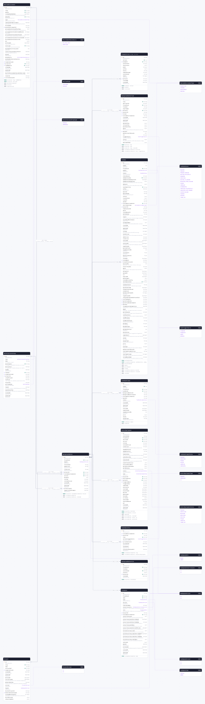

| Field                  | Type                                         | Constraints                                                   | Default      | Description |
| ---------------------- | -------------------------------------------- | ------------------------------------------------------------- | ------------ | ----------- |
| `id`                   | `String`                                     | PK NOT NULL                                                   | `cuid(1)`    |             |
| `friendlyId`           | `String`                                     | UNIQUE NOT NULL                                               |              |             |
| `engine`               | [`RunEngineVersion`](#enum-RunEngineVersion) | NOT NULL                                                      | `V1`         |             |
| `contentHash`          | `String`                                     | NOT NULL                                                      |              |             |
| `sdkVersion`           | `String`                                     | NOT NULL                                                      | `"unknown"`  |             |
| `cliVersion`           | `String`                                     | NOT NULL                                                      | `"unknown"`  |             |
| `projectId`            | `String`                                     | NOT NULL → [Project.id](#model-Project)                       |              |             |
| `runtimeEnvironmentId` | `String`                                     | NOT NULL → [RuntimeEnvironment.id](#model-RuntimeEnvironment) |              |             |
| `version`              | `String`                                     | NOT NULL                                                      |              |             |
| `metadata`             | `Json`                                       | NOT NULL                                                      |              |             |
| `runtime`              | `String`                                     | NULL                                                          |              |             |
| `runtimeVersion`       | `String`                                     | NULL                                                          |              |             |
| `createdAt`            | `DateTime`                                   | NOT NULL                                                      | `now()`      |             |
| `updatedAt`            | `DateTime`                                   | NOT NULL                                                      | `@updatedAt` |             |
| `workerGroupId`        | `String`                                     | NULL → [WorkerInstanceGroup.id](#model-WorkerInstanceGroup)   |              |             |
| `supportsLazyAttempts` | `Boolean`                                    | NOT NULL                                                      | `false`      |             |

#### Indexes

- `@@index([runtimeEnvironmentId])`
- `@@index([runtimeEnvironmentId, createdAt])`
- `@@unique([projectId, runtimeEnvironmentId, version])`

#### References

- `projectId` → [Project.id](#model-Project) (many-to-one, on delete Cascade, on update Cascade)
- `runtimeEnvironmentId` → [RuntimeEnvironment.id](#model-RuntimeEnvironment) (many-to-one, on delete Cascade, on update Cascade)
- `workerGroupId` → [WorkerInstanceGroup.id](#model-WorkerInstanceGroup) (many-to-one, on delete SetNull, on update Cascade)

#### Referenced by

- `id` ← [PromptVersion.workerId](#model-PromptVersion) (one-to-many)
- `id` ← [BackgroundWorkerTask.workerId](#model-BackgroundWorkerTask) (one-to-many, on delete Cascade, on update Cascade)
- `id` ← [TaskRun.lockedToVersionId](#model-TaskRun) (one-to-many)
- `id` ← [TaskRunAttempt.backgroundWorkerId](#model-TaskRunAttempt) (one-to-many, on delete Cascade, on update Cascade)
- `id` ← [WorkerDeployment.workerId](#model-WorkerDeployment) (one-to-one, on delete Cascade, on update Cascade)
- `id` ← [TaskIdentifier.currentWorkerId](#model-TaskIdentifier) (one-to-many, on delete SetNull, on update Cascade)

#### Many to many

- `files` ↔ [BackgroundWorkerFile.backgroundWorkers](#model-BackgroundWorkerFile) through `_BackgroundWorkerToBackgroundWorkerFile`
- `queues` ↔ [TaskQueue.workers](#model-TaskQueue) through `_BackgroundWorkerToTaskQueue`

#### Definition

```sql
CREATE TABLE "BackgroundWorker" (
    "id" TEXT NOT NULL,
    "friendlyId" TEXT NOT NULL,
    "engine" "RunEngineVersion" NOT NULL DEFAULT 'V1',
    "contentHash" TEXT NOT NULL,
    "sdkVersion" TEXT NOT NULL DEFAULT 'unknown',
    "cliVersion" TEXT NOT NULL DEFAULT 'unknown',
    "projectId" TEXT NOT NULL,
    "runtimeEnvironmentId" TEXT NOT NULL,
    "version" TEXT NOT NULL,
    "metadata" JSONB NOT NULL,
    "runtime" TEXT,
    "runtimeVersion" TEXT,
    "createdAt" TIMESTAMP(3) NOT NULL DEFAULT CURRENT_TIMESTAMP,
    "updatedAt" TIMESTAMP(3) NOT NULL,
    "workerGroupId" TEXT,
    "supportsLazyAttempts" BOOLEAN NOT NULL DEFAULT false,

    CONSTRAINT "BackgroundWorker_pkey" PRIMARY KEY ("id")
);

CREATE UNIQUE INDEX "BackgroundWorker_friendlyId_key" ON "BackgroundWorker"("friendlyId");

CREATE INDEX "BackgroundWorker_runtimeEnvironmentId_idx" ON "BackgroundWorker"("runtimeEnvironmentId");

CREATE INDEX "BackgroundWorker_runtimeEnvironmentId_createdAt_idx" ON "BackgroundWorker"("runtimeEnvironmentId", "createdAt" DESC);

CREATE UNIQUE INDEX "BackgroundWorker_projectId_runtimeEnvironmentId_version_key" ON "BackgroundWorker"("projectId", "runtimeEnvironmentId", "version");

ALTER TABLE "BackgroundWorker" ADD CONSTRAINT "BackgroundWorker_projectId_fkey" FOREIGN KEY ("projectId") REFERENCES "Project"("id") ON DELETE CASCADE ON UPDATE CASCADE;

ALTER TABLE "BackgroundWorker" ADD CONSTRAINT "BackgroundWorker_runtimeEnvironmentId_fkey" FOREIGN KEY ("runtimeEnvironmentId") REFERENCES "RuntimeEnvironment"("id") ON DELETE CASCADE ON UPDATE CASCADE;

ALTER TABLE "BackgroundWorker" ADD CONSTRAINT "BackgroundWorker_workerGroupId_fkey" FOREIGN KEY ("workerGroupId") REFERENCES "WorkerInstanceGroup"("id") ON DELETE SET NULL ON UPDATE CASCADE;
```

<details>
<summary>Queries and their SQL</summary>

**findMany**: Every row

```ts
await prisma.backgroundWorker.findMany();
```

```sql
SELECT
  "public"."BackgroundWorker"."id",
  "public"."BackgroundWorker"."friendlyId",
  "public"."BackgroundWorker"."engine"::text,
  "public"."BackgroundWorker"."contentHash",
  "public"."BackgroundWorker"."sdkVersion",
  "public"."BackgroundWorker"."cliVersion",
  "public"."BackgroundWorker"."projectId",
  "public"."BackgroundWorker"."runtimeEnvironmentId",
  "public"."BackgroundWorker"."version",
  "public"."BackgroundWorker"."metadata",
  "public"."BackgroundWorker"."runtime",
  "public"."BackgroundWorker"."runtimeVersion",
  "public"."BackgroundWorker"."createdAt",
  "public"."BackgroundWorker"."updatedAt",
  "public"."BackgroundWorker"."workerGroupId",
  "public"."BackgroundWorker"."supportsLazyAttempts"
FROM
  "public"."BackgroundWorker"
WHERE
  1 = 1
OFFSET
  $1
-- params: ["0"]
```

**count**: How many rows there are

```ts
await prisma.backgroundWorker.count();
```

```sql
SELECT
  COUNT(*) AS "_count$_all"
FROM
  (
    SELECT
      "public"."BackgroundWorker"."id"
    FROM
      "public"."BackgroundWorker"
    WHERE
      1 = 1
    OFFSET
      $1
  ) AS "sub"
-- params: ["0"]
```

**findMany**: Every row with its relations

```ts
await prisma.backgroundWorker.findMany({
  include: {
    project: true,
    runtimeEnvironment: true,
    tasks: true,
    attempts: true,
    lockedRuns: true,
    files: true,
    queues: true,
    promptVersions: true,
    deployment: true,
    workerGroup: true,
    taskIdentifiers: true,
  },
});
```

```sql
SELECT
  "public"."BackgroundWorker"."id",
  "public"."BackgroundWorker"."friendlyId",
  "public"."BackgroundWorker"."engine"::text,
  "public"."BackgroundWorker"."contentHash",
  "public"."BackgroundWorker"."sdkVersion",
  "public"."BackgroundWorker"."cliVersion",
  "public"."BackgroundWorker"."projectId",
  "public"."BackgroundWorker"."runtimeEnvironmentId",
  "public"."BackgroundWorker"."version",
  "public"."BackgroundWorker"."metadata",
  "public"."BackgroundWorker"."runtime",
  "public"."BackgroundWorker"."runtimeVersion",
  "public"."BackgroundWorker"."createdAt",
  "public"."BackgroundWorker"."updatedAt",
  "public"."BackgroundWorker"."workerGroupId",
  "public"."BackgroundWorker"."supportsLazyAttempts"
FROM
  "public"."BackgroundWorker"
WHERE
  1 = 1
OFFSET
  $1
-- params: ["0"]

SELECT
  "public"."Project"."id",
  "public"."Project"."slug",
  "public"."Project"."name",
  "public"."Project"."externalRef",
  "public"."Project"."organizationId",
  "public"."Project"."createdAt",
  "public"."Project"."updatedAt",
  "public"."Project"."deletedAt",
  "public"."Project"."initializedAt",
  "public"."Project"."defaultRuntime",
  "public"."Project"."version"::text,
  "public"."Project"."engine"::text,
  "public"."Project"."builderProjectId",
  "public"."Project"."defaultWorkerGroupId",
  "public"."Project"."allowedMasterQueues",
  "public"."Project"."buildSettings",
  "public"."Project"."onboardingData"
FROM
  "public"."Project"
WHERE
  "public"."Project"."id" IN ($1)
OFFSET
  $2
-- params: ["<projectId of the rows above>","0"]

SELECT
  "public"."RuntimeEnvironment"."id",
  "public"."RuntimeEnvironment"."slug",
  "public"."RuntimeEnvironment"."apiKey",
  "public"."RuntimeEnvironment"."rootApiKeyHiddenAt",
  "public"."RuntimeEnvironment"."pkApiKey",
  "public"."RuntimeEnvironment"."type"::text,
  "public"."RuntimeEnvironment"."isBranchableEnvironment",
  "public"."RuntimeEnvironment"."branchName",
  "public"."RuntimeEnvironment"."parentEnvironmentId",
  "public"."RuntimeEnvironment"."previewAutoArchiveAfterDays",
  "public"."RuntimeEnvironment"."previewAutoArchiveExcludedBranches",
  "public"."RuntimeEnvironment"."previewAutoArchiveNextCheckAt",
  "public"."RuntimeEnvironment"."previewAutoArchiveCursorCreatedAt",
  "public"."RuntimeEnvironment"."previewAutoArchiveCursorId",
  "public"."RuntimeEnvironment"."git",
  "public"."RuntimeEnvironment"."archivedAt",
  "public"."RuntimeEnvironment"."shortcode",
  "public"."RuntimeEnvironment"."maximumConcurrencyLimit",
  "public"."RuntimeEnvironment"."concurrencyLimitBurstFactor",
  "public"."RuntimeEnvironment"."paused",
  "public"."RuntimeEnvironment"."pauseSource"::text,
  "public"."RuntimeEnvironment"."autoEnableInternalSources",
  "public"."RuntimeEnvironment"."organizationId",
  "public"."RuntimeEnvironment"."projectId",
  "public"."RuntimeEnvironment"."orgMemberId",
  "public"."RuntimeEnvironment"."createdAt",
  "public"."RuntimeEnvironment"."updatedAt",
  "public"."RuntimeEnvironment"."builtInEnvironmentVariableOverrides",
  "public"."RuntimeEnvironment"."tunnelId",
  "public"."RuntimeEnvironment"."currentSessionId"
FROM
  "public"."RuntimeEnvironment"
WHERE
  "public"."RuntimeEnvironment"."id" IN ($1)
OFFSET
  $2
-- params: ["<runtimeEnvironmentId of the rows above>","0"]

SELECT
  "public"."BackgroundWorkerTask"."id",
  "public"."BackgroundWorkerTask"."slug",
  "public"."BackgroundWorkerTask"."description",
  "public"."BackgroundWorkerTask"."friendlyId",
  "public"."BackgroundWorkerTask"."filePath",
  "public"."BackgroundWorkerTask"."exportName",
  "public"."BackgroundWorkerTask"."workerId",
  "public"."BackgroundWorkerTask"."projectId",
  "public"."BackgroundWorkerTask"."fileId",
  "public"."BackgroundWorkerTask"."runtimeEnvironmentId",
  "public"."BackgroundWorkerTask"."createdAt",
  "public"."BackgroundWorkerTask"."updatedAt",
  "public"."BackgroundWorkerTask"."queueConfig",
  "public"."BackgroundWorkerTask"."retryConfig",
  "public"."BackgroundWorkerTask"."machineConfig",
  "public"."BackgroundWorkerTask"."gates",
  "public"."BackgroundWorkerTask"."queueId",
  "public"."BackgroundWorkerTask"."maxDurationInSeconds",
  "public"."BackgroundWorkerTask"."ttl",
  "public"."BackgroundWorkerTask"."triggerSource"::text,
  "public"."BackgroundWorkerTask"."config",
  "public"."BackgroundWorkerTask"."payloadSchema"
FROM
  "public"."BackgroundWorkerTask"
WHERE
  "public"."BackgroundWorkerTask"."workerId" IN ($1)
OFFSET
  $2
-- params: ["<id of the rows above>","0"]

SELECT
  "public"."TaskRunAttempt"."id",
  "public"."TaskRunAttempt"."number",
  "public"."TaskRunAttempt"."friendlyId",
  "public"."TaskRunAttempt"."taskRunId",
  "public"."TaskRunAttempt"."backgroundWorkerId",
  "public"."TaskRunAttempt"."backgroundWorkerTaskId",
  "public"."TaskRunAttempt"."runtimeEnvironmentId",
  "public"."TaskRunAttempt"."queueId",
  "public"."TaskRunAttempt"."status"::text,
  "public"."TaskRunAttempt"."createdAt",
  "public"."TaskRunAttempt"."updatedAt",
  "public"."TaskRunAttempt"."startedAt",
  "public"."TaskRunAttempt"."completedAt",
  "public"."TaskRunAttempt"."usageDurationMs",
  "public"."TaskRunAttempt"."error",
  "public"."TaskRunAttempt"."output",
  "public"."TaskRunAttempt"."outputType"
FROM
  "public"."TaskRunAttempt"
WHERE
  "public"."TaskRunAttempt"."backgroundWorkerId" IN ($1)
OFFSET
  $2
-- params: ["<id of the rows above>","0"]

SELECT
  "public"."TaskRun"."id",
  "public"."TaskRun"."number",
  "public"."TaskRun"."friendlyId",
  "public"."TaskRun"."engine"::text,
  "public"."TaskRun"."status"::text,
  "public"."TaskRun"."statusReason",
  "public"."TaskRun"."idempotencyKey",
  "public"."TaskRun"."idempotencyKeyExpiresAt",
  "public"."TaskRun"."idempotencyKeyOptions",
  "public"."TaskRun"."debounce",
  "public"."TaskRun"."taskIdentifier",
  "public"."TaskRun"."isTest",
  "public"."TaskRun"."payload",
  "public"."TaskRun"."payloadType",
  "public"."TaskRun"."context",
  "public"."TaskRun"."traceContext",
  "public"."TaskRun"."traceId",
  "public"."TaskRun"."spanId",
  "public"."TaskRun"."runtimeEnvironmentId",
  "public"."TaskRun"."environmentType"::text,
  "public"."TaskRun"."projectId",
  "public"."TaskRun"."organizationId",
  "public"."TaskRun"."queue",
  "public"."TaskRun"."lockedQueueId",
  "public"."TaskRun"."masterQueue",
  "public"."TaskRun"."region",
  "public"."TaskRun"."secondaryMasterQueue",
  "public"."TaskRun"."attemptNumber",
  "public"."TaskRun"."createdAt",
  "public"."TaskRun"."updatedAt",
  "public"."TaskRun"."runTags",
  "public"."TaskRun"."taskVersion",
  "public"."TaskRun"."sdkVersion",
  "public"."TaskRun"."cliVersion",
  "public"."TaskRun"."startedAt",
  "public"."TaskRun"."executedAt",
  "public"."TaskRun"."completedAt",
  "public"."TaskRun"."machinePreset",
  "public"."TaskRun"."usageDurationMs",
  "public"."TaskRun"."costInCents",
  "public"."TaskRun"."baseCostInCents",
  "public"."TaskRun"."lockedAt",
  "public"."TaskRun"."lockedById",
  "public"."TaskRun"."lockedToVersionId",
  "public"."TaskRun"."priorityMs",
  "public"."TaskRun"."concurrencyKey",
  "public"."TaskRun"."gates",
  "public"."TaskRun"."delayUntil",
  "public"."TaskRun"."queuedAt",
  "public"."TaskRun"."ttl",
  "public"."TaskRun"."expiredAt",
  "public"."TaskRun"."maxAttempts",
  "public"."TaskRun"."lockedRetryConfig",
  "public"."TaskRun"."oneTimeUseToken",
  "public"."TaskRun"."taskEventStore",
  "public"."TaskRun"."queueTimestamp",
  "public"."TaskRun"."scheduleInstanceId",
  "public"."TaskRun"."scheduleId",
  "public"."TaskRun"."bulkActionGroupIds",
  "public"."TaskRun"."logsDeletedAt",
  "public"."TaskRun"."replayedFromTaskRunFriendlyId",
  "public"."TaskRun"."rootTaskRunId",
  "public"."TaskRun"."parentTaskRunId",
  "public"."TaskRun"."parentTaskRunAttemptId",
  "public"."TaskRun"."batchId",
  "public"."TaskRun"."resumeParentOnCompletion",
  "public"."TaskRun"."depth",
  "public"."TaskRun"."parentSpanId",
  "public"."TaskRun"."runChainState",
  "public"."TaskRun"."seedMetadata",
  "public"."TaskRun"."seedMetadataType",
  "public"."TaskRun"."metadata",
  "public"."TaskRun"."metadataType",
  "public"."TaskRun"."metadataVersion",
  "public"."TaskRun"."annotations",
  "public"."TaskRun"."isWarmStart",
  "public"."TaskRun"."output",
  "public"."TaskRun"."outputType",
  "public"."TaskRun"."error",
  "public"."TaskRun"."planType",
  "public"."TaskRun"."maxDurationInSeconds",
  "public"."TaskRun"."realtimeStreamsVersion",
  "public"."TaskRun"."realtimeStreams",
  "public"."TaskRun"."streamBasinName"
FROM
  "public"."TaskRun"
WHERE
  "public"."TaskRun"."lockedToVersionId" IN ($1)
OFFSET
  $2
-- params: ["<id of the rows above>","0"]

SELECT
  "public"."BackgroundWorkerFile"."id",
  "public"."BackgroundWorkerFile"."friendlyId",
  "public"."BackgroundWorkerFile"."filePath",
  "public"."BackgroundWorkerFile"."contentHash",
  "public"."BackgroundWorkerFile"."contents",
  "public"."BackgroundWorkerFile"."projectId",
  "public"."BackgroundWorkerFile"."createdAt",
  "t0"."A" AS "BackgroundWorkerToBackgroundWorkerFile@BackgroundWorker"
FROM
  "public"."BackgroundWorkerFile"
  INNER JOIN "public"."_BackgroundWorkerToBackgroundWorkerFile" AS "t0" ON "t0"."B" = "public"."BackgroundWorkerFile"."id"
WHERE
  (
    1 = 1
    AND "t0"."A" IN ($1)
  )
OFFSET
  $2
-- params: ["<id of the rows above>","0"]

SELECT
  "public"."TaskQueue"."id",
  "public"."TaskQueue"."friendlyId",
  "public"."TaskQueue"."name",
  "public"."TaskQueue"."type"::text,
  "public"."TaskQueue"."version"::text,
  "public"."TaskQueue"."orderableName",
  "public"."TaskQueue"."concurrencyVersion"::text,
  "public"."TaskQueue"."role"::text,
  "public"."TaskQueue"."projectId",
  "public"."TaskQueue"."runtimeEnvironmentId",
  "public"."TaskQueue"."concurrencyLimit",
  "public"."TaskQueue"."concurrencyLimitOverriddenAt",
  "public"."TaskQueue"."concurrencyLimitOverriddenBy",
  "public"."TaskQueue"."concurrencyLimitBase",
  "public"."TaskQueue"."concurrencyLimitOverridePercent",
  "public"."TaskQueue"."totalConcurrencyLimit",
  "public"."TaskQueue"."totalConcurrencyLimitOverriddenAt",
  "public"."TaskQueue"."totalConcurrencyLimitOverriddenBy",
  "public"."TaskQueue"."totalConcurrencyLimitBase",
  "public"."TaskQueue"."rateLimit",
  "public"."TaskQueue"."paused",
  "public"."TaskQueue"."archivedAt",
  "public"."TaskQueue"."createdAt",
  "public"."TaskQueue"."updatedAt",
  "t1"."A" AS "BackgroundWorkerToTaskQueue@BackgroundWorker"
FROM
  "public"."TaskQueue"
  INNER JOIN "public"."_BackgroundWorkerToTaskQueue" AS "t1" ON "t1"."B" = "public"."TaskQueue"."id"
WHERE
  (
    1 = 1
    AND "t1"."A" IN ($1)
  )
OFFSET
  $2
-- params: ["<id of the rows above>","0"]

SELECT
  "public"."prompt_versions"."id",
  "public"."prompt_versions"."version",
  "public"."prompt_versions"."promptId",
  "public"."prompt_versions"."textContent",
  "public"."prompt_versions"."chatContent",
  "public"."prompt_versions"."model",
  "public"."prompt_versions"."config",
  "public"."prompt_versions"."source",
  "public"."prompt_versions"."commitMessage",
  "public"."prompt_versions"."contentHash",
  "public"."prompt_versions"."labels",
  "public"."prompt_versions"."workerId",
  "public"."prompt_versions"."createdBy",
  "public"."prompt_versions"."createdAt"
FROM
  "public"."prompt_versions"
WHERE
  "public"."prompt_versions"."workerId" IN ($1)
OFFSET
  $2
-- params: ["<id of the rows above>","0"]

SELECT
  "public"."WorkerDeployment"."id",
  "public"."WorkerDeployment"."contentHash",
  "public"."WorkerDeployment"."friendlyId",
  "public"."WorkerDeployment"."shortCode",
  "public"."WorkerDeployment"."version",
  "public"."WorkerDeployment"."runtime",
  "public"."WorkerDeployment"."runtimeVersion",
  "public"."WorkerDeployment"."cliVersion",
  "public"."WorkerDeployment"."imageReference",
  "public"."WorkerDeployment"."imagePlatform",
  "public"."WorkerDeployment"."templateKey",
  "public"."WorkerDeployment"."indexObjectKey",
  "public"."WorkerDeployment"."indexSha256",
  "public"."WorkerDeployment"."indexFormatVersion",
  "public"."WorkerDeployment"."externalBuildData",
  "public"."WorkerDeployment"."buildServerMetadata",
  "public"."WorkerDeployment"."buildEnvVars",
  "public"."WorkerDeployment"."status"::text,
  "public"."WorkerDeployment"."type"::text,
  "public"."WorkerDeployment"."projectId",
  "public"."WorkerDeployment"."environmentId",
  "public"."WorkerDeployment"."workerId",
  "public"."WorkerDeployment"."triggeredById",
  "public"."WorkerDeployment"."triggeredVia",
  "public"."WorkerDeployment"."commitSHA",
  "public"."WorkerDeployment"."externalId",
  "public"."WorkerDeployment"."startedAt",
  "public"."WorkerDeployment"."installedAt",
  "public"."WorkerDeployment"."builtAt",
  "public"."WorkerDeployment"."deployedAt",
  "public"."WorkerDeployment"."failedAt",
  "public"."WorkerDeployment"."errorData",
  "public"."WorkerDeployment"."canceledAt",
  "public"."WorkerDeployment"."canceledReason",
  "public"."WorkerDeployment"."git",
  "public"."WorkerDeployment"."createdAt",
  "public"."WorkerDeployment"."updatedAt"
FROM
  "public"."WorkerDeployment"
WHERE
  "public"."WorkerDeployment"."workerId" IN ($1)
OFFSET
  $2
-- params: ["<id of the rows above>","0"]

SELECT
  "public"."WorkerInstanceGroup"."id",
  "public"."WorkerInstanceGroup"."type"::text,
  "public"."WorkerInstanceGroup"."name",
  "public"."WorkerInstanceGroup"."masterQueue",
  "public"."WorkerInstanceGroup"."description",
  "public"."WorkerInstanceGroup"."hidden",
  "public"."WorkerInstanceGroup"."tokenId",
  "public"."WorkerInstanceGroup"."organizationId",
  "public"."WorkerInstanceGroup"."projectId",
  "public"."WorkerInstanceGroup"."cloudProvider",
  "public"."WorkerInstanceGroup"."location",
  "public"."WorkerInstanceGroup"."staticIPs",
  "public"."WorkerInstanceGroup"."workloadType"::text,
  "public"."WorkerInstanceGroup"."region",
  "public"."WorkerInstanceGroup"."enableFastPath",
  "public"."WorkerInstanceGroup"."createdAt",
  "public"."WorkerInstanceGroup"."updatedAt"
FROM
  "public"."WorkerInstanceGroup"
WHERE
  "public"."WorkerInstanceGroup"."id" IN ($1)
OFFSET
  $2
-- params: ["<workerGroupId of the rows above>","0"]

SELECT
  "public"."TaskIdentifier"."id",
  "public"."TaskIdentifier"."runtimeEnvironmentId",
  "public"."TaskIdentifier"."projectId",
  "public"."TaskIdentifier"."slug",
  "public"."TaskIdentifier"."currentTriggerSource"::text,
  "public"."TaskIdentifier"."currentWorkerId",
  "public"."TaskIdentifier"."firstSeenAt",
  "public"."TaskIdentifier"."lastSeenAt",
  "public"."TaskIdentifier"."isInLatestDeployment"
FROM
  "public"."TaskIdentifier"
WHERE
  "public"."TaskIdentifier"."currentWorkerId" IN ($1)
OFFSET
  $2
-- params: ["<id of the rows above>","0"]
```

**findUnique**: One row by what is unique to it

```ts
await prisma.backgroundWorker.findUnique({ where: { id: "example" } });
```

```sql
SELECT
  "public"."BackgroundWorker"."id",
  "public"."BackgroundWorker"."friendlyId",
  "public"."BackgroundWorker"."engine"::text,
  "public"."BackgroundWorker"."contentHash",
  "public"."BackgroundWorker"."sdkVersion",
  "public"."BackgroundWorker"."cliVersion",
  "public"."BackgroundWorker"."projectId",
  "public"."BackgroundWorker"."runtimeEnvironmentId",
  "public"."BackgroundWorker"."version",
  "public"."BackgroundWorker"."metadata",
  "public"."BackgroundWorker"."runtime",
  "public"."BackgroundWorker"."runtimeVersion",
  "public"."BackgroundWorker"."createdAt",
  "public"."BackgroundWorker"."updatedAt",
  "public"."BackgroundWorker"."workerGroupId",
  "public"."BackgroundWorker"."supportsLazyAttempts"
FROM
  "public"."BackgroundWorker"
WHERE
  (
    "public"."BackgroundWorker"."id" = $1
    AND 1 = 1
  )
LIMIT
  $2
OFFSET
  $3
-- params: ["example","1","0"]
```

**create**: Create a row

```ts
await prisma.backgroundWorker.create({
  data: {
    friendlyId: "example",
    contentHash: "example",
    projectId: "example",
    runtimeEnvironmentId: "example",
    version: "example",
    metadata: {},
  },
});
```

```sql
INSERT INTO
  "public"."BackgroundWorker" (
    "id",
    "friendlyId",
    "engine",
    "contentHash",
    "sdkVersion",
    "cliVersion",
    "projectId",
    "runtimeEnvironmentId",
    "version",
    "metadata",
    "createdAt",
    "updatedAt",
    "supportsLazyAttempts"
  )
VALUES
  (
    $1,
    $2,
    CAST($3::text AS "public"."RunEngineVersion"),
    $4,
    $5,
    $6,
    $7,
    $8,
    $9,
    $10,
    $11,
    $12,
    $13
  )
RETURNING
  "public"."BackgroundWorker"."id",
  "public"."BackgroundWorker"."friendlyId",
  "public"."BackgroundWorker"."engine"::text,
  "public"."BackgroundWorker"."contentHash",
  "public"."BackgroundWorker"."sdkVersion",
  "public"."BackgroundWorker"."cliVersion",
  "public"."BackgroundWorker"."projectId",
  "public"."BackgroundWorker"."runtimeEnvironmentId",
  "public"."BackgroundWorker"."version",
  "public"."BackgroundWorker"."metadata",
  "public"."BackgroundWorker"."runtime",
  "public"."BackgroundWorker"."runtimeVersion",
  "public"."BackgroundWorker"."createdAt",
  "public"."BackgroundWorker"."updatedAt",
  "public"."BackgroundWorker"."workerGroupId",
  "public"."BackgroundWorker"."supportsLazyAttempts"
-- params: ["<cuid(1)>","example","V1","example","unknown","unknown","example","example","example","{}","<now()>","<now()>",false]
```

**update**: Update a row

```ts
await prisma.backgroundWorker.update({ where: { id: "example" }, data: { friendlyId: "example" } });
```

```sql
UPDATE "public"."BackgroundWorker"
SET
  "friendlyId" = $1,
  "updatedAt" = $2
WHERE
  (
    "public"."BackgroundWorker"."id" = $3
    AND 1 = 1
  )
RETURNING
  "public"."BackgroundWorker"."id",
  "public"."BackgroundWorker"."friendlyId",
  "public"."BackgroundWorker"."engine"::text,
  "public"."BackgroundWorker"."contentHash",
  "public"."BackgroundWorker"."sdkVersion",
  "public"."BackgroundWorker"."cliVersion",
  "public"."BackgroundWorker"."projectId",
  "public"."BackgroundWorker"."runtimeEnvironmentId",
  "public"."BackgroundWorker"."version",
  "public"."BackgroundWorker"."metadata",
  "public"."BackgroundWorker"."runtime",
  "public"."BackgroundWorker"."runtimeVersion",
  "public"."BackgroundWorker"."createdAt",
  "public"."BackgroundWorker"."updatedAt",
  "public"."BackgroundWorker"."workerGroupId",
  "public"."BackgroundWorker"."supportsLazyAttempts"
-- params: ["example",{"prisma__type":"generatorCall","prisma__value":{"name":"now","args":[],"returnType":{"type":"DateTime"}}},"example"]
```

**delete**: Delete a row

```ts
await prisma.backgroundWorker.delete({ where: { id: "example" } });
```

```sql
DELETE FROM "public"."BackgroundWorker"
WHERE
  (
    "public"."BackgroundWorker"."id" = $1
    AND 1 = 1
  )
RETURNING
  "public"."BackgroundWorker"."id",
  "public"."BackgroundWorker"."friendlyId",
  "public"."BackgroundWorker"."engine"::text,
  "public"."BackgroundWorker"."contentHash",
  "public"."BackgroundWorker"."sdkVersion",
  "public"."BackgroundWorker"."cliVersion",
  "public"."BackgroundWorker"."projectId",
  "public"."BackgroundWorker"."runtimeEnvironmentId",
  "public"."BackgroundWorker"."version",
  "public"."BackgroundWorker"."metadata",
  "public"."BackgroundWorker"."runtime",
  "public"."BackgroundWorker"."runtimeVersion",
  "public"."BackgroundWorker"."createdAt",
  "public"."BackgroundWorker"."updatedAt",
  "public"."BackgroundWorker"."workerGroupId",
  "public"."BackgroundWorker"."supportsLazyAttempts"
-- params: ["example"]
```

</details>

<a id="model-BackgroundWorkerFile"></a>

### BackgroundWorkerFile

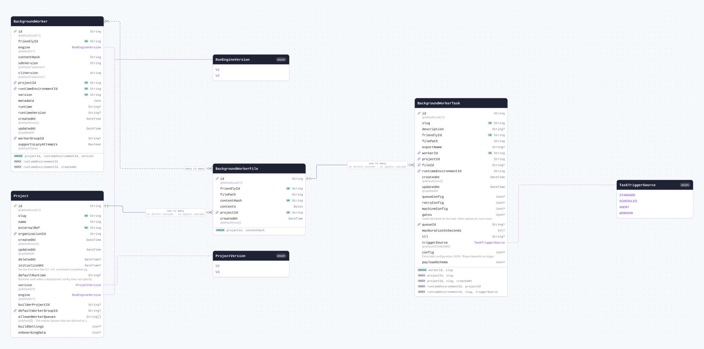

| Field         | Type       | Constraints                             | Default   | Description |
| ------------- | ---------- | --------------------------------------- | --------- | ----------- |
| `id`          | `String`   | PK NOT NULL                             | `cuid(1)` |             |
| `friendlyId`  | `String`   | UNIQUE NOT NULL                         |           |             |
| `filePath`    | `String`   | NOT NULL                                |           |             |
| `contentHash` | `String`   | NOT NULL                                |           |             |
| `contents`    | `Bytes`    | NOT NULL                                |           |             |
| `projectId`   | `String`   | NOT NULL → [Project.id](#model-Project) |           |             |
| `createdAt`   | `DateTime` | NOT NULL                                | `now()`   |             |

#### Indexes

- `@@unique([projectId, contentHash])`

#### References

- `projectId` → [Project.id](#model-Project) (many-to-one, on delete Cascade, on update Cascade)

#### Referenced by

- `id` ← [BackgroundWorkerTask.fileId](#model-BackgroundWorkerTask) (one-to-many, on delete Cascade, on update Cascade)

#### Many to many

- `backgroundWorkers` ↔ [BackgroundWorker.files](#model-BackgroundWorker) through `_BackgroundWorkerToBackgroundWorkerFile`

#### Definition

```sql
CREATE TABLE "BackgroundWorkerFile" (
    "id" TEXT NOT NULL,
    "friendlyId" TEXT NOT NULL,
    "filePath" TEXT NOT NULL,
    "contentHash" TEXT NOT NULL,
    "contents" BYTEA NOT NULL,
    "projectId" TEXT NOT NULL,
    "createdAt" TIMESTAMP(3) NOT NULL DEFAULT CURRENT_TIMESTAMP,

    CONSTRAINT "BackgroundWorkerFile_pkey" PRIMARY KEY ("id")
);

CREATE UNIQUE INDEX "BackgroundWorkerFile_friendlyId_key" ON "BackgroundWorkerFile"("friendlyId");

CREATE UNIQUE INDEX "BackgroundWorkerFile_projectId_contentHash_key" ON "BackgroundWorkerFile"("projectId", "contentHash");

ALTER TABLE "BackgroundWorkerFile" ADD CONSTRAINT "BackgroundWorkerFile_projectId_fkey" FOREIGN KEY ("projectId") REFERENCES "Project"("id") ON DELETE CASCADE ON UPDATE CASCADE;
```

<details>
<summary>Queries and their SQL</summary>

**findMany**: Every row

```ts
await prisma.backgroundWorkerFile.findMany();
```

```sql
SELECT
  "public"."BackgroundWorkerFile"."id",
  "public"."BackgroundWorkerFile"."friendlyId",
  "public"."BackgroundWorkerFile"."filePath",
  "public"."BackgroundWorkerFile"."contentHash",
  "public"."BackgroundWorkerFile"."contents",
  "public"."BackgroundWorkerFile"."projectId",
  "public"."BackgroundWorkerFile"."createdAt"
FROM
  "public"."BackgroundWorkerFile"
WHERE
  1 = 1
OFFSET
  $1
-- params: ["0"]
```

**count**: How many rows there are

```ts
await prisma.backgroundWorkerFile.count();
```

```sql
SELECT
  COUNT(*) AS "_count$_all"
FROM
  (
    SELECT
      "public"."BackgroundWorkerFile"."id"
    FROM
      "public"."BackgroundWorkerFile"
    WHERE
      1 = 1
    OFFSET
      $1
  ) AS "sub"
-- params: ["0"]
```

**findMany**: Every row with its relations

```ts
await prisma.backgroundWorkerFile.findMany({
  include: { project: true, backgroundWorkers: true, tasks: true },
});
```

```sql
SELECT
  "public"."BackgroundWorkerFile"."id",
  "public"."BackgroundWorkerFile"."friendlyId",
  "public"."BackgroundWorkerFile"."filePath",
  "public"."BackgroundWorkerFile"."contentHash",
  "public"."BackgroundWorkerFile"."contents",
  "public"."BackgroundWorkerFile"."projectId",
  "public"."BackgroundWorkerFile"."createdAt"
FROM
  "public"."BackgroundWorkerFile"
WHERE
  1 = 1
OFFSET
  $1
-- params: ["0"]

SELECT
  "public"."Project"."id",
  "public"."Project"."slug",
  "public"."Project"."name",
  "public"."Project"."externalRef",
  "public"."Project"."organizationId",
  "public"."Project"."createdAt",
  "public"."Project"."updatedAt",
  "public"."Project"."deletedAt",
  "public"."Project"."initializedAt",
  "public"."Project"."defaultRuntime",
  "public"."Project"."version"::text,
  "public"."Project"."engine"::text,
  "public"."Project"."builderProjectId",
  "public"."Project"."defaultWorkerGroupId",
  "public"."Project"."allowedMasterQueues",
  "public"."Project"."buildSettings",
  "public"."Project"."onboardingData"
FROM
  "public"."Project"
WHERE
  "public"."Project"."id" IN ($1)
OFFSET
  $2
-- params: ["<projectId of the rows above>","0"]

SELECT
  "public"."BackgroundWorker"."id",
  "public"."BackgroundWorker"."friendlyId",
  "public"."BackgroundWorker"."engine"::text,
  "public"."BackgroundWorker"."contentHash",
  "public"."BackgroundWorker"."sdkVersion",
  "public"."BackgroundWorker"."cliVersion",
  "public"."BackgroundWorker"."projectId",
  "public"."BackgroundWorker"."runtimeEnvironmentId",
  "public"."BackgroundWorker"."version",
  "public"."BackgroundWorker"."metadata",
  "public"."BackgroundWorker"."runtime",
  "public"."BackgroundWorker"."runtimeVersion",
  "public"."BackgroundWorker"."createdAt",
  "public"."BackgroundWorker"."updatedAt",
  "public"."BackgroundWorker"."workerGroupId",
  "public"."BackgroundWorker"."supportsLazyAttempts",
  "t0"."B" AS "BackgroundWorkerToBackgroundWorkerFile@BackgroundWorkerFile"
FROM
  "public"."BackgroundWorker"
  INNER JOIN "public"."_BackgroundWorkerToBackgroundWorkerFile" AS "t0" ON "t0"."A" = "public"."BackgroundWorker"."id"
WHERE
  (
    1 = 1
    AND "t0"."B" IN ($1)
  )
OFFSET
  $2
-- params: ["<id of the rows above>","0"]

SELECT
  "public"."BackgroundWorkerTask"."id",
  "public"."BackgroundWorkerTask"."slug",
  "public"."BackgroundWorkerTask"."description",
  "public"."BackgroundWorkerTask"."friendlyId",
  "public"."BackgroundWorkerTask"."filePath",
  "public"."BackgroundWorkerTask"."exportName",
  "public"."BackgroundWorkerTask"."workerId",
  "public"."BackgroundWorkerTask"."projectId",
  "public"."BackgroundWorkerTask"."fileId",
  "public"."BackgroundWorkerTask"."runtimeEnvironmentId",
  "public"."BackgroundWorkerTask"."createdAt",
  "public"."BackgroundWorkerTask"."updatedAt",
  "public"."BackgroundWorkerTask"."queueConfig",
  "public"."BackgroundWorkerTask"."retryConfig",
  "public"."BackgroundWorkerTask"."machineConfig",
  "public"."BackgroundWorkerTask"."gates",
  "public"."BackgroundWorkerTask"."queueId",
  "public"."BackgroundWorkerTask"."maxDurationInSeconds",
  "public"."BackgroundWorkerTask"."ttl",
  "public"."BackgroundWorkerTask"."triggerSource"::text,
  "public"."BackgroundWorkerTask"."config",
  "public"."BackgroundWorkerTask"."payloadSchema"
FROM
  "public"."BackgroundWorkerTask"
WHERE
  "public"."BackgroundWorkerTask"."fileId" IN ($1)
OFFSET
  $2
-- params: ["<id of the rows above>","0"]
```

**findUnique**: One row by what is unique to it

```ts
await prisma.backgroundWorkerFile.findUnique({ where: { id: "example" } });
```

```sql
SELECT
  "public"."BackgroundWorkerFile"."id",
  "public"."BackgroundWorkerFile"."friendlyId",
  "public"."BackgroundWorkerFile"."filePath",
  "public"."BackgroundWorkerFile"."contentHash",
  "public"."BackgroundWorkerFile"."contents",
  "public"."BackgroundWorkerFile"."projectId",
  "public"."BackgroundWorkerFile"."createdAt"
FROM
  "public"."BackgroundWorkerFile"
WHERE
  (
    "public"."BackgroundWorkerFile"."id" = $1
    AND 1 = 1
  )
LIMIT
  $2
OFFSET
  $3
-- params: ["example","1","0"]
```

**create**: Create a row

```ts
await prisma.backgroundWorkerFile.create({
  data: {
    friendlyId: "example",
    filePath: "example",
    contentHash: "example",
    contents: Uint8Array.from([1, 2, 3]),
    projectId: "example",
  },
});
```

```sql
INSERT INTO
  "public"."BackgroundWorkerFile" (
    "id",
    "friendlyId",
    "filePath",
    "contentHash",
    "contents",
    "projectId",
    "createdAt"
  )
VALUES
  ($1, $2, $3, $4, $5, $6, $7)
RETURNING
  "public"."BackgroundWorkerFile"."id",
  "public"."BackgroundWorkerFile"."friendlyId",
  "public"."BackgroundWorkerFile"."filePath",
  "public"."BackgroundWorkerFile"."contentHash",
  "public"."BackgroundWorkerFile"."contents",
  "public"."BackgroundWorkerFile"."projectId",
  "public"."BackgroundWorkerFile"."createdAt"
-- params: ["<cuid(1)>","example","example","example","AQID","example","<now()>"]
```

**update**: Update a row

```ts
await prisma.backgroundWorkerFile.update({
  where: { id: "example" },
  data: { friendlyId: "example" },
});
```

```sql
UPDATE "public"."BackgroundWorkerFile"
SET
  "friendlyId" = $1
WHERE
  (
    "public"."BackgroundWorkerFile"."id" = $2
    AND 1 = 1
  )
RETURNING
  "public"."BackgroundWorkerFile"."id",
  "public"."BackgroundWorkerFile"."friendlyId",
  "public"."BackgroundWorkerFile"."filePath",
  "public"."BackgroundWorkerFile"."contentHash",
  "public"."BackgroundWorkerFile"."contents",
  "public"."BackgroundWorkerFile"."projectId",
  "public"."BackgroundWorkerFile"."createdAt"
-- params: ["example","example"]
```

**delete**: Delete a row

```ts
await prisma.backgroundWorkerFile.delete({ where: { id: "example" } });
```

```sql
DELETE FROM "public"."BackgroundWorkerFile"
WHERE
  (
    "public"."BackgroundWorkerFile"."id" = $1
    AND 1 = 1
  )
RETURNING
  "public"."BackgroundWorkerFile"."id",
  "public"."BackgroundWorkerFile"."friendlyId",
  "public"."BackgroundWorkerFile"."filePath",
  "public"."BackgroundWorkerFile"."contentHash",
  "public"."BackgroundWorkerFile"."contents",
  "public"."BackgroundWorkerFile"."projectId",
  "public"."BackgroundWorkerFile"."createdAt"
-- params: ["example"]
```

</details>

<a id="model-Prompt"></a>

### Prompt

Table `prompts`.

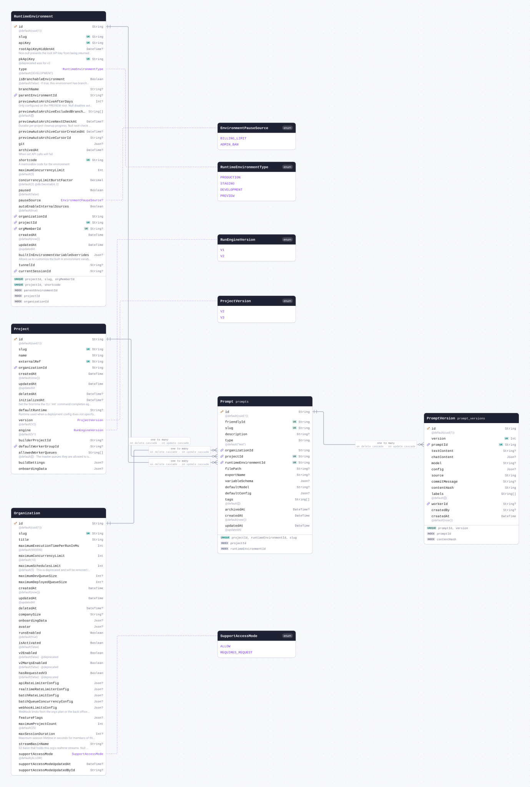

| Field                        | Type       | Constraints                                                   | Default      | Description |
| ---------------------------- | ---------- | ------------------------------------------------------------- | ------------ | ----------- |
| `id`                         | `String`   | PK NOT NULL                                                   | `cuid(1)`    |             |
| `friendlyId` (`friendly_id`) | `String`   | UNIQUE NOT NULL                                               |              |             |
| `slug`                       | `String`   | NOT NULL                                                      |              |             |
| `description`                | `String`   | NULL                                                          |              |             |
| `type`                       | `String`   | NOT NULL                                                      | `"text"`     |             |
| `organizationId`             | `String`   | NOT NULL → [Organization.id](#model-Organization)             |              |             |
| `projectId`                  | `String`   | NOT NULL → [Project.id](#model-Project)                       |              |             |
| `runtimeEnvironmentId`       | `String`   | NOT NULL → [RuntimeEnvironment.id](#model-RuntimeEnvironment) |              |             |
| `filePath`                   | `String`   | NULL                                                          |              |             |
| `exportName`                 | `String`   | NULL                                                          |              |             |
| `variableSchema`             | `Json`     | NULL                                                          |              |             |
| `defaultModel`               | `String`   | NULL                                                          |              |             |
| `defaultConfig`              | `Json`     | NULL                                                          |              |             |
| `tags`                       | `String[]` | NOT NULL                                                      | `[]`         |             |
| `archivedAt`                 | `DateTime` | NULL                                                          |              |             |
| `createdAt`                  | `DateTime` | NOT NULL                                                      | `now()`      |             |
| `updatedAt`                  | `DateTime` | NOT NULL                                                      | `@updatedAt` |             |

#### Indexes

- `@@index([projectId])`
- `@@index([runtimeEnvironmentId])`
- `@@unique([projectId, runtimeEnvironmentId, slug])`

#### References

- `organizationId` → [Organization.id](#model-Organization) (many-to-one, on delete Cascade, on update Cascade)
- `projectId` → [Project.id](#model-Project) (many-to-one, on delete Cascade, on update Cascade)
- `runtimeEnvironmentId` → [RuntimeEnvironment.id](#model-RuntimeEnvironment) (many-to-one, on delete Cascade, on update Cascade)

#### Referenced by

- `id` ← [PromptVersion.promptId](#model-PromptVersion) (one-to-many, on delete Cascade, on update Cascade)

#### Definition

```sql
CREATE TABLE "prompts" (
    "id" TEXT NOT NULL,
    "friendly_id" TEXT NOT NULL,
    "slug" TEXT NOT NULL,
    "description" TEXT,
    "type" TEXT NOT NULL DEFAULT 'text',
    "organizationId" TEXT NOT NULL,
    "projectId" TEXT NOT NULL,
    "runtimeEnvironmentId" TEXT NOT NULL,
    "filePath" TEXT,
    "exportName" TEXT,
    "variableSchema" JSONB,
    "defaultModel" TEXT,
    "defaultConfig" JSONB,
    "tags" TEXT[] DEFAULT ARRAY[]::TEXT[],
    "archivedAt" TIMESTAMP(3),
    "createdAt" TIMESTAMP(3) NOT NULL DEFAULT CURRENT_TIMESTAMP,
    "updatedAt" TIMESTAMP(3) NOT NULL,

    CONSTRAINT "prompts_pkey" PRIMARY KEY ("id")
);

CREATE UNIQUE INDEX "prompts_friendly_id_key" ON "prompts"("friendly_id");

CREATE INDEX "prompts_projectId_idx" ON "prompts"("projectId");

CREATE INDEX "prompts_runtimeEnvironmentId_idx" ON "prompts"("runtimeEnvironmentId");

CREATE UNIQUE INDEX "prompts_projectId_runtimeEnvironmentId_slug_key" ON "prompts"("projectId", "runtimeEnvironmentId", "slug");

ALTER TABLE "prompts" ADD CONSTRAINT "prompts_organizationId_fkey" FOREIGN KEY ("organizationId") REFERENCES "Organization"("id") ON DELETE CASCADE ON UPDATE CASCADE;

ALTER TABLE "prompts" ADD CONSTRAINT "prompts_projectId_fkey" FOREIGN KEY ("projectId") REFERENCES "Project"("id") ON DELETE CASCADE ON UPDATE CASCADE;

ALTER TABLE "prompts" ADD CONSTRAINT "prompts_runtimeEnvironmentId_fkey" FOREIGN KEY ("runtimeEnvironmentId") REFERENCES "RuntimeEnvironment"("id") ON DELETE CASCADE ON UPDATE CASCADE;
```

<details>
<summary>Queries and their SQL</summary>

**findMany**: Every row

```ts
await prisma.prompt.findMany();
```

```sql
SELECT
  "public"."prompts"."id",
  "public"."prompts"."friendly_id",
  "public"."prompts"."slug",
  "public"."prompts"."description",
  "public"."prompts"."type",
  "public"."prompts"."organizationId",
  "public"."prompts"."projectId",
  "public"."prompts"."runtimeEnvironmentId",
  "public"."prompts"."filePath",
  "public"."prompts"."exportName",
  "public"."prompts"."variableSchema",
  "public"."prompts"."defaultModel",
  "public"."prompts"."defaultConfig",
  "public"."prompts"."tags",
  "public"."prompts"."archivedAt",
  "public"."prompts"."createdAt",
  "public"."prompts"."updatedAt"
FROM
  "public"."prompts"
WHERE
  1 = 1
OFFSET
  $1
-- params: ["0"]
```

**count**: How many rows there are

```ts
await prisma.prompt.count();
```

```sql
SELECT
  COUNT(*) AS "_count$_all"
FROM
  (
    SELECT
      "public"."prompts"."id"
    FROM
      "public"."prompts"
    WHERE
      1 = 1
    OFFSET
      $1
  ) AS "sub"
-- params: ["0"]
```

**findMany**: Every row with its relations

```ts
await prisma.prompt.findMany({
  include: { organization: true, project: true, runtimeEnvironment: true, versions: true },
});
```

```sql
SELECT
  "public"."prompts"."id",
  "public"."prompts"."friendly_id",
  "public"."prompts"."slug",
  "public"."prompts"."description",
  "public"."prompts"."type",
  "public"."prompts"."organizationId",
  "public"."prompts"."projectId",
  "public"."prompts"."runtimeEnvironmentId",
  "public"."prompts"."filePath",
  "public"."prompts"."exportName",
  "public"."prompts"."variableSchema",
  "public"."prompts"."defaultModel",
  "public"."prompts"."defaultConfig",
  "public"."prompts"."tags",
  "public"."prompts"."archivedAt",
  "public"."prompts"."createdAt",
  "public"."prompts"."updatedAt"
FROM
  "public"."prompts"
WHERE
  1 = 1
OFFSET
  $1
-- params: ["0"]

SELECT
  "public"."Organization"."id",
  "public"."Organization"."slug",
  "public"."Organization"."title",
  "public"."Organization"."maximumExecutionTimePerRunInMs",
  "public"."Organization"."maximumConcurrencyLimit",
  "public"."Organization"."maximumSchedulesLimit",
  "public"."Organization"."maximumDevQueueSize",
  "public"."Organization"."maximumDeployedQueueSize",
  "public"."Organization"."createdAt",
  "public"."Organization"."updatedAt",
  "public"."Organization"."deletedAt",
  "public"."Organization"."companySize",
  "public"."Organization"."onboardingData",
  "public"."Organization"."avatar",
  "public"."Organization"."runsEnabled",
  "public"."Organization"."v3Enabled",
  "public"."Organization"."v2Enabled",
  "public"."Organization"."v2MarqsEnabled",
  "public"."Organization"."hasRequestedV3",
  "public"."Organization"."apiRateLimiterConfig",
  "public"."Organization"."realtimeRateLimiterConfig",
  "public"."Organization"."batchRateLimitConfig",
  "public"."Organization"."batchQueueConcurrencyConfig",
  "public"."Organization"."webhookLimitsConfig",
  "public"."Organization"."featureFlags",
  "public"."Organization"."maximumProjectCount",
  "public"."Organization"."maxSessionDuration",
  "public"."Organization"."streamBasinName",
  "public"."Organization"."supportAccessMode"::text,
  "public"."Organization"."supportAccessModeUpdatedAt",
  "public"."Organization"."supportAccessModeUpdatedById"
FROM
  "public"."Organization"
WHERE
  "public"."Organization"."id" IN ($1)
OFFSET
  $2
-- params: ["<organizationId of the rows above>","0"]

SELECT
  "public"."Project"."id",
  "public"."Project"."slug",
  "public"."Project"."name",
  "public"."Project"."externalRef",
  "public"."Project"."organizationId",
  "public"."Project"."createdAt",
  "public"."Project"."updatedAt",
  "public"."Project"."deletedAt",
  "public"."Project"."initializedAt",
  "public"."Project"."defaultRuntime",
  "public"."Project"."version"::text,
  "public"."Project"."engine"::text,
  "public"."Project"."builderProjectId",
  "public"."Project"."defaultWorkerGroupId",
  "public"."Project"."allowedMasterQueues",
  "public"."Project"."buildSettings",
  "public"."Project"."onboardingData"
FROM
  "public"."Project"
WHERE
  "public"."Project"."id" IN ($1)
OFFSET
  $2
-- params: ["<projectId of the rows above>","0"]

SELECT
  "public"."RuntimeEnvironment"."id",
  "public"."RuntimeEnvironment"."slug",
  "public"."RuntimeEnvironment"."apiKey",
  "public"."RuntimeEnvironment"."rootApiKeyHiddenAt",
  "public"."RuntimeEnvironment"."pkApiKey",
  "public"."RuntimeEnvironment"."type"::text,
  "public"."RuntimeEnvironment"."isBranchableEnvironment",
  "public"."RuntimeEnvironment"."branchName",
  "public"."RuntimeEnvironment"."parentEnvironmentId",
  "public"."RuntimeEnvironment"."previewAutoArchiveAfterDays",
  "public"."RuntimeEnvironment"."previewAutoArchiveExcludedBranches",
  "public"."RuntimeEnvironment"."previewAutoArchiveNextCheckAt",
  "public"."RuntimeEnvironment"."previewAutoArchiveCursorCreatedAt",
  "public"."RuntimeEnvironment"."previewAutoArchiveCursorId",
  "public"."RuntimeEnvironment"."git",
  "public"."RuntimeEnvironment"."archivedAt",
  "public"."RuntimeEnvironment"."shortcode",
  "public"."RuntimeEnvironment"."maximumConcurrencyLimit",
  "public"."RuntimeEnvironment"."concurrencyLimitBurstFactor",
  "public"."RuntimeEnvironment"."paused",
  "public"."RuntimeEnvironment"."pauseSource"::text,
  "public"."RuntimeEnvironment"."autoEnableInternalSources",
  "public"."RuntimeEnvironment"."organizationId",
  "public"."RuntimeEnvironment"."projectId",
  "public"."RuntimeEnvironment"."orgMemberId",
  "public"."RuntimeEnvironment"."createdAt",
  "public"."RuntimeEnvironment"."updatedAt",
  "public"."RuntimeEnvironment"."builtInEnvironmentVariableOverrides",
  "public"."RuntimeEnvironment"."tunnelId",
  "public"."RuntimeEnvironment"."currentSessionId"
FROM
  "public"."RuntimeEnvironment"
WHERE
  "public"."RuntimeEnvironment"."id" IN ($1)
OFFSET
  $2
-- params: ["<runtimeEnvironmentId of the rows above>","0"]

SELECT
  "public"."prompt_versions"."id",
  "public"."prompt_versions"."version",
  "public"."prompt_versions"."promptId",
  "public"."prompt_versions"."textContent",
  "public"."prompt_versions"."chatContent",
  "public"."prompt_versions"."model",
  "public"."prompt_versions"."config",
  "public"."prompt_versions"."source",
  "public"."prompt_versions"."commitMessage",
  "public"."prompt_versions"."contentHash",
  "public"."prompt_versions"."labels",
  "public"."prompt_versions"."workerId",
  "public"."prompt_versions"."createdBy",
  "public"."prompt_versions"."createdAt"
FROM
  "public"."prompt_versions"
WHERE
  "public"."prompt_versions"."promptId" IN ($1)
OFFSET
  $2
-- params: ["<id of the rows above>","0"]
```

**findUnique**: One row by what is unique to it

```ts
await prisma.prompt.findUnique({ where: { id: "example" } });
```

```sql
SELECT
  "public"."prompts"."id",
  "public"."prompts"."friendly_id",
  "public"."prompts"."slug",
  "public"."prompts"."description",
  "public"."prompts"."type",
  "public"."prompts"."organizationId",
  "public"."prompts"."projectId",
  "public"."prompts"."runtimeEnvironmentId",
  "public"."prompts"."filePath",
  "public"."prompts"."exportName",
  "public"."prompts"."variableSchema",
  "public"."prompts"."defaultModel",
  "public"."prompts"."defaultConfig",
  "public"."prompts"."tags",
  "public"."prompts"."archivedAt",
  "public"."prompts"."createdAt",
  "public"."prompts"."updatedAt"
FROM
  "public"."prompts"
WHERE
  (
    "public"."prompts"."id" = $1
    AND 1 = 1
  )
LIMIT
  $2
OFFSET
  $3
-- params: ["example","1","0"]
```

**create**: Create a row

```ts
await prisma.prompt.create({
  data: {
    friendlyId: "example",
    slug: "example",
    organizationId: "example",
    projectId: "example",
    runtimeEnvironmentId: "example",
  },
});
```

```sql
INSERT INTO
  "public"."prompts" (
    "id",
    "friendly_id",
    "slug",
    "type",
    "organizationId",
    "projectId",
    "runtimeEnvironmentId",
    "tags",
    "createdAt",
    "updatedAt"
  )
VALUES
  ($1, $2, $3, $4, $5, $6, $7, $8, $9, $10)
RETURNING
  "public"."prompts"."id",
  "public"."prompts"."friendly_id",
  "public"."prompts"."slug",
  "public"."prompts"."description",
  "public"."prompts"."type",
  "public"."prompts"."organizationId",
  "public"."prompts"."projectId",
  "public"."prompts"."runtimeEnvironmentId",
  "public"."prompts"."filePath",
  "public"."prompts"."exportName",
  "public"."prompts"."variableSchema",
  "public"."prompts"."defaultModel",
  "public"."prompts"."defaultConfig",
  "public"."prompts"."tags",
  "public"."prompts"."archivedAt",
  "public"."prompts"."createdAt",
  "public"."prompts"."updatedAt"
-- params: ["<cuid(1)>","example","example","text","example","example","example",[],"<now()>","<now()>"]
```

**update**: Update a row

```ts
await prisma.prompt.update({ where: { id: "example" }, data: { friendlyId: "example" } });
```

```sql
UPDATE "public"."prompts"
SET
  "friendly_id" = $1,
  "updatedAt" = $2
WHERE
  (
    "public"."prompts"."id" = $3
    AND 1 = 1
  )
RETURNING
  "public"."prompts"."id",
  "public"."prompts"."friendly_id",
  "public"."prompts"."slug",
  "public"."prompts"."description",
  "public"."prompts"."type",
  "public"."prompts"."organizationId",
  "public"."prompts"."projectId",
  "public"."prompts"."runtimeEnvironmentId",
  "public"."prompts"."filePath",
  "public"."prompts"."exportName",
  "public"."prompts"."variableSchema",
  "public"."prompts"."defaultModel",
  "public"."prompts"."defaultConfig",
  "public"."prompts"."tags",
  "public"."prompts"."archivedAt",
  "public"."prompts"."createdAt",
  "public"."prompts"."updatedAt"
-- params: ["example",{"prisma__type":"generatorCall","prisma__value":{"name":"now","args":[],"returnType":{"type":"DateTime"}}},"example"]
```

**delete**: Delete a row

```ts
await prisma.prompt.delete({ where: { id: "example" } });
```

```sql
DELETE FROM "public"."prompts"
WHERE
  (
    "public"."prompts"."id" = $1
    AND 1 = 1
  )
RETURNING
  "public"."prompts"."id",
  "public"."prompts"."friendly_id",
  "public"."prompts"."slug",
  "public"."prompts"."description",
  "public"."prompts"."type",
  "public"."prompts"."organizationId",
  "public"."prompts"."projectId",
  "public"."prompts"."runtimeEnvironmentId",
  "public"."prompts"."filePath",
  "public"."prompts"."exportName",
  "public"."prompts"."variableSchema",
  "public"."prompts"."defaultModel",
  "public"."prompts"."defaultConfig",
  "public"."prompts"."tags",
  "public"."prompts"."archivedAt",
  "public"."prompts"."createdAt",
  "public"."prompts"."updatedAt"
-- params: ["example"]
```

</details>

<a id="model-PromptVersion"></a>

### PromptVersion

Table `prompt_versions`.

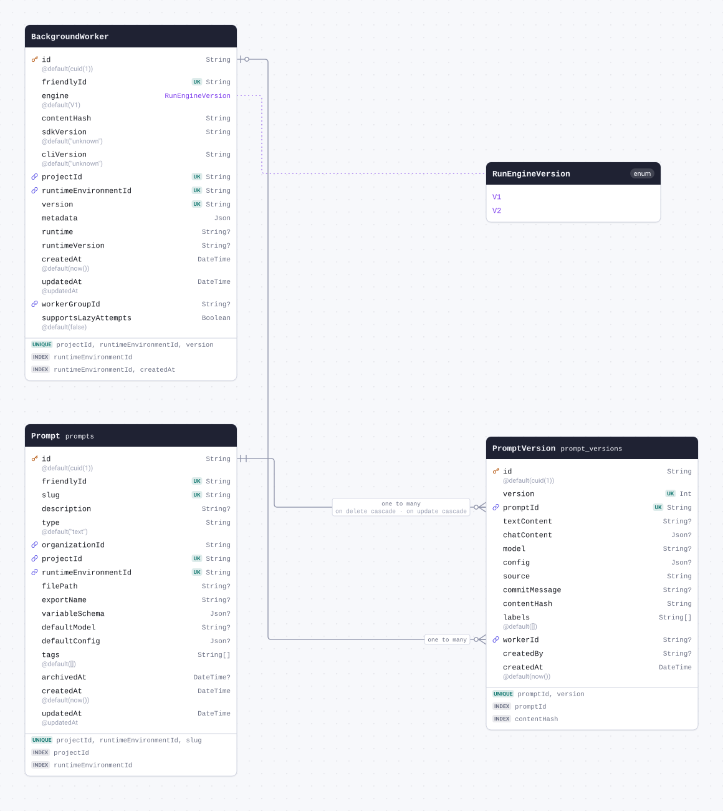

| Field           | Type       | Constraints                                           | Default   | Description |
| --------------- | ---------- | ----------------------------------------------------- | --------- | ----------- |
| `id`            | `String`   | PK NOT NULL                                           | `cuid(1)` |             |
| `version`       | `Int`      | NOT NULL                                              |           |             |
| `promptId`      | `String`   | NOT NULL → [Prompt.id](#model-Prompt)                 |           |             |
| `textContent`   | `String`   | NULL                                                  |           |             |
| `chatContent`   | `Json`     | NULL                                                  |           |             |
| `model`         | `String`   | NULL                                                  |           |             |
| `config`        | `Json`     | NULL                                                  |           |             |
| `source`        | `String`   | NOT NULL                                              |           |             |
| `commitMessage` | `String`   | NULL                                                  |           |             |
| `contentHash`   | `String`   | NOT NULL                                              |           |             |
| `labels`        | `String[]` | NOT NULL                                              | `[]`      |             |
| `workerId`      | `String`   | NULL → [BackgroundWorker.id](#model-BackgroundWorker) |           |             |
| `createdBy`     | `String`   | NULL                                                  |           |             |
| `createdAt`     | `DateTime` | NOT NULL                                              | `now()`   |             |

#### Indexes

- `@@index([promptId])`
- `@@index([contentHash])`
- `@@unique([promptId, version])`

#### References

- `promptId` → [Prompt.id](#model-Prompt) (many-to-one, on delete Cascade, on update Cascade)
- `workerId` → [BackgroundWorker.id](#model-BackgroundWorker) (many-to-one)

#### Definition

```sql
CREATE TABLE "prompt_versions" (
    "id" TEXT NOT NULL,
    "version" INTEGER NOT NULL,
    "promptId" TEXT NOT NULL,
    "textContent" TEXT,
    "chatContent" JSONB,
    "model" TEXT,
    "config" JSONB,
    "source" TEXT NOT NULL,
    "commitMessage" TEXT,
    "contentHash" TEXT NOT NULL,
    "labels" TEXT[] DEFAULT ARRAY[]::TEXT[],
    "workerId" TEXT,
    "createdBy" TEXT,
    "createdAt" TIMESTAMP(3) NOT NULL DEFAULT CURRENT_TIMESTAMP,

    CONSTRAINT "prompt_versions_pkey" PRIMARY KEY ("id")
);

CREATE INDEX "prompt_versions_promptId_idx" ON "prompt_versions"("promptId");

CREATE INDEX "prompt_versions_contentHash_idx" ON "prompt_versions"("contentHash");

CREATE UNIQUE INDEX "prompt_versions_promptId_version_key" ON "prompt_versions"("promptId", "version");

ALTER TABLE "prompt_versions" ADD CONSTRAINT "prompt_versions_promptId_fkey" FOREIGN KEY ("promptId") REFERENCES "prompts"("id") ON DELETE CASCADE ON UPDATE CASCADE;

ALTER TABLE "prompt_versions" ADD CONSTRAINT "prompt_versions_workerId_fkey" FOREIGN KEY ("workerId") REFERENCES "BackgroundWorker"("id") ON DELETE SET NULL ON UPDATE CASCADE;
```

<details>
<summary>Queries and their SQL</summary>

**findMany**: Every row

```ts
await prisma.promptVersion.findMany();
```

```sql
SELECT
  "public"."prompt_versions"."id",
  "public"."prompt_versions"."version",
  "public"."prompt_versions"."promptId",
  "public"."prompt_versions"."textContent",
  "public"."prompt_versions"."chatContent",
  "public"."prompt_versions"."model",
  "public"."prompt_versions"."config",
  "public"."prompt_versions"."source",
  "public"."prompt_versions"."commitMessage",
  "public"."prompt_versions"."contentHash",
  "public"."prompt_versions"."labels",
  "public"."prompt_versions"."workerId",
  "public"."prompt_versions"."createdBy",
  "public"."prompt_versions"."createdAt"
FROM
  "public"."prompt_versions"
WHERE
  1 = 1
OFFSET
  $1
-- params: ["0"]
```

**count**: How many rows there are

```ts
await prisma.promptVersion.count();
```

```sql
SELECT
  COUNT(*) AS "_count$_all"
FROM
  (
    SELECT
      "public"."prompt_versions"."id"
    FROM
      "public"."prompt_versions"
    WHERE
      1 = 1
    OFFSET
      $1
  ) AS "sub"
-- params: ["0"]
```

**findMany**: Every row with its relations

```ts
await prisma.promptVersion.findMany({ include: { prompt: true, worker: true } });
```

```sql
SELECT
  "public"."prompt_versions"."id",
  "public"."prompt_versions"."version",
  "public"."prompt_versions"."promptId",
  "public"."prompt_versions"."textContent",
  "public"."prompt_versions"."chatContent",
  "public"."prompt_versions"."model",
  "public"."prompt_versions"."config",
  "public"."prompt_versions"."source",
  "public"."prompt_versions"."commitMessage",
  "public"."prompt_versions"."contentHash",
  "public"."prompt_versions"."labels",
  "public"."prompt_versions"."workerId",
  "public"."prompt_versions"."createdBy",
  "public"."prompt_versions"."createdAt"
FROM
  "public"."prompt_versions"
WHERE
  1 = 1
OFFSET
  $1
-- params: ["0"]

SELECT
  "public"."prompts"."id",
  "public"."prompts"."friendly_id",
  "public"."prompts"."slug",
  "public"."prompts"."description",
  "public"."prompts"."type",
  "public"."prompts"."organizationId",
  "public"."prompts"."projectId",
  "public"."prompts"."runtimeEnvironmentId",
  "public"."prompts"."filePath",
  "public"."prompts"."exportName",
  "public"."prompts"."variableSchema",
  "public"."prompts"."defaultModel",
  "public"."prompts"."defaultConfig",
  "public"."prompts"."tags",
  "public"."prompts"."archivedAt",
  "public"."prompts"."createdAt",
  "public"."prompts"."updatedAt"
FROM
  "public"."prompts"
WHERE
  "public"."prompts"."id" IN ($1)
OFFSET
  $2
-- params: ["<promptId of the rows above>","0"]

SELECT
  "public"."BackgroundWorker"."id",
  "public"."BackgroundWorker"."friendlyId",
  "public"."BackgroundWorker"."engine"::text,
  "public"."BackgroundWorker"."contentHash",
  "public"."BackgroundWorker"."sdkVersion",
  "public"."BackgroundWorker"."cliVersion",
  "public"."BackgroundWorker"."projectId",
  "public"."BackgroundWorker"."runtimeEnvironmentId",
  "public"."BackgroundWorker"."version",
  "public"."BackgroundWorker"."metadata",
  "public"."BackgroundWorker"."runtime",
  "public"."BackgroundWorker"."runtimeVersion",
  "public"."BackgroundWorker"."createdAt",
  "public"."BackgroundWorker"."updatedAt",
  "public"."BackgroundWorker"."workerGroupId",
  "public"."BackgroundWorker"."supportsLazyAttempts"
FROM
  "public"."BackgroundWorker"
WHERE
  "public"."BackgroundWorker"."id" IN ($1)
OFFSET
  $2
-- params: ["<workerId of the rows above>","0"]
```

**findUnique**: One row by what is unique to it

```ts
await prisma.promptVersion.findUnique({ where: { id: "example" } });
```

```sql
SELECT
  "public"."prompt_versions"."id",
  "public"."prompt_versions"."version",
  "public"."prompt_versions"."promptId",
  "public"."prompt_versions"."textContent",
  "public"."prompt_versions"."chatContent",
  "public"."prompt_versions"."model",
  "public"."prompt_versions"."config",
  "public"."prompt_versions"."source",
  "public"."prompt_versions"."commitMessage",
  "public"."prompt_versions"."contentHash",
  "public"."prompt_versions"."labels",
  "public"."prompt_versions"."workerId",
  "public"."prompt_versions"."createdBy",
  "public"."prompt_versions"."createdAt"
FROM
  "public"."prompt_versions"
WHERE
  (
    "public"."prompt_versions"."id" = $1
    AND 1 = 1
  )
LIMIT
  $2
OFFSET
  $3
-- params: ["example","1","0"]
```

**create**: Create a row

```ts
await prisma.promptVersion.create({
  data: { version: 1, promptId: "example", source: "example", contentHash: "example" },
});
```

```sql
INSERT INTO
  "public"."prompt_versions" (
    "id",
    "version",
    "promptId",
    "source",
    "contentHash",
    "labels",
    "createdAt"
  )
VALUES
  ($1, $2, $3, $4, $5, $6, $7)
RETURNING
  "public"."prompt_versions"."id",
  "public"."prompt_versions"."version",
  "public"."prompt_versions"."promptId",
  "public"."prompt_versions"."textContent",
  "public"."prompt_versions"."chatContent",
  "public"."prompt_versions"."model",
  "public"."prompt_versions"."config",
  "public"."prompt_versions"."source",
  "public"."prompt_versions"."commitMessage",
  "public"."prompt_versions"."contentHash",
  "public"."prompt_versions"."labels",
  "public"."prompt_versions"."workerId",
  "public"."prompt_versions"."createdBy",
  "public"."prompt_versions"."createdAt"
-- params: ["<cuid(1)>","1","example","example","example",[],"<now()>"]
```

**update**: Update a row

```ts
await prisma.promptVersion.update({ where: { id: "example" }, data: { version: 1 } });
```

```sql
UPDATE "public"."prompt_versions"
SET
  "version" = $1
WHERE
  (
    "public"."prompt_versions"."id" = $2
    AND 1 = 1
  )
RETURNING
  "public"."prompt_versions"."id",
  "public"."prompt_versions"."version",
  "public"."prompt_versions"."promptId",
  "public"."prompt_versions"."textContent",
  "public"."prompt_versions"."chatContent",
  "public"."prompt_versions"."model",
  "public"."prompt_versions"."config",
  "public"."prompt_versions"."source",
  "public"."prompt_versions"."commitMessage",
  "public"."prompt_versions"."contentHash",
  "public"."prompt_versions"."labels",
  "public"."prompt_versions"."workerId",
  "public"."prompt_versions"."createdBy",
  "public"."prompt_versions"."createdAt"
-- params: ["1","example"]
```

**delete**: Delete a row

```ts
await prisma.promptVersion.delete({ where: { id: "example" } });
```

```sql
DELETE FROM "public"."prompt_versions"
WHERE
  (
    "public"."prompt_versions"."id" = $1
    AND 1 = 1
  )
RETURNING
  "public"."prompt_versions"."id",
  "public"."prompt_versions"."version",
  "public"."prompt_versions"."promptId",
  "public"."prompt_versions"."textContent",
  "public"."prompt_versions"."chatContent",
  "public"."prompt_versions"."model",
  "public"."prompt_versions"."config",
  "public"."prompt_versions"."source",
  "public"."prompt_versions"."commitMessage",
  "public"."prompt_versions"."contentHash",
  "public"."prompt_versions"."labels",
  "public"."prompt_versions"."workerId",
  "public"."prompt_versions"."createdBy",
  "public"."prompt_versions"."createdAt"
-- params: ["example"]
```

</details>

<a id="model-BackgroundWorkerTask"></a>

### BackgroundWorkerTask

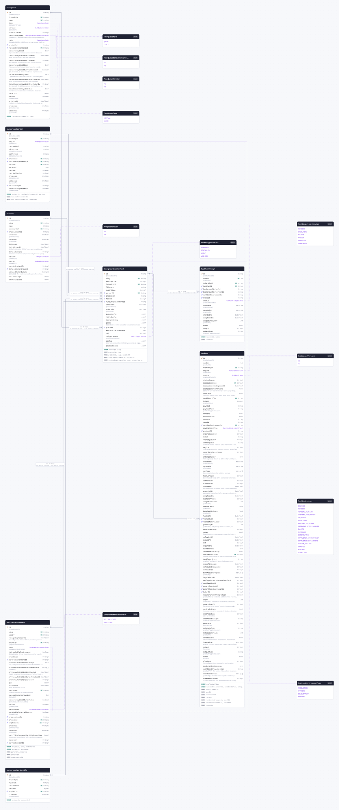

| Field                  | Type                                           | Constraints                                                   | Default      | Description                                                                                                                                                 |
| ---------------------- | ---------------------------------------------- | ------------------------------------------------------------- | ------------ | ----------------------------------------------------------------------------------------------------------------------------------------------------------- |
| `id`                   | `String`                                       | PK NOT NULL                                                   | `cuid(1)`    |                                                                                                                                                             |
| `slug`                 | `String`                                       | NOT NULL                                                      |              |                                                                                                                                                             |
| `description`          | `String`                                       | NULL                                                          |              |                                                                                                                                                             |
| `friendlyId`           | `String`                                       | UNIQUE NOT NULL                                               |              |                                                                                                                                                             |
| `filePath`             | `String`                                       | NOT NULL                                                      |              |                                                                                                                                                             |
| `exportName`           | `String`                                       | NULL                                                          |              |                                                                                                                                                             |
| `workerId`             | `String`                                       | NOT NULL → [BackgroundWorker.id](#model-BackgroundWorker)     |              |                                                                                                                                                             |
| `projectId`            | `String`                                       | NOT NULL → [Project.id](#model-Project)                       |              |                                                                                                                                                             |
| `fileId`               | `String`                                       | NULL → [BackgroundWorkerFile.id](#model-BackgroundWorkerFile) |              |                                                                                                                                                             |
| `runtimeEnvironmentId` | `String`                                       | NOT NULL → [RuntimeEnvironment.id](#model-RuntimeEnvironment) |              |                                                                                                                                                             |
| `createdAt`            | `DateTime`                                     | NOT NULL                                                      | `now()`      |                                                                                                                                                             |
| `updatedAt`            | `DateTime`                                     | NOT NULL                                                      | `@updatedAt` |                                                                                                                                                             |
| `queueConfig`          | `Json`                                         | NULL                                                          |              |                                                                                                                                                             |
| `retryConfig`          | `Json`                                         | NULL                                                          |              |                                                                                                                                                             |
| `machineConfig`        | `Json`                                         | NULL                                                          |              |                                                                                                                                                             |
| `gates`                | `Json`                                         | NULL                                                          |              | Gates declared on the task: other queues its runs must also hold a concurrency slot in while executing. Shape: [{ queue: string, concurrencyKey?: string }] |
| `queueId`              | `String`                                       | NULL → [TaskQueue.id](#model-TaskQueue)                       |              |                                                                                                                                                             |
| `maxDurationInSeconds` | `Int`                                          | NULL                                                          |              |                                                                                                                                                             |
| `ttl`                  | `String`                                       | NULL                                                          |              |                                                                                                                                                             |
| `triggerSource`        | [`TaskTriggerSource`](#enum-TaskTriggerSource) | NOT NULL                                                      | `STANDARD`   |                                                                                                                                                             |
| `config`               | `Json`                                         | NULL                                                          |              | Extra task configuration JSON. Shape depends on triggerSource. AGENT: { type: "ai-sdk-chat" }                                                               |
| `payloadSchema`        | `Json`                                         | NULL                                                          |              |                                                                                                                                                             |

#### Indexes

- `@@index([projectId, slug])`
- `@@index([projectId, slug, createdAt])`
- `@@index([runtimeEnvironmentId, projectId])`
- `@@index([runtimeEnvironmentId, slug, triggerSource])`
- `@@unique([workerId, slug])`

#### References

- `workerId` → [BackgroundWorker.id](#model-BackgroundWorker) (many-to-one, on delete Cascade, on update Cascade)
- `projectId` → [Project.id](#model-Project) (many-to-one, on delete Cascade, on update Cascade)
- `fileId` → [BackgroundWorkerFile.id](#model-BackgroundWorkerFile) (many-to-one, on delete Cascade, on update Cascade)
- `runtimeEnvironmentId` → [RuntimeEnvironment.id](#model-RuntimeEnvironment) (many-to-one, on delete Cascade, on update Cascade)
- `queueId` → [TaskQueue.id](#model-TaskQueue) (many-to-one, on delete SetNull, on update Cascade)

#### Referenced by

- `id` ← [TaskRun.lockedById](#model-TaskRun) (one-to-many)
- `id` ← [TaskRunAttempt.backgroundWorkerTaskId](#model-TaskRunAttempt) (one-to-many, on delete Cascade, on update Cascade)

#### Definition

```sql
CREATE TABLE "BackgroundWorkerTask" (
    "id" TEXT NOT NULL,
    "slug" TEXT NOT NULL,
    "description" TEXT,
    "friendlyId" TEXT NOT NULL,
    "filePath" TEXT NOT NULL,
    "exportName" TEXT,
    "workerId" TEXT NOT NULL,
    "projectId" TEXT NOT NULL,
    "fileId" TEXT,
    "runtimeEnvironmentId" TEXT NOT NULL,
    "createdAt" TIMESTAMP(3) NOT NULL DEFAULT CURRENT_TIMESTAMP,
    "updatedAt" TIMESTAMP(3) NOT NULL,
    "queueConfig" JSONB,
    "retryConfig" JSONB,
    "machineConfig" JSONB,
    "gates" JSONB,
    "queueId" TEXT,
    "maxDurationInSeconds" INTEGER,
    "ttl" TEXT,
    "triggerSource" "TaskTriggerSource" NOT NULL DEFAULT 'STANDARD',
    "config" JSONB,
    "payloadSchema" JSONB,

    CONSTRAINT "BackgroundWorkerTask_pkey" PRIMARY KEY ("id")
);

CREATE UNIQUE INDEX "BackgroundWorkerTask_friendlyId_key" ON "BackgroundWorkerTask"("friendlyId");

CREATE INDEX "BackgroundWorkerTask_projectId_slug_idx" ON "BackgroundWorkerTask"("projectId", "slug");

CREATE INDEX "BackgroundWorkerTask_projectId_slug_createdAt_idx" ON "BackgroundWorkerTask"("projectId", "slug", "createdAt");

CREATE INDEX "BackgroundWorkerTask_runtimeEnvironmentId_projectId_idx" ON "BackgroundWorkerTask"("runtimeEnvironmentId", "projectId");

CREATE INDEX "BackgroundWorkerTask_runtimeEnvironmentId_slug_triggerSourc_idx" ON "BackgroundWorkerTask"("runtimeEnvironmentId", "slug", "triggerSource");

CREATE UNIQUE INDEX "BackgroundWorkerTask_workerId_slug_key" ON "BackgroundWorkerTask"("workerId", "slug");

ALTER TABLE "BackgroundWorkerTask" ADD CONSTRAINT "BackgroundWorkerTask_workerId_fkey" FOREIGN KEY ("workerId") REFERENCES "BackgroundWorker"("id") ON DELETE CASCADE ON UPDATE CASCADE;

ALTER TABLE "BackgroundWorkerTask" ADD CONSTRAINT "BackgroundWorkerTask_projectId_fkey" FOREIGN KEY ("projectId") REFERENCES "Project"("id") ON DELETE CASCADE ON UPDATE CASCADE;

ALTER TABLE "BackgroundWorkerTask" ADD CONSTRAINT "BackgroundWorkerTask_fileId_fkey" FOREIGN KEY ("fileId") REFERENCES "BackgroundWorkerFile"("id") ON DELETE CASCADE ON UPDATE CASCADE;

ALTER TABLE "BackgroundWorkerTask" ADD CONSTRAINT "BackgroundWorkerTask_runtimeEnvironmentId_fkey" FOREIGN KEY ("runtimeEnvironmentId") REFERENCES "RuntimeEnvironment"("id") ON DELETE CASCADE ON UPDATE CASCADE;

ALTER TABLE "BackgroundWorkerTask" ADD CONSTRAINT "BackgroundWorkerTask_queueId_fkey" FOREIGN KEY ("queueId") REFERENCES "TaskQueue"("id") ON DELETE SET NULL ON UPDATE CASCADE;
```

<details>
<summary>Queries and their SQL</summary>

**findMany**: Every row

```ts
await prisma.backgroundWorkerTask.findMany();
```

```sql
SELECT
  "public"."BackgroundWorkerTask"."id",
  "public"."BackgroundWorkerTask"."slug",
  "public"."BackgroundWorkerTask"."description",
  "public"."BackgroundWorkerTask"."friendlyId",
  "public"."BackgroundWorkerTask"."filePath",
  "public"."BackgroundWorkerTask"."exportName",
  "public"."BackgroundWorkerTask"."workerId",
  "public"."BackgroundWorkerTask"."projectId",
  "public"."BackgroundWorkerTask"."fileId",
  "public"."BackgroundWorkerTask"."runtimeEnvironmentId",
  "public"."BackgroundWorkerTask"."createdAt",
  "public"."BackgroundWorkerTask"."updatedAt",
  "public"."BackgroundWorkerTask"."queueConfig",
  "public"."BackgroundWorkerTask"."retryConfig",
  "public"."BackgroundWorkerTask"."machineConfig",
  "public"."BackgroundWorkerTask"."gates",
  "public"."BackgroundWorkerTask"."queueId",
  "public"."BackgroundWorkerTask"."maxDurationInSeconds",
  "public"."BackgroundWorkerTask"."ttl",
  "public"."BackgroundWorkerTask"."triggerSource"::text,
  "public"."BackgroundWorkerTask"."config",
  "public"."BackgroundWorkerTask"."payloadSchema"
FROM
  "public"."BackgroundWorkerTask"
WHERE
  1 = 1
OFFSET
  $1
-- params: ["0"]
```

**count**: How many rows there are

```ts
await prisma.backgroundWorkerTask.count();
```

```sql
SELECT
  COUNT(*) AS "_count$_all"
FROM
  (
    SELECT
      "public"."BackgroundWorkerTask"."id"
    FROM
      "public"."BackgroundWorkerTask"
    WHERE
      1 = 1
    OFFSET
      $1
  ) AS "sub"
-- params: ["0"]
```

**findMany**: Every row with its relations

```ts
await prisma.backgroundWorkerTask.findMany({
  include: {
    worker: true,
    project: true,
    file: true,
    runtimeEnvironment: true,
    attempts: true,
    runs: true,
    queue: true,
  },
});
```

```sql
SELECT
  "public"."BackgroundWorkerTask"."id",
  "public"."BackgroundWorkerTask"."slug",
  "public"."BackgroundWorkerTask"."description",
  "public"."BackgroundWorkerTask"."friendlyId",
  "public"."BackgroundWorkerTask"."filePath",
  "public"."BackgroundWorkerTask"."exportName",
  "public"."BackgroundWorkerTask"."workerId",
  "public"."BackgroundWorkerTask"."projectId",
  "public"."BackgroundWorkerTask"."fileId",
  "public"."BackgroundWorkerTask"."runtimeEnvironmentId",
  "public"."BackgroundWorkerTask"."createdAt",
  "public"."BackgroundWorkerTask"."updatedAt",
  "public"."BackgroundWorkerTask"."queueConfig",
  "public"."BackgroundWorkerTask"."retryConfig",
  "public"."BackgroundWorkerTask"."machineConfig",
  "public"."BackgroundWorkerTask"."gates",
  "public"."BackgroundWorkerTask"."queueId",
  "public"."BackgroundWorkerTask"."maxDurationInSeconds",
  "public"."BackgroundWorkerTask"."ttl",
  "public"."BackgroundWorkerTask"."triggerSource"::text,
  "public"."BackgroundWorkerTask"."config",
  "public"."BackgroundWorkerTask"."payloadSchema"
FROM
  "public"."BackgroundWorkerTask"
WHERE
  1 = 1
OFFSET
  $1
-- params: ["0"]

SELECT
  "public"."BackgroundWorker"."id",
  "public"."BackgroundWorker"."friendlyId",
  "public"."BackgroundWorker"."engine"::text,
  "public"."BackgroundWorker"."contentHash",
  "public"."BackgroundWorker"."sdkVersion",
  "public"."BackgroundWorker"."cliVersion",
  "public"."BackgroundWorker"."projectId",
  "public"."BackgroundWorker"."runtimeEnvironmentId",
  "public"."BackgroundWorker"."version",
  "public"."BackgroundWorker"."metadata",
  "public"."BackgroundWorker"."runtime",
  "public"."BackgroundWorker"."runtimeVersion",
  "public"."BackgroundWorker"."createdAt",
  "public"."BackgroundWorker"."updatedAt",
  "public"."BackgroundWorker"."workerGroupId",
  "public"."BackgroundWorker"."supportsLazyAttempts"
FROM
  "public"."BackgroundWorker"
WHERE
  "public"."BackgroundWorker"."id" IN ($1)
OFFSET
  $2
-- params: ["<workerId of the rows above>","0"]

SELECT
  "public"."Project"."id",
  "public"."Project"."slug",
  "public"."Project"."name",
  "public"."Project"."externalRef",
  "public"."Project"."organizationId",
  "public"."Project"."createdAt",
  "public"."Project"."updatedAt",
  "public"."Project"."deletedAt",
  "public"."Project"."initializedAt",
  "public"."Project"."defaultRuntime",
  "public"."Project"."version"::text,
  "public"."Project"."engine"::text,
  "public"."Project"."builderProjectId",
  "public"."Project"."defaultWorkerGroupId",
  "public"."Project"."allowedMasterQueues",
  "public"."Project"."buildSettings",
  "public"."Project"."onboardingData"
FROM
  "public"."Project"
WHERE
  "public"."Project"."id" IN ($1)
OFFSET
  $2
-- params: ["<projectId of the rows above>","0"]

SELECT
  "public"."BackgroundWorkerFile"."id",
  "public"."BackgroundWorkerFile"."friendlyId",
  "public"."BackgroundWorkerFile"."filePath",
  "public"."BackgroundWorkerFile"."contentHash",
  "public"."BackgroundWorkerFile"."contents",
  "public"."BackgroundWorkerFile"."projectId",
  "public"."BackgroundWorkerFile"."createdAt"
FROM
  "public"."BackgroundWorkerFile"
WHERE
  "public"."BackgroundWorkerFile"."id" IN ($1)
OFFSET
  $2
-- params: ["<fileId of the rows above>","0"]

SELECT
  "public"."RuntimeEnvironment"."id",
  "public"."RuntimeEnvironment"."slug",
  "public"."RuntimeEnvironment"."apiKey",
  "public"."RuntimeEnvironment"."rootApiKeyHiddenAt",
  "public"."RuntimeEnvironment"."pkApiKey",
  "public"."RuntimeEnvironment"."type"::text,
  "public"."RuntimeEnvironment"."isBranchableEnvironment",
  "public"."RuntimeEnvironment"."branchName",
  "public"."RuntimeEnvironment"."parentEnvironmentId",
  "public"."RuntimeEnvironment"."previewAutoArchiveAfterDays",
  "public"."RuntimeEnvironment"."previewAutoArchiveExcludedBranches",
  "public"."RuntimeEnvironment"."previewAutoArchiveNextCheckAt",
  "public"."RuntimeEnvironment"."previewAutoArchiveCursorCreatedAt",
  "public"."RuntimeEnvironment"."previewAutoArchiveCursorId",
  "public"."RuntimeEnvironment"."git",
  "public"."RuntimeEnvironment"."archivedAt",
  "public"."RuntimeEnvironment"."shortcode",
  "public"."RuntimeEnvironment"."maximumConcurrencyLimit",
  "public"."RuntimeEnvironment"."concurrencyLimitBurstFactor",
  "public"."RuntimeEnvironment"."paused",
  "public"."RuntimeEnvironment"."pauseSource"::text,
  "public"."RuntimeEnvironment"."autoEnableInternalSources",
  "public"."RuntimeEnvironment"."organizationId",
  "public"."RuntimeEnvironment"."projectId",
  "public"."RuntimeEnvironment"."orgMemberId",
  "public"."RuntimeEnvironment"."createdAt",
  "public"."RuntimeEnvironment"."updatedAt",
  "public"."RuntimeEnvironment"."builtInEnvironmentVariableOverrides",
  "public"."RuntimeEnvironment"."tunnelId",
  "public"."RuntimeEnvironment"."currentSessionId"
FROM
  "public"."RuntimeEnvironment"
WHERE
  "public"."RuntimeEnvironment"."id" IN ($1)
OFFSET
  $2
-- params: ["<runtimeEnvironmentId of the rows above>","0"]

SELECT
  "public"."TaskRunAttempt"."id",
  "public"."TaskRunAttempt"."number",
  "public"."TaskRunAttempt"."friendlyId",
  "public"."TaskRunAttempt"."taskRunId",
  "public"."TaskRunAttempt"."backgroundWorkerId",
  "public"."TaskRunAttempt"."backgroundWorkerTaskId",
  "public"."TaskRunAttempt"."runtimeEnvironmentId",
  "public"."TaskRunAttempt"."queueId",
  "public"."TaskRunAttempt"."status"::text,
  "public"."TaskRunAttempt"."createdAt",
  "public"."TaskRunAttempt"."updatedAt",
  "public"."TaskRunAttempt"."startedAt",
  "public"."TaskRunAttempt"."completedAt",
  "public"."TaskRunAttempt"."usageDurationMs",
  "public"."TaskRunAttempt"."error",
  "public"."TaskRunAttempt"."output",
  "public"."TaskRunAttempt"."outputType"
FROM
  "public"."TaskRunAttempt"
WHERE
  "public"."TaskRunAttempt"."backgroundWorkerTaskId" IN ($1)
OFFSET
  $2
-- params: ["<id of the rows above>","0"]

SELECT
  "public"."TaskRun"."id",
  "public"."TaskRun"."number",
  "public"."TaskRun"."friendlyId",
  "public"."TaskRun"."engine"::text,
  "public"."TaskRun"."status"::text,
  "public"."TaskRun"."statusReason",
  "public"."TaskRun"."idempotencyKey",
  "public"."TaskRun"."idempotencyKeyExpiresAt",
  "public"."TaskRun"."idempotencyKeyOptions",
  "public"."TaskRun"."debounce",
  "public"."TaskRun"."taskIdentifier",
  "public"."TaskRun"."isTest",
  "public"."TaskRun"."payload",
  "public"."TaskRun"."payloadType",
  "public"."TaskRun"."context",
  "public"."TaskRun"."traceContext",
  "public"."TaskRun"."traceId",
  "public"."TaskRun"."spanId",
  "public"."TaskRun"."runtimeEnvironmentId",
  "public"."TaskRun"."environmentType"::text,
  "public"."TaskRun"."projectId",
  "public"."TaskRun"."organizationId",
  "public"."TaskRun"."queue",
  "public"."TaskRun"."lockedQueueId",
  "public"."TaskRun"."masterQueue",
  "public"."TaskRun"."region",
  "public"."TaskRun"."secondaryMasterQueue",
  "public"."TaskRun"."attemptNumber",
  "public"."TaskRun"."createdAt",
  "public"."TaskRun"."updatedAt",
  "public"."TaskRun"."runTags",
  "public"."TaskRun"."taskVersion",
  "public"."TaskRun"."sdkVersion",
  "public"."TaskRun"."cliVersion",
  "public"."TaskRun"."startedAt",
  "public"."TaskRun"."executedAt",
  "public"."TaskRun"."completedAt",
  "public"."TaskRun"."machinePreset",
  "public"."TaskRun"."usageDurationMs",
  "public"."TaskRun"."costInCents",
  "public"."TaskRun"."baseCostInCents",
  "public"."TaskRun"."lockedAt",
  "public"."TaskRun"."lockedById",
  "public"."TaskRun"."lockedToVersionId",
  "public"."TaskRun"."priorityMs",
  "public"."TaskRun"."concurrencyKey",
  "public"."TaskRun"."gates",
  "public"."TaskRun"."delayUntil",
  "public"."TaskRun"."queuedAt",
  "public"."TaskRun"."ttl",
  "public"."TaskRun"."expiredAt",
  "public"."TaskRun"."maxAttempts",
  "public"."TaskRun"."lockedRetryConfig",
  "public"."TaskRun"."oneTimeUseToken",
  "public"."TaskRun"."taskEventStore",
  "public"."TaskRun"."queueTimestamp",
  "public"."TaskRun"."scheduleInstanceId",
  "public"."TaskRun"."scheduleId",
  "public"."TaskRun"."bulkActionGroupIds",
  "public"."TaskRun"."logsDeletedAt",
  "public"."TaskRun"."replayedFromTaskRunFriendlyId",
  "public"."TaskRun"."rootTaskRunId",
  "public"."TaskRun"."parentTaskRunId",
  "public"."TaskRun"."parentTaskRunAttemptId",
  "public"."TaskRun"."batchId",
  "public"."TaskRun"."resumeParentOnCompletion",
  "public"."TaskRun"."depth",
  "public"."TaskRun"."parentSpanId",
  "public"."TaskRun"."runChainState",
  "public"."TaskRun"."seedMetadata",
  "public"."TaskRun"."seedMetadataType",
  "public"."TaskRun"."metadata",
  "public"."TaskRun"."metadataType",
  "public"."TaskRun"."metadataVersion",
  "public"."TaskRun"."annotations",
  "public"."TaskRun"."isWarmStart",
  "public"."TaskRun"."output",
  "public"."TaskRun"."outputType",
  "public"."TaskRun"."error",
  "public"."TaskRun"."planType",
  "public"."TaskRun"."maxDurationInSeconds",
  "public"."TaskRun"."realtimeStreamsVersion",
  "public"."TaskRun"."realtimeStreams",
  "public"."TaskRun"."streamBasinName"
FROM
  "public"."TaskRun"
WHERE
  "public"."TaskRun"."lockedById" IN ($1)
OFFSET
  $2
-- params: ["<id of the rows above>","0"]

SELECT
  "public"."TaskQueue"."id",
  "public"."TaskQueue"."friendlyId",
  "public"."TaskQueue"."name",
  "public"."TaskQueue"."type"::text,
  "public"."TaskQueue"."version"::text,
  "public"."TaskQueue"."orderableName",
  "public"."TaskQueue"."concurrencyVersion"::text,
  "public"."TaskQueue"."role"::text,
  "public"."TaskQueue"."projectId",
  "public"."TaskQueue"."runtimeEnvironmentId",
  "public"."TaskQueue"."concurrencyLimit",
  "public"."TaskQueue"."concurrencyLimitOverriddenAt",
  "public"."TaskQueue"."concurrencyLimitOverriddenBy",
  "public"."TaskQueue"."concurrencyLimitBase",
  "public"."TaskQueue"."concurrencyLimitOverridePercent",
  "public"."TaskQueue"."totalConcurrencyLimit",
  "public"."TaskQueue"."totalConcurrencyLimitOverriddenAt",
  "public"."TaskQueue"."totalConcurrencyLimitOverriddenBy",
  "public"."TaskQueue"."totalConcurrencyLimitBase",
  "public"."TaskQueue"."rateLimit",
  "public"."TaskQueue"."paused",
  "public"."TaskQueue"."archivedAt",
  "public"."TaskQueue"."createdAt",
  "public"."TaskQueue"."updatedAt"
FROM
  "public"."TaskQueue"
WHERE
  "public"."TaskQueue"."id" IN ($1)
OFFSET
  $2
-- params: ["<queueId of the rows above>","0"]
```

**findUnique**: One row by what is unique to it

```ts
await prisma.backgroundWorkerTask.findUnique({ where: { id: "example" } });
```

```sql
SELECT
  "public"."BackgroundWorkerTask"."id",
  "public"."BackgroundWorkerTask"."slug",
  "public"."BackgroundWorkerTask"."description",
  "public"."BackgroundWorkerTask"."friendlyId",
  "public"."BackgroundWorkerTask"."filePath",
  "public"."BackgroundWorkerTask"."exportName",
  "public"."BackgroundWorkerTask"."workerId",
  "public"."BackgroundWorkerTask"."projectId",
  "public"."BackgroundWorkerTask"."fileId",
  "public"."BackgroundWorkerTask"."runtimeEnvironmentId",
  "public"."BackgroundWorkerTask"."createdAt",
  "public"."BackgroundWorkerTask"."updatedAt",
  "public"."BackgroundWorkerTask"."queueConfig",
  "public"."BackgroundWorkerTask"."retryConfig",
  "public"."BackgroundWorkerTask"."machineConfig",
  "public"."BackgroundWorkerTask"."gates",
  "public"."BackgroundWorkerTask"."queueId",
  "public"."BackgroundWorkerTask"."maxDurationInSeconds",
  "public"."BackgroundWorkerTask"."ttl",
  "public"."BackgroundWorkerTask"."triggerSource"::text,
  "public"."BackgroundWorkerTask"."config",
  "public"."BackgroundWorkerTask"."payloadSchema"
FROM
  "public"."BackgroundWorkerTask"
WHERE
  (
    "public"."BackgroundWorkerTask"."id" = $1
    AND 1 = 1
  )
LIMIT
  $2
OFFSET
  $3
-- params: ["example","1","0"]
```

**create**: Create a row

```ts
await prisma.backgroundWorkerTask.create({
  data: {
    slug: "example",
    friendlyId: "example",
    filePath: "example",
    workerId: "example",
    projectId: "example",
    runtimeEnvironmentId: "example",
  },
});
```

```sql
INSERT INTO
  "public"."BackgroundWorkerTask" (
    "id",
    "slug",
    "friendlyId",
    "filePath",
    "workerId",
    "projectId",
    "runtimeEnvironmentId",
    "createdAt",
    "updatedAt",
    "triggerSource"
  )
VALUES
  (
    $1,
    $2,
    $3,
    $4,
    $5,
    $6,
    $7,
    $8,
    $9,
    CAST($10::text AS "public"."TaskTriggerSource")
  )
RETURNING
  "public"."BackgroundWorkerTask"."id",
  "public"."BackgroundWorkerTask"."slug",
  "public"."BackgroundWorkerTask"."description",
  "public"."BackgroundWorkerTask"."friendlyId",
  "public"."BackgroundWorkerTask"."filePath",
  "public"."BackgroundWorkerTask"."exportName",
  "public"."BackgroundWorkerTask"."workerId",
  "public"."BackgroundWorkerTask"."projectId",
  "public"."BackgroundWorkerTask"."fileId",
  "public"."BackgroundWorkerTask"."runtimeEnvironmentId",
  "public"."BackgroundWorkerTask"."createdAt",
  "public"."BackgroundWorkerTask"."updatedAt",
  "public"."BackgroundWorkerTask"."queueConfig",
  "public"."BackgroundWorkerTask"."retryConfig",
  "public"."BackgroundWorkerTask"."machineConfig",
  "public"."BackgroundWorkerTask"."gates",
  "public"."BackgroundWorkerTask"."queueId",
  "public"."BackgroundWorkerTask"."maxDurationInSeconds",
  "public"."BackgroundWorkerTask"."ttl",
  "public"."BackgroundWorkerTask"."triggerSource"::text,
  "public"."BackgroundWorkerTask"."config",
  "public"."BackgroundWorkerTask"."payloadSchema"
-- params: ["<cuid(1)>","example","example","example","example","example","example","<now()>","<now()>","STANDARD"]
```

**update**: Update a row

```ts
await prisma.backgroundWorkerTask.update({ where: { id: "example" }, data: { slug: "example" } });
```

```sql
UPDATE "public"."BackgroundWorkerTask"
SET
  "slug" = $1,
  "updatedAt" = $2
WHERE
  (
    "public"."BackgroundWorkerTask"."id" = $3
    AND 1 = 1
  )
RETURNING
  "public"."BackgroundWorkerTask"."id",
  "public"."BackgroundWorkerTask"."slug",
  "public"."BackgroundWorkerTask"."description",
  "public"."BackgroundWorkerTask"."friendlyId",
  "public"."BackgroundWorkerTask"."filePath",
  "public"."BackgroundWorkerTask"."exportName",
  "public"."BackgroundWorkerTask"."workerId",
  "public"."BackgroundWorkerTask"."projectId",
  "public"."BackgroundWorkerTask"."fileId",
  "public"."BackgroundWorkerTask"."runtimeEnvironmentId",
  "public"."BackgroundWorkerTask"."createdAt",
  "public"."BackgroundWorkerTask"."updatedAt",
  "public"."BackgroundWorkerTask"."queueConfig",
  "public"."BackgroundWorkerTask"."retryConfig",
  "public"."BackgroundWorkerTask"."machineConfig",
  "public"."BackgroundWorkerTask"."gates",
  "public"."BackgroundWorkerTask"."queueId",
  "public"."BackgroundWorkerTask"."maxDurationInSeconds",
  "public"."BackgroundWorkerTask"."ttl",
  "public"."BackgroundWorkerTask"."triggerSource"::text,
  "public"."BackgroundWorkerTask"."config",
  "public"."BackgroundWorkerTask"."payloadSchema"
-- params: ["example",{"prisma__type":"generatorCall","prisma__value":{"name":"now","args":[],"returnType":{"type":"DateTime"}}},"example"]
```

**delete**: Delete a row

```ts
await prisma.backgroundWorkerTask.delete({ where: { id: "example" } });
```

```sql
DELETE FROM "public"."BackgroundWorkerTask"
WHERE
  (
    "public"."BackgroundWorkerTask"."id" = $1
    AND 1 = 1
  )
RETURNING
  "public"."BackgroundWorkerTask"."id",
  "public"."BackgroundWorkerTask"."slug",
  "public"."BackgroundWorkerTask"."description",
  "public"."BackgroundWorkerTask"."friendlyId",
  "public"."BackgroundWorkerTask"."filePath",
  "public"."BackgroundWorkerTask"."exportName",
  "public"."BackgroundWorkerTask"."workerId",
  "public"."BackgroundWorkerTask"."projectId",
  "public"."BackgroundWorkerTask"."fileId",
  "public"."BackgroundWorkerTask"."runtimeEnvironmentId",
  "public"."BackgroundWorkerTask"."createdAt",
  "public"."BackgroundWorkerTask"."updatedAt",
  "public"."BackgroundWorkerTask"."queueConfig",
  "public"."BackgroundWorkerTask"."retryConfig",
  "public"."BackgroundWorkerTask"."machineConfig",
  "public"."BackgroundWorkerTask"."gates",
  "public"."BackgroundWorkerTask"."queueId",
  "public"."BackgroundWorkerTask"."maxDurationInSeconds",
  "public"."BackgroundWorkerTask"."ttl",
  "public"."BackgroundWorkerTask"."triggerSource"::text,
  "public"."BackgroundWorkerTask"."config",
  "public"."BackgroundWorkerTask"."payloadSchema"
-- params: ["example"]
```

</details>

<a id="model-WebhookEndpoint"></a>

### WebhookEndpoint

| Field                   | Type                                                     | Constraints     | Default      | Description                                                                                                                                                                                                                                                                              |
| ----------------------- | -------------------------------------------------------- | --------------- | ------------ | ---------------------------------------------------------------------------------------------------------------------------------------------------------------------------------------------------------------------------------------------------------------------------------------- |
| `id`                    | `String`                                                 | PK NOT NULL     | `cuid(1)`    |                                                                                                                                                                                                                                                                                          |
| `friendlyId`            | `String`                                                 | UNIQUE NOT NULL |              |                                                                                                                                                                                                                                                                                          |
| `opaqueId`              | `String`                                                 | UNIQUE NOT NULL |              | URL key. CSPRNG, NOT a friendlyId: crypto.randomBytes(16) base64url. Generated by the create path (deploy-sync / P2 API), NOT by @default.                                                                                                                                               |
| `organizationId`        | `String`                                                 | NOT NULL        |              |                                                                                                                                                                                                                                                                                          |
| `projectId`             | `String`                                                 | NOT NULL        |              |                                                                                                                                                                                                                                                                                          |
| `runtimeEnvironmentId`  | `String`                                                 | NOT NULL        |              |                                                                                                                                                                                                                                                                                          |
| `environmentType`       | [`RuntimeEnvironmentType`](#enum-RuntimeEnvironmentType) | NOT NULL        |              |                                                                                                                                                                                                                                                                                          |
| `endpointTenantId`      | `String`                                                 | NOT NULL        | `""`         |                                                                                                                                                                                                                                                                                          |
| `endpointExternalRef`   | `String`                                                 | NOT NULL        | `""`         |                                                                                                                                                                                                                                                                                          |
| `source`                | `String`                                                 | NOT NULL        |              |                                                                                                                                                                                                                                                                                          |
| `declaredId`            | `String`                                                 | NOT NULL        |              | The declared webhooks.endpoint.define id (string ref, no relation).                                                                                                                                                                                                                      |
| `routingTargets`        | `Json`                                                   | NOT NULL        | `"[]"`       | Subscribers of this endpoint: StoredWebhookRoutingTarget[] ({ id, type: "task" \| "session", ..., filterAst }).                                                                                                                                                                          |
| `verifierArtifact`      | `Json`                                                   | NOT NULL        |              |                                                                                                                                                                                                                                                                                          |
| `metadata`              | `Json`                                                   | NOT NULL        | `"{}"`       |                                                                                                                                                                                                                                                                                          |
| `secretProvisioning`    | `String`                                                 | NOT NULL        | `"either"`   |                                                                                                                                                                                                                                                                                          |
| `setupPrompt`           | `String`                                                 | NULL            |              | The source's instructions for an AI agent registering this endpoint with the provider.                                                                                                                                                                                                   |
| `signingSecretKey`      | `String`                                                 | NULL            |              | SecretReference.key string. Plain String, NO @relation -> no FK to SecretReference.                                                                                                                                                                                                      |
| `status`                | [`WebhookEndpointStatus`](#enum-WebhookEndpointStatus)   | NOT NULL        | `ACTIVE`     |                                                                                                                                                                                                                                                                                          |
| `manuallyDeactivatedAt` | `DateTime`                                               | NULL            |              | When an operator disabled the endpoint via the dashboard/API. Null means the declarative sync owns the status: a redeploy that re-declares a previously-removed (auto-deactivated) webhook reactivates it. Non-null means the operator disabled it, so the sync leaves the status alone. |
| `createdAt`             | `DateTime`                                               | NOT NULL        | `now()`      |                                                                                                                                                                                                                                                                                          |
| `updatedAt`             | `DateTime`                                               | NOT NULL        | `@updatedAt` |                                                                                                                                                                                                                                                                                          |

#### Indexes

- `@@index([runtimeEnvironmentId, source])`
- `@@index([projectId, createdAt])`
- `@@unique([runtimeEnvironmentId, declaredId, endpointTenantId, endpointExternalRef])`

#### Definition

```sql
CREATE TABLE "WebhookEndpoint" (
    "id" TEXT NOT NULL,
    "friendlyId" TEXT NOT NULL,
    "opaqueId" TEXT NOT NULL,
    "organizationId" TEXT NOT NULL,
    "projectId" TEXT NOT NULL,
    "runtimeEnvironmentId" TEXT NOT NULL,
    "environmentType" "RuntimeEnvironmentType" NOT NULL,
    "endpointTenantId" TEXT NOT NULL DEFAULT '',
    "endpointExternalRef" TEXT NOT NULL DEFAULT '',
    "source" TEXT NOT NULL,
    "declaredId" TEXT NOT NULL,
    "routingTargets" JSONB NOT NULL DEFAULT '[]',
    "verifierArtifact" JSONB NOT NULL,
    "metadata" JSONB NOT NULL DEFAULT '{}',
    "secretProvisioning" TEXT NOT NULL DEFAULT 'either',
    "setupPrompt" TEXT,
    "signingSecretKey" TEXT,
    "status" "WebhookEndpointStatus" NOT NULL DEFAULT 'ACTIVE',
    "manuallyDeactivatedAt" TIMESTAMP(3),
    "createdAt" TIMESTAMP(3) NOT NULL DEFAULT CURRENT_TIMESTAMP,
    "updatedAt" TIMESTAMP(3) NOT NULL,

    CONSTRAINT "WebhookEndpoint_pkey" PRIMARY KEY ("id")
);

CREATE UNIQUE INDEX "WebhookEndpoint_friendlyId_key" ON "WebhookEndpoint"("friendlyId");

CREATE UNIQUE INDEX "WebhookEndpoint_opaqueId_key" ON "WebhookEndpoint"("opaqueId");

CREATE INDEX "WebhookEndpoint_runtimeEnvironmentId_source_idx" ON "WebhookEndpoint"("runtimeEnvironmentId", "source");

CREATE INDEX "WebhookEndpoint_projectId_createdAt_idx" ON "WebhookEndpoint"("projectId", "createdAt" DESC);

CREATE UNIQUE INDEX "WebhookEndpoint_runtimeEnvironmentId_declaredId_endpointTen_key" ON "WebhookEndpoint"("runtimeEnvironmentId", "declaredId", "endpointTenantId", "endpointExternalRef");
```

<details>
<summary>Queries and their SQL</summary>

**findMany**: Every row

```ts
await prisma.webhookEndpoint.findMany();
```

```sql
SELECT
  "public"."WebhookEndpoint"."id",
  "public"."WebhookEndpoint"."friendlyId",
  "public"."WebhookEndpoint"."opaqueId",
  "public"."WebhookEndpoint"."organizationId",
  "public"."WebhookEndpoint"."projectId",
  "public"."WebhookEndpoint"."runtimeEnvironmentId",
  "public"."WebhookEndpoint"."environmentType"::text,
  "public"."WebhookEndpoint"."endpointTenantId",
  "public"."WebhookEndpoint"."endpointExternalRef",
  "public"."WebhookEndpoint"."source",
  "public"."WebhookEndpoint"."declaredId",
  "public"."WebhookEndpoint"."routingTargets",
  "public"."WebhookEndpoint"."verifierArtifact",
  "public"."WebhookEndpoint"."metadata",
  "public"."WebhookEndpoint"."secretProvisioning",
  "public"."WebhookEndpoint"."setupPrompt",
  "public"."WebhookEndpoint"."signingSecretKey",
  "public"."WebhookEndpoint"."status"::text,
  "public"."WebhookEndpoint"."manuallyDeactivatedAt",
  "public"."WebhookEndpoint"."createdAt",
  "public"."WebhookEndpoint"."updatedAt"
FROM
  "public"."WebhookEndpoint"
WHERE
  1 = 1
OFFSET
  $1
-- params: ["0"]
```

**count**: How many rows there are

```ts
await prisma.webhookEndpoint.count();
```

```sql
SELECT
  COUNT(*) AS "_count$_all"
FROM
  (
    SELECT
      "public"."WebhookEndpoint"."id"
    FROM
      "public"."WebhookEndpoint"
    WHERE
      1 = 1
    OFFSET
      $1
  ) AS "sub"
-- params: ["0"]
```

**findUnique**: One row by what is unique to it

```ts
await prisma.webhookEndpoint.findUnique({ where: { id: "example" } });
```

```sql
SELECT
  "public"."WebhookEndpoint"."id",
  "public"."WebhookEndpoint"."friendlyId",
  "public"."WebhookEndpoint"."opaqueId",
  "public"."WebhookEndpoint"."organizationId",
  "public"."WebhookEndpoint"."projectId",
  "public"."WebhookEndpoint"."runtimeEnvironmentId",
  "public"."WebhookEndpoint"."environmentType"::text,
  "public"."WebhookEndpoint"."endpointTenantId",
  "public"."WebhookEndpoint"."endpointExternalRef",
  "public"."WebhookEndpoint"."source",
  "public"."WebhookEndpoint"."declaredId",
  "public"."WebhookEndpoint"."routingTargets",
  "public"."WebhookEndpoint"."verifierArtifact",
  "public"."WebhookEndpoint"."metadata",
  "public"."WebhookEndpoint"."secretProvisioning",
  "public"."WebhookEndpoint"."setupPrompt",
  "public"."WebhookEndpoint"."signingSecretKey",
  "public"."WebhookEndpoint"."status"::text,
  "public"."WebhookEndpoint"."manuallyDeactivatedAt",
  "public"."WebhookEndpoint"."createdAt",
  "public"."WebhookEndpoint"."updatedAt"
FROM
  "public"."WebhookEndpoint"
WHERE
  (
    "public"."WebhookEndpoint"."id" = $1
    AND 1 = 1
  )
LIMIT
  $2
OFFSET
  $3
-- params: ["example","1","0"]
```

**create**: Create a row

```ts
await prisma.webhookEndpoint.create({
  data: {
    friendlyId: "example",
    opaqueId: "example",
    organizationId: "example",
    projectId: "example",
    runtimeEnvironmentId: "example",
    environmentType: "PRODUCTION",
    source: "example",
    declaredId: "example",
    verifierArtifact: {},
  },
});
```

```sql
INSERT INTO
  "public"."WebhookEndpoint" (
    "id",
    "friendlyId",
    "opaqueId",
    "organizationId",
    "projectId",
    "runtimeEnvironmentId",
    "environmentType",
    "endpointTenantId",
    "endpointExternalRef",
    "source",
    "declaredId",
    "routingTargets",
    "verifierArtifact",
    "metadata",
    "secretProvisioning",
    "status",
    "createdAt",
    "updatedAt"
  )
VALUES
  (
    $1,
    $2,
    $3,
    $4,
    $5,
    $6,
    CAST($7::text AS "public"."RuntimeEnvironmentType"),
    $8,
    $9,
    $10,
    $11,
    $12,
    $13,
    $14,
    $15,
    CAST($16::text AS "public"."WebhookEndpointStatus"),
    $17,
    $18
  )
RETURNING
  "public"."WebhookEndpoint"."id",
  "public"."WebhookEndpoint"."friendlyId",
  "public"."WebhookEndpoint"."opaqueId",
  "public"."WebhookEndpoint"."organizationId",
  "public"."WebhookEndpoint"."projectId",
  "public"."WebhookEndpoint"."runtimeEnvironmentId",
  "public"."WebhookEndpoint"."environmentType"::text,
  "public"."WebhookEndpoint"."endpointTenantId",
  "public"."WebhookEndpoint"."endpointExternalRef",
  "public"."WebhookEndpoint"."source",
  "public"."WebhookEndpoint"."declaredId",
  "public"."WebhookEndpoint"."routingTargets",
  "public"."WebhookEndpoint"."verifierArtifact",
  "public"."WebhookEndpoint"."metadata",
  "public"."WebhookEndpoint"."secretProvisioning",
  "public"."WebhookEndpoint"."setupPrompt",
  "public"."WebhookEndpoint"."signingSecretKey",
  "public"."WebhookEndpoint"."status"::text,
  "public"."WebhookEndpoint"."manuallyDeactivatedAt",
  "public"."WebhookEndpoint"."createdAt",
  "public"."WebhookEndpoint"."updatedAt"
-- params: ["<cuid(1)>","example","example","example","example","example","PRODUCTION","","","example","example","[]","{}","{}","either","ACTIVE","<now()>","<now()>"]
```

**update**: Update a row

```ts
await prisma.webhookEndpoint.update({ where: { id: "example" }, data: { friendlyId: "example" } });
```

```sql
UPDATE "public"."WebhookEndpoint"
SET
  "friendlyId" = $1,
  "updatedAt" = $2
WHERE
  (
    "public"."WebhookEndpoint"."id" = $3
    AND 1 = 1
  )
RETURNING
  "public"."WebhookEndpoint"."id",
  "public"."WebhookEndpoint"."friendlyId",
  "public"."WebhookEndpoint"."opaqueId",
  "public"."WebhookEndpoint"."organizationId",
  "public"."WebhookEndpoint"."projectId",
  "public"."WebhookEndpoint"."runtimeEnvironmentId",
  "public"."WebhookEndpoint"."environmentType"::text,
  "public"."WebhookEndpoint"."endpointTenantId",
  "public"."WebhookEndpoint"."endpointExternalRef",
  "public"."WebhookEndpoint"."source",
  "public"."WebhookEndpoint"."declaredId",
  "public"."WebhookEndpoint"."routingTargets",
  "public"."WebhookEndpoint"."verifierArtifact",
  "public"."WebhookEndpoint"."metadata",
  "public"."WebhookEndpoint"."secretProvisioning",
  "public"."WebhookEndpoint"."setupPrompt",
  "public"."WebhookEndpoint"."signingSecretKey",
  "public"."WebhookEndpoint"."status"::text,
  "public"."WebhookEndpoint"."manuallyDeactivatedAt",
  "public"."WebhookEndpoint"."createdAt",
  "public"."WebhookEndpoint"."updatedAt"
-- params: ["example",{"prisma__type":"generatorCall","prisma__value":{"name":"now","args":[],"returnType":{"type":"DateTime"}}},"example"]
```

**delete**: Delete a row

```ts
await prisma.webhookEndpoint.delete({ where: { id: "example" } });
```

```sql
DELETE FROM "public"."WebhookEndpoint"
WHERE
  (
    "public"."WebhookEndpoint"."id" = $1
    AND 1 = 1
  )
RETURNING
  "public"."WebhookEndpoint"."id",
  "public"."WebhookEndpoint"."friendlyId",
  "public"."WebhookEndpoint"."opaqueId",
  "public"."WebhookEndpoint"."organizationId",
  "public"."WebhookEndpoint"."projectId",
  "public"."WebhookEndpoint"."runtimeEnvironmentId",
  "public"."WebhookEndpoint"."environmentType"::text,
  "public"."WebhookEndpoint"."endpointTenantId",
  "public"."WebhookEndpoint"."endpointExternalRef",
  "public"."WebhookEndpoint"."source",
  "public"."WebhookEndpoint"."declaredId",
  "public"."WebhookEndpoint"."routingTargets",
  "public"."WebhookEndpoint"."verifierArtifact",
  "public"."WebhookEndpoint"."metadata",
  "public"."WebhookEndpoint"."secretProvisioning",
  "public"."WebhookEndpoint"."setupPrompt",
  "public"."WebhookEndpoint"."signingSecretKey",
  "public"."WebhookEndpoint"."status"::text,
  "public"."WebhookEndpoint"."manuallyDeactivatedAt",
  "public"."WebhookEndpoint"."createdAt",
  "public"."WebhookEndpoint"."updatedAt"
-- params: ["example"]
```

</details>

<a id="model-WebhookDelivery"></a>

### WebhookDelivery

| Field                  | Type                                                     | Constraints | Default      | Description                                                                                                   |
| ---------------------- | -------------------------------------------------------- | ----------- | ------------ | ------------------------------------------------------------------------------------------------------------- |
| `id`                   | `String`                                                 | PK NOT NULL | `cuid(1)`    |                                                                                                               |
| `friendlyId`           | `String`                                                 | NOT NULL    |              |                                                                                                               |
| `webhookEndpointId`    | `String`                                                 | NOT NULL    |              |                                                                                                               |
| `organizationId`       | `String`                                                 | NOT NULL    |              |                                                                                                               |
| `projectId`            | `String`                                                 | NOT NULL    |              |                                                                                                               |
| `runtimeEnvironmentId` | `String`                                                 | NOT NULL    |              |                                                                                                               |
| `environmentType`      | [`RuntimeEnvironmentType`](#enum-RuntimeEnvironmentType) | NOT NULL    |              |                                                                                                               |
| `externalDeliveryId`   | `String`                                                 | NOT NULL    |              |                                                                                                               |
| `idempotencyKey`       | `String`                                                 | NOT NULL    |              |                                                                                                               |
| `runId`                | `String`                                                 | NULL        |              |                                                                                                               |
| `status`               | [`WebhookDeliveryStatus`](#enum-WebhookDeliveryStatus)   | NOT NULL    | `PENDING`    |                                                                                                               |
| `isTest`               | `Boolean`                                                | NOT NULL    | `false`      | Set from the x-trigger-test ingress header; marks console/test-send deliveries so the list can filter them.   |
| `parsedEvent`          | `Json`                                                   | NULL        |              |                                                                                                               |
| `headers`              | `Json`                                                   | NULL        |              |                                                                                                               |
| `rawBodyHash`          | `String`                                                 | NULL        |              |                                                                                                               |
| `errorMessage`         | `String`                                                 | NULL        |              |                                                                                                               |
| `filterReason`         | `String`                                                 | NULL        |              |                                                                                                               |
| `targets`              | `Json`                                                   | NOT NULL    | `"[]"`       | Per-target results: WebhookDeliveryTargetResult[] ({ id, type, status, reason?, runId?, error? }).            |
| `createdAt`            | `DateTime`                                               | PK NOT NULL | `now()`      |                                                                                                               |
| `updatedAt`            | `DateTime`                                               | NOT NULL    | `@updatedAt` |                                                                                                               |
| `processedAt`          | `DateTime`                                               | NULL        |              |                                                                                                               |
| `retentionDays`        | `Int`                                                    | PK NOT NULL | `30`         | Retention class in days: the LIST partition key, stamped at ingest from the org's plan and encoded in the id. |

#### Indexes

- `@@id([id, createdAt, retentionDays])`
- `@@index([webhookEndpointId, createdAt])`

#### Definition

```sql
CREATE TABLE "WebhookDelivery" (
    "id" TEXT NOT NULL,
    "friendlyId" TEXT NOT NULL,
    "webhookEndpointId" TEXT NOT NULL,
    "organizationId" TEXT NOT NULL,
    "projectId" TEXT NOT NULL,
    "runtimeEnvironmentId" TEXT NOT NULL,
    "environmentType" "RuntimeEnvironmentType" NOT NULL,
    "externalDeliveryId" TEXT NOT NULL,
    "idempotencyKey" TEXT NOT NULL,
    "runId" TEXT,
    "status" "WebhookDeliveryStatus" NOT NULL DEFAULT 'PENDING',
    "isTest" BOOLEAN NOT NULL DEFAULT false,
    "parsedEvent" JSONB,
    "headers" JSONB,
    "rawBodyHash" TEXT,
    "errorMessage" TEXT,
    "filterReason" TEXT,
    "targets" JSONB NOT NULL DEFAULT '[]',
    "createdAt" TIMESTAMP(3) NOT NULL DEFAULT CURRENT_TIMESTAMP,
    "updatedAt" TIMESTAMP(3) NOT NULL,
    "processedAt" TIMESTAMP(3),
    "retentionDays" INTEGER NOT NULL DEFAULT 30,

    CONSTRAINT "WebhookDelivery_pkey" PRIMARY KEY ("id","createdAt","retentionDays")
);

CREATE INDEX "WebhookDelivery_webhookEndpointId_createdAt_idx" ON "WebhookDelivery"("webhookEndpointId", "createdAt" DESC);
```

<details>
<summary>Queries and their SQL</summary>

**findMany**: Every row

```ts
await prisma.webhookDelivery.findMany();
```

```sql
SELECT
  "public"."WebhookDelivery"."id",
  "public"."WebhookDelivery"."createdAt",
  "public"."WebhookDelivery"."retentionDays",
  "public"."WebhookDelivery"."friendlyId",
  "public"."WebhookDelivery"."webhookEndpointId",
  "public"."WebhookDelivery"."organizationId",
  "public"."WebhookDelivery"."projectId",
  "public"."WebhookDelivery"."runtimeEnvironmentId",
  "public"."WebhookDelivery"."environmentType"::text,
  "public"."WebhookDelivery"."externalDeliveryId",
  "public"."WebhookDelivery"."idempotencyKey",
  "public"."WebhookDelivery"."runId",
  "public"."WebhookDelivery"."status"::text,
  "public"."WebhookDelivery"."isTest",
  "public"."WebhookDelivery"."parsedEvent",
  "public"."WebhookDelivery"."headers",
  "public"."WebhookDelivery"."rawBodyHash",
  "public"."WebhookDelivery"."errorMessage",
  "public"."WebhookDelivery"."filterReason",
  "public"."WebhookDelivery"."targets",
  "public"."WebhookDelivery"."updatedAt",
  "public"."WebhookDelivery"."processedAt"
FROM
  "public"."WebhookDelivery"
WHERE
  1 = 1
OFFSET
  $1
-- params: ["0"]
```

**count**: How many rows there are

```ts
await prisma.webhookDelivery.count();
```

```sql
SELECT
  COUNT(*) AS "_count$_all"
FROM
  (
    SELECT
      "public"."WebhookDelivery"."id",
      "public"."WebhookDelivery"."createdAt",
      "public"."WebhookDelivery"."retentionDays"
    FROM
      "public"."WebhookDelivery"
    WHERE
      1 = 1
    OFFSET
      $1
  ) AS "sub"
-- params: ["0"]
```

**findUnique**: One row by what is unique to it

```ts
await prisma.webhookDelivery.findUnique({
  where: {
    id_createdAt_retentionDays: {
      id: "example",
      createdAt: new Date("2026-01-01T00:00:00.000Z"),
      retentionDays: 1,
    },
  },
});
```

```sql
SELECT
  "public"."WebhookDelivery"."id",
  "public"."WebhookDelivery"."createdAt",
  "public"."WebhookDelivery"."retentionDays",
  "public"."WebhookDelivery"."friendlyId",
  "public"."WebhookDelivery"."webhookEndpointId",
  "public"."WebhookDelivery"."organizationId",
  "public"."WebhookDelivery"."projectId",
  "public"."WebhookDelivery"."runtimeEnvironmentId",
  "public"."WebhookDelivery"."environmentType"::text,
  "public"."WebhookDelivery"."externalDeliveryId",
  "public"."WebhookDelivery"."idempotencyKey",
  "public"."WebhookDelivery"."runId",
  "public"."WebhookDelivery"."status"::text,
  "public"."WebhookDelivery"."isTest",
  "public"."WebhookDelivery"."parsedEvent",
  "public"."WebhookDelivery"."headers",
  "public"."WebhookDelivery"."rawBodyHash",
  "public"."WebhookDelivery"."errorMessage",
  "public"."WebhookDelivery"."filterReason",
  "public"."WebhookDelivery"."targets",
  "public"."WebhookDelivery"."updatedAt",
  "public"."WebhookDelivery"."processedAt"
FROM
  "public"."WebhookDelivery"
WHERE
  (
    (
      "public"."WebhookDelivery"."id" = $1
      AND "public"."WebhookDelivery"."createdAt" = $2
      AND "public"."WebhookDelivery"."retentionDays" = $3
    )
    AND 1 = 1
  )
LIMIT
  $4
OFFSET
  $5
-- params: ["example","2026-01-01T00:00:00.000Z","1","1","0"]
```

**create**: Create a row

```ts
await prisma.webhookDelivery.create({
  data: {
    friendlyId: "example",
    webhookEndpointId: "example",
    organizationId: "example",
    projectId: "example",
    runtimeEnvironmentId: "example",
    environmentType: "PRODUCTION",
    externalDeliveryId: "example",
    idempotencyKey: "example",
  },
});
```

```sql
INSERT INTO
  "public"."WebhookDelivery" (
    "id",
    "friendlyId",
    "webhookEndpointId",
    "organizationId",
    "projectId",
    "runtimeEnvironmentId",
    "environmentType",
    "externalDeliveryId",
    "idempotencyKey",
    "status",
    "isTest",
    "targets",
    "createdAt",
    "updatedAt",
    "retentionDays"
  )
VALUES
  (
    $1,
    $2,
    $3,
    $4,
    $5,
    $6,
    CAST($7::text AS "public"."RuntimeEnvironmentType"),
    $8,
    $9,
    CAST($10::text AS "public"."WebhookDeliveryStatus"),
    $11,
    $12,
    $13,
    $14,
    $15
  )
RETURNING
  "public"."WebhookDelivery"."id",
  "public"."WebhookDelivery"."createdAt",
  "public"."WebhookDelivery"."retentionDays",
  "public"."WebhookDelivery"."friendlyId",
  "public"."WebhookDelivery"."webhookEndpointId",
  "public"."WebhookDelivery"."organizationId",
  "public"."WebhookDelivery"."projectId",
  "public"."WebhookDelivery"."runtimeEnvironmentId",
  "public"."WebhookDelivery"."environmentType"::text,
  "public"."WebhookDelivery"."externalDeliveryId",
  "public"."WebhookDelivery"."idempotencyKey",
  "public"."WebhookDelivery"."runId",
  "public"."WebhookDelivery"."status"::text,
  "public"."WebhookDelivery"."isTest",
  "public"."WebhookDelivery"."parsedEvent",
  "public"."WebhookDelivery"."headers",
  "public"."WebhookDelivery"."rawBodyHash",
  "public"."WebhookDelivery"."errorMessage",
  "public"."WebhookDelivery"."filterReason",
  "public"."WebhookDelivery"."targets",
  "public"."WebhookDelivery"."updatedAt",
  "public"."WebhookDelivery"."processedAt"
-- params: ["<cuid(1)>","example","example","example","example","example","PRODUCTION","example","example","PENDING",false,"[]","<now()>","<now()>","30"]
```

**update**: Update a row

```ts
await prisma.webhookDelivery.update({
  where: {
    id_createdAt_retentionDays: {
      id: "example",
      createdAt: new Date("2026-01-01T00:00:00.000Z"),
      retentionDays: 1,
    },
  },
  data: { friendlyId: "example" },
});
```

```sql
UPDATE "public"."WebhookDelivery"
SET
  "friendlyId" = $1,
  "updatedAt" = $2
WHERE
  (
    (
      "public"."WebhookDelivery"."id" = $3
      AND "public"."WebhookDelivery"."createdAt" = $4
      AND "public"."WebhookDelivery"."retentionDays" = $5
    )
    AND 1 = 1
  )
RETURNING
  "public"."WebhookDelivery"."id",
  "public"."WebhookDelivery"."createdAt",
  "public"."WebhookDelivery"."retentionDays",
  "public"."WebhookDelivery"."friendlyId",
  "public"."WebhookDelivery"."webhookEndpointId",
  "public"."WebhookDelivery"."organizationId",
  "public"."WebhookDelivery"."projectId",
  "public"."WebhookDelivery"."runtimeEnvironmentId",
  "public"."WebhookDelivery"."environmentType"::text,
  "public"."WebhookDelivery"."externalDeliveryId",
  "public"."WebhookDelivery"."idempotencyKey",
  "public"."WebhookDelivery"."runId",
  "public"."WebhookDelivery"."status"::text,
  "public"."WebhookDelivery"."isTest",
  "public"."WebhookDelivery"."parsedEvent",
  "public"."WebhookDelivery"."headers",
  "public"."WebhookDelivery"."rawBodyHash",
  "public"."WebhookDelivery"."errorMessage",
  "public"."WebhookDelivery"."filterReason",
  "public"."WebhookDelivery"."targets",
  "public"."WebhookDelivery"."updatedAt",
  "public"."WebhookDelivery"."processedAt"
-- params: ["example",{"prisma__type":"generatorCall","prisma__value":{"name":"now","args":[],"returnType":{"type":"DateTime"}}},"example","2026-01-01T00:00:00.000Z","1"]
```

**delete**: Delete a row

```ts
await prisma.webhookDelivery.delete({
  where: {
    id_createdAt_retentionDays: {
      id: "example",
      createdAt: new Date("2026-01-01T00:00:00.000Z"),
      retentionDays: 1,
    },
  },
});
```

```sql
DELETE FROM "public"."WebhookDelivery"
WHERE
  (
    (
      "public"."WebhookDelivery"."id" = $1
      AND "public"."WebhookDelivery"."createdAt" = $2
      AND "public"."WebhookDelivery"."retentionDays" = $3
    )
    AND 1 = 1
  )
RETURNING
  "public"."WebhookDelivery"."id",
  "public"."WebhookDelivery"."createdAt",
  "public"."WebhookDelivery"."retentionDays",
  "public"."WebhookDelivery"."friendlyId",
  "public"."WebhookDelivery"."webhookEndpointId",
  "public"."WebhookDelivery"."organizationId",
  "public"."WebhookDelivery"."projectId",
  "public"."WebhookDelivery"."runtimeEnvironmentId",
  "public"."WebhookDelivery"."environmentType"::text,
  "public"."WebhookDelivery"."externalDeliveryId",
  "public"."WebhookDelivery"."idempotencyKey",
  "public"."WebhookDelivery"."runId",
  "public"."WebhookDelivery"."status"::text,
  "public"."WebhookDelivery"."isTest",
  "public"."WebhookDelivery"."parsedEvent",
  "public"."WebhookDelivery"."headers",
  "public"."WebhookDelivery"."rawBodyHash",
  "public"."WebhookDelivery"."errorMessage",
  "public"."WebhookDelivery"."filterReason",
  "public"."WebhookDelivery"."targets",
  "public"."WebhookDelivery"."updatedAt",
  "public"."WebhookDelivery"."processedAt"
-- params: ["example","2026-01-01T00:00:00.000Z","1"]
```

</details>

<a id="model-Alert"></a>

### Alert

| Field                        | Type                            | Constraints | Default     | Description |
| ---------------------------- | ------------------------------- | ----------- | ----------- | ----------- |
| `id`                         | `String`                        | PK NOT NULL |             |             |
| `organizationId`             | `String`                        | NOT NULL    |             |             |
| `projectId`                  | `String`                        | NOT NULL    |             |             |
| `environmentId`              | `String`                        | NOT NULL    |             |             |
| `capabilityKey`              | `String`                        | NOT NULL    |             |             |
| `params`                     | `Json`                          | NOT NULL    |             |             |
| `condition`                  | `Json`                          | NOT NULL    |             |             |
| `query`                      | `String`                        | NULL        |             |             |
| `expiresAt`                  | `DateTime` `@db.Timestamptz(6)` | NULL        |             |             |
| `lifecycle`                  | `String`                        | NOT NULL    | `"active"`  |             |
| `attention`                  | `String`                        | NOT NULL    | `"clear"`   |             |
| `observedCondition`          | `String`                        | NOT NULL    | `"unknown"` |             |
| `observedConditionChangedAt` | `DateTime` `@db.Timestamptz(6)` | NULL        |             |             |
| `pendingMetSince`            | `DateTime` `@db.Timestamptz(6)` | NULL        |             |             |
| `evaluatorState`             | `Json`                          | NULL        |             |             |
| `evaluationLeaseId`          | `String`                        | NULL        |             |             |
| `evaluationLeaseUntil`       | `DateTime` `@db.Timestamptz(6)` | NULL        |             |             |
| `lastEvaluatedAt`            | `DateTime` `@db.Timestamptz(6)` | NULL        |             |             |
| `nextEvaluationAt`           | `DateTime` `@db.Timestamptz(6)` | NULL        |             |             |
| `notifiers`                  | `Json`                          | NOT NULL    | `"[]"`      |             |
| `name`                       | `String`                        | NULL        |             |             |
| `createdBy`                  | `String`                        | NOT NULL    |             |             |
| `createdAt`                  | `DateTime` `@db.Timestamptz(6)` | NOT NULL    | `now()`     |             |
| `updatedAt`                  | `DateTime` `@db.Timestamptz(6)` | NOT NULL    | `now()`     |             |
| `resolvedAt`                 | `DateTime` `@db.Timestamptz(6)` | NULL        |             |             |
| `resolvedBy`                 | `String`                        | NULL        |             |             |
| `stoppedAt`                  | `DateTime` `@db.Timestamptz(6)` | NULL        |             |             |
| `stoppedBy`                  | `String`                        | NULL        |             |             |
| `lastOccurrenceAt`           | `DateTime` `@db.Timestamptz(6)` | NULL        |             |             |
| `occurrencesSinceRaise`      | `Int`                           | NOT NULL    | `0`         |             |
| `occurrencesTotal`           | `BigInt`                        | NOT NULL    | `"0"`       |             |
| `groupId`                    | `String`                        | NULL        |             |             |

#### Indexes

- `@@index([environmentId, lifecycle])`
- `@@index([lifecycle, evaluationLeaseUntil])`
- `@@index([projectId])`
- `@@index([organizationId])`
- `@@index([groupId])`

#### Definition

```sql
CREATE TABLE "Alert" (
    "id" TEXT NOT NULL,
    "organizationId" TEXT NOT NULL,
    "projectId" TEXT NOT NULL,
    "environmentId" TEXT NOT NULL,
    "capabilityKey" TEXT NOT NULL,
    "params" JSONB NOT NULL,
    "condition" JSONB NOT NULL,
    "query" TEXT,
    "expiresAt" TIMESTAMPTZ(6),
    "lifecycle" TEXT NOT NULL DEFAULT 'active',
    "attention" TEXT NOT NULL DEFAULT 'clear',
    "observedCondition" TEXT NOT NULL DEFAULT 'unknown',
    "observedConditionChangedAt" TIMESTAMPTZ(6),
    "pendingMetSince" TIMESTAMPTZ(6),
    "evaluatorState" JSONB,
    "evaluationLeaseId" TEXT,
    "evaluationLeaseUntil" TIMESTAMPTZ(6),
    "lastEvaluatedAt" TIMESTAMPTZ(6),
    "nextEvaluationAt" TIMESTAMPTZ(6),
    "notifiers" JSONB NOT NULL DEFAULT '[]',
    "name" TEXT,
    "createdBy" TEXT NOT NULL,
    "createdAt" TIMESTAMPTZ(6) NOT NULL DEFAULT CURRENT_TIMESTAMP,
    "updatedAt" TIMESTAMPTZ(6) NOT NULL DEFAULT CURRENT_TIMESTAMP,
    "resolvedAt" TIMESTAMPTZ(6),
    "resolvedBy" TEXT,
    "stoppedAt" TIMESTAMPTZ(6),
    "stoppedBy" TEXT,
    "lastOccurrenceAt" TIMESTAMPTZ(6),
    "occurrencesSinceRaise" INTEGER NOT NULL DEFAULT 0,
    "occurrencesTotal" BIGINT NOT NULL DEFAULT 0,
    "groupId" TEXT,

    CONSTRAINT "Alert_pkey" PRIMARY KEY ("id")
);

CREATE INDEX "Alert_environmentId_lifecycle_idx" ON "Alert"("environmentId", "lifecycle");

CREATE INDEX "Alert_lifecycle_evaluationLeaseUntil_idx" ON "Alert"("lifecycle", "evaluationLeaseUntil");

CREATE INDEX "Alert_projectId_idx" ON "Alert"("projectId");

CREATE INDEX "Alert_organizationId_idx" ON "Alert"("organizationId");

CREATE INDEX "Alert_groupId_idx" ON "Alert"("groupId");
```

<details>
<summary>Queries and their SQL</summary>

**findMany**: Every row

```ts
await prisma.alert.findMany();
```

```sql
SELECT
  "public"."Alert"."id",
  "public"."Alert"."organizationId",
  "public"."Alert"."projectId",
  "public"."Alert"."environmentId",
  "public"."Alert"."capabilityKey",
  "public"."Alert"."params",
  "public"."Alert"."condition",
  "public"."Alert"."query",
  "public"."Alert"."expiresAt",
  "public"."Alert"."lifecycle",
  "public"."Alert"."attention",
  "public"."Alert"."observedCondition",
  "public"."Alert"."observedConditionChangedAt",
  "public"."Alert"."pendingMetSince",
  "public"."Alert"."evaluatorState",
  "public"."Alert"."evaluationLeaseId",
  "public"."Alert"."evaluationLeaseUntil",
  "public"."Alert"."lastEvaluatedAt",
  "public"."Alert"."nextEvaluationAt",
  "public"."Alert"."notifiers",
  "public"."Alert"."name",
  "public"."Alert"."createdBy",
  "public"."Alert"."createdAt",
  "public"."Alert"."updatedAt",
  "public"."Alert"."resolvedAt",
  "public"."Alert"."resolvedBy",
  "public"."Alert"."stoppedAt",
  "public"."Alert"."stoppedBy",
  "public"."Alert"."lastOccurrenceAt",
  "public"."Alert"."occurrencesSinceRaise",
  "public"."Alert"."occurrencesTotal",
  "public"."Alert"."groupId"
FROM
  "public"."Alert"
WHERE
  1 = 1
OFFSET
  $1
-- params: ["0"]
```

**count**: How many rows there are

```ts
await prisma.alert.count();
```

```sql
SELECT
  COUNT(*) AS "_count$_all"
FROM
  (
    SELECT
      "public"."Alert"."id"
    FROM
      "public"."Alert"
    WHERE
      1 = 1
    OFFSET
      $1
  ) AS "sub"
-- params: ["0"]
```

**findUnique**: One row by what is unique to it

```ts
await prisma.alert.findUnique({ where: { id: "example" } });
```

```sql
SELECT
  "public"."Alert"."id",
  "public"."Alert"."organizationId",
  "public"."Alert"."projectId",
  "public"."Alert"."environmentId",
  "public"."Alert"."capabilityKey",
  "public"."Alert"."params",
  "public"."Alert"."condition",
  "public"."Alert"."query",
  "public"."Alert"."expiresAt",
  "public"."Alert"."lifecycle",
  "public"."Alert"."attention",
  "public"."Alert"."observedCondition",
  "public"."Alert"."observedConditionChangedAt",
  "public"."Alert"."pendingMetSince",
  "public"."Alert"."evaluatorState",
  "public"."Alert"."evaluationLeaseId",
  "public"."Alert"."evaluationLeaseUntil",
  "public"."Alert"."lastEvaluatedAt",
  "public"."Alert"."nextEvaluationAt",
  "public"."Alert"."notifiers",
  "public"."Alert"."name",
  "public"."Alert"."createdBy",
  "public"."Alert"."createdAt",
  "public"."Alert"."updatedAt",
  "public"."Alert"."resolvedAt",
  "public"."Alert"."resolvedBy",
  "public"."Alert"."stoppedAt",
  "public"."Alert"."stoppedBy",
  "public"."Alert"."lastOccurrenceAt",
  "public"."Alert"."occurrencesSinceRaise",
  "public"."Alert"."occurrencesTotal",
  "public"."Alert"."groupId"
FROM
  "public"."Alert"
WHERE
  (
    "public"."Alert"."id" = $1
    AND 1 = 1
  )
LIMIT
  $2
OFFSET
  $3
-- params: ["example","1","0"]
```

**create**: Create a row

```ts
await prisma.alert.create({
  data: {
    id: "example",
    organizationId: "example",
    projectId: "example",
    environmentId: "example",
    capabilityKey: "example",
    params: {},
    condition: {},
    createdBy: "example",
  },
});
```

```sql
INSERT INTO
  "public"."Alert" (
    "id",
    "organizationId",
    "projectId",
    "environmentId",
    "capabilityKey",
    "params",
    "condition",
    "lifecycle",
    "attention",
    "observedCondition",
    "notifiers",
    "createdBy",
    "createdAt",
    "updatedAt",
    "occurrencesSinceRaise",
    "occurrencesTotal"
  )
VALUES
  (
    $1,
    $2,
    $3,
    $4,
    $5,
    $6,
    $7,
    $8,
    $9,
    $10,
    $11,
    $12,
    $13,
    $14,
    $15,
    $16
  )
RETURNING
  "public"."Alert"."id",
  "public"."Alert"."organizationId",
  "public"."Alert"."projectId",
  "public"."Alert"."environmentId",
  "public"."Alert"."capabilityKey",
  "public"."Alert"."params",
  "public"."Alert"."condition",
  "public"."Alert"."query",
  "public"."Alert"."expiresAt",
  "public"."Alert"."lifecycle",
  "public"."Alert"."attention",
  "public"."Alert"."observedCondition",
  "public"."Alert"."observedConditionChangedAt",
  "public"."Alert"."pendingMetSince",
  "public"."Alert"."evaluatorState",
  "public"."Alert"."evaluationLeaseId",
  "public"."Alert"."evaluationLeaseUntil",
  "public"."Alert"."lastEvaluatedAt",
  "public"."Alert"."nextEvaluationAt",
  "public"."Alert"."notifiers",
  "public"."Alert"."name",
  "public"."Alert"."createdBy",
  "public"."Alert"."createdAt",
  "public"."Alert"."updatedAt",
  "public"."Alert"."resolvedAt",
  "public"."Alert"."resolvedBy",
  "public"."Alert"."stoppedAt",
  "public"."Alert"."stoppedBy",
  "public"."Alert"."lastOccurrenceAt",
  "public"."Alert"."occurrencesSinceRaise",
  "public"."Alert"."occurrencesTotal",
  "public"."Alert"."groupId"
-- params: ["example","example","example","example","example","{}","{}","active","clear","unknown","[]","example","<now()>","<now()>","0","0"]
```

**update**: Update a row

```ts
await prisma.alert.update({ where: { id: "example" }, data: { organizationId: "example" } });
```

```sql
UPDATE "public"."Alert"
SET
  "organizationId" = $1
WHERE
  (
    "public"."Alert"."id" = $2
    AND 1 = 1
  )
RETURNING
  "public"."Alert"."id",
  "public"."Alert"."organizationId",
  "public"."Alert"."projectId",
  "public"."Alert"."environmentId",
  "public"."Alert"."capabilityKey",
  "public"."Alert"."params",
  "public"."Alert"."condition",
  "public"."Alert"."query",
  "public"."Alert"."expiresAt",
  "public"."Alert"."lifecycle",
  "public"."Alert"."attention",
  "public"."Alert"."observedCondition",
  "public"."Alert"."observedConditionChangedAt",
  "public"."Alert"."pendingMetSince",
  "public"."Alert"."evaluatorState",
  "public"."Alert"."evaluationLeaseId",
  "public"."Alert"."evaluationLeaseUntil",
  "public"."Alert"."lastEvaluatedAt",
  "public"."Alert"."nextEvaluationAt",
  "public"."Alert"."notifiers",
  "public"."Alert"."name",
  "public"."Alert"."createdBy",
  "public"."Alert"."createdAt",
  "public"."Alert"."updatedAt",
  "public"."Alert"."resolvedAt",
  "public"."Alert"."resolvedBy",
  "public"."Alert"."stoppedAt",
  "public"."Alert"."stoppedBy",
  "public"."Alert"."lastOccurrenceAt",
  "public"."Alert"."occurrencesSinceRaise",
  "public"."Alert"."occurrencesTotal",
  "public"."Alert"."groupId"
-- params: ["example","example"]
```

**delete**: Delete a row

```ts
await prisma.alert.delete({ where: { id: "example" } });
```

```sql
DELETE FROM "public"."Alert"
WHERE
  (
    "public"."Alert"."id" = $1
    AND 1 = 1
  )
RETURNING
  "public"."Alert"."id",
  "public"."Alert"."organizationId",
  "public"."Alert"."projectId",
  "public"."Alert"."environmentId",
  "public"."Alert"."capabilityKey",
  "public"."Alert"."params",
  "public"."Alert"."condition",
  "public"."Alert"."query",
  "public"."Alert"."expiresAt",
  "public"."Alert"."lifecycle",
  "public"."Alert"."attention",
  "public"."Alert"."observedCondition",
  "public"."Alert"."observedConditionChangedAt",
  "public"."Alert"."pendingMetSince",
  "public"."Alert"."evaluatorState",
  "public"."Alert"."evaluationLeaseId",
  "public"."Alert"."evaluationLeaseUntil",
  "public"."Alert"."lastEvaluatedAt",
  "public"."Alert"."nextEvaluationAt",
  "public"."Alert"."notifiers",
  "public"."Alert"."name",
  "public"."Alert"."createdBy",
  "public"."Alert"."createdAt",
  "public"."Alert"."updatedAt",
  "public"."Alert"."resolvedAt",
  "public"."Alert"."resolvedBy",
  "public"."Alert"."stoppedAt",
  "public"."Alert"."stoppedBy",
  "public"."Alert"."lastOccurrenceAt",
  "public"."Alert"."occurrencesSinceRaise",
  "public"."Alert"."occurrencesTotal",
  "public"."Alert"."groupId"
-- params: ["example"]
```

</details>

<a id="model-AlertEvent"></a>

### AlertEvent

RANGE-partitioned by month on `at` (see migration).

| Field           | Type                            | Constraints | Default | Description |
| --------------- | ------------------------------- | ----------- | ------- | ----------- |
| `id`            | `String`                        | PK NOT NULL |         |             |
| `alertId`       | `String`                        | NOT NULL    |         |             |
| `type`          | `String`                        | NOT NULL    |         |             |
| `at`            | `DateTime` `@db.Timestamptz(6)` | PK NOT NULL | `now()` |             |
| `facts`         | `Json`                          | NOT NULL    | `"{}"`  |             |
| `actorId`       | `String`                        | NULL        |         |             |
| `sourceEventId` | `String`                        | NULL        |         |             |

#### Indexes

- `@@id([id, at])`
- `@@index([alertId, at])`

#### Definition

```sql
CREATE TABLE "AlertEvent" (
    "id" TEXT NOT NULL,
    "alertId" TEXT NOT NULL,
    "type" TEXT NOT NULL,
    "at" TIMESTAMPTZ(6) NOT NULL DEFAULT CURRENT_TIMESTAMP,
    "facts" JSONB NOT NULL DEFAULT '{}',
    "actorId" TEXT,
    "sourceEventId" TEXT,

    CONSTRAINT "AlertEvent_pkey" PRIMARY KEY ("id","at")
);

CREATE INDEX "AlertEvent_alertId_at_idx" ON "AlertEvent"("alertId", "at" DESC);
```

<details>
<summary>Queries and their SQL</summary>

**findMany**: Every row

```ts
await prisma.alertEvent.findMany();
```

```sql
SELECT
  "public"."AlertEvent"."id",
  "public"."AlertEvent"."at",
  "public"."AlertEvent"."alertId",
  "public"."AlertEvent"."type",
  "public"."AlertEvent"."facts",
  "public"."AlertEvent"."actorId",
  "public"."AlertEvent"."sourceEventId"
FROM
  "public"."AlertEvent"
WHERE
  1 = 1
OFFSET
  $1
-- params: ["0"]
```

**count**: How many rows there are

```ts
await prisma.alertEvent.count();
```

```sql
SELECT
  COUNT(*) AS "_count$_all"
FROM
  (
    SELECT
      "public"."AlertEvent"."id",
      "public"."AlertEvent"."at"
    FROM
      "public"."AlertEvent"
    WHERE
      1 = 1
    OFFSET
      $1
  ) AS "sub"
-- params: ["0"]
```

**findUnique**: One row by what is unique to it

```ts
await prisma.alertEvent.findUnique({
  where: { id_at: { id: "example", at: new Date("2026-01-01T00:00:00.000Z") } },
});
```

```sql
SELECT
  "public"."AlertEvent"."id",
  "public"."AlertEvent"."at",
  "public"."AlertEvent"."alertId",
  "public"."AlertEvent"."type",
  "public"."AlertEvent"."facts",
  "public"."AlertEvent"."actorId",
  "public"."AlertEvent"."sourceEventId"
FROM
  "public"."AlertEvent"
WHERE
  (
    (
      "public"."AlertEvent"."id" = $1
      AND "public"."AlertEvent"."at" = $2
    )
    AND 1 = 1
  )
LIMIT
  $3
OFFSET
  $4
-- params: ["example","2026-01-01T00:00:00.000Z","1","0"]
```

**create**: Create a row

```ts
await prisma.alertEvent.create({ data: { id: "example", alertId: "example", type: "example" } });
```

```sql
INSERT INTO
  "public"."AlertEvent" ("id", "alertId", "type", "at", "facts")
VALUES
  ($1, $2, $3, $4, $5)
RETURNING
  "public"."AlertEvent"."id",
  "public"."AlertEvent"."at",
  "public"."AlertEvent"."alertId",
  "public"."AlertEvent"."type",
  "public"."AlertEvent"."facts",
  "public"."AlertEvent"."actorId",
  "public"."AlertEvent"."sourceEventId"
-- params: ["example","example","example","<now()>","{}"]
```

**update**: Update a row

```ts
await prisma.alertEvent.update({
  where: { id_at: { id: "example", at: new Date("2026-01-01T00:00:00.000Z") } },
  data: { alertId: "example" },
});
```

```sql
UPDATE "public"."AlertEvent"
SET
  "alertId" = $1
WHERE
  (
    (
      "public"."AlertEvent"."id" = $2
      AND "public"."AlertEvent"."at" = $3
    )
    AND 1 = 1
  )
RETURNING
  "public"."AlertEvent"."id",
  "public"."AlertEvent"."at",
  "public"."AlertEvent"."alertId",
  "public"."AlertEvent"."type",
  "public"."AlertEvent"."facts",
  "public"."AlertEvent"."actorId",
  "public"."AlertEvent"."sourceEventId"
-- params: ["example","example","2026-01-01T00:00:00.000Z"]
```

**delete**: Delete a row

```ts
await prisma.alertEvent.delete({
  where: { id_at: { id: "example", at: new Date("2026-01-01T00:00:00.000Z") } },
});
```

```sql
DELETE FROM "public"."AlertEvent"
WHERE
  (
    (
      "public"."AlertEvent"."id" = $1
      AND "public"."AlertEvent"."at" = $2
    )
    AND 1 = 1
  )
RETURNING
  "public"."AlertEvent"."id",
  "public"."AlertEvent"."at",
  "public"."AlertEvent"."alertId",
  "public"."AlertEvent"."type",
  "public"."AlertEvent"."facts",
  "public"."AlertEvent"."actorId",
  "public"."AlertEvent"."sourceEventId"
-- params: ["example","2026-01-01T00:00:00.000Z"]
```

</details>

<a id="model-AlertOccurrenceSeen"></a>

### AlertOccurrenceSeen

| Field           | Type                            | Constraints | Default | Description |
| --------------- | ------------------------------- | ----------- | ------- | ----------- |
| `alertId`       | `String`                        | PK NOT NULL |         |             |
| `sourceEventId` | `String`                        | PK NOT NULL |         |             |
| `rowTime`       | `DateTime` `@db.Timestamptz(6)` | NOT NULL    |         |             |
| `seenAt`        | `DateTime` `@db.Timestamptz(6)` | NOT NULL    | `now()` |             |
| `expiresAt`     | `DateTime` `@db.Timestamptz(6)` | NOT NULL    |         |             |

#### Indexes

- `@@id([alertId, sourceEventId])`
- `@@index([expiresAt])`

#### Definition

```sql
CREATE TABLE "AlertOccurrenceSeen" (
    "alertId" TEXT NOT NULL,
    "sourceEventId" TEXT NOT NULL,
    "rowTime" TIMESTAMPTZ(6) NOT NULL,
    "seenAt" TIMESTAMPTZ(6) NOT NULL DEFAULT CURRENT_TIMESTAMP,
    "expiresAt" TIMESTAMPTZ(6) NOT NULL,

    CONSTRAINT "AlertOccurrenceSeen_pkey" PRIMARY KEY ("alertId","sourceEventId")
);

CREATE INDEX "AlertOccurrenceSeen_expiresAt_idx" ON "AlertOccurrenceSeen"("expiresAt");
```

<details>
<summary>Queries and their SQL</summary>

**findMany**: Every row

```ts
await prisma.alertOccurrenceSeen.findMany();
```

```sql
SELECT
  "public"."AlertOccurrenceSeen"."alertId",
  "public"."AlertOccurrenceSeen"."sourceEventId",
  "public"."AlertOccurrenceSeen"."rowTime",
  "public"."AlertOccurrenceSeen"."seenAt",
  "public"."AlertOccurrenceSeen"."expiresAt"
FROM
  "public"."AlertOccurrenceSeen"
WHERE
  1 = 1
OFFSET
  $1
-- params: ["0"]
```

**count**: How many rows there are

```ts
await prisma.alertOccurrenceSeen.count();
```

```sql
SELECT
  COUNT(*) AS "_count$_all"
FROM
  (
    SELECT
      "public"."AlertOccurrenceSeen"."alertId",
      "public"."AlertOccurrenceSeen"."sourceEventId"
    FROM
      "public"."AlertOccurrenceSeen"
    WHERE
      1 = 1
    OFFSET
      $1
  ) AS "sub"
-- params: ["0"]
```

**findUnique**: One row by what is unique to it

```ts
await prisma.alertOccurrenceSeen.findUnique({
  where: { alertId_sourceEventId: { alertId: "example", sourceEventId: "example" } },
});
```

```sql
SELECT
  "public"."AlertOccurrenceSeen"."alertId",
  "public"."AlertOccurrenceSeen"."sourceEventId",
  "public"."AlertOccurrenceSeen"."rowTime",
  "public"."AlertOccurrenceSeen"."seenAt",
  "public"."AlertOccurrenceSeen"."expiresAt"
FROM
  "public"."AlertOccurrenceSeen"
WHERE
  (
    (
      "public"."AlertOccurrenceSeen"."alertId" = $1
      AND "public"."AlertOccurrenceSeen"."sourceEventId" = $2
    )
    AND 1 = 1
  )
LIMIT
  $3
OFFSET
  $4
-- params: ["example","example","1","0"]
```

**create**: Create a row

```ts
await prisma.alertOccurrenceSeen.create({
  data: {
    alertId: "example",
    sourceEventId: "example",
    rowTime: new Date("2026-01-01T00:00:00.000Z"),
    expiresAt: new Date("2026-01-01T00:00:00.000Z"),
  },
});
```

```sql
INSERT INTO
  "public"."AlertOccurrenceSeen" (
    "alertId",
    "sourceEventId",
    "rowTime",
    "seenAt",
    "expiresAt"
  )
VALUES
  ($1, $2, $3, $4, $5)
RETURNING
  "public"."AlertOccurrenceSeen"."alertId",
  "public"."AlertOccurrenceSeen"."sourceEventId",
  "public"."AlertOccurrenceSeen"."rowTime",
  "public"."AlertOccurrenceSeen"."seenAt",
  "public"."AlertOccurrenceSeen"."expiresAt"
-- params: ["example","example","2026-01-01T00:00:00.000Z","<now()>","2026-01-01T00:00:00.000Z"]
```

**update**: Update a row

```ts
await prisma.alertOccurrenceSeen.update({
  where: { alertId_sourceEventId: { alertId: "example", sourceEventId: "example" } },
  data: { rowTime: new Date("2026-01-01T00:00:00.000Z") },
});
```

```sql
UPDATE "public"."AlertOccurrenceSeen"
SET
  "rowTime" = $1
WHERE
  (
    (
      "public"."AlertOccurrenceSeen"."alertId" = $2
      AND "public"."AlertOccurrenceSeen"."sourceEventId" = $3
    )
    AND 1 = 1
  )
RETURNING
  "public"."AlertOccurrenceSeen"."alertId",
  "public"."AlertOccurrenceSeen"."sourceEventId",
  "public"."AlertOccurrenceSeen"."rowTime",
  "public"."AlertOccurrenceSeen"."seenAt",
  "public"."AlertOccurrenceSeen"."expiresAt"
-- params: ["2026-01-01T00:00:00.000Z","example","example"]
```

**delete**: Delete a row

```ts
await prisma.alertOccurrenceSeen.delete({
  where: { alertId_sourceEventId: { alertId: "example", sourceEventId: "example" } },
});
```

```sql
DELETE FROM "public"."AlertOccurrenceSeen"
WHERE
  (
    (
      "public"."AlertOccurrenceSeen"."alertId" = $1
      AND "public"."AlertOccurrenceSeen"."sourceEventId" = $2
    )
    AND 1 = 1
  )
RETURNING
  "public"."AlertOccurrenceSeen"."alertId",
  "public"."AlertOccurrenceSeen"."sourceEventId",
  "public"."AlertOccurrenceSeen"."rowTime",
  "public"."AlertOccurrenceSeen"."seenAt",
  "public"."AlertOccurrenceSeen"."expiresAt"
-- params: ["example","example"]
```

</details>

<a id="model-AlertDelivery"></a>

### AlertDelivery

RANGE-partitioned by month on `eventAt` (see migration).

| Field              | Type                            | Constraints | Default     | Description |
| ------------------ | ------------------------------- | ----------- | ----------- | ----------- |
| `id`               | `String`                        | PK NOT NULL |             |             |
| `alertEventId`     | `String`                        | NOT NULL    |             |             |
| `eventAt`          | `DateTime` `@db.Timestamptz(6)` | PK NOT NULL |             |             |
| `notifierId`       | `String`                        | NOT NULL    |             |             |
| `notifier`         | `Json`                          | NOT NULL    |             |             |
| `status`           | `String`                        | NOT NULL    | `"pending"` |             |
| `claimId`          | `String`                        | NULL        |             |             |
| `claimedAt`        | `DateTime` `@db.Timestamptz(6)` | NULL        |             |             |
| `deliveredAt`      | `DateTime` `@db.Timestamptz(6)` | NULL        |             |             |
| `failureReason`    | `String`                        | NULL        |             |             |
| `providerMetadata` | `Json`                          | NULL        |             |             |
| `attempts`         | `Int`                           | NOT NULL    | `0`         |             |
| `firstAttemptAt`   | `DateTime` `@db.Timestamptz(6)` | NULL        |             |             |
| `createdAt`        | `DateTime` `@db.Timestamptz(6)` | NOT NULL    | `now()`     |             |

#### Indexes

- `@@id([id, eventAt])`
- `@@index([status, createdAt])`
- `@@index([status, claimedAt])`
- `@@unique([alertEventId, notifierId, eventAt])`

#### Definition

```sql
CREATE TABLE "AlertDelivery" (
    "id" TEXT NOT NULL,
    "alertEventId" TEXT NOT NULL,
    "eventAt" TIMESTAMPTZ(6) NOT NULL,
    "notifierId" TEXT NOT NULL,
    "notifier" JSONB NOT NULL,
    "status" TEXT NOT NULL DEFAULT 'pending',
    "claimId" TEXT,
    "claimedAt" TIMESTAMPTZ(6),
    "deliveredAt" TIMESTAMPTZ(6),
    "failureReason" TEXT,
    "providerMetadata" JSONB,
    "attempts" INTEGER NOT NULL DEFAULT 0,
    "firstAttemptAt" TIMESTAMPTZ(6),
    "createdAt" TIMESTAMPTZ(6) NOT NULL DEFAULT CURRENT_TIMESTAMP,

    CONSTRAINT "AlertDelivery_pkey" PRIMARY KEY ("id","eventAt")
);

CREATE INDEX "AlertDelivery_status_createdAt_idx" ON "AlertDelivery"("status", "createdAt");

CREATE INDEX "AlertDelivery_status_claimedAt_idx" ON "AlertDelivery"("status", "claimedAt");

CREATE UNIQUE INDEX "AlertDelivery_alertEventId_notifierId_eventAt_key" ON "AlertDelivery"("alertEventId", "notifierId", "eventAt");
```

<details>
<summary>Queries and their SQL</summary>

**findMany**: Every row

```ts
await prisma.alertDelivery.findMany();
```

```sql
SELECT
  "public"."AlertDelivery"."id",
  "public"."AlertDelivery"."eventAt",
  "public"."AlertDelivery"."alertEventId",
  "public"."AlertDelivery"."notifierId",
  "public"."AlertDelivery"."notifier",
  "public"."AlertDelivery"."status",
  "public"."AlertDelivery"."claimId",
  "public"."AlertDelivery"."claimedAt",
  "public"."AlertDelivery"."deliveredAt",
  "public"."AlertDelivery"."failureReason",
  "public"."AlertDelivery"."providerMetadata",
  "public"."AlertDelivery"."attempts",
  "public"."AlertDelivery"."firstAttemptAt",
  "public"."AlertDelivery"."createdAt"
FROM
  "public"."AlertDelivery"
WHERE
  1 = 1
OFFSET
  $1
-- params: ["0"]
```

**count**: How many rows there are

```ts
await prisma.alertDelivery.count();
```

```sql
SELECT
  COUNT(*) AS "_count$_all"
FROM
  (
    SELECT
      "public"."AlertDelivery"."id",
      "public"."AlertDelivery"."eventAt"
    FROM
      "public"."AlertDelivery"
    WHERE
      1 = 1
    OFFSET
      $1
  ) AS "sub"
-- params: ["0"]
```

**findUnique**: One row by what is unique to it

```ts
await prisma.alertDelivery.findUnique({
  where: { id_eventAt: { id: "example", eventAt: new Date("2026-01-01T00:00:00.000Z") } },
});
```

```sql
SELECT
  "public"."AlertDelivery"."id",
  "public"."AlertDelivery"."eventAt",
  "public"."AlertDelivery"."alertEventId",
  "public"."AlertDelivery"."notifierId",
  "public"."AlertDelivery"."notifier",
  "public"."AlertDelivery"."status",
  "public"."AlertDelivery"."claimId",
  "public"."AlertDelivery"."claimedAt",
  "public"."AlertDelivery"."deliveredAt",
  "public"."AlertDelivery"."failureReason",
  "public"."AlertDelivery"."providerMetadata",
  "public"."AlertDelivery"."attempts",
  "public"."AlertDelivery"."firstAttemptAt",
  "public"."AlertDelivery"."createdAt"
FROM
  "public"."AlertDelivery"
WHERE
  (
    (
      "public"."AlertDelivery"."id" = $1
      AND "public"."AlertDelivery"."eventAt" = $2
    )
    AND 1 = 1
  )
LIMIT
  $3
OFFSET
  $4
-- params: ["example","2026-01-01T00:00:00.000Z","1","0"]
```

**create**: Create a row

```ts
await prisma.alertDelivery.create({
  data: {
    id: "example",
    alertEventId: "example",
    eventAt: new Date("2026-01-01T00:00:00.000Z"),
    notifierId: "example",
    notifier: {},
  },
});
```

```sql
INSERT INTO
  "public"."AlertDelivery" (
    "id",
    "alertEventId",
    "eventAt",
    "notifierId",
    "notifier",
    "status",
    "attempts",
    "createdAt"
  )
VALUES
  ($1, $2, $3, $4, $5, $6, $7, $8)
RETURNING
  "public"."AlertDelivery"."id",
  "public"."AlertDelivery"."eventAt",
  "public"."AlertDelivery"."alertEventId",
  "public"."AlertDelivery"."notifierId",
  "public"."AlertDelivery"."notifier",
  "public"."AlertDelivery"."status",
  "public"."AlertDelivery"."claimId",
  "public"."AlertDelivery"."claimedAt",
  "public"."AlertDelivery"."deliveredAt",
  "public"."AlertDelivery"."failureReason",
  "public"."AlertDelivery"."providerMetadata",
  "public"."AlertDelivery"."attempts",
  "public"."AlertDelivery"."firstAttemptAt",
  "public"."AlertDelivery"."createdAt"
-- params: ["example","example","2026-01-01T00:00:00.000Z","example","{}","pending","0","<now()>"]
```

**update**: Update a row

```ts
await prisma.alertDelivery.update({
  where: { id_eventAt: { id: "example", eventAt: new Date("2026-01-01T00:00:00.000Z") } },
  data: { alertEventId: "example" },
});
```

```sql
UPDATE "public"."AlertDelivery"
SET
  "alertEventId" = $1
WHERE
  (
    (
      "public"."AlertDelivery"."id" = $2
      AND "public"."AlertDelivery"."eventAt" = $3
    )
    AND 1 = 1
  )
RETURNING
  "public"."AlertDelivery"."id",
  "public"."AlertDelivery"."eventAt",
  "public"."AlertDelivery"."alertEventId",
  "public"."AlertDelivery"."notifierId",
  "public"."AlertDelivery"."notifier",
  "public"."AlertDelivery"."status",
  "public"."AlertDelivery"."claimId",
  "public"."AlertDelivery"."claimedAt",
  "public"."AlertDelivery"."deliveredAt",
  "public"."AlertDelivery"."failureReason",
  "public"."AlertDelivery"."providerMetadata",
  "public"."AlertDelivery"."attempts",
  "public"."AlertDelivery"."firstAttemptAt",
  "public"."AlertDelivery"."createdAt"
-- params: ["example","example","2026-01-01T00:00:00.000Z"]
```

**delete**: Delete a row

```ts
await prisma.alertDelivery.delete({
  where: { id_eventAt: { id: "example", eventAt: new Date("2026-01-01T00:00:00.000Z") } },
});
```

```sql
DELETE FROM "public"."AlertDelivery"
WHERE
  (
    (
      "public"."AlertDelivery"."id" = $1
      AND "public"."AlertDelivery"."eventAt" = $2
    )
    AND 1 = 1
  )
RETURNING
  "public"."AlertDelivery"."id",
  "public"."AlertDelivery"."eventAt",
  "public"."AlertDelivery"."alertEventId",
  "public"."AlertDelivery"."notifierId",
  "public"."AlertDelivery"."notifier",
  "public"."AlertDelivery"."status",
  "public"."AlertDelivery"."claimId",
  "public"."AlertDelivery"."claimedAt",
  "public"."AlertDelivery"."deliveredAt",
  "public"."AlertDelivery"."failureReason",
  "public"."AlertDelivery"."providerMetadata",
  "public"."AlertDelivery"."attempts",
  "public"."AlertDelivery"."firstAttemptAt",
  "public"."AlertDelivery"."createdAt"
-- params: ["example","2026-01-01T00:00:00.000Z"]
```

</details>

<a id="model-PlaygroundConversation"></a>

### PlaygroundConversation

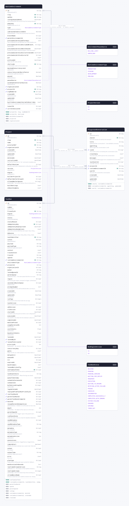

| Field                  | Type       | Constraints                                                   | Default              | Description                                                                    |
| ---------------------- | ---------- | ------------------------------------------------------------- | -------------------- | ------------------------------------------------------------------------------ |
| `id`                   | `String`   | PK NOT NULL                                                   | `cuid(1)`            |                                                                                |
| `chatId`               | `String`   | NOT NULL                                                      |                      | The chat session ID used by the transport                                      |
| `title`                | `String`   | NOT NULL                                                      | `"New conversation"` | User-editable conversation title (auto-generated from first message)           |
| `agentSlug`            | `String`   | NOT NULL                                                      |                      | Which agent this conversation is with                                          |
| `runId`                | `String`   | NULL → [TaskRun.id](#model-TaskRun)                           |                      | The current active run backing this conversation (null if no run yet)          |
| `clientData`           | `Json`     | NULL                                                          |                      | The client data JSON used for this conversation                                |
| `messages`             | `Json`     | NULL                                                          |                      | Accumulated UIMessages from completed turns (for resume without stream replay) |
| `lastEventId`          | `String`   | NULL                                                          |                      | Last SSE event ID — resume from this position to avoid replaying old turns     |
| `projectId`            | `String`   | NOT NULL → [Project.id](#model-Project)                       |                      |                                                                                |
| `runtimeEnvironmentId` | `String`   | NOT NULL → [RuntimeEnvironment.id](#model-RuntimeEnvironment) |                      |                                                                                |
| `userId`               | `String`   | NOT NULL                                                      |                      | The user who started this conversation                                         |
| `createdAt`            | `DateTime` | NOT NULL                                                      | `now()`              |                                                                                |
| `updatedAt`            | `DateTime` | NOT NULL                                                      | `@updatedAt`         |                                                                                |

#### Indexes

- `@@index([runtimeEnvironmentId, agentSlug, updatedAt])`
- `@@index([userId, runtimeEnvironmentId])`
- `@@unique([chatId, runtimeEnvironmentId])`

#### References

- `runId` → [TaskRun.id](#model-TaskRun) (many-to-one, on delete SetNull, on update Cascade)
- `projectId` → [Project.id](#model-Project) (many-to-one, on delete Cascade, on update Cascade)
- `runtimeEnvironmentId` → [RuntimeEnvironment.id](#model-RuntimeEnvironment) (many-to-one, on delete Cascade, on update Cascade)

#### Definition

```sql
CREATE TABLE "PlaygroundConversation" (
    "id" TEXT NOT NULL,
    "chatId" TEXT NOT NULL,
    "title" TEXT NOT NULL DEFAULT 'New conversation',
    "agentSlug" TEXT NOT NULL,
    "runId" TEXT,
    "clientData" JSONB,
    "messages" JSONB,
    "lastEventId" TEXT,
    "projectId" TEXT NOT NULL,
    "runtimeEnvironmentId" TEXT NOT NULL,
    "userId" TEXT NOT NULL,
    "createdAt" TIMESTAMP(3) NOT NULL DEFAULT CURRENT_TIMESTAMP,
    "updatedAt" TIMESTAMP(3) NOT NULL,

    CONSTRAINT "PlaygroundConversation_pkey" PRIMARY KEY ("id")
);

CREATE INDEX "PlaygroundConversation_runtimeEnvironmentId_agentSlug_updat_idx" ON "PlaygroundConversation"("runtimeEnvironmentId", "agentSlug", "updatedAt" DESC);

CREATE INDEX "PlaygroundConversation_userId_runtimeEnvironmentId_idx" ON "PlaygroundConversation"("userId", "runtimeEnvironmentId");

CREATE UNIQUE INDEX "PlaygroundConversation_chatId_runtimeEnvironmentId_key" ON "PlaygroundConversation"("chatId", "runtimeEnvironmentId");

ALTER TABLE "PlaygroundConversation" ADD CONSTRAINT "PlaygroundConversation_runId_fkey" FOREIGN KEY ("runId") REFERENCES "TaskRun"("id") ON DELETE SET NULL ON UPDATE CASCADE;

ALTER TABLE "PlaygroundConversation" ADD CONSTRAINT "PlaygroundConversation_projectId_fkey" FOREIGN KEY ("projectId") REFERENCES "Project"("id") ON DELETE CASCADE ON UPDATE CASCADE;

ALTER TABLE "PlaygroundConversation" ADD CONSTRAINT "PlaygroundConversation_runtimeEnvironmentId_fkey" FOREIGN KEY ("runtimeEnvironmentId") REFERENCES "RuntimeEnvironment"("id") ON DELETE CASCADE ON UPDATE CASCADE;
```

<details>
<summary>Queries and their SQL</summary>

**findMany**: Every row

```ts
await prisma.playgroundConversation.findMany();
```

```sql
SELECT
  "public"."PlaygroundConversation"."id",
  "public"."PlaygroundConversation"."chatId",
  "public"."PlaygroundConversation"."title",
  "public"."PlaygroundConversation"."agentSlug",
  "public"."PlaygroundConversation"."runId",
  "public"."PlaygroundConversation"."clientData",
  "public"."PlaygroundConversation"."messages",
  "public"."PlaygroundConversation"."lastEventId",
  "public"."PlaygroundConversation"."projectId",
  "public"."PlaygroundConversation"."runtimeEnvironmentId",
  "public"."PlaygroundConversation"."userId",
  "public"."PlaygroundConversation"."createdAt",
  "public"."PlaygroundConversation"."updatedAt"
FROM
  "public"."PlaygroundConversation"
WHERE
  1 = 1
OFFSET
  $1
-- params: ["0"]
```

**count**: How many rows there are

```ts
await prisma.playgroundConversation.count();
```

```sql
SELECT
  COUNT(*) AS "_count$_all"
FROM
  (
    SELECT
      "public"."PlaygroundConversation"."id"
    FROM
      "public"."PlaygroundConversation"
    WHERE
      1 = 1
    OFFSET
      $1
  ) AS "sub"
-- params: ["0"]
```

**findMany**: Every row with its relations

```ts
await prisma.playgroundConversation.findMany({
  include: { run: true, project: true, runtimeEnvironment: true },
});
```

```sql
SELECT
  "public"."PlaygroundConversation"."id",
  "public"."PlaygroundConversation"."chatId",
  "public"."PlaygroundConversation"."title",
  "public"."PlaygroundConversation"."agentSlug",
  "public"."PlaygroundConversation"."runId",
  "public"."PlaygroundConversation"."clientData",
  "public"."PlaygroundConversation"."messages",
  "public"."PlaygroundConversation"."lastEventId",
  "public"."PlaygroundConversation"."projectId",
  "public"."PlaygroundConversation"."runtimeEnvironmentId",
  "public"."PlaygroundConversation"."userId",
  "public"."PlaygroundConversation"."createdAt",
  "public"."PlaygroundConversation"."updatedAt"
FROM
  "public"."PlaygroundConversation"
WHERE
  1 = 1
OFFSET
  $1
-- params: ["0"]

SELECT
  "public"."TaskRun"."id",
  "public"."TaskRun"."number",
  "public"."TaskRun"."friendlyId",
  "public"."TaskRun"."engine"::text,
  "public"."TaskRun"."status"::text,
  "public"."TaskRun"."statusReason",
  "public"."TaskRun"."idempotencyKey",
  "public"."TaskRun"."idempotencyKeyExpiresAt",
  "public"."TaskRun"."idempotencyKeyOptions",
  "public"."TaskRun"."debounce",
  "public"."TaskRun"."taskIdentifier",
  "public"."TaskRun"."isTest",
  "public"."TaskRun"."payload",
  "public"."TaskRun"."payloadType",
  "public"."TaskRun"."context",
  "public"."TaskRun"."traceContext",
  "public"."TaskRun"."traceId",
  "public"."TaskRun"."spanId",
  "public"."TaskRun"."runtimeEnvironmentId",
  "public"."TaskRun"."environmentType"::text,
  "public"."TaskRun"."projectId",
  "public"."TaskRun"."organizationId",
  "public"."TaskRun"."queue",
  "public"."TaskRun"."lockedQueueId",
  "public"."TaskRun"."masterQueue",
  "public"."TaskRun"."region",
  "public"."TaskRun"."secondaryMasterQueue",
  "public"."TaskRun"."attemptNumber",
  "public"."TaskRun"."createdAt",
  "public"."TaskRun"."updatedAt",
  "public"."TaskRun"."runTags",
  "public"."TaskRun"."taskVersion",
  "public"."TaskRun"."sdkVersion",
  "public"."TaskRun"."cliVersion",
  "public"."TaskRun"."startedAt",
  "public"."TaskRun"."executedAt",
  "public"."TaskRun"."completedAt",
  "public"."TaskRun"."machinePreset",
  "public"."TaskRun"."usageDurationMs",
  "public"."TaskRun"."costInCents",
  "public"."TaskRun"."baseCostInCents",
  "public"."TaskRun"."lockedAt",
  "public"."TaskRun"."lockedById",
  "public"."TaskRun"."lockedToVersionId",
  "public"."TaskRun"."priorityMs",
  "public"."TaskRun"."concurrencyKey",
  "public"."TaskRun"."gates",
  "public"."TaskRun"."delayUntil",
  "public"."TaskRun"."queuedAt",
  "public"."TaskRun"."ttl",
  "public"."TaskRun"."expiredAt",
  "public"."TaskRun"."maxAttempts",
  "public"."TaskRun"."lockedRetryConfig",
  "public"."TaskRun"."oneTimeUseToken",
  "public"."TaskRun"."taskEventStore",
  "public"."TaskRun"."queueTimestamp",
  "public"."TaskRun"."scheduleInstanceId",
  "public"."TaskRun"."scheduleId",
  "public"."TaskRun"."bulkActionGroupIds",
  "public"."TaskRun"."logsDeletedAt",
  "public"."TaskRun"."replayedFromTaskRunFriendlyId",
  "public"."TaskRun"."rootTaskRunId",
  "public"."TaskRun"."parentTaskRunId",
  "public"."TaskRun"."parentTaskRunAttemptId",
  "public"."TaskRun"."batchId",
  "public"."TaskRun"."resumeParentOnCompletion",
  "public"."TaskRun"."depth",
  "public"."TaskRun"."parentSpanId",
  "public"."TaskRun"."runChainState",
  "public"."TaskRun"."seedMetadata",
  "public"."TaskRun"."seedMetadataType",
  "public"."TaskRun"."metadata",
  "public"."TaskRun"."metadataType",
  "public"."TaskRun"."metadataVersion",
  "public"."TaskRun"."annotations",
  "public"."TaskRun"."isWarmStart",
  "public"."TaskRun"."output",
  "public"."TaskRun"."outputType",
  "public"."TaskRun"."error",
  "public"."TaskRun"."planType",
  "public"."TaskRun"."maxDurationInSeconds",
  "public"."TaskRun"."realtimeStreamsVersion",
  "public"."TaskRun"."realtimeStreams",
  "public"."TaskRun"."streamBasinName"
FROM
  "public"."TaskRun"
WHERE
  "public"."TaskRun"."id" IN ($1)
OFFSET
  $2
-- params: ["<runId of the rows above>","0"]

SELECT
  "public"."Project"."id",
  "public"."Project"."slug",
  "public"."Project"."name",
  "public"."Project"."externalRef",
  "public"."Project"."organizationId",
  "public"."Project"."createdAt",
  "public"."Project"."updatedAt",
  "public"."Project"."deletedAt",
  "public"."Project"."initializedAt",
  "public"."Project"."defaultRuntime",
  "public"."Project"."version"::text,
  "public"."Project"."engine"::text,
  "public"."Project"."builderProjectId",
  "public"."Project"."defaultWorkerGroupId",
  "public"."Project"."allowedMasterQueues",
  "public"."Project"."buildSettings",
  "public"."Project"."onboardingData"
FROM
  "public"."Project"
WHERE
  "public"."Project"."id" IN ($1)
OFFSET
  $2
-- params: ["<projectId of the rows above>","0"]

SELECT
  "public"."RuntimeEnvironment"."id",
  "public"."RuntimeEnvironment"."slug",
  "public"."RuntimeEnvironment"."apiKey",
  "public"."RuntimeEnvironment"."rootApiKeyHiddenAt",
  "public"."RuntimeEnvironment"."pkApiKey",
  "public"."RuntimeEnvironment"."type"::text,
  "public"."RuntimeEnvironment"."isBranchableEnvironment",
  "public"."RuntimeEnvironment"."branchName",
  "public"."RuntimeEnvironment"."parentEnvironmentId",
  "public"."RuntimeEnvironment"."previewAutoArchiveAfterDays",
  "public"."RuntimeEnvironment"."previewAutoArchiveExcludedBranches",
  "public"."RuntimeEnvironment"."previewAutoArchiveNextCheckAt",
  "public"."RuntimeEnvironment"."previewAutoArchiveCursorCreatedAt",
  "public"."RuntimeEnvironment"."previewAutoArchiveCursorId",
  "public"."RuntimeEnvironment"."git",
  "public"."RuntimeEnvironment"."archivedAt",
  "public"."RuntimeEnvironment"."shortcode",
  "public"."RuntimeEnvironment"."maximumConcurrencyLimit",
  "public"."RuntimeEnvironment"."concurrencyLimitBurstFactor",
  "public"."RuntimeEnvironment"."paused",
  "public"."RuntimeEnvironment"."pauseSource"::text,
  "public"."RuntimeEnvironment"."autoEnableInternalSources",
  "public"."RuntimeEnvironment"."organizationId",
  "public"."RuntimeEnvironment"."projectId",
  "public"."RuntimeEnvironment"."orgMemberId",
  "public"."RuntimeEnvironment"."createdAt",
  "public"."RuntimeEnvironment"."updatedAt",
  "public"."RuntimeEnvironment"."builtInEnvironmentVariableOverrides",
  "public"."RuntimeEnvironment"."tunnelId",
  "public"."RuntimeEnvironment"."currentSessionId"
FROM
  "public"."RuntimeEnvironment"
WHERE
  "public"."RuntimeEnvironment"."id" IN ($1)
OFFSET
  $2
-- params: ["<runtimeEnvironmentId of the rows above>","0"]
```

**findUnique**: One row by what is unique to it

```ts
await prisma.playgroundConversation.findUnique({ where: { id: "example" } });
```

```sql
SELECT
  "public"."PlaygroundConversation"."id",
  "public"."PlaygroundConversation"."chatId",
  "public"."PlaygroundConversation"."title",
  "public"."PlaygroundConversation"."agentSlug",
  "public"."PlaygroundConversation"."runId",
  "public"."PlaygroundConversation"."clientData",
  "public"."PlaygroundConversation"."messages",
  "public"."PlaygroundConversation"."lastEventId",
  "public"."PlaygroundConversation"."projectId",
  "public"."PlaygroundConversation"."runtimeEnvironmentId",
  "public"."PlaygroundConversation"."userId",
  "public"."PlaygroundConversation"."createdAt",
  "public"."PlaygroundConversation"."updatedAt"
FROM
  "public"."PlaygroundConversation"
WHERE
  (
    "public"."PlaygroundConversation"."id" = $1
    AND 1 = 1
  )
LIMIT
  $2
OFFSET
  $3
-- params: ["example","1","0"]
```

**create**: Create a row

```ts
await prisma.playgroundConversation.create({
  data: {
    chatId: "example",
    agentSlug: "example",
    projectId: "example",
    runtimeEnvironmentId: "example",
    userId: "example",
  },
});
```

```sql
INSERT INTO
  "public"."PlaygroundConversation" (
    "id",
    "chatId",
    "title",
    "agentSlug",
    "projectId",
    "runtimeEnvironmentId",
    "userId",
    "createdAt",
    "updatedAt"
  )
VALUES
  ($1, $2, $3, $4, $5, $6, $7, $8, $9)
RETURNING
  "public"."PlaygroundConversation"."id",
  "public"."PlaygroundConversation"."chatId",
  "public"."PlaygroundConversation"."title",
  "public"."PlaygroundConversation"."agentSlug",
  "public"."PlaygroundConversation"."runId",
  "public"."PlaygroundConversation"."clientData",
  "public"."PlaygroundConversation"."messages",
  "public"."PlaygroundConversation"."lastEventId",
  "public"."PlaygroundConversation"."projectId",
  "public"."PlaygroundConversation"."runtimeEnvironmentId",
  "public"."PlaygroundConversation"."userId",
  "public"."PlaygroundConversation"."createdAt",
  "public"."PlaygroundConversation"."updatedAt"
-- params: ["<cuid(1)>","example","New conversation","example","example","example","example","<now()>","<now()>"]
```

**update**: Update a row

```ts
await prisma.playgroundConversation.update({
  where: { id: "example" },
  data: { chatId: "example" },
});
```

```sql
UPDATE "public"."PlaygroundConversation"
SET
  "chatId" = $1,
  "updatedAt" = $2
WHERE
  (
    "public"."PlaygroundConversation"."id" = $3
    AND 1 = 1
  )
RETURNING
  "public"."PlaygroundConversation"."id",
  "public"."PlaygroundConversation"."chatId",
  "public"."PlaygroundConversation"."title",
  "public"."PlaygroundConversation"."agentSlug",
  "public"."PlaygroundConversation"."runId",
  "public"."PlaygroundConversation"."clientData",
  "public"."PlaygroundConversation"."messages",
  "public"."PlaygroundConversation"."lastEventId",
  "public"."PlaygroundConversation"."projectId",
  "public"."PlaygroundConversation"."runtimeEnvironmentId",
  "public"."PlaygroundConversation"."userId",
  "public"."PlaygroundConversation"."createdAt",
  "public"."PlaygroundConversation"."updatedAt"
-- params: ["example",{"prisma__type":"generatorCall","prisma__value":{"name":"now","args":[],"returnType":{"type":"DateTime"}}},"example"]
```

**delete**: Delete a row

```ts
await prisma.playgroundConversation.delete({ where: { id: "example" } });
```

```sql
DELETE FROM "public"."PlaygroundConversation"
WHERE
  (
    "public"."PlaygroundConversation"."id" = $1
    AND 1 = 1
  )
RETURNING
  "public"."PlaygroundConversation"."id",
  "public"."PlaygroundConversation"."chatId",
  "public"."PlaygroundConversation"."title",
  "public"."PlaygroundConversation"."agentSlug",
  "public"."PlaygroundConversation"."runId",
  "public"."PlaygroundConversation"."clientData",
  "public"."PlaygroundConversation"."messages",
  "public"."PlaygroundConversation"."lastEventId",
  "public"."PlaygroundConversation"."projectId",
  "public"."PlaygroundConversation"."runtimeEnvironmentId",
  "public"."PlaygroundConversation"."userId",
  "public"."PlaygroundConversation"."createdAt",
  "public"."PlaygroundConversation"."updatedAt"
-- params: ["example"]
```

</details>

<a id="model-Session"></a>

### Session

Durable, typed, bidirectional I/O primitive. Owns two S2 streams (.out / .in).
The row is essentially static — no status, no counters, no pointers. No
foreign keys: project/runtimeEnvironment/organization ids are plain
scalar columns (matches TaskRun pattern). List-style queries are served
from ClickHouse, not Postgres, so only point-lookup indexes live here.


| Field                     | Type                                                     | Constraints     | Default      | Description                                                                                                                                                                                                                                                                                                                                                                |
| ------------------------- | -------------------------------------------------------- | --------------- | ------------ | -------------------------------------------------------------------------------------------------------------------------------------------------------------------------------------------------------------------------------------------------------------------------------------------------------------------------------------------------------------------------- |
| `id`                      | `String`                                                 | PK NOT NULL     | `cuid(1)`    |                                                                                                                                                                                                                                                                                                                                                                            |
| `friendlyId`              | `String`                                                 | UNIQUE NOT NULL |              |                                                                                                                                                                                                                                                                                                                                                                            |
| `externalId`              | `String`                                                 | NULL            |              | User-supplied identifier scoped to the environment. Used for idempotent upsert and for resolving sessions via the public API.                                                                                                                                                                                                                                              |
| `type`                    | `String`                                                 | NOT NULL        |              | Plain string — intentionally not an enum.                                                                                                                                                                                                                                                                                                                                  |
| `projectId`               | `String`                                                 | NOT NULL        |              | Denormalized scoping columns — no FK relations.                                                                                                                                                                                                                                                                                                                            |
| `runtimeEnvironmentId`    | `String`                                                 | NOT NULL        |              |                                                                                                                                                                                                                                                                                                                                                                            |
| `environmentType`         | [`RuntimeEnvironmentType`](#enum-RuntimeEnvironmentType) | NOT NULL        |              |                                                                                                                                                                                                                                                                                                                                                                            |
| `organizationId`          | `String`                                                 | NOT NULL        |              |                                                                                                                                                                                                                                                                                                                                                                            |
| `taskIdentifier`          | `String`                                                 | NOT NULL        |              | Task this session triggers runs against. Required — Sessions are task-bound: creating a session also triggers its first run, and every subsequent re-trigger uses this same identifier.                                                                                                                                                                                    |
| `triggerConfig`           | `Json`                                                   | NOT NULL        |              | Trigger config used for every run this session schedules. Shape (validated at the route layer, opaque to the DB): { basePayload: object, machine?: string, queue?: string, tags?: string[], maxAttempts?: number, idleTimeoutInSeconds?: number } `basePayload` carries the customer's client-data; runtime fields (chatId, messages, trigger) are merged at trigger time. |
| `isTest`                  | `Boolean`                                                | NOT NULL        | `false`      | Whether this session was created from the Test/playground UI rather than by a real chat.agent() trigger. Mirrors TaskRun.isTest.                                                                                                                                                                                                                                           |
| `tags`                    | `String[]`                                               | NOT NULL        | `[]`         |                                                                                                                                                                                                                                                                                                                                                                            |
| `metadata`                | `Json`                                                   | NULL            |              |                                                                                                                                                                                                                                                                                                                                                                            |
| `currentRunId`            | `String`                                                 | NULL            |              | Live run pointer — non-FK so run deletion never cascades. Can lag reality; the `.in/append` handler re-checks the snapshot status before reusing it.                                                                                                                                                                                                                       |
| `currentRunVersion`       | `Int`                                                    | NOT NULL        | `0`          | Monotonic counter used for optimistic locking on `currentRunId` swaps. Bumped atomically alongside any update that changes `currentRunId`.                                                                                                                                                                                                                                 |
| `closedAt`                | `DateTime`                                               | NULL            |              | Terminal markers — written once, never flipped back.                                                                                                                                                                                                                                                                                                                       |
| `closedReason`            | `String`                                                 | NULL            |              |                                                                                                                                                                                                                                                                                                                                                                            |
| `expiresAt`               | `DateTime`                                               | NULL            |              |                                                                                                                                                                                                                                                                                                                                                                            |
| `createdAt`               | `DateTime`                                               | NOT NULL        | `now()`      |                                                                                                                                                                                                                                                                                                                                                                            |
| `updatedAt`               | `DateTime`                                               | NOT NULL        | `@updatedAt` |                                                                                                                                                                                                                                                                                                                                                                            |
| `streamBasinName`         | `String`                                                 | NULL            |              | S2 basin where this session's stream pair lives. Stamped at create time from `Organization.streamBasinName` so reads can resolve the basin without joining org. Null when the org has no per-org basin (OSS, or pre-backfill); reads fall back to the global basin.                                                                                                        |
| `chatSnapshotStoragePath` | `String`                                                 | NULL            |              | Storage URI (with protocol prefix) for this session's chat.agent snapshot blob. Set on first snapshot write. Null = pre-column session, fall back to computed default path.                                                                                                                                                                                                |

#### Indexes

- `@@index([expiresAt])`
- `@@index([currentRunId])`
- `@@unique([runtimeEnvironmentId, externalId])`

#### Referenced by

- `id` ← [SessionRun.sessionId](#model-SessionRun) (one-to-many, on delete Cascade)

#### Definition

```sql
CREATE TABLE "Session" (
    "id" TEXT NOT NULL,
    "friendlyId" TEXT NOT NULL,
    "externalId" TEXT,
    "type" TEXT NOT NULL,
    "projectId" TEXT NOT NULL,
    "runtimeEnvironmentId" TEXT NOT NULL,
    "environmentType" "RuntimeEnvironmentType" NOT NULL,
    "organizationId" TEXT NOT NULL,
    "taskIdentifier" TEXT NOT NULL,
    "triggerConfig" JSONB NOT NULL,
    "isTest" BOOLEAN NOT NULL DEFAULT false,
    "tags" TEXT[] DEFAULT ARRAY[]::TEXT[],
    "metadata" JSONB,
    "currentRunId" TEXT,
    "currentRunVersion" INTEGER NOT NULL DEFAULT 0,
    "closedAt" TIMESTAMP(3),
    "closedReason" TEXT,
    "expiresAt" TIMESTAMP(3),
    "createdAt" TIMESTAMP(3) NOT NULL DEFAULT CURRENT_TIMESTAMP,
    "updatedAt" TIMESTAMP(3) NOT NULL,
    "streamBasinName" TEXT,
    "chatSnapshotStoragePath" TEXT,

    CONSTRAINT "Session_pkey" PRIMARY KEY ("id")
);

CREATE UNIQUE INDEX "Session_friendlyId_key" ON "Session"("friendlyId");

CREATE INDEX "Session_expiresAt_idx" ON "Session"("expiresAt");

CREATE INDEX "Session_currentRunId_idx" ON "Session"("currentRunId");

CREATE UNIQUE INDEX "Session_runtimeEnvironmentId_externalId_key" ON "Session"("runtimeEnvironmentId", "externalId");
```

<details>
<summary>Queries and their SQL</summary>

**findMany**: Every row

```ts
await prisma.session.findMany();
```

```sql
SELECT
  "public"."Session"."id",
  "public"."Session"."friendlyId",
  "public"."Session"."externalId",
  "public"."Session"."type",
  "public"."Session"."projectId",
  "public"."Session"."runtimeEnvironmentId",
  "public"."Session"."environmentType"::text,
  "public"."Session"."organizationId",
  "public"."Session"."taskIdentifier",
  "public"."Session"."triggerConfig",
  "public"."Session"."isTest",
  "public"."Session"."tags",
  "public"."Session"."metadata",
  "public"."Session"."currentRunId",
  "public"."Session"."currentRunVersion",
  "public"."Session"."closedAt",
  "public"."Session"."closedReason",
  "public"."Session"."expiresAt",
  "public"."Session"."createdAt",
  "public"."Session"."updatedAt",
  "public"."Session"."streamBasinName",
  "public"."Session"."chatSnapshotStoragePath"
FROM
  "public"."Session"
WHERE
  1 = 1
OFFSET
  $1
-- params: ["0"]
```

**count**: How many rows there are

```ts
await prisma.session.count();
```

```sql
SELECT
  COUNT(*) AS "_count$_all"
FROM
  (
    SELECT
      "public"."Session"."id"
    FROM
      "public"."Session"
    WHERE
      1 = 1
    OFFSET
      $1
  ) AS "sub"
-- params: ["0"]
```

**findMany**: Every row with its relations

```ts
await prisma.session.findMany({ include: { runs: true } });
```

```sql
SELECT
  "public"."Session"."id",
  "public"."Session"."friendlyId",
  "public"."Session"."externalId",
  "public"."Session"."type",
  "public"."Session"."projectId",
  "public"."Session"."runtimeEnvironmentId",
  "public"."Session"."environmentType"::text,
  "public"."Session"."organizationId",
  "public"."Session"."taskIdentifier",
  "public"."Session"."triggerConfig",
  "public"."Session"."isTest",
  "public"."Session"."tags",
  "public"."Session"."metadata",
  "public"."Session"."currentRunId",
  "public"."Session"."currentRunVersion",
  "public"."Session"."closedAt",
  "public"."Session"."closedReason",
  "public"."Session"."expiresAt",
  "public"."Session"."createdAt",
  "public"."Session"."updatedAt",
  "public"."Session"."streamBasinName",
  "public"."Session"."chatSnapshotStoragePath"
FROM
  "public"."Session"
WHERE
  1 = 1
OFFSET
  $1
-- params: ["0"]

SELECT
  "public"."SessionRun"."id",
  "public"."SessionRun"."sessionId",
  "public"."SessionRun"."runId",
  "public"."SessionRun"."reason",
  "public"."SessionRun"."triggeredAt"
FROM
  "public"."SessionRun"
WHERE
  "public"."SessionRun"."sessionId" IN ($1)
OFFSET
  $2
-- params: ["<id of the rows above>","0"]
```

**findUnique**: One row by what is unique to it

```ts
await prisma.session.findUnique({ where: { id: "example" } });
```

```sql
SELECT
  "public"."Session"."id",
  "public"."Session"."friendlyId",
  "public"."Session"."externalId",
  "public"."Session"."type",
  "public"."Session"."projectId",
  "public"."Session"."runtimeEnvironmentId",
  "public"."Session"."environmentType"::text,
  "public"."Session"."organizationId",
  "public"."Session"."taskIdentifier",
  "public"."Session"."triggerConfig",
  "public"."Session"."isTest",
  "public"."Session"."tags",
  "public"."Session"."metadata",
  "public"."Session"."currentRunId",
  "public"."Session"."currentRunVersion",
  "public"."Session"."closedAt",
  "public"."Session"."closedReason",
  "public"."Session"."expiresAt",
  "public"."Session"."createdAt",
  "public"."Session"."updatedAt",
  "public"."Session"."streamBasinName",
  "public"."Session"."chatSnapshotStoragePath"
FROM
  "public"."Session"
WHERE
  (
    "public"."Session"."id" = $1
    AND 1 = 1
  )
LIMIT
  $2
OFFSET
  $3
-- params: ["example","1","0"]
```

**create**: Create a row

```ts
await prisma.session.create({
  data: {
    friendlyId: "example",
    type: "example",
    projectId: "example",
    runtimeEnvironmentId: "example",
    environmentType: "PRODUCTION",
    organizationId: "example",
    taskIdentifier: "example",
    triggerConfig: {},
  },
});
```

```sql
INSERT INTO
  "public"."Session" (
    "id",
    "friendlyId",
    "type",
    "projectId",
    "runtimeEnvironmentId",
    "environmentType",
    "organizationId",
    "taskIdentifier",
    "triggerConfig",
    "isTest",
    "tags",
    "currentRunVersion",
    "createdAt",
    "updatedAt"
  )
VALUES
  (
    $1,
    $2,
    $3,
    $4,
    $5,
    CAST($6::text AS "public"."RuntimeEnvironmentType"),
    $7,
    $8,
    $9,
    $10,
    $11,
    $12,
    $13,
    $14
  )
RETURNING
  "public"."Session"."id",
  "public"."Session"."friendlyId",
  "public"."Session"."externalId",
  "public"."Session"."type",
  "public"."Session"."projectId",
  "public"."Session"."runtimeEnvironmentId",
  "public"."Session"."environmentType"::text,
  "public"."Session"."organizationId",
  "public"."Session"."taskIdentifier",
  "public"."Session"."triggerConfig",
  "public"."Session"."isTest",
  "public"."Session"."tags",
  "public"."Session"."metadata",
  "public"."Session"."currentRunId",
  "public"."Session"."currentRunVersion",
  "public"."Session"."closedAt",
  "public"."Session"."closedReason",
  "public"."Session"."expiresAt",
  "public"."Session"."createdAt",
  "public"."Session"."updatedAt",
  "public"."Session"."streamBasinName",
  "public"."Session"."chatSnapshotStoragePath"
-- params: ["<cuid(1)>","example","example","example","example","PRODUCTION","example","example","{}",false,[],"0","<now()>","<now()>"]
```

**update**: Update a row

```ts
await prisma.session.update({ where: { id: "example" }, data: { friendlyId: "example" } });
```

```sql
UPDATE "public"."Session"
SET
  "friendlyId" = $1,
  "updatedAt" = $2
WHERE
  (
    "public"."Session"."id" = $3
    AND 1 = 1
  )
RETURNING
  "public"."Session"."id",
  "public"."Session"."friendlyId",
  "public"."Session"."externalId",
  "public"."Session"."type",
  "public"."Session"."projectId",
  "public"."Session"."runtimeEnvironmentId",
  "public"."Session"."environmentType"::text,
  "public"."Session"."organizationId",
  "public"."Session"."taskIdentifier",
  "public"."Session"."triggerConfig",
  "public"."Session"."isTest",
  "public"."Session"."tags",
  "public"."Session"."metadata",
  "public"."Session"."currentRunId",
  "public"."Session"."currentRunVersion",
  "public"."Session"."closedAt",
  "public"."Session"."closedReason",
  "public"."Session"."expiresAt",
  "public"."Session"."createdAt",
  "public"."Session"."updatedAt",
  "public"."Session"."streamBasinName",
  "public"."Session"."chatSnapshotStoragePath"
-- params: ["example",{"prisma__type":"generatorCall","prisma__value":{"name":"now","args":[],"returnType":{"type":"DateTime"}}},"example"]
```

**delete**: Delete a row

```ts
await prisma.session.delete({ where: { id: "example" } });
```

```sql
DELETE FROM "public"."Session"
WHERE
  (
    "public"."Session"."id" = $1
    AND 1 = 1
  )
RETURNING
  "public"."Session"."id",
  "public"."Session"."friendlyId",
  "public"."Session"."externalId",
  "public"."Session"."type",
  "public"."Session"."projectId",
  "public"."Session"."runtimeEnvironmentId",
  "public"."Session"."environmentType"::text,
  "public"."Session"."organizationId",
  "public"."Session"."taskIdentifier",
  "public"."Session"."triggerConfig",
  "public"."Session"."isTest",
  "public"."Session"."tags",
  "public"."Session"."metadata",
  "public"."Session"."currentRunId",
  "public"."Session"."currentRunVersion",
  "public"."Session"."closedAt",
  "public"."Session"."closedReason",
  "public"."Session"."expiresAt",
  "public"."Session"."createdAt",
  "public"."Session"."updatedAt",
  "public"."Session"."streamBasinName",
  "public"."Session"."chatSnapshotStoragePath"
-- params: ["example"]
```

</details>

<a id="model-SessionRun"></a>

### SessionRun

Historical record of every run a Session has owned. Append-only —
rows are inserted on each `ensureRunForSession` claim, never updated.
Lets us reconstruct the run timeline of a chat for debugging /
dashboard surfaces. The relation cascades on Session delete (tied to
the session lifecycle) but `runId` is a plain string column with no
FK to TaskRun so run pruning is independent.

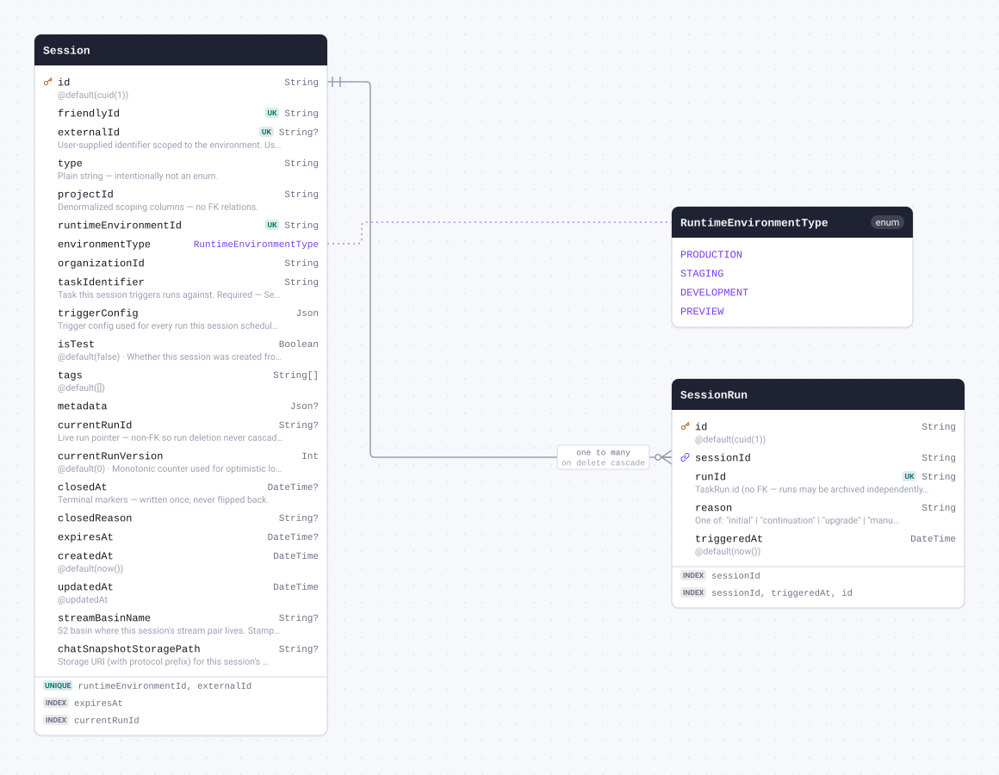

| Field         | Type       | Constraints                             | Default   | Description                                                                                                                |
| ------------- | ---------- | --------------------------------------- | --------- | -------------------------------------------------------------------------------------------------------------------------- |
| `id`          | `String`   | PK NOT NULL                             | `cuid(1)` |                                                                                                                            |
| `sessionId`   | `String`   | NOT NULL → [Session.id](#model-Session) |           |                                                                                                                            |
| `runId`       | `String`   | UNIQUE NOT NULL                         |           | TaskRun.id (no FK — runs may be archived independently of session history)                                                 |
| `reason`      | `String`   | NOT NULL                                |           | One of: "initial" \| "continuation" \| "upgrade" \| "manual". Plain string for forward-compat with future trigger reasons. |
| `triggeredAt` | `DateTime` | NOT NULL                                | `now()`   |                                                                                                                            |

#### Indexes

- `@@index([sessionId])`
- `@@index([sessionId, triggeredAt, id])`

#### References

- `sessionId` → [Session.id](#model-Session) (many-to-one, on delete Cascade)

#### Definition

```sql
CREATE TABLE "SessionRun" (
    "id" TEXT NOT NULL,
    "sessionId" TEXT NOT NULL,
    "runId" TEXT NOT NULL,
    "reason" TEXT NOT NULL,
    "triggeredAt" TIMESTAMP(3) NOT NULL DEFAULT CURRENT_TIMESTAMP,

    CONSTRAINT "SessionRun_pkey" PRIMARY KEY ("id")
);

CREATE UNIQUE INDEX "SessionRun_runId_key" ON "SessionRun"("runId");

CREATE INDEX "SessionRun_sessionId_idx" ON "SessionRun"("sessionId");

CREATE INDEX "SessionRun_sessionId_triggeredAt_id_idx" ON "SessionRun"("sessionId", "triggeredAt", "id");

ALTER TABLE "SessionRun" ADD CONSTRAINT "SessionRun_sessionId_fkey" FOREIGN KEY ("sessionId") REFERENCES "Session"("id") ON DELETE CASCADE ON UPDATE CASCADE;
```

<details>
<summary>Queries and their SQL</summary>

**findMany**: Every row

```ts
await prisma.sessionRun.findMany();
```

```sql
SELECT
  "public"."SessionRun"."id",
  "public"."SessionRun"."sessionId",
  "public"."SessionRun"."runId",
  "public"."SessionRun"."reason",
  "public"."SessionRun"."triggeredAt"
FROM
  "public"."SessionRun"
WHERE
  1 = 1
OFFSET
  $1
-- params: ["0"]
```

**count**: How many rows there are

```ts
await prisma.sessionRun.count();
```

```sql
SELECT
  COUNT(*) AS "_count$_all"
FROM
  (
    SELECT
      "public"."SessionRun"."id"
    FROM
      "public"."SessionRun"
    WHERE
      1 = 1
    OFFSET
      $1
  ) AS "sub"
-- params: ["0"]
```

**findMany**: Every row with its relations

```ts
await prisma.sessionRun.findMany({ include: { session: true } });
```

```sql
SELECT
  "public"."SessionRun"."id",
  "public"."SessionRun"."sessionId",
  "public"."SessionRun"."runId",
  "public"."SessionRun"."reason",
  "public"."SessionRun"."triggeredAt"
FROM
  "public"."SessionRun"
WHERE
  1 = 1
OFFSET
  $1
-- params: ["0"]

SELECT
  "public"."Session"."id",
  "public"."Session"."friendlyId",
  "public"."Session"."externalId",
  "public"."Session"."type",
  "public"."Session"."projectId",
  "public"."Session"."runtimeEnvironmentId",
  "public"."Session"."environmentType"::text,
  "public"."Session"."organizationId",
  "public"."Session"."taskIdentifier",
  "public"."Session"."triggerConfig",
  "public"."Session"."isTest",
  "public"."Session"."tags",
  "public"."Session"."metadata",
  "public"."Session"."currentRunId",
  "public"."Session"."currentRunVersion",
  "public"."Session"."closedAt",
  "public"."Session"."closedReason",
  "public"."Session"."expiresAt",
  "public"."Session"."createdAt",
  "public"."Session"."updatedAt",
  "public"."Session"."streamBasinName",
  "public"."Session"."chatSnapshotStoragePath"
FROM
  "public"."Session"
WHERE
  "public"."Session"."id" IN ($1)
OFFSET
  $2
-- params: ["<sessionId of the rows above>","0"]
```

**findUnique**: One row by what is unique to it

```ts
await prisma.sessionRun.findUnique({ where: { id: "example" } });
```

```sql
SELECT
  "public"."SessionRun"."id",
  "public"."SessionRun"."sessionId",
  "public"."SessionRun"."runId",
  "public"."SessionRun"."reason",
  "public"."SessionRun"."triggeredAt"
FROM
  "public"."SessionRun"
WHERE
  (
    "public"."SessionRun"."id" = $1
    AND 1 = 1
  )
LIMIT
  $2
OFFSET
  $3
-- params: ["example","1","0"]
```

**create**: Create a row

```ts
await prisma.sessionRun.create({
  data: { sessionId: "example", runId: "example", reason: "example" },
});
```

```sql
INSERT INTO
  "public"."SessionRun" (
    "id",
    "sessionId",
    "runId",
    "reason",
    "triggeredAt"
  )
VALUES
  ($1, $2, $3, $4, $5)
RETURNING
  "public"."SessionRun"."id",
  "public"."SessionRun"."sessionId",
  "public"."SessionRun"."runId",
  "public"."SessionRun"."reason",
  "public"."SessionRun"."triggeredAt"
-- params: ["<cuid(1)>","example","example","example","<now()>"]
```

**update**: Update a row

```ts
await prisma.sessionRun.update({ where: { id: "example" }, data: { runId: "example" } });
```

```sql
UPDATE "public"."SessionRun"
SET
  "runId" = $1
WHERE
  (
    "public"."SessionRun"."id" = $2
    AND 1 = 1
  )
RETURNING
  "public"."SessionRun"."id",
  "public"."SessionRun"."sessionId",
  "public"."SessionRun"."runId",
  "public"."SessionRun"."reason",
  "public"."SessionRun"."triggeredAt"
-- params: ["example","example"]
```

**delete**: Delete a row

```ts
await prisma.sessionRun.delete({ where: { id: "example" } });
```

```sql
DELETE FROM "public"."SessionRun"
WHERE
  (
    "public"."SessionRun"."id" = $1
    AND 1 = 1
  )
RETURNING
  "public"."SessionRun"."id",
  "public"."SessionRun"."sessionId",
  "public"."SessionRun"."runId",
  "public"."SessionRun"."reason",
  "public"."SessionRun"."triggeredAt"
-- params: ["example"]
```

</details>

<a id="model-TaskRun"></a>

### TaskRun

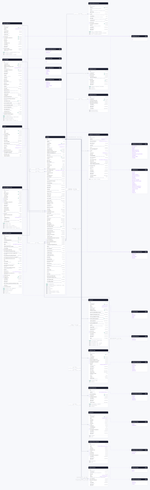

| Field                           | Type                                                     | Constraints                                                   | Default              | Description                                                                                                                                                                                                                                                         |
| ------------------------------- | -------------------------------------------------------- | ------------------------------------------------------------- | -------------------- | ------------------------------------------------------------------------------------------------------------------------------------------------------------------------------------------------------------------------------------------------------------------- |
| `id`                            | `String`                                                 | PK NOT NULL                                                   | `cuid(1)`            |                                                                                                                                                                                                                                                                     |
| `number`                        | `Int`                                                    | NOT NULL                                                      | `0`                  |                                                                                                                                                                                                                                                                     |
| `friendlyId`                    | `String`                                                 | UNIQUE NOT NULL                                               |                      |                                                                                                                                                                                                                                                                     |
| `engine`                        | [`RunEngineVersion`](#enum-RunEngineVersion)             | NOT NULL                                                      | `V1`                 |                                                                                                                                                                                                                                                                     |
| `status`                        | [`TaskRunStatus`](#enum-TaskRunStatus)                   | NOT NULL                                                      | `PENDING`            |                                                                                                                                                                                                                                                                     |
| `statusReason`                  | `String`                                                 | NULL                                                          |                      |                                                                                                                                                                                                                                                                     |
| `idempotencyKey`                | `String`                                                 | NULL                                                          |                      |                                                                                                                                                                                                                                                                     |
| `idempotencyKeyExpiresAt`       | `DateTime`                                               | NULL                                                          |                      |                                                                                                                                                                                                                                                                     |
| `idempotencyKeyOptions`         | `Json`                                                   | NULL                                                          |                      | Stores the user-provided key and scope: { key: string, scope: "run" \| "attempt" \| "global" }                                                                                                                                                                      |
| `debounce`                      | `Json`                                                   | NULL                                                          |                      | Debounce options: { key: string, delay: string, createdAt: Date }                                                                                                                                                                                                   |
| `taskIdentifier`                | `String`                                                 | NOT NULL                                                      |                      |                                                                                                                                                                                                                                                                     |
| `isTest`                        | `Boolean`                                                | NOT NULL                                                      | `false`              |                                                                                                                                                                                                                                                                     |
| `payload`                       | `String`                                                 | NOT NULL                                                      |                      |                                                                                                                                                                                                                                                                     |
| `payloadType`                   | `String`                                                 | NOT NULL                                                      | `"application/json"` |                                                                                                                                                                                                                                                                     |
| `context`                       | `Json`                                                   | NULL                                                          |                      |                                                                                                                                                                                                                                                                     |
| `traceContext`                  | `Json`                                                   | NULL                                                          |                      |                                                                                                                                                                                                                                                                     |
| `traceId`                       | `String`                                                 | NOT NULL                                                      |                      |                                                                                                                                                                                                                                                                     |
| `spanId`                        | `String`                                                 | NOT NULL                                                      |                      |                                                                                                                                                                                                                                                                     |
| `runtimeEnvironmentId`          | `String`                                                 | NOT NULL → [RuntimeEnvironment.id](#model-RuntimeEnvironment) |                      |                                                                                                                                                                                                                                                                     |
| `environmentType`               | [`RuntimeEnvironmentType`](#enum-RuntimeEnvironmentType) | NULL                                                          |                      |                                                                                                                                                                                                                                                                     |
| `projectId`                     | `String`                                                 | NOT NULL → [Project.id](#model-Project)                       |                      |                                                                                                                                                                                                                                                                     |
| `organizationId`                | `String`                                                 | NULL                                                          |                      |                                                                                                                                                                                                                                                                     |
| `queue`                         | `String`                                                 | NOT NULL                                                      |                      |                                                                                                                                                                                                                                                                     |
| `lockedQueueId`                 | `String`                                                 | NULL                                                          |                      |                                                                                                                                                                                                                                                                     |
| `workerQueue` (`masterQueue`)   | `String`                                                 | NOT NULL                                                      | `"main"`             | The main queue that this run is part of                                                                                                                                                                                                                             |
| `region`                        | `String`                                                 | NULL                                                          |                      | User-facing geo region, stamped at trigger; workerQueue is where it actually ran.                                                                                                                                                                                   |
| `secondaryMasterQueue`          | `String`                                                 | NULL                                                          |                      | @deprecated                                                                                                                                                                                                                                                         |
| `attemptNumber`                 | `Int`                                                    | NULL                                                          |                      | From engine v2+ this will be defined after a run has been dequeued (starting at 1)                                                                                                                                                                                  |
| `createdAt`                     | `DateTime`                                               | NOT NULL                                                      | `now()`              |                                                                                                                                                                                                                                                                     |
| `updatedAt`                     | `DateTime`                                               | NOT NULL                                                      | `@updatedAt`         |                                                                                                                                                                                                                                                                     |
| `runTags`                       | `String[]`                                               | NOT NULL                                                      |                      | Denormized column that holds the raw tags                                                                                                                                                                                                                           |
| `taskVersion`                   | `String`                                                 | NULL                                                          |                      | Denormalized version of the background worker task                                                                                                                                                                                                                  |
| `sdkVersion`                    | `String`                                                 | NULL                                                          |                      |                                                                                                                                                                                                                                                                     |
| `cliVersion`                    | `String`                                                 | NULL                                                          |                      |                                                                                                                                                                                                                                                                     |
| `startedAt`                     | `DateTime`                                               | NULL                                                          |                      | startedAt marks the point at which a run is dequeued from MarQS                                                                                                                                                                                                     |
| `executedAt`                    | `DateTime`                                               | NULL                                                          |                      | executedAt is set when the first attempt is about to execute                                                                                                                                                                                                        |
| `completedAt`                   | `DateTime`                                               | NULL                                                          |                      |                                                                                                                                                                                                                                                                     |
| `machinePreset`                 | `String`                                                 | NULL                                                          |                      |                                                                                                                                                                                                                                                                     |
| `usageDurationMs`               | `Int`                                                    | NOT NULL                                                      | `0`                  |                                                                                                                                                                                                                                                                     |
| `costInCents`                   | `Float`                                                  | NOT NULL                                                      | `0`                  |                                                                                                                                                                                                                                                                     |
| `baseCostInCents`               | `Float`                                                  | NOT NULL                                                      | `0`                  |                                                                                                                                                                                                                                                                     |
| `lockedAt`                      | `DateTime`                                               | NULL                                                          |                      |                                                                                                                                                                                                                                                                     |
| `lockedById`                    | `String`                                                 | NULL → [BackgroundWorkerTask.id](#model-BackgroundWorkerTask) |                      |                                                                                                                                                                                                                                                                     |
| `lockedToVersionId`             | `String`                                                 | NULL → [BackgroundWorker.id](#model-BackgroundWorker)         |                      |                                                                                                                                                                                                                                                                     |
| `priorityMs`                    | `Int`                                                    | NOT NULL                                                      | `0`                  | The "priority" of the run. This is just a negative offset in ms for the queue timestamp E.g. a value of 60_000 would put the run into the queue 60s ago.                                                                                                            |
| `concurrencyKey`                | `String`                                                 | NULL                                                          |                      |                                                                                                                                                                                                                                                                     |
| `gates`                         | `Json`                                                   | NULL                                                          |                      | Gates for this run: other queues it must also hold a concurrency slot in while executing. Shape: [{ queue: string, concurrencyKey?: string }]                                                                                                                       |
| `delayUntil`                    | `DateTime`                                               | NULL                                                          |                      |                                                                                                                                                                                                                                                                     |
| `queuedAt`                      | `DateTime`                                               | NULL                                                          |                      |                                                                                                                                                                                                                                                                     |
| `ttl`                           | `String`                                                 | NULL                                                          |                      |                                                                                                                                                                                                                                                                     |
| `expiredAt`                     | `DateTime`                                               | NULL                                                          |                      |                                                                                                                                                                                                                                                                     |
| `maxAttempts`                   | `Int`                                                    | NULL                                                          |                      |                                                                                                                                                                                                                                                                     |
| `lockedRetryConfig`             | `Json`                                                   | NULL                                                          |                      |                                                                                                                                                                                                                                                                     |
| `oneTimeUseToken`               | `String`                                                 | UNIQUE NULL                                                   |                      | optional token that can be used to authenticate the task run                                                                                                                                                                                                        |
| `taskEventStore`                | `String`                                                 | NOT NULL                                                      | `"taskEvent"`        | Where the logs are stored                                                                                                                                                                                                                                           |
| `queueTimestamp`                | `DateTime`                                               | NULL                                                          |                      |                                                                                                                                                                                                                                                                     |
| `scheduleInstanceId`            | `String`                                                 | NULL                                                          |                      |                                                                                                                                                                                                                                                                     |
| `scheduleId`                    | `String`                                                 | NULL                                                          |                      |                                                                                                                                                                                                                                                                     |
| `bulkActionGroupIds`            | `String[]`                                               | NOT NULL                                                      | `[]`                 |                                                                                                                                                                                                                                                                     |
| `logsDeletedAt`                 | `DateTime`                                               | NULL                                                          |                      |                                                                                                                                                                                                                                                                     |
| `replayedFromTaskRunFriendlyId` | `String`                                                 | NULL                                                          |                      |                                                                                                                                                                                                                                                                     |
| `rootTaskRunId`                 | `String`                                                 | NULL → [TaskRun.id](#model-TaskRun)                           |                      |                                                                                                                                                                                                                                                                     |
| `parentTaskRunId`               | `String`                                                 | NULL → [TaskRun.id](#model-TaskRun)                           |                      |                                                                                                                                                                                                                                                                     |
| `parentTaskRunAttemptId`        | `String`                                                 | NULL → [TaskRunAttempt.id](#model-TaskRunAttempt)             |                      |                                                                                                                                                                                                                                                                     |
| `batchId`                       | `String`                                                 | NULL → [BatchTaskRun.id](#model-BatchTaskRun)                 |                      |                                                                                                                                                                                                                                                                     |
| `resumeParentOnCompletion`      | `Boolean`                                                | NOT NULL                                                      | `false`              | whether or not the task run was created because of a triggerAndWait for batchTriggerAndWait                                                                                                                                                                         |
| `depth`                         | `Int`                                                    | NOT NULL                                                      | `0`                  | The depth of this task run in the task run hierarchy                                                                                                                                                                                                                |
| `parentSpanId`                  | `String`                                                 | NULL                                                          |                      | The span ID of the "trigger" span in the parent task run                                                                                                                                                                                                            |
| `runChainState`                 | `Json`                                                   | NULL                                                          |                      | Holds the state of the run chain for deadlock detection                                                                                                                                                                                                             |
| `seedMetadata`                  | `String`                                                 | NULL                                                          |                      | seed run metadata                                                                                                                                                                                                                                                   |
| `seedMetadataType`              | `String`                                                 | NOT NULL                                                      | `"application/json"` |                                                                                                                                                                                                                                                                     |
| `metadata`                      | `String`                                                 | NULL                                                          |                      | Run metadata                                                                                                                                                                                                                                                        |
| `metadataType`                  | `String`                                                 | NOT NULL                                                      | `"application/json"` |                                                                                                                                                                                                                                                                     |
| `metadataVersion`               | `Int`                                                    | NOT NULL                                                      | `1`                  |                                                                                                                                                                                                                                                                     |
| `annotations`                   | `Json`                                                   | NULL                                                          |                      | Structured annotations: triggerSource, triggerAction, rootTriggerSource, rootScheduleId                                                                                                                                                                             |
| `isWarmStart`                   | `Boolean`                                                | NULL                                                          |                      | Whether the latest attempt was a warm start. Null until first attempt starts.                                                                                                                                                                                       |
| `output`                        | `String`                                                 | NULL                                                          |                      | Run output                                                                                                                                                                                                                                                          |
| `outputType`                    | `String`                                                 | NOT NULL                                                      | `"application/json"` |                                                                                                                                                                                                                                                                     |
| `error`                         | `Json`                                                   | NULL                                                          |                      | Run error                                                                                                                                                                                                                                                           |
| `planType`                      | `String`                                                 | NULL                                                          |                      | Organization's billing plan type (cached for fallback when billing API fails)                                                                                                                                                                                       |
| `maxDurationInSeconds`          | `Int`                                                    | NULL                                                          |                      |                                                                                                                                                                                                                                                                     |
| `realtimeStreamsVersion`        | `String`                                                 | NOT NULL                                                      | `"v1"`               | The version of the realtime streams implementation used by the run                                                                                                                                                                                                  |
| `realtimeStreams`               | `String[]`                                               | NOT NULL                                                      | `[]`                 | Store the stream keys that are being used by the run                                                                                                                                                                                                                |
| `streamBasinName`               | `String`                                                 | NULL                                                          |                      | S2 basin where this run's realtime streams live. Stamped at create time from `Organization.streamBasinName` so reads can resolve the basin without joining org. Null when the org has no per-org basin (OSS, or pre-backfill); reads fall back to the global basin. |

#### Indexes

- `@@index([parentTaskRunId])`
- `@@index([spanId])`
- `@@index([parentSpanId])`
- `@@index([runTags])`
- `@@index([runtimeEnvironmentId, batchId])`
- `@@index([runtimeEnvironmentId, createdAt])`
- `@@index([createdAt])`
- `@@unique([oneTimeUseToken])`
- `@@unique([runtimeEnvironmentId, taskIdentifier, idempotencyKey])`

#### References

- `runtimeEnvironmentId` → [RuntimeEnvironment.id](#model-RuntimeEnvironment) (many-to-one, on delete Cascade, on update Cascade)
- `projectId` → [Project.id](#model-Project) (many-to-one, on delete Cascade, on update Cascade)
- `lockedById` → [BackgroundWorkerTask.id](#model-BackgroundWorkerTask) (many-to-one)
- `lockedToVersionId` → [BackgroundWorker.id](#model-BackgroundWorker) (many-to-one)
- `rootTaskRunId` → [TaskRun.id](#model-TaskRun) (many-to-one, on delete SetNull, on update NoAction)
- `parentTaskRunId` → [TaskRun.id](#model-TaskRun) (many-to-one, on delete SetNull, on update NoAction)
- `parentTaskRunAttemptId` → [TaskRunAttempt.id](#model-TaskRunAttempt) (many-to-one, on delete SetNull, on update NoAction)
- `batchId` → [BatchTaskRun.id](#model-BatchTaskRun) (many-to-one, on delete SetNull, on update NoAction)

#### Referenced by

- `id` ← [PlaygroundConversation.runId](#model-PlaygroundConversation) (one-to-many, on delete SetNull, on update Cascade)
- `id` ← [TaskRun.rootTaskRunId](#model-TaskRun) (one-to-many, on delete SetNull, on update NoAction)
- `id` ← [TaskRun.parentTaskRunId](#model-TaskRun) (one-to-many, on delete SetNull, on update NoAction)
- `id` ← [TaskRunExecutionSnapshot.runId](#model-TaskRunExecutionSnapshot) (one-to-many)
- `id` ← [Waitpoint.completedByTaskRunId](#model-Waitpoint) (one-to-one, on delete SetNull)
- `id` ← [TaskRunWaitpoint.taskRunId](#model-TaskRunWaitpoint) (one-to-many)
- `id` ← [TaskRunDependency.taskRunId](#model-TaskRunDependency) (one-to-one, on delete Cascade, on update Cascade)
- `id` ← [TaskRunAttempt.taskRunId](#model-TaskRunAttempt) (one-to-many, on delete Cascade, on update Cascade)
- `id` ← [BatchTaskRunItem.taskRunId](#model-BatchTaskRunItem) (one-to-many, on delete Cascade, on update Cascade)
- `id` ← [Checkpoint.runId](#model-Checkpoint) (one-to-many, on delete Cascade, on update Cascade)
- `id` ← [CheckpointRestoreEvent.runId](#model-CheckpointRestoreEvent) (one-to-many, on delete Cascade, on update Cascade)
- `id` ← [BulkActionItem.sourceRunId](#model-BulkActionItem) (one-to-many, on delete Cascade, on update Cascade)
- `id` ← [BulkActionItem.destinationRunId](#model-BulkActionItem) (one-to-many, on delete Cascade, on update Cascade)

#### Many to many

- `connectedWaitpoints` ↔ [Waitpoint.connectedRuns](#model-Waitpoint) through `_WaitpointRunConnections`

#### Definition

```sql
CREATE TABLE "TaskRun" (
    "id" TEXT NOT NULL,
    "number" INTEGER NOT NULL DEFAULT 0,
    "friendlyId" TEXT NOT NULL,
    "engine" "RunEngineVersion" NOT NULL DEFAULT 'V1',
    "status" "TaskRunStatus" NOT NULL DEFAULT 'PENDING',
    "statusReason" TEXT,
    "idempotencyKey" TEXT,
    "idempotencyKeyExpiresAt" TIMESTAMP(3),
    "idempotencyKeyOptions" JSONB,
    "debounce" JSONB,
    "taskIdentifier" TEXT NOT NULL,
    "isTest" BOOLEAN NOT NULL DEFAULT false,
    "payload" TEXT NOT NULL,
    "payloadType" TEXT NOT NULL DEFAULT 'application/json',
    "context" JSONB,
    "traceContext" JSONB,
    "traceId" TEXT NOT NULL,
    "spanId" TEXT NOT NULL,
    "runtimeEnvironmentId" TEXT NOT NULL,
    "environmentType" "RuntimeEnvironmentType",
    "projectId" TEXT NOT NULL,
    "organizationId" TEXT,
    "queue" TEXT NOT NULL,
    "lockedQueueId" TEXT,
    "masterQueue" TEXT NOT NULL DEFAULT 'main',
    "region" TEXT,
    "secondaryMasterQueue" TEXT,
    "attemptNumber" INTEGER,
    "createdAt" TIMESTAMP(3) NOT NULL DEFAULT CURRENT_TIMESTAMP,
    "updatedAt" TIMESTAMP(3) NOT NULL,
    "runTags" TEXT[],
    "taskVersion" TEXT,
    "sdkVersion" TEXT,
    "cliVersion" TEXT,
    "startedAt" TIMESTAMP(3),
    "executedAt" TIMESTAMP(3),
    "completedAt" TIMESTAMP(3),
    "machinePreset" TEXT,
    "usageDurationMs" INTEGER NOT NULL DEFAULT 0,
    "costInCents" DOUBLE PRECISION NOT NULL DEFAULT 0,
    "baseCostInCents" DOUBLE PRECISION NOT NULL DEFAULT 0,
    "lockedAt" TIMESTAMP(3),
    "lockedById" TEXT,
    "lockedToVersionId" TEXT,
    "priorityMs" INTEGER NOT NULL DEFAULT 0,
    "concurrencyKey" TEXT,
    "gates" JSONB,
    "delayUntil" TIMESTAMP(3),
    "queuedAt" TIMESTAMP(3),
    "ttl" TEXT,
    "expiredAt" TIMESTAMP(3),
    "maxAttempts" INTEGER,
    "lockedRetryConfig" JSONB,
    "oneTimeUseToken" TEXT,
    "taskEventStore" TEXT NOT NULL DEFAULT 'taskEvent',
    "queueTimestamp" TIMESTAMP(3),
    "scheduleInstanceId" TEXT,
    "scheduleId" TEXT,
    "bulkActionGroupIds" TEXT[] DEFAULT ARRAY[]::TEXT[],
    "logsDeletedAt" TIMESTAMP(3),
    "replayedFromTaskRunFriendlyId" TEXT,
    "rootTaskRunId" TEXT,
    "parentTaskRunId" TEXT,
    "parentTaskRunAttemptId" TEXT,
    "batchId" TEXT,
    "resumeParentOnCompletion" BOOLEAN NOT NULL DEFAULT false,
    "depth" INTEGER NOT NULL DEFAULT 0,
    "parentSpanId" TEXT,
    "runChainState" JSONB,
    "seedMetadata" TEXT,
    "seedMetadataType" TEXT NOT NULL DEFAULT 'application/json',
    "metadata" TEXT,
    "metadataType" TEXT NOT NULL DEFAULT 'application/json',
    "metadataVersion" INTEGER NOT NULL DEFAULT 1,
    "annotations" JSONB,
    "isWarmStart" BOOLEAN,
    "output" TEXT,
    "outputType" TEXT NOT NULL DEFAULT 'application/json',
    "error" JSONB,
    "planType" TEXT,
    "maxDurationInSeconds" INTEGER,
    "realtimeStreamsVersion" TEXT NOT NULL DEFAULT 'v1',
    "realtimeStreams" TEXT[] DEFAULT ARRAY[]::TEXT[],
    "streamBasinName" TEXT,

    CONSTRAINT "TaskRun_pkey" PRIMARY KEY ("id")
);

CREATE UNIQUE INDEX "TaskRun_friendlyId_key" ON "TaskRun"("friendlyId");

CREATE INDEX "TaskRun_parentTaskRunId_idx" ON "TaskRun"("parentTaskRunId");

CREATE INDEX "TaskRun_spanId_idx" ON "TaskRun"("spanId");

CREATE INDEX "TaskRun_parentSpanId_idx" ON "TaskRun"("parentSpanId");

CREATE INDEX "TaskRun_runTags_idx" ON "TaskRun" USING GIN ("runTags" array_ops);

CREATE INDEX "TaskRun_runtimeEnvironmentId_batchId_idx" ON "TaskRun"("runtimeEnvironmentId", "batchId");

CREATE INDEX "TaskRun_runtimeEnvironmentId_createdAt_idx" ON "TaskRun"("runtimeEnvironmentId", "createdAt" DESC);

CREATE INDEX "TaskRun_createdAt_idx" ON "TaskRun" USING BRIN ("createdAt");

CREATE UNIQUE INDEX "TaskRun_oneTimeUseToken_key" ON "TaskRun"("oneTimeUseToken");

CREATE UNIQUE INDEX "TaskRun_runtimeEnvironmentId_taskIdentifier_idempotencyKey_key" ON "TaskRun"("runtimeEnvironmentId", "taskIdentifier", "idempotencyKey");

ALTER TABLE "TaskRun" ADD CONSTRAINT "TaskRun_runtimeEnvironmentId_fkey" FOREIGN KEY ("runtimeEnvironmentId") REFERENCES "RuntimeEnvironment"("id") ON DELETE CASCADE ON UPDATE CASCADE;

ALTER TABLE "TaskRun" ADD CONSTRAINT "TaskRun_projectId_fkey" FOREIGN KEY ("projectId") REFERENCES "Project"("id") ON DELETE CASCADE ON UPDATE CASCADE;

ALTER TABLE "TaskRun" ADD CONSTRAINT "TaskRun_lockedById_fkey" FOREIGN KEY ("lockedById") REFERENCES "BackgroundWorkerTask"("id") ON DELETE SET NULL ON UPDATE CASCADE;

ALTER TABLE "TaskRun" ADD CONSTRAINT "TaskRun_lockedToVersionId_fkey" FOREIGN KEY ("lockedToVersionId") REFERENCES "BackgroundWorker"("id") ON DELETE SET NULL ON UPDATE CASCADE;

ALTER TABLE "TaskRun" ADD CONSTRAINT "TaskRun_rootTaskRunId_fkey" FOREIGN KEY ("rootTaskRunId") REFERENCES "TaskRun"("id") ON DELETE SET NULL ON UPDATE NO ACTION;

ALTER TABLE "TaskRun" ADD CONSTRAINT "TaskRun_parentTaskRunId_fkey" FOREIGN KEY ("parentTaskRunId") REFERENCES "TaskRun"("id") ON DELETE SET NULL ON UPDATE NO ACTION;

ALTER TABLE "TaskRun" ADD CONSTRAINT "TaskRun_parentTaskRunAttemptId_fkey" FOREIGN KEY ("parentTaskRunAttemptId") REFERENCES "TaskRunAttempt"("id") ON DELETE SET NULL ON UPDATE NO ACTION;

ALTER TABLE "TaskRun" ADD CONSTRAINT "TaskRun_batchId_fkey" FOREIGN KEY ("batchId") REFERENCES "BatchTaskRun"("id") ON DELETE SET NULL ON UPDATE NO ACTION;
```

<details>
<summary>Queries and their SQL</summary>

**findMany**: Every row

```ts
await prisma.taskRun.findMany();
```

```sql
SELECT
  "public"."TaskRun"."id",
  "public"."TaskRun"."number",
  "public"."TaskRun"."friendlyId",
  "public"."TaskRun"."engine"::text,
  "public"."TaskRun"."status"::text,
  "public"."TaskRun"."statusReason",
  "public"."TaskRun"."idempotencyKey",
  "public"."TaskRun"."idempotencyKeyExpiresAt",
  "public"."TaskRun"."idempotencyKeyOptions",
  "public"."TaskRun"."debounce",
  "public"."TaskRun"."taskIdentifier",
  "public"."TaskRun"."isTest",
  "public"."TaskRun"."payload",
  "public"."TaskRun"."payloadType",
  "public"."TaskRun"."context",
  "public"."TaskRun"."traceContext",
  "public"."TaskRun"."traceId",
  "public"."TaskRun"."spanId",
  "public"."TaskRun"."runtimeEnvironmentId",
  "public"."TaskRun"."environmentType"::text,
  "public"."TaskRun"."projectId",
  "public"."TaskRun"."organizationId",
  "public"."TaskRun"."queue",
  "public"."TaskRun"."lockedQueueId",
  "public"."TaskRun"."masterQueue",
  "public"."TaskRun"."region",
  "public"."TaskRun"."secondaryMasterQueue",
  "public"."TaskRun"."attemptNumber",
  "public"."TaskRun"."createdAt",
  "public"."TaskRun"."updatedAt",
  "public"."TaskRun"."runTags",
  "public"."TaskRun"."taskVersion",
  "public"."TaskRun"."sdkVersion",
  "public"."TaskRun"."cliVersion",
  "public"."TaskRun"."startedAt",
  "public"."TaskRun"."executedAt",
  "public"."TaskRun"."completedAt",
  "public"."TaskRun"."machinePreset",
  "public"."TaskRun"."usageDurationMs",
  "public"."TaskRun"."costInCents",
  "public"."TaskRun"."baseCostInCents",
  "public"."TaskRun"."lockedAt",
  "public"."TaskRun"."lockedById",
  "public"."TaskRun"."lockedToVersionId",
  "public"."TaskRun"."priorityMs",
  "public"."TaskRun"."concurrencyKey",
  "public"."TaskRun"."gates",
  "public"."TaskRun"."delayUntil",
  "public"."TaskRun"."queuedAt",
  "public"."TaskRun"."ttl",
  "public"."TaskRun"."expiredAt",
  "public"."TaskRun"."maxAttempts",
  "public"."TaskRun"."lockedRetryConfig",
  "public"."TaskRun"."oneTimeUseToken",
  "public"."TaskRun"."taskEventStore",
  "public"."TaskRun"."queueTimestamp",
  "public"."TaskRun"."scheduleInstanceId",
  "public"."TaskRun"."scheduleId",
  "public"."TaskRun"."bulkActionGroupIds",
  "public"."TaskRun"."logsDeletedAt",
  "public"."TaskRun"."replayedFromTaskRunFriendlyId",
  "public"."TaskRun"."rootTaskRunId",
  "public"."TaskRun"."parentTaskRunId",
  "public"."TaskRun"."parentTaskRunAttemptId",
  "public"."TaskRun"."batchId",
  "public"."TaskRun"."resumeParentOnCompletion",
  "public"."TaskRun"."depth",
  "public"."TaskRun"."parentSpanId",
  "public"."TaskRun"."runChainState",
  "public"."TaskRun"."seedMetadata",
  "public"."TaskRun"."seedMetadataType",
  "public"."TaskRun"."metadata",
  "public"."TaskRun"."metadataType",
  "public"."TaskRun"."metadataVersion",
  "public"."TaskRun"."annotations",
  "public"."TaskRun"."isWarmStart",
  "public"."TaskRun"."output",
  "public"."TaskRun"."outputType",
  "public"."TaskRun"."error",
  "public"."TaskRun"."planType",
  "public"."TaskRun"."maxDurationInSeconds",
  "public"."TaskRun"."realtimeStreamsVersion",
  "public"."TaskRun"."realtimeStreams",
  "public"."TaskRun"."streamBasinName"
FROM
  "public"."TaskRun"
WHERE
  1 = 1
OFFSET
  $1
-- params: ["0"]
```

**count**: How many rows there are

```ts
await prisma.taskRun.count();
```

```sql
SELECT
  COUNT(*) AS "_count$_all"
FROM
  (
    SELECT
      "public"."TaskRun"."id"
    FROM
      "public"."TaskRun"
    WHERE
      1 = 1
    OFFSET
      $1
  ) AS "sub"
-- params: ["0"]
```

**findMany**: Every row with its relations

```ts
await prisma.taskRun.findMany({
  include: {
    runtimeEnvironment: true,
    project: true,
    attempts: true,
    checkpoints: true,
    lockedBy: true,
    lockedToVersion: true,
    associatedWaitpoint: true,
    blockedByWaitpoints: true,
    connectedWaitpoints: true,
    batchItems: true,
    dependency: true,
    CheckpointRestoreEvent: true,
    executionSnapshots: true,
    sourceBulkActionItems: true,
    destinationBulkActionItems: true,
    rootTaskRun: true,
    descendantRuns: true,
    parentTaskRun: true,
    childRuns: true,
    parentTaskRunAttempt: true,
    batch: true,
    playgroundConversations: true,
  },
});
```

```sql
SELECT
  "public"."TaskRun"."id",
  "public"."TaskRun"."number",
  "public"."TaskRun"."friendlyId",
  "public"."TaskRun"."engine"::text,
  "public"."TaskRun"."status"::text,
  "public"."TaskRun"."statusReason",
  "public"."TaskRun"."idempotencyKey",
  "public"."TaskRun"."idempotencyKeyExpiresAt",
  "public"."TaskRun"."idempotencyKeyOptions",
  "public"."TaskRun"."debounce",
  "public"."TaskRun"."taskIdentifier",
  "public"."TaskRun"."isTest",
  "public"."TaskRun"."payload",
  "public"."TaskRun"."payloadType",
  "public"."TaskRun"."context",
  "public"."TaskRun"."traceContext",
  "public"."TaskRun"."traceId",
  "public"."TaskRun"."spanId",
  "public"."TaskRun"."runtimeEnvironmentId",
  "public"."TaskRun"."environmentType"::text,
  "public"."TaskRun"."projectId",
  "public"."TaskRun"."organizationId",
  "public"."TaskRun"."queue",
  "public"."TaskRun"."lockedQueueId",
  "public"."TaskRun"."masterQueue",
  "public"."TaskRun"."region",
  "public"."TaskRun"."secondaryMasterQueue",
  "public"."TaskRun"."attemptNumber",
  "public"."TaskRun"."createdAt",
  "public"."TaskRun"."updatedAt",
  "public"."TaskRun"."runTags",
  "public"."TaskRun"."taskVersion",
  "public"."TaskRun"."sdkVersion",
  "public"."TaskRun"."cliVersion",
  "public"."TaskRun"."startedAt",
  "public"."TaskRun"."executedAt",
  "public"."TaskRun"."completedAt",
  "public"."TaskRun"."machinePreset",
  "public"."TaskRun"."usageDurationMs",
  "public"."TaskRun"."costInCents",
  "public"."TaskRun"."baseCostInCents",
  "public"."TaskRun"."lockedAt",
  "public"."TaskRun"."lockedById",
  "public"."TaskRun"."lockedToVersionId",
  "public"."TaskRun"."priorityMs",
  "public"."TaskRun"."concurrencyKey",
  "public"."TaskRun"."gates",
  "public"."TaskRun"."delayUntil",
  "public"."TaskRun"."queuedAt",
  "public"."TaskRun"."ttl",
  "public"."TaskRun"."expiredAt",
  "public"."TaskRun"."maxAttempts",
  "public"."TaskRun"."lockedRetryConfig",
  "public"."TaskRun"."oneTimeUseToken",
  "public"."TaskRun"."taskEventStore",
  "public"."TaskRun"."queueTimestamp",
  "public"."TaskRun"."scheduleInstanceId",
  "public"."TaskRun"."scheduleId",
  "public"."TaskRun"."bulkActionGroupIds",
  "public"."TaskRun"."logsDeletedAt",
  "public"."TaskRun"."replayedFromTaskRunFriendlyId",
  "public"."TaskRun"."rootTaskRunId",
  "public"."TaskRun"."parentTaskRunId",
  "public"."TaskRun"."parentTaskRunAttemptId",
  "public"."TaskRun"."batchId",
  "public"."TaskRun"."resumeParentOnCompletion",
  "public"."TaskRun"."depth",
  "public"."TaskRun"."parentSpanId",
  "public"."TaskRun"."runChainState",
  "public"."TaskRun"."seedMetadata",
  "public"."TaskRun"."seedMetadataType",
  "public"."TaskRun"."metadata",
  "public"."TaskRun"."metadataType",
  "public"."TaskRun"."metadataVersion",
  "public"."TaskRun"."annotations",
  "public"."TaskRun"."isWarmStart",
  "public"."TaskRun"."output",
  "public"."TaskRun"."outputType",
  "public"."TaskRun"."error",
  "public"."TaskRun"."planType",
  "public"."TaskRun"."maxDurationInSeconds",
  "public"."TaskRun"."realtimeStreamsVersion",
  "public"."TaskRun"."realtimeStreams",
  "public"."TaskRun"."streamBasinName"
FROM
  "public"."TaskRun"
WHERE
  1 = 1
OFFSET
  $1
-- params: ["0"]

SELECT
  "public"."RuntimeEnvironment"."id",
  "public"."RuntimeEnvironment"."slug",
  "public"."RuntimeEnvironment"."apiKey",
  "public"."RuntimeEnvironment"."rootApiKeyHiddenAt",
  "public"."RuntimeEnvironment"."pkApiKey",
  "public"."RuntimeEnvironment"."type"::text,
  "public"."RuntimeEnvironment"."isBranchableEnvironment",
  "public"."RuntimeEnvironment"."branchName",
  "public"."RuntimeEnvironment"."parentEnvironmentId",
  "public"."RuntimeEnvironment"."previewAutoArchiveAfterDays",
  "public"."RuntimeEnvironment"."previewAutoArchiveExcludedBranches",
  "public"."RuntimeEnvironment"."previewAutoArchiveNextCheckAt",
  "public"."RuntimeEnvironment"."previewAutoArchiveCursorCreatedAt",
  "public"."RuntimeEnvironment"."previewAutoArchiveCursorId",
  "public"."RuntimeEnvironment"."git",
  "public"."RuntimeEnvironment"."archivedAt",
  "public"."RuntimeEnvironment"."shortcode",
  "public"."RuntimeEnvironment"."maximumConcurrencyLimit",
  "public"."RuntimeEnvironment"."concurrencyLimitBurstFactor",
  "public"."RuntimeEnvironment"."paused",
  "public"."RuntimeEnvironment"."pauseSource"::text,
  "public"."RuntimeEnvironment"."autoEnableInternalSources",
  "public"."RuntimeEnvironment"."organizationId",
  "public"."RuntimeEnvironment"."projectId",
  "public"."RuntimeEnvironment"."orgMemberId",
  "public"."RuntimeEnvironment"."createdAt",
  "public"."RuntimeEnvironment"."updatedAt",
  "public"."RuntimeEnvironment"."builtInEnvironmentVariableOverrides",
  "public"."RuntimeEnvironment"."tunnelId",
  "public"."RuntimeEnvironment"."currentSessionId"
FROM
  "public"."RuntimeEnvironment"
WHERE
  "public"."RuntimeEnvironment"."id" IN ($1)
OFFSET
  $2
-- params: ["<runtimeEnvironmentId of the rows above>","0"]

SELECT
  "public"."Project"."id",
  "public"."Project"."slug",
  "public"."Project"."name",
  "public"."Project"."externalRef",
  "public"."Project"."organizationId",
  "public"."Project"."createdAt",
  "public"."Project"."updatedAt",
  "public"."Project"."deletedAt",
  "public"."Project"."initializedAt",
  "public"."Project"."defaultRuntime",
  "public"."Project"."version"::text,
  "public"."Project"."engine"::text,
  "public"."Project"."builderProjectId",
  "public"."Project"."defaultWorkerGroupId",
  "public"."Project"."allowedMasterQueues",
  "public"."Project"."buildSettings",
  "public"."Project"."onboardingData"
FROM
  "public"."Project"
WHERE
  "public"."Project"."id" IN ($1)
OFFSET
  $2
-- params: ["<projectId of the rows above>","0"]

SELECT
  "public"."TaskRunAttempt"."id",
  "public"."TaskRunAttempt"."number",
  "public"."TaskRunAttempt"."friendlyId",
  "public"."TaskRunAttempt"."taskRunId",
  "public"."TaskRunAttempt"."backgroundWorkerId",
  "public"."TaskRunAttempt"."backgroundWorkerTaskId",
  "public"."TaskRunAttempt"."runtimeEnvironmentId",
  "public"."TaskRunAttempt"."queueId",
  "public"."TaskRunAttempt"."status"::text,
  "public"."TaskRunAttempt"."createdAt",
  "public"."TaskRunAttempt"."updatedAt",
  "public"."TaskRunAttempt"."startedAt",
  "public"."TaskRunAttempt"."completedAt",
  "public"."TaskRunAttempt"."usageDurationMs",
  "public"."TaskRunAttempt"."error",
  "public"."TaskRunAttempt"."output",
  "public"."TaskRunAttempt"."outputType"
FROM
  "public"."TaskRunAttempt"
WHERE
  "public"."TaskRunAttempt"."taskRunId" IN ($1)
OFFSET
  $2
-- params: ["<id of the rows above>","0"]

SELECT
  "public"."Checkpoint"."id",
  "public"."Checkpoint"."friendlyId",
  "public"."Checkpoint"."type"::text,
  "public"."Checkpoint"."location",
  "public"."Checkpoint"."imageRef",
  "public"."Checkpoint"."reason",
  "public"."Checkpoint"."metadata",
  "public"."Checkpoint"."runId",
  "public"."Checkpoint"."attemptId",
  "public"."Checkpoint"."attemptNumber",
  "public"."Checkpoint"."projectId",
  "public"."Checkpoint"."runtimeEnvironmentId",
  "public"."Checkpoint"."createdAt",
  "public"."Checkpoint"."updatedAt"
FROM
  "public"."Checkpoint"
WHERE
  "public"."Checkpoint"."runId" IN ($1)
OFFSET
  $2
-- params: ["<id of the rows above>","0"]

SELECT
  "public"."BackgroundWorkerTask"."id",
  "public"."BackgroundWorkerTask"."slug",
  "public"."BackgroundWorkerTask"."description",
  "public"."BackgroundWorkerTask"."friendlyId",
  "public"."BackgroundWorkerTask"."filePath",
  "public"."BackgroundWorkerTask"."exportName",
  "public"."BackgroundWorkerTask"."workerId",
  "public"."BackgroundWorkerTask"."projectId",
  "public"."BackgroundWorkerTask"."fileId",
  "public"."BackgroundWorkerTask"."runtimeEnvironmentId",
  "public"."BackgroundWorkerTask"."createdAt",
  "public"."BackgroundWorkerTask"."updatedAt",
  "public"."BackgroundWorkerTask"."queueConfig",
  "public"."BackgroundWorkerTask"."retryConfig",
  "public"."BackgroundWorkerTask"."machineConfig",
  "public"."BackgroundWorkerTask"."gates",
  "public"."BackgroundWorkerTask"."queueId",
  "public"."BackgroundWorkerTask"."maxDurationInSeconds",
  "public"."BackgroundWorkerTask"."ttl",
  "public"."BackgroundWorkerTask"."triggerSource"::text,
  "public"."BackgroundWorkerTask"."config",
  "public"."BackgroundWorkerTask"."payloadSchema"
FROM
  "public"."BackgroundWorkerTask"
WHERE
  "public"."BackgroundWorkerTask"."id" IN ($1)
OFFSET
  $2
-- params: ["<lockedById of the rows above>","0"]

SELECT
  "public"."BackgroundWorker"."id",
  "public"."BackgroundWorker"."friendlyId",
  "public"."BackgroundWorker"."engine"::text,
  "public"."BackgroundWorker"."contentHash",
  "public"."BackgroundWorker"."sdkVersion",
  "public"."BackgroundWorker"."cliVersion",
  "public"."BackgroundWorker"."projectId",
  "public"."BackgroundWorker"."runtimeEnvironmentId",
  "public"."BackgroundWorker"."version",
  "public"."BackgroundWorker"."metadata",
  "public"."BackgroundWorker"."runtime",
  "public"."BackgroundWorker"."runtimeVersion",
  "public"."BackgroundWorker"."createdAt",
  "public"."BackgroundWorker"."updatedAt",
  "public"."BackgroundWorker"."workerGroupId",
  "public"."BackgroundWorker"."supportsLazyAttempts"
FROM
  "public"."BackgroundWorker"
WHERE
  "public"."BackgroundWorker"."id" IN ($1)
OFFSET
  $2
-- params: ["<lockedToVersionId of the rows above>","0"]

SELECT
  "public"."Waitpoint"."id",
  "public"."Waitpoint"."friendlyId",
  "public"."Waitpoint"."type"::text,
  "public"."Waitpoint"."status"::text,
  "public"."Waitpoint"."completedAt",
  "public"."Waitpoint"."idempotencyKey",
  "public"."Waitpoint"."userProvidedIdempotencyKey",
  "public"."Waitpoint"."idempotencyKeyExpiresAt",
  "public"."Waitpoint"."inactiveIdempotencyKey",
  "public"."Waitpoint"."completedByTaskRunId",
  "public"."Waitpoint"."completedAfter",
  "public"."Waitpoint"."completedByBatchId",
  "public"."Waitpoint"."output",
  "public"."Waitpoint"."outputType",
  "public"."Waitpoint"."outputIsError",
  "public"."Waitpoint"."projectId",
  "public"."Waitpoint"."environmentId",
  "public"."Waitpoint"."createdAt",
  "public"."Waitpoint"."updatedAt",
  "public"."Waitpoint"."tags"
FROM
  "public"."Waitpoint"
WHERE
  "public"."Waitpoint"."completedByTaskRunId" IN ($1)
OFFSET
  $2
-- params: ["<id of the rows above>","0"]

SELECT
  "public"."TaskRunWaitpoint"."id",
  "public"."TaskRunWaitpoint"."taskRunId",
  "public"."TaskRunWaitpoint"."waitpointId",
  "public"."TaskRunWaitpoint"."projectId",
  "public"."TaskRunWaitpoint"."spanIdToComplete",
  "public"."TaskRunWaitpoint"."batchId",
  "public"."TaskRunWaitpoint"."batchIndex",
  "public"."TaskRunWaitpoint"."createdAt",
  "public"."TaskRunWaitpoint"."updatedAt"
FROM
  "public"."TaskRunWaitpoint"
WHERE
  "public"."TaskRunWaitpoint"."taskRunId" IN ($1)
OFFSET
  $2
-- params: ["<id of the rows above>","0"]

SELECT
  "public"."Waitpoint"."id",
  "public"."Waitpoint"."friendlyId",
  "public"."Waitpoint"."type"::text,
  "public"."Waitpoint"."status"::text,
  "public"."Waitpoint"."completedAt",
  "public"."Waitpoint"."idempotencyKey",
  "public"."Waitpoint"."userProvidedIdempotencyKey",
  "public"."Waitpoint"."idempotencyKeyExpiresAt",
  "public"."Waitpoint"."inactiveIdempotencyKey",
  "public"."Waitpoint"."completedByTaskRunId",
  "public"."Waitpoint"."completedAfter",
  "public"."Waitpoint"."completedByBatchId",
  "public"."Waitpoint"."output",
  "public"."Waitpoint"."outputType",
  "public"."Waitpoint"."outputIsError",
  "public"."Waitpoint"."projectId",
  "public"."Waitpoint"."environmentId",
  "public"."Waitpoint"."createdAt",
  "public"."Waitpoint"."updatedAt",
  "public"."Waitpoint"."tags",
  "t0"."A" AS "WaitpointRunConnections@TaskRun"
FROM
  "public"."Waitpoint"
  INNER JOIN "public"."_WaitpointRunConnections" AS "t0" ON "t0"."B" = "public"."Waitpoint"."id"
WHERE
  (
    1 = 1
    AND "t0"."A" IN ($1)
  )
OFFSET
  $2
-- params: ["<id of the rows above>","0"]

SELECT
  "public"."BatchTaskRunItem"."id",
  "public"."BatchTaskRunItem"."status"::text,
  "public"."BatchTaskRunItem"."batchTaskRunId",
  "public"."BatchTaskRunItem"."taskRunId",
  "public"."BatchTaskRunItem"."taskRunAttemptId",
  "public"."BatchTaskRunItem"."createdAt",
  "public"."BatchTaskRunItem"."updatedAt",
  "public"."BatchTaskRunItem"."completedAt"
FROM
  "public"."BatchTaskRunItem"
WHERE
  "public"."BatchTaskRunItem"."taskRunId" IN ($1)
OFFSET
  $2
-- params: ["<id of the rows above>","0"]

SELECT
  "public"."TaskRunDependency"."id",
  "public"."TaskRunDependency"."taskRunId",
  "public"."TaskRunDependency"."checkpointEventId",
  "public"."TaskRunDependency"."dependentAttemptId",
  "public"."TaskRunDependency"."dependentBatchRunId",
  "public"."TaskRunDependency"."createdAt",
  "public"."TaskRunDependency"."updatedAt",
  "public"."TaskRunDependency"."resumedAt"
FROM
  "public"."TaskRunDependency"
WHERE
  "public"."TaskRunDependency"."taskRunId" IN ($1)
OFFSET
  $2
-- params: ["<id of the rows above>","0"]

SELECT
  "public"."CheckpointRestoreEvent"."id",
  "public"."CheckpointRestoreEvent"."type"::text,
  "public"."CheckpointRestoreEvent"."reason",
  "public"."CheckpointRestoreEvent"."metadata",
  "public"."CheckpointRestoreEvent"."checkpointId",
  "public"."CheckpointRestoreEvent"."runId",
  "public"."CheckpointRestoreEvent"."attemptId",
  "public"."CheckpointRestoreEvent"."projectId",
  "public"."CheckpointRestoreEvent"."runtimeEnvironmentId",
  "public"."CheckpointRestoreEvent"."createdAt",
  "public"."CheckpointRestoreEvent"."updatedAt"
FROM
  "public"."CheckpointRestoreEvent"
WHERE
  "public"."CheckpointRestoreEvent"."runId" IN ($1)
OFFSET
  $2
-- params: ["<id of the rows above>","0"]

SELECT
  "public"."TaskRunExecutionSnapshot"."id",
  "public"."TaskRunExecutionSnapshot"."engine"::text,
  "public"."TaskRunExecutionSnapshot"."executionStatus"::text,
  "public"."TaskRunExecutionSnapshot"."description",
  "public"."TaskRunExecutionSnapshot"."isValid",
  "public"."TaskRunExecutionSnapshot"."error",
  "public"."TaskRunExecutionSnapshot"."previousSnapshotId",
  "public"."TaskRunExecutionSnapshot"."runId",
  "public"."TaskRunExecutionSnapshot"."runStatus"::text,
  "public"."TaskRunExecutionSnapshot"."batchId",
  "public"."TaskRunExecutionSnapshot"."attemptNumber",
  "public"."TaskRunExecutionSnapshot"."environmentId",
  "public"."TaskRunExecutionSnapshot"."environmentType"::text,
  "public"."TaskRunExecutionSnapshot"."projectId",
  "public"."TaskRunExecutionSnapshot"."organizationId",
  "public"."TaskRunExecutionSnapshot"."completedWaitpointOrder",
  "public"."TaskRunExecutionSnapshot"."checkpointId",
  "public"."TaskRunExecutionSnapshot"."workerId",
  "public"."TaskRunExecutionSnapshot"."runnerId",
  "public"."TaskRunExecutionSnapshot"."createdAt",
  "public"."TaskRunExecutionSnapshot"."updatedAt",
  "public"."TaskRunExecutionSnapshot"."lastHeartbeatAt",
  "public"."TaskRunExecutionSnapshot"."metadata"
FROM
  "public"."TaskRunExecutionSnapshot"
WHERE
  "public"."TaskRunExecutionSnapshot"."runId" IN ($1)
OFFSET
  $2
-- params: ["<id of the rows above>","0"]

SELECT
  "public"."BulkActionItem"."id",
  "public"."BulkActionItem"."friendlyId",
  "public"."BulkActionItem"."groupId",
  "public"."BulkActionItem"."type"::text,
  "public"."BulkActionItem"."status"::text,
  "public"."BulkActionItem"."sourceRunId",
  "public"."BulkActionItem"."destinationRunId",
  "public"."BulkActionItem"."error",
  "public"."BulkActionItem"."createdAt",
  "public"."BulkActionItem"."updatedAt"
FROM
  "public"."BulkActionItem"
WHERE
  "public"."BulkActionItem"."sourceRunId" IN ($1)
OFFSET
  $2
-- params: ["<id of the rows above>","0"]

SELECT
  "public"."BulkActionItem"."id",
  "public"."BulkActionItem"."friendlyId",
  "public"."BulkActionItem"."groupId",
  "public"."BulkActionItem"."type"::text,
  "public"."BulkActionItem"."status"::text,
  "public"."BulkActionItem"."sourceRunId",
  "public"."BulkActionItem"."destinationRunId",
  "public"."BulkActionItem"."error",
  "public"."BulkActionItem"."createdAt",
  "public"."BulkActionItem"."updatedAt"
FROM
  "public"."BulkActionItem"
WHERE
  "public"."BulkActionItem"."destinationRunId" IN ($1)
OFFSET
  $2
-- params: ["<id of the rows above>","0"]

SELECT
  "public"."TaskRun"."id",
  "public"."TaskRun"."number",
  "public"."TaskRun"."friendlyId",
  "public"."TaskRun"."engine"::text,
  "public"."TaskRun"."status"::text,
  "public"."TaskRun"."statusReason",
  "public"."TaskRun"."idempotencyKey",
  "public"."TaskRun"."idempotencyKeyExpiresAt",
  "public"."TaskRun"."idempotencyKeyOptions",
  "public"."TaskRun"."debounce",
  "public"."TaskRun"."taskIdentifier",
  "public"."TaskRun"."isTest",
  "public"."TaskRun"."payload",
  "public"."TaskRun"."payloadType",
  "public"."TaskRun"."context",
  "public"."TaskRun"."traceContext",
  "public"."TaskRun"."traceId",
  "public"."TaskRun"."spanId",
  "public"."TaskRun"."runtimeEnvironmentId",
  "public"."TaskRun"."environmentType"::text,
  "public"."TaskRun"."projectId",
  "public"."TaskRun"."organizationId",
  "public"."TaskRun"."queue",
  "public"."TaskRun"."lockedQueueId",
  "public"."TaskRun"."masterQueue",
  "public"."TaskRun"."region",
  "public"."TaskRun"."secondaryMasterQueue",
  "public"."TaskRun"."attemptNumber",
  "public"."TaskRun"."createdAt",
  "public"."TaskRun"."updatedAt",
  "public"."TaskRun"."runTags",
  "public"."TaskRun"."taskVersion",
  "public"."TaskRun"."sdkVersion",
  "public"."TaskRun"."cliVersion",
  "public"."TaskRun"."startedAt",
  "public"."TaskRun"."executedAt",
  "public"."TaskRun"."completedAt",
  "public"."TaskRun"."machinePreset",
  "public"."TaskRun"."usageDurationMs",
  "public"."TaskRun"."costInCents",
  "public"."TaskRun"."baseCostInCents",
  "public"."TaskRun"."lockedAt",
  "public"."TaskRun"."lockedById",
  "public"."TaskRun"."lockedToVersionId",
  "public"."TaskRun"."priorityMs",
  "public"."TaskRun"."concurrencyKey",
  "public"."TaskRun"."gates",
  "public"."TaskRun"."delayUntil",
  "public"."TaskRun"."queuedAt",
  "public"."TaskRun"."ttl",
  "public"."TaskRun"."expiredAt",
  "public"."TaskRun"."maxAttempts",
  "public"."TaskRun"."lockedRetryConfig",
  "public"."TaskRun"."oneTimeUseToken",
  "public"."TaskRun"."taskEventStore",
  "public"."TaskRun"."queueTimestamp",
  "public"."TaskRun"."scheduleInstanceId",
  "public"."TaskRun"."scheduleId",
  "public"."TaskRun"."bulkActionGroupIds",
  "public"."TaskRun"."logsDeletedAt",
  "public"."TaskRun"."replayedFromTaskRunFriendlyId",
  "public"."TaskRun"."rootTaskRunId",
  "public"."TaskRun"."parentTaskRunId",
  "public"."TaskRun"."parentTaskRunAttemptId",
  "public"."TaskRun"."batchId",
  "public"."TaskRun"."resumeParentOnCompletion",
  "public"."TaskRun"."depth",
  "public"."TaskRun"."parentSpanId",
  "public"."TaskRun"."runChainState",
  "public"."TaskRun"."seedMetadata",
  "public"."TaskRun"."seedMetadataType",
  "public"."TaskRun"."metadata",
  "public"."TaskRun"."metadataType",
  "public"."TaskRun"."metadataVersion",
  "public"."TaskRun"."annotations",
  "public"."TaskRun"."isWarmStart",
  "public"."TaskRun"."output",
  "public"."TaskRun"."outputType",
  "public"."TaskRun"."error",
  "public"."TaskRun"."planType",
  "public"."TaskRun"."maxDurationInSeconds",
  "public"."TaskRun"."realtimeStreamsVersion",
  "public"."TaskRun"."realtimeStreams",
  "public"."TaskRun"."streamBasinName"
FROM
  "public"."TaskRun"
WHERE
  "public"."TaskRun"."id" IN ($1)
OFFSET
  $2
-- params: ["<rootTaskRunId of the rows above>","0"]

SELECT
  "public"."TaskRun"."id",
  "public"."TaskRun"."number",
  "public"."TaskRun"."friendlyId",
  "public"."TaskRun"."engine"::text,
  "public"."TaskRun"."status"::text,
  "public"."TaskRun"."statusReason",
  "public"."TaskRun"."idempotencyKey",
  "public"."TaskRun"."idempotencyKeyExpiresAt",
  "public"."TaskRun"."idempotencyKeyOptions",
  "public"."TaskRun"."debounce",
  "public"."TaskRun"."taskIdentifier",
  "public"."TaskRun"."isTest",
  "public"."TaskRun"."payload",
  "public"."TaskRun"."payloadType",
  "public"."TaskRun"."context",
  "public"."TaskRun"."traceContext",
  "public"."TaskRun"."traceId",
  "public"."TaskRun"."spanId",
  "public"."TaskRun"."runtimeEnvironmentId",
  "public"."TaskRun"."environmentType"::text,
  "public"."TaskRun"."projectId",
  "public"."TaskRun"."organizationId",
  "public"."TaskRun"."queue",
  "public"."TaskRun"."lockedQueueId",
  "public"."TaskRun"."masterQueue",
  "public"."TaskRun"."region",
  "public"."TaskRun"."secondaryMasterQueue",
  "public"."TaskRun"."attemptNumber",
  "public"."TaskRun"."createdAt",
  "public"."TaskRun"."updatedAt",
  "public"."TaskRun"."runTags",
  "public"."TaskRun"."taskVersion",
  "public"."TaskRun"."sdkVersion",
  "public"."TaskRun"."cliVersion",
  "public"."TaskRun"."startedAt",
  "public"."TaskRun"."executedAt",
  "public"."TaskRun"."completedAt",
  "public"."TaskRun"."machinePreset",
  "public"."TaskRun"."usageDurationMs",
  "public"."TaskRun"."costInCents",
  "public"."TaskRun"."baseCostInCents",
  "public"."TaskRun"."lockedAt",
  "public"."TaskRun"."lockedById",
  "public"."TaskRun"."lockedToVersionId",
  "public"."TaskRun"."priorityMs",
  "public"."TaskRun"."concurrencyKey",
  "public"."TaskRun"."gates",
  "public"."TaskRun"."delayUntil",
  "public"."TaskRun"."queuedAt",
  "public"."TaskRun"."ttl",
  "public"."TaskRun"."expiredAt",
  "public"."TaskRun"."maxAttempts",
  "public"."TaskRun"."lockedRetryConfig",
  "public"."TaskRun"."oneTimeUseToken",
  "public"."TaskRun"."taskEventStore",
  "public"."TaskRun"."queueTimestamp",
  "public"."TaskRun"."scheduleInstanceId",
  "public"."TaskRun"."scheduleId",
  "public"."TaskRun"."bulkActionGroupIds",
  "public"."TaskRun"."logsDeletedAt",
  "public"."TaskRun"."replayedFromTaskRunFriendlyId",
  "public"."TaskRun"."rootTaskRunId",
  "public"."TaskRun"."parentTaskRunId",
  "public"."TaskRun"."parentTaskRunAttemptId",
  "public"."TaskRun"."batchId",
  "public"."TaskRun"."resumeParentOnCompletion",
  "public"."TaskRun"."depth",
  "public"."TaskRun"."parentSpanId",
  "public"."TaskRun"."runChainState",
  "public"."TaskRun"."seedMetadata",
  "public"."TaskRun"."seedMetadataType",
  "public"."TaskRun"."metadata",
  "public"."TaskRun"."metadataType",
  "public"."TaskRun"."metadataVersion",
  "public"."TaskRun"."annotations",
  "public"."TaskRun"."isWarmStart",
  "public"."TaskRun"."output",
  "public"."TaskRun"."outputType",
  "public"."TaskRun"."error",
  "public"."TaskRun"."planType",
  "public"."TaskRun"."maxDurationInSeconds",
  "public"."TaskRun"."realtimeStreamsVersion",
  "public"."TaskRun"."realtimeStreams",
  "public"."TaskRun"."streamBasinName"
FROM
  "public"."TaskRun"
WHERE
  "public"."TaskRun"."rootTaskRunId" IN ($1)
OFFSET
  $2
-- params: ["<id of the rows above>","0"]

SELECT
  "public"."TaskRun"."id",
  "public"."TaskRun"."number",
  "public"."TaskRun"."friendlyId",
  "public"."TaskRun"."engine"::text,
  "public"."TaskRun"."status"::text,
  "public"."TaskRun"."statusReason",
  "public"."TaskRun"."idempotencyKey",
  "public"."TaskRun"."idempotencyKeyExpiresAt",
  "public"."TaskRun"."idempotencyKeyOptions",
  "public"."TaskRun"."debounce",
  "public"."TaskRun"."taskIdentifier",
  "public"."TaskRun"."isTest",
  "public"."TaskRun"."payload",
  "public"."TaskRun"."payloadType",
  "public"."TaskRun"."context",
  "public"."TaskRun"."traceContext",
  "public"."TaskRun"."traceId",
  "public"."TaskRun"."spanId",
  "public"."TaskRun"."runtimeEnvironmentId",
  "public"."TaskRun"."environmentType"::text,
  "public"."TaskRun"."projectId",
  "public"."TaskRun"."organizationId",
  "public"."TaskRun"."queue",
  "public"."TaskRun"."lockedQueueId",
  "public"."TaskRun"."masterQueue",
  "public"."TaskRun"."region",
  "public"."TaskRun"."secondaryMasterQueue",
  "public"."TaskRun"."attemptNumber",
  "public"."TaskRun"."createdAt",
  "public"."TaskRun"."updatedAt",
  "public"."TaskRun"."runTags",
  "public"."TaskRun"."taskVersion",
  "public"."TaskRun"."sdkVersion",
  "public"."TaskRun"."cliVersion",
  "public"."TaskRun"."startedAt",
  "public"."TaskRun"."executedAt",
  "public"."TaskRun"."completedAt",
  "public"."TaskRun"."machinePreset",
  "public"."TaskRun"."usageDurationMs",
  "public"."TaskRun"."costInCents",
  "public"."TaskRun"."baseCostInCents",
  "public"."TaskRun"."lockedAt",
  "public"."TaskRun"."lockedById",
  "public"."TaskRun"."lockedToVersionId",
  "public"."TaskRun"."priorityMs",
  "public"."TaskRun"."concurrencyKey",
  "public"."TaskRun"."gates",
  "public"."TaskRun"."delayUntil",
  "public"."TaskRun"."queuedAt",
  "public"."TaskRun"."ttl",
  "public"."TaskRun"."expiredAt",
  "public"."TaskRun"."maxAttempts",
  "public"."TaskRun"."lockedRetryConfig",
  "public"."TaskRun"."oneTimeUseToken",
  "public"."TaskRun"."taskEventStore",
  "public"."TaskRun"."queueTimestamp",
  "public"."TaskRun"."scheduleInstanceId",
  "public"."TaskRun"."scheduleId",
  "public"."TaskRun"."bulkActionGroupIds",
  "public"."TaskRun"."logsDeletedAt",
  "public"."TaskRun"."replayedFromTaskRunFriendlyId",
  "public"."TaskRun"."rootTaskRunId",
  "public"."TaskRun"."parentTaskRunId",
  "public"."TaskRun"."parentTaskRunAttemptId",
  "public"."TaskRun"."batchId",
  "public"."TaskRun"."resumeParentOnCompletion",
  "public"."TaskRun"."depth",
  "public"."TaskRun"."parentSpanId",
  "public"."TaskRun"."runChainState",
  "public"."TaskRun"."seedMetadata",
  "public"."TaskRun"."seedMetadataType",
  "public"."TaskRun"."metadata",
  "public"."TaskRun"."metadataType",
  "public"."TaskRun"."metadataVersion",
  "public"."TaskRun"."annotations",
  "public"."TaskRun"."isWarmStart",
  "public"."TaskRun"."output",
  "public"."TaskRun"."outputType",
  "public"."TaskRun"."error",
  "public"."TaskRun"."planType",
  "public"."TaskRun"."maxDurationInSeconds",
  "public"."TaskRun"."realtimeStreamsVersion",
  "public"."TaskRun"."realtimeStreams",
  "public"."TaskRun"."streamBasinName"
FROM
  "public"."TaskRun"
WHERE
  "public"."TaskRun"."id" IN ($1)
OFFSET
  $2
-- params: ["<parentTaskRunId of the rows above>","0"]

SELECT
  "public"."TaskRun"."id",
  "public"."TaskRun"."number",
  "public"."TaskRun"."friendlyId",
  "public"."TaskRun"."engine"::text,
  "public"."TaskRun"."status"::text,
  "public"."TaskRun"."statusReason",
  "public"."TaskRun"."idempotencyKey",
  "public"."TaskRun"."idempotencyKeyExpiresAt",
  "public"."TaskRun"."idempotencyKeyOptions",
  "public"."TaskRun"."debounce",
  "public"."TaskRun"."taskIdentifier",
  "public"."TaskRun"."isTest",
  "public"."TaskRun"."payload",
  "public"."TaskRun"."payloadType",
  "public"."TaskRun"."context",
  "public"."TaskRun"."traceContext",
  "public"."TaskRun"."traceId",
  "public"."TaskRun"."spanId",
  "public"."TaskRun"."runtimeEnvironmentId",
  "public"."TaskRun"."environmentType"::text,
  "public"."TaskRun"."projectId",
  "public"."TaskRun"."organizationId",
  "public"."TaskRun"."queue",
  "public"."TaskRun"."lockedQueueId",
  "public"."TaskRun"."masterQueue",
  "public"."TaskRun"."region",
  "public"."TaskRun"."secondaryMasterQueue",
  "public"."TaskRun"."attemptNumber",
  "public"."TaskRun"."createdAt",
  "public"."TaskRun"."updatedAt",
  "public"."TaskRun"."runTags",
  "public"."TaskRun"."taskVersion",
  "public"."TaskRun"."sdkVersion",
  "public"."TaskRun"."cliVersion",
  "public"."TaskRun"."startedAt",
  "public"."TaskRun"."executedAt",
  "public"."TaskRun"."completedAt",
  "public"."TaskRun"."machinePreset",
  "public"."TaskRun"."usageDurationMs",
  "public"."TaskRun"."costInCents",
  "public"."TaskRun"."baseCostInCents",
  "public"."TaskRun"."lockedAt",
  "public"."TaskRun"."lockedById",
  "public"."TaskRun"."lockedToVersionId",
  "public"."TaskRun"."priorityMs",
  "public"."TaskRun"."concurrencyKey",
  "public"."TaskRun"."gates",
  "public"."TaskRun"."delayUntil",
  "public"."TaskRun"."queuedAt",
  "public"."TaskRun"."ttl",
  "public"."TaskRun"."expiredAt",
  "public"."TaskRun"."maxAttempts",
  "public"."TaskRun"."lockedRetryConfig",
  "public"."TaskRun"."oneTimeUseToken",
  "public"."TaskRun"."taskEventStore",
  "public"."TaskRun"."queueTimestamp",
  "public"."TaskRun"."scheduleInstanceId",
  "public"."TaskRun"."scheduleId",
  "public"."TaskRun"."bulkActionGroupIds",
  "public"."TaskRun"."logsDeletedAt",
  "public"."TaskRun"."replayedFromTaskRunFriendlyId",
  "public"."TaskRun"."rootTaskRunId",
  "public"."TaskRun"."parentTaskRunId",
  "public"."TaskRun"."parentTaskRunAttemptId",
  "public"."TaskRun"."batchId",
  "public"."TaskRun"."resumeParentOnCompletion",
  "public"."TaskRun"."depth",
  "public"."TaskRun"."parentSpanId",
  "public"."TaskRun"."runChainState",
  "public"."TaskRun"."seedMetadata",
  "public"."TaskRun"."seedMetadataType",
  "public"."TaskRun"."metadata",
  "public"."TaskRun"."metadataType",
  "public"."TaskRun"."metadataVersion",
  "public"."TaskRun"."annotations",
  "public"."TaskRun"."isWarmStart",
  "public"."TaskRun"."output",
  "public"."TaskRun"."outputType",
  "public"."TaskRun"."error",
  "public"."TaskRun"."planType",
  "public"."TaskRun"."maxDurationInSeconds",
  "public"."TaskRun"."realtimeStreamsVersion",
  "public"."TaskRun"."realtimeStreams",
  "public"."TaskRun"."streamBasinName"
FROM
  "public"."TaskRun"
WHERE
  "public"."TaskRun"."parentTaskRunId" IN ($1)
OFFSET
  $2
-- params: ["<id of the rows above>","0"]

SELECT
  "public"."TaskRunAttempt"."id",
  "public"."TaskRunAttempt"."number",
  "public"."TaskRunAttempt"."friendlyId",
  "public"."TaskRunAttempt"."taskRunId",
  "public"."TaskRunAttempt"."backgroundWorkerId",
  "public"."TaskRunAttempt"."backgroundWorkerTaskId",
  "public"."TaskRunAttempt"."runtimeEnvironmentId",
  "public"."TaskRunAttempt"."queueId",
  "public"."TaskRunAttempt"."status"::text,
  "public"."TaskRunAttempt"."createdAt",
  "public"."TaskRunAttempt"."updatedAt",
  "public"."TaskRunAttempt"."startedAt",
  "public"."TaskRunAttempt"."completedAt",
  "public"."TaskRunAttempt"."usageDurationMs",
  "public"."TaskRunAttempt"."error",
  "public"."TaskRunAttempt"."output",
  "public"."TaskRunAttempt"."outputType"
FROM
  "public"."TaskRunAttempt"
WHERE
  "public"."TaskRunAttempt"."id" IN ($1)
OFFSET
  $2
-- params: ["<parentTaskRunAttemptId of the rows above>","0"]

SELECT
  "public"."BatchTaskRun"."id",
  "public"."BatchTaskRun"."friendlyId",
  "public"."BatchTaskRun"."idempotencyKey",
  "public"."BatchTaskRun"."idempotencyKeyExpiresAt",
  "public"."BatchTaskRun"."status"::text,
  "public"."BatchTaskRun"."runtimeEnvironmentId",
  "public"."BatchTaskRun"."createdAt",
  "public"."BatchTaskRun"."updatedAt",
  "public"."BatchTaskRun"."runIds",
  "public"."BatchTaskRun"."runCount",
  "public"."BatchTaskRun"."payload",
  "public"."BatchTaskRun"."payloadType",
  "public"."BatchTaskRun"."options",
  "public"."BatchTaskRun"."batchVersion",
  "public"."BatchTaskRun"."sealed",
  "public"."BatchTaskRun"."sealedAt",
  "public"."BatchTaskRun"."expectedCount",
  "public"."BatchTaskRun"."completedCount",
  "public"."BatchTaskRun"."completedAt",
  "public"."BatchTaskRun"."resumedAt",
  "public"."BatchTaskRun"."processingJobsCount",
  "public"."BatchTaskRun"."processingJobsExpectedCount",
  "public"."BatchTaskRun"."oneTimeUseToken",
  "public"."BatchTaskRun"."processingStartedAt",
  "public"."BatchTaskRun"."processingCompletedAt",
  "public"."BatchTaskRun"."successfulRunCount",
  "public"."BatchTaskRun"."failedRunCount",
  "public"."BatchTaskRun"."taskIdentifier",
  "public"."BatchTaskRun"."checkpointEventId",
  "public"."BatchTaskRun"."dependentTaskAttemptId"
FROM
  "public"."BatchTaskRun"
WHERE
  "public"."BatchTaskRun"."id" IN ($1)
OFFSET
  $2
-- params: ["<batchId of the rows above>","0"]

SELECT
  "public"."PlaygroundConversation"."id",
  "public"."PlaygroundConversation"."chatId",
  "public"."PlaygroundConversation"."title",
  "public"."PlaygroundConversation"."agentSlug",
  "public"."PlaygroundConversation"."runId",
  "public"."PlaygroundConversation"."clientData",
  "public"."PlaygroundConversation"."messages",
  "public"."PlaygroundConversation"."lastEventId",
  "public"."PlaygroundConversation"."projectId",
  "public"."PlaygroundConversation"."runtimeEnvironmentId",
  "public"."PlaygroundConversation"."userId",
  "public"."PlaygroundConversation"."createdAt",
  "public"."PlaygroundConversation"."updatedAt"
FROM
  "public"."PlaygroundConversation"
WHERE
  "public"."PlaygroundConversation"."runId" IN ($1)
OFFSET
  $2
-- params: ["<id of the rows above>","0"]
```

**findUnique**: One row by what is unique to it

```ts
await prisma.taskRun.findUnique({ where: { id: "example" } });
```

```sql
SELECT
  "public"."TaskRun"."id",
  "public"."TaskRun"."number",
  "public"."TaskRun"."friendlyId",
  "public"."TaskRun"."engine"::text,
  "public"."TaskRun"."status"::text,
  "public"."TaskRun"."statusReason",
  "public"."TaskRun"."idempotencyKey",
  "public"."TaskRun"."idempotencyKeyExpiresAt",
  "public"."TaskRun"."idempotencyKeyOptions",
  "public"."TaskRun"."debounce",
  "public"."TaskRun"."taskIdentifier",
  "public"."TaskRun"."isTest",
  "public"."TaskRun"."payload",
  "public"."TaskRun"."payloadType",
  "public"."TaskRun"."context",
  "public"."TaskRun"."traceContext",
  "public"."TaskRun"."traceId",
  "public"."TaskRun"."spanId",
  "public"."TaskRun"."runtimeEnvironmentId",
  "public"."TaskRun"."environmentType"::text,
  "public"."TaskRun"."projectId",
  "public"."TaskRun"."organizationId",
  "public"."TaskRun"."queue",
  "public"."TaskRun"."lockedQueueId",
  "public"."TaskRun"."masterQueue",
  "public"."TaskRun"."region",
  "public"."TaskRun"."secondaryMasterQueue",
  "public"."TaskRun"."attemptNumber",
  "public"."TaskRun"."createdAt",
  "public"."TaskRun"."updatedAt",
  "public"."TaskRun"."runTags",
  "public"."TaskRun"."taskVersion",
  "public"."TaskRun"."sdkVersion",
  "public"."TaskRun"."cliVersion",
  "public"."TaskRun"."startedAt",
  "public"."TaskRun"."executedAt",
  "public"."TaskRun"."completedAt",
  "public"."TaskRun"."machinePreset",
  "public"."TaskRun"."usageDurationMs",
  "public"."TaskRun"."costInCents",
  "public"."TaskRun"."baseCostInCents",
  "public"."TaskRun"."lockedAt",
  "public"."TaskRun"."lockedById",
  "public"."TaskRun"."lockedToVersionId",
  "public"."TaskRun"."priorityMs",
  "public"."TaskRun"."concurrencyKey",
  "public"."TaskRun"."gates",
  "public"."TaskRun"."delayUntil",
  "public"."TaskRun"."queuedAt",
  "public"."TaskRun"."ttl",
  "public"."TaskRun"."expiredAt",
  "public"."TaskRun"."maxAttempts",
  "public"."TaskRun"."lockedRetryConfig",
  "public"."TaskRun"."oneTimeUseToken",
  "public"."TaskRun"."taskEventStore",
  "public"."TaskRun"."queueTimestamp",
  "public"."TaskRun"."scheduleInstanceId",
  "public"."TaskRun"."scheduleId",
  "public"."TaskRun"."bulkActionGroupIds",
  "public"."TaskRun"."logsDeletedAt",
  "public"."TaskRun"."replayedFromTaskRunFriendlyId",
  "public"."TaskRun"."rootTaskRunId",
  "public"."TaskRun"."parentTaskRunId",
  "public"."TaskRun"."parentTaskRunAttemptId",
  "public"."TaskRun"."batchId",
  "public"."TaskRun"."resumeParentOnCompletion",
  "public"."TaskRun"."depth",
  "public"."TaskRun"."parentSpanId",
  "public"."TaskRun"."runChainState",
  "public"."TaskRun"."seedMetadata",
  "public"."TaskRun"."seedMetadataType",
  "public"."TaskRun"."metadata",
  "public"."TaskRun"."metadataType",
  "public"."TaskRun"."metadataVersion",
  "public"."TaskRun"."annotations",
  "public"."TaskRun"."isWarmStart",
  "public"."TaskRun"."output",
  "public"."TaskRun"."outputType",
  "public"."TaskRun"."error",
  "public"."TaskRun"."planType",
  "public"."TaskRun"."maxDurationInSeconds",
  "public"."TaskRun"."realtimeStreamsVersion",
  "public"."TaskRun"."realtimeStreams",
  "public"."TaskRun"."streamBasinName"
FROM
  "public"."TaskRun"
WHERE
  (
    "public"."TaskRun"."id" = $1
    AND 1 = 1
  )
LIMIT
  $2
OFFSET
  $3
-- params: ["example","1","0"]
```

**create**: Create a row

```ts
await prisma.taskRun.create({
  data: {
    friendlyId: "example",
    taskIdentifier: "example",
    payload: "example",
    traceId: "example",
    spanId: "example",
    runtimeEnvironmentId: "example",
    projectId: "example",
    queue: "example",
    runTags: ["example"],
  },
});
```

```sql
INSERT INTO
  "public"."TaskRun" (
    "id",
    "number",
    "friendlyId",
    "engine",
    "status",
    "taskIdentifier",
    "isTest",
    "payload",
    "payloadType",
    "traceId",
    "spanId",
    "runtimeEnvironmentId",
    "projectId",
    "queue",
    "masterQueue",
    "createdAt",
    "updatedAt",
    "runTags",
    "usageDurationMs",
    "costInCents",
    "baseCostInCents",
    "priorityMs",
    "taskEventStore",
    "bulkActionGroupIds",
    "resumeParentOnCompletion",
    "depth",
    "seedMetadataType",
    "metadataType",
    "metadataVersion",
    "outputType",
    "realtimeStreamsVersion",
    "realtimeStreams"
  )
VALUES
  (
    $1,
    $2,
    $3,
    CAST($4::text AS "public"."RunEngineVersion"),
    CAST($5::text AS "public"."TaskRunStatus"),
    $6,
    $7,
    $8,
    $9,
    $10,
    $11,
    $12,
    $13,
    $14,
    $15,
    $16,
    $17,
    $18,
    $19,
    $20,
    $21,
    $22,
    $23,
    $24,
    $25,
    $26,
    $27,
    $28,
    $29,
    $30,
    $31,
    $32
  )
RETURNING
  "public"."TaskRun"."id",
  "public"."TaskRun"."number",
  "public"."TaskRun"."friendlyId",
  "public"."TaskRun"."engine"::text,
  "public"."TaskRun"."status"::text,
  "public"."TaskRun"."statusReason",
  "public"."TaskRun"."idempotencyKey",
  "public"."TaskRun"."idempotencyKeyExpiresAt",
  "public"."TaskRun"."idempotencyKeyOptions",
  "public"."TaskRun"."debounce",
  "public"."TaskRun"."taskIdentifier",
  "public"."TaskRun"."isTest",
  "public"."TaskRun"."payload",
  "public"."TaskRun"."payloadType",
  "public"."TaskRun"."context",
  "public"."TaskRun"."traceContext",
  "public"."TaskRun"."traceId",
  "public"."TaskRun"."spanId",
  "public"."TaskRun"."runtimeEnvironmentId",
  "public"."TaskRun"."environmentType"::text,
  "public"."TaskRun"."projectId",
  "public"."TaskRun"."organizationId",
  "public"."TaskRun"."queue",
  "public"."TaskRun"."lockedQueueId",
  "public"."TaskRun"."masterQueue",
  "public"."TaskRun"."region",
  "public"."TaskRun"."secondaryMasterQueue",
  "public"."TaskRun"."attemptNumber",
  "public"."TaskRun"."createdAt",
  "public"."TaskRun"."updatedAt",
  "public"."TaskRun"."runTags",
  "public"."TaskRun"."taskVersion",
  "public"."TaskRun"."sdkVersion",
  "public"."TaskRun"."cliVersion",
  "public"."TaskRun"."startedAt",
  "public"."TaskRun"."executedAt",
  "public"."TaskRun"."completedAt",
  "public"."TaskRun"."machinePreset",
  "public"."TaskRun"."usageDurationMs",
  "public"."TaskRun"."costInCents",
  "public"."TaskRun"."baseCostInCents",
  "public"."TaskRun"."lockedAt",
  "public"."TaskRun"."lockedById",
  "public"."TaskRun"."lockedToVersionId",
  "public"."TaskRun"."priorityMs",
  "public"."TaskRun"."concurrencyKey",
  "public"."TaskRun"."gates",
  "public"."TaskRun"."delayUntil",
  "public"."TaskRun"."queuedAt",
  "public"."TaskRun"."ttl",
  "public"."TaskRun"."expiredAt",
  "public"."TaskRun"."maxAttempts",
  "public"."TaskRun"."lockedRetryConfig",
  "public"."TaskRun"."oneTimeUseToken",
  "public"."TaskRun"."taskEventStore",
  "public"."TaskRun"."queueTimestamp",
  "public"."TaskRun"."scheduleInstanceId",
  "public"."TaskRun"."scheduleId",
  "public"."TaskRun"."bulkActionGroupIds",
  "public"."TaskRun"."logsDeletedAt",
  "public"."TaskRun"."replayedFromTaskRunFriendlyId",
  "public"."TaskRun"."rootTaskRunId",
  "public"."TaskRun"."parentTaskRunId",
  "public"."TaskRun"."parentTaskRunAttemptId",
  "public"."TaskRun"."batchId",
  "public"."TaskRun"."resumeParentOnCompletion",
  "public"."TaskRun"."depth",
  "public"."TaskRun"."parentSpanId",
  "public"."TaskRun"."runChainState",
  "public"."TaskRun"."seedMetadata",
  "public"."TaskRun"."seedMetadataType",
  "public"."TaskRun"."metadata",
  "public"."TaskRun"."metadataType",
  "public"."TaskRun"."metadataVersion",
  "public"."TaskRun"."annotations",
  "public"."TaskRun"."isWarmStart",
  "public"."TaskRun"."output",
  "public"."TaskRun"."outputType",
  "public"."TaskRun"."error",
  "public"."TaskRun"."planType",
  "public"."TaskRun"."maxDurationInSeconds",
  "public"."TaskRun"."realtimeStreamsVersion",
  "public"."TaskRun"."realtimeStreams",
  "public"."TaskRun"."streamBasinName"
-- params: ["<cuid(1)>","0","example","V1","PENDING","example",false,"example","application/json","example","example","example","example","example","main","<now()>","<now()>",["example"],"0","0","0","0","taskEvent",[],false,"0","application/json","application/json","1","application/json","v1",[]]
```

**update**: Update a row

```ts
await prisma.taskRun.update({ where: { id: "example" }, data: { number: 1 } });
```

```sql
UPDATE "public"."TaskRun"
SET
  "number" = $1,
  "updatedAt" = $2
WHERE
  (
    "public"."TaskRun"."id" = $3
    AND 1 = 1
  )
RETURNING
  "public"."TaskRun"."id",
  "public"."TaskRun"."number",
  "public"."TaskRun"."friendlyId",
  "public"."TaskRun"."engine"::text,
  "public"."TaskRun"."status"::text,
  "public"."TaskRun"."statusReason",
  "public"."TaskRun"."idempotencyKey",
  "public"."TaskRun"."idempotencyKeyExpiresAt",
  "public"."TaskRun"."idempotencyKeyOptions",
  "public"."TaskRun"."debounce",
  "public"."TaskRun"."taskIdentifier",
  "public"."TaskRun"."isTest",
  "public"."TaskRun"."payload",
  "public"."TaskRun"."payloadType",
  "public"."TaskRun"."context",
  "public"."TaskRun"."traceContext",
  "public"."TaskRun"."traceId",
  "public"."TaskRun"."spanId",
  "public"."TaskRun"."runtimeEnvironmentId",
  "public"."TaskRun"."environmentType"::text,
  "public"."TaskRun"."projectId",
  "public"."TaskRun"."organizationId",
  "public"."TaskRun"."queue",
  "public"."TaskRun"."lockedQueueId",
  "public"."TaskRun"."masterQueue",
  "public"."TaskRun"."region",
  "public"."TaskRun"."secondaryMasterQueue",
  "public"."TaskRun"."attemptNumber",
  "public"."TaskRun"."createdAt",
  "public"."TaskRun"."updatedAt",
  "public"."TaskRun"."runTags",
  "public"."TaskRun"."taskVersion",
  "public"."TaskRun"."sdkVersion",
  "public"."TaskRun"."cliVersion",
  "public"."TaskRun"."startedAt",
  "public"."TaskRun"."executedAt",
  "public"."TaskRun"."completedAt",
  "public"."TaskRun"."machinePreset",
  "public"."TaskRun"."usageDurationMs",
  "public"."TaskRun"."costInCents",
  "public"."TaskRun"."baseCostInCents",
  "public"."TaskRun"."lockedAt",
  "public"."TaskRun"."lockedById",
  "public"."TaskRun"."lockedToVersionId",
  "public"."TaskRun"."priorityMs",
  "public"."TaskRun"."concurrencyKey",
  "public"."TaskRun"."gates",
  "public"."TaskRun"."delayUntil",
  "public"."TaskRun"."queuedAt",
  "public"."TaskRun"."ttl",
  "public"."TaskRun"."expiredAt",
  "public"."TaskRun"."maxAttempts",
  "public"."TaskRun"."lockedRetryConfig",
  "public"."TaskRun"."oneTimeUseToken",
  "public"."TaskRun"."taskEventStore",
  "public"."TaskRun"."queueTimestamp",
  "public"."TaskRun"."scheduleInstanceId",
  "public"."TaskRun"."scheduleId",
  "public"."TaskRun"."bulkActionGroupIds",
  "public"."TaskRun"."logsDeletedAt",
  "public"."TaskRun"."replayedFromTaskRunFriendlyId",
  "public"."TaskRun"."rootTaskRunId",
  "public"."TaskRun"."parentTaskRunId",
  "public"."TaskRun"."parentTaskRunAttemptId",
  "public"."TaskRun"."batchId",
  "public"."TaskRun"."resumeParentOnCompletion",
  "public"."TaskRun"."depth",
  "public"."TaskRun"."parentSpanId",
  "public"."TaskRun"."runChainState",
  "public"."TaskRun"."seedMetadata",
  "public"."TaskRun"."seedMetadataType",
  "public"."TaskRun"."metadata",
  "public"."TaskRun"."metadataType",
  "public"."TaskRun"."metadataVersion",
  "public"."TaskRun"."annotations",
  "public"."TaskRun"."isWarmStart",
  "public"."TaskRun"."output",
  "public"."TaskRun"."outputType",
  "public"."TaskRun"."error",
  "public"."TaskRun"."planType",
  "public"."TaskRun"."maxDurationInSeconds",
  "public"."TaskRun"."realtimeStreamsVersion",
  "public"."TaskRun"."realtimeStreams",
  "public"."TaskRun"."streamBasinName"
-- params: ["1",{"prisma__type":"generatorCall","prisma__value":{"name":"now","args":[],"returnType":{"type":"DateTime"}}},"example"]
```

**delete**: Delete a row

```ts
await prisma.taskRun.delete({ where: { id: "example" } });
```

```sql
DELETE FROM "public"."TaskRun"
WHERE
  (
    "public"."TaskRun"."id" = $1
    AND 1 = 1
  )
RETURNING
  "public"."TaskRun"."id",
  "public"."TaskRun"."number",
  "public"."TaskRun"."friendlyId",
  "public"."TaskRun"."engine"::text,
  "public"."TaskRun"."status"::text,
  "public"."TaskRun"."statusReason",
  "public"."TaskRun"."idempotencyKey",
  "public"."TaskRun"."idempotencyKeyExpiresAt",
  "public"."TaskRun"."idempotencyKeyOptions",
  "public"."TaskRun"."debounce",
  "public"."TaskRun"."taskIdentifier",
  "public"."TaskRun"."isTest",
  "public"."TaskRun"."payload",
  "public"."TaskRun"."payloadType",
  "public"."TaskRun"."context",
  "public"."TaskRun"."traceContext",
  "public"."TaskRun"."traceId",
  "public"."TaskRun"."spanId",
  "public"."TaskRun"."runtimeEnvironmentId",
  "public"."TaskRun"."environmentType"::text,
  "public"."TaskRun"."projectId",
  "public"."TaskRun"."organizationId",
  "public"."TaskRun"."queue",
  "public"."TaskRun"."lockedQueueId",
  "public"."TaskRun"."masterQueue",
  "public"."TaskRun"."region",
  "public"."TaskRun"."secondaryMasterQueue",
  "public"."TaskRun"."attemptNumber",
  "public"."TaskRun"."createdAt",
  "public"."TaskRun"."updatedAt",
  "public"."TaskRun"."runTags",
  "public"."TaskRun"."taskVersion",
  "public"."TaskRun"."sdkVersion",
  "public"."TaskRun"."cliVersion",
  "public"."TaskRun"."startedAt",
  "public"."TaskRun"."executedAt",
  "public"."TaskRun"."completedAt",
  "public"."TaskRun"."machinePreset",
  "public"."TaskRun"."usageDurationMs",
  "public"."TaskRun"."costInCents",
  "public"."TaskRun"."baseCostInCents",
  "public"."TaskRun"."lockedAt",
  "public"."TaskRun"."lockedById",
  "public"."TaskRun"."lockedToVersionId",
  "public"."TaskRun"."priorityMs",
  "public"."TaskRun"."concurrencyKey",
  "public"."TaskRun"."gates",
  "public"."TaskRun"."delayUntil",
  "public"."TaskRun"."queuedAt",
  "public"."TaskRun"."ttl",
  "public"."TaskRun"."expiredAt",
  "public"."TaskRun"."maxAttempts",
  "public"."TaskRun"."lockedRetryConfig",
  "public"."TaskRun"."oneTimeUseToken",
  "public"."TaskRun"."taskEventStore",
  "public"."TaskRun"."queueTimestamp",
  "public"."TaskRun"."scheduleInstanceId",
  "public"."TaskRun"."scheduleId",
  "public"."TaskRun"."bulkActionGroupIds",
  "public"."TaskRun"."logsDeletedAt",
  "public"."TaskRun"."replayedFromTaskRunFriendlyId",
  "public"."TaskRun"."rootTaskRunId",
  "public"."TaskRun"."parentTaskRunId",
  "public"."TaskRun"."parentTaskRunAttemptId",
  "public"."TaskRun"."batchId",
  "public"."TaskRun"."resumeParentOnCompletion",
  "public"."TaskRun"."depth",
  "public"."TaskRun"."parentSpanId",
  "public"."TaskRun"."runChainState",
  "public"."TaskRun"."seedMetadata",
  "public"."TaskRun"."seedMetadataType",
  "public"."TaskRun"."metadata",
  "public"."TaskRun"."metadataType",
  "public"."TaskRun"."metadataVersion",
  "public"."TaskRun"."annotations",
  "public"."TaskRun"."isWarmStart",
  "public"."TaskRun"."output",
  "public"."TaskRun"."outputType",
  "public"."TaskRun"."error",
  "public"."TaskRun"."planType",
  "public"."TaskRun"."maxDurationInSeconds",
  "public"."TaskRun"."realtimeStreamsVersion",
  "public"."TaskRun"."realtimeStreams",
  "public"."TaskRun"."streamBasinName"
-- params: ["example"]
```

</details>

<a id="model-TaskRunTemplate"></a>

### TaskRunTemplate

| Field                | Type                                           | Constraints | Default              | Description |
| -------------------- | ---------------------------------------------- | ----------- | -------------------- | ----------- |
| `id`                 | `String`                                       | PK NOT NULL | `cuid(1)`            |             |
| `taskSlug`           | `String`                                       | NOT NULL    |                      |             |
| `triggerSource`      | [`TaskTriggerSource`](#enum-TaskTriggerSource) | NOT NULL    |                      |             |
| `label`              | `String`                                       | NOT NULL    |                      |             |
| `payload`            | `String`                                       | NULL        |                      |             |
| `payloadType`        | `String`                                       | NOT NULL    | `"application/json"` |             |
| `metadata`           | `String`                                       | NULL        |                      |             |
| `metadataType`       | `String`                                       | NOT NULL    | `"application/json"` |             |
| `queue`              | `String`                                       | NULL        |                      |             |
| `concurrencyKey`     | `String`                                       | NULL        |                      |             |
| `ttlSeconds`         | `Int`                                          | NULL        |                      |             |
| `maxAttempts`        | `Int`                                          | NULL        |                      |             |
| `maxDurationSeconds` | `Int`                                          | NULL        |                      |             |
| `tags`               | `String[]`                                     | NOT NULL    |                      |             |
| `machinePreset`      | `String`                                       | NULL        |                      |             |
| `projectId`          | `String`                                       | NOT NULL    |                      |             |
| `organizationId`     | `String`                                       | NOT NULL    |                      |             |
| `createdAt`          | `DateTime`                                     | NOT NULL    | `now()`              |             |
| `updatedAt`          | `DateTime`                                     | NOT NULL    | `@updatedAt`         |             |

#### Indexes

- `@@index([projectId, taskSlug, triggerSource, createdAt])`

#### Definition

```sql
CREATE TABLE "TaskRunTemplate" (
    "id" TEXT NOT NULL,
    "taskSlug" TEXT NOT NULL,
    "triggerSource" "TaskTriggerSource" NOT NULL,
    "label" TEXT NOT NULL,
    "payload" TEXT,
    "payloadType" TEXT NOT NULL DEFAULT 'application/json',
    "metadata" TEXT,
    "metadataType" TEXT NOT NULL DEFAULT 'application/json',
    "queue" TEXT,
    "concurrencyKey" TEXT,
    "ttlSeconds" INTEGER,
    "maxAttempts" INTEGER,
    "maxDurationSeconds" INTEGER,
    "tags" TEXT[],
    "machinePreset" TEXT,
    "projectId" TEXT NOT NULL,
    "organizationId" TEXT NOT NULL,
    "createdAt" TIMESTAMP(3) NOT NULL DEFAULT CURRENT_TIMESTAMP,
    "updatedAt" TIMESTAMP(3) NOT NULL,

    CONSTRAINT "TaskRunTemplate_pkey" PRIMARY KEY ("id")
);

CREATE INDEX "TaskRunTemplate_projectId_taskSlug_triggerSource_createdAt_idx" ON "TaskRunTemplate"("projectId", "taskSlug", "triggerSource", "createdAt" DESC);
```

<details>
<summary>Queries and their SQL</summary>

**findMany**: Every row

```ts
await prisma.taskRunTemplate.findMany();
```

```sql
SELECT
  "public"."TaskRunTemplate"."id",
  "public"."TaskRunTemplate"."taskSlug",
  "public"."TaskRunTemplate"."triggerSource"::text,
  "public"."TaskRunTemplate"."label",
  "public"."TaskRunTemplate"."payload",
  "public"."TaskRunTemplate"."payloadType",
  "public"."TaskRunTemplate"."metadata",
  "public"."TaskRunTemplate"."metadataType",
  "public"."TaskRunTemplate"."queue",
  "public"."TaskRunTemplate"."concurrencyKey",
  "public"."TaskRunTemplate"."ttlSeconds",
  "public"."TaskRunTemplate"."maxAttempts",
  "public"."TaskRunTemplate"."maxDurationSeconds",
  "public"."TaskRunTemplate"."tags",
  "public"."TaskRunTemplate"."machinePreset",
  "public"."TaskRunTemplate"."projectId",
  "public"."TaskRunTemplate"."organizationId",
  "public"."TaskRunTemplate"."createdAt",
  "public"."TaskRunTemplate"."updatedAt"
FROM
  "public"."TaskRunTemplate"
WHERE
  1 = 1
OFFSET
  $1
-- params: ["0"]
```

**count**: How many rows there are

```ts
await prisma.taskRunTemplate.count();
```

```sql
SELECT
  COUNT(*) AS "_count$_all"
FROM
  (
    SELECT
      "public"."TaskRunTemplate"."id"
    FROM
      "public"."TaskRunTemplate"
    WHERE
      1 = 1
    OFFSET
      $1
  ) AS "sub"
-- params: ["0"]
```

**findUnique**: One row by what is unique to it

```ts
await prisma.taskRunTemplate.findUnique({ where: { id: "example" } });
```

```sql
SELECT
  "public"."TaskRunTemplate"."id",
  "public"."TaskRunTemplate"."taskSlug",
  "public"."TaskRunTemplate"."triggerSource"::text,
  "public"."TaskRunTemplate"."label",
  "public"."TaskRunTemplate"."payload",
  "public"."TaskRunTemplate"."payloadType",
  "public"."TaskRunTemplate"."metadata",
  "public"."TaskRunTemplate"."metadataType",
  "public"."TaskRunTemplate"."queue",
  "public"."TaskRunTemplate"."concurrencyKey",
  "public"."TaskRunTemplate"."ttlSeconds",
  "public"."TaskRunTemplate"."maxAttempts",
  "public"."TaskRunTemplate"."maxDurationSeconds",
  "public"."TaskRunTemplate"."tags",
  "public"."TaskRunTemplate"."machinePreset",
  "public"."TaskRunTemplate"."projectId",
  "public"."TaskRunTemplate"."organizationId",
  "public"."TaskRunTemplate"."createdAt",
  "public"."TaskRunTemplate"."updatedAt"
FROM
  "public"."TaskRunTemplate"
WHERE
  (
    "public"."TaskRunTemplate"."id" = $1
    AND 1 = 1
  )
LIMIT
  $2
OFFSET
  $3
-- params: ["example","1","0"]
```

**create**: Create a row

```ts
await prisma.taskRunTemplate.create({
  data: {
    taskSlug: "example",
    triggerSource: "STANDARD",
    label: "example",
    tags: ["example"],
    projectId: "example",
    organizationId: "example",
  },
});
```

```sql
INSERT INTO
  "public"."TaskRunTemplate" (
    "id",
    "taskSlug",
    "triggerSource",
    "label",
    "payloadType",
    "metadataType",
    "tags",
    "projectId",
    "organizationId",
    "createdAt",
    "updatedAt"
  )
VALUES
  (
    $1,
    $2,
    CAST($3::text AS "public"."TaskTriggerSource"),
    $4,
    $5,
    $6,
    $7,
    $8,
    $9,
    $10,
    $11
  )
RETURNING
  "public"."TaskRunTemplate"."id",
  "public"."TaskRunTemplate"."taskSlug",
  "public"."TaskRunTemplate"."triggerSource"::text,
  "public"."TaskRunTemplate"."label",
  "public"."TaskRunTemplate"."payload",
  "public"."TaskRunTemplate"."payloadType",
  "public"."TaskRunTemplate"."metadata",
  "public"."TaskRunTemplate"."metadataType",
  "public"."TaskRunTemplate"."queue",
  "public"."TaskRunTemplate"."concurrencyKey",
  "public"."TaskRunTemplate"."ttlSeconds",
  "public"."TaskRunTemplate"."maxAttempts",
  "public"."TaskRunTemplate"."maxDurationSeconds",
  "public"."TaskRunTemplate"."tags",
  "public"."TaskRunTemplate"."machinePreset",
  "public"."TaskRunTemplate"."projectId",
  "public"."TaskRunTemplate"."organizationId",
  "public"."TaskRunTemplate"."createdAt",
  "public"."TaskRunTemplate"."updatedAt"
-- params: ["<cuid(1)>","example","STANDARD","example","application/json","application/json",["example"],"example","example","<now()>","<now()>"]
```

**update**: Update a row

```ts
await prisma.taskRunTemplate.update({ where: { id: "example" }, data: { taskSlug: "example" } });
```

```sql
UPDATE "public"."TaskRunTemplate"
SET
  "taskSlug" = $1,
  "updatedAt" = $2
WHERE
  (
    "public"."TaskRunTemplate"."id" = $3
    AND 1 = 1
  )
RETURNING
  "public"."TaskRunTemplate"."id",
  "public"."TaskRunTemplate"."taskSlug",
  "public"."TaskRunTemplate"."triggerSource"::text,
  "public"."TaskRunTemplate"."label",
  "public"."TaskRunTemplate"."payload",
  "public"."TaskRunTemplate"."payloadType",
  "public"."TaskRunTemplate"."metadata",
  "public"."TaskRunTemplate"."metadataType",
  "public"."TaskRunTemplate"."queue",
  "public"."TaskRunTemplate"."concurrencyKey",
  "public"."TaskRunTemplate"."ttlSeconds",
  "public"."TaskRunTemplate"."maxAttempts",
  "public"."TaskRunTemplate"."maxDurationSeconds",
  "public"."TaskRunTemplate"."tags",
  "public"."TaskRunTemplate"."machinePreset",
  "public"."TaskRunTemplate"."projectId",
  "public"."TaskRunTemplate"."organizationId",
  "public"."TaskRunTemplate"."createdAt",
  "public"."TaskRunTemplate"."updatedAt"
-- params: ["example",{"prisma__type":"generatorCall","prisma__value":{"name":"now","args":[],"returnType":{"type":"DateTime"}}},"example"]
```

**delete**: Delete a row

```ts
await prisma.taskRunTemplate.delete({ where: { id: "example" } });
```

```sql
DELETE FROM "public"."TaskRunTemplate"
WHERE
  (
    "public"."TaskRunTemplate"."id" = $1
    AND 1 = 1
  )
RETURNING
  "public"."TaskRunTemplate"."id",
  "public"."TaskRunTemplate"."taskSlug",
  "public"."TaskRunTemplate"."triggerSource"::text,
  "public"."TaskRunTemplate"."label",
  "public"."TaskRunTemplate"."payload",
  "public"."TaskRunTemplate"."payloadType",
  "public"."TaskRunTemplate"."metadata",
  "public"."TaskRunTemplate"."metadataType",
  "public"."TaskRunTemplate"."queue",
  "public"."TaskRunTemplate"."concurrencyKey",
  "public"."TaskRunTemplate"."ttlSeconds",
  "public"."TaskRunTemplate"."maxAttempts",
  "public"."TaskRunTemplate"."maxDurationSeconds",
  "public"."TaskRunTemplate"."tags",
  "public"."TaskRunTemplate"."machinePreset",
  "public"."TaskRunTemplate"."projectId",
  "public"."TaskRunTemplate"."organizationId",
  "public"."TaskRunTemplate"."createdAt",
  "public"."TaskRunTemplate"."updatedAt"
-- params: ["example"]
```

</details>

<a id="model-TaskRunExecutionSnapshot"></a>

### TaskRunExecutionSnapshot

Used by the RunEngine during TaskRun execution
It has the required information to transactionally progress a run through states,
and prevent side effects like heartbeats failing a run that has progressed.
It is optimised for performance and is designed to be cleared at some point,
so there are no cascading relationships to other models.

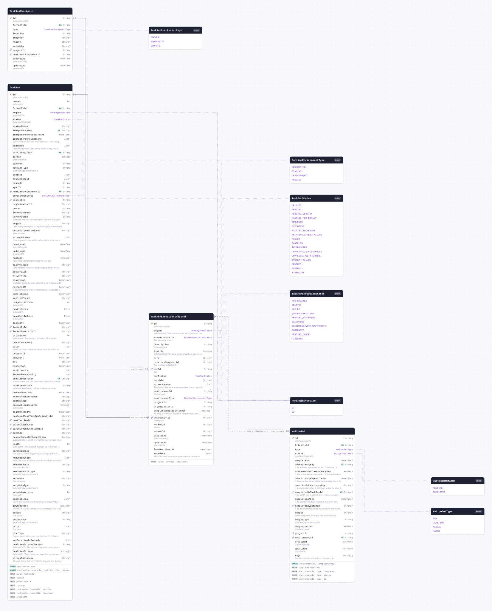

| Field                     | Type                                                     | Constraints                                             | Default      | Description                                                                                     |
| ------------------------- | -------------------------------------------------------- | ------------------------------------------------------- | ------------ | ----------------------------------------------------------------------------------------------- |
| `id`                      | `String`                                                 | PK NOT NULL                                             | `cuid(1)`    |                                                                                                 |
| `engine`                  | [`RunEngineVersion`](#enum-RunEngineVersion)             | NOT NULL                                                | `V2`         | This should always be 2+ (V1 didn't use the run engine or snapshots)                            |
| `executionStatus`         | [`TaskRunExecutionStatus`](#enum-TaskRunExecutionStatus) | NOT NULL                                                |              | The execution status                                                                            |
| `description`             | `String`                                                 | NOT NULL                                                |              | For debugging                                                                                   |
| `isValid`                 | `Boolean`                                                | NOT NULL                                                | `true`       | We store invalid snapshots as a record of the run state when we tried to move                   |
| `error`                   | `String`                                                 | NULL                                                    |              |                                                                                                 |
| `previousSnapshotId`      | `String`                                                 | NULL                                                    |              | The previous snapshot ID                                                                        |
| `runId`                   | `String`                                                 | NOT NULL → [TaskRun.id](#model-TaskRun)                 |              | Run                                                                                             |
| `runStatus`               | [`TaskRunStatus`](#enum-TaskRunStatus)                   | NOT NULL                                                |              |                                                                                                 |
| `batchId`                 | `String`                                                 | NULL                                                    |              |                                                                                                 |
| `attemptNumber`           | `Int`                                                    | NULL                                                    |              | This is the current run attempt number. Users can define how many attempts they want for a run. |
| `environmentId`           | `String`                                                 | NOT NULL                                                |              | Environment                                                                                     |
| `environmentType`         | [`RuntimeEnvironmentType`](#enum-RuntimeEnvironmentType) | NOT NULL                                                |              |                                                                                                 |
| `projectId`               | `String`                                                 | NOT NULL                                                |              |                                                                                                 |
| `organizationId`          | `String`                                                 | NOT NULL                                                |              |                                                                                                 |
| `completedWaitpointOrder` | `String[]`                                               | NOT NULL                                                |              | An array of waitpoint IDs in the correct order, used for batches                                |
| `checkpointId`            | `String`                                                 | NULL → [TaskRunCheckpoint.id](#model-TaskRunCheckpoint) |              | Checkpoint                                                                                      |
| `workerId`                | `String`                                                 | NULL                                                    |              | Worker                                                                                          |
| `runnerId`                | `String`                                                 | NULL                                                    |              |                                                                                                 |
| `createdAt`               | `DateTime`                                               | NOT NULL                                                | `now()`      |                                                                                                 |
| `updatedAt`               | `DateTime`                                               | NOT NULL                                                | `@updatedAt` |                                                                                                 |
| `lastHeartbeatAt`         | `DateTime`                                               | NULL                                                    |              |                                                                                                 |
| `metadata`                | `Json`                                                   | NULL                                                    |              | Metadata used by various systems in the run engine                                              |

#### Indexes

- `@@index([runId, isValid, createdAt])`

#### References

- `runId` → [TaskRun.id](#model-TaskRun) (many-to-one)
- `checkpointId` → [TaskRunCheckpoint.id](#model-TaskRunCheckpoint) (many-to-one)

#### Many to many

- `completedWaitpoints` ↔ [Waitpoint.completedExecutionSnapshots](#model-Waitpoint) through `_completedWaitpoints`

#### Definition

```sql
CREATE TABLE "TaskRunExecutionSnapshot" (
    "id" TEXT NOT NULL,
    "engine" "RunEngineVersion" NOT NULL DEFAULT 'V2',
    "executionStatus" "TaskRunExecutionStatus" NOT NULL,
    "description" TEXT NOT NULL,
    "isValid" BOOLEAN NOT NULL DEFAULT true,
    "error" TEXT,
    "previousSnapshotId" TEXT,
    "runId" TEXT NOT NULL,
    "runStatus" "TaskRunStatus" NOT NULL,
    "batchId" TEXT,
    "attemptNumber" INTEGER,
    "environmentId" TEXT NOT NULL,
    "environmentType" "RuntimeEnvironmentType" NOT NULL,
    "projectId" TEXT NOT NULL,
    "organizationId" TEXT NOT NULL,
    "completedWaitpointOrder" TEXT[],
    "checkpointId" TEXT,
    "workerId" TEXT,
    "runnerId" TEXT,
    "createdAt" TIMESTAMP(3) NOT NULL DEFAULT CURRENT_TIMESTAMP,
    "updatedAt" TIMESTAMP(3) NOT NULL,
    "lastHeartbeatAt" TIMESTAMP(3),
    "metadata" JSONB,

    CONSTRAINT "TaskRunExecutionSnapshot_pkey" PRIMARY KEY ("id")
);

CREATE INDEX "TaskRunExecutionSnapshot_runId_isValid_createdAt_idx" ON "TaskRunExecutionSnapshot"("runId", "isValid", "createdAt" DESC);

ALTER TABLE "TaskRunExecutionSnapshot" ADD CONSTRAINT "TaskRunExecutionSnapshot_runId_fkey" FOREIGN KEY ("runId") REFERENCES "TaskRun"("id") ON DELETE RESTRICT ON UPDATE CASCADE;

ALTER TABLE "TaskRunExecutionSnapshot" ADD CONSTRAINT "TaskRunExecutionSnapshot_checkpointId_fkey" FOREIGN KEY ("checkpointId") REFERENCES "TaskRunCheckpoint"("id") ON DELETE SET NULL ON UPDATE CASCADE;
```

<details>
<summary>Queries and their SQL</summary>

**findMany**: Every row

```ts
await prisma.taskRunExecutionSnapshot.findMany();
```

```sql
SELECT
  "public"."TaskRunExecutionSnapshot"."id",
  "public"."TaskRunExecutionSnapshot"."engine"::text,
  "public"."TaskRunExecutionSnapshot"."executionStatus"::text,
  "public"."TaskRunExecutionSnapshot"."description",
  "public"."TaskRunExecutionSnapshot"."isValid",
  "public"."TaskRunExecutionSnapshot"."error",
  "public"."TaskRunExecutionSnapshot"."previousSnapshotId",
  "public"."TaskRunExecutionSnapshot"."runId",
  "public"."TaskRunExecutionSnapshot"."runStatus"::text,
  "public"."TaskRunExecutionSnapshot"."batchId",
  "public"."TaskRunExecutionSnapshot"."attemptNumber",
  "public"."TaskRunExecutionSnapshot"."environmentId",
  "public"."TaskRunExecutionSnapshot"."environmentType"::text,
  "public"."TaskRunExecutionSnapshot"."projectId",
  "public"."TaskRunExecutionSnapshot"."organizationId",
  "public"."TaskRunExecutionSnapshot"."completedWaitpointOrder",
  "public"."TaskRunExecutionSnapshot"."checkpointId",
  "public"."TaskRunExecutionSnapshot"."workerId",
  "public"."TaskRunExecutionSnapshot"."runnerId",
  "public"."TaskRunExecutionSnapshot"."createdAt",
  "public"."TaskRunExecutionSnapshot"."updatedAt",
  "public"."TaskRunExecutionSnapshot"."lastHeartbeatAt",
  "public"."TaskRunExecutionSnapshot"."metadata"
FROM
  "public"."TaskRunExecutionSnapshot"
WHERE
  1 = 1
OFFSET
  $1
-- params: ["0"]
```

**count**: How many rows there are

```ts
await prisma.taskRunExecutionSnapshot.count();
```

```sql
SELECT
  COUNT(*) AS "_count$_all"
FROM
  (
    SELECT
      "public"."TaskRunExecutionSnapshot"."id"
    FROM
      "public"."TaskRunExecutionSnapshot"
    WHERE
      1 = 1
    OFFSET
      $1
  ) AS "sub"
-- params: ["0"]
```

**findMany**: Every row with its relations

```ts
await prisma.taskRunExecutionSnapshot.findMany({
  include: { run: true, completedWaitpoints: true, checkpoint: true },
});
```

```sql
SELECT
  "public"."TaskRunExecutionSnapshot"."id",
  "public"."TaskRunExecutionSnapshot"."engine"::text,
  "public"."TaskRunExecutionSnapshot"."executionStatus"::text,
  "public"."TaskRunExecutionSnapshot"."description",
  "public"."TaskRunExecutionSnapshot"."isValid",
  "public"."TaskRunExecutionSnapshot"."error",
  "public"."TaskRunExecutionSnapshot"."previousSnapshotId",
  "public"."TaskRunExecutionSnapshot"."runId",
  "public"."TaskRunExecutionSnapshot"."runStatus"::text,
  "public"."TaskRunExecutionSnapshot"."batchId",
  "public"."TaskRunExecutionSnapshot"."attemptNumber",
  "public"."TaskRunExecutionSnapshot"."environmentId",
  "public"."TaskRunExecutionSnapshot"."environmentType"::text,
  "public"."TaskRunExecutionSnapshot"."projectId",
  "public"."TaskRunExecutionSnapshot"."organizationId",
  "public"."TaskRunExecutionSnapshot"."completedWaitpointOrder",
  "public"."TaskRunExecutionSnapshot"."checkpointId",
  "public"."TaskRunExecutionSnapshot"."workerId",
  "public"."TaskRunExecutionSnapshot"."runnerId",
  "public"."TaskRunExecutionSnapshot"."createdAt",
  "public"."TaskRunExecutionSnapshot"."updatedAt",
  "public"."TaskRunExecutionSnapshot"."lastHeartbeatAt",
  "public"."TaskRunExecutionSnapshot"."metadata"
FROM
  "public"."TaskRunExecutionSnapshot"
WHERE
  1 = 1
OFFSET
  $1
-- params: ["0"]

SELECT
  "public"."TaskRun"."id",
  "public"."TaskRun"."number",
  "public"."TaskRun"."friendlyId",
  "public"."TaskRun"."engine"::text,
  "public"."TaskRun"."status"::text,
  "public"."TaskRun"."statusReason",
  "public"."TaskRun"."idempotencyKey",
  "public"."TaskRun"."idempotencyKeyExpiresAt",
  "public"."TaskRun"."idempotencyKeyOptions",
  "public"."TaskRun"."debounce",
  "public"."TaskRun"."taskIdentifier",
  "public"."TaskRun"."isTest",
  "public"."TaskRun"."payload",
  "public"."TaskRun"."payloadType",
  "public"."TaskRun"."context",
  "public"."TaskRun"."traceContext",
  "public"."TaskRun"."traceId",
  "public"."TaskRun"."spanId",
  "public"."TaskRun"."runtimeEnvironmentId",
  "public"."TaskRun"."environmentType"::text,
  "public"."TaskRun"."projectId",
  "public"."TaskRun"."organizationId",
  "public"."TaskRun"."queue",
  "public"."TaskRun"."lockedQueueId",
  "public"."TaskRun"."masterQueue",
  "public"."TaskRun"."region",
  "public"."TaskRun"."secondaryMasterQueue",
  "public"."TaskRun"."attemptNumber",
  "public"."TaskRun"."createdAt",
  "public"."TaskRun"."updatedAt",
  "public"."TaskRun"."runTags",
  "public"."TaskRun"."taskVersion",
  "public"."TaskRun"."sdkVersion",
  "public"."TaskRun"."cliVersion",
  "public"."TaskRun"."startedAt",
  "public"."TaskRun"."executedAt",
  "public"."TaskRun"."completedAt",
  "public"."TaskRun"."machinePreset",
  "public"."TaskRun"."usageDurationMs",
  "public"."TaskRun"."costInCents",
  "public"."TaskRun"."baseCostInCents",
  "public"."TaskRun"."lockedAt",
  "public"."TaskRun"."lockedById",
  "public"."TaskRun"."lockedToVersionId",
  "public"."TaskRun"."priorityMs",
  "public"."TaskRun"."concurrencyKey",
  "public"."TaskRun"."gates",
  "public"."TaskRun"."delayUntil",
  "public"."TaskRun"."queuedAt",
  "public"."TaskRun"."ttl",
  "public"."TaskRun"."expiredAt",
  "public"."TaskRun"."maxAttempts",
  "public"."TaskRun"."lockedRetryConfig",
  "public"."TaskRun"."oneTimeUseToken",
  "public"."TaskRun"."taskEventStore",
  "public"."TaskRun"."queueTimestamp",
  "public"."TaskRun"."scheduleInstanceId",
  "public"."TaskRun"."scheduleId",
  "public"."TaskRun"."bulkActionGroupIds",
  "public"."TaskRun"."logsDeletedAt",
  "public"."TaskRun"."replayedFromTaskRunFriendlyId",
  "public"."TaskRun"."rootTaskRunId",
  "public"."TaskRun"."parentTaskRunId",
  "public"."TaskRun"."parentTaskRunAttemptId",
  "public"."TaskRun"."batchId",
  "public"."TaskRun"."resumeParentOnCompletion",
  "public"."TaskRun"."depth",
  "public"."TaskRun"."parentSpanId",
  "public"."TaskRun"."runChainState",
  "public"."TaskRun"."seedMetadata",
  "public"."TaskRun"."seedMetadataType",
  "public"."TaskRun"."metadata",
  "public"."TaskRun"."metadataType",
  "public"."TaskRun"."metadataVersion",
  "public"."TaskRun"."annotations",
  "public"."TaskRun"."isWarmStart",
  "public"."TaskRun"."output",
  "public"."TaskRun"."outputType",
  "public"."TaskRun"."error",
  "public"."TaskRun"."planType",
  "public"."TaskRun"."maxDurationInSeconds",
  "public"."TaskRun"."realtimeStreamsVersion",
  "public"."TaskRun"."realtimeStreams",
  "public"."TaskRun"."streamBasinName"
FROM
  "public"."TaskRun"
WHERE
  "public"."TaskRun"."id" IN ($1)
OFFSET
  $2
-- params: ["<runId of the rows above>","0"]

SELECT
  "public"."Waitpoint"."id",
  "public"."Waitpoint"."friendlyId",
  "public"."Waitpoint"."type"::text,
  "public"."Waitpoint"."status"::text,
  "public"."Waitpoint"."completedAt",
  "public"."Waitpoint"."idempotencyKey",
  "public"."Waitpoint"."userProvidedIdempotencyKey",
  "public"."Waitpoint"."idempotencyKeyExpiresAt",
  "public"."Waitpoint"."inactiveIdempotencyKey",
  "public"."Waitpoint"."completedByTaskRunId",
  "public"."Waitpoint"."completedAfter",
  "public"."Waitpoint"."completedByBatchId",
  "public"."Waitpoint"."output",
  "public"."Waitpoint"."outputType",
  "public"."Waitpoint"."outputIsError",
  "public"."Waitpoint"."projectId",
  "public"."Waitpoint"."environmentId",
  "public"."Waitpoint"."createdAt",
  "public"."Waitpoint"."updatedAt",
  "public"."Waitpoint"."tags",
  "t0"."A" AS "completedWaitpoints@TaskRunExecutionSnapshot"
FROM
  "public"."Waitpoint"
  INNER JOIN "public"."_completedWaitpoints" AS "t0" ON "t0"."B" = "public"."Waitpoint"."id"
WHERE
  (
    1 = 1
    AND "t0"."A" IN ($1)
  )
OFFSET
  $2
-- params: ["<id of the rows above>","0"]

SELECT
  "public"."TaskRunCheckpoint"."id",
  "public"."TaskRunCheckpoint"."friendlyId",
  "public"."TaskRunCheckpoint"."type"::text,
  "public"."TaskRunCheckpoint"."location",
  "public"."TaskRunCheckpoint"."imageRef",
  "public"."TaskRunCheckpoint"."reason",
  "public"."TaskRunCheckpoint"."metadata",
  "public"."TaskRunCheckpoint"."projectId",
  "public"."TaskRunCheckpoint"."runtimeEnvironmentId",
  "public"."TaskRunCheckpoint"."createdAt",
  "public"."TaskRunCheckpoint"."updatedAt"
FROM
  "public"."TaskRunCheckpoint"
WHERE
  "public"."TaskRunCheckpoint"."id" IN ($1)
OFFSET
  $2
-- params: ["<checkpointId of the rows above>","0"]
```

**findUnique**: One row by what is unique to it

```ts
await prisma.taskRunExecutionSnapshot.findUnique({ where: { id: "example" } });
```

```sql
SELECT
  "public"."TaskRunExecutionSnapshot"."id",
  "public"."TaskRunExecutionSnapshot"."engine"::text,
  "public"."TaskRunExecutionSnapshot"."executionStatus"::text,
  "public"."TaskRunExecutionSnapshot"."description",
  "public"."TaskRunExecutionSnapshot"."isValid",
  "public"."TaskRunExecutionSnapshot"."error",
  "public"."TaskRunExecutionSnapshot"."previousSnapshotId",
  "public"."TaskRunExecutionSnapshot"."runId",
  "public"."TaskRunExecutionSnapshot"."runStatus"::text,
  "public"."TaskRunExecutionSnapshot"."batchId",
  "public"."TaskRunExecutionSnapshot"."attemptNumber",
  "public"."TaskRunExecutionSnapshot"."environmentId",
  "public"."TaskRunExecutionSnapshot"."environmentType"::text,
  "public"."TaskRunExecutionSnapshot"."projectId",
  "public"."TaskRunExecutionSnapshot"."organizationId",
  "public"."TaskRunExecutionSnapshot"."completedWaitpointOrder",
  "public"."TaskRunExecutionSnapshot"."checkpointId",
  "public"."TaskRunExecutionSnapshot"."workerId",
  "public"."TaskRunExecutionSnapshot"."runnerId",
  "public"."TaskRunExecutionSnapshot"."createdAt",
  "public"."TaskRunExecutionSnapshot"."updatedAt",
  "public"."TaskRunExecutionSnapshot"."lastHeartbeatAt",
  "public"."TaskRunExecutionSnapshot"."metadata"
FROM
  "public"."TaskRunExecutionSnapshot"
WHERE
  (
    "public"."TaskRunExecutionSnapshot"."id" = $1
    AND 1 = 1
  )
LIMIT
  $2
OFFSET
  $3
-- params: ["example","1","0"]
```

**create**: Create a row

```ts
await prisma.taskRunExecutionSnapshot.create({
  data: {
    executionStatus: "RUN_CREATED",
    description: "example",
    runId: "example",
    runStatus: "DELAYED",
    environmentId: "example",
    environmentType: "PRODUCTION",
    projectId: "example",
    organizationId: "example",
    completedWaitpointOrder: ["example"],
  },
});
```

```sql
INSERT INTO
  "public"."TaskRunExecutionSnapshot" (
    "id",
    "engine",
    "executionStatus",
    "description",
    "isValid",
    "runId",
    "runStatus",
    "environmentId",
    "environmentType",
    "projectId",
    "organizationId",
    "completedWaitpointOrder",
    "createdAt",
    "updatedAt"
  )
VALUES
  (
    $1,
    CAST($2::text AS "public"."RunEngineVersion"),
    CAST($3::text AS "public"."TaskRunExecutionStatus"),
    $4,
    $5,
    $6,
    CAST($7::text AS "public"."TaskRunStatus"),
    $8,
    CAST($9::text AS "public"."RuntimeEnvironmentType"),
    $10,
    $11,
    $12,
    $13,
    $14
  )
RETURNING
  "public"."TaskRunExecutionSnapshot"."id",
  "public"."TaskRunExecutionSnapshot"."engine"::text,
  "public"."TaskRunExecutionSnapshot"."executionStatus"::text,
  "public"."TaskRunExecutionSnapshot"."description",
  "public"."TaskRunExecutionSnapshot"."isValid",
  "public"."TaskRunExecutionSnapshot"."error",
  "public"."TaskRunExecutionSnapshot"."previousSnapshotId",
  "public"."TaskRunExecutionSnapshot"."runId",
  "public"."TaskRunExecutionSnapshot"."runStatus"::text,
  "public"."TaskRunExecutionSnapshot"."batchId",
  "public"."TaskRunExecutionSnapshot"."attemptNumber",
  "public"."TaskRunExecutionSnapshot"."environmentId",
  "public"."TaskRunExecutionSnapshot"."environmentType"::text,
  "public"."TaskRunExecutionSnapshot"."projectId",
  "public"."TaskRunExecutionSnapshot"."organizationId",
  "public"."TaskRunExecutionSnapshot"."completedWaitpointOrder",
  "public"."TaskRunExecutionSnapshot"."checkpointId",
  "public"."TaskRunExecutionSnapshot"."workerId",
  "public"."TaskRunExecutionSnapshot"."runnerId",
  "public"."TaskRunExecutionSnapshot"."createdAt",
  "public"."TaskRunExecutionSnapshot"."updatedAt",
  "public"."TaskRunExecutionSnapshot"."lastHeartbeatAt",
  "public"."TaskRunExecutionSnapshot"."metadata"
-- params: ["<cuid(1)>","V2","RUN_CREATED","example",true,"example","DELAYED","example","PRODUCTION","example","example",["example"],"<now()>","<now()>"]
```

**update**: Update a row

```ts
await prisma.taskRunExecutionSnapshot.update({ where: { id: "example" }, data: { engine: "V1" } });
```

```sql
UPDATE "public"."TaskRunExecutionSnapshot"
SET
  "engine" = CAST($1::text AS "public"."RunEngineVersion"),
  "updatedAt" = $2
WHERE
  (
    "public"."TaskRunExecutionSnapshot"."id" = $3
    AND 1 = 1
  )
RETURNING
  "public"."TaskRunExecutionSnapshot"."id",
  "public"."TaskRunExecutionSnapshot"."engine"::text,
  "public"."TaskRunExecutionSnapshot"."executionStatus"::text,
  "public"."TaskRunExecutionSnapshot"."description",
  "public"."TaskRunExecutionSnapshot"."isValid",
  "public"."TaskRunExecutionSnapshot"."error",
  "public"."TaskRunExecutionSnapshot"."previousSnapshotId",
  "public"."TaskRunExecutionSnapshot"."runId",
  "public"."TaskRunExecutionSnapshot"."runStatus"::text,
  "public"."TaskRunExecutionSnapshot"."batchId",
  "public"."TaskRunExecutionSnapshot"."attemptNumber",
  "public"."TaskRunExecutionSnapshot"."environmentId",
  "public"."TaskRunExecutionSnapshot"."environmentType"::text,
  "public"."TaskRunExecutionSnapshot"."projectId",
  "public"."TaskRunExecutionSnapshot"."organizationId",
  "public"."TaskRunExecutionSnapshot"."completedWaitpointOrder",
  "public"."TaskRunExecutionSnapshot"."checkpointId",
  "public"."TaskRunExecutionSnapshot"."workerId",
  "public"."TaskRunExecutionSnapshot"."runnerId",
  "public"."TaskRunExecutionSnapshot"."createdAt",
  "public"."TaskRunExecutionSnapshot"."updatedAt",
  "public"."TaskRunExecutionSnapshot"."lastHeartbeatAt",
  "public"."TaskRunExecutionSnapshot"."metadata"
-- params: ["V1",{"prisma__type":"generatorCall","prisma__value":{"name":"now","args":[],"returnType":{"type":"DateTime"}}},"example"]
```

**delete**: Delete a row

```ts
await prisma.taskRunExecutionSnapshot.delete({ where: { id: "example" } });
```

```sql
DELETE FROM "public"."TaskRunExecutionSnapshot"
WHERE
  (
    "public"."TaskRunExecutionSnapshot"."id" = $1
    AND 1 = 1
  )
RETURNING
  "public"."TaskRunExecutionSnapshot"."id",
  "public"."TaskRunExecutionSnapshot"."engine"::text,
  "public"."TaskRunExecutionSnapshot"."executionStatus"::text,
  "public"."TaskRunExecutionSnapshot"."description",
  "public"."TaskRunExecutionSnapshot"."isValid",
  "public"."TaskRunExecutionSnapshot"."error",
  "public"."TaskRunExecutionSnapshot"."previousSnapshotId",
  "public"."TaskRunExecutionSnapshot"."runId",
  "public"."TaskRunExecutionSnapshot"."runStatus"::text,
  "public"."TaskRunExecutionSnapshot"."batchId",
  "public"."TaskRunExecutionSnapshot"."attemptNumber",
  "public"."TaskRunExecutionSnapshot"."environmentId",
  "public"."TaskRunExecutionSnapshot"."environmentType"::text,
  "public"."TaskRunExecutionSnapshot"."projectId",
  "public"."TaskRunExecutionSnapshot"."organizationId",
  "public"."TaskRunExecutionSnapshot"."completedWaitpointOrder",
  "public"."TaskRunExecutionSnapshot"."checkpointId",
  "public"."TaskRunExecutionSnapshot"."workerId",
  "public"."TaskRunExecutionSnapshot"."runnerId",
  "public"."TaskRunExecutionSnapshot"."createdAt",
  "public"."TaskRunExecutionSnapshot"."updatedAt",
  "public"."TaskRunExecutionSnapshot"."lastHeartbeatAt",
  "public"."TaskRunExecutionSnapshot"."metadata"
-- params: ["example"]
```

</details>

<a id="model-TaskRunCheckpoint"></a>

### TaskRunCheckpoint

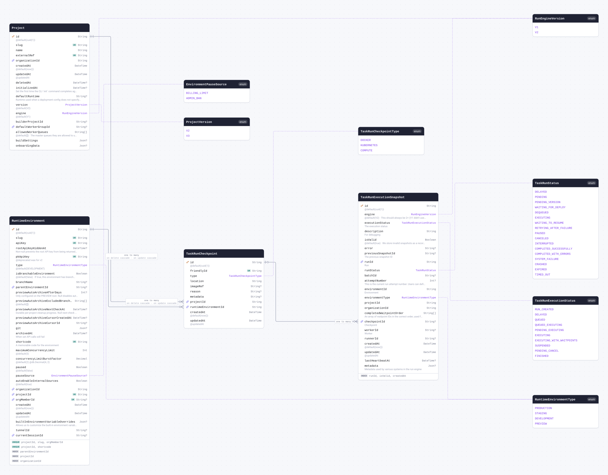

| Field                  | Type                                                   | Constraints                                                   | Default      | Description |
| ---------------------- | ------------------------------------------------------ | ------------------------------------------------------------- | ------------ | ----------- |
| `id`                   | `String`                                               | PK NOT NULL                                                   | `cuid(1)`    |             |
| `friendlyId`           | `String`                                               | UNIQUE NOT NULL                                               |              |             |
| `type`                 | [`TaskRunCheckpointType`](#enum-TaskRunCheckpointType) | NOT NULL                                                      |              |             |
| `location`             | `String`                                               | NOT NULL                                                      |              |             |
| `imageRef`             | `String`                                               | NULL                                                          |              |             |
| `reason`               | `String`                                               | NULL                                                          |              |             |
| `metadata`             | `String`                                               | NULL                                                          |              |             |
| `projectId`            | `String`                                               | NOT NULL → [Project.id](#model-Project)                       |              |             |
| `runtimeEnvironmentId` | `String`                                               | NOT NULL → [RuntimeEnvironment.id](#model-RuntimeEnvironment) |              |             |
| `createdAt`            | `DateTime`                                             | NOT NULL                                                      | `now()`      |             |
| `updatedAt`            | `DateTime`                                             | NOT NULL                                                      | `@updatedAt` |             |

#### References

- `projectId` → [Project.id](#model-Project) (many-to-one, on delete Cascade, on update Cascade)
- `runtimeEnvironmentId` → [RuntimeEnvironment.id](#model-RuntimeEnvironment) (many-to-one, on delete Cascade, on update Cascade)

#### Referenced by

- `id` ← [TaskRunExecutionSnapshot.checkpointId](#model-TaskRunExecutionSnapshot) (one-to-many)

#### Definition

```sql
CREATE TABLE "TaskRunCheckpoint" (
    "id" TEXT NOT NULL,
    "friendlyId" TEXT NOT NULL,
    "type" "TaskRunCheckpointType" NOT NULL,
    "location" TEXT NOT NULL,
    "imageRef" TEXT,
    "reason" TEXT,
    "metadata" TEXT,
    "projectId" TEXT NOT NULL,
    "runtimeEnvironmentId" TEXT NOT NULL,
    "createdAt" TIMESTAMP(3) NOT NULL DEFAULT CURRENT_TIMESTAMP,
    "updatedAt" TIMESTAMP(3) NOT NULL,

    CONSTRAINT "TaskRunCheckpoint_pkey" PRIMARY KEY ("id")
);

CREATE UNIQUE INDEX "TaskRunCheckpoint_friendlyId_key" ON "TaskRunCheckpoint"("friendlyId");

ALTER TABLE "TaskRunCheckpoint" ADD CONSTRAINT "TaskRunCheckpoint_projectId_fkey" FOREIGN KEY ("projectId") REFERENCES "Project"("id") ON DELETE CASCADE ON UPDATE CASCADE;

ALTER TABLE "TaskRunCheckpoint" ADD CONSTRAINT "TaskRunCheckpoint_runtimeEnvironmentId_fkey" FOREIGN KEY ("runtimeEnvironmentId") REFERENCES "RuntimeEnvironment"("id") ON DELETE CASCADE ON UPDATE CASCADE;
```

<details>
<summary>Queries and their SQL</summary>

**findMany**: Every row

```ts
await prisma.taskRunCheckpoint.findMany();
```

```sql
SELECT
  "public"."TaskRunCheckpoint"."id",
  "public"."TaskRunCheckpoint"."friendlyId",
  "public"."TaskRunCheckpoint"."type"::text,
  "public"."TaskRunCheckpoint"."location",
  "public"."TaskRunCheckpoint"."imageRef",
  "public"."TaskRunCheckpoint"."reason",
  "public"."TaskRunCheckpoint"."metadata",
  "public"."TaskRunCheckpoint"."projectId",
  "public"."TaskRunCheckpoint"."runtimeEnvironmentId",
  "public"."TaskRunCheckpoint"."createdAt",
  "public"."TaskRunCheckpoint"."updatedAt"
FROM
  "public"."TaskRunCheckpoint"
WHERE
  1 = 1
OFFSET
  $1
-- params: ["0"]
```

**count**: How many rows there are

```ts
await prisma.taskRunCheckpoint.count();
```

```sql
SELECT
  COUNT(*) AS "_count$_all"
FROM
  (
    SELECT
      "public"."TaskRunCheckpoint"."id"
    FROM
      "public"."TaskRunCheckpoint"
    WHERE
      1 = 1
    OFFSET
      $1
  ) AS "sub"
-- params: ["0"]
```

**findMany**: Every row with its relations

```ts
await prisma.taskRunCheckpoint.findMany({
  include: { project: true, runtimeEnvironment: true, executionSnapshot: true },
});
```

```sql
SELECT
  "public"."TaskRunCheckpoint"."id",
  "public"."TaskRunCheckpoint"."friendlyId",
  "public"."TaskRunCheckpoint"."type"::text,
  "public"."TaskRunCheckpoint"."location",
  "public"."TaskRunCheckpoint"."imageRef",
  "public"."TaskRunCheckpoint"."reason",
  "public"."TaskRunCheckpoint"."metadata",
  "public"."TaskRunCheckpoint"."projectId",
  "public"."TaskRunCheckpoint"."runtimeEnvironmentId",
  "public"."TaskRunCheckpoint"."createdAt",
  "public"."TaskRunCheckpoint"."updatedAt"
FROM
  "public"."TaskRunCheckpoint"
WHERE
  1 = 1
OFFSET
  $1
-- params: ["0"]

SELECT
  "public"."Project"."id",
  "public"."Project"."slug",
  "public"."Project"."name",
  "public"."Project"."externalRef",
  "public"."Project"."organizationId",
  "public"."Project"."createdAt",
  "public"."Project"."updatedAt",
  "public"."Project"."deletedAt",
  "public"."Project"."initializedAt",
  "public"."Project"."defaultRuntime",
  "public"."Project"."version"::text,
  "public"."Project"."engine"::text,
  "public"."Project"."builderProjectId",
  "public"."Project"."defaultWorkerGroupId",
  "public"."Project"."allowedMasterQueues",
  "public"."Project"."buildSettings",
  "public"."Project"."onboardingData"
FROM
  "public"."Project"
WHERE
  "public"."Project"."id" IN ($1)
OFFSET
  $2
-- params: ["<projectId of the rows above>","0"]

SELECT
  "public"."RuntimeEnvironment"."id",
  "public"."RuntimeEnvironment"."slug",
  "public"."RuntimeEnvironment"."apiKey",
  "public"."RuntimeEnvironment"."rootApiKeyHiddenAt",
  "public"."RuntimeEnvironment"."pkApiKey",
  "public"."RuntimeEnvironment"."type"::text,
  "public"."RuntimeEnvironment"."isBranchableEnvironment",
  "public"."RuntimeEnvironment"."branchName",
  "public"."RuntimeEnvironment"."parentEnvironmentId",
  "public"."RuntimeEnvironment"."previewAutoArchiveAfterDays",
  "public"."RuntimeEnvironment"."previewAutoArchiveExcludedBranches",
  "public"."RuntimeEnvironment"."previewAutoArchiveNextCheckAt",
  "public"."RuntimeEnvironment"."previewAutoArchiveCursorCreatedAt",
  "public"."RuntimeEnvironment"."previewAutoArchiveCursorId",
  "public"."RuntimeEnvironment"."git",
  "public"."RuntimeEnvironment"."archivedAt",
  "public"."RuntimeEnvironment"."shortcode",
  "public"."RuntimeEnvironment"."maximumConcurrencyLimit",
  "public"."RuntimeEnvironment"."concurrencyLimitBurstFactor",
  "public"."RuntimeEnvironment"."paused",
  "public"."RuntimeEnvironment"."pauseSource"::text,
  "public"."RuntimeEnvironment"."autoEnableInternalSources",
  "public"."RuntimeEnvironment"."organizationId",
  "public"."RuntimeEnvironment"."projectId",
  "public"."RuntimeEnvironment"."orgMemberId",
  "public"."RuntimeEnvironment"."createdAt",
  "public"."RuntimeEnvironment"."updatedAt",
  "public"."RuntimeEnvironment"."builtInEnvironmentVariableOverrides",
  "public"."RuntimeEnvironment"."tunnelId",
  "public"."RuntimeEnvironment"."currentSessionId"
FROM
  "public"."RuntimeEnvironment"
WHERE
  "public"."RuntimeEnvironment"."id" IN ($1)
OFFSET
  $2
-- params: ["<runtimeEnvironmentId of the rows above>","0"]

SELECT
  "public"."TaskRunExecutionSnapshot"."id",
  "public"."TaskRunExecutionSnapshot"."engine"::text,
  "public"."TaskRunExecutionSnapshot"."executionStatus"::text,
  "public"."TaskRunExecutionSnapshot"."description",
  "public"."TaskRunExecutionSnapshot"."isValid",
  "public"."TaskRunExecutionSnapshot"."error",
  "public"."TaskRunExecutionSnapshot"."previousSnapshotId",
  "public"."TaskRunExecutionSnapshot"."runId",
  "public"."TaskRunExecutionSnapshot"."runStatus"::text,
  "public"."TaskRunExecutionSnapshot"."batchId",
  "public"."TaskRunExecutionSnapshot"."attemptNumber",
  "public"."TaskRunExecutionSnapshot"."environmentId",
  "public"."TaskRunExecutionSnapshot"."environmentType"::text,
  "public"."TaskRunExecutionSnapshot"."projectId",
  "public"."TaskRunExecutionSnapshot"."organizationId",
  "public"."TaskRunExecutionSnapshot"."completedWaitpointOrder",
  "public"."TaskRunExecutionSnapshot"."checkpointId",
  "public"."TaskRunExecutionSnapshot"."workerId",
  "public"."TaskRunExecutionSnapshot"."runnerId",
  "public"."TaskRunExecutionSnapshot"."createdAt",
  "public"."TaskRunExecutionSnapshot"."updatedAt",
  "public"."TaskRunExecutionSnapshot"."lastHeartbeatAt",
  "public"."TaskRunExecutionSnapshot"."metadata"
FROM
  "public"."TaskRunExecutionSnapshot"
WHERE
  "public"."TaskRunExecutionSnapshot"."checkpointId" IN ($1)
OFFSET
  $2
-- params: ["<id of the rows above>","0"]
```

**findUnique**: One row by what is unique to it

```ts
await prisma.taskRunCheckpoint.findUnique({ where: { id: "example" } });
```

```sql
SELECT
  "public"."TaskRunCheckpoint"."id",
  "public"."TaskRunCheckpoint"."friendlyId",
  "public"."TaskRunCheckpoint"."type"::text,
  "public"."TaskRunCheckpoint"."location",
  "public"."TaskRunCheckpoint"."imageRef",
  "public"."TaskRunCheckpoint"."reason",
  "public"."TaskRunCheckpoint"."metadata",
  "public"."TaskRunCheckpoint"."projectId",
  "public"."TaskRunCheckpoint"."runtimeEnvironmentId",
  "public"."TaskRunCheckpoint"."createdAt",
  "public"."TaskRunCheckpoint"."updatedAt"
FROM
  "public"."TaskRunCheckpoint"
WHERE
  (
    "public"."TaskRunCheckpoint"."id" = $1
    AND 1 = 1
  )
LIMIT
  $2
OFFSET
  $3
-- params: ["example","1","0"]
```

**create**: Create a row

```ts
await prisma.taskRunCheckpoint.create({
  data: {
    friendlyId: "example",
    type: "DOCKER",
    location: "example",
    projectId: "example",
    runtimeEnvironmentId: "example",
  },
});
```

```sql
INSERT INTO
  "public"."TaskRunCheckpoint" (
    "id",
    "friendlyId",
    "type",
    "location",
    "projectId",
    "runtimeEnvironmentId",
    "createdAt",
    "updatedAt"
  )
VALUES
  (
    $1,
    $2,
    CAST($3::text AS "public"."TaskRunCheckpointType"),
    $4,
    $5,
    $6,
    $7,
    $8
  )
RETURNING
  "public"."TaskRunCheckpoint"."id",
  "public"."TaskRunCheckpoint"."friendlyId",
  "public"."TaskRunCheckpoint"."type"::text,
  "public"."TaskRunCheckpoint"."location",
  "public"."TaskRunCheckpoint"."imageRef",
  "public"."TaskRunCheckpoint"."reason",
  "public"."TaskRunCheckpoint"."metadata",
  "public"."TaskRunCheckpoint"."projectId",
  "public"."TaskRunCheckpoint"."runtimeEnvironmentId",
  "public"."TaskRunCheckpoint"."createdAt",
  "public"."TaskRunCheckpoint"."updatedAt"
-- params: ["<cuid(1)>","example","DOCKER","example","example","example","<now()>","<now()>"]
```

**update**: Update a row

```ts
await prisma.taskRunCheckpoint.update({
  where: { id: "example" },
  data: { friendlyId: "example" },
});
```

```sql
UPDATE "public"."TaskRunCheckpoint"
SET
  "friendlyId" = $1,
  "updatedAt" = $2
WHERE
  (
    "public"."TaskRunCheckpoint"."id" = $3
    AND 1 = 1
  )
RETURNING
  "public"."TaskRunCheckpoint"."id",
  "public"."TaskRunCheckpoint"."friendlyId",
  "public"."TaskRunCheckpoint"."type"::text,
  "public"."TaskRunCheckpoint"."location",
  "public"."TaskRunCheckpoint"."imageRef",
  "public"."TaskRunCheckpoint"."reason",
  "public"."TaskRunCheckpoint"."metadata",
  "public"."TaskRunCheckpoint"."projectId",
  "public"."TaskRunCheckpoint"."runtimeEnvironmentId",
  "public"."TaskRunCheckpoint"."createdAt",
  "public"."TaskRunCheckpoint"."updatedAt"
-- params: ["example",{"prisma__type":"generatorCall","prisma__value":{"name":"now","args":[],"returnType":{"type":"DateTime"}}},"example"]
```

**delete**: Delete a row

```ts
await prisma.taskRunCheckpoint.delete({ where: { id: "example" } });
```

```sql
DELETE FROM "public"."TaskRunCheckpoint"
WHERE
  (
    "public"."TaskRunCheckpoint"."id" = $1
    AND 1 = 1
  )
RETURNING
  "public"."TaskRunCheckpoint"."id",
  "public"."TaskRunCheckpoint"."friendlyId",
  "public"."TaskRunCheckpoint"."type"::text,
  "public"."TaskRunCheckpoint"."location",
  "public"."TaskRunCheckpoint"."imageRef",
  "public"."TaskRunCheckpoint"."reason",
  "public"."TaskRunCheckpoint"."metadata",
  "public"."TaskRunCheckpoint"."projectId",
  "public"."TaskRunCheckpoint"."runtimeEnvironmentId",
  "public"."TaskRunCheckpoint"."createdAt",
  "public"."TaskRunCheckpoint"."updatedAt"
-- params: ["example"]
```

</details>

<a id="model-Waitpoint"></a>

### Waitpoint

A Waitpoint blocks a run from continuing until it's completed
If there's a waitpoint blocking a run, it shouldn't be in the queue

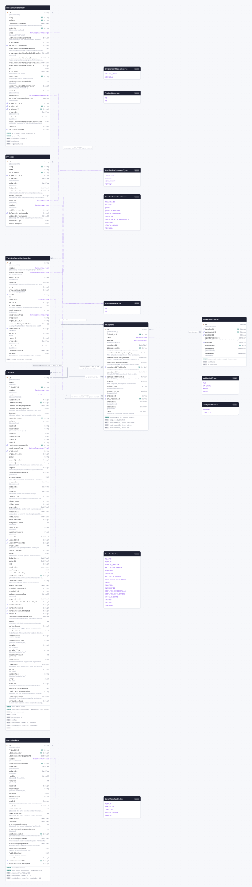

| Field                        | Type                                       | Constraints                                                   | Default              | Description                                                                                                                                                                                                                                                      |
| ---------------------------- | ------------------------------------------ | ------------------------------------------------------------- | -------------------- | ---------------------------------------------------------------------------------------------------------------------------------------------------------------------------------------------------------------------------------------------------------------- |
| `id`                         | `String`                                   | PK NOT NULL                                                   | `cuid(1)`            |                                                                                                                                                                                                                                                                  |
| `friendlyId`                 | `String`                                   | UNIQUE NOT NULL                                               |                      |                                                                                                                                                                                                                                                                  |
| `type`                       | [`WaitpointType`](#enum-WaitpointType)     | NOT NULL                                                      |                      |                                                                                                                                                                                                                                                                  |
| `status`                     | [`WaitpointStatus`](#enum-WaitpointStatus) | NOT NULL                                                      | `PENDING`            |                                                                                                                                                                                                                                                                  |
| `completedAt`                | `DateTime`                                 | NULL                                                          |                      |                                                                                                                                                                                                                                                                  |
| `idempotencyKey`             | `String`                                   | NOT NULL                                                      |                      | If it's an Event type waitpoint, this is the event. It can also be provided for the DATETIME type                                                                                                                                                                |
| `userProvidedIdempotencyKey` | `Boolean`                                  | NOT NULL                                                      |                      | If this is true then we can show it in the dashboard/return it from the SDK                                                                                                                                                                                      |
| `idempotencyKeyExpiresAt`    | `DateTime`                                 | NULL                                                          |                      | If there's a user provided idempotency key, this is the time it expires at                                                                                                                                                                                       |
| `inactiveIdempotencyKey`     | `String`                                   | NULL                                                          |                      | If an idempotencyKey is no longer active, we store it here and generate a new one for the idempotencyKey field. Clearing an idempotencyKey is useful for debounce or cancelling child runs. This is a workaround because Prisma doesn't support partial indexes. |
| `completedByTaskRunId`       | `String`                                   | UNIQUE NULL → [TaskRun.id](#model-TaskRun)                    |                      | If it's a RUN type waitpoint, this is the associated run                                                                                                                                                                                                         |
| `completedAfter`             | `DateTime`                                 | NULL                                                          |                      | If it's a DATETIME type waitpoint, this is the date. If it's a MANUAL waitpoint, this can be set as the `timeout`.                                                                                                                                               |
| `completedByBatchId`         | `String`                                   | NULL → [BatchTaskRun.id](#model-BatchTaskRun)                 |                      | If it's a BATCH type waitpoint, this is the associated batch                                                                                                                                                                                                     |
| `output`                     | `String`                                   | NULL                                                          |                      | When completed, an output can be stored here                                                                                                                                                                                                                     |
| `outputType`                 | `String`                                   | NOT NULL                                                      | `"application/json"` |                                                                                                                                                                                                                                                                  |
| `outputIsError`              | `Boolean`                                  | NOT NULL                                                      | `false`              |                                                                                                                                                                                                                                                                  |
| `projectId`                  | `String`                                   | NOT NULL → [Project.id](#model-Project)                       |                      |                                                                                                                                                                                                                                                                  |
| `environmentId`              | `String`                                   | NOT NULL → [RuntimeEnvironment.id](#model-RuntimeEnvironment) |                      |                                                                                                                                                                                                                                                                  |
| `createdAt`                  | `DateTime`                                 | NOT NULL                                                      | `now()`              |                                                                                                                                                                                                                                                                  |
| `updatedAt`                  | `DateTime`                                 | NOT NULL                                                      | `@updatedAt`         |                                                                                                                                                                                                                                                                  |
| `tags`                       | `String[]`                                 | NOT NULL                                                      |                      | Denormized column that holds the raw tags Denormalized column that holds the raw tags                                                                                                                                                                            |

#### Indexes

- `@@index([completedByBatchId])`
- `@@index([environmentId, type, createdAt])`
- `@@index([environmentId, type, status])`
- `@@index([environmentId, type, id])`
- `@@unique([environmentId, idempotencyKey])`

#### References

- `completedByTaskRunId` → [TaskRun.id](#model-TaskRun) (one-to-one, on delete SetNull)
- `completedByBatchId` → [BatchTaskRun.id](#model-BatchTaskRun) (many-to-one, on delete SetNull)
- `projectId` → [Project.id](#model-Project) (many-to-one, on delete Cascade, on update Cascade)
- `environmentId` → [RuntimeEnvironment.id](#model-RuntimeEnvironment) (many-to-one, on delete Cascade, on update Cascade)

#### Referenced by

- `id` ← [TaskRunWaitpoint.waitpointId](#model-TaskRunWaitpoint) (one-to-many)

#### Many to many

- `connectedRuns` ↔ [TaskRun.connectedWaitpoints](#model-TaskRun) through `_WaitpointRunConnections`
- `completedExecutionSnapshots` ↔ [TaskRunExecutionSnapshot.completedWaitpoints](#model-TaskRunExecutionSnapshot) through `_completedWaitpoints`

#### Definition

```sql
CREATE TABLE "Waitpoint" (
    "id" TEXT NOT NULL,
    "friendlyId" TEXT NOT NULL,
    "type" "WaitpointType" NOT NULL,
    "status" "WaitpointStatus" NOT NULL DEFAULT 'PENDING',
    "completedAt" TIMESTAMP(3),
    "idempotencyKey" TEXT NOT NULL,
    "userProvidedIdempotencyKey" BOOLEAN NOT NULL,
    "idempotencyKeyExpiresAt" TIMESTAMP(3),
    "inactiveIdempotencyKey" TEXT,
    "completedByTaskRunId" TEXT,
    "completedAfter" TIMESTAMP(3),
    "completedByBatchId" TEXT,
    "output" TEXT,
    "outputType" TEXT NOT NULL DEFAULT 'application/json',
    "outputIsError" BOOLEAN NOT NULL DEFAULT false,
    "projectId" TEXT NOT NULL,
    "environmentId" TEXT NOT NULL,
    "createdAt" TIMESTAMP(3) NOT NULL DEFAULT CURRENT_TIMESTAMP,
    "updatedAt" TIMESTAMP(3) NOT NULL,
    "tags" TEXT[],

    CONSTRAINT "Waitpoint_pkey" PRIMARY KEY ("id")
);

CREATE UNIQUE INDEX "Waitpoint_friendlyId_key" ON "Waitpoint"("friendlyId");

CREATE UNIQUE INDEX "Waitpoint_completedByTaskRunId_key" ON "Waitpoint"("completedByTaskRunId");

CREATE INDEX "Waitpoint_completedByBatchId_idx" ON "Waitpoint"("completedByBatchId");

CREATE INDEX "Waitpoint_environmentId_type_createdAt_idx" ON "Waitpoint"("environmentId", "type", "createdAt" DESC);

CREATE INDEX "Waitpoint_environmentId_type_status_idx" ON "Waitpoint"("environmentId", "type", "status");

CREATE INDEX "Waitpoint_environmentId_type_id_idx" ON "Waitpoint"("environmentId", "type", "id" DESC);

CREATE UNIQUE INDEX "Waitpoint_environmentId_idempotencyKey_key" ON "Waitpoint"("environmentId", "idempotencyKey");

ALTER TABLE "Waitpoint" ADD CONSTRAINT "Waitpoint_completedByTaskRunId_fkey" FOREIGN KEY ("completedByTaskRunId") REFERENCES "TaskRun"("id") ON DELETE SET NULL ON UPDATE CASCADE;

ALTER TABLE "Waitpoint" ADD CONSTRAINT "Waitpoint_completedByBatchId_fkey" FOREIGN KEY ("completedByBatchId") REFERENCES "BatchTaskRun"("id") ON DELETE SET NULL ON UPDATE CASCADE;

ALTER TABLE "Waitpoint" ADD CONSTRAINT "Waitpoint_projectId_fkey" FOREIGN KEY ("projectId") REFERENCES "Project"("id") ON DELETE CASCADE ON UPDATE CASCADE;

ALTER TABLE "Waitpoint" ADD CONSTRAINT "Waitpoint_environmentId_fkey" FOREIGN KEY ("environmentId") REFERENCES "RuntimeEnvironment"("id") ON DELETE CASCADE ON UPDATE CASCADE;
```

<details>
<summary>Queries and their SQL</summary>

**findMany**: Every row

```ts
await prisma.waitpoint.findMany();
```

```sql
SELECT
  "public"."Waitpoint"."id",
  "public"."Waitpoint"."friendlyId",
  "public"."Waitpoint"."type"::text,
  "public"."Waitpoint"."status"::text,
  "public"."Waitpoint"."completedAt",
  "public"."Waitpoint"."idempotencyKey",
  "public"."Waitpoint"."userProvidedIdempotencyKey",
  "public"."Waitpoint"."idempotencyKeyExpiresAt",
  "public"."Waitpoint"."inactiveIdempotencyKey",
  "public"."Waitpoint"."completedByTaskRunId",
  "public"."Waitpoint"."completedAfter",
  "public"."Waitpoint"."completedByBatchId",
  "public"."Waitpoint"."output",
  "public"."Waitpoint"."outputType",
  "public"."Waitpoint"."outputIsError",
  "public"."Waitpoint"."projectId",
  "public"."Waitpoint"."environmentId",
  "public"."Waitpoint"."createdAt",
  "public"."Waitpoint"."updatedAt",
  "public"."Waitpoint"."tags"
FROM
  "public"."Waitpoint"
WHERE
  1 = 1
OFFSET
  $1
-- params: ["0"]
```

**count**: How many rows there are

```ts
await prisma.waitpoint.count();
```

```sql
SELECT
  COUNT(*) AS "_count$_all"
FROM
  (
    SELECT
      "public"."Waitpoint"."id"
    FROM
      "public"."Waitpoint"
    WHERE
      1 = 1
    OFFSET
      $1
  ) AS "sub"
-- params: ["0"]
```

**findMany**: Every row with its relations

```ts
await prisma.waitpoint.findMany({
  include: {
    completedByTaskRun: true,
    completedByBatch: true,
    blockingTaskRuns: true,
    connectedRuns: true,
    completedExecutionSnapshots: true,
    project: true,
    environment: true,
  },
});
```

```sql
SELECT
  "public"."Waitpoint"."id",
  "public"."Waitpoint"."friendlyId",
  "public"."Waitpoint"."type"::text,
  "public"."Waitpoint"."status"::text,
  "public"."Waitpoint"."completedAt",
  "public"."Waitpoint"."idempotencyKey",
  "public"."Waitpoint"."userProvidedIdempotencyKey",
  "public"."Waitpoint"."idempotencyKeyExpiresAt",
  "public"."Waitpoint"."inactiveIdempotencyKey",
  "public"."Waitpoint"."completedByTaskRunId",
  "public"."Waitpoint"."completedAfter",
  "public"."Waitpoint"."completedByBatchId",
  "public"."Waitpoint"."output",
  "public"."Waitpoint"."outputType",
  "public"."Waitpoint"."outputIsError",
  "public"."Waitpoint"."projectId",
  "public"."Waitpoint"."environmentId",
  "public"."Waitpoint"."createdAt",
  "public"."Waitpoint"."updatedAt",
  "public"."Waitpoint"."tags"
FROM
  "public"."Waitpoint"
WHERE
  1 = 1
OFFSET
  $1
-- params: ["0"]

SELECT
  "public"."TaskRun"."id",
  "public"."TaskRun"."number",
  "public"."TaskRun"."friendlyId",
  "public"."TaskRun"."engine"::text,
  "public"."TaskRun"."status"::text,
  "public"."TaskRun"."statusReason",
  "public"."TaskRun"."idempotencyKey",
  "public"."TaskRun"."idempotencyKeyExpiresAt",
  "public"."TaskRun"."idempotencyKeyOptions",
  "public"."TaskRun"."debounce",
  "public"."TaskRun"."taskIdentifier",
  "public"."TaskRun"."isTest",
  "public"."TaskRun"."payload",
  "public"."TaskRun"."payloadType",
  "public"."TaskRun"."context",
  "public"."TaskRun"."traceContext",
  "public"."TaskRun"."traceId",
  "public"."TaskRun"."spanId",
  "public"."TaskRun"."runtimeEnvironmentId",
  "public"."TaskRun"."environmentType"::text,
  "public"."TaskRun"."projectId",
  "public"."TaskRun"."organizationId",
  "public"."TaskRun"."queue",
  "public"."TaskRun"."lockedQueueId",
  "public"."TaskRun"."masterQueue",
  "public"."TaskRun"."region",
  "public"."TaskRun"."secondaryMasterQueue",
  "public"."TaskRun"."attemptNumber",
  "public"."TaskRun"."createdAt",
  "public"."TaskRun"."updatedAt",
  "public"."TaskRun"."runTags",
  "public"."TaskRun"."taskVersion",
  "public"."TaskRun"."sdkVersion",
  "public"."TaskRun"."cliVersion",
  "public"."TaskRun"."startedAt",
  "public"."TaskRun"."executedAt",
  "public"."TaskRun"."completedAt",
  "public"."TaskRun"."machinePreset",
  "public"."TaskRun"."usageDurationMs",
  "public"."TaskRun"."costInCents",
  "public"."TaskRun"."baseCostInCents",
  "public"."TaskRun"."lockedAt",
  "public"."TaskRun"."lockedById",
  "public"."TaskRun"."lockedToVersionId",
  "public"."TaskRun"."priorityMs",
  "public"."TaskRun"."concurrencyKey",
  "public"."TaskRun"."gates",
  "public"."TaskRun"."delayUntil",
  "public"."TaskRun"."queuedAt",
  "public"."TaskRun"."ttl",
  "public"."TaskRun"."expiredAt",
  "public"."TaskRun"."maxAttempts",
  "public"."TaskRun"."lockedRetryConfig",
  "public"."TaskRun"."oneTimeUseToken",
  "public"."TaskRun"."taskEventStore",
  "public"."TaskRun"."queueTimestamp",
  "public"."TaskRun"."scheduleInstanceId",
  "public"."TaskRun"."scheduleId",
  "public"."TaskRun"."bulkActionGroupIds",
  "public"."TaskRun"."logsDeletedAt",
  "public"."TaskRun"."replayedFromTaskRunFriendlyId",
  "public"."TaskRun"."rootTaskRunId",
  "public"."TaskRun"."parentTaskRunId",
  "public"."TaskRun"."parentTaskRunAttemptId",
  "public"."TaskRun"."batchId",
  "public"."TaskRun"."resumeParentOnCompletion",
  "public"."TaskRun"."depth",
  "public"."TaskRun"."parentSpanId",
  "public"."TaskRun"."runChainState",
  "public"."TaskRun"."seedMetadata",
  "public"."TaskRun"."seedMetadataType",
  "public"."TaskRun"."metadata",
  "public"."TaskRun"."metadataType",
  "public"."TaskRun"."metadataVersion",
  "public"."TaskRun"."annotations",
  "public"."TaskRun"."isWarmStart",
  "public"."TaskRun"."output",
  "public"."TaskRun"."outputType",
  "public"."TaskRun"."error",
  "public"."TaskRun"."planType",
  "public"."TaskRun"."maxDurationInSeconds",
  "public"."TaskRun"."realtimeStreamsVersion",
  "public"."TaskRun"."realtimeStreams",
  "public"."TaskRun"."streamBasinName"
FROM
  "public"."TaskRun"
WHERE
  "public"."TaskRun"."id" IN ($1)
OFFSET
  $2
-- params: ["<completedByTaskRunId of the rows above>","0"]

SELECT
  "public"."BatchTaskRun"."id",
  "public"."BatchTaskRun"."friendlyId",
  "public"."BatchTaskRun"."idempotencyKey",
  "public"."BatchTaskRun"."idempotencyKeyExpiresAt",
  "public"."BatchTaskRun"."status"::text,
  "public"."BatchTaskRun"."runtimeEnvironmentId",
  "public"."BatchTaskRun"."createdAt",
  "public"."BatchTaskRun"."updatedAt",
  "public"."BatchTaskRun"."runIds",
  "public"."BatchTaskRun"."runCount",
  "public"."BatchTaskRun"."payload",
  "public"."BatchTaskRun"."payloadType",
  "public"."BatchTaskRun"."options",
  "public"."BatchTaskRun"."batchVersion",
  "public"."BatchTaskRun"."sealed",
  "public"."BatchTaskRun"."sealedAt",
  "public"."BatchTaskRun"."expectedCount",
  "public"."BatchTaskRun"."completedCount",
  "public"."BatchTaskRun"."completedAt",
  "public"."BatchTaskRun"."resumedAt",
  "public"."BatchTaskRun"."processingJobsCount",
  "public"."BatchTaskRun"."processingJobsExpectedCount",
  "public"."BatchTaskRun"."oneTimeUseToken",
  "public"."BatchTaskRun"."processingStartedAt",
  "public"."BatchTaskRun"."processingCompletedAt",
  "public"."BatchTaskRun"."successfulRunCount",
  "public"."BatchTaskRun"."failedRunCount",
  "public"."BatchTaskRun"."taskIdentifier",
  "public"."BatchTaskRun"."checkpointEventId",
  "public"."BatchTaskRun"."dependentTaskAttemptId"
FROM
  "public"."BatchTaskRun"
WHERE
  "public"."BatchTaskRun"."id" IN ($1)
OFFSET
  $2
-- params: ["<completedByBatchId of the rows above>","0"]

SELECT
  "public"."TaskRunWaitpoint"."id",
  "public"."TaskRunWaitpoint"."taskRunId",
  "public"."TaskRunWaitpoint"."waitpointId",
  "public"."TaskRunWaitpoint"."projectId",
  "public"."TaskRunWaitpoint"."spanIdToComplete",
  "public"."TaskRunWaitpoint"."batchId",
  "public"."TaskRunWaitpoint"."batchIndex",
  "public"."TaskRunWaitpoint"."createdAt",
  "public"."TaskRunWaitpoint"."updatedAt"
FROM
  "public"."TaskRunWaitpoint"
WHERE
  "public"."TaskRunWaitpoint"."waitpointId" IN ($1)
OFFSET
  $2
-- params: ["<id of the rows above>","0"]

SELECT
  "public"."TaskRun"."id",
  "public"."TaskRun"."number",
  "public"."TaskRun"."friendlyId",
  "public"."TaskRun"."engine"::text,
  "public"."TaskRun"."status"::text,
  "public"."TaskRun"."statusReason",
  "public"."TaskRun"."idempotencyKey",
  "public"."TaskRun"."idempotencyKeyExpiresAt",
  "public"."TaskRun"."idempotencyKeyOptions",
  "public"."TaskRun"."debounce",
  "public"."TaskRun"."taskIdentifier",
  "public"."TaskRun"."isTest",
  "public"."TaskRun"."payload",
  "public"."TaskRun"."payloadType",
  "public"."TaskRun"."context",
  "public"."TaskRun"."traceContext",
  "public"."TaskRun"."traceId",
  "public"."TaskRun"."spanId",
  "public"."TaskRun"."runtimeEnvironmentId",
  "public"."TaskRun"."environmentType"::text,
  "public"."TaskRun"."projectId",
  "public"."TaskRun"."organizationId",
  "public"."TaskRun"."queue",
  "public"."TaskRun"."lockedQueueId",
  "public"."TaskRun"."masterQueue",
  "public"."TaskRun"."region",
  "public"."TaskRun"."secondaryMasterQueue",
  "public"."TaskRun"."attemptNumber",
  "public"."TaskRun"."createdAt",
  "public"."TaskRun"."updatedAt",
  "public"."TaskRun"."runTags",
  "public"."TaskRun"."taskVersion",
  "public"."TaskRun"."sdkVersion",
  "public"."TaskRun"."cliVersion",
  "public"."TaskRun"."startedAt",
  "public"."TaskRun"."executedAt",
  "public"."TaskRun"."completedAt",
  "public"."TaskRun"."machinePreset",
  "public"."TaskRun"."usageDurationMs",
  "public"."TaskRun"."costInCents",
  "public"."TaskRun"."baseCostInCents",
  "public"."TaskRun"."lockedAt",
  "public"."TaskRun"."lockedById",
  "public"."TaskRun"."lockedToVersionId",
  "public"."TaskRun"."priorityMs",
  "public"."TaskRun"."concurrencyKey",
  "public"."TaskRun"."gates",
  "public"."TaskRun"."delayUntil",
  "public"."TaskRun"."queuedAt",
  "public"."TaskRun"."ttl",
  "public"."TaskRun"."expiredAt",
  "public"."TaskRun"."maxAttempts",
  "public"."TaskRun"."lockedRetryConfig",
  "public"."TaskRun"."oneTimeUseToken",
  "public"."TaskRun"."taskEventStore",
  "public"."TaskRun"."queueTimestamp",
  "public"."TaskRun"."scheduleInstanceId",
  "public"."TaskRun"."scheduleId",
  "public"."TaskRun"."bulkActionGroupIds",
  "public"."TaskRun"."logsDeletedAt",
  "public"."TaskRun"."replayedFromTaskRunFriendlyId",
  "public"."TaskRun"."rootTaskRunId",
  "public"."TaskRun"."parentTaskRunId",
  "public"."TaskRun"."parentTaskRunAttemptId",
  "public"."TaskRun"."batchId",
  "public"."TaskRun"."resumeParentOnCompletion",
  "public"."TaskRun"."depth",
  "public"."TaskRun"."parentSpanId",
  "public"."TaskRun"."runChainState",
  "public"."TaskRun"."seedMetadata",
  "public"."TaskRun"."seedMetadataType",
  "public"."TaskRun"."metadata",
  "public"."TaskRun"."metadataType",
  "public"."TaskRun"."metadataVersion",
  "public"."TaskRun"."annotations",
  "public"."TaskRun"."isWarmStart",
  "public"."TaskRun"."output",
  "public"."TaskRun"."outputType",
  "public"."TaskRun"."error",
  "public"."TaskRun"."planType",
  "public"."TaskRun"."maxDurationInSeconds",
  "public"."TaskRun"."realtimeStreamsVersion",
  "public"."TaskRun"."realtimeStreams",
  "public"."TaskRun"."streamBasinName",
  "t0"."B" AS "WaitpointRunConnections@Waitpoint"
FROM
  "public"."TaskRun"
  INNER JOIN "public"."_WaitpointRunConnections" AS "t0" ON "t0"."A" = "public"."TaskRun"."id"
WHERE
  (
    1 = 1
    AND "t0"."B" IN ($1)
  )
OFFSET
  $2
-- params: ["<id of the rows above>","0"]

SELECT
  "public"."TaskRunExecutionSnapshot"."id",
  "public"."TaskRunExecutionSnapshot"."engine"::text,
  "public"."TaskRunExecutionSnapshot"."executionStatus"::text,
  "public"."TaskRunExecutionSnapshot"."description",
  "public"."TaskRunExecutionSnapshot"."isValid",
  "public"."TaskRunExecutionSnapshot"."error",
  "public"."TaskRunExecutionSnapshot"."previousSnapshotId",
  "public"."TaskRunExecutionSnapshot"."runId",
  "public"."TaskRunExecutionSnapshot"."runStatus"::text,
  "public"."TaskRunExecutionSnapshot"."batchId",
  "public"."TaskRunExecutionSnapshot"."attemptNumber",
  "public"."TaskRunExecutionSnapshot"."environmentId",
  "public"."TaskRunExecutionSnapshot"."environmentType"::text,
  "public"."TaskRunExecutionSnapshot"."projectId",
  "public"."TaskRunExecutionSnapshot"."organizationId",
  "public"."TaskRunExecutionSnapshot"."completedWaitpointOrder",
  "public"."TaskRunExecutionSnapshot"."checkpointId",
  "public"."TaskRunExecutionSnapshot"."workerId",
  "public"."TaskRunExecutionSnapshot"."runnerId",
  "public"."TaskRunExecutionSnapshot"."createdAt",
  "public"."TaskRunExecutionSnapshot"."updatedAt",
  "public"."TaskRunExecutionSnapshot"."lastHeartbeatAt",
  "public"."TaskRunExecutionSnapshot"."metadata",
  "t1"."B" AS "completedWaitpoints@Waitpoint"
FROM
  "public"."TaskRunExecutionSnapshot"
  INNER JOIN "public"."_completedWaitpoints" AS "t1" ON "t1"."A" = "public"."TaskRunExecutionSnapshot"."id"
WHERE
  (
    1 = 1
    AND "t1"."B" IN ($1)
  )
OFFSET
  $2
-- params: ["<id of the rows above>","0"]

SELECT
  "public"."Project"."id",
  "public"."Project"."slug",
  "public"."Project"."name",
  "public"."Project"."externalRef",
  "public"."Project"."organizationId",
  "public"."Project"."createdAt",
  "public"."Project"."updatedAt",
  "public"."Project"."deletedAt",
  "public"."Project"."initializedAt",
  "public"."Project"."defaultRuntime",
  "public"."Project"."version"::text,
  "public"."Project"."engine"::text,
  "public"."Project"."builderProjectId",
  "public"."Project"."defaultWorkerGroupId",
  "public"."Project"."allowedMasterQueues",
  "public"."Project"."buildSettings",
  "public"."Project"."onboardingData"
FROM
  "public"."Project"
WHERE
  "public"."Project"."id" IN ($1)
OFFSET
  $2
-- params: ["<projectId of the rows above>","0"]

SELECT
  "public"."RuntimeEnvironment"."id",
  "public"."RuntimeEnvironment"."slug",
  "public"."RuntimeEnvironment"."apiKey",
  "public"."RuntimeEnvironment"."rootApiKeyHiddenAt",
  "public"."RuntimeEnvironment"."pkApiKey",
  "public"."RuntimeEnvironment"."type"::text,
  "public"."RuntimeEnvironment"."isBranchableEnvironment",
  "public"."RuntimeEnvironment"."branchName",
  "public"."RuntimeEnvironment"."parentEnvironmentId",
  "public"."RuntimeEnvironment"."previewAutoArchiveAfterDays",
  "public"."RuntimeEnvironment"."previewAutoArchiveExcludedBranches",
  "public"."RuntimeEnvironment"."previewAutoArchiveNextCheckAt",
  "public"."RuntimeEnvironment"."previewAutoArchiveCursorCreatedAt",
  "public"."RuntimeEnvironment"."previewAutoArchiveCursorId",
  "public"."RuntimeEnvironment"."git",
  "public"."RuntimeEnvironment"."archivedAt",
  "public"."RuntimeEnvironment"."shortcode",
  "public"."RuntimeEnvironment"."maximumConcurrencyLimit",
  "public"."RuntimeEnvironment"."concurrencyLimitBurstFactor",
  "public"."RuntimeEnvironment"."paused",
  "public"."RuntimeEnvironment"."pauseSource"::text,
  "public"."RuntimeEnvironment"."autoEnableInternalSources",
  "public"."RuntimeEnvironment"."organizationId",
  "public"."RuntimeEnvironment"."projectId",
  "public"."RuntimeEnvironment"."orgMemberId",
  "public"."RuntimeEnvironment"."createdAt",
  "public"."RuntimeEnvironment"."updatedAt",
  "public"."RuntimeEnvironment"."builtInEnvironmentVariableOverrides",
  "public"."RuntimeEnvironment"."tunnelId",
  "public"."RuntimeEnvironment"."currentSessionId"
FROM
  "public"."RuntimeEnvironment"
WHERE
  "public"."RuntimeEnvironment"."id" IN ($1)
OFFSET
  $2
-- params: ["<environmentId of the rows above>","0"]
```

**findUnique**: One row by what is unique to it

```ts
await prisma.waitpoint.findUnique({ where: { id: "example" } });
```

```sql
SELECT
  "public"."Waitpoint"."id",
  "public"."Waitpoint"."friendlyId",
  "public"."Waitpoint"."type"::text,
  "public"."Waitpoint"."status"::text,
  "public"."Waitpoint"."completedAt",
  "public"."Waitpoint"."idempotencyKey",
  "public"."Waitpoint"."userProvidedIdempotencyKey",
  "public"."Waitpoint"."idempotencyKeyExpiresAt",
  "public"."Waitpoint"."inactiveIdempotencyKey",
  "public"."Waitpoint"."completedByTaskRunId",
  "public"."Waitpoint"."completedAfter",
  "public"."Waitpoint"."completedByBatchId",
  "public"."Waitpoint"."output",
  "public"."Waitpoint"."outputType",
  "public"."Waitpoint"."outputIsError",
  "public"."Waitpoint"."projectId",
  "public"."Waitpoint"."environmentId",
  "public"."Waitpoint"."createdAt",
  "public"."Waitpoint"."updatedAt",
  "public"."Waitpoint"."tags"
FROM
  "public"."Waitpoint"
WHERE
  (
    "public"."Waitpoint"."id" = $1
    AND 1 = 1
  )
LIMIT
  $2
OFFSET
  $3
-- params: ["example","1","0"]
```

**create**: Create a row

```ts
await prisma.waitpoint.create({
  data: {
    friendlyId: "example",
    type: "RUN",
    idempotencyKey: "example",
    userProvidedIdempotencyKey: true,
    projectId: "example",
    environmentId: "example",
    tags: ["example"],
  },
});
```

```sql
INSERT INTO
  "public"."Waitpoint" (
    "id",
    "friendlyId",
    "type",
    "status",
    "idempotencyKey",
    "userProvidedIdempotencyKey",
    "outputType",
    "outputIsError",
    "projectId",
    "environmentId",
    "createdAt",
    "updatedAt",
    "tags"
  )
VALUES
  (
    $1,
    $2,
    CAST($3::text AS "public"."WaitpointType"),
    CAST($4::text AS "public"."WaitpointStatus"),
    $5,
    $6,
    $7,
    $8,
    $9,
    $10,
    $11,
    $12,
    $13
  )
RETURNING
  "public"."Waitpoint"."id",
  "public"."Waitpoint"."friendlyId",
  "public"."Waitpoint"."type"::text,
  "public"."Waitpoint"."status"::text,
  "public"."Waitpoint"."completedAt",
  "public"."Waitpoint"."idempotencyKey",
  "public"."Waitpoint"."userProvidedIdempotencyKey",
  "public"."Waitpoint"."idempotencyKeyExpiresAt",
  "public"."Waitpoint"."inactiveIdempotencyKey",
  "public"."Waitpoint"."completedByTaskRunId",
  "public"."Waitpoint"."completedAfter",
  "public"."Waitpoint"."completedByBatchId",
  "public"."Waitpoint"."output",
  "public"."Waitpoint"."outputType",
  "public"."Waitpoint"."outputIsError",
  "public"."Waitpoint"."projectId",
  "public"."Waitpoint"."environmentId",
  "public"."Waitpoint"."createdAt",
  "public"."Waitpoint"."updatedAt",
  "public"."Waitpoint"."tags"
-- params: ["<cuid(1)>","example","RUN","PENDING","example",true,"application/json",false,"example","example","<now()>","<now()>",["example"]]
```

**update**: Update a row

```ts
await prisma.waitpoint.update({ where: { id: "example" }, data: { friendlyId: "example" } });
```

```sql
UPDATE "public"."Waitpoint"
SET
  "friendlyId" = $1,
  "updatedAt" = $2
WHERE
  (
    "public"."Waitpoint"."id" = $3
    AND 1 = 1
  )
RETURNING
  "public"."Waitpoint"."id",
  "public"."Waitpoint"."friendlyId",
  "public"."Waitpoint"."type"::text,
  "public"."Waitpoint"."status"::text,
  "public"."Waitpoint"."completedAt",
  "public"."Waitpoint"."idempotencyKey",
  "public"."Waitpoint"."userProvidedIdempotencyKey",
  "public"."Waitpoint"."idempotencyKeyExpiresAt",
  "public"."Waitpoint"."inactiveIdempotencyKey",
  "public"."Waitpoint"."completedByTaskRunId",
  "public"."Waitpoint"."completedAfter",
  "public"."Waitpoint"."completedByBatchId",
  "public"."Waitpoint"."output",
  "public"."Waitpoint"."outputType",
  "public"."Waitpoint"."outputIsError",
  "public"."Waitpoint"."projectId",
  "public"."Waitpoint"."environmentId",
  "public"."Waitpoint"."createdAt",
  "public"."Waitpoint"."updatedAt",
  "public"."Waitpoint"."tags"
-- params: ["example",{"prisma__type":"generatorCall","prisma__value":{"name":"now","args":[],"returnType":{"type":"DateTime"}}},"example"]
```

**delete**: Delete a row

```ts
await prisma.waitpoint.delete({ where: { id: "example" } });
```

```sql
DELETE FROM "public"."Waitpoint"
WHERE
  (
    "public"."Waitpoint"."id" = $1
    AND 1 = 1
  )
RETURNING
  "public"."Waitpoint"."id",
  "public"."Waitpoint"."friendlyId",
  "public"."Waitpoint"."type"::text,
  "public"."Waitpoint"."status"::text,
  "public"."Waitpoint"."completedAt",
  "public"."Waitpoint"."idempotencyKey",
  "public"."Waitpoint"."userProvidedIdempotencyKey",
  "public"."Waitpoint"."idempotencyKeyExpiresAt",
  "public"."Waitpoint"."inactiveIdempotencyKey",
  "public"."Waitpoint"."completedByTaskRunId",
  "public"."Waitpoint"."completedAfter",
  "public"."Waitpoint"."completedByBatchId",
  "public"."Waitpoint"."output",
  "public"."Waitpoint"."outputType",
  "public"."Waitpoint"."outputIsError",
  "public"."Waitpoint"."projectId",
  "public"."Waitpoint"."environmentId",
  "public"."Waitpoint"."createdAt",
  "public"."Waitpoint"."updatedAt",
  "public"."Waitpoint"."tags"
-- params: ["example"]
```

</details>

<a id="model-TaskRunWaitpoint"></a>

### TaskRunWaitpoint

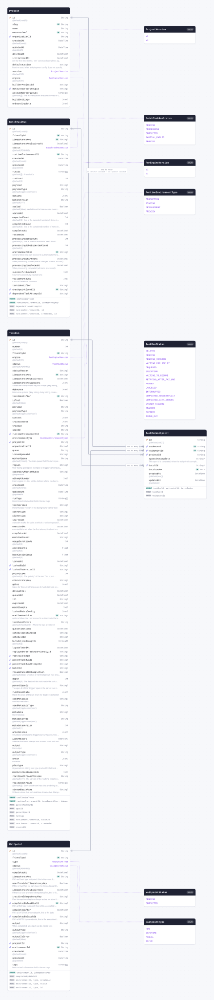

| Field              | Type       | Constraints                                   | Default      | Description                                                                                           |
| ------------------ | ---------- | --------------------------------------------- | ------------ | ----------------------------------------------------------------------------------------------------- |
| `id`               | `String`   | PK NOT NULL                                   | `cuid(1)`    |                                                                                                       |
| `taskRunId`        | `String`   | NOT NULL → [TaskRun.id](#model-TaskRun)       |              |                                                                                                       |
| `waitpointId`      | `String`   | NOT NULL → [Waitpoint.id](#model-Waitpoint)   |              |                                                                                                       |
| `projectId`        | `String`   | NOT NULL → [Project.id](#model-Project)       |              |                                                                                                       |
| `spanIdToComplete` | `String`   | NULL                                          |              | This span id is completed when the waitpoint is completed. This is used with cached runs (idempotent) |
| `batchId`          | `String`   | NULL → [BatchTaskRun.id](#model-BatchTaskRun) |              |                                                                                                       |
| `batchIndex`       | `Int`      | NULL                                          |              |                                                                                                       |
| `createdAt`        | `DateTime` | NOT NULL                                      | `now()`      |                                                                                                       |
| `updatedAt`        | `DateTime` | NOT NULL                                      | `@updatedAt` |                                                                                                       |

#### Indexes

- `@@index([taskRunId])`
- `@@index([waitpointId])`
- `@@unique([taskRunId, waitpointId, batchIndex])`

#### References

- `taskRunId` → [TaskRun.id](#model-TaskRun) (many-to-one)
- `waitpointId` → [Waitpoint.id](#model-Waitpoint) (many-to-one)
- `projectId` → [Project.id](#model-Project) (many-to-one, on delete Cascade, on update Cascade)
- `batchId` → [BatchTaskRun.id](#model-BatchTaskRun) (many-to-one)

#### Definition

```sql
CREATE TABLE "TaskRunWaitpoint" (
    "id" TEXT NOT NULL,
    "taskRunId" TEXT NOT NULL,
    "waitpointId" TEXT NOT NULL,
    "projectId" TEXT NOT NULL,
    "spanIdToComplete" TEXT,
    "batchId" TEXT,
    "batchIndex" INTEGER,
    "createdAt" TIMESTAMP(3) NOT NULL DEFAULT CURRENT_TIMESTAMP,
    "updatedAt" TIMESTAMP(3) NOT NULL,

    CONSTRAINT "TaskRunWaitpoint_pkey" PRIMARY KEY ("id")
);

CREATE INDEX "TaskRunWaitpoint_taskRunId_idx" ON "TaskRunWaitpoint"("taskRunId");

CREATE INDEX "TaskRunWaitpoint_waitpointId_idx" ON "TaskRunWaitpoint"("waitpointId");

CREATE UNIQUE INDEX "TaskRunWaitpoint_taskRunId_waitpointId_batchIndex_key" ON "TaskRunWaitpoint"("taskRunId", "waitpointId", "batchIndex");

ALTER TABLE "TaskRunWaitpoint" ADD CONSTRAINT "TaskRunWaitpoint_taskRunId_fkey" FOREIGN KEY ("taskRunId") REFERENCES "TaskRun"("id") ON DELETE RESTRICT ON UPDATE CASCADE;

ALTER TABLE "TaskRunWaitpoint" ADD CONSTRAINT "TaskRunWaitpoint_waitpointId_fkey" FOREIGN KEY ("waitpointId") REFERENCES "Waitpoint"("id") ON DELETE RESTRICT ON UPDATE CASCADE;

ALTER TABLE "TaskRunWaitpoint" ADD CONSTRAINT "TaskRunWaitpoint_projectId_fkey" FOREIGN KEY ("projectId") REFERENCES "Project"("id") ON DELETE CASCADE ON UPDATE CASCADE;

ALTER TABLE "TaskRunWaitpoint" ADD CONSTRAINT "TaskRunWaitpoint_batchId_fkey" FOREIGN KEY ("batchId") REFERENCES "BatchTaskRun"("id") ON DELETE SET NULL ON UPDATE CASCADE;
```

<details>
<summary>Queries and their SQL</summary>

**findMany**: Every row

```ts
await prisma.taskRunWaitpoint.findMany();
```

```sql
SELECT
  "public"."TaskRunWaitpoint"."id",
  "public"."TaskRunWaitpoint"."taskRunId",
  "public"."TaskRunWaitpoint"."waitpointId",
  "public"."TaskRunWaitpoint"."projectId",
  "public"."TaskRunWaitpoint"."spanIdToComplete",
  "public"."TaskRunWaitpoint"."batchId",
  "public"."TaskRunWaitpoint"."batchIndex",
  "public"."TaskRunWaitpoint"."createdAt",
  "public"."TaskRunWaitpoint"."updatedAt"
FROM
  "public"."TaskRunWaitpoint"
WHERE
  1 = 1
OFFSET
  $1
-- params: ["0"]
```

**count**: How many rows there are

```ts
await prisma.taskRunWaitpoint.count();
```

```sql
SELECT
  COUNT(*) AS "_count$_all"
FROM
  (
    SELECT
      "public"."TaskRunWaitpoint"."id"
    FROM
      "public"."TaskRunWaitpoint"
    WHERE
      1 = 1
    OFFSET
      $1
  ) AS "sub"
-- params: ["0"]
```

**findMany**: Every row with its relations

```ts
await prisma.taskRunWaitpoint.findMany({
  include: { taskRun: true, waitpoint: true, project: true, batch: true },
});
```

```sql
SELECT
  "public"."TaskRunWaitpoint"."id",
  "public"."TaskRunWaitpoint"."taskRunId",
  "public"."TaskRunWaitpoint"."waitpointId",
  "public"."TaskRunWaitpoint"."projectId",
  "public"."TaskRunWaitpoint"."spanIdToComplete",
  "public"."TaskRunWaitpoint"."batchId",
  "public"."TaskRunWaitpoint"."batchIndex",
  "public"."TaskRunWaitpoint"."createdAt",
  "public"."TaskRunWaitpoint"."updatedAt"
FROM
  "public"."TaskRunWaitpoint"
WHERE
  1 = 1
OFFSET
  $1
-- params: ["0"]

SELECT
  "public"."TaskRun"."id",
  "public"."TaskRun"."number",
  "public"."TaskRun"."friendlyId",
  "public"."TaskRun"."engine"::text,
  "public"."TaskRun"."status"::text,
  "public"."TaskRun"."statusReason",
  "public"."TaskRun"."idempotencyKey",
  "public"."TaskRun"."idempotencyKeyExpiresAt",
  "public"."TaskRun"."idempotencyKeyOptions",
  "public"."TaskRun"."debounce",
  "public"."TaskRun"."taskIdentifier",
  "public"."TaskRun"."isTest",
  "public"."TaskRun"."payload",
  "public"."TaskRun"."payloadType",
  "public"."TaskRun"."context",
  "public"."TaskRun"."traceContext",
  "public"."TaskRun"."traceId",
  "public"."TaskRun"."spanId",
  "public"."TaskRun"."runtimeEnvironmentId",
  "public"."TaskRun"."environmentType"::text,
  "public"."TaskRun"."projectId",
  "public"."TaskRun"."organizationId",
  "public"."TaskRun"."queue",
  "public"."TaskRun"."lockedQueueId",
  "public"."TaskRun"."masterQueue",
  "public"."TaskRun"."region",
  "public"."TaskRun"."secondaryMasterQueue",
  "public"."TaskRun"."attemptNumber",
  "public"."TaskRun"."createdAt",
  "public"."TaskRun"."updatedAt",
  "public"."TaskRun"."runTags",
  "public"."TaskRun"."taskVersion",
  "public"."TaskRun"."sdkVersion",
  "public"."TaskRun"."cliVersion",
  "public"."TaskRun"."startedAt",
  "public"."TaskRun"."executedAt",
  "public"."TaskRun"."completedAt",
  "public"."TaskRun"."machinePreset",
  "public"."TaskRun"."usageDurationMs",
  "public"."TaskRun"."costInCents",
  "public"."TaskRun"."baseCostInCents",
  "public"."TaskRun"."lockedAt",
  "public"."TaskRun"."lockedById",
  "public"."TaskRun"."lockedToVersionId",
  "public"."TaskRun"."priorityMs",
  "public"."TaskRun"."concurrencyKey",
  "public"."TaskRun"."gates",
  "public"."TaskRun"."delayUntil",
  "public"."TaskRun"."queuedAt",
  "public"."TaskRun"."ttl",
  "public"."TaskRun"."expiredAt",
  "public"."TaskRun"."maxAttempts",
  "public"."TaskRun"."lockedRetryConfig",
  "public"."TaskRun"."oneTimeUseToken",
  "public"."TaskRun"."taskEventStore",
  "public"."TaskRun"."queueTimestamp",
  "public"."TaskRun"."scheduleInstanceId",
  "public"."TaskRun"."scheduleId",
  "public"."TaskRun"."bulkActionGroupIds",
  "public"."TaskRun"."logsDeletedAt",
  "public"."TaskRun"."replayedFromTaskRunFriendlyId",
  "public"."TaskRun"."rootTaskRunId",
  "public"."TaskRun"."parentTaskRunId",
  "public"."TaskRun"."parentTaskRunAttemptId",
  "public"."TaskRun"."batchId",
  "public"."TaskRun"."resumeParentOnCompletion",
  "public"."TaskRun"."depth",
  "public"."TaskRun"."parentSpanId",
  "public"."TaskRun"."runChainState",
  "public"."TaskRun"."seedMetadata",
  "public"."TaskRun"."seedMetadataType",
  "public"."TaskRun"."metadata",
  "public"."TaskRun"."metadataType",
  "public"."TaskRun"."metadataVersion",
  "public"."TaskRun"."annotations",
  "public"."TaskRun"."isWarmStart",
  "public"."TaskRun"."output",
  "public"."TaskRun"."outputType",
  "public"."TaskRun"."error",
  "public"."TaskRun"."planType",
  "public"."TaskRun"."maxDurationInSeconds",
  "public"."TaskRun"."realtimeStreamsVersion",
  "public"."TaskRun"."realtimeStreams",
  "public"."TaskRun"."streamBasinName"
FROM
  "public"."TaskRun"
WHERE
  "public"."TaskRun"."id" IN ($1)
OFFSET
  $2
-- params: ["<taskRunId of the rows above>","0"]

SELECT
  "public"."Waitpoint"."id",
  "public"."Waitpoint"."friendlyId",
  "public"."Waitpoint"."type"::text,
  "public"."Waitpoint"."status"::text,
  "public"."Waitpoint"."completedAt",
  "public"."Waitpoint"."idempotencyKey",
  "public"."Waitpoint"."userProvidedIdempotencyKey",
  "public"."Waitpoint"."idempotencyKeyExpiresAt",
  "public"."Waitpoint"."inactiveIdempotencyKey",
  "public"."Waitpoint"."completedByTaskRunId",
  "public"."Waitpoint"."completedAfter",
  "public"."Waitpoint"."completedByBatchId",
  "public"."Waitpoint"."output",
  "public"."Waitpoint"."outputType",
  "public"."Waitpoint"."outputIsError",
  "public"."Waitpoint"."projectId",
  "public"."Waitpoint"."environmentId",
  "public"."Waitpoint"."createdAt",
  "public"."Waitpoint"."updatedAt",
  "public"."Waitpoint"."tags"
FROM
  "public"."Waitpoint"
WHERE
  "public"."Waitpoint"."id" IN ($1)
OFFSET
  $2
-- params: ["<waitpointId of the rows above>","0"]

SELECT
  "public"."Project"."id",
  "public"."Project"."slug",
  "public"."Project"."name",
  "public"."Project"."externalRef",
  "public"."Project"."organizationId",
  "public"."Project"."createdAt",
  "public"."Project"."updatedAt",
  "public"."Project"."deletedAt",
  "public"."Project"."initializedAt",
  "public"."Project"."defaultRuntime",
  "public"."Project"."version"::text,
  "public"."Project"."engine"::text,
  "public"."Project"."builderProjectId",
  "public"."Project"."defaultWorkerGroupId",
  "public"."Project"."allowedMasterQueues",
  "public"."Project"."buildSettings",
  "public"."Project"."onboardingData"
FROM
  "public"."Project"
WHERE
  "public"."Project"."id" IN ($1)
OFFSET
  $2
-- params: ["<projectId of the rows above>","0"]

SELECT
  "public"."BatchTaskRun"."id",
  "public"."BatchTaskRun"."friendlyId",
  "public"."BatchTaskRun"."idempotencyKey",
  "public"."BatchTaskRun"."idempotencyKeyExpiresAt",
  "public"."BatchTaskRun"."status"::text,
  "public"."BatchTaskRun"."runtimeEnvironmentId",
  "public"."BatchTaskRun"."createdAt",
  "public"."BatchTaskRun"."updatedAt",
  "public"."BatchTaskRun"."runIds",
  "public"."BatchTaskRun"."runCount",
  "public"."BatchTaskRun"."payload",
  "public"."BatchTaskRun"."payloadType",
  "public"."BatchTaskRun"."options",
  "public"."BatchTaskRun"."batchVersion",
  "public"."BatchTaskRun"."sealed",
  "public"."BatchTaskRun"."sealedAt",
  "public"."BatchTaskRun"."expectedCount",
  "public"."BatchTaskRun"."completedCount",
  "public"."BatchTaskRun"."completedAt",
  "public"."BatchTaskRun"."resumedAt",
  "public"."BatchTaskRun"."processingJobsCount",
  "public"."BatchTaskRun"."processingJobsExpectedCount",
  "public"."BatchTaskRun"."oneTimeUseToken",
  "public"."BatchTaskRun"."processingStartedAt",
  "public"."BatchTaskRun"."processingCompletedAt",
  "public"."BatchTaskRun"."successfulRunCount",
  "public"."BatchTaskRun"."failedRunCount",
  "public"."BatchTaskRun"."taskIdentifier",
  "public"."BatchTaskRun"."checkpointEventId",
  "public"."BatchTaskRun"."dependentTaskAttemptId"
FROM
  "public"."BatchTaskRun"
WHERE
  "public"."BatchTaskRun"."id" IN ($1)
OFFSET
  $2
-- params: ["<batchId of the rows above>","0"]
```

**findUnique**: One row by what is unique to it

```ts
await prisma.taskRunWaitpoint.findUnique({ where: { id: "example" } });
```

```sql
SELECT
  "public"."TaskRunWaitpoint"."id",
  "public"."TaskRunWaitpoint"."taskRunId",
  "public"."TaskRunWaitpoint"."waitpointId",
  "public"."TaskRunWaitpoint"."projectId",
  "public"."TaskRunWaitpoint"."spanIdToComplete",
  "public"."TaskRunWaitpoint"."batchId",
  "public"."TaskRunWaitpoint"."batchIndex",
  "public"."TaskRunWaitpoint"."createdAt",
  "public"."TaskRunWaitpoint"."updatedAt"
FROM
  "public"."TaskRunWaitpoint"
WHERE
  (
    "public"."TaskRunWaitpoint"."id" = $1
    AND 1 = 1
  )
LIMIT
  $2
OFFSET
  $3
-- params: ["example","1","0"]
```

**create**: Create a row

```ts
await prisma.taskRunWaitpoint.create({
  data: { taskRunId: "example", waitpointId: "example", projectId: "example" },
});
```

```sql
INSERT INTO
  "public"."TaskRunWaitpoint" (
    "id",
    "taskRunId",
    "waitpointId",
    "projectId",
    "createdAt",
    "updatedAt"
  )
VALUES
  ($1, $2, $3, $4, $5, $6)
RETURNING
  "public"."TaskRunWaitpoint"."id",
  "public"."TaskRunWaitpoint"."taskRunId",
  "public"."TaskRunWaitpoint"."waitpointId",
  "public"."TaskRunWaitpoint"."projectId",
  "public"."TaskRunWaitpoint"."spanIdToComplete",
  "public"."TaskRunWaitpoint"."batchId",
  "public"."TaskRunWaitpoint"."batchIndex",
  "public"."TaskRunWaitpoint"."createdAt",
  "public"."TaskRunWaitpoint"."updatedAt"
-- params: ["<cuid(1)>","example","example","example","<now()>","<now()>"]
```

**update**: Update a row

```ts
await prisma.taskRunWaitpoint.update({
  where: { id: "example" },
  data: { spanIdToComplete: "example" },
});
```

```sql
UPDATE "public"."TaskRunWaitpoint"
SET
  "spanIdToComplete" = $1,
  "updatedAt" = $2
WHERE
  (
    "public"."TaskRunWaitpoint"."id" = $3
    AND 1 = 1
  )
RETURNING
  "public"."TaskRunWaitpoint"."id",
  "public"."TaskRunWaitpoint"."taskRunId",
  "public"."TaskRunWaitpoint"."waitpointId",
  "public"."TaskRunWaitpoint"."projectId",
  "public"."TaskRunWaitpoint"."spanIdToComplete",
  "public"."TaskRunWaitpoint"."batchId",
  "public"."TaskRunWaitpoint"."batchIndex",
  "public"."TaskRunWaitpoint"."createdAt",
  "public"."TaskRunWaitpoint"."updatedAt"
-- params: ["example",{"prisma__type":"generatorCall","prisma__value":{"name":"now","args":[],"returnType":{"type":"DateTime"}}},"example"]
```

**delete**: Delete a row

```ts
await prisma.taskRunWaitpoint.delete({ where: { id: "example" } });
```

```sql
DELETE FROM "public"."TaskRunWaitpoint"
WHERE
  (
    "public"."TaskRunWaitpoint"."id" = $1
    AND 1 = 1
  )
RETURNING
  "public"."TaskRunWaitpoint"."id",
  "public"."TaskRunWaitpoint"."taskRunId",
  "public"."TaskRunWaitpoint"."waitpointId",
  "public"."TaskRunWaitpoint"."projectId",
  "public"."TaskRunWaitpoint"."spanIdToComplete",
  "public"."TaskRunWaitpoint"."batchId",
  "public"."TaskRunWaitpoint"."batchIndex",
  "public"."TaskRunWaitpoint"."createdAt",
  "public"."TaskRunWaitpoint"."updatedAt"
-- params: ["example"]
```

</details>

<a id="model-WaitpointTag"></a>

### WaitpointTag

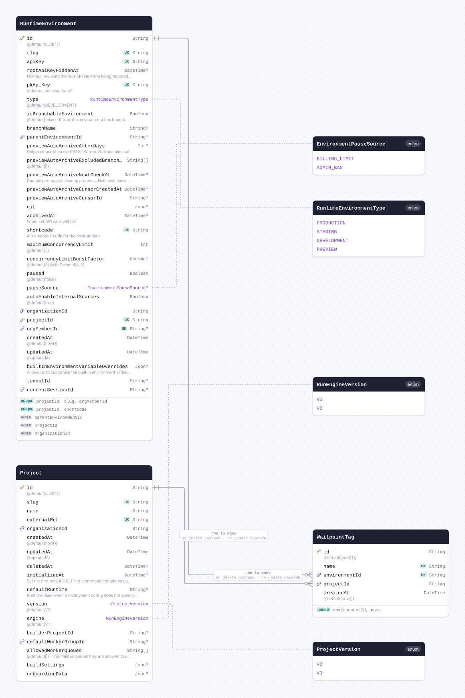

| Field           | Type       | Constraints                                                   | Default   | Description |
| --------------- | ---------- | ------------------------------------------------------------- | --------- | ----------- |
| `id`            | `String`   | PK NOT NULL                                                   | `cuid(1)` |             |
| `name`          | `String`   | NOT NULL                                                      |           |             |
| `environmentId` | `String`   | NOT NULL → [RuntimeEnvironment.id](#model-RuntimeEnvironment) |           |             |
| `projectId`     | `String`   | NOT NULL → [Project.id](#model-Project)                       |           |             |
| `createdAt`     | `DateTime` | NOT NULL                                                      | `now()`   |             |

#### Indexes

- `@@unique([environmentId, name])`

#### References

- `environmentId` → [RuntimeEnvironment.id](#model-RuntimeEnvironment) (many-to-one, on delete Cascade, on update Cascade)
- `projectId` → [Project.id](#model-Project) (many-to-one, on delete Cascade, on update Cascade)

#### Definition

```sql
CREATE TABLE "WaitpointTag" (
    "id" TEXT NOT NULL,
    "name" TEXT NOT NULL,
    "environmentId" TEXT NOT NULL,
    "projectId" TEXT NOT NULL,
    "createdAt" TIMESTAMP(3) NOT NULL DEFAULT CURRENT_TIMESTAMP,

    CONSTRAINT "WaitpointTag_pkey" PRIMARY KEY ("id")
);

CREATE UNIQUE INDEX "WaitpointTag_environmentId_name_key" ON "WaitpointTag"("environmentId", "name");

ALTER TABLE "WaitpointTag" ADD CONSTRAINT "WaitpointTag_environmentId_fkey" FOREIGN KEY ("environmentId") REFERENCES "RuntimeEnvironment"("id") ON DELETE CASCADE ON UPDATE CASCADE;

ALTER TABLE "WaitpointTag" ADD CONSTRAINT "WaitpointTag_projectId_fkey" FOREIGN KEY ("projectId") REFERENCES "Project"("id") ON DELETE CASCADE ON UPDATE CASCADE;
```

<details>
<summary>Queries and their SQL</summary>

**findMany**: Every row

```ts
await prisma.waitpointTag.findMany();
```

```sql
SELECT
  "public"."WaitpointTag"."id",
  "public"."WaitpointTag"."name",
  "public"."WaitpointTag"."environmentId",
  "public"."WaitpointTag"."projectId",
  "public"."WaitpointTag"."createdAt"
FROM
  "public"."WaitpointTag"
WHERE
  1 = 1
OFFSET
  $1
-- params: ["0"]
```

**count**: How many rows there are

```ts
await prisma.waitpointTag.count();
```

```sql
SELECT
  COUNT(*) AS "_count$_all"
FROM
  (
    SELECT
      "public"."WaitpointTag"."id"
    FROM
      "public"."WaitpointTag"
    WHERE
      1 = 1
    OFFSET
      $1
  ) AS "sub"
-- params: ["0"]
```

**findMany**: Every row with its relations

```ts
await prisma.waitpointTag.findMany({ include: { environment: true, project: true } });
```

```sql
SELECT
  "public"."WaitpointTag"."id",
  "public"."WaitpointTag"."name",
  "public"."WaitpointTag"."environmentId",
  "public"."WaitpointTag"."projectId",
  "public"."WaitpointTag"."createdAt"
FROM
  "public"."WaitpointTag"
WHERE
  1 = 1
OFFSET
  $1
-- params: ["0"]

SELECT
  "public"."RuntimeEnvironment"."id",
  "public"."RuntimeEnvironment"."slug",
  "public"."RuntimeEnvironment"."apiKey",
  "public"."RuntimeEnvironment"."rootApiKeyHiddenAt",
  "public"."RuntimeEnvironment"."pkApiKey",
  "public"."RuntimeEnvironment"."type"::text,
  "public"."RuntimeEnvironment"."isBranchableEnvironment",
  "public"."RuntimeEnvironment"."branchName",
  "public"."RuntimeEnvironment"."parentEnvironmentId",
  "public"."RuntimeEnvironment"."previewAutoArchiveAfterDays",
  "public"."RuntimeEnvironment"."previewAutoArchiveExcludedBranches",
  "public"."RuntimeEnvironment"."previewAutoArchiveNextCheckAt",
  "public"."RuntimeEnvironment"."previewAutoArchiveCursorCreatedAt",
  "public"."RuntimeEnvironment"."previewAutoArchiveCursorId",
  "public"."RuntimeEnvironment"."git",
  "public"."RuntimeEnvironment"."archivedAt",
  "public"."RuntimeEnvironment"."shortcode",
  "public"."RuntimeEnvironment"."maximumConcurrencyLimit",
  "public"."RuntimeEnvironment"."concurrencyLimitBurstFactor",
  "public"."RuntimeEnvironment"."paused",
  "public"."RuntimeEnvironment"."pauseSource"::text,
  "public"."RuntimeEnvironment"."autoEnableInternalSources",
  "public"."RuntimeEnvironment"."organizationId",
  "public"."RuntimeEnvironment"."projectId",
  "public"."RuntimeEnvironment"."orgMemberId",
  "public"."RuntimeEnvironment"."createdAt",
  "public"."RuntimeEnvironment"."updatedAt",
  "public"."RuntimeEnvironment"."builtInEnvironmentVariableOverrides",
  "public"."RuntimeEnvironment"."tunnelId",
  "public"."RuntimeEnvironment"."currentSessionId"
FROM
  "public"."RuntimeEnvironment"
WHERE
  "public"."RuntimeEnvironment"."id" IN ($1)
OFFSET
  $2
-- params: ["<environmentId of the rows above>","0"]

SELECT
  "public"."Project"."id",
  "public"."Project"."slug",
  "public"."Project"."name",
  "public"."Project"."externalRef",
  "public"."Project"."organizationId",
  "public"."Project"."createdAt",
  "public"."Project"."updatedAt",
  "public"."Project"."deletedAt",
  "public"."Project"."initializedAt",
  "public"."Project"."defaultRuntime",
  "public"."Project"."version"::text,
  "public"."Project"."engine"::text,
  "public"."Project"."builderProjectId",
  "public"."Project"."defaultWorkerGroupId",
  "public"."Project"."allowedMasterQueues",
  "public"."Project"."buildSettings",
  "public"."Project"."onboardingData"
FROM
  "public"."Project"
WHERE
  "public"."Project"."id" IN ($1)
OFFSET
  $2
-- params: ["<projectId of the rows above>","0"]
```

**findUnique**: One row by what is unique to it

```ts
await prisma.waitpointTag.findUnique({ where: { id: "example" } });
```

```sql
SELECT
  "public"."WaitpointTag"."id",
  "public"."WaitpointTag"."name",
  "public"."WaitpointTag"."environmentId",
  "public"."WaitpointTag"."projectId",
  "public"."WaitpointTag"."createdAt"
FROM
  "public"."WaitpointTag"
WHERE
  (
    "public"."WaitpointTag"."id" = $1
    AND 1 = 1
  )
LIMIT
  $2
OFFSET
  $3
-- params: ["example","1","0"]
```

**create**: Create a row

```ts
await prisma.waitpointTag.create({
  data: { name: "example", environmentId: "example", projectId: "example" },
});
```

```sql
INSERT INTO
  "public"."WaitpointTag" (
    "id",
    "name",
    "environmentId",
    "projectId",
    "createdAt"
  )
VALUES
  ($1, $2, $3, $4, $5)
RETURNING
  "public"."WaitpointTag"."id",
  "public"."WaitpointTag"."name",
  "public"."WaitpointTag"."environmentId",
  "public"."WaitpointTag"."projectId",
  "public"."WaitpointTag"."createdAt"
-- params: ["<cuid(1)>","example","example","example","<now()>"]
```

**update**: Update a row

```ts
await prisma.waitpointTag.update({ where: { id: "example" }, data: { name: "example" } });
```

```sql
UPDATE "public"."WaitpointTag"
SET
  "name" = $1
WHERE
  (
    "public"."WaitpointTag"."id" = $2
    AND 1 = 1
  )
RETURNING
  "public"."WaitpointTag"."id",
  "public"."WaitpointTag"."name",
  "public"."WaitpointTag"."environmentId",
  "public"."WaitpointTag"."projectId",
  "public"."WaitpointTag"."createdAt"
-- params: ["example","example"]
```

**delete**: Delete a row

```ts
await prisma.waitpointTag.delete({ where: { id: "example" } });
```

```sql
DELETE FROM "public"."WaitpointTag"
WHERE
  (
    "public"."WaitpointTag"."id" = $1
    AND 1 = 1
  )
RETURNING
  "public"."WaitpointTag"."id",
  "public"."WaitpointTag"."name",
  "public"."WaitpointTag"."environmentId",
  "public"."WaitpointTag"."projectId",
  "public"."WaitpointTag"."createdAt"
-- params: ["example"]
```

</details>

<a id="model-FeatureFlag"></a>

### FeatureFlag

| Field       | Type       | Constraints     | Default      | Description |
| ----------- | ---------- | --------------- | ------------ | ----------- |
| `id`        | `String`   | PK NOT NULL     | `cuid(1)`    |             |
| `key`       | `String`   | UNIQUE NOT NULL |              |             |
| `value`     | `Json`     | NULL            |              |             |
| `createdAt` | `DateTime` | NOT NULL        | `now()`      |             |
| `updatedAt` | `DateTime` | NOT NULL        | `@updatedAt` |             |

#### Definition

```sql
CREATE TABLE "FeatureFlag" (
    "id" TEXT NOT NULL,
    "key" TEXT NOT NULL,
    "value" JSONB,
    "createdAt" TIMESTAMP(3) NOT NULL DEFAULT CURRENT_TIMESTAMP,
    "updatedAt" TIMESTAMP(3) NOT NULL,

    CONSTRAINT "FeatureFlag_pkey" PRIMARY KEY ("id")
);

CREATE UNIQUE INDEX "FeatureFlag_key_key" ON "FeatureFlag"("key");
```

<details>
<summary>Queries and their SQL</summary>

**findMany**: Every row

```ts
await prisma.featureFlag.findMany();
```

```sql
SELECT
  "public"."FeatureFlag"."id",
  "public"."FeatureFlag"."key",
  "public"."FeatureFlag"."value",
  "public"."FeatureFlag"."createdAt",
  "public"."FeatureFlag"."updatedAt"
FROM
  "public"."FeatureFlag"
WHERE
  1 = 1
OFFSET
  $1
-- params: ["0"]
```

**count**: How many rows there are

```ts
await prisma.featureFlag.count();
```

```sql
SELECT
  COUNT(*) AS "_count$_all"
FROM
  (
    SELECT
      "public"."FeatureFlag"."id"
    FROM
      "public"."FeatureFlag"
    WHERE
      1 = 1
    OFFSET
      $1
  ) AS "sub"
-- params: ["0"]
```

**findUnique**: One row by what is unique to it

```ts
await prisma.featureFlag.findUnique({ where: { id: "example" } });
```

```sql
SELECT
  "public"."FeatureFlag"."id",
  "public"."FeatureFlag"."key",
  "public"."FeatureFlag"."value",
  "public"."FeatureFlag"."createdAt",
  "public"."FeatureFlag"."updatedAt"
FROM
  "public"."FeatureFlag"
WHERE
  (
    "public"."FeatureFlag"."id" = $1
    AND 1 = 1
  )
LIMIT
  $2
OFFSET
  $3
-- params: ["example","1","0"]
```

**create**: Create a row

```ts
await prisma.featureFlag.create({ data: { key: "example" } });
```

```sql
INSERT INTO
  "public"."FeatureFlag" ("id", "key", "createdAt", "updatedAt")
VALUES
  ($1, $2, $3, $4)
RETURNING
  "public"."FeatureFlag"."id",
  "public"."FeatureFlag"."key",
  "public"."FeatureFlag"."value",
  "public"."FeatureFlag"."createdAt",
  "public"."FeatureFlag"."updatedAt"
-- params: ["<cuid(1)>","example","<now()>","<now()>"]
```

**update**: Update a row

```ts
await prisma.featureFlag.update({ where: { id: "example" }, data: { key: "example" } });
```

```sql
UPDATE "public"."FeatureFlag"
SET
  "key" = $1,
  "updatedAt" = $2
WHERE
  (
    "public"."FeatureFlag"."id" = $3
    AND 1 = 1
  )
RETURNING
  "public"."FeatureFlag"."id",
  "public"."FeatureFlag"."key",
  "public"."FeatureFlag"."value",
  "public"."FeatureFlag"."createdAt",
  "public"."FeatureFlag"."updatedAt"
-- params: ["example",{"prisma__type":"generatorCall","prisma__value":{"name":"now","args":[],"returnType":{"type":"DateTime"}}},"example"]
```

**delete**: Delete a row

```ts
await prisma.featureFlag.delete({ where: { id: "example" } });
```

```sql
DELETE FROM "public"."FeatureFlag"
WHERE
  (
    "public"."FeatureFlag"."id" = $1
    AND 1 = 1
  )
RETURNING
  "public"."FeatureFlag"."id",
  "public"."FeatureFlag"."key",
  "public"."FeatureFlag"."value",
  "public"."FeatureFlag"."createdAt",
  "public"."FeatureFlag"."updatedAt"
-- params: ["example"]
```

</details>

<a id="model-WorkerInstance"></a>

### WorkerInstance

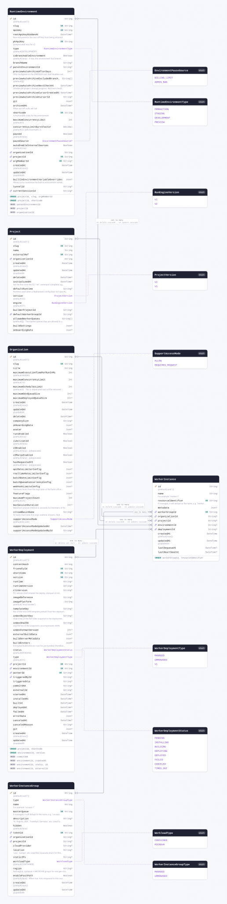

| Field                | Type       | Constraints                                                     | Default      | Description                                                                                                                                 |
| -------------------- | ---------- | --------------------------------------------------------------- | ------------ | ------------------------------------------------------------------------------------------------------------------------------------------- |
| `id`                 | `String`   | PK NOT NULL                                                     | `cuid(1)`    |                                                                                                                                             |
| `name`               | `String`   | NOT NULL                                                        |              | For example "worker-1"                                                                                                                      |
| `resourceIdentifier` | `String`   | NOT NULL                                                        |              | If managed, it will default to the name, e.g. "worker-1" If unmanged, it will be prefixed with the deployment ID e.g. "deploy-123-worker-1" |
| `metadata`           | `Json`     | NULL                                                            |              |                                                                                                                                             |
| `workerGroupId`      | `String`   | NOT NULL → [WorkerInstanceGroup.id](#model-WorkerInstanceGroup) |              |                                                                                                                                             |
| `organizationId`     | `String`   | NULL → [Organization.id](#model-Organization)                   |              |                                                                                                                                             |
| `projectId`          | `String`   | NULL → [Project.id](#model-Project)                             |              |                                                                                                                                             |
| `environmentId`      | `String`   | NULL → [RuntimeEnvironment.id](#model-RuntimeEnvironment)       |              |                                                                                                                                             |
| `deploymentId`       | `String`   | NULL → [WorkerDeployment.id](#model-WorkerDeployment)           |              |                                                                                                                                             |
| `createdAt`          | `DateTime` | NOT NULL                                                        | `now()`      |                                                                                                                                             |
| `updatedAt`          | `DateTime` | NOT NULL                                                        | `@updatedAt` |                                                                                                                                             |
| `lastDequeueAt`      | `DateTime` | NULL                                                            |              |                                                                                                                                             |
| `lastHeartbeatAt`    | `DateTime` | NULL                                                            |              |                                                                                                                                             |

#### Indexes

- `@@unique([workerGroupId, resourceIdentifier])`

#### References

- `workerGroupId` → [WorkerInstanceGroup.id](#model-WorkerInstanceGroup) (many-to-one)
- `organizationId` → [Organization.id](#model-Organization) (many-to-one, on delete Cascade, on update Cascade)
- `projectId` → [Project.id](#model-Project) (many-to-one, on delete Cascade, on update Cascade)
- `environmentId` → [RuntimeEnvironment.id](#model-RuntimeEnvironment) (many-to-one, on delete Cascade, on update Cascade)
- `deploymentId` → [WorkerDeployment.id](#model-WorkerDeployment) (many-to-one, on delete SetNull, on update Cascade)

#### Definition

```sql
CREATE TABLE "WorkerInstance" (
    "id" TEXT NOT NULL,
    "name" TEXT NOT NULL,
    "resourceIdentifier" TEXT NOT NULL,
    "metadata" JSONB,
    "workerGroupId" TEXT NOT NULL,
    "organizationId" TEXT,
    "projectId" TEXT,
    "environmentId" TEXT,
    "deploymentId" TEXT,
    "createdAt" TIMESTAMP(3) NOT NULL DEFAULT CURRENT_TIMESTAMP,
    "updatedAt" TIMESTAMP(3) NOT NULL,
    "lastDequeueAt" TIMESTAMP(3),
    "lastHeartbeatAt" TIMESTAMP(3),

    CONSTRAINT "WorkerInstance_pkey" PRIMARY KEY ("id")
);

CREATE UNIQUE INDEX "WorkerInstance_workerGroupId_resourceIdentifier_key" ON "WorkerInstance"("workerGroupId", "resourceIdentifier");

ALTER TABLE "WorkerInstance" ADD CONSTRAINT "WorkerInstance_workerGroupId_fkey" FOREIGN KEY ("workerGroupId") REFERENCES "WorkerInstanceGroup"("id") ON DELETE RESTRICT ON UPDATE CASCADE;

ALTER TABLE "WorkerInstance" ADD CONSTRAINT "WorkerInstance_organizationId_fkey" FOREIGN KEY ("organizationId") REFERENCES "Organization"("id") ON DELETE CASCADE ON UPDATE CASCADE;

ALTER TABLE "WorkerInstance" ADD CONSTRAINT "WorkerInstance_projectId_fkey" FOREIGN KEY ("projectId") REFERENCES "Project"("id") ON DELETE CASCADE ON UPDATE CASCADE;

ALTER TABLE "WorkerInstance" ADD CONSTRAINT "WorkerInstance_environmentId_fkey" FOREIGN KEY ("environmentId") REFERENCES "RuntimeEnvironment"("id") ON DELETE CASCADE ON UPDATE CASCADE;

ALTER TABLE "WorkerInstance" ADD CONSTRAINT "WorkerInstance_deploymentId_fkey" FOREIGN KEY ("deploymentId") REFERENCES "WorkerDeployment"("id") ON DELETE SET NULL ON UPDATE CASCADE;
```

<details>
<summary>Queries and their SQL</summary>

**findMany**: Every row

```ts
await prisma.workerInstance.findMany();
```

```sql
SELECT
  "public"."WorkerInstance"."id",
  "public"."WorkerInstance"."name",
  "public"."WorkerInstance"."resourceIdentifier",
  "public"."WorkerInstance"."metadata",
  "public"."WorkerInstance"."workerGroupId",
  "public"."WorkerInstance"."organizationId",
  "public"."WorkerInstance"."projectId",
  "public"."WorkerInstance"."environmentId",
  "public"."WorkerInstance"."deploymentId",
  "public"."WorkerInstance"."createdAt",
  "public"."WorkerInstance"."updatedAt",
  "public"."WorkerInstance"."lastDequeueAt",
  "public"."WorkerInstance"."lastHeartbeatAt"
FROM
  "public"."WorkerInstance"
WHERE
  1 = 1
OFFSET
  $1
-- params: ["0"]
```

**count**: How many rows there are

```ts
await prisma.workerInstance.count();
```

```sql
SELECT
  COUNT(*) AS "_count$_all"
FROM
  (
    SELECT
      "public"."WorkerInstance"."id"
    FROM
      "public"."WorkerInstance"
    WHERE
      1 = 1
    OFFSET
      $1
  ) AS "sub"
-- params: ["0"]
```

**findMany**: Every row with its relations

```ts
await prisma.workerInstance.findMany({
  include: {
    workerGroup: true,
    organization: true,
    project: true,
    environment: true,
    deployment: true,
  },
});
```

```sql
SELECT
  "public"."WorkerInstance"."id",
  "public"."WorkerInstance"."name",
  "public"."WorkerInstance"."resourceIdentifier",
  "public"."WorkerInstance"."metadata",
  "public"."WorkerInstance"."workerGroupId",
  "public"."WorkerInstance"."organizationId",
  "public"."WorkerInstance"."projectId",
  "public"."WorkerInstance"."environmentId",
  "public"."WorkerInstance"."deploymentId",
  "public"."WorkerInstance"."createdAt",
  "public"."WorkerInstance"."updatedAt",
  "public"."WorkerInstance"."lastDequeueAt",
  "public"."WorkerInstance"."lastHeartbeatAt"
FROM
  "public"."WorkerInstance"
WHERE
  1 = 1
OFFSET
  $1
-- params: ["0"]

SELECT
  "public"."WorkerInstanceGroup"."id",
  "public"."WorkerInstanceGroup"."type"::text,
  "public"."WorkerInstanceGroup"."name",
  "public"."WorkerInstanceGroup"."masterQueue",
  "public"."WorkerInstanceGroup"."description",
  "public"."WorkerInstanceGroup"."hidden",
  "public"."WorkerInstanceGroup"."tokenId",
  "public"."WorkerInstanceGroup"."organizationId",
  "public"."WorkerInstanceGroup"."projectId",
  "public"."WorkerInstanceGroup"."cloudProvider",
  "public"."WorkerInstanceGroup"."location",
  "public"."WorkerInstanceGroup"."staticIPs",
  "public"."WorkerInstanceGroup"."workloadType"::text,
  "public"."WorkerInstanceGroup"."region",
  "public"."WorkerInstanceGroup"."enableFastPath",
  "public"."WorkerInstanceGroup"."createdAt",
  "public"."WorkerInstanceGroup"."updatedAt"
FROM
  "public"."WorkerInstanceGroup"
WHERE
  "public"."WorkerInstanceGroup"."id" IN ($1)
OFFSET
  $2
-- params: ["<workerGroupId of the rows above>","0"]

SELECT
  "public"."Organization"."id",
  "public"."Organization"."slug",
  "public"."Organization"."title",
  "public"."Organization"."maximumExecutionTimePerRunInMs",
  "public"."Organization"."maximumConcurrencyLimit",
  "public"."Organization"."maximumSchedulesLimit",
  "public"."Organization"."maximumDevQueueSize",
  "public"."Organization"."maximumDeployedQueueSize",
  "public"."Organization"."createdAt",
  "public"."Organization"."updatedAt",
  "public"."Organization"."deletedAt",
  "public"."Organization"."companySize",
  "public"."Organization"."onboardingData",
  "public"."Organization"."avatar",
  "public"."Organization"."runsEnabled",
  "public"."Organization"."v3Enabled",
  "public"."Organization"."v2Enabled",
  "public"."Organization"."v2MarqsEnabled",
  "public"."Organization"."hasRequestedV3",
  "public"."Organization"."apiRateLimiterConfig",
  "public"."Organization"."realtimeRateLimiterConfig",
  "public"."Organization"."batchRateLimitConfig",
  "public"."Organization"."batchQueueConcurrencyConfig",
  "public"."Organization"."webhookLimitsConfig",
  "public"."Organization"."featureFlags",
  "public"."Organization"."maximumProjectCount",
  "public"."Organization"."maxSessionDuration",
  "public"."Organization"."streamBasinName",
  "public"."Organization"."supportAccessMode"::text,
  "public"."Organization"."supportAccessModeUpdatedAt",
  "public"."Organization"."supportAccessModeUpdatedById"
FROM
  "public"."Organization"
WHERE
  "public"."Organization"."id" IN ($1)
OFFSET
  $2
-- params: ["<organizationId of the rows above>","0"]

SELECT
  "public"."Project"."id",
  "public"."Project"."slug",
  "public"."Project"."name",
  "public"."Project"."externalRef",
  "public"."Project"."organizationId",
  "public"."Project"."createdAt",
  "public"."Project"."updatedAt",
  "public"."Project"."deletedAt",
  "public"."Project"."initializedAt",
  "public"."Project"."defaultRuntime",
  "public"."Project"."version"::text,
  "public"."Project"."engine"::text,
  "public"."Project"."builderProjectId",
  "public"."Project"."defaultWorkerGroupId",
  "public"."Project"."allowedMasterQueues",
  "public"."Project"."buildSettings",
  "public"."Project"."onboardingData"
FROM
  "public"."Project"
WHERE
  "public"."Project"."id" IN ($1)
OFFSET
  $2
-- params: ["<projectId of the rows above>","0"]

SELECT
  "public"."RuntimeEnvironment"."id",
  "public"."RuntimeEnvironment"."slug",
  "public"."RuntimeEnvironment"."apiKey",
  "public"."RuntimeEnvironment"."rootApiKeyHiddenAt",
  "public"."RuntimeEnvironment"."pkApiKey",
  "public"."RuntimeEnvironment"."type"::text,
  "public"."RuntimeEnvironment"."isBranchableEnvironment",
  "public"."RuntimeEnvironment"."branchName",
  "public"."RuntimeEnvironment"."parentEnvironmentId",
  "public"."RuntimeEnvironment"."previewAutoArchiveAfterDays",
  "public"."RuntimeEnvironment"."previewAutoArchiveExcludedBranches",
  "public"."RuntimeEnvironment"."previewAutoArchiveNextCheckAt",
  "public"."RuntimeEnvironment"."previewAutoArchiveCursorCreatedAt",
  "public"."RuntimeEnvironment"."previewAutoArchiveCursorId",
  "public"."RuntimeEnvironment"."git",
  "public"."RuntimeEnvironment"."archivedAt",
  "public"."RuntimeEnvironment"."shortcode",
  "public"."RuntimeEnvironment"."maximumConcurrencyLimit",
  "public"."RuntimeEnvironment"."concurrencyLimitBurstFactor",
  "public"."RuntimeEnvironment"."paused",
  "public"."RuntimeEnvironment"."pauseSource"::text,
  "public"."RuntimeEnvironment"."autoEnableInternalSources",
  "public"."RuntimeEnvironment"."organizationId",
  "public"."RuntimeEnvironment"."projectId",
  "public"."RuntimeEnvironment"."orgMemberId",
  "public"."RuntimeEnvironment"."createdAt",
  "public"."RuntimeEnvironment"."updatedAt",
  "public"."RuntimeEnvironment"."builtInEnvironmentVariableOverrides",
  "public"."RuntimeEnvironment"."tunnelId",
  "public"."RuntimeEnvironment"."currentSessionId"
FROM
  "public"."RuntimeEnvironment"
WHERE
  "public"."RuntimeEnvironment"."id" IN ($1)
OFFSET
  $2
-- params: ["<environmentId of the rows above>","0"]

SELECT
  "public"."WorkerDeployment"."id",
  "public"."WorkerDeployment"."contentHash",
  "public"."WorkerDeployment"."friendlyId",
  "public"."WorkerDeployment"."shortCode",
  "public"."WorkerDeployment"."version",
  "public"."WorkerDeployment"."runtime",
  "public"."WorkerDeployment"."runtimeVersion",
  "public"."WorkerDeployment"."cliVersion",
  "public"."WorkerDeployment"."imageReference",
  "public"."WorkerDeployment"."imagePlatform",
  "public"."WorkerDeployment"."templateKey",
  "public"."WorkerDeployment"."indexObjectKey",
  "public"."WorkerDeployment"."indexSha256",
  "public"."WorkerDeployment"."indexFormatVersion",
  "public"."WorkerDeployment"."externalBuildData",
  "public"."WorkerDeployment"."buildServerMetadata",
  "public"."WorkerDeployment"."buildEnvVars",
  "public"."WorkerDeployment"."status"::text,
  "public"."WorkerDeployment"."type"::text,
  "public"."WorkerDeployment"."projectId",
  "public"."WorkerDeployment"."environmentId",
  "public"."WorkerDeployment"."workerId",
  "public"."WorkerDeployment"."triggeredById",
  "public"."WorkerDeployment"."triggeredVia",
  "public"."WorkerDeployment"."commitSHA",
  "public"."WorkerDeployment"."externalId",
  "public"."WorkerDeployment"."startedAt",
  "public"."WorkerDeployment"."installedAt",
  "public"."WorkerDeployment"."builtAt",
  "public"."WorkerDeployment"."deployedAt",
  "public"."WorkerDeployment"."failedAt",
  "public"."WorkerDeployment"."errorData",
  "public"."WorkerDeployment"."canceledAt",
  "public"."WorkerDeployment"."canceledReason",
  "public"."WorkerDeployment"."git",
  "public"."WorkerDeployment"."createdAt",
  "public"."WorkerDeployment"."updatedAt"
FROM
  "public"."WorkerDeployment"
WHERE
  "public"."WorkerDeployment"."id" IN ($1)
OFFSET
  $2
-- params: ["<deploymentId of the rows above>","0"]
```

**findUnique**: One row by what is unique to it

```ts
await prisma.workerInstance.findUnique({ where: { id: "example" } });
```

```sql
SELECT
  "public"."WorkerInstance"."id",
  "public"."WorkerInstance"."name",
  "public"."WorkerInstance"."resourceIdentifier",
  "public"."WorkerInstance"."metadata",
  "public"."WorkerInstance"."workerGroupId",
  "public"."WorkerInstance"."organizationId",
  "public"."WorkerInstance"."projectId",
  "public"."WorkerInstance"."environmentId",
  "public"."WorkerInstance"."deploymentId",
  "public"."WorkerInstance"."createdAt",
  "public"."WorkerInstance"."updatedAt",
  "public"."WorkerInstance"."lastDequeueAt",
  "public"."WorkerInstance"."lastHeartbeatAt"
FROM
  "public"."WorkerInstance"
WHERE
  (
    "public"."WorkerInstance"."id" = $1
    AND 1 = 1
  )
LIMIT
  $2
OFFSET
  $3
-- params: ["example","1","0"]
```

**create**: Create a row

```ts
await prisma.workerInstance.create({
  data: { name: "example", resourceIdentifier: "example", workerGroupId: "example" },
});
```

```sql
INSERT INTO
  "public"."WorkerInstance" (
    "id",
    "name",
    "resourceIdentifier",
    "workerGroupId",
    "createdAt",
    "updatedAt"
  )
VALUES
  ($1, $2, $3, $4, $5, $6)
RETURNING
  "public"."WorkerInstance"."id",
  "public"."WorkerInstance"."name",
  "public"."WorkerInstance"."resourceIdentifier",
  "public"."WorkerInstance"."metadata",
  "public"."WorkerInstance"."workerGroupId",
  "public"."WorkerInstance"."organizationId",
  "public"."WorkerInstance"."projectId",
  "public"."WorkerInstance"."environmentId",
  "public"."WorkerInstance"."deploymentId",
  "public"."WorkerInstance"."createdAt",
  "public"."WorkerInstance"."updatedAt",
  "public"."WorkerInstance"."lastDequeueAt",
  "public"."WorkerInstance"."lastHeartbeatAt"
-- params: ["<cuid(1)>","example","example","example","<now()>","<now()>"]
```

**update**: Update a row

```ts
await prisma.workerInstance.update({ where: { id: "example" }, data: { name: "example" } });
```

```sql
UPDATE "public"."WorkerInstance"
SET
  "name" = $1,
  "updatedAt" = $2
WHERE
  (
    "public"."WorkerInstance"."id" = $3
    AND 1 = 1
  )
RETURNING
  "public"."WorkerInstance"."id",
  "public"."WorkerInstance"."name",
  "public"."WorkerInstance"."resourceIdentifier",
  "public"."WorkerInstance"."metadata",
  "public"."WorkerInstance"."workerGroupId",
  "public"."WorkerInstance"."organizationId",
  "public"."WorkerInstance"."projectId",
  "public"."WorkerInstance"."environmentId",
  "public"."WorkerInstance"."deploymentId",
  "public"."WorkerInstance"."createdAt",
  "public"."WorkerInstance"."updatedAt",
  "public"."WorkerInstance"."lastDequeueAt",
  "public"."WorkerInstance"."lastHeartbeatAt"
-- params: ["example",{"prisma__type":"generatorCall","prisma__value":{"name":"now","args":[],"returnType":{"type":"DateTime"}}},"example"]
```

**delete**: Delete a row

```ts
await prisma.workerInstance.delete({ where: { id: "example" } });
```

```sql
DELETE FROM "public"."WorkerInstance"
WHERE
  (
    "public"."WorkerInstance"."id" = $1
    AND 1 = 1
  )
RETURNING
  "public"."WorkerInstance"."id",
  "public"."WorkerInstance"."name",
  "public"."WorkerInstance"."resourceIdentifier",
  "public"."WorkerInstance"."metadata",
  "public"."WorkerInstance"."workerGroupId",
  "public"."WorkerInstance"."organizationId",
  "public"."WorkerInstance"."projectId",
  "public"."WorkerInstance"."environmentId",
  "public"."WorkerInstance"."deploymentId",
  "public"."WorkerInstance"."createdAt",
  "public"."WorkerInstance"."updatedAt",
  "public"."WorkerInstance"."lastDequeueAt",
  "public"."WorkerInstance"."lastHeartbeatAt"
-- params: ["example"]
```

</details>

<a id="model-WorkerInstanceGroup"></a>

### WorkerInstanceGroup

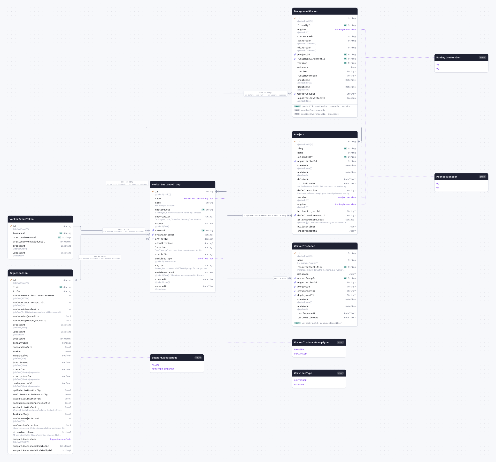

| Field            | Type                                                       | Constraints                                                      | Default      | Description                                                                                                                                             |
| ---------------- | ---------------------------------------------------------- | ---------------------------------------------------------------- | ------------ | ------------------------------------------------------------------------------------------------------------------------------------------------------- |
| `id`             | `String`                                                   | PK NOT NULL                                                      | `cuid(1)`    |                                                                                                                                                         |
| `type`           | [`WorkerInstanceGroupType`](#enum-WorkerInstanceGroupType) | NOT NULL                                                         |              |                                                                                                                                                         |
| `name`           | `String`                                                   | NOT NULL                                                         |              | For example "us-east-1"                                                                                                                                 |
| `masterQueue`    | `String`                                                   | UNIQUE NOT NULL                                                  |              | If managed, it will default to the name, e.g. "us-east-1" If unmanged, it will be prefixed with the project ID e.g. "project_1-us-east-1"               |
| `description`    | `String`                                                   | NULL                                                             |              | "N. Virginia, USA", "Frankfurt, Germany", etc. Used for display purposes                                                                                |
| `hidden`         | `Boolean`                                                  | NOT NULL                                                         | `false`      |                                                                                                                                                         |
| `tokenId`        | `String`                                                   | UNIQUE NOT NULL → [WorkerGroupToken.id](#model-WorkerGroupToken) |              |                                                                                                                                                         |
| `organizationId` | `String`                                                   | NULL → [Organization.id](#model-Organization)                    |              |                                                                                                                                                         |
| `projectId`      | `String`                                                   | NULL → [Project.id](#model-Project)                              |              |                                                                                                                                                         |
| `cloudProvider`  | `String`                                                   | NULL                                                             |              |                                                                                                                                                         |
| `location`       | `String`                                                   | NULL                                                             |              | "usa", "europe", etc. Used like a pseudo enum for things like flags                                                                                     |
| `staticIPs`      | `String`                                                   | NULL                                                             |              |                                                                                                                                                         |
| `workloadType`   | [`WorkloadType`](#enum-WorkloadType)                       | NOT NULL                                                         | `CONTAINER`  |                                                                                                                                                         |
| `region`         | `String`                                                   | NULL                                                             |              | Geo region; container + MICROVM groups for one geo share it. Set-once once it has runs.                                                                 |
| `enableFastPath` | `Boolean`                                                  | NOT NULL                                                         | `false`      | When true, runs enqueued to this worker queue may skip the intermediate queue and be pushed directly to the worker queue when concurrency is available. |
| `createdAt`      | `DateTime`                                                 | NOT NULL                                                         | `now()`      |                                                                                                                                                         |
| `updatedAt`      | `DateTime`                                                 | NOT NULL                                                         | `@updatedAt` |                                                                                                                                                         |

#### References

- `tokenId` → [WorkerGroupToken.id](#model-WorkerGroupToken) (one-to-one, on delete Cascade, on update Cascade)
- `organizationId` → [Organization.id](#model-Organization) (many-to-one, on delete Cascade, on update Cascade)
- `projectId` → [Project.id](#model-Project) (many-to-one, on delete Cascade, on update Cascade)

#### Referenced by

- `id` ← [Project.defaultWorkerGroupId](#model-Project) (one-to-many)
- `id` ← [BackgroundWorker.workerGroupId](#model-BackgroundWorker) (one-to-many, on delete SetNull, on update Cascade)
- `id` ← [WorkerInstance.workerGroupId](#model-WorkerInstance) (one-to-many)

#### Definition

```sql
CREATE TABLE "WorkerInstanceGroup" (
    "id" TEXT NOT NULL,
    "type" "WorkerInstanceGroupType" NOT NULL,
    "name" TEXT NOT NULL,
    "masterQueue" TEXT NOT NULL,
    "description" TEXT,
    "hidden" BOOLEAN NOT NULL DEFAULT false,
    "tokenId" TEXT NOT NULL,
    "organizationId" TEXT,
    "projectId" TEXT,
    "cloudProvider" TEXT,
    "location" TEXT,
    "staticIPs" TEXT,
    "workloadType" "WorkloadType" NOT NULL DEFAULT 'CONTAINER',
    "region" TEXT,
    "enableFastPath" BOOLEAN NOT NULL DEFAULT false,
    "createdAt" TIMESTAMP(3) NOT NULL DEFAULT CURRENT_TIMESTAMP,
    "updatedAt" TIMESTAMP(3) NOT NULL,

    CONSTRAINT "WorkerInstanceGroup_pkey" PRIMARY KEY ("id")
);

CREATE UNIQUE INDEX "WorkerInstanceGroup_masterQueue_key" ON "WorkerInstanceGroup"("masterQueue");

CREATE UNIQUE INDEX "WorkerInstanceGroup_tokenId_key" ON "WorkerInstanceGroup"("tokenId");

ALTER TABLE "WorkerInstanceGroup" ADD CONSTRAINT "WorkerInstanceGroup_tokenId_fkey" FOREIGN KEY ("tokenId") REFERENCES "WorkerGroupToken"("id") ON DELETE CASCADE ON UPDATE CASCADE;

ALTER TABLE "WorkerInstanceGroup" ADD CONSTRAINT "WorkerInstanceGroup_organizationId_fkey" FOREIGN KEY ("organizationId") REFERENCES "Organization"("id") ON DELETE CASCADE ON UPDATE CASCADE;

ALTER TABLE "WorkerInstanceGroup" ADD CONSTRAINT "WorkerInstanceGroup_projectId_fkey" FOREIGN KEY ("projectId") REFERENCES "Project"("id") ON DELETE CASCADE ON UPDATE CASCADE;
```

<details>
<summary>Queries and their SQL</summary>

**findMany**: Every row

```ts
await prisma.workerInstanceGroup.findMany();
```

```sql
SELECT
  "public"."WorkerInstanceGroup"."id",
  "public"."WorkerInstanceGroup"."type"::text,
  "public"."WorkerInstanceGroup"."name",
  "public"."WorkerInstanceGroup"."masterQueue",
  "public"."WorkerInstanceGroup"."description",
  "public"."WorkerInstanceGroup"."hidden",
  "public"."WorkerInstanceGroup"."tokenId",
  "public"."WorkerInstanceGroup"."organizationId",
  "public"."WorkerInstanceGroup"."projectId",
  "public"."WorkerInstanceGroup"."cloudProvider",
  "public"."WorkerInstanceGroup"."location",
  "public"."WorkerInstanceGroup"."staticIPs",
  "public"."WorkerInstanceGroup"."workloadType"::text,
  "public"."WorkerInstanceGroup"."region",
  "public"."WorkerInstanceGroup"."enableFastPath",
  "public"."WorkerInstanceGroup"."createdAt",
  "public"."WorkerInstanceGroup"."updatedAt"
FROM
  "public"."WorkerInstanceGroup"
WHERE
  1 = 1
OFFSET
  $1
-- params: ["0"]
```

**count**: How many rows there are

```ts
await prisma.workerInstanceGroup.count();
```

```sql
SELECT
  COUNT(*) AS "_count$_all"
FROM
  (
    SELECT
      "public"."WorkerInstanceGroup"."id"
    FROM
      "public"."WorkerInstanceGroup"
    WHERE
      1 = 1
    OFFSET
      $1
  ) AS "sub"
-- params: ["0"]
```

**findMany**: Every row with its relations

```ts
await prisma.workerInstanceGroup.findMany({
  include: {
    token: true,
    workers: true,
    backgroundWorkers: true,
    defaultForProjects: true,
    organization: true,
    project: true,
  },
});
```

```sql
SELECT
  "public"."WorkerInstanceGroup"."id",
  "public"."WorkerInstanceGroup"."type"::text,
  "public"."WorkerInstanceGroup"."name",
  "public"."WorkerInstanceGroup"."masterQueue",
  "public"."WorkerInstanceGroup"."description",
  "public"."WorkerInstanceGroup"."hidden",
  "public"."WorkerInstanceGroup"."tokenId",
  "public"."WorkerInstanceGroup"."organizationId",
  "public"."WorkerInstanceGroup"."projectId",
  "public"."WorkerInstanceGroup"."cloudProvider",
  "public"."WorkerInstanceGroup"."location",
  "public"."WorkerInstanceGroup"."staticIPs",
  "public"."WorkerInstanceGroup"."workloadType"::text,
  "public"."WorkerInstanceGroup"."region",
  "public"."WorkerInstanceGroup"."enableFastPath",
  "public"."WorkerInstanceGroup"."createdAt",
  "public"."WorkerInstanceGroup"."updatedAt"
FROM
  "public"."WorkerInstanceGroup"
WHERE
  1 = 1
OFFSET
  $1
-- params: ["0"]

SELECT
  "public"."WorkerGroupToken"."id",
  "public"."WorkerGroupToken"."tokenHash",
  "public"."WorkerGroupToken"."previousTokenHash",
  "public"."WorkerGroupToken"."previousTokenValidUntil",
  "public"."WorkerGroupToken"."createdAt",
  "public"."WorkerGroupToken"."updatedAt"
FROM
  "public"."WorkerGroupToken"
WHERE
  "public"."WorkerGroupToken"."id" IN ($1)
OFFSET
  $2
-- params: ["<tokenId of the rows above>","0"]

SELECT
  "public"."WorkerInstance"."id",
  "public"."WorkerInstance"."name",
  "public"."WorkerInstance"."resourceIdentifier",
  "public"."WorkerInstance"."metadata",
  "public"."WorkerInstance"."workerGroupId",
  "public"."WorkerInstance"."organizationId",
  "public"."WorkerInstance"."projectId",
  "public"."WorkerInstance"."environmentId",
  "public"."WorkerInstance"."deploymentId",
  "public"."WorkerInstance"."createdAt",
  "public"."WorkerInstance"."updatedAt",
  "public"."WorkerInstance"."lastDequeueAt",
  "public"."WorkerInstance"."lastHeartbeatAt"
FROM
  "public"."WorkerInstance"
WHERE
  "public"."WorkerInstance"."workerGroupId" IN ($1)
OFFSET
  $2
-- params: ["<id of the rows above>","0"]

SELECT
  "public"."BackgroundWorker"."id",
  "public"."BackgroundWorker"."friendlyId",
  "public"."BackgroundWorker"."engine"::text,
  "public"."BackgroundWorker"."contentHash",
  "public"."BackgroundWorker"."sdkVersion",
  "public"."BackgroundWorker"."cliVersion",
  "public"."BackgroundWorker"."projectId",
  "public"."BackgroundWorker"."runtimeEnvironmentId",
  "public"."BackgroundWorker"."version",
  "public"."BackgroundWorker"."metadata",
  "public"."BackgroundWorker"."runtime",
  "public"."BackgroundWorker"."runtimeVersion",
  "public"."BackgroundWorker"."createdAt",
  "public"."BackgroundWorker"."updatedAt",
  "public"."BackgroundWorker"."workerGroupId",
  "public"."BackgroundWorker"."supportsLazyAttempts"
FROM
  "public"."BackgroundWorker"
WHERE
  "public"."BackgroundWorker"."workerGroupId" IN ($1)
OFFSET
  $2
-- params: ["<id of the rows above>","0"]

SELECT
  "public"."Project"."id",
  "public"."Project"."slug",
  "public"."Project"."name",
  "public"."Project"."externalRef",
  "public"."Project"."organizationId",
  "public"."Project"."createdAt",
  "public"."Project"."updatedAt",
  "public"."Project"."deletedAt",
  "public"."Project"."initializedAt",
  "public"."Project"."defaultRuntime",
  "public"."Project"."version"::text,
  "public"."Project"."engine"::text,
  "public"."Project"."builderProjectId",
  "public"."Project"."defaultWorkerGroupId",
  "public"."Project"."allowedMasterQueues",
  "public"."Project"."buildSettings",
  "public"."Project"."onboardingData"
FROM
  "public"."Project"
WHERE
  "public"."Project"."defaultWorkerGroupId" IN ($1)
OFFSET
  $2
-- params: ["<id of the rows above>","0"]

SELECT
  "public"."Organization"."id",
  "public"."Organization"."slug",
  "public"."Organization"."title",
  "public"."Organization"."maximumExecutionTimePerRunInMs",
  "public"."Organization"."maximumConcurrencyLimit",
  "public"."Organization"."maximumSchedulesLimit",
  "public"."Organization"."maximumDevQueueSize",
  "public"."Organization"."maximumDeployedQueueSize",
  "public"."Organization"."createdAt",
  "public"."Organization"."updatedAt",
  "public"."Organization"."deletedAt",
  "public"."Organization"."companySize",
  "public"."Organization"."onboardingData",
  "public"."Organization"."avatar",
  "public"."Organization"."runsEnabled",
  "public"."Organization"."v3Enabled",
  "public"."Organization"."v2Enabled",
  "public"."Organization"."v2MarqsEnabled",
  "public"."Organization"."hasRequestedV3",
  "public"."Organization"."apiRateLimiterConfig",
  "public"."Organization"."realtimeRateLimiterConfig",
  "public"."Organization"."batchRateLimitConfig",
  "public"."Organization"."batchQueueConcurrencyConfig",
  "public"."Organization"."webhookLimitsConfig",
  "public"."Organization"."featureFlags",
  "public"."Organization"."maximumProjectCount",
  "public"."Organization"."maxSessionDuration",
  "public"."Organization"."streamBasinName",
  "public"."Organization"."supportAccessMode"::text,
  "public"."Organization"."supportAccessModeUpdatedAt",
  "public"."Organization"."supportAccessModeUpdatedById"
FROM
  "public"."Organization"
WHERE
  "public"."Organization"."id" IN ($1)
OFFSET
  $2
-- params: ["<organizationId of the rows above>","0"]

SELECT
  "public"."Project"."id",
  "public"."Project"."slug",
  "public"."Project"."name",
  "public"."Project"."externalRef",
  "public"."Project"."organizationId",
  "public"."Project"."createdAt",
  "public"."Project"."updatedAt",
  "public"."Project"."deletedAt",
  "public"."Project"."initializedAt",
  "public"."Project"."defaultRuntime",
  "public"."Project"."version"::text,
  "public"."Project"."engine"::text,
  "public"."Project"."builderProjectId",
  "public"."Project"."defaultWorkerGroupId",
  "public"."Project"."allowedMasterQueues",
  "public"."Project"."buildSettings",
  "public"."Project"."onboardingData"
FROM
  "public"."Project"
WHERE
  "public"."Project"."id" IN ($1)
OFFSET
  $2
-- params: ["<projectId of the rows above>","0"]
```

**findUnique**: One row by what is unique to it

```ts
await prisma.workerInstanceGroup.findUnique({ where: { id: "example" } });
```

```sql
SELECT
  "public"."WorkerInstanceGroup"."id",
  "public"."WorkerInstanceGroup"."type"::text,
  "public"."WorkerInstanceGroup"."name",
  "public"."WorkerInstanceGroup"."masterQueue",
  "public"."WorkerInstanceGroup"."description",
  "public"."WorkerInstanceGroup"."hidden",
  "public"."WorkerInstanceGroup"."tokenId",
  "public"."WorkerInstanceGroup"."organizationId",
  "public"."WorkerInstanceGroup"."projectId",
  "public"."WorkerInstanceGroup"."cloudProvider",
  "public"."WorkerInstanceGroup"."location",
  "public"."WorkerInstanceGroup"."staticIPs",
  "public"."WorkerInstanceGroup"."workloadType"::text,
  "public"."WorkerInstanceGroup"."region",
  "public"."WorkerInstanceGroup"."enableFastPath",
  "public"."WorkerInstanceGroup"."createdAt",
  "public"."WorkerInstanceGroup"."updatedAt"
FROM
  "public"."WorkerInstanceGroup"
WHERE
  (
    "public"."WorkerInstanceGroup"."id" = $1
    AND 1 = 1
  )
LIMIT
  $2
OFFSET
  $3
-- params: ["example","1","0"]
```

**create**: Create a row

```ts
await prisma.workerInstanceGroup.create({
  data: { type: "MANAGED", name: "example", masterQueue: "example", tokenId: "example" },
});
```

```sql
INSERT INTO
  "public"."WorkerInstanceGroup" (
    "id",
    "type",
    "name",
    "masterQueue",
    "hidden",
    "tokenId",
    "workloadType",
    "enableFastPath",
    "createdAt",
    "updatedAt"
  )
VALUES
  (
    $1,
    CAST($2::text AS "public"."WorkerInstanceGroupType"),
    $3,
    $4,
    $5,
    $6,
    CAST($7::text AS "public"."WorkloadType"),
    $8,
    $9,
    $10
  )
RETURNING
  "public"."WorkerInstanceGroup"."id",
  "public"."WorkerInstanceGroup"."type"::text,
  "public"."WorkerInstanceGroup"."name",
  "public"."WorkerInstanceGroup"."masterQueue",
  "public"."WorkerInstanceGroup"."description",
  "public"."WorkerInstanceGroup"."hidden",
  "public"."WorkerInstanceGroup"."tokenId",
  "public"."WorkerInstanceGroup"."organizationId",
  "public"."WorkerInstanceGroup"."projectId",
  "public"."WorkerInstanceGroup"."cloudProvider",
  "public"."WorkerInstanceGroup"."location",
  "public"."WorkerInstanceGroup"."staticIPs",
  "public"."WorkerInstanceGroup"."workloadType"::text,
  "public"."WorkerInstanceGroup"."region",
  "public"."WorkerInstanceGroup"."enableFastPath",
  "public"."WorkerInstanceGroup"."createdAt",
  "public"."WorkerInstanceGroup"."updatedAt"
-- params: ["<cuid(1)>","MANAGED","example","example",false,"example","CONTAINER",false,"<now()>","<now()>"]
```

**update**: Update a row

```ts
await prisma.workerInstanceGroup.update({ where: { id: "example" }, data: { type: "MANAGED" } });
```

```sql
UPDATE "public"."WorkerInstanceGroup"
SET
  "type" = CAST($1::text AS "public"."WorkerInstanceGroupType"),
  "updatedAt" = $2
WHERE
  (
    "public"."WorkerInstanceGroup"."id" = $3
    AND 1 = 1
  )
RETURNING
  "public"."WorkerInstanceGroup"."id",
  "public"."WorkerInstanceGroup"."type"::text,
  "public"."WorkerInstanceGroup"."name",
  "public"."WorkerInstanceGroup"."masterQueue",
  "public"."WorkerInstanceGroup"."description",
  "public"."WorkerInstanceGroup"."hidden",
  "public"."WorkerInstanceGroup"."tokenId",
  "public"."WorkerInstanceGroup"."organizationId",
  "public"."WorkerInstanceGroup"."projectId",
  "public"."WorkerInstanceGroup"."cloudProvider",
  "public"."WorkerInstanceGroup"."location",
  "public"."WorkerInstanceGroup"."staticIPs",
  "public"."WorkerInstanceGroup"."workloadType"::text,
  "public"."WorkerInstanceGroup"."region",
  "public"."WorkerInstanceGroup"."enableFastPath",
  "public"."WorkerInstanceGroup"."createdAt",
  "public"."WorkerInstanceGroup"."updatedAt"
-- params: ["MANAGED",{"prisma__type":"generatorCall","prisma__value":{"name":"now","args":[],"returnType":{"type":"DateTime"}}},"example"]
```

**delete**: Delete a row

```ts
await prisma.workerInstanceGroup.delete({ where: { id: "example" } });
```

```sql
DELETE FROM "public"."WorkerInstanceGroup"
WHERE
  (
    "public"."WorkerInstanceGroup"."id" = $1
    AND 1 = 1
  )
RETURNING
  "public"."WorkerInstanceGroup"."id",
  "public"."WorkerInstanceGroup"."type"::text,
  "public"."WorkerInstanceGroup"."name",
  "public"."WorkerInstanceGroup"."masterQueue",
  "public"."WorkerInstanceGroup"."description",
  "public"."WorkerInstanceGroup"."hidden",
  "public"."WorkerInstanceGroup"."tokenId",
  "public"."WorkerInstanceGroup"."organizationId",
  "public"."WorkerInstanceGroup"."projectId",
  "public"."WorkerInstanceGroup"."cloudProvider",
  "public"."WorkerInstanceGroup"."location",
  "public"."WorkerInstanceGroup"."staticIPs",
  "public"."WorkerInstanceGroup"."workloadType"::text,
  "public"."WorkerInstanceGroup"."region",
  "public"."WorkerInstanceGroup"."enableFastPath",
  "public"."WorkerInstanceGroup"."createdAt",
  "public"."WorkerInstanceGroup"."updatedAt"
-- params: ["example"]
```

</details>

<a id="model-WorkerGroupToken"></a>

### WorkerGroupToken

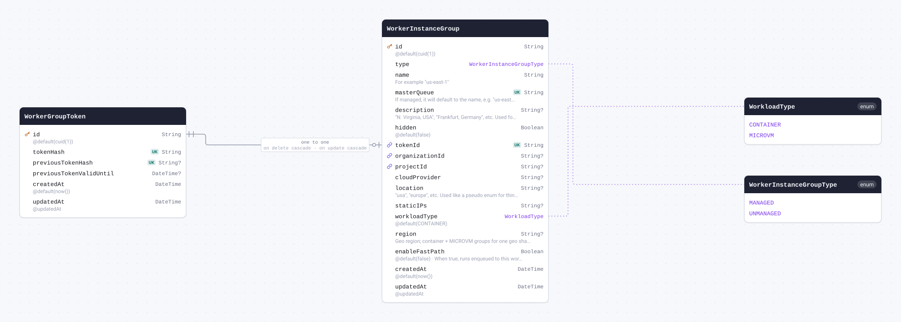

| Field                     | Type       | Constraints     | Default      | Description |
| ------------------------- | ---------- | --------------- | ------------ | ----------- |
| `id`                      | `String`   | PK NOT NULL     | `cuid(1)`    |             |
| `tokenHash`               | `String`   | UNIQUE NOT NULL |              |             |
| `previousTokenHash`       | `String`   | UNIQUE NULL     |              |             |
| `previousTokenValidUntil` | `DateTime` | NULL            |              |             |
| `createdAt`               | `DateTime` | NOT NULL        | `now()`      |             |
| `updatedAt`               | `DateTime` | NOT NULL        | `@updatedAt` |             |

#### Referenced by

- `id` ← [WorkerInstanceGroup.tokenId](#model-WorkerInstanceGroup) (one-to-one, on delete Cascade, on update Cascade)

#### Definition

```sql
CREATE TABLE "WorkerGroupToken" (
    "id" TEXT NOT NULL,
    "tokenHash" TEXT NOT NULL,
    "previousTokenHash" TEXT,
    "previousTokenValidUntil" TIMESTAMP(3),
    "createdAt" TIMESTAMP(3) NOT NULL DEFAULT CURRENT_TIMESTAMP,
    "updatedAt" TIMESTAMP(3) NOT NULL,

    CONSTRAINT "WorkerGroupToken_pkey" PRIMARY KEY ("id")
);

CREATE UNIQUE INDEX "WorkerGroupToken_tokenHash_key" ON "WorkerGroupToken"("tokenHash");

CREATE UNIQUE INDEX "WorkerGroupToken_previousTokenHash_key" ON "WorkerGroupToken"("previousTokenHash");
```

<details>
<summary>Queries and their SQL</summary>

**findMany**: Every row

```ts
await prisma.workerGroupToken.findMany();
```

```sql
SELECT
  "public"."WorkerGroupToken"."id",
  "public"."WorkerGroupToken"."tokenHash",
  "public"."WorkerGroupToken"."previousTokenHash",
  "public"."WorkerGroupToken"."previousTokenValidUntil",
  "public"."WorkerGroupToken"."createdAt",
  "public"."WorkerGroupToken"."updatedAt"
FROM
  "public"."WorkerGroupToken"
WHERE
  1 = 1
OFFSET
  $1
-- params: ["0"]
```

**count**: How many rows there are

```ts
await prisma.workerGroupToken.count();
```

```sql
SELECT
  COUNT(*) AS "_count$_all"
FROM
  (
    SELECT
      "public"."WorkerGroupToken"."id"
    FROM
      "public"."WorkerGroupToken"
    WHERE
      1 = 1
    OFFSET
      $1
  ) AS "sub"
-- params: ["0"]
```

**findMany**: Every row with its relations

```ts
await prisma.workerGroupToken.findMany({ include: { workerGroup: true } });
```

```sql
SELECT
  "public"."WorkerGroupToken"."id",
  "public"."WorkerGroupToken"."tokenHash",
  "public"."WorkerGroupToken"."previousTokenHash",
  "public"."WorkerGroupToken"."previousTokenValidUntil",
  "public"."WorkerGroupToken"."createdAt",
  "public"."WorkerGroupToken"."updatedAt"
FROM
  "public"."WorkerGroupToken"
WHERE
  1 = 1
OFFSET
  $1
-- params: ["0"]

SELECT
  "public"."WorkerInstanceGroup"."id",
  "public"."WorkerInstanceGroup"."type"::text,
  "public"."WorkerInstanceGroup"."name",
  "public"."WorkerInstanceGroup"."masterQueue",
  "public"."WorkerInstanceGroup"."description",
  "public"."WorkerInstanceGroup"."hidden",
  "public"."WorkerInstanceGroup"."tokenId",
  "public"."WorkerInstanceGroup"."organizationId",
  "public"."WorkerInstanceGroup"."projectId",
  "public"."WorkerInstanceGroup"."cloudProvider",
  "public"."WorkerInstanceGroup"."location",
  "public"."WorkerInstanceGroup"."staticIPs",
  "public"."WorkerInstanceGroup"."workloadType"::text,
  "public"."WorkerInstanceGroup"."region",
  "public"."WorkerInstanceGroup"."enableFastPath",
  "public"."WorkerInstanceGroup"."createdAt",
  "public"."WorkerInstanceGroup"."updatedAt"
FROM
  "public"."WorkerInstanceGroup"
WHERE
  "public"."WorkerInstanceGroup"."tokenId" IN ($1)
OFFSET
  $2
-- params: ["<id of the rows above>","0"]
```

**findUnique**: One row by what is unique to it

```ts
await prisma.workerGroupToken.findUnique({ where: { id: "example" } });
```

```sql
SELECT
  "public"."WorkerGroupToken"."id",
  "public"."WorkerGroupToken"."tokenHash",
  "public"."WorkerGroupToken"."previousTokenHash",
  "public"."WorkerGroupToken"."previousTokenValidUntil",
  "public"."WorkerGroupToken"."createdAt",
  "public"."WorkerGroupToken"."updatedAt"
FROM
  "public"."WorkerGroupToken"
WHERE
  (
    "public"."WorkerGroupToken"."id" = $1
    AND 1 = 1
  )
LIMIT
  $2
OFFSET
  $3
-- params: ["example","1","0"]
```

**create**: Create a row

```ts
await prisma.workerGroupToken.create({ data: { tokenHash: "example" } });
```

```sql
INSERT INTO
  "public"."WorkerGroupToken" ("id", "tokenHash", "createdAt", "updatedAt")
VALUES
  ($1, $2, $3, $4)
RETURNING
  "public"."WorkerGroupToken"."id",
  "public"."WorkerGroupToken"."tokenHash",
  "public"."WorkerGroupToken"."previousTokenHash",
  "public"."WorkerGroupToken"."previousTokenValidUntil",
  "public"."WorkerGroupToken"."createdAt",
  "public"."WorkerGroupToken"."updatedAt"
-- params: ["<cuid(1)>","example","<now()>","<now()>"]
```

**update**: Update a row

```ts
await prisma.workerGroupToken.update({ where: { id: "example" }, data: { tokenHash: "example" } });
```

```sql
UPDATE "public"."WorkerGroupToken"
SET
  "tokenHash" = $1,
  "updatedAt" = $2
WHERE
  (
    "public"."WorkerGroupToken"."id" = $3
    AND 1 = 1
  )
RETURNING
  "public"."WorkerGroupToken"."id",
  "public"."WorkerGroupToken"."tokenHash",
  "public"."WorkerGroupToken"."previousTokenHash",
  "public"."WorkerGroupToken"."previousTokenValidUntil",
  "public"."WorkerGroupToken"."createdAt",
  "public"."WorkerGroupToken"."updatedAt"
-- params: ["example",{"prisma__type":"generatorCall","prisma__value":{"name":"now","args":[],"returnType":{"type":"DateTime"}}},"example"]
```

**delete**: Delete a row

```ts
await prisma.workerGroupToken.delete({ where: { id: "example" } });
```

```sql
DELETE FROM "public"."WorkerGroupToken"
WHERE
  (
    "public"."WorkerGroupToken"."id" = $1
    AND 1 = 1
  )
RETURNING
  "public"."WorkerGroupToken"."id",
  "public"."WorkerGroupToken"."tokenHash",
  "public"."WorkerGroupToken"."previousTokenHash",
  "public"."WorkerGroupToken"."previousTokenValidUntil",
  "public"."WorkerGroupToken"."createdAt",
  "public"."WorkerGroupToken"."updatedAt"
-- params: ["example"]
```

</details>

<a id="model-TaskRunTag"></a>

### TaskRunTag

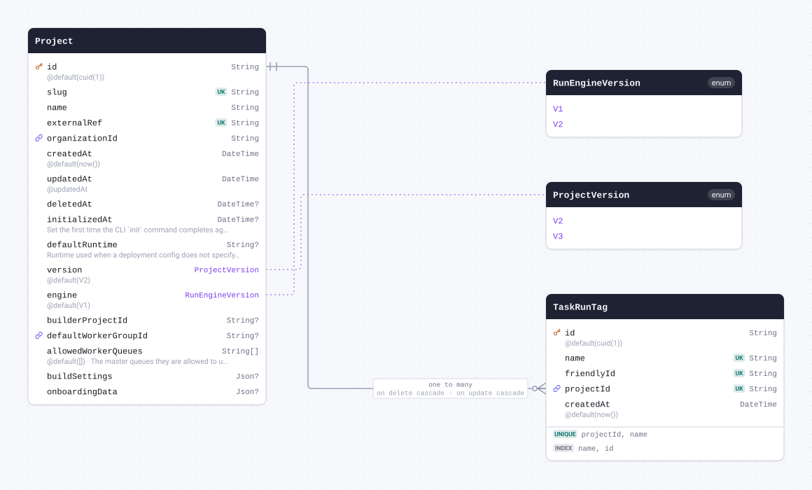

| Field        | Type       | Constraints                             | Default   | Description |
| ------------ | ---------- | --------------------------------------- | --------- | ----------- |
| `id`         | `String`   | PK NOT NULL                             | `cuid(1)` |             |
| `name`       | `String`   | NOT NULL                                |           |             |
| `friendlyId` | `String`   | UNIQUE NOT NULL                         |           |             |
| `projectId`  | `String`   | NOT NULL → [Project.id](#model-Project) |           |             |
| `createdAt`  | `DateTime` | NOT NULL                                | `now()`   |             |

#### Indexes

- `@@index([name, id])`
- `@@unique([projectId, name])`

#### References

- `projectId` → [Project.id](#model-Project) (many-to-one, on delete Cascade, on update Cascade)

#### Definition

```sql
CREATE TABLE "TaskRunTag" (
    "id" TEXT NOT NULL,
    "name" TEXT NOT NULL,
    "friendlyId" TEXT NOT NULL,
    "projectId" TEXT NOT NULL,
    "createdAt" TIMESTAMP(3) NOT NULL DEFAULT CURRENT_TIMESTAMP,

    CONSTRAINT "TaskRunTag_pkey" PRIMARY KEY ("id")
);

CREATE UNIQUE INDEX "TaskRunTag_friendlyId_key" ON "TaskRunTag"("friendlyId");

CREATE INDEX "TaskRunTag_name_id_idx" ON "TaskRunTag"("name", "id");

CREATE UNIQUE INDEX "TaskRunTag_projectId_name_key" ON "TaskRunTag"("projectId", "name");

ALTER TABLE "TaskRunTag" ADD CONSTRAINT "TaskRunTag_projectId_fkey" FOREIGN KEY ("projectId") REFERENCES "Project"("id") ON DELETE CASCADE ON UPDATE CASCADE;
```

<details>
<summary>Queries and their SQL</summary>

**findMany**: Every row

```ts
await prisma.taskRunTag.findMany();
```

```sql
SELECT
  "public"."TaskRunTag"."id",
  "public"."TaskRunTag"."name",
  "public"."TaskRunTag"."friendlyId",
  "public"."TaskRunTag"."projectId",
  "public"."TaskRunTag"."createdAt"
FROM
  "public"."TaskRunTag"
WHERE
  1 = 1
OFFSET
  $1
-- params: ["0"]
```

**count**: How many rows there are

```ts
await prisma.taskRunTag.count();
```

```sql
SELECT
  COUNT(*) AS "_count$_all"
FROM
  (
    SELECT
      "public"."TaskRunTag"."id"
    FROM
      "public"."TaskRunTag"
    WHERE
      1 = 1
    OFFSET
      $1
  ) AS "sub"
-- params: ["0"]
```

**findMany**: Every row with its relations

```ts
await prisma.taskRunTag.findMany({ include: { project: true } });
```

```sql
SELECT
  "public"."TaskRunTag"."id",
  "public"."TaskRunTag"."name",
  "public"."TaskRunTag"."friendlyId",
  "public"."TaskRunTag"."projectId",
  "public"."TaskRunTag"."createdAt"
FROM
  "public"."TaskRunTag"
WHERE
  1 = 1
OFFSET
  $1
-- params: ["0"]

SELECT
  "public"."Project"."id",
  "public"."Project"."slug",
  "public"."Project"."name",
  "public"."Project"."externalRef",
  "public"."Project"."organizationId",
  "public"."Project"."createdAt",
  "public"."Project"."updatedAt",
  "public"."Project"."deletedAt",
  "public"."Project"."initializedAt",
  "public"."Project"."defaultRuntime",
  "public"."Project"."version"::text,
  "public"."Project"."engine"::text,
  "public"."Project"."builderProjectId",
  "public"."Project"."defaultWorkerGroupId",
  "public"."Project"."allowedMasterQueues",
  "public"."Project"."buildSettings",
  "public"."Project"."onboardingData"
FROM
  "public"."Project"
WHERE
  "public"."Project"."id" IN ($1)
OFFSET
  $2
-- params: ["<projectId of the rows above>","0"]
```

**findUnique**: One row by what is unique to it

```ts
await prisma.taskRunTag.findUnique({ where: { id: "example" } });
```

```sql
SELECT
  "public"."TaskRunTag"."id",
  "public"."TaskRunTag"."name",
  "public"."TaskRunTag"."friendlyId",
  "public"."TaskRunTag"."projectId",
  "public"."TaskRunTag"."createdAt"
FROM
  "public"."TaskRunTag"
WHERE
  (
    "public"."TaskRunTag"."id" = $1
    AND 1 = 1
  )
LIMIT
  $2
OFFSET
  $3
-- params: ["example","1","0"]
```

**create**: Create a row

```ts
await prisma.taskRunTag.create({
  data: { name: "example", friendlyId: "example", projectId: "example" },
});
```

```sql
INSERT INTO
  "public"."TaskRunTag" (
    "id",
    "name",
    "friendlyId",
    "projectId",
    "createdAt"
  )
VALUES
  ($1, $2, $3, $4, $5)
RETURNING
  "public"."TaskRunTag"."id",
  "public"."TaskRunTag"."name",
  "public"."TaskRunTag"."friendlyId",
  "public"."TaskRunTag"."projectId",
  "public"."TaskRunTag"."createdAt"
-- params: ["<cuid(1)>","example","example","example","<now()>"]
```

**update**: Update a row

```ts
await prisma.taskRunTag.update({ where: { id: "example" }, data: { name: "example" } });
```

```sql
UPDATE "public"."TaskRunTag"
SET
  "name" = $1
WHERE
  (
    "public"."TaskRunTag"."id" = $2
    AND 1 = 1
  )
RETURNING
  "public"."TaskRunTag"."id",
  "public"."TaskRunTag"."name",
  "public"."TaskRunTag"."friendlyId",
  "public"."TaskRunTag"."projectId",
  "public"."TaskRunTag"."createdAt"
-- params: ["example","example"]
```

**delete**: Delete a row

```ts
await prisma.taskRunTag.delete({ where: { id: "example" } });
```

```sql
DELETE FROM "public"."TaskRunTag"
WHERE
  (
    "public"."TaskRunTag"."id" = $1
    AND 1 = 1
  )
RETURNING
  "public"."TaskRunTag"."id",
  "public"."TaskRunTag"."name",
  "public"."TaskRunTag"."friendlyId",
  "public"."TaskRunTag"."projectId",
  "public"."TaskRunTag"."createdAt"
-- params: ["example"]
```

</details>

<a id="model-TaskRunDependency"></a>

### TaskRunDependency

This is used for triggerAndWait and batchTriggerAndWait. The taskRun is the child task, it points at a parent attempt or a batch

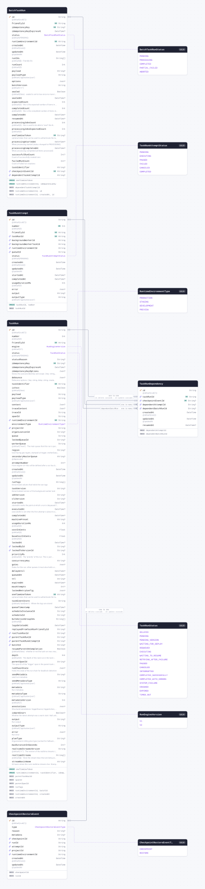

| Field                 | Type       | Constraints                                                              | Default      | Description |
| --------------------- | ---------- | ------------------------------------------------------------------------ | ------------ | ----------- |
| `id`                  | `String`   | PK NOT NULL                                                              | `cuid(1)`    |             |
| `taskRunId`           | `String`   | UNIQUE NOT NULL → [TaskRun.id](#model-TaskRun)                           |              |             |
| `checkpointEventId`   | `String`   | UNIQUE NULL → [CheckpointRestoreEvent.id](#model-CheckpointRestoreEvent) |              |             |
| `dependentAttemptId`  | `String`   | NULL → [TaskRunAttempt.id](#model-TaskRunAttempt)                        |              |             |
| `dependentBatchRunId` | `String`   | NULL → [BatchTaskRun.id](#model-BatchTaskRun)                            |              |             |
| `createdAt`           | `DateTime` | NOT NULL                                                                 | `now()`      |             |
| `updatedAt`           | `DateTime` | NOT NULL                                                                 | `@updatedAt` |             |
| `resumedAt`           | `DateTime` | NULL                                                                     |              |             |

#### Indexes

- `@@index([dependentAttemptId])`
- `@@index([dependentBatchRunId])`

#### References

- `taskRunId` → [TaskRun.id](#model-TaskRun) (one-to-one, on delete Cascade, on update Cascade)
- `checkpointEventId` → [CheckpointRestoreEvent.id](#model-CheckpointRestoreEvent) (one-to-one, on delete Cascade, on update Cascade)
- `dependentAttemptId` → [TaskRunAttempt.id](#model-TaskRunAttempt) (many-to-one)
- `dependentBatchRunId` → [BatchTaskRun.id](#model-BatchTaskRun) (many-to-one)

#### Definition

```sql
CREATE TABLE "TaskRunDependency" (
    "id" TEXT NOT NULL,
    "taskRunId" TEXT NOT NULL,
    "checkpointEventId" TEXT,
    "dependentAttemptId" TEXT,
    "dependentBatchRunId" TEXT,
    "createdAt" TIMESTAMP(3) NOT NULL DEFAULT CURRENT_TIMESTAMP,
    "updatedAt" TIMESTAMP(3) NOT NULL,
    "resumedAt" TIMESTAMP(3),

    CONSTRAINT "TaskRunDependency_pkey" PRIMARY KEY ("id")
);

CREATE UNIQUE INDEX "TaskRunDependency_taskRunId_key" ON "TaskRunDependency"("taskRunId");

CREATE UNIQUE INDEX "TaskRunDependency_checkpointEventId_key" ON "TaskRunDependency"("checkpointEventId");

CREATE INDEX "TaskRunDependency_dependentAttemptId_idx" ON "TaskRunDependency"("dependentAttemptId");

CREATE INDEX "TaskRunDependency_dependentBatchRunId_idx" ON "TaskRunDependency"("dependentBatchRunId");

ALTER TABLE "TaskRunDependency" ADD CONSTRAINT "TaskRunDependency_taskRunId_fkey" FOREIGN KEY ("taskRunId") REFERENCES "TaskRun"("id") ON DELETE CASCADE ON UPDATE CASCADE;

ALTER TABLE "TaskRunDependency" ADD CONSTRAINT "TaskRunDependency_checkpointEventId_fkey" FOREIGN KEY ("checkpointEventId") REFERENCES "CheckpointRestoreEvent"("id") ON DELETE CASCADE ON UPDATE CASCADE;

ALTER TABLE "TaskRunDependency" ADD CONSTRAINT "TaskRunDependency_dependentAttemptId_fkey" FOREIGN KEY ("dependentAttemptId") REFERENCES "TaskRunAttempt"("id") ON DELETE SET NULL ON UPDATE CASCADE;

ALTER TABLE "TaskRunDependency" ADD CONSTRAINT "TaskRunDependency_dependentBatchRunId_fkey" FOREIGN KEY ("dependentBatchRunId") REFERENCES "BatchTaskRun"("id") ON DELETE SET NULL ON UPDATE CASCADE;
```

<details>
<summary>Queries and their SQL</summary>

**findMany**: Every row

```ts
await prisma.taskRunDependency.findMany();
```

```sql
SELECT
  "public"."TaskRunDependency"."id",
  "public"."TaskRunDependency"."taskRunId",
  "public"."TaskRunDependency"."checkpointEventId",
  "public"."TaskRunDependency"."dependentAttemptId",
  "public"."TaskRunDependency"."dependentBatchRunId",
  "public"."TaskRunDependency"."createdAt",
  "public"."TaskRunDependency"."updatedAt",
  "public"."TaskRunDependency"."resumedAt"
FROM
  "public"."TaskRunDependency"
WHERE
  1 = 1
OFFSET
  $1
-- params: ["0"]
```

**count**: How many rows there are

```ts
await prisma.taskRunDependency.count();
```

```sql
SELECT
  COUNT(*) AS "_count$_all"
FROM
  (
    SELECT
      "public"."TaskRunDependency"."id"
    FROM
      "public"."TaskRunDependency"
    WHERE
      1 = 1
    OFFSET
      $1
  ) AS "sub"
-- params: ["0"]
```

**findMany**: Every row with its relations

```ts
await prisma.taskRunDependency.findMany({
  include: {
    taskRun: true,
    checkpointEvent: true,
    dependentAttempt: true,
    dependentBatchRun: true,
  },
});
```

```sql
SELECT
  "public"."TaskRunDependency"."id",
  "public"."TaskRunDependency"."taskRunId",
  "public"."TaskRunDependency"."checkpointEventId",
  "public"."TaskRunDependency"."dependentAttemptId",
  "public"."TaskRunDependency"."dependentBatchRunId",
  "public"."TaskRunDependency"."createdAt",
  "public"."TaskRunDependency"."updatedAt",
  "public"."TaskRunDependency"."resumedAt"
FROM
  "public"."TaskRunDependency"
WHERE
  1 = 1
OFFSET
  $1
-- params: ["0"]

SELECT
  "public"."TaskRun"."id",
  "public"."TaskRun"."number",
  "public"."TaskRun"."friendlyId",
  "public"."TaskRun"."engine"::text,
  "public"."TaskRun"."status"::text,
  "public"."TaskRun"."statusReason",
  "public"."TaskRun"."idempotencyKey",
  "public"."TaskRun"."idempotencyKeyExpiresAt",
  "public"."TaskRun"."idempotencyKeyOptions",
  "public"."TaskRun"."debounce",
  "public"."TaskRun"."taskIdentifier",
  "public"."TaskRun"."isTest",
  "public"."TaskRun"."payload",
  "public"."TaskRun"."payloadType",
  "public"."TaskRun"."context",
  "public"."TaskRun"."traceContext",
  "public"."TaskRun"."traceId",
  "public"."TaskRun"."spanId",
  "public"."TaskRun"."runtimeEnvironmentId",
  "public"."TaskRun"."environmentType"::text,
  "public"."TaskRun"."projectId",
  "public"."TaskRun"."organizationId",
  "public"."TaskRun"."queue",
  "public"."TaskRun"."lockedQueueId",
  "public"."TaskRun"."masterQueue",
  "public"."TaskRun"."region",
  "public"."TaskRun"."secondaryMasterQueue",
  "public"."TaskRun"."attemptNumber",
  "public"."TaskRun"."createdAt",
  "public"."TaskRun"."updatedAt",
  "public"."TaskRun"."runTags",
  "public"."TaskRun"."taskVersion",
  "public"."TaskRun"."sdkVersion",
  "public"."TaskRun"."cliVersion",
  "public"."TaskRun"."startedAt",
  "public"."TaskRun"."executedAt",
  "public"."TaskRun"."completedAt",
  "public"."TaskRun"."machinePreset",
  "public"."TaskRun"."usageDurationMs",
  "public"."TaskRun"."costInCents",
  "public"."TaskRun"."baseCostInCents",
  "public"."TaskRun"."lockedAt",
  "public"."TaskRun"."lockedById",
  "public"."TaskRun"."lockedToVersionId",
  "public"."TaskRun"."priorityMs",
  "public"."TaskRun"."concurrencyKey",
  "public"."TaskRun"."gates",
  "public"."TaskRun"."delayUntil",
  "public"."TaskRun"."queuedAt",
  "public"."TaskRun"."ttl",
  "public"."TaskRun"."expiredAt",
  "public"."TaskRun"."maxAttempts",
  "public"."TaskRun"."lockedRetryConfig",
  "public"."TaskRun"."oneTimeUseToken",
  "public"."TaskRun"."taskEventStore",
  "public"."TaskRun"."queueTimestamp",
  "public"."TaskRun"."scheduleInstanceId",
  "public"."TaskRun"."scheduleId",
  "public"."TaskRun"."bulkActionGroupIds",
  "public"."TaskRun"."logsDeletedAt",
  "public"."TaskRun"."replayedFromTaskRunFriendlyId",
  "public"."TaskRun"."rootTaskRunId",
  "public"."TaskRun"."parentTaskRunId",
  "public"."TaskRun"."parentTaskRunAttemptId",
  "public"."TaskRun"."batchId",
  "public"."TaskRun"."resumeParentOnCompletion",
  "public"."TaskRun"."depth",
  "public"."TaskRun"."parentSpanId",
  "public"."TaskRun"."runChainState",
  "public"."TaskRun"."seedMetadata",
  "public"."TaskRun"."seedMetadataType",
  "public"."TaskRun"."metadata",
  "public"."TaskRun"."metadataType",
  "public"."TaskRun"."metadataVersion",
  "public"."TaskRun"."annotations",
  "public"."TaskRun"."isWarmStart",
  "public"."TaskRun"."output",
  "public"."TaskRun"."outputType",
  "public"."TaskRun"."error",
  "public"."TaskRun"."planType",
  "public"."TaskRun"."maxDurationInSeconds",
  "public"."TaskRun"."realtimeStreamsVersion",
  "public"."TaskRun"."realtimeStreams",
  "public"."TaskRun"."streamBasinName"
FROM
  "public"."TaskRun"
WHERE
  "public"."TaskRun"."id" IN ($1)
OFFSET
  $2
-- params: ["<taskRunId of the rows above>","0"]

SELECT
  "public"."CheckpointRestoreEvent"."id",
  "public"."CheckpointRestoreEvent"."type"::text,
  "public"."CheckpointRestoreEvent"."reason",
  "public"."CheckpointRestoreEvent"."metadata",
  "public"."CheckpointRestoreEvent"."checkpointId",
  "public"."CheckpointRestoreEvent"."runId",
  "public"."CheckpointRestoreEvent"."attemptId",
  "public"."CheckpointRestoreEvent"."projectId",
  "public"."CheckpointRestoreEvent"."runtimeEnvironmentId",
  "public"."CheckpointRestoreEvent"."createdAt",
  "public"."CheckpointRestoreEvent"."updatedAt"
FROM
  "public"."CheckpointRestoreEvent"
WHERE
  "public"."CheckpointRestoreEvent"."id" IN ($1)
OFFSET
  $2
-- params: ["<checkpointEventId of the rows above>","0"]

SELECT
  "public"."TaskRunAttempt"."id",
  "public"."TaskRunAttempt"."number",
  "public"."TaskRunAttempt"."friendlyId",
  "public"."TaskRunAttempt"."taskRunId",
  "public"."TaskRunAttempt"."backgroundWorkerId",
  "public"."TaskRunAttempt"."backgroundWorkerTaskId",
  "public"."TaskRunAttempt"."runtimeEnvironmentId",
  "public"."TaskRunAttempt"."queueId",
  "public"."TaskRunAttempt"."status"::text,
  "public"."TaskRunAttempt"."createdAt",
  "public"."TaskRunAttempt"."updatedAt",
  "public"."TaskRunAttempt"."startedAt",
  "public"."TaskRunAttempt"."completedAt",
  "public"."TaskRunAttempt"."usageDurationMs",
  "public"."TaskRunAttempt"."error",
  "public"."TaskRunAttempt"."output",
  "public"."TaskRunAttempt"."outputType"
FROM
  "public"."TaskRunAttempt"
WHERE
  "public"."TaskRunAttempt"."id" IN ($1)
OFFSET
  $2
-- params: ["<dependentAttemptId of the rows above>","0"]

SELECT
  "public"."BatchTaskRun"."id",
  "public"."BatchTaskRun"."friendlyId",
  "public"."BatchTaskRun"."idempotencyKey",
  "public"."BatchTaskRun"."idempotencyKeyExpiresAt",
  "public"."BatchTaskRun"."status"::text,
  "public"."BatchTaskRun"."runtimeEnvironmentId",
  "public"."BatchTaskRun"."createdAt",
  "public"."BatchTaskRun"."updatedAt",
  "public"."BatchTaskRun"."runIds",
  "public"."BatchTaskRun"."runCount",
  "public"."BatchTaskRun"."payload",
  "public"."BatchTaskRun"."payloadType",
  "public"."BatchTaskRun"."options",
  "public"."BatchTaskRun"."batchVersion",
  "public"."BatchTaskRun"."sealed",
  "public"."BatchTaskRun"."sealedAt",
  "public"."BatchTaskRun"."expectedCount",
  "public"."BatchTaskRun"."completedCount",
  "public"."BatchTaskRun"."completedAt",
  "public"."BatchTaskRun"."resumedAt",
  "public"."BatchTaskRun"."processingJobsCount",
  "public"."BatchTaskRun"."processingJobsExpectedCount",
  "public"."BatchTaskRun"."oneTimeUseToken",
  "public"."BatchTaskRun"."processingStartedAt",
  "public"."BatchTaskRun"."processingCompletedAt",
  "public"."BatchTaskRun"."successfulRunCount",
  "public"."BatchTaskRun"."failedRunCount",
  "public"."BatchTaskRun"."taskIdentifier",
  "public"."BatchTaskRun"."checkpointEventId",
  "public"."BatchTaskRun"."dependentTaskAttemptId"
FROM
  "public"."BatchTaskRun"
WHERE
  "public"."BatchTaskRun"."id" IN ($1)
OFFSET
  $2
-- params: ["<dependentBatchRunId of the rows above>","0"]
```

**findUnique**: One row by what is unique to it

```ts
await prisma.taskRunDependency.findUnique({ where: { id: "example" } });
```

```sql
SELECT
  "public"."TaskRunDependency"."id",
  "public"."TaskRunDependency"."taskRunId",
  "public"."TaskRunDependency"."checkpointEventId",
  "public"."TaskRunDependency"."dependentAttemptId",
  "public"."TaskRunDependency"."dependentBatchRunId",
  "public"."TaskRunDependency"."createdAt",
  "public"."TaskRunDependency"."updatedAt",
  "public"."TaskRunDependency"."resumedAt"
FROM
  "public"."TaskRunDependency"
WHERE
  (
    "public"."TaskRunDependency"."id" = $1
    AND 1 = 1
  )
LIMIT
  $2
OFFSET
  $3
-- params: ["example","1","0"]
```

**create**: Create a row

```ts
await prisma.taskRunDependency.create({ data: { taskRunId: "example" } });
```

```sql
INSERT INTO
  "public"."TaskRunDependency" ("id", "taskRunId", "createdAt", "updatedAt")
VALUES
  ($1, $2, $3, $4)
RETURNING
  "public"."TaskRunDependency"."id",
  "public"."TaskRunDependency"."taskRunId",
  "public"."TaskRunDependency"."checkpointEventId",
  "public"."TaskRunDependency"."dependentAttemptId",
  "public"."TaskRunDependency"."dependentBatchRunId",
  "public"."TaskRunDependency"."createdAt",
  "public"."TaskRunDependency"."updatedAt",
  "public"."TaskRunDependency"."resumedAt"
-- params: ["<cuid(1)>","example","<now()>","<now()>"]
```

**update**: Update a row

```ts
await prisma.taskRunDependency.update({
  where: { id: "example" },
  data: { createdAt: new Date("2026-01-01T00:00:00.000Z") },
});
```

```sql
UPDATE "public"."TaskRunDependency"
SET
  "createdAt" = $1,
  "updatedAt" = $2
WHERE
  (
    "public"."TaskRunDependency"."id" = $3
    AND 1 = 1
  )
RETURNING
  "public"."TaskRunDependency"."id",
  "public"."TaskRunDependency"."taskRunId",
  "public"."TaskRunDependency"."checkpointEventId",
  "public"."TaskRunDependency"."dependentAttemptId",
  "public"."TaskRunDependency"."dependentBatchRunId",
  "public"."TaskRunDependency"."createdAt",
  "public"."TaskRunDependency"."updatedAt",
  "public"."TaskRunDependency"."resumedAt"
-- params: ["2026-01-01T00:00:00.000Z",{"prisma__type":"generatorCall","prisma__value":{"name":"now","args":[],"returnType":{"type":"DateTime"}}},"example"]
```

**delete**: Delete a row

```ts
await prisma.taskRunDependency.delete({ where: { id: "example" } });
```

```sql
DELETE FROM "public"."TaskRunDependency"
WHERE
  (
    "public"."TaskRunDependency"."id" = $1
    AND 1 = 1
  )
RETURNING
  "public"."TaskRunDependency"."id",
  "public"."TaskRunDependency"."taskRunId",
  "public"."TaskRunDependency"."checkpointEventId",
  "public"."TaskRunDependency"."dependentAttemptId",
  "public"."TaskRunDependency"."dependentBatchRunId",
  "public"."TaskRunDependency"."createdAt",
  "public"."TaskRunDependency"."updatedAt",
  "public"."TaskRunDependency"."resumedAt"
-- params: ["example"]
```

</details>

<a id="model-TaskRunCounter"></a>

### TaskRunCounter

deprecated, we hadn't included the project id in the unique constraint

| Field            | Type     | Constraints | Default | Description |
| ---------------- | -------- | ----------- | ------- | ----------- |
| `taskIdentifier` | `String` | PK NOT NULL |         |             |
| `lastNumber`     | `Int`    | NOT NULL    | `0`     |             |

#### Definition

```sql
CREATE TABLE "TaskRunCounter" (
    "taskIdentifier" TEXT NOT NULL,
    "lastNumber" INTEGER NOT NULL DEFAULT 0,

    CONSTRAINT "TaskRunCounter_pkey" PRIMARY KEY ("taskIdentifier")
);
```

<details>
<summary>Queries and their SQL</summary>

**findMany**: Every row

```ts
await prisma.taskRunCounter.findMany();
```

```sql
SELECT
  "public"."TaskRunCounter"."taskIdentifier",
  "public"."TaskRunCounter"."lastNumber"
FROM
  "public"."TaskRunCounter"
WHERE
  1 = 1
OFFSET
  $1
-- params: ["0"]
```

**count**: How many rows there are

```ts
await prisma.taskRunCounter.count();
```

```sql
SELECT
  COUNT(*) AS "_count$_all"
FROM
  (
    SELECT
      "public"."TaskRunCounter"."taskIdentifier"
    FROM
      "public"."TaskRunCounter"
    WHERE
      1 = 1
    OFFSET
      $1
  ) AS "sub"
-- params: ["0"]
```

**findUnique**: One row by what is unique to it

```ts
await prisma.taskRunCounter.findUnique({ where: { taskIdentifier: "example" } });
```

```sql
SELECT
  "public"."TaskRunCounter"."taskIdentifier",
  "public"."TaskRunCounter"."lastNumber"
FROM
  "public"."TaskRunCounter"
WHERE
  (
    "public"."TaskRunCounter"."taskIdentifier" = $1
    AND 1 = 1
  )
LIMIT
  $2
OFFSET
  $3
-- params: ["example","1","0"]
```

**create**: Create a row

```ts
await prisma.taskRunCounter.create({ data: { taskIdentifier: "example" } });
```

```sql
INSERT INTO
  "public"."TaskRunCounter" ("taskIdentifier", "lastNumber")
VALUES
  ($1, $2)
RETURNING
  "public"."TaskRunCounter"."taskIdentifier",
  "public"."TaskRunCounter"."lastNumber"
-- params: ["example","0"]
```

**update**: Update a row

```ts
await prisma.taskRunCounter.update({
  where: { taskIdentifier: "example" },
  data: { lastNumber: 1 },
});
```

```sql
UPDATE "public"."TaskRunCounter"
SET
  "lastNumber" = $1
WHERE
  (
    "public"."TaskRunCounter"."taskIdentifier" = $2
    AND 1 = 1
  )
RETURNING
  "public"."TaskRunCounter"."taskIdentifier",
  "public"."TaskRunCounter"."lastNumber"
-- params: ["1","example"]
```

**delete**: Delete a row

```ts
await prisma.taskRunCounter.delete({ where: { taskIdentifier: "example" } });
```

```sql
DELETE FROM "public"."TaskRunCounter"
WHERE
  (
    "public"."TaskRunCounter"."taskIdentifier" = $1
    AND 1 = 1
  )
RETURNING
  "public"."TaskRunCounter"."taskIdentifier",
  "public"."TaskRunCounter"."lastNumber"
-- params: ["example"]
```

</details>

<a id="model-TaskRunNumberCounter"></a>

### TaskRunNumberCounter

Used for the TaskRun number (e.g. #1,421)

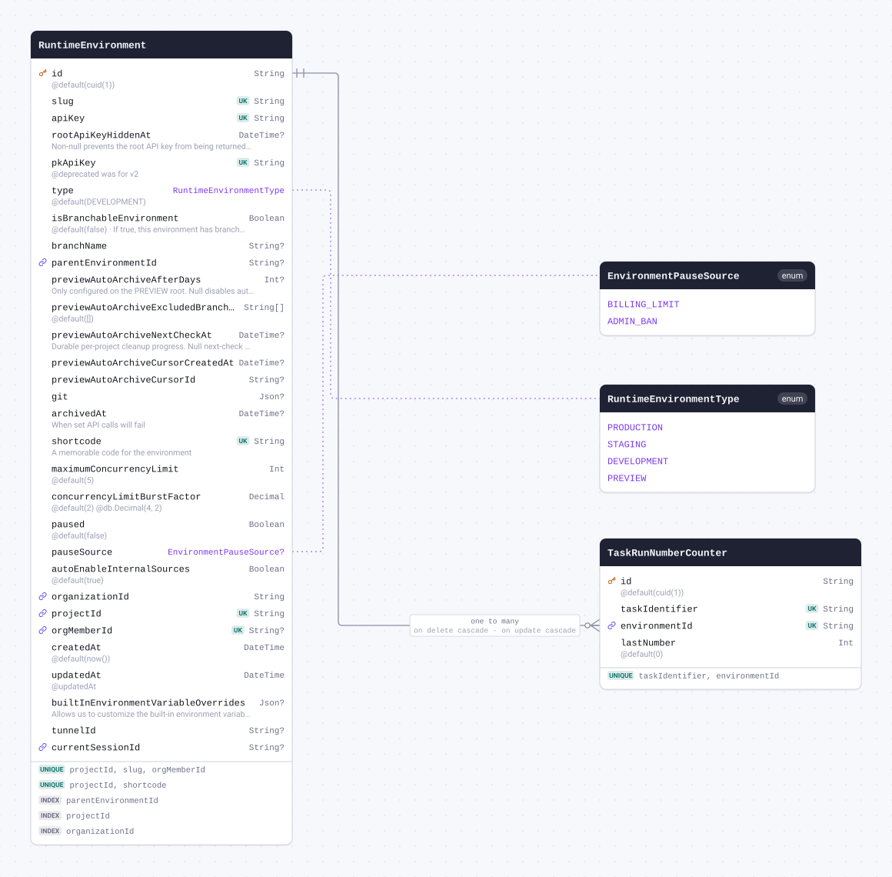

| Field            | Type     | Constraints                                                   | Default   | Description |
| ---------------- | -------- | ------------------------------------------------------------- | --------- | ----------- |
| `id`             | `String` | PK NOT NULL                                                   | `cuid(1)` |             |
| `taskIdentifier` | `String` | NOT NULL                                                      |           |             |
| `environmentId`  | `String` | NOT NULL → [RuntimeEnvironment.id](#model-RuntimeEnvironment) |           |             |
| `lastNumber`     | `Int`    | NOT NULL                                                      | `0`       |             |

#### Indexes

- `@@unique([taskIdentifier, environmentId])`

#### References

- `environmentId` → [RuntimeEnvironment.id](#model-RuntimeEnvironment) (many-to-one, on delete Cascade, on update Cascade)

#### Definition

```sql
CREATE TABLE "TaskRunNumberCounter" (
    "id" TEXT NOT NULL,
    "taskIdentifier" TEXT NOT NULL,
    "environmentId" TEXT NOT NULL,
    "lastNumber" INTEGER NOT NULL DEFAULT 0,

    CONSTRAINT "TaskRunNumberCounter_pkey" PRIMARY KEY ("id")
);

CREATE UNIQUE INDEX "TaskRunNumberCounter_taskIdentifier_environmentId_key" ON "TaskRunNumberCounter"("taskIdentifier", "environmentId");

ALTER TABLE "TaskRunNumberCounter" ADD CONSTRAINT "TaskRunNumberCounter_environmentId_fkey" FOREIGN KEY ("environmentId") REFERENCES "RuntimeEnvironment"("id") ON DELETE CASCADE ON UPDATE CASCADE;
```

<details>
<summary>Queries and their SQL</summary>

**findMany**: Every row

```ts
await prisma.taskRunNumberCounter.findMany();
```

```sql
SELECT
  "public"."TaskRunNumberCounter"."id",
  "public"."TaskRunNumberCounter"."taskIdentifier",
  "public"."TaskRunNumberCounter"."environmentId",
  "public"."TaskRunNumberCounter"."lastNumber"
FROM
  "public"."TaskRunNumberCounter"
WHERE
  1 = 1
OFFSET
  $1
-- params: ["0"]
```

**count**: How many rows there are

```ts
await prisma.taskRunNumberCounter.count();
```

```sql
SELECT
  COUNT(*) AS "_count$_all"
FROM
  (
    SELECT
      "public"."TaskRunNumberCounter"."id"
    FROM
      "public"."TaskRunNumberCounter"
    WHERE
      1 = 1
    OFFSET
      $1
  ) AS "sub"
-- params: ["0"]
```

**findMany**: Every row with its relations

```ts
await prisma.taskRunNumberCounter.findMany({ include: { environment: true } });
```

```sql
SELECT
  "public"."TaskRunNumberCounter"."id",
  "public"."TaskRunNumberCounter"."taskIdentifier",
  "public"."TaskRunNumberCounter"."environmentId",
  "public"."TaskRunNumberCounter"."lastNumber"
FROM
  "public"."TaskRunNumberCounter"
WHERE
  1 = 1
OFFSET
  $1
-- params: ["0"]

SELECT
  "public"."RuntimeEnvironment"."id",
  "public"."RuntimeEnvironment"."slug",
  "public"."RuntimeEnvironment"."apiKey",
  "public"."RuntimeEnvironment"."rootApiKeyHiddenAt",
  "public"."RuntimeEnvironment"."pkApiKey",
  "public"."RuntimeEnvironment"."type"::text,
  "public"."RuntimeEnvironment"."isBranchableEnvironment",
  "public"."RuntimeEnvironment"."branchName",
  "public"."RuntimeEnvironment"."parentEnvironmentId",
  "public"."RuntimeEnvironment"."previewAutoArchiveAfterDays",
  "public"."RuntimeEnvironment"."previewAutoArchiveExcludedBranches",
  "public"."RuntimeEnvironment"."previewAutoArchiveNextCheckAt",
  "public"."RuntimeEnvironment"."previewAutoArchiveCursorCreatedAt",
  "public"."RuntimeEnvironment"."previewAutoArchiveCursorId",
  "public"."RuntimeEnvironment"."git",
  "public"."RuntimeEnvironment"."archivedAt",
  "public"."RuntimeEnvironment"."shortcode",
  "public"."RuntimeEnvironment"."maximumConcurrencyLimit",
  "public"."RuntimeEnvironment"."concurrencyLimitBurstFactor",
  "public"."RuntimeEnvironment"."paused",
  "public"."RuntimeEnvironment"."pauseSource"::text,
  "public"."RuntimeEnvironment"."autoEnableInternalSources",
  "public"."RuntimeEnvironment"."organizationId",
  "public"."RuntimeEnvironment"."projectId",
  "public"."RuntimeEnvironment"."orgMemberId",
  "public"."RuntimeEnvironment"."createdAt",
  "public"."RuntimeEnvironment"."updatedAt",
  "public"."RuntimeEnvironment"."builtInEnvironmentVariableOverrides",
  "public"."RuntimeEnvironment"."tunnelId",
  "public"."RuntimeEnvironment"."currentSessionId"
FROM
  "public"."RuntimeEnvironment"
WHERE
  "public"."RuntimeEnvironment"."id" IN ($1)
OFFSET
  $2
-- params: ["<environmentId of the rows above>","0"]
```

**findUnique**: One row by what is unique to it

```ts
await prisma.taskRunNumberCounter.findUnique({ where: { id: "example" } });
```

```sql
SELECT
  "public"."TaskRunNumberCounter"."id",
  "public"."TaskRunNumberCounter"."taskIdentifier",
  "public"."TaskRunNumberCounter"."environmentId",
  "public"."TaskRunNumberCounter"."lastNumber"
FROM
  "public"."TaskRunNumberCounter"
WHERE
  (
    "public"."TaskRunNumberCounter"."id" = $1
    AND 1 = 1
  )
LIMIT
  $2
OFFSET
  $3
-- params: ["example","1","0"]
```

**create**: Create a row

```ts
await prisma.taskRunNumberCounter.create({
  data: { taskIdentifier: "example", environmentId: "example" },
});
```

```sql
INSERT INTO
  "public"."TaskRunNumberCounter" (
    "id",
    "taskIdentifier",
    "environmentId",
    "lastNumber"
  )
VALUES
  ($1, $2, $3, $4)
RETURNING
  "public"."TaskRunNumberCounter"."id",
  "public"."TaskRunNumberCounter"."taskIdentifier",
  "public"."TaskRunNumberCounter"."environmentId",
  "public"."TaskRunNumberCounter"."lastNumber"
-- params: ["<cuid(1)>","example","example","0"]
```

**update**: Update a row

```ts
await prisma.taskRunNumberCounter.update({
  where: { id: "example" },
  data: { taskIdentifier: "example" },
});
```

```sql
UPDATE "public"."TaskRunNumberCounter"
SET
  "taskIdentifier" = $1
WHERE
  (
    "public"."TaskRunNumberCounter"."id" = $2
    AND 1 = 1
  )
RETURNING
  "public"."TaskRunNumberCounter"."id",
  "public"."TaskRunNumberCounter"."taskIdentifier",
  "public"."TaskRunNumberCounter"."environmentId",
  "public"."TaskRunNumberCounter"."lastNumber"
-- params: ["example","example"]
```

**delete**: Delete a row

```ts
await prisma.taskRunNumberCounter.delete({ where: { id: "example" } });
```

```sql
DELETE FROM "public"."TaskRunNumberCounter"
WHERE
  (
    "public"."TaskRunNumberCounter"."id" = $1
    AND 1 = 1
  )
RETURNING
  "public"."TaskRunNumberCounter"."id",
  "public"."TaskRunNumberCounter"."taskIdentifier",
  "public"."TaskRunNumberCounter"."environmentId",
  "public"."TaskRunNumberCounter"."lastNumber"
-- params: ["example"]
```

</details>

<a id="model-TaskRunAttempt"></a>

### TaskRunAttempt

This is not used from engine v2+, attempts use the TaskRunExecutionSnapshot and TaskRun

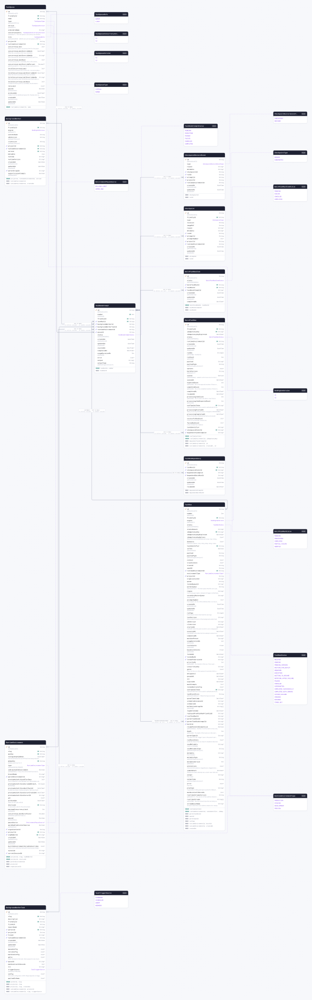

| Field                    | Type                                                 | Constraints                                                       | Default              | Description |
| ------------------------ | ---------------------------------------------------- | ----------------------------------------------------------------- | -------------------- | ----------- |
| `id`                     | `String`                                             | PK NOT NULL                                                       | `cuid(1)`            |             |
| `number`                 | `Int`                                                | NOT NULL                                                          | `0`                  |             |
| `friendlyId`             | `String`                                             | UNIQUE NOT NULL                                                   |                      |             |
| `taskRunId`              | `String`                                             | NOT NULL → [TaskRun.id](#model-TaskRun)                           |                      |             |
| `backgroundWorkerId`     | `String`                                             | NOT NULL → [BackgroundWorker.id](#model-BackgroundWorker)         |                      |             |
| `backgroundWorkerTaskId` | `String`                                             | NOT NULL → [BackgroundWorkerTask.id](#model-BackgroundWorkerTask) |                      |             |
| `runtimeEnvironmentId`   | `String`                                             | NOT NULL → [RuntimeEnvironment.id](#model-RuntimeEnvironment)     |                      |             |
| `queueId`                | `String`                                             | NOT NULL → [TaskQueue.id](#model-TaskQueue)                       |                      |             |
| `status`                 | [`TaskRunAttemptStatus`](#enum-TaskRunAttemptStatus) | NOT NULL                                                          | `PENDING`            |             |
| `createdAt`              | `DateTime`                                           | NOT NULL                                                          | `now()`              |             |
| `updatedAt`              | `DateTime`                                           | NOT NULL                                                          | `@updatedAt`         |             |
| `startedAt`              | `DateTime`                                           | NULL                                                              |                      |             |
| `completedAt`            | `DateTime`                                           | NULL                                                              |                      |             |
| `usageDurationMs`        | `Int`                                                | NOT NULL                                                          | `0`                  |             |
| `error`                  | `Json`                                               | NULL                                                              |                      |             |
| `output`                 | `String`                                             | NULL                                                              |                      |             |
| `outputType`             | `String`                                             | NOT NULL                                                          | `"application/json"` |             |

#### Indexes

- `@@index([taskRunId])`
- `@@unique([taskRunId, number])`

#### References

- `taskRunId` → [TaskRun.id](#model-TaskRun) (many-to-one, on delete Cascade, on update Cascade)
- `backgroundWorkerId` → [BackgroundWorker.id](#model-BackgroundWorker) (many-to-one, on delete Cascade, on update Cascade)
- `backgroundWorkerTaskId` → [BackgroundWorkerTask.id](#model-BackgroundWorkerTask) (many-to-one, on delete Cascade, on update Cascade)
- `runtimeEnvironmentId` → [RuntimeEnvironment.id](#model-RuntimeEnvironment) (many-to-one, on delete Cascade, on update Cascade)
- `queueId` → [TaskQueue.id](#model-TaskQueue) (many-to-one, on delete Cascade, on update Cascade)

#### Referenced by

- `id` ← [TaskRun.parentTaskRunAttemptId](#model-TaskRun) (one-to-many, on delete SetNull, on update NoAction)
- `id` ← [TaskRunDependency.dependentAttemptId](#model-TaskRunDependency) (one-to-many)
- `id` ← [BatchTaskRun.dependentTaskAttemptId](#model-BatchTaskRun) (one-to-many, on delete Cascade, on update Cascade)
- `id` ← [BatchTaskRunItem.taskRunAttemptId](#model-BatchTaskRunItem) (one-to-many, on delete SetNull, on update Cascade)
- `id` ← [Checkpoint.attemptId](#model-Checkpoint) (one-to-many, on delete Cascade, on update Cascade)
- `id` ← [CheckpointRestoreEvent.attemptId](#model-CheckpointRestoreEvent) (one-to-many, on delete Cascade, on update Cascade)

#### Definition

```sql
CREATE TABLE "TaskRunAttempt" (
    "id" TEXT NOT NULL,
    "number" INTEGER NOT NULL DEFAULT 0,
    "friendlyId" TEXT NOT NULL,
    "taskRunId" TEXT NOT NULL,
    "backgroundWorkerId" TEXT NOT NULL,
    "backgroundWorkerTaskId" TEXT NOT NULL,
    "runtimeEnvironmentId" TEXT NOT NULL,
    "queueId" TEXT NOT NULL,
    "status" "TaskRunAttemptStatus" NOT NULL DEFAULT 'PENDING',
    "createdAt" TIMESTAMP(3) NOT NULL DEFAULT CURRENT_TIMESTAMP,
    "updatedAt" TIMESTAMP(3) NOT NULL,
    "startedAt" TIMESTAMP(3),
    "completedAt" TIMESTAMP(3),
    "usageDurationMs" INTEGER NOT NULL DEFAULT 0,
    "error" JSONB,
    "output" TEXT,
    "outputType" TEXT NOT NULL DEFAULT 'application/json',

    CONSTRAINT "TaskRunAttempt_pkey" PRIMARY KEY ("id")
);

CREATE UNIQUE INDEX "TaskRunAttempt_friendlyId_key" ON "TaskRunAttempt"("friendlyId");

CREATE INDEX "TaskRunAttempt_taskRunId_idx" ON "TaskRunAttempt"("taskRunId");

CREATE UNIQUE INDEX "TaskRunAttempt_taskRunId_number_key" ON "TaskRunAttempt"("taskRunId", "number");

ALTER TABLE "TaskRunAttempt" ADD CONSTRAINT "TaskRunAttempt_taskRunId_fkey" FOREIGN KEY ("taskRunId") REFERENCES "TaskRun"("id") ON DELETE CASCADE ON UPDATE CASCADE;

ALTER TABLE "TaskRunAttempt" ADD CONSTRAINT "TaskRunAttempt_backgroundWorkerId_fkey" FOREIGN KEY ("backgroundWorkerId") REFERENCES "BackgroundWorker"("id") ON DELETE CASCADE ON UPDATE CASCADE;

ALTER TABLE "TaskRunAttempt" ADD CONSTRAINT "TaskRunAttempt_backgroundWorkerTaskId_fkey" FOREIGN KEY ("backgroundWorkerTaskId") REFERENCES "BackgroundWorkerTask"("id") ON DELETE CASCADE ON UPDATE CASCADE;

ALTER TABLE "TaskRunAttempt" ADD CONSTRAINT "TaskRunAttempt_runtimeEnvironmentId_fkey" FOREIGN KEY ("runtimeEnvironmentId") REFERENCES "RuntimeEnvironment"("id") ON DELETE CASCADE ON UPDATE CASCADE;

ALTER TABLE "TaskRunAttempt" ADD CONSTRAINT "TaskRunAttempt_queueId_fkey" FOREIGN KEY ("queueId") REFERENCES "TaskQueue"("id") ON DELETE CASCADE ON UPDATE CASCADE;
```

<details>
<summary>Queries and their SQL</summary>

**findMany**: Every row

```ts
await prisma.taskRunAttempt.findMany();
```

```sql
SELECT
  "public"."TaskRunAttempt"."id",
  "public"."TaskRunAttempt"."number",
  "public"."TaskRunAttempt"."friendlyId",
  "public"."TaskRunAttempt"."taskRunId",
  "public"."TaskRunAttempt"."backgroundWorkerId",
  "public"."TaskRunAttempt"."backgroundWorkerTaskId",
  "public"."TaskRunAttempt"."runtimeEnvironmentId",
  "public"."TaskRunAttempt"."queueId",
  "public"."TaskRunAttempt"."status"::text,
  "public"."TaskRunAttempt"."createdAt",
  "public"."TaskRunAttempt"."updatedAt",
  "public"."TaskRunAttempt"."startedAt",
  "public"."TaskRunAttempt"."completedAt",
  "public"."TaskRunAttempt"."usageDurationMs",
  "public"."TaskRunAttempt"."error",
  "public"."TaskRunAttempt"."output",
  "public"."TaskRunAttempt"."outputType"
FROM
  "public"."TaskRunAttempt"
WHERE
  1 = 1
OFFSET
  $1
-- params: ["0"]
```

**count**: How many rows there are

```ts
await prisma.taskRunAttempt.count();
```

```sql
SELECT
  COUNT(*) AS "_count$_all"
FROM
  (
    SELECT
      "public"."TaskRunAttempt"."id"
    FROM
      "public"."TaskRunAttempt"
    WHERE
      1 = 1
    OFFSET
      $1
  ) AS "sub"
-- params: ["0"]
```

**findMany**: Every row with its relations

```ts
await prisma.taskRunAttempt.findMany({
  include: {
    taskRun: true,
    backgroundWorker: true,
    backgroundWorkerTask: true,
    runtimeEnvironment: true,
    queue: true,
    dependencies: true,
    batchDependencies: true,
    checkpoints: true,
    batchTaskRunItems: true,
    CheckpointRestoreEvent: true,
    childRuns: true,
  },
});
```

```sql
SELECT
  "public"."TaskRunAttempt"."id",
  "public"."TaskRunAttempt"."number",
  "public"."TaskRunAttempt"."friendlyId",
  "public"."TaskRunAttempt"."taskRunId",
  "public"."TaskRunAttempt"."backgroundWorkerId",
  "public"."TaskRunAttempt"."backgroundWorkerTaskId",
  "public"."TaskRunAttempt"."runtimeEnvironmentId",
  "public"."TaskRunAttempt"."queueId",
  "public"."TaskRunAttempt"."status"::text,
  "public"."TaskRunAttempt"."createdAt",
  "public"."TaskRunAttempt"."updatedAt",
  "public"."TaskRunAttempt"."startedAt",
  "public"."TaskRunAttempt"."completedAt",
  "public"."TaskRunAttempt"."usageDurationMs",
  "public"."TaskRunAttempt"."error",
  "public"."TaskRunAttempt"."output",
  "public"."TaskRunAttempt"."outputType"
FROM
  "public"."TaskRunAttempt"
WHERE
  1 = 1
OFFSET
  $1
-- params: ["0"]

SELECT
  "public"."TaskRun"."id",
  "public"."TaskRun"."number",
  "public"."TaskRun"."friendlyId",
  "public"."TaskRun"."engine"::text,
  "public"."TaskRun"."status"::text,
  "public"."TaskRun"."statusReason",
  "public"."TaskRun"."idempotencyKey",
  "public"."TaskRun"."idempotencyKeyExpiresAt",
  "public"."TaskRun"."idempotencyKeyOptions",
  "public"."TaskRun"."debounce",
  "public"."TaskRun"."taskIdentifier",
  "public"."TaskRun"."isTest",
  "public"."TaskRun"."payload",
  "public"."TaskRun"."payloadType",
  "public"."TaskRun"."context",
  "public"."TaskRun"."traceContext",
  "public"."TaskRun"."traceId",
  "public"."TaskRun"."spanId",
  "public"."TaskRun"."runtimeEnvironmentId",
  "public"."TaskRun"."environmentType"::text,
  "public"."TaskRun"."projectId",
  "public"."TaskRun"."organizationId",
  "public"."TaskRun"."queue",
  "public"."TaskRun"."lockedQueueId",
  "public"."TaskRun"."masterQueue",
  "public"."TaskRun"."region",
  "public"."TaskRun"."secondaryMasterQueue",
  "public"."TaskRun"."attemptNumber",
  "public"."TaskRun"."createdAt",
  "public"."TaskRun"."updatedAt",
  "public"."TaskRun"."runTags",
  "public"."TaskRun"."taskVersion",
  "public"."TaskRun"."sdkVersion",
  "public"."TaskRun"."cliVersion",
  "public"."TaskRun"."startedAt",
  "public"."TaskRun"."executedAt",
  "public"."TaskRun"."completedAt",
  "public"."TaskRun"."machinePreset",
  "public"."TaskRun"."usageDurationMs",
  "public"."TaskRun"."costInCents",
  "public"."TaskRun"."baseCostInCents",
  "public"."TaskRun"."lockedAt",
  "public"."TaskRun"."lockedById",
  "public"."TaskRun"."lockedToVersionId",
  "public"."TaskRun"."priorityMs",
  "public"."TaskRun"."concurrencyKey",
  "public"."TaskRun"."gates",
  "public"."TaskRun"."delayUntil",
  "public"."TaskRun"."queuedAt",
  "public"."TaskRun"."ttl",
  "public"."TaskRun"."expiredAt",
  "public"."TaskRun"."maxAttempts",
  "public"."TaskRun"."lockedRetryConfig",
  "public"."TaskRun"."oneTimeUseToken",
  "public"."TaskRun"."taskEventStore",
  "public"."TaskRun"."queueTimestamp",
  "public"."TaskRun"."scheduleInstanceId",
  "public"."TaskRun"."scheduleId",
  "public"."TaskRun"."bulkActionGroupIds",
  "public"."TaskRun"."logsDeletedAt",
  "public"."TaskRun"."replayedFromTaskRunFriendlyId",
  "public"."TaskRun"."rootTaskRunId",
  "public"."TaskRun"."parentTaskRunId",
  "public"."TaskRun"."parentTaskRunAttemptId",
  "public"."TaskRun"."batchId",
  "public"."TaskRun"."resumeParentOnCompletion",
  "public"."TaskRun"."depth",
  "public"."TaskRun"."parentSpanId",
  "public"."TaskRun"."runChainState",
  "public"."TaskRun"."seedMetadata",
  "public"."TaskRun"."seedMetadataType",
  "public"."TaskRun"."metadata",
  "public"."TaskRun"."metadataType",
  "public"."TaskRun"."metadataVersion",
  "public"."TaskRun"."annotations",
  "public"."TaskRun"."isWarmStart",
  "public"."TaskRun"."output",
  "public"."TaskRun"."outputType",
  "public"."TaskRun"."error",
  "public"."TaskRun"."planType",
  "public"."TaskRun"."maxDurationInSeconds",
  "public"."TaskRun"."realtimeStreamsVersion",
  "public"."TaskRun"."realtimeStreams",
  "public"."TaskRun"."streamBasinName"
FROM
  "public"."TaskRun"
WHERE
  "public"."TaskRun"."id" IN ($1)
OFFSET
  $2
-- params: ["<taskRunId of the rows above>","0"]

SELECT
  "public"."BackgroundWorker"."id",
  "public"."BackgroundWorker"."friendlyId",
  "public"."BackgroundWorker"."engine"::text,
  "public"."BackgroundWorker"."contentHash",
  "public"."BackgroundWorker"."sdkVersion",
  "public"."BackgroundWorker"."cliVersion",
  "public"."BackgroundWorker"."projectId",
  "public"."BackgroundWorker"."runtimeEnvironmentId",
  "public"."BackgroundWorker"."version",
  "public"."BackgroundWorker"."metadata",
  "public"."BackgroundWorker"."runtime",
  "public"."BackgroundWorker"."runtimeVersion",
  "public"."BackgroundWorker"."createdAt",
  "public"."BackgroundWorker"."updatedAt",
  "public"."BackgroundWorker"."workerGroupId",
  "public"."BackgroundWorker"."supportsLazyAttempts"
FROM
  "public"."BackgroundWorker"
WHERE
  "public"."BackgroundWorker"."id" IN ($1)
OFFSET
  $2
-- params: ["<backgroundWorkerId of the rows above>","0"]

SELECT
  "public"."BackgroundWorkerTask"."id",
  "public"."BackgroundWorkerTask"."slug",
  "public"."BackgroundWorkerTask"."description",
  "public"."BackgroundWorkerTask"."friendlyId",
  "public"."BackgroundWorkerTask"."filePath",
  "public"."BackgroundWorkerTask"."exportName",
  "public"."BackgroundWorkerTask"."workerId",
  "public"."BackgroundWorkerTask"."projectId",
  "public"."BackgroundWorkerTask"."fileId",
  "public"."BackgroundWorkerTask"."runtimeEnvironmentId",
  "public"."BackgroundWorkerTask"."createdAt",
  "public"."BackgroundWorkerTask"."updatedAt",
  "public"."BackgroundWorkerTask"."queueConfig",
  "public"."BackgroundWorkerTask"."retryConfig",
  "public"."BackgroundWorkerTask"."machineConfig",
  "public"."BackgroundWorkerTask"."gates",
  "public"."BackgroundWorkerTask"."queueId",
  "public"."BackgroundWorkerTask"."maxDurationInSeconds",
  "public"."BackgroundWorkerTask"."ttl",
  "public"."BackgroundWorkerTask"."triggerSource"::text,
  "public"."BackgroundWorkerTask"."config",
  "public"."BackgroundWorkerTask"."payloadSchema"
FROM
  "public"."BackgroundWorkerTask"
WHERE
  "public"."BackgroundWorkerTask"."id" IN ($1)
OFFSET
  $2
-- params: ["<backgroundWorkerTaskId of the rows above>","0"]

SELECT
  "public"."RuntimeEnvironment"."id",
  "public"."RuntimeEnvironment"."slug",
  "public"."RuntimeEnvironment"."apiKey",
  "public"."RuntimeEnvironment"."rootApiKeyHiddenAt",
  "public"."RuntimeEnvironment"."pkApiKey",
  "public"."RuntimeEnvironment"."type"::text,
  "public"."RuntimeEnvironment"."isBranchableEnvironment",
  "public"."RuntimeEnvironment"."branchName",
  "public"."RuntimeEnvironment"."parentEnvironmentId",
  "public"."RuntimeEnvironment"."previewAutoArchiveAfterDays",
  "public"."RuntimeEnvironment"."previewAutoArchiveExcludedBranches",
  "public"."RuntimeEnvironment"."previewAutoArchiveNextCheckAt",
  "public"."RuntimeEnvironment"."previewAutoArchiveCursorCreatedAt",
  "public"."RuntimeEnvironment"."previewAutoArchiveCursorId",
  "public"."RuntimeEnvironment"."git",
  "public"."RuntimeEnvironment"."archivedAt",
  "public"."RuntimeEnvironment"."shortcode",
  "public"."RuntimeEnvironment"."maximumConcurrencyLimit",
  "public"."RuntimeEnvironment"."concurrencyLimitBurstFactor",
  "public"."RuntimeEnvironment"."paused",
  "public"."RuntimeEnvironment"."pauseSource"::text,
  "public"."RuntimeEnvironment"."autoEnableInternalSources",
  "public"."RuntimeEnvironment"."organizationId",
  "public"."RuntimeEnvironment"."projectId",
  "public"."RuntimeEnvironment"."orgMemberId",
  "public"."RuntimeEnvironment"."createdAt",
  "public"."RuntimeEnvironment"."updatedAt",
  "public"."RuntimeEnvironment"."builtInEnvironmentVariableOverrides",
  "public"."RuntimeEnvironment"."tunnelId",
  "public"."RuntimeEnvironment"."currentSessionId"
FROM
  "public"."RuntimeEnvironment"
WHERE
  "public"."RuntimeEnvironment"."id" IN ($1)
OFFSET
  $2
-- params: ["<runtimeEnvironmentId of the rows above>","0"]

SELECT
  "public"."TaskQueue"."id",
  "public"."TaskQueue"."friendlyId",
  "public"."TaskQueue"."name",
  "public"."TaskQueue"."type"::text,
  "public"."TaskQueue"."version"::text,
  "public"."TaskQueue"."orderableName",
  "public"."TaskQueue"."concurrencyVersion"::text,
  "public"."TaskQueue"."role"::text,
  "public"."TaskQueue"."projectId",
  "public"."TaskQueue"."runtimeEnvironmentId",
  "public"."TaskQueue"."concurrencyLimit",
  "public"."TaskQueue"."concurrencyLimitOverriddenAt",
  "public"."TaskQueue"."concurrencyLimitOverriddenBy",
  "public"."TaskQueue"."concurrencyLimitBase",
  "public"."TaskQueue"."concurrencyLimitOverridePercent",
  "public"."TaskQueue"."totalConcurrencyLimit",
  "public"."TaskQueue"."totalConcurrencyLimitOverriddenAt",
  "public"."TaskQueue"."totalConcurrencyLimitOverriddenBy",
  "public"."TaskQueue"."totalConcurrencyLimitBase",
  "public"."TaskQueue"."rateLimit",
  "public"."TaskQueue"."paused",
  "public"."TaskQueue"."archivedAt",
  "public"."TaskQueue"."createdAt",
  "public"."TaskQueue"."updatedAt"
FROM
  "public"."TaskQueue"
WHERE
  "public"."TaskQueue"."id" IN ($1)
OFFSET
  $2
-- params: ["<queueId of the rows above>","0"]

SELECT
  "public"."TaskRunDependency"."id",
  "public"."TaskRunDependency"."taskRunId",
  "public"."TaskRunDependency"."checkpointEventId",
  "public"."TaskRunDependency"."dependentAttemptId",
  "public"."TaskRunDependency"."dependentBatchRunId",
  "public"."TaskRunDependency"."createdAt",
  "public"."TaskRunDependency"."updatedAt",
  "public"."TaskRunDependency"."resumedAt"
FROM
  "public"."TaskRunDependency"
WHERE
  "public"."TaskRunDependency"."dependentAttemptId" IN ($1)
OFFSET
  $2
-- params: ["<id of the rows above>","0"]

SELECT
  "public"."BatchTaskRun"."id",
  "public"."BatchTaskRun"."friendlyId",
  "public"."BatchTaskRun"."idempotencyKey",
  "public"."BatchTaskRun"."idempotencyKeyExpiresAt",
  "public"."BatchTaskRun"."status"::text,
  "public"."BatchTaskRun"."runtimeEnvironmentId",
  "public"."BatchTaskRun"."createdAt",
  "public"."BatchTaskRun"."updatedAt",
  "public"."BatchTaskRun"."runIds",
  "public"."BatchTaskRun"."runCount",
  "public"."BatchTaskRun"."payload",
  "public"."BatchTaskRun"."payloadType",
  "public"."BatchTaskRun"."options",
  "public"."BatchTaskRun"."batchVersion",
  "public"."BatchTaskRun"."sealed",
  "public"."BatchTaskRun"."sealedAt",
  "public"."BatchTaskRun"."expectedCount",
  "public"."BatchTaskRun"."completedCount",
  "public"."BatchTaskRun"."completedAt",
  "public"."BatchTaskRun"."resumedAt",
  "public"."BatchTaskRun"."processingJobsCount",
  "public"."BatchTaskRun"."processingJobsExpectedCount",
  "public"."BatchTaskRun"."oneTimeUseToken",
  "public"."BatchTaskRun"."processingStartedAt",
  "public"."BatchTaskRun"."processingCompletedAt",
  "public"."BatchTaskRun"."successfulRunCount",
  "public"."BatchTaskRun"."failedRunCount",
  "public"."BatchTaskRun"."taskIdentifier",
  "public"."BatchTaskRun"."checkpointEventId",
  "public"."BatchTaskRun"."dependentTaskAttemptId"
FROM
  "public"."BatchTaskRun"
WHERE
  "public"."BatchTaskRun"."dependentTaskAttemptId" IN ($1)
OFFSET
  $2
-- params: ["<id of the rows above>","0"]

SELECT
  "public"."Checkpoint"."id",
  "public"."Checkpoint"."friendlyId",
  "public"."Checkpoint"."type"::text,
  "public"."Checkpoint"."location",
  "public"."Checkpoint"."imageRef",
  "public"."Checkpoint"."reason",
  "public"."Checkpoint"."metadata",
  "public"."Checkpoint"."runId",
  "public"."Checkpoint"."attemptId",
  "public"."Checkpoint"."attemptNumber",
  "public"."Checkpoint"."projectId",
  "public"."Checkpoint"."runtimeEnvironmentId",
  "public"."Checkpoint"."createdAt",
  "public"."Checkpoint"."updatedAt"
FROM
  "public"."Checkpoint"
WHERE
  "public"."Checkpoint"."attemptId" IN ($1)
OFFSET
  $2
-- params: ["<id of the rows above>","0"]

SELECT
  "public"."BatchTaskRunItem"."id",
  "public"."BatchTaskRunItem"."status"::text,
  "public"."BatchTaskRunItem"."batchTaskRunId",
  "public"."BatchTaskRunItem"."taskRunId",
  "public"."BatchTaskRunItem"."taskRunAttemptId",
  "public"."BatchTaskRunItem"."createdAt",
  "public"."BatchTaskRunItem"."updatedAt",
  "public"."BatchTaskRunItem"."completedAt"
FROM
  "public"."BatchTaskRunItem"
WHERE
  "public"."BatchTaskRunItem"."taskRunAttemptId" IN ($1)
OFFSET
  $2
-- params: ["<id of the rows above>","0"]

SELECT
  "public"."CheckpointRestoreEvent"."id",
  "public"."CheckpointRestoreEvent"."type"::text,
  "public"."CheckpointRestoreEvent"."reason",
  "public"."CheckpointRestoreEvent"."metadata",
  "public"."CheckpointRestoreEvent"."checkpointId",
  "public"."CheckpointRestoreEvent"."runId",
  "public"."CheckpointRestoreEvent"."attemptId",
  "public"."CheckpointRestoreEvent"."projectId",
  "public"."CheckpointRestoreEvent"."runtimeEnvironmentId",
  "public"."CheckpointRestoreEvent"."createdAt",
  "public"."CheckpointRestoreEvent"."updatedAt"
FROM
  "public"."CheckpointRestoreEvent"
WHERE
  "public"."CheckpointRestoreEvent"."attemptId" IN ($1)
OFFSET
  $2
-- params: ["<id of the rows above>","0"]

SELECT
  "public"."TaskRun"."id",
  "public"."TaskRun"."number",
  "public"."TaskRun"."friendlyId",
  "public"."TaskRun"."engine"::text,
  "public"."TaskRun"."status"::text,
  "public"."TaskRun"."statusReason",
  "public"."TaskRun"."idempotencyKey",
  "public"."TaskRun"."idempotencyKeyExpiresAt",
  "public"."TaskRun"."idempotencyKeyOptions",
  "public"."TaskRun"."debounce",
  "public"."TaskRun"."taskIdentifier",
  "public"."TaskRun"."isTest",
  "public"."TaskRun"."payload",
  "public"."TaskRun"."payloadType",
  "public"."TaskRun"."context",
  "public"."TaskRun"."traceContext",
  "public"."TaskRun"."traceId",
  "public"."TaskRun"."spanId",
  "public"."TaskRun"."runtimeEnvironmentId",
  "public"."TaskRun"."environmentType"::text,
  "public"."TaskRun"."projectId",
  "public"."TaskRun"."organizationId",
  "public"."TaskRun"."queue",
  "public"."TaskRun"."lockedQueueId",
  "public"."TaskRun"."masterQueue",
  "public"."TaskRun"."region",
  "public"."TaskRun"."secondaryMasterQueue",
  "public"."TaskRun"."attemptNumber",
  "public"."TaskRun"."createdAt",
  "public"."TaskRun"."updatedAt",
  "public"."TaskRun"."runTags",
  "public"."TaskRun"."taskVersion",
  "public"."TaskRun"."sdkVersion",
  "public"."TaskRun"."cliVersion",
  "public"."TaskRun"."startedAt",
  "public"."TaskRun"."executedAt",
  "public"."TaskRun"."completedAt",
  "public"."TaskRun"."machinePreset",
  "public"."TaskRun"."usageDurationMs",
  "public"."TaskRun"."costInCents",
  "public"."TaskRun"."baseCostInCents",
  "public"."TaskRun"."lockedAt",
  "public"."TaskRun"."lockedById",
  "public"."TaskRun"."lockedToVersionId",
  "public"."TaskRun"."priorityMs",
  "public"."TaskRun"."concurrencyKey",
  "public"."TaskRun"."gates",
  "public"."TaskRun"."delayUntil",
  "public"."TaskRun"."queuedAt",
  "public"."TaskRun"."ttl",
  "public"."TaskRun"."expiredAt",
  "public"."TaskRun"."maxAttempts",
  "public"."TaskRun"."lockedRetryConfig",
  "public"."TaskRun"."oneTimeUseToken",
  "public"."TaskRun"."taskEventStore",
  "public"."TaskRun"."queueTimestamp",
  "public"."TaskRun"."scheduleInstanceId",
  "public"."TaskRun"."scheduleId",
  "public"."TaskRun"."bulkActionGroupIds",
  "public"."TaskRun"."logsDeletedAt",
  "public"."TaskRun"."replayedFromTaskRunFriendlyId",
  "public"."TaskRun"."rootTaskRunId",
  "public"."TaskRun"."parentTaskRunId",
  "public"."TaskRun"."parentTaskRunAttemptId",
  "public"."TaskRun"."batchId",
  "public"."TaskRun"."resumeParentOnCompletion",
  "public"."TaskRun"."depth",
  "public"."TaskRun"."parentSpanId",
  "public"."TaskRun"."runChainState",
  "public"."TaskRun"."seedMetadata",
  "public"."TaskRun"."seedMetadataType",
  "public"."TaskRun"."metadata",
  "public"."TaskRun"."metadataType",
  "public"."TaskRun"."metadataVersion",
  "public"."TaskRun"."annotations",
  "public"."TaskRun"."isWarmStart",
  "public"."TaskRun"."output",
  "public"."TaskRun"."outputType",
  "public"."TaskRun"."error",
  "public"."TaskRun"."planType",
  "public"."TaskRun"."maxDurationInSeconds",
  "public"."TaskRun"."realtimeStreamsVersion",
  "public"."TaskRun"."realtimeStreams",
  "public"."TaskRun"."streamBasinName"
FROM
  "public"."TaskRun"
WHERE
  "public"."TaskRun"."parentTaskRunAttemptId" IN ($1)
OFFSET
  $2
-- params: ["<id of the rows above>","0"]
```

**findUnique**: One row by what is unique to it

```ts
await prisma.taskRunAttempt.findUnique({ where: { id: "example" } });
```

```sql
SELECT
  "public"."TaskRunAttempt"."id",
  "public"."TaskRunAttempt"."number",
  "public"."TaskRunAttempt"."friendlyId",
  "public"."TaskRunAttempt"."taskRunId",
  "public"."TaskRunAttempt"."backgroundWorkerId",
  "public"."TaskRunAttempt"."backgroundWorkerTaskId",
  "public"."TaskRunAttempt"."runtimeEnvironmentId",
  "public"."TaskRunAttempt"."queueId",
  "public"."TaskRunAttempt"."status"::text,
  "public"."TaskRunAttempt"."createdAt",
  "public"."TaskRunAttempt"."updatedAt",
  "public"."TaskRunAttempt"."startedAt",
  "public"."TaskRunAttempt"."completedAt",
  "public"."TaskRunAttempt"."usageDurationMs",
  "public"."TaskRunAttempt"."error",
  "public"."TaskRunAttempt"."output",
  "public"."TaskRunAttempt"."outputType"
FROM
  "public"."TaskRunAttempt"
WHERE
  (
    "public"."TaskRunAttempt"."id" = $1
    AND 1 = 1
  )
LIMIT
  $2
OFFSET
  $3
-- params: ["example","1","0"]
```

**create**: Create a row

```ts
await prisma.taskRunAttempt.create({
  data: {
    friendlyId: "example",
    taskRunId: "example",
    backgroundWorkerId: "example",
    backgroundWorkerTaskId: "example",
    runtimeEnvironmentId: "example",
    queueId: "example",
  },
});
```

```sql
INSERT INTO
  "public"."TaskRunAttempt" (
    "id",
    "number",
    "friendlyId",
    "taskRunId",
    "backgroundWorkerId",
    "backgroundWorkerTaskId",
    "runtimeEnvironmentId",
    "queueId",
    "status",
    "createdAt",
    "updatedAt",
    "usageDurationMs",
    "outputType"
  )
VALUES
  (
    $1,
    $2,
    $3,
    $4,
    $5,
    $6,
    $7,
    $8,
    CAST($9::text AS "public"."TaskRunAttemptStatus"),
    $10,
    $11,
    $12,
    $13
  )
RETURNING
  "public"."TaskRunAttempt"."id",
  "public"."TaskRunAttempt"."number",
  "public"."TaskRunAttempt"."friendlyId",
  "public"."TaskRunAttempt"."taskRunId",
  "public"."TaskRunAttempt"."backgroundWorkerId",
  "public"."TaskRunAttempt"."backgroundWorkerTaskId",
  "public"."TaskRunAttempt"."runtimeEnvironmentId",
  "public"."TaskRunAttempt"."queueId",
  "public"."TaskRunAttempt"."status"::text,
  "public"."TaskRunAttempt"."createdAt",
  "public"."TaskRunAttempt"."updatedAt",
  "public"."TaskRunAttempt"."startedAt",
  "public"."TaskRunAttempt"."completedAt",
  "public"."TaskRunAttempt"."usageDurationMs",
  "public"."TaskRunAttempt"."error",
  "public"."TaskRunAttempt"."output",
  "public"."TaskRunAttempt"."outputType"
-- params: ["<cuid(1)>","0","example","example","example","example","example","example","PENDING","<now()>","<now()>","0","application/json"]
```

**update**: Update a row

```ts
await prisma.taskRunAttempt.update({ where: { id: "example" }, data: { number: 1 } });
```

```sql
UPDATE "public"."TaskRunAttempt"
SET
  "number" = $1,
  "updatedAt" = $2
WHERE
  (
    "public"."TaskRunAttempt"."id" = $3
    AND 1 = 1
  )
RETURNING
  "public"."TaskRunAttempt"."id",
  "public"."TaskRunAttempt"."number",
  "public"."TaskRunAttempt"."friendlyId",
  "public"."TaskRunAttempt"."taskRunId",
  "public"."TaskRunAttempt"."backgroundWorkerId",
  "public"."TaskRunAttempt"."backgroundWorkerTaskId",
  "public"."TaskRunAttempt"."runtimeEnvironmentId",
  "public"."TaskRunAttempt"."queueId",
  "public"."TaskRunAttempt"."status"::text,
  "public"."TaskRunAttempt"."createdAt",
  "public"."TaskRunAttempt"."updatedAt",
  "public"."TaskRunAttempt"."startedAt",
  "public"."TaskRunAttempt"."completedAt",
  "public"."TaskRunAttempt"."usageDurationMs",
  "public"."TaskRunAttempt"."error",
  "public"."TaskRunAttempt"."output",
  "public"."TaskRunAttempt"."outputType"
-- params: ["1",{"prisma__type":"generatorCall","prisma__value":{"name":"now","args":[],"returnType":{"type":"DateTime"}}},"example"]
```

**delete**: Delete a row

```ts
await prisma.taskRunAttempt.delete({ where: { id: "example" } });
```

```sql
DELETE FROM "public"."TaskRunAttempt"
WHERE
  (
    "public"."TaskRunAttempt"."id" = $1
    AND 1 = 1
  )
RETURNING
  "public"."TaskRunAttempt"."id",
  "public"."TaskRunAttempt"."number",
  "public"."TaskRunAttempt"."friendlyId",
  "public"."TaskRunAttempt"."taskRunId",
  "public"."TaskRunAttempt"."backgroundWorkerId",
  "public"."TaskRunAttempt"."backgroundWorkerTaskId",
  "public"."TaskRunAttempt"."runtimeEnvironmentId",
  "public"."TaskRunAttempt"."queueId",
  "public"."TaskRunAttempt"."status"::text,
  "public"."TaskRunAttempt"."createdAt",
  "public"."TaskRunAttempt"."updatedAt",
  "public"."TaskRunAttempt"."startedAt",
  "public"."TaskRunAttempt"."completedAt",
  "public"."TaskRunAttempt"."usageDurationMs",
  "public"."TaskRunAttempt"."error",
  "public"."TaskRunAttempt"."output",
  "public"."TaskRunAttempt"."outputType"
-- params: ["example"]
```

</details>

<a id="model-TaskEvent"></a>

### TaskEvent

This is the unified otel span/log model that will eventually be replaced by clickhouse

| Field                     | Type                                                     | Constraints | Default    | Description                                                                                                                                                                                    |
| ------------------------- | -------------------------------------------------------- | ----------- | ---------- | ---------------------------------------------------------------------------------------------------------------------------------------------------------------------------------------------- |
| `id`                      | `String`                                                 | PK NOT NULL | `cuid(1)`  |                                                                                                                                                                                                |
| `message`                 | `String`                                                 | NOT NULL    |            | This matches the span name for a trace event, or the log body for a log event                                                                                                                  |
| `traceId`                 | `String`                                                 | NOT NULL    |            |                                                                                                                                                                                                |
| `spanId`                  | `String`                                                 | NOT NULL    |            |                                                                                                                                                                                                |
| `parentId`                | `String`                                                 | NULL        |            |                                                                                                                                                                                                |
| `tracestate`              | `String`                                                 | NULL        |            |                                                                                                                                                                                                |
| `isError`                 | `Boolean`                                                | NOT NULL    | `false`    |                                                                                                                                                                                                |
| `isPartial`               | `Boolean`                                                | NOT NULL    | `false`    |                                                                                                                                                                                                |
| `isCancelled`             | `Boolean`                                                | NOT NULL    | `false`    |                                                                                                                                                                                                |
| `isDebug`                 | `Boolean`                                                | NOT NULL    | `false`    | deprecated: don't use this, moving this to properties, this now uses TaskEventKind.LOG                                                                                                         |
| `serviceName`             | `String`                                                 | NOT NULL    |            |                                                                                                                                                                                                |
| `serviceNamespace`        | `String`                                                 | NOT NULL    |            |                                                                                                                                                                                                |
| `level`                   | [`TaskEventLevel`](#enum-TaskEventLevel)                 | NOT NULL    | `TRACE`    |                                                                                                                                                                                                |
| `kind`                    | [`TaskEventKind`](#enum-TaskEventKind)                   | NOT NULL    | `INTERNAL` |                                                                                                                                                                                                |
| `status`                  | [`TaskEventStatus`](#enum-TaskEventStatus)               | NOT NULL    | `UNSET`    |                                                                                                                                                                                                |
| `links`                   | `Json`                                                   | NULL        |            |                                                                                                                                                                                                |
| `events`                  | `Json`                                                   | NULL        |            |                                                                                                                                                                                                |
| `startTime`               | `BigInt`                                                 | NOT NULL    |            | This is the time the event started in nanoseconds since the epoch                                                                                                                              |
| `duration`                | `BigInt`                                                 | NOT NULL    | `"0"`      | This is the duration of the event in nanoseconds                                                                                                                                               |
| `attemptId`               | `String`                                                 | NULL        |            |                                                                                                                                                                                                |
| `attemptNumber`           | `Int`                                                    | NULL        |            |                                                                                                                                                                                                |
| `environmentId`           | `String`                                                 | NOT NULL    |            |                                                                                                                                                                                                |
| `environmentType`         | [`RuntimeEnvironmentType`](#enum-RuntimeEnvironmentType) | NOT NULL    |            |                                                                                                                                                                                                |
| `organizationId`          | `String`                                                 | NOT NULL    |            |                                                                                                                                                                                                |
| `projectId`               | `String`                                                 | NOT NULL    |            |                                                                                                                                                                                                |
| `projectRef`              | `String`                                                 | NOT NULL    |            |                                                                                                                                                                                                |
| `runId`                   | `String`                                                 | NOT NULL    |            |                                                                                                                                                                                                |
| `runIsTest`               | `Boolean`                                                | NOT NULL    | `false`    |                                                                                                                                                                                                |
| `idempotencyKey`          | `String`                                                 | NULL        |            |                                                                                                                                                                                                |
| `taskSlug`                | `String`                                                 | NOT NULL    |            |                                                                                                                                                                                                |
| `taskPath`                | `String`                                                 | NULL        |            |                                                                                                                                                                                                |
| `taskExportName`          | `String`                                                 | NULL        |            |                                                                                                                                                                                                |
| `workerId`                | `String`                                                 | NULL        |            |                                                                                                                                                                                                |
| `workerVersion`           | `String`                                                 | NULL        |            |                                                                                                                                                                                                |
| `queueId`                 | `String`                                                 | NULL        |            |                                                                                                                                                                                                |
| `queueName`               | `String`                                                 | NULL        |            |                                                                                                                                                                                                |
| `batchId`                 | `String`                                                 | NULL        |            |                                                                                                                                                                                                |
| `properties`              | `Json`                                                   | NOT NULL    |            | This represents all the span attributes available, like http.status_code, and special attributes like $style.icon, $output, $metadata.payload.userId, as it's used for searching and filtering |
| `metadata`                | `Json`                                                   | NULL        |            | This represents all span attributes in the $metadata namespace, like $metadata.payload                                                                                                         |
| `style`                   | `Json`                                                   | NULL        |            | This represents all span attributes in the $style namespace, like $style                                                                                                                       |
| `output`                  | `Json`                                                   | NULL        |            | This represents all span attributes in the $output namespace, like $output                                                                                                                     |
| `outputType`              | `String`                                                 | NULL        |            | This represents the mimetype of the output, such as application/json or application/super+json                                                                                                 |
| `payload`                 | `Json`                                                   | NULL        |            |                                                                                                                                                                                                |
| `payloadType`             | `String`                                                 | NULL        |            |                                                                                                                                                                                                |
| `createdAt`               | `DateTime`                                               | NOT NULL    | `now()`    |                                                                                                                                                                                                |
| `usageDurationMs`         | `Int`                                                    | NOT NULL    | `0`        |                                                                                                                                                                                                |
| `usageCostInCents`        | `Float`                                                  | NOT NULL    | `0`        |                                                                                                                                                                                                |
| `machinePreset`           | `String`                                                 | NULL        |            |                                                                                                                                                                                                |
| `machinePresetCpu`        | `Float`                                                  | NULL        |            |                                                                                                                                                                                                |
| `machinePresetMemory`     | `Float`                                                  | NULL        |            |                                                                                                                                                                                                |
| `machinePresetCentsPerMs` | `Float`                                                  | NULL        |            |                                                                                                                                                                                                |

#### Indexes

- `@@index([traceId])`
- `@@index([spanId])`
- `@@index([runId])`

#### Definition

```sql
CREATE TABLE "TaskEvent" (
    "id" TEXT NOT NULL,
    "message" TEXT NOT NULL,
    "traceId" TEXT NOT NULL,
    "spanId" TEXT NOT NULL,
    "parentId" TEXT,
    "tracestate" TEXT,
    "isError" BOOLEAN NOT NULL DEFAULT false,
    "isPartial" BOOLEAN NOT NULL DEFAULT false,
    "isCancelled" BOOLEAN NOT NULL DEFAULT false,
    "isDebug" BOOLEAN NOT NULL DEFAULT false,
    "serviceName" TEXT NOT NULL,
    "serviceNamespace" TEXT NOT NULL,
    "level" "TaskEventLevel" NOT NULL DEFAULT 'TRACE',
    "kind" "TaskEventKind" NOT NULL DEFAULT 'INTERNAL',
    "status" "TaskEventStatus" NOT NULL DEFAULT 'UNSET',
    "links" JSONB,
    "events" JSONB,
    "startTime" BIGINT NOT NULL,
    "duration" BIGINT NOT NULL DEFAULT 0,
    "attemptId" TEXT,
    "attemptNumber" INTEGER,
    "environmentId" TEXT NOT NULL,
    "environmentType" "RuntimeEnvironmentType" NOT NULL,
    "organizationId" TEXT NOT NULL,
    "projectId" TEXT NOT NULL,
    "projectRef" TEXT NOT NULL,
    "runId" TEXT NOT NULL,
    "runIsTest" BOOLEAN NOT NULL DEFAULT false,
    "idempotencyKey" TEXT,
    "taskSlug" TEXT NOT NULL,
    "taskPath" TEXT,
    "taskExportName" TEXT,
    "workerId" TEXT,
    "workerVersion" TEXT,
    "queueId" TEXT,
    "queueName" TEXT,
    "batchId" TEXT,
    "properties" JSONB NOT NULL,
    "metadata" JSONB,
    "style" JSONB,
    "output" JSONB,
    "outputType" TEXT,
    "payload" JSONB,
    "payloadType" TEXT,
    "createdAt" TIMESTAMP(3) NOT NULL DEFAULT CURRENT_TIMESTAMP,
    "usageDurationMs" INTEGER NOT NULL DEFAULT 0,
    "usageCostInCents" DOUBLE PRECISION NOT NULL DEFAULT 0,
    "machinePreset" TEXT,
    "machinePresetCpu" DOUBLE PRECISION,
    "machinePresetMemory" DOUBLE PRECISION,
    "machinePresetCentsPerMs" DOUBLE PRECISION,

    CONSTRAINT "TaskEvent_pkey" PRIMARY KEY ("id")
);

CREATE INDEX "TaskEvent_traceId_idx" ON "TaskEvent"("traceId");

CREATE INDEX "TaskEvent_spanId_idx" ON "TaskEvent"("spanId");

CREATE INDEX "TaskEvent_runId_idx" ON "TaskEvent"("runId");
```

<details>
<summary>Queries and their SQL</summary>

**findMany**: Every row

```ts
await prisma.taskEvent.findMany();
```

```sql
SELECT
  "public"."TaskEvent"."id",
  "public"."TaskEvent"."message",
  "public"."TaskEvent"."traceId",
  "public"."TaskEvent"."spanId",
  "public"."TaskEvent"."parentId",
  "public"."TaskEvent"."tracestate",
  "public"."TaskEvent"."isError",
  "public"."TaskEvent"."isPartial",
  "public"."TaskEvent"."isCancelled",
  "public"."TaskEvent"."isDebug",
  "public"."TaskEvent"."serviceName",
  "public"."TaskEvent"."serviceNamespace",
  "public"."TaskEvent"."level"::text,
  "public"."TaskEvent"."kind"::text,
  "public"."TaskEvent"."status"::text,
  "public"."TaskEvent"."links",
  "public"."TaskEvent"."events",
  "public"."TaskEvent"."startTime",
  "public"."TaskEvent"."duration",
  "public"."TaskEvent"."attemptId",
  "public"."TaskEvent"."attemptNumber",
  "public"."TaskEvent"."environmentId",
  "public"."TaskEvent"."environmentType"::text,
  "public"."TaskEvent"."organizationId",
  "public"."TaskEvent"."projectId",
  "public"."TaskEvent"."projectRef",
  "public"."TaskEvent"."runId",
  "public"."TaskEvent"."runIsTest",
  "public"."TaskEvent"."idempotencyKey",
  "public"."TaskEvent"."taskSlug",
  "public"."TaskEvent"."taskPath",
  "public"."TaskEvent"."taskExportName",
  "public"."TaskEvent"."workerId",
  "public"."TaskEvent"."workerVersion",
  "public"."TaskEvent"."queueId",
  "public"."TaskEvent"."queueName",
  "public"."TaskEvent"."batchId",
  "public"."TaskEvent"."properties",
  "public"."TaskEvent"."metadata",
  "public"."TaskEvent"."style",
  "public"."TaskEvent"."output",
  "public"."TaskEvent"."outputType",
  "public"."TaskEvent"."payload",
  "public"."TaskEvent"."payloadType",
  "public"."TaskEvent"."createdAt",
  "public"."TaskEvent"."usageDurationMs",
  "public"."TaskEvent"."usageCostInCents",
  "public"."TaskEvent"."machinePreset",
  "public"."TaskEvent"."machinePresetCpu",
  "public"."TaskEvent"."machinePresetMemory",
  "public"."TaskEvent"."machinePresetCentsPerMs"
FROM
  "public"."TaskEvent"
WHERE
  1 = 1
OFFSET
  $1
-- params: ["0"]
```

**count**: How many rows there are

```ts
await prisma.taskEvent.count();
```

```sql
SELECT
  COUNT(*) AS "_count$_all"
FROM
  (
    SELECT
      "public"."TaskEvent"."id"
    FROM
      "public"."TaskEvent"
    WHERE
      1 = 1
    OFFSET
      $1
  ) AS "sub"
-- params: ["0"]
```

**findUnique**: One row by what is unique to it

```ts
await prisma.taskEvent.findUnique({ where: { id: "example" } });
```

```sql
SELECT
  "public"."TaskEvent"."id",
  "public"."TaskEvent"."message",
  "public"."TaskEvent"."traceId",
  "public"."TaskEvent"."spanId",
  "public"."TaskEvent"."parentId",
  "public"."TaskEvent"."tracestate",
  "public"."TaskEvent"."isError",
  "public"."TaskEvent"."isPartial",
  "public"."TaskEvent"."isCancelled",
  "public"."TaskEvent"."isDebug",
  "public"."TaskEvent"."serviceName",
  "public"."TaskEvent"."serviceNamespace",
  "public"."TaskEvent"."level"::text,
  "public"."TaskEvent"."kind"::text,
  "public"."TaskEvent"."status"::text,
  "public"."TaskEvent"."links",
  "public"."TaskEvent"."events",
  "public"."TaskEvent"."startTime",
  "public"."TaskEvent"."duration",
  "public"."TaskEvent"."attemptId",
  "public"."TaskEvent"."attemptNumber",
  "public"."TaskEvent"."environmentId",
  "public"."TaskEvent"."environmentType"::text,
  "public"."TaskEvent"."organizationId",
  "public"."TaskEvent"."projectId",
  "public"."TaskEvent"."projectRef",
  "public"."TaskEvent"."runId",
  "public"."TaskEvent"."runIsTest",
  "public"."TaskEvent"."idempotencyKey",
  "public"."TaskEvent"."taskSlug",
  "public"."TaskEvent"."taskPath",
  "public"."TaskEvent"."taskExportName",
  "public"."TaskEvent"."workerId",
  "public"."TaskEvent"."workerVersion",
  "public"."TaskEvent"."queueId",
  "public"."TaskEvent"."queueName",
  "public"."TaskEvent"."batchId",
  "public"."TaskEvent"."properties",
  "public"."TaskEvent"."metadata",
  "public"."TaskEvent"."style",
  "public"."TaskEvent"."output",
  "public"."TaskEvent"."outputType",
  "public"."TaskEvent"."payload",
  "public"."TaskEvent"."payloadType",
  "public"."TaskEvent"."createdAt",
  "public"."TaskEvent"."usageDurationMs",
  "public"."TaskEvent"."usageCostInCents",
  "public"."TaskEvent"."machinePreset",
  "public"."TaskEvent"."machinePresetCpu",
  "public"."TaskEvent"."machinePresetMemory",
  "public"."TaskEvent"."machinePresetCentsPerMs"
FROM
  "public"."TaskEvent"
WHERE
  (
    "public"."TaskEvent"."id" = $1
    AND 1 = 1
  )
LIMIT
  $2
OFFSET
  $3
-- params: ["example","1","0"]
```

**create**: Create a row

```ts
await prisma.taskEvent.create({
  data: {
    message: "example",
    traceId: "example",
    spanId: "example",
    serviceName: "example",
    serviceNamespace: "example",
    startTime: 1n,
    environmentId: "example",
    environmentType: "PRODUCTION",
    organizationId: "example",
    projectId: "example",
    projectRef: "example",
    runId: "example",
    taskSlug: "example",
    properties: {},
  },
});
```

```sql
INSERT INTO
  "public"."TaskEvent" (
    "id",
    "message",
    "traceId",
    "spanId",
    "isError",
    "isPartial",
    "isCancelled",
    "isDebug",
    "serviceName",
    "serviceNamespace",
    "level",
    "kind",
    "status",
    "startTime",
    "duration",
    "environmentId",
    "environmentType",
    "organizationId",
    "projectId",
    "projectRef",
    "runId",
    "runIsTest",
    "taskSlug",
    "properties",
    "createdAt",
    "usageDurationMs",
    "usageCostInCents"
  )
VALUES
  (
    $1,
    $2,
    $3,
    $4,
    $5,
    $6,
    $7,
    $8,
    $9,
    $10,
    CAST($11::text AS "public"."TaskEventLevel"),
    CAST($12::text AS "public"."TaskEventKind"),
    CAST($13::text AS "public"."TaskEventStatus"),
    $14,
    $15,
    $16,
    CAST($17::text AS "public"."RuntimeEnvironmentType"),
    $18,
    $19,
    $20,
    $21,
    $22,
    $23,
    $24,
    $25,
    $26,
    $27
  )
RETURNING
  "public"."TaskEvent"."id",
  "public"."TaskEvent"."message",
  "public"."TaskEvent"."traceId",
  "public"."TaskEvent"."spanId",
  "public"."TaskEvent"."parentId",
  "public"."TaskEvent"."tracestate",
  "public"."TaskEvent"."isError",
  "public"."TaskEvent"."isPartial",
  "public"."TaskEvent"."isCancelled",
  "public"."TaskEvent"."isDebug",
  "public"."TaskEvent"."serviceName",
  "public"."TaskEvent"."serviceNamespace",
  "public"."TaskEvent"."level"::text,
  "public"."TaskEvent"."kind"::text,
  "public"."TaskEvent"."status"::text,
  "public"."TaskEvent"."links",
  "public"."TaskEvent"."events",
  "public"."TaskEvent"."startTime",
  "public"."TaskEvent"."duration",
  "public"."TaskEvent"."attemptId",
  "public"."TaskEvent"."attemptNumber",
  "public"."TaskEvent"."environmentId",
  "public"."TaskEvent"."environmentType"::text,
  "public"."TaskEvent"."organizationId",
  "public"."TaskEvent"."projectId",
  "public"."TaskEvent"."projectRef",
  "public"."TaskEvent"."runId",
  "public"."TaskEvent"."runIsTest",
  "public"."TaskEvent"."idempotencyKey",
  "public"."TaskEvent"."taskSlug",
  "public"."TaskEvent"."taskPath",
  "public"."TaskEvent"."taskExportName",
  "public"."TaskEvent"."workerId",
  "public"."TaskEvent"."workerVersion",
  "public"."TaskEvent"."queueId",
  "public"."TaskEvent"."queueName",
  "public"."TaskEvent"."batchId",
  "public"."TaskEvent"."properties",
  "public"."TaskEvent"."metadata",
  "public"."TaskEvent"."style",
  "public"."TaskEvent"."output",
  "public"."TaskEvent"."outputType",
  "public"."TaskEvent"."payload",
  "public"."TaskEvent"."payloadType",
  "public"."TaskEvent"."createdAt",
  "public"."TaskEvent"."usageDurationMs",
  "public"."TaskEvent"."usageCostInCents",
  "public"."TaskEvent"."machinePreset",
  "public"."TaskEvent"."machinePresetCpu",
  "public"."TaskEvent"."machinePresetMemory",
  "public"."TaskEvent"."machinePresetCentsPerMs"
-- params: ["<cuid(1)>","example","example","example",false,false,false,false,"example","example","TRACE","INTERNAL","UNSET","1","0","example","PRODUCTION","example","example","example","example",false,"example","{}","<now()>","0","0"]
```

**update**: Update a row

```ts
await prisma.taskEvent.update({ where: { id: "example" }, data: { message: "example" } });
```

```sql
UPDATE "public"."TaskEvent"
SET
  "message" = $1
WHERE
  (
    "public"."TaskEvent"."id" = $2
    AND 1 = 1
  )
RETURNING
  "public"."TaskEvent"."id",
  "public"."TaskEvent"."message",
  "public"."TaskEvent"."traceId",
  "public"."TaskEvent"."spanId",
  "public"."TaskEvent"."parentId",
  "public"."TaskEvent"."tracestate",
  "public"."TaskEvent"."isError",
  "public"."TaskEvent"."isPartial",
  "public"."TaskEvent"."isCancelled",
  "public"."TaskEvent"."isDebug",
  "public"."TaskEvent"."serviceName",
  "public"."TaskEvent"."serviceNamespace",
  "public"."TaskEvent"."level"::text,
  "public"."TaskEvent"."kind"::text,
  "public"."TaskEvent"."status"::text,
  "public"."TaskEvent"."links",
  "public"."TaskEvent"."events",
  "public"."TaskEvent"."startTime",
  "public"."TaskEvent"."duration",
  "public"."TaskEvent"."attemptId",
  "public"."TaskEvent"."attemptNumber",
  "public"."TaskEvent"."environmentId",
  "public"."TaskEvent"."environmentType"::text,
  "public"."TaskEvent"."organizationId",
  "public"."TaskEvent"."projectId",
  "public"."TaskEvent"."projectRef",
  "public"."TaskEvent"."runId",
  "public"."TaskEvent"."runIsTest",
  "public"."TaskEvent"."idempotencyKey",
  "public"."TaskEvent"."taskSlug",
  "public"."TaskEvent"."taskPath",
  "public"."TaskEvent"."taskExportName",
  "public"."TaskEvent"."workerId",
  "public"."TaskEvent"."workerVersion",
  "public"."TaskEvent"."queueId",
  "public"."TaskEvent"."queueName",
  "public"."TaskEvent"."batchId",
  "public"."TaskEvent"."properties",
  "public"."TaskEvent"."metadata",
  "public"."TaskEvent"."style",
  "public"."TaskEvent"."output",
  "public"."TaskEvent"."outputType",
  "public"."TaskEvent"."payload",
  "public"."TaskEvent"."payloadType",
  "public"."TaskEvent"."createdAt",
  "public"."TaskEvent"."usageDurationMs",
  "public"."TaskEvent"."usageCostInCents",
  "public"."TaskEvent"."machinePreset",
  "public"."TaskEvent"."machinePresetCpu",
  "public"."TaskEvent"."machinePresetMemory",
  "public"."TaskEvent"."machinePresetCentsPerMs"
-- params: ["example","example"]
```

**delete**: Delete a row

```ts
await prisma.taskEvent.delete({ where: { id: "example" } });
```

```sql
DELETE FROM "public"."TaskEvent"
WHERE
  (
    "public"."TaskEvent"."id" = $1
    AND 1 = 1
  )
RETURNING
  "public"."TaskEvent"."id",
  "public"."TaskEvent"."message",
  "public"."TaskEvent"."traceId",
  "public"."TaskEvent"."spanId",
  "public"."TaskEvent"."parentId",
  "public"."TaskEvent"."tracestate",
  "public"."TaskEvent"."isError",
  "public"."TaskEvent"."isPartial",
  "public"."TaskEvent"."isCancelled",
  "public"."TaskEvent"."isDebug",
  "public"."TaskEvent"."serviceName",
  "public"."TaskEvent"."serviceNamespace",
  "public"."TaskEvent"."level"::text,
  "public"."TaskEvent"."kind"::text,
  "public"."TaskEvent"."status"::text,
  "public"."TaskEvent"."links",
  "public"."TaskEvent"."events",
  "public"."TaskEvent"."startTime",
  "public"."TaskEvent"."duration",
  "public"."TaskEvent"."attemptId",
  "public"."TaskEvent"."attemptNumber",
  "public"."TaskEvent"."environmentId",
  "public"."TaskEvent"."environmentType"::text,
  "public"."TaskEvent"."organizationId",
  "public"."TaskEvent"."projectId",
  "public"."TaskEvent"."projectRef",
  "public"."TaskEvent"."runId",
  "public"."TaskEvent"."runIsTest",
  "public"."TaskEvent"."idempotencyKey",
  "public"."TaskEvent"."taskSlug",
  "public"."TaskEvent"."taskPath",
  "public"."TaskEvent"."taskExportName",
  "public"."TaskEvent"."workerId",
  "public"."TaskEvent"."workerVersion",
  "public"."TaskEvent"."queueId",
  "public"."TaskEvent"."queueName",
  "public"."TaskEvent"."batchId",
  "public"."TaskEvent"."properties",
  "public"."TaskEvent"."metadata",
  "public"."TaskEvent"."style",
  "public"."TaskEvent"."output",
  "public"."TaskEvent"."outputType",
  "public"."TaskEvent"."payload",
  "public"."TaskEvent"."payloadType",
  "public"."TaskEvent"."createdAt",
  "public"."TaskEvent"."usageDurationMs",
  "public"."TaskEvent"."usageCostInCents",
  "public"."TaskEvent"."machinePreset",
  "public"."TaskEvent"."machinePresetCpu",
  "public"."TaskEvent"."machinePresetMemory",
  "public"."TaskEvent"."machinePresetCentsPerMs"
-- params: ["example"]
```

</details>

<a id="model-TaskQueue"></a>

### TaskQueue

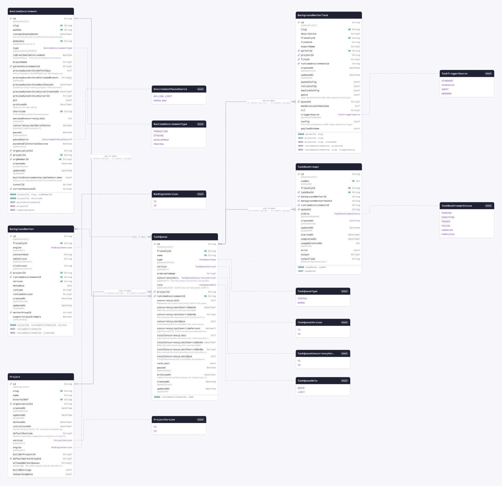

| Field                               | Type                                                               | Constraints                                                   | Default      | Description                                                                                                                                                                                                                                             |
| ----------------------------------- | ------------------------------------------------------------------ | ------------------------------------------------------------- | ------------ | ------------------------------------------------------------------------------------------------------------------------------------------------------------------------------------------------------------------------------------------------------- |
| `id`                                | `String`                                                           | PK NOT NULL                                                   | `cuid(1)`    |                                                                                                                                                                                                                                                         |
| `friendlyId`                        | `String`                                                           | UNIQUE NOT NULL                                               |              |                                                                                                                                                                                                                                                         |
| `name`                              | `String`                                                           | NOT NULL                                                      |              |                                                                                                                                                                                                                                                         |
| `type`                              | [`TaskQueueType`](#enum-TaskQueueType)                             | NOT NULL                                                      | `VIRTUAL`    |                                                                                                                                                                                                                                                         |
| `version`                           | [`TaskQueueVersion`](#enum-TaskQueueVersion)                       | NOT NULL                                                      | `V1`         |                                                                                                                                                                                                                                                         |
| `orderableName`                     | `String`                                                           | NULL                                                          |              |                                                                                                                                                                                                                                                         |
| `concurrencyVersion`                | [`TaskQueueConcurrencyVersion`](#enum-TaskQueueConcurrencyVersion) | NOT NULL                                                      | `V1`         | How the queue's concurrency was declared: V1 = legacy concurrencyLimit semantics (per key when keyed, whole queue otherwise), V2 = the explicit perKey/total shape.                                                                                     |
| `role`                              | [`TaskQueueRole`](#enum-TaskQueueRole)                             | NOT NULL                                                      | `QUEUE`      | QUEUE rows are real queues; LIMIT rows back named concurrency limits and are excluded from every queue-facing surface.                                                                                                                                  |
| `projectId`                         | `String`                                                           | NOT NULL → [Project.id](#model-Project)                       |              |                                                                                                                                                                                                                                                         |
| `runtimeEnvironmentId`              | `String`                                                           | NOT NULL → [RuntimeEnvironment.id](#model-RuntimeEnvironment) |              |                                                                                                                                                                                                                                                         |
| `concurrencyLimit`                  | `Int`                                                              | NULL                                                          |              | Represents the current concurrency limit for the queue                                                                                                                                                                                                  |
| `concurrencyLimitOverriddenAt`      | `DateTime`                                                         | NULL                                                          |              | When the concurrency limit was overridden                                                                                                                                                                                                               |
| `concurrencyLimitOverriddenBy`      | `String`                                                           | NULL                                                          |              | Who overrode the concurrency limit (will be null if overridden via the API)                                                                                                                                                                             |
| `concurrencyLimitBase`              | `Int`                                                              | NULL                                                          |              | If concurrencyLimit is overridden, this is the overridden value                                                                                                                                                                                         |
| `concurrencyLimitOverridePercent`   | `Decimal` `@db.Decimal(5, 2)`                                      | NULL                                                          |              | If the override was expressed as a percentage of the environment limit, this stores that percentage (the source of truth). The absolute concurrencyLimit is materialized from it. Decimal(5,2) allows fractional percentages like 12.50% (0.01–100.00). |
| `totalConcurrencyLimit`             | `Int`                                                              | NULL                                                          |              | Caps total concurrent runs across ALL concurrencyKey values of this queue (concurrencyLimit applies per key value). Null = no total cap.                                                                                                                |
| `totalConcurrencyLimitOverriddenAt` | `DateTime`                                                         | NULL                                                          |              | When the total concurrency limit was overridden                                                                                                                                                                                                         |
| `totalConcurrencyLimitOverriddenBy` | `String`                                                           | NULL                                                          |              | Who overrode the total concurrency limit (null when overridden via the API)                                                                                                                                                                             |
| `totalConcurrencyLimitBase`         | `Int`                                                              | NULL                                                          |              | If totalConcurrencyLimit is overridden, the declared value it reverts to on reset                                                                                                                                                                       |
| `rateLimit`                         | `Json`                                                             | NULL                                                          |              |                                                                                                                                                                                                                                                         |
| `paused`                            | `Boolean`                                                          | NOT NULL                                                      | `false`      |                                                                                                                                                                                                                                                         |
| `archivedAt`                        | `DateTime`                                                         | NULL                                                          |              | Hidden from the dashboard queue list. Display-only: never read on trigger/dequeue paths.                                                                                                                                                                |
| `createdAt`                         | `DateTime`                                                         | NOT NULL                                                      | `now()`      |                                                                                                                                                                                                                                                         |
| `updatedAt`                         | `DateTime`                                                         | NOT NULL                                                      | `@updatedAt` |                                                                                                                                                                                                                                                         |

#### Indexes

- `@@unique([runtimeEnvironmentId, name])`

#### References

- `projectId` → [Project.id](#model-Project) (many-to-one, on delete Cascade, on update Cascade)
- `runtimeEnvironmentId` → [RuntimeEnvironment.id](#model-RuntimeEnvironment) (many-to-one, on delete Cascade, on update Cascade)

#### Referenced by

- `id` ← [BackgroundWorkerTask.queueId](#model-BackgroundWorkerTask) (one-to-many, on delete SetNull, on update Cascade)
- `id` ← [TaskRunAttempt.queueId](#model-TaskRunAttempt) (one-to-many, on delete Cascade, on update Cascade)

#### Many to many

- `workers` ↔ [BackgroundWorker.queues](#model-BackgroundWorker) through `_BackgroundWorkerToTaskQueue`

#### Definition

```sql
CREATE TABLE "TaskQueue" (
    "id" TEXT NOT NULL,
    "friendlyId" TEXT NOT NULL,
    "name" TEXT NOT NULL,
    "type" "TaskQueueType" NOT NULL DEFAULT 'VIRTUAL',
    "version" "TaskQueueVersion" NOT NULL DEFAULT 'V1',
    "orderableName" TEXT,
    "concurrencyVersion" "TaskQueueConcurrencyVersion" NOT NULL DEFAULT 'V1',
    "role" "TaskQueueRole" NOT NULL DEFAULT 'QUEUE',
    "projectId" TEXT NOT NULL,
    "runtimeEnvironmentId" TEXT NOT NULL,
    "concurrencyLimit" INTEGER,
    "concurrencyLimitOverriddenAt" TIMESTAMP(3),
    "concurrencyLimitOverriddenBy" TEXT,
    "concurrencyLimitBase" INTEGER,
    "concurrencyLimitOverridePercent" DECIMAL(5,2),
    "totalConcurrencyLimit" INTEGER,
    "totalConcurrencyLimitOverriddenAt" TIMESTAMP(3),
    "totalConcurrencyLimitOverriddenBy" TEXT,
    "totalConcurrencyLimitBase" INTEGER,
    "rateLimit" JSONB,
    "paused" BOOLEAN NOT NULL DEFAULT false,
    "archivedAt" TIMESTAMP(3),
    "createdAt" TIMESTAMP(3) NOT NULL DEFAULT CURRENT_TIMESTAMP,
    "updatedAt" TIMESTAMP(3) NOT NULL,

    CONSTRAINT "TaskQueue_pkey" PRIMARY KEY ("id")
);

CREATE UNIQUE INDEX "TaskQueue_friendlyId_key" ON "TaskQueue"("friendlyId");

CREATE UNIQUE INDEX "TaskQueue_runtimeEnvironmentId_name_key" ON "TaskQueue"("runtimeEnvironmentId", "name");

ALTER TABLE "TaskQueue" ADD CONSTRAINT "TaskQueue_projectId_fkey" FOREIGN KEY ("projectId") REFERENCES "Project"("id") ON DELETE CASCADE ON UPDATE CASCADE;

ALTER TABLE "TaskQueue" ADD CONSTRAINT "TaskQueue_runtimeEnvironmentId_fkey" FOREIGN KEY ("runtimeEnvironmentId") REFERENCES "RuntimeEnvironment"("id") ON DELETE CASCADE ON UPDATE CASCADE;
```

<details>
<summary>Queries and their SQL</summary>

**findMany**: Every row

```ts
await prisma.taskQueue.findMany();
```

```sql
SELECT
  "public"."TaskQueue"."id",
  "public"."TaskQueue"."friendlyId",
  "public"."TaskQueue"."name",
  "public"."TaskQueue"."type"::text,
  "public"."TaskQueue"."version"::text,
  "public"."TaskQueue"."orderableName",
  "public"."TaskQueue"."concurrencyVersion"::text,
  "public"."TaskQueue"."role"::text,
  "public"."TaskQueue"."projectId",
  "public"."TaskQueue"."runtimeEnvironmentId",
  "public"."TaskQueue"."concurrencyLimit",
  "public"."TaskQueue"."concurrencyLimitOverriddenAt",
  "public"."TaskQueue"."concurrencyLimitOverriddenBy",
  "public"."TaskQueue"."concurrencyLimitBase",
  "public"."TaskQueue"."concurrencyLimitOverridePercent",
  "public"."TaskQueue"."totalConcurrencyLimit",
  "public"."TaskQueue"."totalConcurrencyLimitOverriddenAt",
  "public"."TaskQueue"."totalConcurrencyLimitOverriddenBy",
  "public"."TaskQueue"."totalConcurrencyLimitBase",
  "public"."TaskQueue"."rateLimit",
  "public"."TaskQueue"."paused",
  "public"."TaskQueue"."archivedAt",
  "public"."TaskQueue"."createdAt",
  "public"."TaskQueue"."updatedAt"
FROM
  "public"."TaskQueue"
WHERE
  1 = 1
OFFSET
  $1
-- params: ["0"]
```

**count**: How many rows there are

```ts
await prisma.taskQueue.count();
```

```sql
SELECT
  COUNT(*) AS "_count$_all"
FROM
  (
    SELECT
      "public"."TaskQueue"."id"
    FROM
      "public"."TaskQueue"
    WHERE
      1 = 1
    OFFSET
      $1
  ) AS "sub"
-- params: ["0"]
```

**findMany**: Every row with its relations

```ts
await prisma.taskQueue.findMany({
  include: { project: true, runtimeEnvironment: true, attempts: true, tasks: true, workers: true },
});
```

```sql
SELECT
  "public"."TaskQueue"."id",
  "public"."TaskQueue"."friendlyId",
  "public"."TaskQueue"."name",
  "public"."TaskQueue"."type"::text,
  "public"."TaskQueue"."version"::text,
  "public"."TaskQueue"."orderableName",
  "public"."TaskQueue"."concurrencyVersion"::text,
  "public"."TaskQueue"."role"::text,
  "public"."TaskQueue"."projectId",
  "public"."TaskQueue"."runtimeEnvironmentId",
  "public"."TaskQueue"."concurrencyLimit",
  "public"."TaskQueue"."concurrencyLimitOverriddenAt",
  "public"."TaskQueue"."concurrencyLimitOverriddenBy",
  "public"."TaskQueue"."concurrencyLimitBase",
  "public"."TaskQueue"."concurrencyLimitOverridePercent",
  "public"."TaskQueue"."totalConcurrencyLimit",
  "public"."TaskQueue"."totalConcurrencyLimitOverriddenAt",
  "public"."TaskQueue"."totalConcurrencyLimitOverriddenBy",
  "public"."TaskQueue"."totalConcurrencyLimitBase",
  "public"."TaskQueue"."rateLimit",
  "public"."TaskQueue"."paused",
  "public"."TaskQueue"."archivedAt",
  "public"."TaskQueue"."createdAt",
  "public"."TaskQueue"."updatedAt"
FROM
  "public"."TaskQueue"
WHERE
  1 = 1
OFFSET
  $1
-- params: ["0"]

SELECT
  "public"."Project"."id",
  "public"."Project"."slug",
  "public"."Project"."name",
  "public"."Project"."externalRef",
  "public"."Project"."organizationId",
  "public"."Project"."createdAt",
  "public"."Project"."updatedAt",
  "public"."Project"."deletedAt",
  "public"."Project"."initializedAt",
  "public"."Project"."defaultRuntime",
  "public"."Project"."version"::text,
  "public"."Project"."engine"::text,
  "public"."Project"."builderProjectId",
  "public"."Project"."defaultWorkerGroupId",
  "public"."Project"."allowedMasterQueues",
  "public"."Project"."buildSettings",
  "public"."Project"."onboardingData"
FROM
  "public"."Project"
WHERE
  "public"."Project"."id" IN ($1)
OFFSET
  $2
-- params: ["<projectId of the rows above>","0"]

SELECT
  "public"."RuntimeEnvironment"."id",
  "public"."RuntimeEnvironment"."slug",
  "public"."RuntimeEnvironment"."apiKey",
  "public"."RuntimeEnvironment"."rootApiKeyHiddenAt",
  "public"."RuntimeEnvironment"."pkApiKey",
  "public"."RuntimeEnvironment"."type"::text,
  "public"."RuntimeEnvironment"."isBranchableEnvironment",
  "public"."RuntimeEnvironment"."branchName",
  "public"."RuntimeEnvironment"."parentEnvironmentId",
  "public"."RuntimeEnvironment"."previewAutoArchiveAfterDays",
  "public"."RuntimeEnvironment"."previewAutoArchiveExcludedBranches",
  "public"."RuntimeEnvironment"."previewAutoArchiveNextCheckAt",
  "public"."RuntimeEnvironment"."previewAutoArchiveCursorCreatedAt",
  "public"."RuntimeEnvironment"."previewAutoArchiveCursorId",
  "public"."RuntimeEnvironment"."git",
  "public"."RuntimeEnvironment"."archivedAt",
  "public"."RuntimeEnvironment"."shortcode",
  "public"."RuntimeEnvironment"."maximumConcurrencyLimit",
  "public"."RuntimeEnvironment"."concurrencyLimitBurstFactor",
  "public"."RuntimeEnvironment"."paused",
  "public"."RuntimeEnvironment"."pauseSource"::text,
  "public"."RuntimeEnvironment"."autoEnableInternalSources",
  "public"."RuntimeEnvironment"."organizationId",
  "public"."RuntimeEnvironment"."projectId",
  "public"."RuntimeEnvironment"."orgMemberId",
  "public"."RuntimeEnvironment"."createdAt",
  "public"."RuntimeEnvironment"."updatedAt",
  "public"."RuntimeEnvironment"."builtInEnvironmentVariableOverrides",
  "public"."RuntimeEnvironment"."tunnelId",
  "public"."RuntimeEnvironment"."currentSessionId"
FROM
  "public"."RuntimeEnvironment"
WHERE
  "public"."RuntimeEnvironment"."id" IN ($1)
OFFSET
  $2
-- params: ["<runtimeEnvironmentId of the rows above>","0"]

SELECT
  "public"."TaskRunAttempt"."id",
  "public"."TaskRunAttempt"."number",
  "public"."TaskRunAttempt"."friendlyId",
  "public"."TaskRunAttempt"."taskRunId",
  "public"."TaskRunAttempt"."backgroundWorkerId",
  "public"."TaskRunAttempt"."backgroundWorkerTaskId",
  "public"."TaskRunAttempt"."runtimeEnvironmentId",
  "public"."TaskRunAttempt"."queueId",
  "public"."TaskRunAttempt"."status"::text,
  "public"."TaskRunAttempt"."createdAt",
  "public"."TaskRunAttempt"."updatedAt",
  "public"."TaskRunAttempt"."startedAt",
  "public"."TaskRunAttempt"."completedAt",
  "public"."TaskRunAttempt"."usageDurationMs",
  "public"."TaskRunAttempt"."error",
  "public"."TaskRunAttempt"."output",
  "public"."TaskRunAttempt"."outputType"
FROM
  "public"."TaskRunAttempt"
WHERE
  "public"."TaskRunAttempt"."queueId" IN ($1)
OFFSET
  $2
-- params: ["<id of the rows above>","0"]

SELECT
  "public"."BackgroundWorkerTask"."id",
  "public"."BackgroundWorkerTask"."slug",
  "public"."BackgroundWorkerTask"."description",
  "public"."BackgroundWorkerTask"."friendlyId",
  "public"."BackgroundWorkerTask"."filePath",
  "public"."BackgroundWorkerTask"."exportName",
  "public"."BackgroundWorkerTask"."workerId",
  "public"."BackgroundWorkerTask"."projectId",
  "public"."BackgroundWorkerTask"."fileId",
  "public"."BackgroundWorkerTask"."runtimeEnvironmentId",
  "public"."BackgroundWorkerTask"."createdAt",
  "public"."BackgroundWorkerTask"."updatedAt",
  "public"."BackgroundWorkerTask"."queueConfig",
  "public"."BackgroundWorkerTask"."retryConfig",
  "public"."BackgroundWorkerTask"."machineConfig",
  "public"."BackgroundWorkerTask"."gates",
  "public"."BackgroundWorkerTask"."queueId",
  "public"."BackgroundWorkerTask"."maxDurationInSeconds",
  "public"."BackgroundWorkerTask"."ttl",
  "public"."BackgroundWorkerTask"."triggerSource"::text,
  "public"."BackgroundWorkerTask"."config",
  "public"."BackgroundWorkerTask"."payloadSchema"
FROM
  "public"."BackgroundWorkerTask"
WHERE
  "public"."BackgroundWorkerTask"."queueId" IN ($1)
OFFSET
  $2
-- params: ["<id of the rows above>","0"]

SELECT
  "public"."BackgroundWorker"."id",
  "public"."BackgroundWorker"."friendlyId",
  "public"."BackgroundWorker"."engine"::text,
  "public"."BackgroundWorker"."contentHash",
  "public"."BackgroundWorker"."sdkVersion",
  "public"."BackgroundWorker"."cliVersion",
  "public"."BackgroundWorker"."projectId",
  "public"."BackgroundWorker"."runtimeEnvironmentId",
  "public"."BackgroundWorker"."version",
  "public"."BackgroundWorker"."metadata",
  "public"."BackgroundWorker"."runtime",
  "public"."BackgroundWorker"."runtimeVersion",
  "public"."BackgroundWorker"."createdAt",
  "public"."BackgroundWorker"."updatedAt",
  "public"."BackgroundWorker"."workerGroupId",
  "public"."BackgroundWorker"."supportsLazyAttempts",
  "t0"."B" AS "BackgroundWorkerToTaskQueue@TaskQueue"
FROM
  "public"."BackgroundWorker"
  INNER JOIN "public"."_BackgroundWorkerToTaskQueue" AS "t0" ON "t0"."A" = "public"."BackgroundWorker"."id"
WHERE
  (
    1 = 1
    AND "t0"."B" IN ($1)
  )
OFFSET
  $2
-- params: ["<id of the rows above>","0"]
```

**findUnique**: One row by what is unique to it

```ts
await prisma.taskQueue.findUnique({ where: { id: "example" } });
```

```sql
SELECT
  "public"."TaskQueue"."id",
  "public"."TaskQueue"."friendlyId",
  "public"."TaskQueue"."name",
  "public"."TaskQueue"."type"::text,
  "public"."TaskQueue"."version"::text,
  "public"."TaskQueue"."orderableName",
  "public"."TaskQueue"."concurrencyVersion"::text,
  "public"."TaskQueue"."role"::text,
  "public"."TaskQueue"."projectId",
  "public"."TaskQueue"."runtimeEnvironmentId",
  "public"."TaskQueue"."concurrencyLimit",
  "public"."TaskQueue"."concurrencyLimitOverriddenAt",
  "public"."TaskQueue"."concurrencyLimitOverriddenBy",
  "public"."TaskQueue"."concurrencyLimitBase",
  "public"."TaskQueue"."concurrencyLimitOverridePercent",
  "public"."TaskQueue"."totalConcurrencyLimit",
  "public"."TaskQueue"."totalConcurrencyLimitOverriddenAt",
  "public"."TaskQueue"."totalConcurrencyLimitOverriddenBy",
  "public"."TaskQueue"."totalConcurrencyLimitBase",
  "public"."TaskQueue"."rateLimit",
  "public"."TaskQueue"."paused",
  "public"."TaskQueue"."archivedAt",
  "public"."TaskQueue"."createdAt",
  "public"."TaskQueue"."updatedAt"
FROM
  "public"."TaskQueue"
WHERE
  (
    "public"."TaskQueue"."id" = $1
    AND 1 = 1
  )
LIMIT
  $2
OFFSET
  $3
-- params: ["example","1","0"]
```

**create**: Create a row

```ts
await prisma.taskQueue.create({
  data: {
    friendlyId: "example",
    name: "example",
    projectId: "example",
    runtimeEnvironmentId: "example",
  },
});
```

```sql
INSERT INTO
  "public"."TaskQueue" (
    "id",
    "friendlyId",
    "name",
    "type",
    "version",
    "concurrencyVersion",
    "role",
    "projectId",
    "runtimeEnvironmentId",
    "paused",
    "createdAt",
    "updatedAt"
  )
VALUES
  (
    $1,
    $2,
    $3,
    CAST($4::text AS "public"."TaskQueueType"),
    CAST($5::text AS "public"."TaskQueueVersion"),
    CAST(
      $6::text AS "public"."TaskQueueConcurrencyVersion"
    ),
    CAST($7::text AS "public"."TaskQueueRole"),
    $8,
    $9,
    $10,
    $11,
    $12
  )
RETURNING
  "public"."TaskQueue"."id",
  "public"."TaskQueue"."friendlyId",
  "public"."TaskQueue"."name",
  "public"."TaskQueue"."type"::text,
  "public"."TaskQueue"."version"::text,
  "public"."TaskQueue"."orderableName",
  "public"."TaskQueue"."concurrencyVersion"::text,
  "public"."TaskQueue"."role"::text,
  "public"."TaskQueue"."projectId",
  "public"."TaskQueue"."runtimeEnvironmentId",
  "public"."TaskQueue"."concurrencyLimit",
  "public"."TaskQueue"."concurrencyLimitOverriddenAt",
  "public"."TaskQueue"."concurrencyLimitOverriddenBy",
  "public"."TaskQueue"."concurrencyLimitBase",
  "public"."TaskQueue"."concurrencyLimitOverridePercent",
  "public"."TaskQueue"."totalConcurrencyLimit",
  "public"."TaskQueue"."totalConcurrencyLimitOverriddenAt",
  "public"."TaskQueue"."totalConcurrencyLimitOverriddenBy",
  "public"."TaskQueue"."totalConcurrencyLimitBase",
  "public"."TaskQueue"."rateLimit",
  "public"."TaskQueue"."paused",
  "public"."TaskQueue"."archivedAt",
  "public"."TaskQueue"."createdAt",
  "public"."TaskQueue"."updatedAt"
-- params: ["<cuid(1)>","example","example","VIRTUAL","V1","V1","QUEUE","example","example",false,"<now()>","<now()>"]
```

**update**: Update a row

```ts
await prisma.taskQueue.update({ where: { id: "example" }, data: { friendlyId: "example" } });
```

```sql
UPDATE "public"."TaskQueue"
SET
  "friendlyId" = $1,
  "updatedAt" = $2
WHERE
  (
    "public"."TaskQueue"."id" = $3
    AND 1 = 1
  )
RETURNING
  "public"."TaskQueue"."id",
  "public"."TaskQueue"."friendlyId",
  "public"."TaskQueue"."name",
  "public"."TaskQueue"."type"::text,
  "public"."TaskQueue"."version"::text,
  "public"."TaskQueue"."orderableName",
  "public"."TaskQueue"."concurrencyVersion"::text,
  "public"."TaskQueue"."role"::text,
  "public"."TaskQueue"."projectId",
  "public"."TaskQueue"."runtimeEnvironmentId",
  "public"."TaskQueue"."concurrencyLimit",
  "public"."TaskQueue"."concurrencyLimitOverriddenAt",
  "public"."TaskQueue"."concurrencyLimitOverriddenBy",
  "public"."TaskQueue"."concurrencyLimitBase",
  "public"."TaskQueue"."concurrencyLimitOverridePercent",
  "public"."TaskQueue"."totalConcurrencyLimit",
  "public"."TaskQueue"."totalConcurrencyLimitOverriddenAt",
  "public"."TaskQueue"."totalConcurrencyLimitOverriddenBy",
  "public"."TaskQueue"."totalConcurrencyLimitBase",
  "public"."TaskQueue"."rateLimit",
  "public"."TaskQueue"."paused",
  "public"."TaskQueue"."archivedAt",
  "public"."TaskQueue"."createdAt",
  "public"."TaskQueue"."updatedAt"
-- params: ["example",{"prisma__type":"generatorCall","prisma__value":{"name":"now","args":[],"returnType":{"type":"DateTime"}}},"example"]
```

**delete**: Delete a row

```ts
await prisma.taskQueue.delete({ where: { id: "example" } });
```

```sql
DELETE FROM "public"."TaskQueue"
WHERE
  (
    "public"."TaskQueue"."id" = $1
    AND 1 = 1
  )
RETURNING
  "public"."TaskQueue"."id",
  "public"."TaskQueue"."friendlyId",
  "public"."TaskQueue"."name",
  "public"."TaskQueue"."type"::text,
  "public"."TaskQueue"."version"::text,
  "public"."TaskQueue"."orderableName",
  "public"."TaskQueue"."concurrencyVersion"::text,
  "public"."TaskQueue"."role"::text,
  "public"."TaskQueue"."projectId",
  "public"."TaskQueue"."runtimeEnvironmentId",
  "public"."TaskQueue"."concurrencyLimit",
  "public"."TaskQueue"."concurrencyLimitOverriddenAt",
  "public"."TaskQueue"."concurrencyLimitOverriddenBy",
  "public"."TaskQueue"."concurrencyLimitBase",
  "public"."TaskQueue"."concurrencyLimitOverridePercent",
  "public"."TaskQueue"."totalConcurrencyLimit",
  "public"."TaskQueue"."totalConcurrencyLimitOverriddenAt",
  "public"."TaskQueue"."totalConcurrencyLimitOverriddenBy",
  "public"."TaskQueue"."totalConcurrencyLimitBase",
  "public"."TaskQueue"."rateLimit",
  "public"."TaskQueue"."paused",
  "public"."TaskQueue"."archivedAt",
  "public"."TaskQueue"."createdAt",
  "public"."TaskQueue"."updatedAt"
-- params: ["example"]
```

</details>

<a id="model-BatchTaskRun"></a>

### BatchTaskRun

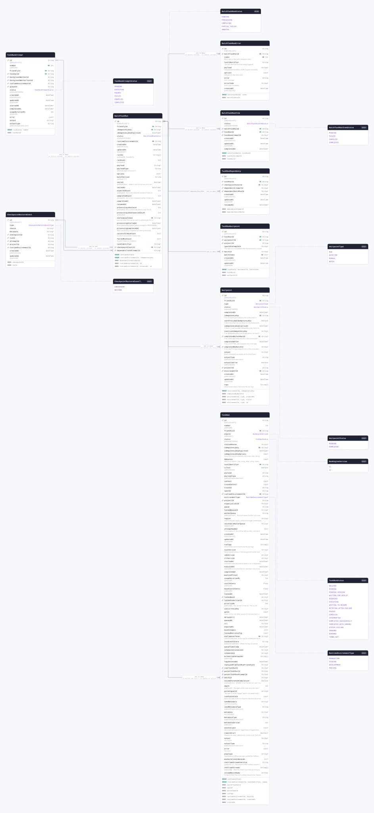

| Field                         | Type                                             | Constraints                                                              | Default              | Description                                                                                                                                               |
| ----------------------------- | ------------------------------------------------ | ------------------------------------------------------------------------ | -------------------- | --------------------------------------------------------------------------------------------------------------------------------------------------------- |
| `id`                          | `String`                                         | PK NOT NULL                                                              | `cuid(1)`            |                                                                                                                                                           |
| `friendlyId`                  | `String`                                         | UNIQUE NOT NULL                                                          |                      |                                                                                                                                                           |
| `idempotencyKey`              | `String`                                         | NULL                                                                     |                      |                                                                                                                                                           |
| `idempotencyKeyExpiresAt`     | `DateTime`                                       | NULL                                                                     |                      |                                                                                                                                                           |
| `status`                      | [`BatchTaskRunStatus`](#enum-BatchTaskRunStatus) | NOT NULL                                                                 | `PENDING`            |                                                                                                                                                           |
| `runtimeEnvironmentId`        | `String`                                         | NOT NULL                                                                 |                      |                                                                                                                                                           |
| `createdAt`                   | `DateTime`                                       | NOT NULL                                                                 | `now()`              |                                                                                                                                                           |
| `updatedAt`                   | `DateTime`                                       | NOT NULL                                                                 | `@updatedAt`         |                                                                                                                                                           |
| `runIds`                      | `String[]`                                       | NOT NULL                                                                 | `[]`                 | Friendly IDs                                                                                                                                              |
| `runCount`                    | `Int`                                            | NOT NULL                                                                 | `0`                  |                                                                                                                                                           |
| `payload`                     | `String`                                         | NULL                                                                     |                      |                                                                                                                                                           |
| `payloadType`                 | `String`                                         | NOT NULL                                                                 | `"application/json"` |                                                                                                                                                           |
| `options`                     | `Json`                                           | NULL                                                                     |                      |                                                                                                                                                           |
| `batchVersion`                | `String`                                         | NOT NULL                                                                 | `"v1"`               |                                                                                                                                                           |
| `sealed`                      | `Boolean`                                        | NOT NULL                                                                 | `false`              | sealed is set to true once no more items can be added to the batch                                                                                        |
| `sealedAt`                    | `DateTime`                                       | NULL                                                                     |                      |                                                                                                                                                           |
| `expectedCount`               | `Int`                                            | NOT NULL                                                                 | `0`                  | this is the expected number of items in the batch                                                                                                         |
| `completedCount`              | `Int`                                            | NOT NULL                                                                 | `0`                  | this is the completed number of items in the batch. once this reaches expectedCount, and the batch is sealed, the batch is considered completed           |
| `completedAt`                 | `DateTime`                                       | NULL                                                                     |                      |                                                                                                                                                           |
| `resumedAt`                   | `DateTime`                                       | NULL                                                                     |                      |                                                                                                                                                           |
| `processingJobsCount`         | `Int`                                            | NOT NULL                                                                 | `0`                  | this is used to be able to "seal" this BatchTaskRun when all of the runs have been triggered asynchronously, and using the "parallel" processing strategy |
| `processingJobsExpectedCount` | `Int`                                            | NOT NULL                                                                 | `0`                  |                                                                                                                                                           |
| `oneTimeUseToken`             | `String`                                         | UNIQUE NULL                                                              |                      | optional token that can be used to authenticate the task run                                                                                              |
| `processingStartedAt`         | `DateTime`                                       | NULL                                                                     |                      | When processing started (status changed to PROCESSING)                                                                                                    |
| `processingCompletedAt`       | `DateTime`                                       | NULL                                                                     |                      | When processing completed (all items processed)                                                                                                           |
| `successfulRunCount`          | `Int`                                            | NULL                                                                     |                      | Count of successfully created runs                                                                                                                        |
| `failedRunCount`              | `Int`                                            | NULL                                                                     |                      | Count of failed run creations                                                                                                                             |
| `taskIdentifier`              | `String`                                         | NULL                                                                     |                      |                                                                                                                                                           |
| `checkpointEventId`           | `String`                                         | UNIQUE NULL → [CheckpointRestoreEvent.id](#model-CheckpointRestoreEvent) |                      |                                                                                                                                                           |
| `dependentTaskAttemptId`      | `String`                                         | NULL → [TaskRunAttempt.id](#model-TaskRunAttempt)                        |                      |                                                                                                                                                           |

#### Indexes

- `@@index([dependentTaskAttemptId])`
- `@@index([runtimeEnvironmentId, id])`
- `@@index([runtimeEnvironmentId, createdAt, id])`
- `@@unique([oneTimeUseToken])`
- `@@unique([runtimeEnvironmentId, idempotencyKey])`

#### References

- `checkpointEventId` → [CheckpointRestoreEvent.id](#model-CheckpointRestoreEvent) (one-to-one, on delete Cascade, on update Cascade)
- `dependentTaskAttemptId` → [TaskRunAttempt.id](#model-TaskRunAttempt) (many-to-one, on delete Cascade, on update Cascade)

#### Referenced by

- `id` ← [TaskRun.batchId](#model-TaskRun) (one-to-many, on delete SetNull, on update NoAction)
- `id` ← [Waitpoint.completedByBatchId](#model-Waitpoint) (one-to-many, on delete SetNull)
- `id` ← [TaskRunWaitpoint.batchId](#model-TaskRunWaitpoint) (one-to-many)
- `id` ← [TaskRunDependency.dependentBatchRunId](#model-TaskRunDependency) (one-to-many)
- `id` ← [BatchTaskRunItem.batchTaskRunId](#model-BatchTaskRunItem) (one-to-many, on delete Cascade, on update Cascade)
- `id` ← [BatchTaskRunError.batchTaskRunId](#model-BatchTaskRunError) (one-to-many, on delete Cascade, on update Cascade)

#### Definition

```sql
CREATE TABLE "BatchTaskRun" (
    "id" TEXT NOT NULL,
    "friendlyId" TEXT NOT NULL,
    "idempotencyKey" TEXT,
    "idempotencyKeyExpiresAt" TIMESTAMP(3),
    "status" "BatchTaskRunStatus" NOT NULL DEFAULT 'PENDING',
    "runtimeEnvironmentId" TEXT NOT NULL,
    "createdAt" TIMESTAMP(3) NOT NULL DEFAULT CURRENT_TIMESTAMP,
    "updatedAt" TIMESTAMP(3) NOT NULL,
    "runIds" TEXT[] DEFAULT ARRAY[]::TEXT[],
    "runCount" INTEGER NOT NULL DEFAULT 0,
    "payload" TEXT,
    "payloadType" TEXT NOT NULL DEFAULT 'application/json',
    "options" JSONB,
    "batchVersion" TEXT NOT NULL DEFAULT 'v1',
    "sealed" BOOLEAN NOT NULL DEFAULT false,
    "sealedAt" TIMESTAMP(3),
    "expectedCount" INTEGER NOT NULL DEFAULT 0,
    "completedCount" INTEGER NOT NULL DEFAULT 0,
    "completedAt" TIMESTAMP(3),
    "resumedAt" TIMESTAMP(3),
    "processingJobsCount" INTEGER NOT NULL DEFAULT 0,
    "processingJobsExpectedCount" INTEGER NOT NULL DEFAULT 0,
    "oneTimeUseToken" TEXT,
    "processingStartedAt" TIMESTAMP(3),
    "processingCompletedAt" TIMESTAMP(3),
    "successfulRunCount" INTEGER,
    "failedRunCount" INTEGER,
    "taskIdentifier" TEXT,
    "checkpointEventId" TEXT,
    "dependentTaskAttemptId" TEXT,

    CONSTRAINT "BatchTaskRun_pkey" PRIMARY KEY ("id")
);

CREATE UNIQUE INDEX "BatchTaskRun_friendlyId_key" ON "BatchTaskRun"("friendlyId");

CREATE UNIQUE INDEX "BatchTaskRun_checkpointEventId_key" ON "BatchTaskRun"("checkpointEventId");

CREATE INDEX "BatchTaskRun_dependentTaskAttemptId_idx" ON "BatchTaskRun"("dependentTaskAttemptId");

CREATE INDEX "BatchTaskRun_runtimeEnvironmentId_id_idx" ON "BatchTaskRun"("runtimeEnvironmentId", "id" DESC);

CREATE INDEX "BatchTaskRun_runtimeEnvironmentId_createdAt_id_idx" ON "BatchTaskRun"("runtimeEnvironmentId", "createdAt" DESC, "id" DESC);

CREATE UNIQUE INDEX "BatchTaskRun_oneTimeUseToken_key" ON "BatchTaskRun"("oneTimeUseToken");

CREATE UNIQUE INDEX "BatchTaskRun_runtimeEnvironmentId_idempotencyKey_key" ON "BatchTaskRun"("runtimeEnvironmentId", "idempotencyKey");

ALTER TABLE "BatchTaskRun" ADD CONSTRAINT "BatchTaskRun_checkpointEventId_fkey" FOREIGN KEY ("checkpointEventId") REFERENCES "CheckpointRestoreEvent"("id") ON DELETE CASCADE ON UPDATE CASCADE;

ALTER TABLE "BatchTaskRun" ADD CONSTRAINT "BatchTaskRun_dependentTaskAttemptId_fkey" FOREIGN KEY ("dependentTaskAttemptId") REFERENCES "TaskRunAttempt"("id") ON DELETE CASCADE ON UPDATE CASCADE;
```

<details>
<summary>Queries and their SQL</summary>

**findMany**: Every row

```ts
await prisma.batchTaskRun.findMany();
```

```sql
SELECT
  "public"."BatchTaskRun"."id",
  "public"."BatchTaskRun"."friendlyId",
  "public"."BatchTaskRun"."idempotencyKey",
  "public"."BatchTaskRun"."idempotencyKeyExpiresAt",
  "public"."BatchTaskRun"."status"::text,
  "public"."BatchTaskRun"."runtimeEnvironmentId",
  "public"."BatchTaskRun"."createdAt",
  "public"."BatchTaskRun"."updatedAt",
  "public"."BatchTaskRun"."runIds",
  "public"."BatchTaskRun"."runCount",
  "public"."BatchTaskRun"."payload",
  "public"."BatchTaskRun"."payloadType",
  "public"."BatchTaskRun"."options",
  "public"."BatchTaskRun"."batchVersion",
  "public"."BatchTaskRun"."sealed",
  "public"."BatchTaskRun"."sealedAt",
  "public"."BatchTaskRun"."expectedCount",
  "public"."BatchTaskRun"."completedCount",
  "public"."BatchTaskRun"."completedAt",
  "public"."BatchTaskRun"."resumedAt",
  "public"."BatchTaskRun"."processingJobsCount",
  "public"."BatchTaskRun"."processingJobsExpectedCount",
  "public"."BatchTaskRun"."oneTimeUseToken",
  "public"."BatchTaskRun"."processingStartedAt",
  "public"."BatchTaskRun"."processingCompletedAt",
  "public"."BatchTaskRun"."successfulRunCount",
  "public"."BatchTaskRun"."failedRunCount",
  "public"."BatchTaskRun"."taskIdentifier",
  "public"."BatchTaskRun"."checkpointEventId",
  "public"."BatchTaskRun"."dependentTaskAttemptId"
FROM
  "public"."BatchTaskRun"
WHERE
  1 = 1
OFFSET
  $1
-- params: ["0"]
```

**count**: How many rows there are

```ts
await prisma.batchTaskRun.count();
```

```sql
SELECT
  COUNT(*) AS "_count$_all"
FROM
  (
    SELECT
      "public"."BatchTaskRun"."id"
    FROM
      "public"."BatchTaskRun"
    WHERE
      1 = 1
    OFFSET
      $1
  ) AS "sub"
-- params: ["0"]
```

**findMany**: Every row with its relations

```ts
await prisma.batchTaskRun.findMany({
  include: {
    runs: true,
    runsBlocked: true,
    waitpoints: true,
    errors: true,
    items: true,
    checkpointEvent: true,
    dependentTaskAttempt: true,
    runDependencies: true,
  },
});
```

```sql
SELECT
  "public"."BatchTaskRun"."id",
  "public"."BatchTaskRun"."friendlyId",
  "public"."BatchTaskRun"."idempotencyKey",
  "public"."BatchTaskRun"."idempotencyKeyExpiresAt",
  "public"."BatchTaskRun"."status"::text,
  "public"."BatchTaskRun"."runtimeEnvironmentId",
  "public"."BatchTaskRun"."createdAt",
  "public"."BatchTaskRun"."updatedAt",
  "public"."BatchTaskRun"."runIds",
  "public"."BatchTaskRun"."runCount",
  "public"."BatchTaskRun"."payload",
  "public"."BatchTaskRun"."payloadType",
  "public"."BatchTaskRun"."options",
  "public"."BatchTaskRun"."batchVersion",
  "public"."BatchTaskRun"."sealed",
  "public"."BatchTaskRun"."sealedAt",
  "public"."BatchTaskRun"."expectedCount",
  "public"."BatchTaskRun"."completedCount",
  "public"."BatchTaskRun"."completedAt",
  "public"."BatchTaskRun"."resumedAt",
  "public"."BatchTaskRun"."processingJobsCount",
  "public"."BatchTaskRun"."processingJobsExpectedCount",
  "public"."BatchTaskRun"."oneTimeUseToken",
  "public"."BatchTaskRun"."processingStartedAt",
  "public"."BatchTaskRun"."processingCompletedAt",
  "public"."BatchTaskRun"."successfulRunCount",
  "public"."BatchTaskRun"."failedRunCount",
  "public"."BatchTaskRun"."taskIdentifier",
  "public"."BatchTaskRun"."checkpointEventId",
  "public"."BatchTaskRun"."dependentTaskAttemptId"
FROM
  "public"."BatchTaskRun"
WHERE
  1 = 1
OFFSET
  $1
-- params: ["0"]

SELECT
  "public"."TaskRun"."id",
  "public"."TaskRun"."number",
  "public"."TaskRun"."friendlyId",
  "public"."TaskRun"."engine"::text,
  "public"."TaskRun"."status"::text,
  "public"."TaskRun"."statusReason",
  "public"."TaskRun"."idempotencyKey",
  "public"."TaskRun"."idempotencyKeyExpiresAt",
  "public"."TaskRun"."idempotencyKeyOptions",
  "public"."TaskRun"."debounce",
  "public"."TaskRun"."taskIdentifier",
  "public"."TaskRun"."isTest",
  "public"."TaskRun"."payload",
  "public"."TaskRun"."payloadType",
  "public"."TaskRun"."context",
  "public"."TaskRun"."traceContext",
  "public"."TaskRun"."traceId",
  "public"."TaskRun"."spanId",
  "public"."TaskRun"."runtimeEnvironmentId",
  "public"."TaskRun"."environmentType"::text,
  "public"."TaskRun"."projectId",
  "public"."TaskRun"."organizationId",
  "public"."TaskRun"."queue",
  "public"."TaskRun"."lockedQueueId",
  "public"."TaskRun"."masterQueue",
  "public"."TaskRun"."region",
  "public"."TaskRun"."secondaryMasterQueue",
  "public"."TaskRun"."attemptNumber",
  "public"."TaskRun"."createdAt",
  "public"."TaskRun"."updatedAt",
  "public"."TaskRun"."runTags",
  "public"."TaskRun"."taskVersion",
  "public"."TaskRun"."sdkVersion",
  "public"."TaskRun"."cliVersion",
  "public"."TaskRun"."startedAt",
  "public"."TaskRun"."executedAt",
  "public"."TaskRun"."completedAt",
  "public"."TaskRun"."machinePreset",
  "public"."TaskRun"."usageDurationMs",
  "public"."TaskRun"."costInCents",
  "public"."TaskRun"."baseCostInCents",
  "public"."TaskRun"."lockedAt",
  "public"."TaskRun"."lockedById",
  "public"."TaskRun"."lockedToVersionId",
  "public"."TaskRun"."priorityMs",
  "public"."TaskRun"."concurrencyKey",
  "public"."TaskRun"."gates",
  "public"."TaskRun"."delayUntil",
  "public"."TaskRun"."queuedAt",
  "public"."TaskRun"."ttl",
  "public"."TaskRun"."expiredAt",
  "public"."TaskRun"."maxAttempts",
  "public"."TaskRun"."lockedRetryConfig",
  "public"."TaskRun"."oneTimeUseToken",
  "public"."TaskRun"."taskEventStore",
  "public"."TaskRun"."queueTimestamp",
  "public"."TaskRun"."scheduleInstanceId",
  "public"."TaskRun"."scheduleId",
  "public"."TaskRun"."bulkActionGroupIds",
  "public"."TaskRun"."logsDeletedAt",
  "public"."TaskRun"."replayedFromTaskRunFriendlyId",
  "public"."TaskRun"."rootTaskRunId",
  "public"."TaskRun"."parentTaskRunId",
  "public"."TaskRun"."parentTaskRunAttemptId",
  "public"."TaskRun"."batchId",
  "public"."TaskRun"."resumeParentOnCompletion",
  "public"."TaskRun"."depth",
  "public"."TaskRun"."parentSpanId",
  "public"."TaskRun"."runChainState",
  "public"."TaskRun"."seedMetadata",
  "public"."TaskRun"."seedMetadataType",
  "public"."TaskRun"."metadata",
  "public"."TaskRun"."metadataType",
  "public"."TaskRun"."metadataVersion",
  "public"."TaskRun"."annotations",
  "public"."TaskRun"."isWarmStart",
  "public"."TaskRun"."output",
  "public"."TaskRun"."outputType",
  "public"."TaskRun"."error",
  "public"."TaskRun"."planType",
  "public"."TaskRun"."maxDurationInSeconds",
  "public"."TaskRun"."realtimeStreamsVersion",
  "public"."TaskRun"."realtimeStreams",
  "public"."TaskRun"."streamBasinName"
FROM
  "public"."TaskRun"
WHERE
  "public"."TaskRun"."batchId" IN ($1)
OFFSET
  $2
-- params: ["<id of the rows above>","0"]

SELECT
  "public"."TaskRunWaitpoint"."id",
  "public"."TaskRunWaitpoint"."taskRunId",
  "public"."TaskRunWaitpoint"."waitpointId",
  "public"."TaskRunWaitpoint"."projectId",
  "public"."TaskRunWaitpoint"."spanIdToComplete",
  "public"."TaskRunWaitpoint"."batchId",
  "public"."TaskRunWaitpoint"."batchIndex",
  "public"."TaskRunWaitpoint"."createdAt",
  "public"."TaskRunWaitpoint"."updatedAt"
FROM
  "public"."TaskRunWaitpoint"
WHERE
  "public"."TaskRunWaitpoint"."batchId" IN ($1)
OFFSET
  $2
-- params: ["<id of the rows above>","0"]

SELECT
  "public"."Waitpoint"."id",
  "public"."Waitpoint"."friendlyId",
  "public"."Waitpoint"."type"::text,
  "public"."Waitpoint"."status"::text,
  "public"."Waitpoint"."completedAt",
  "public"."Waitpoint"."idempotencyKey",
  "public"."Waitpoint"."userProvidedIdempotencyKey",
  "public"."Waitpoint"."idempotencyKeyExpiresAt",
  "public"."Waitpoint"."inactiveIdempotencyKey",
  "public"."Waitpoint"."completedByTaskRunId",
  "public"."Waitpoint"."completedAfter",
  "public"."Waitpoint"."completedByBatchId",
  "public"."Waitpoint"."output",
  "public"."Waitpoint"."outputType",
  "public"."Waitpoint"."outputIsError",
  "public"."Waitpoint"."projectId",
  "public"."Waitpoint"."environmentId",
  "public"."Waitpoint"."createdAt",
  "public"."Waitpoint"."updatedAt",
  "public"."Waitpoint"."tags"
FROM
  "public"."Waitpoint"
WHERE
  "public"."Waitpoint"."completedByBatchId" IN ($1)
OFFSET
  $2
-- params: ["<id of the rows above>","0"]

SELECT
  "public"."BatchTaskRunError"."id",
  "public"."BatchTaskRunError"."batchTaskRunId",
  "public"."BatchTaskRunError"."index",
  "public"."BatchTaskRunError"."taskIdentifier",
  "public"."BatchTaskRunError"."payload",
  "public"."BatchTaskRunError"."options",
  "public"."BatchTaskRunError"."error",
  "public"."BatchTaskRunError"."errorCode",
  "public"."BatchTaskRunError"."createdAt"
FROM
  "public"."BatchTaskRunError"
WHERE
  "public"."BatchTaskRunError"."batchTaskRunId" IN ($1)
OFFSET
  $2
-- params: ["<id of the rows above>","0"]

SELECT
  "public"."BatchTaskRunItem"."id",
  "public"."BatchTaskRunItem"."status"::text,
  "public"."BatchTaskRunItem"."batchTaskRunId",
  "public"."BatchTaskRunItem"."taskRunId",
  "public"."BatchTaskRunItem"."taskRunAttemptId",
  "public"."BatchTaskRunItem"."createdAt",
  "public"."BatchTaskRunItem"."updatedAt",
  "public"."BatchTaskRunItem"."completedAt"
FROM
  "public"."BatchTaskRunItem"
WHERE
  "public"."BatchTaskRunItem"."batchTaskRunId" IN ($1)
OFFSET
  $2
-- params: ["<id of the rows above>","0"]

SELECT
  "public"."CheckpointRestoreEvent"."id",
  "public"."CheckpointRestoreEvent"."type"::text,
  "public"."CheckpointRestoreEvent"."reason",
  "public"."CheckpointRestoreEvent"."metadata",
  "public"."CheckpointRestoreEvent"."checkpointId",
  "public"."CheckpointRestoreEvent"."runId",
  "public"."CheckpointRestoreEvent"."attemptId",
  "public"."CheckpointRestoreEvent"."projectId",
  "public"."CheckpointRestoreEvent"."runtimeEnvironmentId",
  "public"."CheckpointRestoreEvent"."createdAt",
  "public"."CheckpointRestoreEvent"."updatedAt"
FROM
  "public"."CheckpointRestoreEvent"
WHERE
  "public"."CheckpointRestoreEvent"."id" IN ($1)
OFFSET
  $2
-- params: ["<checkpointEventId of the rows above>","0"]

SELECT
  "public"."TaskRunAttempt"."id",
  "public"."TaskRunAttempt"."number",
  "public"."TaskRunAttempt"."friendlyId",
  "public"."TaskRunAttempt"."taskRunId",
  "public"."TaskRunAttempt"."backgroundWorkerId",
  "public"."TaskRunAttempt"."backgroundWorkerTaskId",
  "public"."TaskRunAttempt"."runtimeEnvironmentId",
  "public"."TaskRunAttempt"."queueId",
  "public"."TaskRunAttempt"."status"::text,
  "public"."TaskRunAttempt"."createdAt",
  "public"."TaskRunAttempt"."updatedAt",
  "public"."TaskRunAttempt"."startedAt",
  "public"."TaskRunAttempt"."completedAt",
  "public"."TaskRunAttempt"."usageDurationMs",
  "public"."TaskRunAttempt"."error",
  "public"."TaskRunAttempt"."output",
  "public"."TaskRunAttempt"."outputType"
FROM
  "public"."TaskRunAttempt"
WHERE
  "public"."TaskRunAttempt"."id" IN ($1)
OFFSET
  $2
-- params: ["<dependentTaskAttemptId of the rows above>","0"]

SELECT
  "public"."TaskRunDependency"."id",
  "public"."TaskRunDependency"."taskRunId",
  "public"."TaskRunDependency"."checkpointEventId",
  "public"."TaskRunDependency"."dependentAttemptId",
  "public"."TaskRunDependency"."dependentBatchRunId",
  "public"."TaskRunDependency"."createdAt",
  "public"."TaskRunDependency"."updatedAt",
  "public"."TaskRunDependency"."resumedAt"
FROM
  "public"."TaskRunDependency"
WHERE
  "public"."TaskRunDependency"."dependentBatchRunId" IN ($1)
OFFSET
  $2
-- params: ["<id of the rows above>","0"]
```

**findUnique**: One row by what is unique to it

```ts
await prisma.batchTaskRun.findUnique({ where: { id: "example" } });
```

```sql
SELECT
  "public"."BatchTaskRun"."id",
  "public"."BatchTaskRun"."friendlyId",
  "public"."BatchTaskRun"."idempotencyKey",
  "public"."BatchTaskRun"."idempotencyKeyExpiresAt",
  "public"."BatchTaskRun"."status"::text,
  "public"."BatchTaskRun"."runtimeEnvironmentId",
  "public"."BatchTaskRun"."createdAt",
  "public"."BatchTaskRun"."updatedAt",
  "public"."BatchTaskRun"."runIds",
  "public"."BatchTaskRun"."runCount",
  "public"."BatchTaskRun"."payload",
  "public"."BatchTaskRun"."payloadType",
  "public"."BatchTaskRun"."options",
  "public"."BatchTaskRun"."batchVersion",
  "public"."BatchTaskRun"."sealed",
  "public"."BatchTaskRun"."sealedAt",
  "public"."BatchTaskRun"."expectedCount",
  "public"."BatchTaskRun"."completedCount",
  "public"."BatchTaskRun"."completedAt",
  "public"."BatchTaskRun"."resumedAt",
  "public"."BatchTaskRun"."processingJobsCount",
  "public"."BatchTaskRun"."processingJobsExpectedCount",
  "public"."BatchTaskRun"."oneTimeUseToken",
  "public"."BatchTaskRun"."processingStartedAt",
  "public"."BatchTaskRun"."processingCompletedAt",
  "public"."BatchTaskRun"."successfulRunCount",
  "public"."BatchTaskRun"."failedRunCount",
  "public"."BatchTaskRun"."taskIdentifier",
  "public"."BatchTaskRun"."checkpointEventId",
  "public"."BatchTaskRun"."dependentTaskAttemptId"
FROM
  "public"."BatchTaskRun"
WHERE
  (
    "public"."BatchTaskRun"."id" = $1
    AND 1 = 1
  )
LIMIT
  $2
OFFSET
  $3
-- params: ["example","1","0"]
```

**create**: Create a row

```ts
await prisma.batchTaskRun.create({
  data: { friendlyId: "example", runtimeEnvironmentId: "example" },
});
```

```sql
INSERT INTO
  "public"."BatchTaskRun" (
    "id",
    "friendlyId",
    "status",
    "runtimeEnvironmentId",
    "createdAt",
    "updatedAt",
    "runIds",
    "runCount",
    "payloadType",
    "batchVersion",
    "sealed",
    "expectedCount",
    "completedCount",
    "processingJobsCount",
    "processingJobsExpectedCount"
  )
VALUES
  (
    $1,
    $2,
    CAST($3::text AS "public"."BatchTaskRunStatus"),
    $4,
    $5,
    $6,
    $7,
    $8,
    $9,
    $10,
    $11,
    $12,
    $13,
    $14,
    $15
  )
RETURNING
  "public"."BatchTaskRun"."id",
  "public"."BatchTaskRun"."friendlyId",
  "public"."BatchTaskRun"."idempotencyKey",
  "public"."BatchTaskRun"."idempotencyKeyExpiresAt",
  "public"."BatchTaskRun"."status"::text,
  "public"."BatchTaskRun"."runtimeEnvironmentId",
  "public"."BatchTaskRun"."createdAt",
  "public"."BatchTaskRun"."updatedAt",
  "public"."BatchTaskRun"."runIds",
  "public"."BatchTaskRun"."runCount",
  "public"."BatchTaskRun"."payload",
  "public"."BatchTaskRun"."payloadType",
  "public"."BatchTaskRun"."options",
  "public"."BatchTaskRun"."batchVersion",
  "public"."BatchTaskRun"."sealed",
  "public"."BatchTaskRun"."sealedAt",
  "public"."BatchTaskRun"."expectedCount",
  "public"."BatchTaskRun"."completedCount",
  "public"."BatchTaskRun"."completedAt",
  "public"."BatchTaskRun"."resumedAt",
  "public"."BatchTaskRun"."processingJobsCount",
  "public"."BatchTaskRun"."processingJobsExpectedCount",
  "public"."BatchTaskRun"."oneTimeUseToken",
  "public"."BatchTaskRun"."processingStartedAt",
  "public"."BatchTaskRun"."processingCompletedAt",
  "public"."BatchTaskRun"."successfulRunCount",
  "public"."BatchTaskRun"."failedRunCount",
  "public"."BatchTaskRun"."taskIdentifier",
  "public"."BatchTaskRun"."checkpointEventId",
  "public"."BatchTaskRun"."dependentTaskAttemptId"
-- params: ["<cuid(1)>","example","PENDING","example","<now()>","<now()>",[],"0","application/json","v1",false,"0","0","0","0"]
```

**update**: Update a row

```ts
await prisma.batchTaskRun.update({ where: { id: "example" }, data: { friendlyId: "example" } });
```

```sql
UPDATE "public"."BatchTaskRun"
SET
  "friendlyId" = $1,
  "updatedAt" = $2
WHERE
  (
    "public"."BatchTaskRun"."id" = $3
    AND 1 = 1
  )
RETURNING
  "public"."BatchTaskRun"."id",
  "public"."BatchTaskRun"."friendlyId",
  "public"."BatchTaskRun"."idempotencyKey",
  "public"."BatchTaskRun"."idempotencyKeyExpiresAt",
  "public"."BatchTaskRun"."status"::text,
  "public"."BatchTaskRun"."runtimeEnvironmentId",
  "public"."BatchTaskRun"."createdAt",
  "public"."BatchTaskRun"."updatedAt",
  "public"."BatchTaskRun"."runIds",
  "public"."BatchTaskRun"."runCount",
  "public"."BatchTaskRun"."payload",
  "public"."BatchTaskRun"."payloadType",
  "public"."BatchTaskRun"."options",
  "public"."BatchTaskRun"."batchVersion",
  "public"."BatchTaskRun"."sealed",
  "public"."BatchTaskRun"."sealedAt",
  "public"."BatchTaskRun"."expectedCount",
  "public"."BatchTaskRun"."completedCount",
  "public"."BatchTaskRun"."completedAt",
  "public"."BatchTaskRun"."resumedAt",
  "public"."BatchTaskRun"."processingJobsCount",
  "public"."BatchTaskRun"."processingJobsExpectedCount",
  "public"."BatchTaskRun"."oneTimeUseToken",
  "public"."BatchTaskRun"."processingStartedAt",
  "public"."BatchTaskRun"."processingCompletedAt",
  "public"."BatchTaskRun"."successfulRunCount",
  "public"."BatchTaskRun"."failedRunCount",
  "public"."BatchTaskRun"."taskIdentifier",
  "public"."BatchTaskRun"."checkpointEventId",
  "public"."BatchTaskRun"."dependentTaskAttemptId"
-- params: ["example",{"prisma__type":"generatorCall","prisma__value":{"name":"now","args":[],"returnType":{"type":"DateTime"}}},"example"]
```

**delete**: Delete a row

```ts
await prisma.batchTaskRun.delete({ where: { id: "example" } });
```

```sql
DELETE FROM "public"."BatchTaskRun"
WHERE
  (
    "public"."BatchTaskRun"."id" = $1
    AND 1 = 1
  )
RETURNING
  "public"."BatchTaskRun"."id",
  "public"."BatchTaskRun"."friendlyId",
  "public"."BatchTaskRun"."idempotencyKey",
  "public"."BatchTaskRun"."idempotencyKeyExpiresAt",
  "public"."BatchTaskRun"."status"::text,
  "public"."BatchTaskRun"."runtimeEnvironmentId",
  "public"."BatchTaskRun"."createdAt",
  "public"."BatchTaskRun"."updatedAt",
  "public"."BatchTaskRun"."runIds",
  "public"."BatchTaskRun"."runCount",
  "public"."BatchTaskRun"."payload",
  "public"."BatchTaskRun"."payloadType",
  "public"."BatchTaskRun"."options",
  "public"."BatchTaskRun"."batchVersion",
  "public"."BatchTaskRun"."sealed",
  "public"."BatchTaskRun"."sealedAt",
  "public"."BatchTaskRun"."expectedCount",
  "public"."BatchTaskRun"."completedCount",
  "public"."BatchTaskRun"."completedAt",
  "public"."BatchTaskRun"."resumedAt",
  "public"."BatchTaskRun"."processingJobsCount",
  "public"."BatchTaskRun"."processingJobsExpectedCount",
  "public"."BatchTaskRun"."oneTimeUseToken",
  "public"."BatchTaskRun"."processingStartedAt",
  "public"."BatchTaskRun"."processingCompletedAt",
  "public"."BatchTaskRun"."successfulRunCount",
  "public"."BatchTaskRun"."failedRunCount",
  "public"."BatchTaskRun"."taskIdentifier",
  "public"."BatchTaskRun"."checkpointEventId",
  "public"."BatchTaskRun"."dependentTaskAttemptId"
-- params: ["example"]
```

</details>

<a id="model-BatchTaskRunItem"></a>

### BatchTaskRunItem

Used in engine V1 only

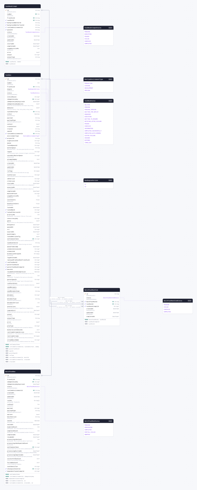

| Field              | Type                                                     | Constraints                                       | Default      | Description |
| ------------------ | -------------------------------------------------------- | ------------------------------------------------- | ------------ | ----------- |
| `id`               | `String`                                                 | PK NOT NULL                                       | `cuid(1)`    |             |
| `status`           | [`BatchTaskRunItemStatus`](#enum-BatchTaskRunItemStatus) | NOT NULL                                          | `PENDING`    |             |
| `batchTaskRunId`   | `String`                                                 | NOT NULL → [BatchTaskRun.id](#model-BatchTaskRun) |              |             |
| `taskRunId`        | `String`                                                 | NOT NULL → [TaskRun.id](#model-TaskRun)           |              |             |
| `taskRunAttemptId` | `String`                                                 | NULL → [TaskRunAttempt.id](#model-TaskRunAttempt) |              |             |
| `createdAt`        | `DateTime`                                               | NOT NULL                                          | `now()`      |             |
| `updatedAt`        | `DateTime`                                               | NOT NULL                                          | `@updatedAt` |             |
| `completedAt`      | `DateTime`                                               | NULL                                              |              |             |

#### Indexes

- `@@index([taskRunAttemptId], map: "idx_batchtaskrunitem_taskrunattempt")`
- `@@index([taskRunId], map: "idx_batchtaskrunitem_taskrun")`
- `@@unique([batchTaskRunId, taskRunId])`

#### References

- `batchTaskRunId` → [BatchTaskRun.id](#model-BatchTaskRun) (many-to-one, on delete Cascade, on update Cascade)
- `taskRunId` → [TaskRun.id](#model-TaskRun) (many-to-one, on delete Cascade, on update Cascade)
- `taskRunAttemptId` → [TaskRunAttempt.id](#model-TaskRunAttempt) (many-to-one, on delete SetNull, on update Cascade)

#### Definition

```sql
CREATE TABLE "BatchTaskRunItem" (
    "id" TEXT NOT NULL,
    "status" "BatchTaskRunItemStatus" NOT NULL DEFAULT 'PENDING',
    "batchTaskRunId" TEXT NOT NULL,
    "taskRunId" TEXT NOT NULL,
    "taskRunAttemptId" TEXT,
    "createdAt" TIMESTAMP(3) NOT NULL DEFAULT CURRENT_TIMESTAMP,
    "updatedAt" TIMESTAMP(3) NOT NULL,
    "completedAt" TIMESTAMP(3),

    CONSTRAINT "BatchTaskRunItem_pkey" PRIMARY KEY ("id")
);

CREATE INDEX "idx_batchtaskrunitem_taskrunattempt" ON "BatchTaskRunItem"("taskRunAttemptId");

CREATE INDEX "idx_batchtaskrunitem_taskrun" ON "BatchTaskRunItem"("taskRunId");

CREATE UNIQUE INDEX "BatchTaskRunItem_batchTaskRunId_taskRunId_key" ON "BatchTaskRunItem"("batchTaskRunId", "taskRunId");

ALTER TABLE "BatchTaskRunItem" ADD CONSTRAINT "BatchTaskRunItem_batchTaskRunId_fkey" FOREIGN KEY ("batchTaskRunId") REFERENCES "BatchTaskRun"("id") ON DELETE CASCADE ON UPDATE CASCADE;

ALTER TABLE "BatchTaskRunItem" ADD CONSTRAINT "BatchTaskRunItem_taskRunId_fkey" FOREIGN KEY ("taskRunId") REFERENCES "TaskRun"("id") ON DELETE CASCADE ON UPDATE CASCADE;

ALTER TABLE "BatchTaskRunItem" ADD CONSTRAINT "BatchTaskRunItem_taskRunAttemptId_fkey" FOREIGN KEY ("taskRunAttemptId") REFERENCES "TaskRunAttempt"("id") ON DELETE SET NULL ON UPDATE CASCADE;
```

<details>
<summary>Queries and their SQL</summary>

**findMany**: Every row

```ts
await prisma.batchTaskRunItem.findMany();
```

```sql
SELECT
  "public"."BatchTaskRunItem"."id",
  "public"."BatchTaskRunItem"."status"::text,
  "public"."BatchTaskRunItem"."batchTaskRunId",
  "public"."BatchTaskRunItem"."taskRunId",
  "public"."BatchTaskRunItem"."taskRunAttemptId",
  "public"."BatchTaskRunItem"."createdAt",
  "public"."BatchTaskRunItem"."updatedAt",
  "public"."BatchTaskRunItem"."completedAt"
FROM
  "public"."BatchTaskRunItem"
WHERE
  1 = 1
OFFSET
  $1
-- params: ["0"]
```

**count**: How many rows there are

```ts
await prisma.batchTaskRunItem.count();
```

```sql
SELECT
  COUNT(*) AS "_count$_all"
FROM
  (
    SELECT
      "public"."BatchTaskRunItem"."id"
    FROM
      "public"."BatchTaskRunItem"
    WHERE
      1 = 1
    OFFSET
      $1
  ) AS "sub"
-- params: ["0"]
```

**findMany**: Every row with its relations

```ts
await prisma.batchTaskRunItem.findMany({
  include: { batchTaskRun: true, taskRun: true, taskRunAttempt: true },
});
```

```sql
SELECT
  "public"."BatchTaskRunItem"."id",
  "public"."BatchTaskRunItem"."status"::text,
  "public"."BatchTaskRunItem"."batchTaskRunId",
  "public"."BatchTaskRunItem"."taskRunId",
  "public"."BatchTaskRunItem"."taskRunAttemptId",
  "public"."BatchTaskRunItem"."createdAt",
  "public"."BatchTaskRunItem"."updatedAt",
  "public"."BatchTaskRunItem"."completedAt"
FROM
  "public"."BatchTaskRunItem"
WHERE
  1 = 1
OFFSET
  $1
-- params: ["0"]

SELECT
  "public"."BatchTaskRun"."id",
  "public"."BatchTaskRun"."friendlyId",
  "public"."BatchTaskRun"."idempotencyKey",
  "public"."BatchTaskRun"."idempotencyKeyExpiresAt",
  "public"."BatchTaskRun"."status"::text,
  "public"."BatchTaskRun"."runtimeEnvironmentId",
  "public"."BatchTaskRun"."createdAt",
  "public"."BatchTaskRun"."updatedAt",
  "public"."BatchTaskRun"."runIds",
  "public"."BatchTaskRun"."runCount",
  "public"."BatchTaskRun"."payload",
  "public"."BatchTaskRun"."payloadType",
  "public"."BatchTaskRun"."options",
  "public"."BatchTaskRun"."batchVersion",
  "public"."BatchTaskRun"."sealed",
  "public"."BatchTaskRun"."sealedAt",
  "public"."BatchTaskRun"."expectedCount",
  "public"."BatchTaskRun"."completedCount",
  "public"."BatchTaskRun"."completedAt",
  "public"."BatchTaskRun"."resumedAt",
  "public"."BatchTaskRun"."processingJobsCount",
  "public"."BatchTaskRun"."processingJobsExpectedCount",
  "public"."BatchTaskRun"."oneTimeUseToken",
  "public"."BatchTaskRun"."processingStartedAt",
  "public"."BatchTaskRun"."processingCompletedAt",
  "public"."BatchTaskRun"."successfulRunCount",
  "public"."BatchTaskRun"."failedRunCount",
  "public"."BatchTaskRun"."taskIdentifier",
  "public"."BatchTaskRun"."checkpointEventId",
  "public"."BatchTaskRun"."dependentTaskAttemptId"
FROM
  "public"."BatchTaskRun"
WHERE
  "public"."BatchTaskRun"."id" IN ($1)
OFFSET
  $2
-- params: ["<batchTaskRunId of the rows above>","0"]

SELECT
  "public"."TaskRun"."id",
  "public"."TaskRun"."number",
  "public"."TaskRun"."friendlyId",
  "public"."TaskRun"."engine"::text,
  "public"."TaskRun"."status"::text,
  "public"."TaskRun"."statusReason",
  "public"."TaskRun"."idempotencyKey",
  "public"."TaskRun"."idempotencyKeyExpiresAt",
  "public"."TaskRun"."idempotencyKeyOptions",
  "public"."TaskRun"."debounce",
  "public"."TaskRun"."taskIdentifier",
  "public"."TaskRun"."isTest",
  "public"."TaskRun"."payload",
  "public"."TaskRun"."payloadType",
  "public"."TaskRun"."context",
  "public"."TaskRun"."traceContext",
  "public"."TaskRun"."traceId",
  "public"."TaskRun"."spanId",
  "public"."TaskRun"."runtimeEnvironmentId",
  "public"."TaskRun"."environmentType"::text,
  "public"."TaskRun"."projectId",
  "public"."TaskRun"."organizationId",
  "public"."TaskRun"."queue",
  "public"."TaskRun"."lockedQueueId",
  "public"."TaskRun"."masterQueue",
  "public"."TaskRun"."region",
  "public"."TaskRun"."secondaryMasterQueue",
  "public"."TaskRun"."attemptNumber",
  "public"."TaskRun"."createdAt",
  "public"."TaskRun"."updatedAt",
  "public"."TaskRun"."runTags",
  "public"."TaskRun"."taskVersion",
  "public"."TaskRun"."sdkVersion",
  "public"."TaskRun"."cliVersion",
  "public"."TaskRun"."startedAt",
  "public"."TaskRun"."executedAt",
  "public"."TaskRun"."completedAt",
  "public"."TaskRun"."machinePreset",
  "public"."TaskRun"."usageDurationMs",
  "public"."TaskRun"."costInCents",
  "public"."TaskRun"."baseCostInCents",
  "public"."TaskRun"."lockedAt",
  "public"."TaskRun"."lockedById",
  "public"."TaskRun"."lockedToVersionId",
  "public"."TaskRun"."priorityMs",
  "public"."TaskRun"."concurrencyKey",
  "public"."TaskRun"."gates",
  "public"."TaskRun"."delayUntil",
  "public"."TaskRun"."queuedAt",
  "public"."TaskRun"."ttl",
  "public"."TaskRun"."expiredAt",
  "public"."TaskRun"."maxAttempts",
  "public"."TaskRun"."lockedRetryConfig",
  "public"."TaskRun"."oneTimeUseToken",
  "public"."TaskRun"."taskEventStore",
  "public"."TaskRun"."queueTimestamp",
  "public"."TaskRun"."scheduleInstanceId",
  "public"."TaskRun"."scheduleId",
  "public"."TaskRun"."bulkActionGroupIds",
  "public"."TaskRun"."logsDeletedAt",
  "public"."TaskRun"."replayedFromTaskRunFriendlyId",
  "public"."TaskRun"."rootTaskRunId",
  "public"."TaskRun"."parentTaskRunId",
  "public"."TaskRun"."parentTaskRunAttemptId",
  "public"."TaskRun"."batchId",
  "public"."TaskRun"."resumeParentOnCompletion",
  "public"."TaskRun"."depth",
  "public"."TaskRun"."parentSpanId",
  "public"."TaskRun"."runChainState",
  "public"."TaskRun"."seedMetadata",
  "public"."TaskRun"."seedMetadataType",
  "public"."TaskRun"."metadata",
  "public"."TaskRun"."metadataType",
  "public"."TaskRun"."metadataVersion",
  "public"."TaskRun"."annotations",
  "public"."TaskRun"."isWarmStart",
  "public"."TaskRun"."output",
  "public"."TaskRun"."outputType",
  "public"."TaskRun"."error",
  "public"."TaskRun"."planType",
  "public"."TaskRun"."maxDurationInSeconds",
  "public"."TaskRun"."realtimeStreamsVersion",
  "public"."TaskRun"."realtimeStreams",
  "public"."TaskRun"."streamBasinName"
FROM
  "public"."TaskRun"
WHERE
  "public"."TaskRun"."id" IN ($1)
OFFSET
  $2
-- params: ["<taskRunId of the rows above>","0"]

SELECT
  "public"."TaskRunAttempt"."id",
  "public"."TaskRunAttempt"."number",
  "public"."TaskRunAttempt"."friendlyId",
  "public"."TaskRunAttempt"."taskRunId",
  "public"."TaskRunAttempt"."backgroundWorkerId",
  "public"."TaskRunAttempt"."backgroundWorkerTaskId",
  "public"."TaskRunAttempt"."runtimeEnvironmentId",
  "public"."TaskRunAttempt"."queueId",
  "public"."TaskRunAttempt"."status"::text,
  "public"."TaskRunAttempt"."createdAt",
  "public"."TaskRunAttempt"."updatedAt",
  "public"."TaskRunAttempt"."startedAt",
  "public"."TaskRunAttempt"."completedAt",
  "public"."TaskRunAttempt"."usageDurationMs",
  "public"."TaskRunAttempt"."error",
  "public"."TaskRunAttempt"."output",
  "public"."TaskRunAttempt"."outputType"
FROM
  "public"."TaskRunAttempt"
WHERE
  "public"."TaskRunAttempt"."id" IN ($1)
OFFSET
  $2
-- params: ["<taskRunAttemptId of the rows above>","0"]
```

**findUnique**: One row by what is unique to it

```ts
await prisma.batchTaskRunItem.findUnique({ where: { id: "example" } });
```

```sql
SELECT
  "public"."BatchTaskRunItem"."id",
  "public"."BatchTaskRunItem"."status"::text,
  "public"."BatchTaskRunItem"."batchTaskRunId",
  "public"."BatchTaskRunItem"."taskRunId",
  "public"."BatchTaskRunItem"."taskRunAttemptId",
  "public"."BatchTaskRunItem"."createdAt",
  "public"."BatchTaskRunItem"."updatedAt",
  "public"."BatchTaskRunItem"."completedAt"
FROM
  "public"."BatchTaskRunItem"
WHERE
  (
    "public"."BatchTaskRunItem"."id" = $1
    AND 1 = 1
  )
LIMIT
  $2
OFFSET
  $3
-- params: ["example","1","0"]
```

**create**: Create a row

```ts
await prisma.batchTaskRunItem.create({ data: { batchTaskRunId: "example", taskRunId: "example" } });
```

```sql
INSERT INTO
  "public"."BatchTaskRunItem" (
    "id",
    "status",
    "batchTaskRunId",
    "taskRunId",
    "createdAt",
    "updatedAt"
  )
VALUES
  (
    $1,
    CAST($2::text AS "public"."BatchTaskRunItemStatus"),
    $3,
    $4,
    $5,
    $6
  )
RETURNING
  "public"."BatchTaskRunItem"."id",
  "public"."BatchTaskRunItem"."status"::text,
  "public"."BatchTaskRunItem"."batchTaskRunId",
  "public"."BatchTaskRunItem"."taskRunId",
  "public"."BatchTaskRunItem"."taskRunAttemptId",
  "public"."BatchTaskRunItem"."createdAt",
  "public"."BatchTaskRunItem"."updatedAt",
  "public"."BatchTaskRunItem"."completedAt"
-- params: ["<cuid(1)>","PENDING","example","example","<now()>","<now()>"]
```

**update**: Update a row

```ts
await prisma.batchTaskRunItem.update({ where: { id: "example" }, data: { status: "PENDING" } });
```

```sql
UPDATE "public"."BatchTaskRunItem"
SET
  "status" = CAST($1::text AS "public"."BatchTaskRunItemStatus"),
  "updatedAt" = $2
WHERE
  (
    "public"."BatchTaskRunItem"."id" = $3
    AND 1 = 1
  )
RETURNING
  "public"."BatchTaskRunItem"."id",
  "public"."BatchTaskRunItem"."status"::text,
  "public"."BatchTaskRunItem"."batchTaskRunId",
  "public"."BatchTaskRunItem"."taskRunId",
  "public"."BatchTaskRunItem"."taskRunAttemptId",
  "public"."BatchTaskRunItem"."createdAt",
  "public"."BatchTaskRunItem"."updatedAt",
  "public"."BatchTaskRunItem"."completedAt"
-- params: ["PENDING",{"prisma__type":"generatorCall","prisma__value":{"name":"now","args":[],"returnType":{"type":"DateTime"}}},"example"]
```

**delete**: Delete a row

```ts
await prisma.batchTaskRunItem.delete({ where: { id: "example" } });
```

```sql
DELETE FROM "public"."BatchTaskRunItem"
WHERE
  (
    "public"."BatchTaskRunItem"."id" = $1
    AND 1 = 1
  )
RETURNING
  "public"."BatchTaskRunItem"."id",
  "public"."BatchTaskRunItem"."status"::text,
  "public"."BatchTaskRunItem"."batchTaskRunId",
  "public"."BatchTaskRunItem"."taskRunId",
  "public"."BatchTaskRunItem"."taskRunAttemptId",
  "public"."BatchTaskRunItem"."createdAt",
  "public"."BatchTaskRunItem"."updatedAt",
  "public"."BatchTaskRunItem"."completedAt"
-- params: ["example"]
```

</details>

<a id="model-BatchTaskRunError"></a>

### BatchTaskRunError

Track individual run creation failures in batch processing (Run Engine v2)

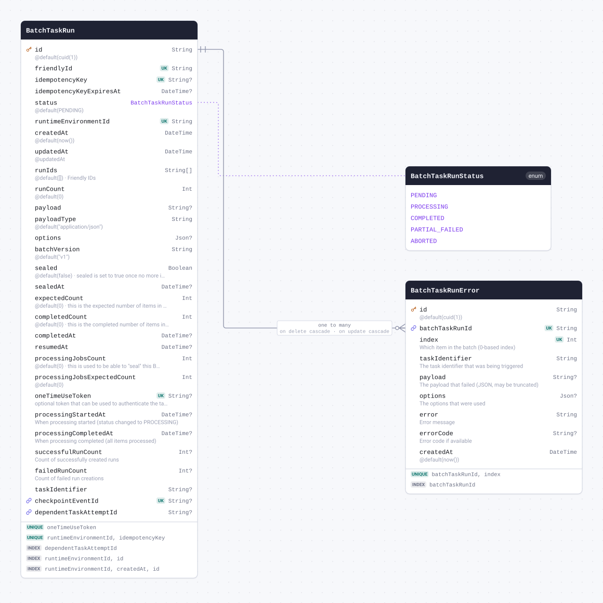

| Field            | Type       | Constraints                                       | Default   | Description                                      |
| ---------------- | ---------- | ------------------------------------------------- | --------- | ------------------------------------------------ |
| `id`             | `String`   | PK NOT NULL                                       | `cuid(1)` |                                                  |
| `batchTaskRunId` | `String`   | NOT NULL → [BatchTaskRun.id](#model-BatchTaskRun) |           |                                                  |
| `index`          | `Int`      | NOT NULL                                          |           | Which item in the batch (0-based index)          |
| `taskIdentifier` | `String`   | NOT NULL                                          |           | The task identifier that was being triggered     |
| `payload`        | `String`   | NULL                                              |           | The payload that failed (JSON, may be truncated) |
| `options`        | `Json`     | NULL                                              |           | The options that were used                       |
| `error`          | `String`   | NOT NULL                                          |           | Error message                                    |
| `errorCode`      | `String`   | NULL                                              |           | Error code if available                          |
| `createdAt`      | `DateTime` | NOT NULL                                          | `now()`   |                                                  |

#### Indexes

- `@@index([batchTaskRunId])`
- `@@unique([batchTaskRunId, index])`

#### References

- `batchTaskRunId` → [BatchTaskRun.id](#model-BatchTaskRun) (many-to-one, on delete Cascade, on update Cascade)

#### Definition

```sql
CREATE TABLE "BatchTaskRunError" (
    "id" TEXT NOT NULL,
    "batchTaskRunId" TEXT NOT NULL,
    "index" INTEGER NOT NULL,
    "taskIdentifier" TEXT NOT NULL,
    "payload" TEXT,
    "options" JSONB,
    "error" TEXT NOT NULL,
    "errorCode" TEXT,
    "createdAt" TIMESTAMP(3) NOT NULL DEFAULT CURRENT_TIMESTAMP,

    CONSTRAINT "BatchTaskRunError_pkey" PRIMARY KEY ("id")
);

CREATE INDEX "BatchTaskRunError_batchTaskRunId_idx" ON "BatchTaskRunError"("batchTaskRunId");

CREATE UNIQUE INDEX "BatchTaskRunError_batchTaskRunId_index_key" ON "BatchTaskRunError"("batchTaskRunId", "index");

ALTER TABLE "BatchTaskRunError" ADD CONSTRAINT "BatchTaskRunError_batchTaskRunId_fkey" FOREIGN KEY ("batchTaskRunId") REFERENCES "BatchTaskRun"("id") ON DELETE CASCADE ON UPDATE CASCADE;
```

<details>
<summary>Queries and their SQL</summary>

**findMany**: Every row

```ts
await prisma.batchTaskRunError.findMany();
```

```sql
SELECT
  "public"."BatchTaskRunError"."id",
  "public"."BatchTaskRunError"."batchTaskRunId",
  "public"."BatchTaskRunError"."index",
  "public"."BatchTaskRunError"."taskIdentifier",
  "public"."BatchTaskRunError"."payload",
  "public"."BatchTaskRunError"."options",
  "public"."BatchTaskRunError"."error",
  "public"."BatchTaskRunError"."errorCode",
  "public"."BatchTaskRunError"."createdAt"
FROM
  "public"."BatchTaskRunError"
WHERE
  1 = 1
OFFSET
  $1
-- params: ["0"]
```

**count**: How many rows there are

```ts
await prisma.batchTaskRunError.count();
```

```sql
SELECT
  COUNT(*) AS "_count$_all"
FROM
  (
    SELECT
      "public"."BatchTaskRunError"."id"
    FROM
      "public"."BatchTaskRunError"
    WHERE
      1 = 1
    OFFSET
      $1
  ) AS "sub"
-- params: ["0"]
```

**findMany**: Every row with its relations

```ts
await prisma.batchTaskRunError.findMany({ include: { batchTaskRun: true } });
```

```sql
SELECT
  "public"."BatchTaskRunError"."id",
  "public"."BatchTaskRunError"."batchTaskRunId",
  "public"."BatchTaskRunError"."index",
  "public"."BatchTaskRunError"."taskIdentifier",
  "public"."BatchTaskRunError"."payload",
  "public"."BatchTaskRunError"."options",
  "public"."BatchTaskRunError"."error",
  "public"."BatchTaskRunError"."errorCode",
  "public"."BatchTaskRunError"."createdAt"
FROM
  "public"."BatchTaskRunError"
WHERE
  1 = 1
OFFSET
  $1
-- params: ["0"]

SELECT
  "public"."BatchTaskRun"."id",
  "public"."BatchTaskRun"."friendlyId",
  "public"."BatchTaskRun"."idempotencyKey",
  "public"."BatchTaskRun"."idempotencyKeyExpiresAt",
  "public"."BatchTaskRun"."status"::text,
  "public"."BatchTaskRun"."runtimeEnvironmentId",
  "public"."BatchTaskRun"."createdAt",
  "public"."BatchTaskRun"."updatedAt",
  "public"."BatchTaskRun"."runIds",
  "public"."BatchTaskRun"."runCount",
  "public"."BatchTaskRun"."payload",
  "public"."BatchTaskRun"."payloadType",
  "public"."BatchTaskRun"."options",
  "public"."BatchTaskRun"."batchVersion",
  "public"."BatchTaskRun"."sealed",
  "public"."BatchTaskRun"."sealedAt",
  "public"."BatchTaskRun"."expectedCount",
  "public"."BatchTaskRun"."completedCount",
  "public"."BatchTaskRun"."completedAt",
  "public"."BatchTaskRun"."resumedAt",
  "public"."BatchTaskRun"."processingJobsCount",
  "public"."BatchTaskRun"."processingJobsExpectedCount",
  "public"."BatchTaskRun"."oneTimeUseToken",
  "public"."BatchTaskRun"."processingStartedAt",
  "public"."BatchTaskRun"."processingCompletedAt",
  "public"."BatchTaskRun"."successfulRunCount",
  "public"."BatchTaskRun"."failedRunCount",
  "public"."BatchTaskRun"."taskIdentifier",
  "public"."BatchTaskRun"."checkpointEventId",
  "public"."BatchTaskRun"."dependentTaskAttemptId"
FROM
  "public"."BatchTaskRun"
WHERE
  "public"."BatchTaskRun"."id" IN ($1)
OFFSET
  $2
-- params: ["<batchTaskRunId of the rows above>","0"]
```

**findUnique**: One row by what is unique to it

```ts
await prisma.batchTaskRunError.findUnique({ where: { id: "example" } });
```

```sql
SELECT
  "public"."BatchTaskRunError"."id",
  "public"."BatchTaskRunError"."batchTaskRunId",
  "public"."BatchTaskRunError"."index",
  "public"."BatchTaskRunError"."taskIdentifier",
  "public"."BatchTaskRunError"."payload",
  "public"."BatchTaskRunError"."options",
  "public"."BatchTaskRunError"."error",
  "public"."BatchTaskRunError"."errorCode",
  "public"."BatchTaskRunError"."createdAt"
FROM
  "public"."BatchTaskRunError"
WHERE
  (
    "public"."BatchTaskRunError"."id" = $1
    AND 1 = 1
  )
LIMIT
  $2
OFFSET
  $3
-- params: ["example","1","0"]
```

**create**: Create a row

```ts
await prisma.batchTaskRunError.create({
  data: { batchTaskRunId: "example", index: 1, taskIdentifier: "example", error: "example" },
});
```

```sql
INSERT INTO
  "public"."BatchTaskRunError" (
    "id",
    "batchTaskRunId",
    "index",
    "taskIdentifier",
    "error",
    "createdAt"
  )
VALUES
  ($1, $2, $3, $4, $5, $6)
RETURNING
  "public"."BatchTaskRunError"."id",
  "public"."BatchTaskRunError"."batchTaskRunId",
  "public"."BatchTaskRunError"."index",
  "public"."BatchTaskRunError"."taskIdentifier",
  "public"."BatchTaskRunError"."payload",
  "public"."BatchTaskRunError"."options",
  "public"."BatchTaskRunError"."error",
  "public"."BatchTaskRunError"."errorCode",
  "public"."BatchTaskRunError"."createdAt"
-- params: ["<cuid(1)>","example","1","example","example","<now()>"]
```

**update**: Update a row

```ts
await prisma.batchTaskRunError.update({ where: { id: "example" }, data: { index: 1 } });
```

```sql
UPDATE "public"."BatchTaskRunError"
SET
  "index" = $1
WHERE
  (
    "public"."BatchTaskRunError"."id" = $2
    AND 1 = 1
  )
RETURNING
  "public"."BatchTaskRunError"."id",
  "public"."BatchTaskRunError"."batchTaskRunId",
  "public"."BatchTaskRunError"."index",
  "public"."BatchTaskRunError"."taskIdentifier",
  "public"."BatchTaskRunError"."payload",
  "public"."BatchTaskRunError"."options",
  "public"."BatchTaskRunError"."error",
  "public"."BatchTaskRunError"."errorCode",
  "public"."BatchTaskRunError"."createdAt"
-- params: ["1","example"]
```

**delete**: Delete a row

```ts
await prisma.batchTaskRunError.delete({ where: { id: "example" } });
```

```sql
DELETE FROM "public"."BatchTaskRunError"
WHERE
  (
    "public"."BatchTaskRunError"."id" = $1
    AND 1 = 1
  )
RETURNING
  "public"."BatchTaskRunError"."id",
  "public"."BatchTaskRunError"."batchTaskRunId",
  "public"."BatchTaskRunError"."index",
  "public"."BatchTaskRunError"."taskIdentifier",
  "public"."BatchTaskRunError"."payload",
  "public"."BatchTaskRunError"."options",
  "public"."BatchTaskRunError"."error",
  "public"."BatchTaskRunError"."errorCode",
  "public"."BatchTaskRunError"."createdAt"
-- params: ["example"]
```

</details>

<a id="model-EnvironmentVariable"></a>

### EnvironmentVariable

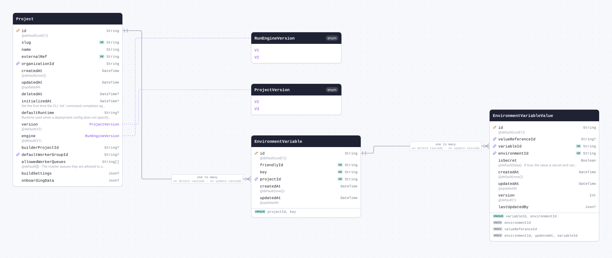

| Field        | Type       | Constraints                             | Default      | Description |
| ------------ | ---------- | --------------------------------------- | ------------ | ----------- |
| `id`         | `String`   | PK NOT NULL                             | `cuid(1)`    |             |
| `friendlyId` | `String`   | UNIQUE NOT NULL                         |              |             |
| `key`        | `String`   | NOT NULL                                |              |             |
| `projectId`  | `String`   | NOT NULL → [Project.id](#model-Project) |              |             |
| `createdAt`  | `DateTime` | NOT NULL                                | `now()`      |             |
| `updatedAt`  | `DateTime` | NOT NULL                                | `@updatedAt` |             |

#### Indexes

- `@@unique([projectId, key])`

#### References

- `projectId` → [Project.id](#model-Project) (many-to-one, on delete Cascade, on update Cascade)

#### Referenced by

- `id` ← [EnvironmentVariableValue.variableId](#model-EnvironmentVariableValue) (one-to-many, on delete Cascade, on update Cascade)

#### Definition

```sql
CREATE TABLE "EnvironmentVariable" (
    "id" TEXT NOT NULL,
    "friendlyId" TEXT NOT NULL,
    "key" TEXT NOT NULL,
    "projectId" TEXT NOT NULL,
    "createdAt" TIMESTAMP(3) NOT NULL DEFAULT CURRENT_TIMESTAMP,
    "updatedAt" TIMESTAMP(3) NOT NULL,

    CONSTRAINT "EnvironmentVariable_pkey" PRIMARY KEY ("id")
);

CREATE UNIQUE INDEX "EnvironmentVariable_friendlyId_key" ON "EnvironmentVariable"("friendlyId");

CREATE UNIQUE INDEX "EnvironmentVariable_projectId_key_key" ON "EnvironmentVariable"("projectId", "key");

ALTER TABLE "EnvironmentVariable" ADD CONSTRAINT "EnvironmentVariable_projectId_fkey" FOREIGN KEY ("projectId") REFERENCES "Project"("id") ON DELETE CASCADE ON UPDATE CASCADE;
```

<details>
<summary>Queries and their SQL</summary>

**findMany**: Every row

```ts
await prisma.environmentVariable.findMany();
```

```sql
SELECT
  "public"."EnvironmentVariable"."id",
  "public"."EnvironmentVariable"."friendlyId",
  "public"."EnvironmentVariable"."key",
  "public"."EnvironmentVariable"."projectId",
  "public"."EnvironmentVariable"."createdAt",
  "public"."EnvironmentVariable"."updatedAt"
FROM
  "public"."EnvironmentVariable"
WHERE
  1 = 1
OFFSET
  $1
-- params: ["0"]
```

**count**: How many rows there are

```ts
await prisma.environmentVariable.count();
```

```sql
SELECT
  COUNT(*) AS "_count$_all"
FROM
  (
    SELECT
      "public"."EnvironmentVariable"."id"
    FROM
      "public"."EnvironmentVariable"
    WHERE
      1 = 1
    OFFSET
      $1
  ) AS "sub"
-- params: ["0"]
```

**findMany**: Every row with its relations

```ts
await prisma.environmentVariable.findMany({ include: { project: true, values: true } });
```

```sql
SELECT
  "public"."EnvironmentVariable"."id",
  "public"."EnvironmentVariable"."friendlyId",
  "public"."EnvironmentVariable"."key",
  "public"."EnvironmentVariable"."projectId",
  "public"."EnvironmentVariable"."createdAt",
  "public"."EnvironmentVariable"."updatedAt"
FROM
  "public"."EnvironmentVariable"
WHERE
  1 = 1
OFFSET
  $1
-- params: ["0"]

SELECT
  "public"."Project"."id",
  "public"."Project"."slug",
  "public"."Project"."name",
  "public"."Project"."externalRef",
  "public"."Project"."organizationId",
  "public"."Project"."createdAt",
  "public"."Project"."updatedAt",
  "public"."Project"."deletedAt",
  "public"."Project"."initializedAt",
  "public"."Project"."defaultRuntime",
  "public"."Project"."version"::text,
  "public"."Project"."engine"::text,
  "public"."Project"."builderProjectId",
  "public"."Project"."defaultWorkerGroupId",
  "public"."Project"."allowedMasterQueues",
  "public"."Project"."buildSettings",
  "public"."Project"."onboardingData"
FROM
  "public"."Project"
WHERE
  "public"."Project"."id" IN ($1)
OFFSET
  $2
-- params: ["<projectId of the rows above>","0"]

SELECT
  "public"."EnvironmentVariableValue"."id",
  "public"."EnvironmentVariableValue"."valueReferenceId",
  "public"."EnvironmentVariableValue"."variableId",
  "public"."EnvironmentVariableValue"."environmentId",
  "public"."EnvironmentVariableValue"."isSecret",
  "public"."EnvironmentVariableValue"."createdAt",
  "public"."EnvironmentVariableValue"."updatedAt",
  "public"."EnvironmentVariableValue"."version",
  "public"."EnvironmentVariableValue"."lastUpdatedBy"
FROM
  "public"."EnvironmentVariableValue"
WHERE
  "public"."EnvironmentVariableValue"."variableId" IN ($1)
OFFSET
  $2
-- params: ["<id of the rows above>","0"]
```

**findUnique**: One row by what is unique to it

```ts
await prisma.environmentVariable.findUnique({ where: { id: "example" } });
```

```sql
SELECT
  "public"."EnvironmentVariable"."id",
  "public"."EnvironmentVariable"."friendlyId",
  "public"."EnvironmentVariable"."key",
  "public"."EnvironmentVariable"."projectId",
  "public"."EnvironmentVariable"."createdAt",
  "public"."EnvironmentVariable"."updatedAt"
FROM
  "public"."EnvironmentVariable"
WHERE
  (
    "public"."EnvironmentVariable"."id" = $1
    AND 1 = 1
  )
LIMIT
  $2
OFFSET
  $3
-- params: ["example","1","0"]
```

**create**: Create a row

```ts
await prisma.environmentVariable.create({
  data: { friendlyId: "example", key: "example", projectId: "example" },
});
```

```sql
INSERT INTO
  "public"."EnvironmentVariable" (
    "id",
    "friendlyId",
    "key",
    "projectId",
    "createdAt",
    "updatedAt"
  )
VALUES
  ($1, $2, $3, $4, $5, $6)
RETURNING
  "public"."EnvironmentVariable"."id",
  "public"."EnvironmentVariable"."friendlyId",
  "public"."EnvironmentVariable"."key",
  "public"."EnvironmentVariable"."projectId",
  "public"."EnvironmentVariable"."createdAt",
  "public"."EnvironmentVariable"."updatedAt"
-- params: ["<cuid(1)>","example","example","example","<now()>","<now()>"]
```

**update**: Update a row

```ts
await prisma.environmentVariable.update({
  where: { id: "example" },
  data: { friendlyId: "example" },
});
```

```sql
UPDATE "public"."EnvironmentVariable"
SET
  "friendlyId" = $1,
  "updatedAt" = $2
WHERE
  (
    "public"."EnvironmentVariable"."id" = $3
    AND 1 = 1
  )
RETURNING
  "public"."EnvironmentVariable"."id",
  "public"."EnvironmentVariable"."friendlyId",
  "public"."EnvironmentVariable"."key",
  "public"."EnvironmentVariable"."projectId",
  "public"."EnvironmentVariable"."createdAt",
  "public"."EnvironmentVariable"."updatedAt"
-- params: ["example",{"prisma__type":"generatorCall","prisma__value":{"name":"now","args":[],"returnType":{"type":"DateTime"}}},"example"]
```

**delete**: Delete a row

```ts
await prisma.environmentVariable.delete({ where: { id: "example" } });
```

```sql
DELETE FROM "public"."EnvironmentVariable"
WHERE
  (
    "public"."EnvironmentVariable"."id" = $1
    AND 1 = 1
  )
RETURNING
  "public"."EnvironmentVariable"."id",
  "public"."EnvironmentVariable"."friendlyId",
  "public"."EnvironmentVariable"."key",
  "public"."EnvironmentVariable"."projectId",
  "public"."EnvironmentVariable"."createdAt",
  "public"."EnvironmentVariable"."updatedAt"
-- params: ["example"]
```

</details>

<a id="model-EnvironmentVariableValue"></a>

### EnvironmentVariableValue

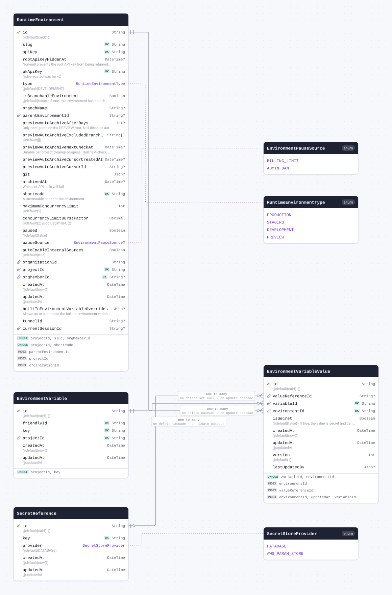

| Field              | Type       | Constraints                                                     | Default      | Description                                         |
| ------------------ | ---------- | --------------------------------------------------------------- | ------------ | --------------------------------------------------- |
| `id`               | `String`   | PK NOT NULL                                                     | `cuid(1)`    |                                                     |
| `valueReferenceId` | `String`   | NULL → [SecretReference.id](#model-SecretReference)             |              |                                                     |
| `variableId`       | `String`   | NOT NULL → [EnvironmentVariable.id](#model-EnvironmentVariable) |              |                                                     |
| `environmentId`    | `String`   | NOT NULL → [RuntimeEnvironment.id](#model-RuntimeEnvironment)   |              |                                                     |
| `isSecret`         | `Boolean`  | NOT NULL                                                        | `false`      | If true, the value is secret and cannot be revealed |
| `createdAt`        | `DateTime` | NOT NULL                                                        | `now()`      |                                                     |
| `updatedAt`        | `DateTime` | NOT NULL                                                        | `@updatedAt` |                                                     |
| `version`          | `Int`      | NOT NULL                                                        | `1`          |                                                     |
| `lastUpdatedBy`    | `Json`     | NULL                                                            |              |                                                     |

#### Indexes

- `@@index([environmentId])`
- `@@index([valueReferenceId])`
- `@@index([environmentId, updatedAt, variableId])`
- `@@unique([variableId, environmentId])`

#### References

- `valueReferenceId` → [SecretReference.id](#model-SecretReference) (many-to-one, on delete SetNull, on update Cascade)
- `variableId` → [EnvironmentVariable.id](#model-EnvironmentVariable) (many-to-one, on delete Cascade, on update Cascade)
- `environmentId` → [RuntimeEnvironment.id](#model-RuntimeEnvironment) (many-to-one, on delete Cascade, on update Cascade)

#### Definition

```sql
CREATE TABLE "EnvironmentVariableValue" (
    "id" TEXT NOT NULL,
    "valueReferenceId" TEXT,
    "variableId" TEXT NOT NULL,
    "environmentId" TEXT NOT NULL,
    "isSecret" BOOLEAN NOT NULL DEFAULT false,
    "createdAt" TIMESTAMP(3) NOT NULL DEFAULT CURRENT_TIMESTAMP,
    "updatedAt" TIMESTAMP(3) NOT NULL,
    "version" INTEGER NOT NULL DEFAULT 1,
    "lastUpdatedBy" JSONB,

    CONSTRAINT "EnvironmentVariableValue_pkey" PRIMARY KEY ("id")
);

CREATE INDEX "EnvironmentVariableValue_environmentId_idx" ON "EnvironmentVariableValue"("environmentId");

CREATE INDEX "EnvironmentVariableValue_valueReferenceId_idx" ON "EnvironmentVariableValue"("valueReferenceId");

CREATE INDEX "EnvironmentVariableValue_environmentId_updatedAt_variableId_idx" ON "EnvironmentVariableValue"("environmentId", "updatedAt" DESC, "variableId");

CREATE UNIQUE INDEX "EnvironmentVariableValue_variableId_environmentId_key" ON "EnvironmentVariableValue"("variableId", "environmentId");

ALTER TABLE "EnvironmentVariableValue" ADD CONSTRAINT "EnvironmentVariableValue_valueReferenceId_fkey" FOREIGN KEY ("valueReferenceId") REFERENCES "SecretReference"("id") ON DELETE SET NULL ON UPDATE CASCADE;

ALTER TABLE "EnvironmentVariableValue" ADD CONSTRAINT "EnvironmentVariableValue_variableId_fkey" FOREIGN KEY ("variableId") REFERENCES "EnvironmentVariable"("id") ON DELETE CASCADE ON UPDATE CASCADE;

ALTER TABLE "EnvironmentVariableValue" ADD CONSTRAINT "EnvironmentVariableValue_environmentId_fkey" FOREIGN KEY ("environmentId") REFERENCES "RuntimeEnvironment"("id") ON DELETE CASCADE ON UPDATE CASCADE;
```

<details>
<summary>Queries and their SQL</summary>

**findMany**: Every row

```ts
await prisma.environmentVariableValue.findMany();
```

```sql
SELECT
  "public"."EnvironmentVariableValue"."id",
  "public"."EnvironmentVariableValue"."valueReferenceId",
  "public"."EnvironmentVariableValue"."variableId",
  "public"."EnvironmentVariableValue"."environmentId",
  "public"."EnvironmentVariableValue"."isSecret",
  "public"."EnvironmentVariableValue"."createdAt",
  "public"."EnvironmentVariableValue"."updatedAt",
  "public"."EnvironmentVariableValue"."version",
  "public"."EnvironmentVariableValue"."lastUpdatedBy"
FROM
  "public"."EnvironmentVariableValue"
WHERE
  1 = 1
OFFSET
  $1
-- params: ["0"]
```

**count**: How many rows there are

```ts
await prisma.environmentVariableValue.count();
```

```sql
SELECT
  COUNT(*) AS "_count$_all"
FROM
  (
    SELECT
      "public"."EnvironmentVariableValue"."id"
    FROM
      "public"."EnvironmentVariableValue"
    WHERE
      1 = 1
    OFFSET
      $1
  ) AS "sub"
-- params: ["0"]
```

**findMany**: Every row with its relations

```ts
await prisma.environmentVariableValue.findMany({
  include: { valueReference: true, variable: true, environment: true },
});
```

```sql
SELECT
  "public"."EnvironmentVariableValue"."id",
  "public"."EnvironmentVariableValue"."valueReferenceId",
  "public"."EnvironmentVariableValue"."variableId",
  "public"."EnvironmentVariableValue"."environmentId",
  "public"."EnvironmentVariableValue"."isSecret",
  "public"."EnvironmentVariableValue"."createdAt",
  "public"."EnvironmentVariableValue"."updatedAt",
  "public"."EnvironmentVariableValue"."version",
  "public"."EnvironmentVariableValue"."lastUpdatedBy"
FROM
  "public"."EnvironmentVariableValue"
WHERE
  1 = 1
OFFSET
  $1
-- params: ["0"]

SELECT
  "public"."SecretReference"."id",
  "public"."SecretReference"."key",
  "public"."SecretReference"."provider"::text,
  "public"."SecretReference"."createdAt",
  "public"."SecretReference"."updatedAt"
FROM
  "public"."SecretReference"
WHERE
  "public"."SecretReference"."id" IN ($1)
OFFSET
  $2
-- params: ["<valueReferenceId of the rows above>","0"]

SELECT
  "public"."EnvironmentVariable"."id",
  "public"."EnvironmentVariable"."friendlyId",
  "public"."EnvironmentVariable"."key",
  "public"."EnvironmentVariable"."projectId",
  "public"."EnvironmentVariable"."createdAt",
  "public"."EnvironmentVariable"."updatedAt"
FROM
  "public"."EnvironmentVariable"
WHERE
  "public"."EnvironmentVariable"."id" IN ($1)
OFFSET
  $2
-- params: ["<variableId of the rows above>","0"]

SELECT
  "public"."RuntimeEnvironment"."id",
  "public"."RuntimeEnvironment"."slug",
  "public"."RuntimeEnvironment"."apiKey",
  "public"."RuntimeEnvironment"."rootApiKeyHiddenAt",
  "public"."RuntimeEnvironment"."pkApiKey",
  "public"."RuntimeEnvironment"."type"::text,
  "public"."RuntimeEnvironment"."isBranchableEnvironment",
  "public"."RuntimeEnvironment"."branchName",
  "public"."RuntimeEnvironment"."parentEnvironmentId",
  "public"."RuntimeEnvironment"."previewAutoArchiveAfterDays",
  "public"."RuntimeEnvironment"."previewAutoArchiveExcludedBranches",
  "public"."RuntimeEnvironment"."previewAutoArchiveNextCheckAt",
  "public"."RuntimeEnvironment"."previewAutoArchiveCursorCreatedAt",
  "public"."RuntimeEnvironment"."previewAutoArchiveCursorId",
  "public"."RuntimeEnvironment"."git",
  "public"."RuntimeEnvironment"."archivedAt",
  "public"."RuntimeEnvironment"."shortcode",
  "public"."RuntimeEnvironment"."maximumConcurrencyLimit",
  "public"."RuntimeEnvironment"."concurrencyLimitBurstFactor",
  "public"."RuntimeEnvironment"."paused",
  "public"."RuntimeEnvironment"."pauseSource"::text,
  "public"."RuntimeEnvironment"."autoEnableInternalSources",
  "public"."RuntimeEnvironment"."organizationId",
  "public"."RuntimeEnvironment"."projectId",
  "public"."RuntimeEnvironment"."orgMemberId",
  "public"."RuntimeEnvironment"."createdAt",
  "public"."RuntimeEnvironment"."updatedAt",
  "public"."RuntimeEnvironment"."builtInEnvironmentVariableOverrides",
  "public"."RuntimeEnvironment"."tunnelId",
  "public"."RuntimeEnvironment"."currentSessionId"
FROM
  "public"."RuntimeEnvironment"
WHERE
  "public"."RuntimeEnvironment"."id" IN ($1)
OFFSET
  $2
-- params: ["<environmentId of the rows above>","0"]
```

**findUnique**: One row by what is unique to it

```ts
await prisma.environmentVariableValue.findUnique({ where: { id: "example" } });
```

```sql
SELECT
  "public"."EnvironmentVariableValue"."id",
  "public"."EnvironmentVariableValue"."valueReferenceId",
  "public"."EnvironmentVariableValue"."variableId",
  "public"."EnvironmentVariableValue"."environmentId",
  "public"."EnvironmentVariableValue"."isSecret",
  "public"."EnvironmentVariableValue"."createdAt",
  "public"."EnvironmentVariableValue"."updatedAt",
  "public"."EnvironmentVariableValue"."version",
  "public"."EnvironmentVariableValue"."lastUpdatedBy"
FROM
  "public"."EnvironmentVariableValue"
WHERE
  (
    "public"."EnvironmentVariableValue"."id" = $1
    AND 1 = 1
  )
LIMIT
  $2
OFFSET
  $3
-- params: ["example","1","0"]
```

**create**: Create a row

```ts
await prisma.environmentVariableValue.create({
  data: { variableId: "example", environmentId: "example" },
});
```

```sql
INSERT INTO
  "public"."EnvironmentVariableValue" (
    "id",
    "variableId",
    "environmentId",
    "isSecret",
    "createdAt",
    "updatedAt",
    "version"
  )
VALUES
  ($1, $2, $3, $4, $5, $6, $7)
RETURNING
  "public"."EnvironmentVariableValue"."id",
  "public"."EnvironmentVariableValue"."valueReferenceId",
  "public"."EnvironmentVariableValue"."variableId",
  "public"."EnvironmentVariableValue"."environmentId",
  "public"."EnvironmentVariableValue"."isSecret",
  "public"."EnvironmentVariableValue"."createdAt",
  "public"."EnvironmentVariableValue"."updatedAt",
  "public"."EnvironmentVariableValue"."version",
  "public"."EnvironmentVariableValue"."lastUpdatedBy"
-- params: ["<cuid(1)>","example","example",false,"<now()>","<now()>","1"]
```

**update**: Update a row

```ts
await prisma.environmentVariableValue.update({
  where: { id: "example" },
  data: { isSecret: true },
});
```

```sql
UPDATE "public"."EnvironmentVariableValue"
SET
  "isSecret" = $1,
  "updatedAt" = $2
WHERE
  (
    "public"."EnvironmentVariableValue"."id" = $3
    AND 1 = 1
  )
RETURNING
  "public"."EnvironmentVariableValue"."id",
  "public"."EnvironmentVariableValue"."valueReferenceId",
  "public"."EnvironmentVariableValue"."variableId",
  "public"."EnvironmentVariableValue"."environmentId",
  "public"."EnvironmentVariableValue"."isSecret",
  "public"."EnvironmentVariableValue"."createdAt",
  "public"."EnvironmentVariableValue"."updatedAt",
  "public"."EnvironmentVariableValue"."version",
  "public"."EnvironmentVariableValue"."lastUpdatedBy"
-- params: [true,{"prisma__type":"generatorCall","prisma__value":{"name":"now","args":[],"returnType":{"type":"DateTime"}}},"example"]
```

**delete**: Delete a row

```ts
await prisma.environmentVariableValue.delete({ where: { id: "example" } });
```

```sql
DELETE FROM "public"."EnvironmentVariableValue"
WHERE
  (
    "public"."EnvironmentVariableValue"."id" = $1
    AND 1 = 1
  )
RETURNING
  "public"."EnvironmentVariableValue"."id",
  "public"."EnvironmentVariableValue"."valueReferenceId",
  "public"."EnvironmentVariableValue"."variableId",
  "public"."EnvironmentVariableValue"."environmentId",
  "public"."EnvironmentVariableValue"."isSecret",
  "public"."EnvironmentVariableValue"."createdAt",
  "public"."EnvironmentVariableValue"."updatedAt",
  "public"."EnvironmentVariableValue"."version",
  "public"."EnvironmentVariableValue"."lastUpdatedBy"
-- params: ["example"]
```

</details>

<a id="model-Checkpoint"></a>

### Checkpoint

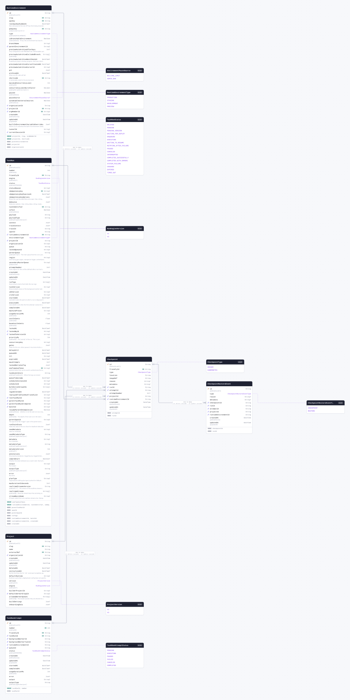

| Field                  | Type                                     | Constraints                                                   | Default      | Description |
| ---------------------- | ---------------------------------------- | ------------------------------------------------------------- | ------------ | ----------- |
| `id`                   | `String`                                 | PK NOT NULL                                                   | `cuid(1)`    |             |
| `friendlyId`           | `String`                                 | UNIQUE NOT NULL                                               |              |             |
| `type`                 | [`CheckpointType`](#enum-CheckpointType) | NOT NULL                                                      |              |             |
| `location`             | `String`                                 | NOT NULL                                                      |              |             |
| `imageRef`             | `String`                                 | NOT NULL                                                      |              |             |
| `reason`               | `String`                                 | NULL                                                          |              |             |
| `metadata`             | `String`                                 | NULL                                                          |              |             |
| `runId`                | `String`                                 | NOT NULL → [TaskRun.id](#model-TaskRun)                       |              |             |
| `attemptId`            | `String`                                 | NOT NULL → [TaskRunAttempt.id](#model-TaskRunAttempt)         |              |             |
| `attemptNumber`        | `Int`                                    | NULL                                                          |              |             |
| `projectId`            | `String`                                 | NOT NULL → [Project.id](#model-Project)                       |              |             |
| `runtimeEnvironmentId` | `String`                                 | NOT NULL → [RuntimeEnvironment.id](#model-RuntimeEnvironment) |              |             |
| `createdAt`            | `DateTime`                               | NOT NULL                                                      | `now()`      |             |
| `updatedAt`            | `DateTime`                               | NOT NULL                                                      | `@updatedAt` |             |

#### Indexes

- `@@index([attemptId])`
- `@@index([runId])`

#### References

- `runId` → [TaskRun.id](#model-TaskRun) (many-to-one, on delete Cascade, on update Cascade)
- `attemptId` → [TaskRunAttempt.id](#model-TaskRunAttempt) (many-to-one, on delete Cascade, on update Cascade)
- `projectId` → [Project.id](#model-Project) (many-to-one, on delete Cascade, on update Cascade)
- `runtimeEnvironmentId` → [RuntimeEnvironment.id](#model-RuntimeEnvironment) (many-to-one, on delete Cascade, on update Cascade)

#### Referenced by

- `id` ← [CheckpointRestoreEvent.checkpointId](#model-CheckpointRestoreEvent) (one-to-many, on delete Cascade, on update Cascade)

#### Definition

```sql
CREATE TABLE "Checkpoint" (
    "id" TEXT NOT NULL,
    "friendlyId" TEXT NOT NULL,
    "type" "CheckpointType" NOT NULL,
    "location" TEXT NOT NULL,
    "imageRef" TEXT NOT NULL,
    "reason" TEXT,
    "metadata" TEXT,
    "runId" TEXT NOT NULL,
    "attemptId" TEXT NOT NULL,
    "attemptNumber" INTEGER,
    "projectId" TEXT NOT NULL,
    "runtimeEnvironmentId" TEXT NOT NULL,
    "createdAt" TIMESTAMP(3) NOT NULL DEFAULT CURRENT_TIMESTAMP,
    "updatedAt" TIMESTAMP(3) NOT NULL,

    CONSTRAINT "Checkpoint_pkey" PRIMARY KEY ("id")
);

CREATE UNIQUE INDEX "Checkpoint_friendlyId_key" ON "Checkpoint"("friendlyId");

CREATE INDEX "Checkpoint_attemptId_idx" ON "Checkpoint"("attemptId");

CREATE INDEX "Checkpoint_runId_idx" ON "Checkpoint"("runId");

ALTER TABLE "Checkpoint" ADD CONSTRAINT "Checkpoint_runId_fkey" FOREIGN KEY ("runId") REFERENCES "TaskRun"("id") ON DELETE CASCADE ON UPDATE CASCADE;

ALTER TABLE "Checkpoint" ADD CONSTRAINT "Checkpoint_attemptId_fkey" FOREIGN KEY ("attemptId") REFERENCES "TaskRunAttempt"("id") ON DELETE CASCADE ON UPDATE CASCADE;

ALTER TABLE "Checkpoint" ADD CONSTRAINT "Checkpoint_projectId_fkey" FOREIGN KEY ("projectId") REFERENCES "Project"("id") ON DELETE CASCADE ON UPDATE CASCADE;

ALTER TABLE "Checkpoint" ADD CONSTRAINT "Checkpoint_runtimeEnvironmentId_fkey" FOREIGN KEY ("runtimeEnvironmentId") REFERENCES "RuntimeEnvironment"("id") ON DELETE CASCADE ON UPDATE CASCADE;
```

<details>
<summary>Queries and their SQL</summary>

**findMany**: Every row

```ts
await prisma.checkpoint.findMany();
```

```sql
SELECT
  "public"."Checkpoint"."id",
  "public"."Checkpoint"."friendlyId",
  "public"."Checkpoint"."type"::text,
  "public"."Checkpoint"."location",
  "public"."Checkpoint"."imageRef",
  "public"."Checkpoint"."reason",
  "public"."Checkpoint"."metadata",
  "public"."Checkpoint"."runId",
  "public"."Checkpoint"."attemptId",
  "public"."Checkpoint"."attemptNumber",
  "public"."Checkpoint"."projectId",
  "public"."Checkpoint"."runtimeEnvironmentId",
  "public"."Checkpoint"."createdAt",
  "public"."Checkpoint"."updatedAt"
FROM
  "public"."Checkpoint"
WHERE
  1 = 1
OFFSET
  $1
-- params: ["0"]
```

**count**: How many rows there are

```ts
await prisma.checkpoint.count();
```

```sql
SELECT
  COUNT(*) AS "_count$_all"
FROM
  (
    SELECT
      "public"."Checkpoint"."id"
    FROM
      "public"."Checkpoint"
    WHERE
      1 = 1
    OFFSET
      $1
  ) AS "sub"
-- params: ["0"]
```

**findMany**: Every row with its relations

```ts
await prisma.checkpoint.findMany({
  include: { events: true, run: true, attempt: true, project: true, runtimeEnvironment: true },
});
```

```sql
SELECT
  "public"."Checkpoint"."id",
  "public"."Checkpoint"."friendlyId",
  "public"."Checkpoint"."type"::text,
  "public"."Checkpoint"."location",
  "public"."Checkpoint"."imageRef",
  "public"."Checkpoint"."reason",
  "public"."Checkpoint"."metadata",
  "public"."Checkpoint"."runId",
  "public"."Checkpoint"."attemptId",
  "public"."Checkpoint"."attemptNumber",
  "public"."Checkpoint"."projectId",
  "public"."Checkpoint"."runtimeEnvironmentId",
  "public"."Checkpoint"."createdAt",
  "public"."Checkpoint"."updatedAt"
FROM
  "public"."Checkpoint"
WHERE
  1 = 1
OFFSET
  $1
-- params: ["0"]

SELECT
  "public"."CheckpointRestoreEvent"."id",
  "public"."CheckpointRestoreEvent"."type"::text,
  "public"."CheckpointRestoreEvent"."reason",
  "public"."CheckpointRestoreEvent"."metadata",
  "public"."CheckpointRestoreEvent"."checkpointId",
  "public"."CheckpointRestoreEvent"."runId",
  "public"."CheckpointRestoreEvent"."attemptId",
  "public"."CheckpointRestoreEvent"."projectId",
  "public"."CheckpointRestoreEvent"."runtimeEnvironmentId",
  "public"."CheckpointRestoreEvent"."createdAt",
  "public"."CheckpointRestoreEvent"."updatedAt"
FROM
  "public"."CheckpointRestoreEvent"
WHERE
  "public"."CheckpointRestoreEvent"."checkpointId" IN ($1)
OFFSET
  $2
-- params: ["<id of the rows above>","0"]

SELECT
  "public"."TaskRun"."id",
  "public"."TaskRun"."number",
  "public"."TaskRun"."friendlyId",
  "public"."TaskRun"."engine"::text,
  "public"."TaskRun"."status"::text,
  "public"."TaskRun"."statusReason",
  "public"."TaskRun"."idempotencyKey",
  "public"."TaskRun"."idempotencyKeyExpiresAt",
  "public"."TaskRun"."idempotencyKeyOptions",
  "public"."TaskRun"."debounce",
  "public"."TaskRun"."taskIdentifier",
  "public"."TaskRun"."isTest",
  "public"."TaskRun"."payload",
  "public"."TaskRun"."payloadType",
  "public"."TaskRun"."context",
  "public"."TaskRun"."traceContext",
  "public"."TaskRun"."traceId",
  "public"."TaskRun"."spanId",
  "public"."TaskRun"."runtimeEnvironmentId",
  "public"."TaskRun"."environmentType"::text,
  "public"."TaskRun"."projectId",
  "public"."TaskRun"."organizationId",
  "public"."TaskRun"."queue",
  "public"."TaskRun"."lockedQueueId",
  "public"."TaskRun"."masterQueue",
  "public"."TaskRun"."region",
  "public"."TaskRun"."secondaryMasterQueue",
  "public"."TaskRun"."attemptNumber",
  "public"."TaskRun"."createdAt",
  "public"."TaskRun"."updatedAt",
  "public"."TaskRun"."runTags",
  "public"."TaskRun"."taskVersion",
  "public"."TaskRun"."sdkVersion",
  "public"."TaskRun"."cliVersion",
  "public"."TaskRun"."startedAt",
  "public"."TaskRun"."executedAt",
  "public"."TaskRun"."completedAt",
  "public"."TaskRun"."machinePreset",
  "public"."TaskRun"."usageDurationMs",
  "public"."TaskRun"."costInCents",
  "public"."TaskRun"."baseCostInCents",
  "public"."TaskRun"."lockedAt",
  "public"."TaskRun"."lockedById",
  "public"."TaskRun"."lockedToVersionId",
  "public"."TaskRun"."priorityMs",
  "public"."TaskRun"."concurrencyKey",
  "public"."TaskRun"."gates",
  "public"."TaskRun"."delayUntil",
  "public"."TaskRun"."queuedAt",
  "public"."TaskRun"."ttl",
  "public"."TaskRun"."expiredAt",
  "public"."TaskRun"."maxAttempts",
  "public"."TaskRun"."lockedRetryConfig",
  "public"."TaskRun"."oneTimeUseToken",
  "public"."TaskRun"."taskEventStore",
  "public"."TaskRun"."queueTimestamp",
  "public"."TaskRun"."scheduleInstanceId",
  "public"."TaskRun"."scheduleId",
  "public"."TaskRun"."bulkActionGroupIds",
  "public"."TaskRun"."logsDeletedAt",
  "public"."TaskRun"."replayedFromTaskRunFriendlyId",
  "public"."TaskRun"."rootTaskRunId",
  "public"."TaskRun"."parentTaskRunId",
  "public"."TaskRun"."parentTaskRunAttemptId",
  "public"."TaskRun"."batchId",
  "public"."TaskRun"."resumeParentOnCompletion",
  "public"."TaskRun"."depth",
  "public"."TaskRun"."parentSpanId",
  "public"."TaskRun"."runChainState",
  "public"."TaskRun"."seedMetadata",
  "public"."TaskRun"."seedMetadataType",
  "public"."TaskRun"."metadata",
  "public"."TaskRun"."metadataType",
  "public"."TaskRun"."metadataVersion",
  "public"."TaskRun"."annotations",
  "public"."TaskRun"."isWarmStart",
  "public"."TaskRun"."output",
  "public"."TaskRun"."outputType",
  "public"."TaskRun"."error",
  "public"."TaskRun"."planType",
  "public"."TaskRun"."maxDurationInSeconds",
  "public"."TaskRun"."realtimeStreamsVersion",
  "public"."TaskRun"."realtimeStreams",
  "public"."TaskRun"."streamBasinName"
FROM
  "public"."TaskRun"
WHERE
  "public"."TaskRun"."id" IN ($1)
OFFSET
  $2
-- params: ["<runId of the rows above>","0"]

SELECT
  "public"."TaskRunAttempt"."id",
  "public"."TaskRunAttempt"."number",
  "public"."TaskRunAttempt"."friendlyId",
  "public"."TaskRunAttempt"."taskRunId",
  "public"."TaskRunAttempt"."backgroundWorkerId",
  "public"."TaskRunAttempt"."backgroundWorkerTaskId",
  "public"."TaskRunAttempt"."runtimeEnvironmentId",
  "public"."TaskRunAttempt"."queueId",
  "public"."TaskRunAttempt"."status"::text,
  "public"."TaskRunAttempt"."createdAt",
  "public"."TaskRunAttempt"."updatedAt",
  "public"."TaskRunAttempt"."startedAt",
  "public"."TaskRunAttempt"."completedAt",
  "public"."TaskRunAttempt"."usageDurationMs",
  "public"."TaskRunAttempt"."error",
  "public"."TaskRunAttempt"."output",
  "public"."TaskRunAttempt"."outputType"
FROM
  "public"."TaskRunAttempt"
WHERE
  "public"."TaskRunAttempt"."id" IN ($1)
OFFSET
  $2
-- params: ["<attemptId of the rows above>","0"]

SELECT
  "public"."Project"."id",
  "public"."Project"."slug",
  "public"."Project"."name",
  "public"."Project"."externalRef",
  "public"."Project"."organizationId",
  "public"."Project"."createdAt",
  "public"."Project"."updatedAt",
  "public"."Project"."deletedAt",
  "public"."Project"."initializedAt",
  "public"."Project"."defaultRuntime",
  "public"."Project"."version"::text,
  "public"."Project"."engine"::text,
  "public"."Project"."builderProjectId",
  "public"."Project"."defaultWorkerGroupId",
  "public"."Project"."allowedMasterQueues",
  "public"."Project"."buildSettings",
  "public"."Project"."onboardingData"
FROM
  "public"."Project"
WHERE
  "public"."Project"."id" IN ($1)
OFFSET
  $2
-- params: ["<projectId of the rows above>","0"]

SELECT
  "public"."RuntimeEnvironment"."id",
  "public"."RuntimeEnvironment"."slug",
  "public"."RuntimeEnvironment"."apiKey",
  "public"."RuntimeEnvironment"."rootApiKeyHiddenAt",
  "public"."RuntimeEnvironment"."pkApiKey",
  "public"."RuntimeEnvironment"."type"::text,
  "public"."RuntimeEnvironment"."isBranchableEnvironment",
  "public"."RuntimeEnvironment"."branchName",
  "public"."RuntimeEnvironment"."parentEnvironmentId",
  "public"."RuntimeEnvironment"."previewAutoArchiveAfterDays",
  "public"."RuntimeEnvironment"."previewAutoArchiveExcludedBranches",
  "public"."RuntimeEnvironment"."previewAutoArchiveNextCheckAt",
  "public"."RuntimeEnvironment"."previewAutoArchiveCursorCreatedAt",
  "public"."RuntimeEnvironment"."previewAutoArchiveCursorId",
  "public"."RuntimeEnvironment"."git",
  "public"."RuntimeEnvironment"."archivedAt",
  "public"."RuntimeEnvironment"."shortcode",
  "public"."RuntimeEnvironment"."maximumConcurrencyLimit",
  "public"."RuntimeEnvironment"."concurrencyLimitBurstFactor",
  "public"."RuntimeEnvironment"."paused",
  "public"."RuntimeEnvironment"."pauseSource"::text,
  "public"."RuntimeEnvironment"."autoEnableInternalSources",
  "public"."RuntimeEnvironment"."organizationId",
  "public"."RuntimeEnvironment"."projectId",
  "public"."RuntimeEnvironment"."orgMemberId",
  "public"."RuntimeEnvironment"."createdAt",
  "public"."RuntimeEnvironment"."updatedAt",
  "public"."RuntimeEnvironment"."builtInEnvironmentVariableOverrides",
  "public"."RuntimeEnvironment"."tunnelId",
  "public"."RuntimeEnvironment"."currentSessionId"
FROM
  "public"."RuntimeEnvironment"
WHERE
  "public"."RuntimeEnvironment"."id" IN ($1)
OFFSET
  $2
-- params: ["<runtimeEnvironmentId of the rows above>","0"]
```

**findUnique**: One row by what is unique to it

```ts
await prisma.checkpoint.findUnique({ where: { id: "example" } });
```

```sql
SELECT
  "public"."Checkpoint"."id",
  "public"."Checkpoint"."friendlyId",
  "public"."Checkpoint"."type"::text,
  "public"."Checkpoint"."location",
  "public"."Checkpoint"."imageRef",
  "public"."Checkpoint"."reason",
  "public"."Checkpoint"."metadata",
  "public"."Checkpoint"."runId",
  "public"."Checkpoint"."attemptId",
  "public"."Checkpoint"."attemptNumber",
  "public"."Checkpoint"."projectId",
  "public"."Checkpoint"."runtimeEnvironmentId",
  "public"."Checkpoint"."createdAt",
  "public"."Checkpoint"."updatedAt"
FROM
  "public"."Checkpoint"
WHERE
  (
    "public"."Checkpoint"."id" = $1
    AND 1 = 1
  )
LIMIT
  $2
OFFSET
  $3
-- params: ["example","1","0"]
```

**create**: Create a row

```ts
await prisma.checkpoint.create({
  data: {
    friendlyId: "example",
    type: "DOCKER",
    location: "example",
    imageRef: "example",
    runId: "example",
    attemptId: "example",
    projectId: "example",
    runtimeEnvironmentId: "example",
  },
});
```

```sql
INSERT INTO
  "public"."Checkpoint" (
    "id",
    "friendlyId",
    "type",
    "location",
    "imageRef",
    "runId",
    "attemptId",
    "projectId",
    "runtimeEnvironmentId",
    "createdAt",
    "updatedAt"
  )
VALUES
  (
    $1,
    $2,
    CAST($3::text AS "public"."CheckpointType"),
    $4,
    $5,
    $6,
    $7,
    $8,
    $9,
    $10,
    $11
  )
RETURNING
  "public"."Checkpoint"."id",
  "public"."Checkpoint"."friendlyId",
  "public"."Checkpoint"."type"::text,
  "public"."Checkpoint"."location",
  "public"."Checkpoint"."imageRef",
  "public"."Checkpoint"."reason",
  "public"."Checkpoint"."metadata",
  "public"."Checkpoint"."runId",
  "public"."Checkpoint"."attemptId",
  "public"."Checkpoint"."attemptNumber",
  "public"."Checkpoint"."projectId",
  "public"."Checkpoint"."runtimeEnvironmentId",
  "public"."Checkpoint"."createdAt",
  "public"."Checkpoint"."updatedAt"
-- params: ["<cuid(1)>","example","DOCKER","example","example","example","example","example","example","<now()>","<now()>"]
```

**update**: Update a row

```ts
await prisma.checkpoint.update({ where: { id: "example" }, data: { friendlyId: "example" } });
```

```sql
UPDATE "public"."Checkpoint"
SET
  "friendlyId" = $1,
  "updatedAt" = $2
WHERE
  (
    "public"."Checkpoint"."id" = $3
    AND 1 = 1
  )
RETURNING
  "public"."Checkpoint"."id",
  "public"."Checkpoint"."friendlyId",
  "public"."Checkpoint"."type"::text,
  "public"."Checkpoint"."location",
  "public"."Checkpoint"."imageRef",
  "public"."Checkpoint"."reason",
  "public"."Checkpoint"."metadata",
  "public"."Checkpoint"."runId",
  "public"."Checkpoint"."attemptId",
  "public"."Checkpoint"."attemptNumber",
  "public"."Checkpoint"."projectId",
  "public"."Checkpoint"."runtimeEnvironmentId",
  "public"."Checkpoint"."createdAt",
  "public"."Checkpoint"."updatedAt"
-- params: ["example",{"prisma__type":"generatorCall","prisma__value":{"name":"now","args":[],"returnType":{"type":"DateTime"}}},"example"]
```

**delete**: Delete a row

```ts
await prisma.checkpoint.delete({ where: { id: "example" } });
```

```sql
DELETE FROM "public"."Checkpoint"
WHERE
  (
    "public"."Checkpoint"."id" = $1
    AND 1 = 1
  )
RETURNING
  "public"."Checkpoint"."id",
  "public"."Checkpoint"."friendlyId",
  "public"."Checkpoint"."type"::text,
  "public"."Checkpoint"."location",
  "public"."Checkpoint"."imageRef",
  "public"."Checkpoint"."reason",
  "public"."Checkpoint"."metadata",
  "public"."Checkpoint"."runId",
  "public"."Checkpoint"."attemptId",
  "public"."Checkpoint"."attemptNumber",
  "public"."Checkpoint"."projectId",
  "public"."Checkpoint"."runtimeEnvironmentId",
  "public"."Checkpoint"."createdAt",
  "public"."Checkpoint"."updatedAt"
-- params: ["example"]
```

</details>

<a id="model-CheckpointRestoreEvent"></a>

### CheckpointRestoreEvent

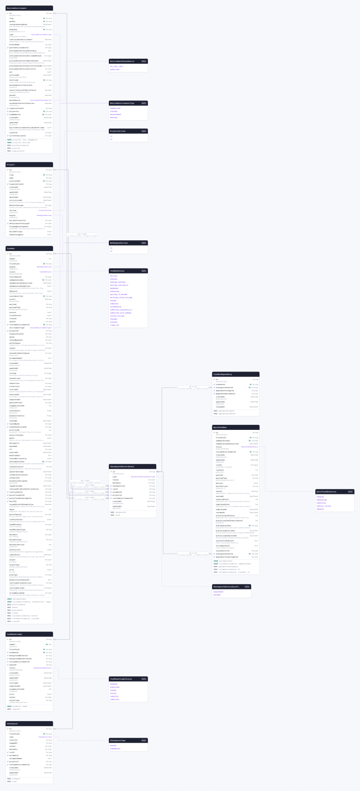

| Field                  | Type                                                             | Constraints                                                   | Default      | Description |
| ---------------------- | ---------------------------------------------------------------- | ------------------------------------------------------------- | ------------ | ----------- |
| `id`                   | `String`                                                         | PK NOT NULL                                                   | `cuid(1)`    |             |
| `type`                 | [`CheckpointRestoreEventType`](#enum-CheckpointRestoreEventType) | NOT NULL                                                      |              |             |
| `reason`               | `String`                                                         | NULL                                                          |              |             |
| `metadata`             | `String`                                                         | NULL                                                          |              |             |
| `checkpointId`         | `String`                                                         | NOT NULL → [Checkpoint.id](#model-Checkpoint)                 |              |             |
| `runId`                | `String`                                                         | NOT NULL → [TaskRun.id](#model-TaskRun)                       |              |             |
| `attemptId`            | `String`                                                         | NOT NULL → [TaskRunAttempt.id](#model-TaskRunAttempt)         |              |             |
| `projectId`            | `String`                                                         | NOT NULL → [Project.id](#model-Project)                       |              |             |
| `runtimeEnvironmentId` | `String`                                                         | NOT NULL → [RuntimeEnvironment.id](#model-RuntimeEnvironment) |              |             |
| `createdAt`            | `DateTime`                                                       | NOT NULL                                                      | `now()`      |             |
| `updatedAt`            | `DateTime`                                                       | NOT NULL                                                      | `@updatedAt` |             |

#### Indexes

- `@@index([checkpointId])`
- `@@index([runId])`

#### References

- `checkpointId` → [Checkpoint.id](#model-Checkpoint) (many-to-one, on delete Cascade, on update Cascade)
- `runId` → [TaskRun.id](#model-TaskRun) (many-to-one, on delete Cascade, on update Cascade)
- `attemptId` → [TaskRunAttempt.id](#model-TaskRunAttempt) (many-to-one, on delete Cascade, on update Cascade)
- `projectId` → [Project.id](#model-Project) (many-to-one, on delete Cascade, on update Cascade)
- `runtimeEnvironmentId` → [RuntimeEnvironment.id](#model-RuntimeEnvironment) (many-to-one, on delete Cascade, on update Cascade)

#### Referenced by

- `id` ← [TaskRunDependency.checkpointEventId](#model-TaskRunDependency) (one-to-one, on delete Cascade, on update Cascade)
- `id` ← [BatchTaskRun.checkpointEventId](#model-BatchTaskRun) (one-to-one, on delete Cascade, on update Cascade)

#### Definition

```sql
CREATE TABLE "CheckpointRestoreEvent" (
    "id" TEXT NOT NULL,
    "type" "CheckpointRestoreEventType" NOT NULL,
    "reason" TEXT,
    "metadata" TEXT,
    "checkpointId" TEXT NOT NULL,
    "runId" TEXT NOT NULL,
    "attemptId" TEXT NOT NULL,
    "projectId" TEXT NOT NULL,
    "runtimeEnvironmentId" TEXT NOT NULL,
    "createdAt" TIMESTAMP(3) NOT NULL DEFAULT CURRENT_TIMESTAMP,
    "updatedAt" TIMESTAMP(3) NOT NULL,

    CONSTRAINT "CheckpointRestoreEvent_pkey" PRIMARY KEY ("id")
);

CREATE INDEX "CheckpointRestoreEvent_checkpointId_idx" ON "CheckpointRestoreEvent"("checkpointId");

CREATE INDEX "CheckpointRestoreEvent_runId_idx" ON "CheckpointRestoreEvent"("runId");

ALTER TABLE "CheckpointRestoreEvent" ADD CONSTRAINT "CheckpointRestoreEvent_checkpointId_fkey" FOREIGN KEY ("checkpointId") REFERENCES "Checkpoint"("id") ON DELETE CASCADE ON UPDATE CASCADE;

ALTER TABLE "CheckpointRestoreEvent" ADD CONSTRAINT "CheckpointRestoreEvent_runId_fkey" FOREIGN KEY ("runId") REFERENCES "TaskRun"("id") ON DELETE CASCADE ON UPDATE CASCADE;

ALTER TABLE "CheckpointRestoreEvent" ADD CONSTRAINT "CheckpointRestoreEvent_attemptId_fkey" FOREIGN KEY ("attemptId") REFERENCES "TaskRunAttempt"("id") ON DELETE CASCADE ON UPDATE CASCADE;

ALTER TABLE "CheckpointRestoreEvent" ADD CONSTRAINT "CheckpointRestoreEvent_projectId_fkey" FOREIGN KEY ("projectId") REFERENCES "Project"("id") ON DELETE CASCADE ON UPDATE CASCADE;

ALTER TABLE "CheckpointRestoreEvent" ADD CONSTRAINT "CheckpointRestoreEvent_runtimeEnvironmentId_fkey" FOREIGN KEY ("runtimeEnvironmentId") REFERENCES "RuntimeEnvironment"("id") ON DELETE CASCADE ON UPDATE CASCADE;
```

<details>
<summary>Queries and their SQL</summary>

**findMany**: Every row

```ts
await prisma.checkpointRestoreEvent.findMany();
```

```sql
SELECT
  "public"."CheckpointRestoreEvent"."id",
  "public"."CheckpointRestoreEvent"."type"::text,
  "public"."CheckpointRestoreEvent"."reason",
  "public"."CheckpointRestoreEvent"."metadata",
  "public"."CheckpointRestoreEvent"."checkpointId",
  "public"."CheckpointRestoreEvent"."runId",
  "public"."CheckpointRestoreEvent"."attemptId",
  "public"."CheckpointRestoreEvent"."projectId",
  "public"."CheckpointRestoreEvent"."runtimeEnvironmentId",
  "public"."CheckpointRestoreEvent"."createdAt",
  "public"."CheckpointRestoreEvent"."updatedAt"
FROM
  "public"."CheckpointRestoreEvent"
WHERE
  1 = 1
OFFSET
  $1
-- params: ["0"]
```

**count**: How many rows there are

```ts
await prisma.checkpointRestoreEvent.count();
```

```sql
SELECT
  COUNT(*) AS "_count$_all"
FROM
  (
    SELECT
      "public"."CheckpointRestoreEvent"."id"
    FROM
      "public"."CheckpointRestoreEvent"
    WHERE
      1 = 1
    OFFSET
      $1
  ) AS "sub"
-- params: ["0"]
```

**findMany**: Every row with its relations

```ts
await prisma.checkpointRestoreEvent.findMany({
  include: {
    checkpoint: true,
    run: true,
    attempt: true,
    project: true,
    runtimeEnvironment: true,
    taskRunDependency: true,
    batchTaskRunDependency: true,
  },
});
```

```sql
SELECT
  "public"."CheckpointRestoreEvent"."id",
  "public"."CheckpointRestoreEvent"."type"::text,
  "public"."CheckpointRestoreEvent"."reason",
  "public"."CheckpointRestoreEvent"."metadata",
  "public"."CheckpointRestoreEvent"."checkpointId",
  "public"."CheckpointRestoreEvent"."runId",
  "public"."CheckpointRestoreEvent"."attemptId",
  "public"."CheckpointRestoreEvent"."projectId",
  "public"."CheckpointRestoreEvent"."runtimeEnvironmentId",
  "public"."CheckpointRestoreEvent"."createdAt",
  "public"."CheckpointRestoreEvent"."updatedAt"
FROM
  "public"."CheckpointRestoreEvent"
WHERE
  1 = 1
OFFSET
  $1
-- params: ["0"]

SELECT
  "public"."Checkpoint"."id",
  "public"."Checkpoint"."friendlyId",
  "public"."Checkpoint"."type"::text,
  "public"."Checkpoint"."location",
  "public"."Checkpoint"."imageRef",
  "public"."Checkpoint"."reason",
  "public"."Checkpoint"."metadata",
  "public"."Checkpoint"."runId",
  "public"."Checkpoint"."attemptId",
  "public"."Checkpoint"."attemptNumber",
  "public"."Checkpoint"."projectId",
  "public"."Checkpoint"."runtimeEnvironmentId",
  "public"."Checkpoint"."createdAt",
  "public"."Checkpoint"."updatedAt"
FROM
  "public"."Checkpoint"
WHERE
  "public"."Checkpoint"."id" IN ($1)
OFFSET
  $2
-- params: ["<checkpointId of the rows above>","0"]

SELECT
  "public"."TaskRun"."id",
  "public"."TaskRun"."number",
  "public"."TaskRun"."friendlyId",
  "public"."TaskRun"."engine"::text,
  "public"."TaskRun"."status"::text,
  "public"."TaskRun"."statusReason",
  "public"."TaskRun"."idempotencyKey",
  "public"."TaskRun"."idempotencyKeyExpiresAt",
  "public"."TaskRun"."idempotencyKeyOptions",
  "public"."TaskRun"."debounce",
  "public"."TaskRun"."taskIdentifier",
  "public"."TaskRun"."isTest",
  "public"."TaskRun"."payload",
  "public"."TaskRun"."payloadType",
  "public"."TaskRun"."context",
  "public"."TaskRun"."traceContext",
  "public"."TaskRun"."traceId",
  "public"."TaskRun"."spanId",
  "public"."TaskRun"."runtimeEnvironmentId",
  "public"."TaskRun"."environmentType"::text,
  "public"."TaskRun"."projectId",
  "public"."TaskRun"."organizationId",
  "public"."TaskRun"."queue",
  "public"."TaskRun"."lockedQueueId",
  "public"."TaskRun"."masterQueue",
  "public"."TaskRun"."region",
  "public"."TaskRun"."secondaryMasterQueue",
  "public"."TaskRun"."attemptNumber",
  "public"."TaskRun"."createdAt",
  "public"."TaskRun"."updatedAt",
  "public"."TaskRun"."runTags",
  "public"."TaskRun"."taskVersion",
  "public"."TaskRun"."sdkVersion",
  "public"."TaskRun"."cliVersion",
  "public"."TaskRun"."startedAt",
  "public"."TaskRun"."executedAt",
  "public"."TaskRun"."completedAt",
  "public"."TaskRun"."machinePreset",
  "public"."TaskRun"."usageDurationMs",
  "public"."TaskRun"."costInCents",
  "public"."TaskRun"."baseCostInCents",
  "public"."TaskRun"."lockedAt",
  "public"."TaskRun"."lockedById",
  "public"."TaskRun"."lockedToVersionId",
  "public"."TaskRun"."priorityMs",
  "public"."TaskRun"."concurrencyKey",
  "public"."TaskRun"."gates",
  "public"."TaskRun"."delayUntil",
  "public"."TaskRun"."queuedAt",
  "public"."TaskRun"."ttl",
  "public"."TaskRun"."expiredAt",
  "public"."TaskRun"."maxAttempts",
  "public"."TaskRun"."lockedRetryConfig",
  "public"."TaskRun"."oneTimeUseToken",
  "public"."TaskRun"."taskEventStore",
  "public"."TaskRun"."queueTimestamp",
  "public"."TaskRun"."scheduleInstanceId",
  "public"."TaskRun"."scheduleId",
  "public"."TaskRun"."bulkActionGroupIds",
  "public"."TaskRun"."logsDeletedAt",
  "public"."TaskRun"."replayedFromTaskRunFriendlyId",
  "public"."TaskRun"."rootTaskRunId",
  "public"."TaskRun"."parentTaskRunId",
  "public"."TaskRun"."parentTaskRunAttemptId",
  "public"."TaskRun"."batchId",
  "public"."TaskRun"."resumeParentOnCompletion",
  "public"."TaskRun"."depth",
  "public"."TaskRun"."parentSpanId",
  "public"."TaskRun"."runChainState",
  "public"."TaskRun"."seedMetadata",
  "public"."TaskRun"."seedMetadataType",
  "public"."TaskRun"."metadata",
  "public"."TaskRun"."metadataType",
  "public"."TaskRun"."metadataVersion",
  "public"."TaskRun"."annotations",
  "public"."TaskRun"."isWarmStart",
  "public"."TaskRun"."output",
  "public"."TaskRun"."outputType",
  "public"."TaskRun"."error",
  "public"."TaskRun"."planType",
  "public"."TaskRun"."maxDurationInSeconds",
  "public"."TaskRun"."realtimeStreamsVersion",
  "public"."TaskRun"."realtimeStreams",
  "public"."TaskRun"."streamBasinName"
FROM
  "public"."TaskRun"
WHERE
  "public"."TaskRun"."id" IN ($1)
OFFSET
  $2
-- params: ["<runId of the rows above>","0"]

SELECT
  "public"."TaskRunAttempt"."id",
  "public"."TaskRunAttempt"."number",
  "public"."TaskRunAttempt"."friendlyId",
  "public"."TaskRunAttempt"."taskRunId",
  "public"."TaskRunAttempt"."backgroundWorkerId",
  "public"."TaskRunAttempt"."backgroundWorkerTaskId",
  "public"."TaskRunAttempt"."runtimeEnvironmentId",
  "public"."TaskRunAttempt"."queueId",
  "public"."TaskRunAttempt"."status"::text,
  "public"."TaskRunAttempt"."createdAt",
  "public"."TaskRunAttempt"."updatedAt",
  "public"."TaskRunAttempt"."startedAt",
  "public"."TaskRunAttempt"."completedAt",
  "public"."TaskRunAttempt"."usageDurationMs",
  "public"."TaskRunAttempt"."error",
  "public"."TaskRunAttempt"."output",
  "public"."TaskRunAttempt"."outputType"
FROM
  "public"."TaskRunAttempt"
WHERE
  "public"."TaskRunAttempt"."id" IN ($1)
OFFSET
  $2
-- params: ["<attemptId of the rows above>","0"]

SELECT
  "public"."Project"."id",
  "public"."Project"."slug",
  "public"."Project"."name",
  "public"."Project"."externalRef",
  "public"."Project"."organizationId",
  "public"."Project"."createdAt",
  "public"."Project"."updatedAt",
  "public"."Project"."deletedAt",
  "public"."Project"."initializedAt",
  "public"."Project"."defaultRuntime",
  "public"."Project"."version"::text,
  "public"."Project"."engine"::text,
  "public"."Project"."builderProjectId",
  "public"."Project"."defaultWorkerGroupId",
  "public"."Project"."allowedMasterQueues",
  "public"."Project"."buildSettings",
  "public"."Project"."onboardingData"
FROM
  "public"."Project"
WHERE
  "public"."Project"."id" IN ($1)
OFFSET
  $2
-- params: ["<projectId of the rows above>","0"]

SELECT
  "public"."RuntimeEnvironment"."id",
  "public"."RuntimeEnvironment"."slug",
  "public"."RuntimeEnvironment"."apiKey",
  "public"."RuntimeEnvironment"."rootApiKeyHiddenAt",
  "public"."RuntimeEnvironment"."pkApiKey",
  "public"."RuntimeEnvironment"."type"::text,
  "public"."RuntimeEnvironment"."isBranchableEnvironment",
  "public"."RuntimeEnvironment"."branchName",
  "public"."RuntimeEnvironment"."parentEnvironmentId",
  "public"."RuntimeEnvironment"."previewAutoArchiveAfterDays",
  "public"."RuntimeEnvironment"."previewAutoArchiveExcludedBranches",
  "public"."RuntimeEnvironment"."previewAutoArchiveNextCheckAt",
  "public"."RuntimeEnvironment"."previewAutoArchiveCursorCreatedAt",
  "public"."RuntimeEnvironment"."previewAutoArchiveCursorId",
  "public"."RuntimeEnvironment"."git",
  "public"."RuntimeEnvironment"."archivedAt",
  "public"."RuntimeEnvironment"."shortcode",
  "public"."RuntimeEnvironment"."maximumConcurrencyLimit",
  "public"."RuntimeEnvironment"."concurrencyLimitBurstFactor",
  "public"."RuntimeEnvironment"."paused",
  "public"."RuntimeEnvironment"."pauseSource"::text,
  "public"."RuntimeEnvironment"."autoEnableInternalSources",
  "public"."RuntimeEnvironment"."organizationId",
  "public"."RuntimeEnvironment"."projectId",
  "public"."RuntimeEnvironment"."orgMemberId",
  "public"."RuntimeEnvironment"."createdAt",
  "public"."RuntimeEnvironment"."updatedAt",
  "public"."RuntimeEnvironment"."builtInEnvironmentVariableOverrides",
  "public"."RuntimeEnvironment"."tunnelId",
  "public"."RuntimeEnvironment"."currentSessionId"
FROM
  "public"."RuntimeEnvironment"
WHERE
  "public"."RuntimeEnvironment"."id" IN ($1)
OFFSET
  $2
-- params: ["<runtimeEnvironmentId of the rows above>","0"]

SELECT
  "public"."TaskRunDependency"."id",
  "public"."TaskRunDependency"."taskRunId",
  "public"."TaskRunDependency"."checkpointEventId",
  "public"."TaskRunDependency"."dependentAttemptId",
  "public"."TaskRunDependency"."dependentBatchRunId",
  "public"."TaskRunDependency"."createdAt",
  "public"."TaskRunDependency"."updatedAt",
  "public"."TaskRunDependency"."resumedAt"
FROM
  "public"."TaskRunDependency"
WHERE
  "public"."TaskRunDependency"."checkpointEventId" IN ($1)
OFFSET
  $2
-- params: ["<id of the rows above>","0"]

SELECT
  "public"."BatchTaskRun"."id",
  "public"."BatchTaskRun"."friendlyId",
  "public"."BatchTaskRun"."idempotencyKey",
  "public"."BatchTaskRun"."idempotencyKeyExpiresAt",
  "public"."BatchTaskRun"."status"::text,
  "public"."BatchTaskRun"."runtimeEnvironmentId",
  "public"."BatchTaskRun"."createdAt",
  "public"."BatchTaskRun"."updatedAt",
  "public"."BatchTaskRun"."runIds",
  "public"."BatchTaskRun"."runCount",
  "public"."BatchTaskRun"."payload",
  "public"."BatchTaskRun"."payloadType",
  "public"."BatchTaskRun"."options",
  "public"."BatchTaskRun"."batchVersion",
  "public"."BatchTaskRun"."sealed",
  "public"."BatchTaskRun"."sealedAt",
  "public"."BatchTaskRun"."expectedCount",
  "public"."BatchTaskRun"."completedCount",
  "public"."BatchTaskRun"."completedAt",
  "public"."BatchTaskRun"."resumedAt",
  "public"."BatchTaskRun"."processingJobsCount",
  "public"."BatchTaskRun"."processingJobsExpectedCount",
  "public"."BatchTaskRun"."oneTimeUseToken",
  "public"."BatchTaskRun"."processingStartedAt",
  "public"."BatchTaskRun"."processingCompletedAt",
  "public"."BatchTaskRun"."successfulRunCount",
  "public"."BatchTaskRun"."failedRunCount",
  "public"."BatchTaskRun"."taskIdentifier",
  "public"."BatchTaskRun"."checkpointEventId",
  "public"."BatchTaskRun"."dependentTaskAttemptId"
FROM
  "public"."BatchTaskRun"
WHERE
  "public"."BatchTaskRun"."checkpointEventId" IN ($1)
OFFSET
  $2
-- params: ["<id of the rows above>","0"]
```

**findUnique**: One row by what is unique to it

```ts
await prisma.checkpointRestoreEvent.findUnique({ where: { id: "example" } });
```

```sql
SELECT
  "public"."CheckpointRestoreEvent"."id",
  "public"."CheckpointRestoreEvent"."type"::text,
  "public"."CheckpointRestoreEvent"."reason",
  "public"."CheckpointRestoreEvent"."metadata",
  "public"."CheckpointRestoreEvent"."checkpointId",
  "public"."CheckpointRestoreEvent"."runId",
  "public"."CheckpointRestoreEvent"."attemptId",
  "public"."CheckpointRestoreEvent"."projectId",
  "public"."CheckpointRestoreEvent"."runtimeEnvironmentId",
  "public"."CheckpointRestoreEvent"."createdAt",
  "public"."CheckpointRestoreEvent"."updatedAt"
FROM
  "public"."CheckpointRestoreEvent"
WHERE
  (
    "public"."CheckpointRestoreEvent"."id" = $1
    AND 1 = 1
  )
LIMIT
  $2
OFFSET
  $3
-- params: ["example","1","0"]
```

**create**: Create a row

```ts
await prisma.checkpointRestoreEvent.create({
  data: {
    type: "CHECKPOINT",
    checkpointId: "example",
    runId: "example",
    attemptId: "example",
    projectId: "example",
    runtimeEnvironmentId: "example",
  },
});
```

```sql
INSERT INTO
  "public"."CheckpointRestoreEvent" (
    "id",
    "type",
    "checkpointId",
    "runId",
    "attemptId",
    "projectId",
    "runtimeEnvironmentId",
    "createdAt",
    "updatedAt"
  )
VALUES
  (
    $1,
    CAST($2::text AS "public"."CheckpointRestoreEventType"),
    $3,
    $4,
    $5,
    $6,
    $7,
    $8,
    $9
  )
RETURNING
  "public"."CheckpointRestoreEvent"."id",
  "public"."CheckpointRestoreEvent"."type"::text,
  "public"."CheckpointRestoreEvent"."reason",
  "public"."CheckpointRestoreEvent"."metadata",
  "public"."CheckpointRestoreEvent"."checkpointId",
  "public"."CheckpointRestoreEvent"."runId",
  "public"."CheckpointRestoreEvent"."attemptId",
  "public"."CheckpointRestoreEvent"."projectId",
  "public"."CheckpointRestoreEvent"."runtimeEnvironmentId",
  "public"."CheckpointRestoreEvent"."createdAt",
  "public"."CheckpointRestoreEvent"."updatedAt"
-- params: ["<cuid(1)>","CHECKPOINT","example","example","example","example","example","<now()>","<now()>"]
```

**update**: Update a row

```ts
await prisma.checkpointRestoreEvent.update({
  where: { id: "example" },
  data: { type: "CHECKPOINT" },
});
```

```sql
UPDATE "public"."CheckpointRestoreEvent"
SET
  "type" = CAST($1::text AS "public"."CheckpointRestoreEventType"),
  "updatedAt" = $2
WHERE
  (
    "public"."CheckpointRestoreEvent"."id" = $3
    AND 1 = 1
  )
RETURNING
  "public"."CheckpointRestoreEvent"."id",
  "public"."CheckpointRestoreEvent"."type"::text,
  "public"."CheckpointRestoreEvent"."reason",
  "public"."CheckpointRestoreEvent"."metadata",
  "public"."CheckpointRestoreEvent"."checkpointId",
  "public"."CheckpointRestoreEvent"."runId",
  "public"."CheckpointRestoreEvent"."attemptId",
  "public"."CheckpointRestoreEvent"."projectId",
  "public"."CheckpointRestoreEvent"."runtimeEnvironmentId",
  "public"."CheckpointRestoreEvent"."createdAt",
  "public"."CheckpointRestoreEvent"."updatedAt"
-- params: ["CHECKPOINT",{"prisma__type":"generatorCall","prisma__value":{"name":"now","args":[],"returnType":{"type":"DateTime"}}},"example"]
```

**delete**: Delete a row

```ts
await prisma.checkpointRestoreEvent.delete({ where: { id: "example" } });
```

```sql
DELETE FROM "public"."CheckpointRestoreEvent"
WHERE
  (
    "public"."CheckpointRestoreEvent"."id" = $1
    AND 1 = 1
  )
RETURNING
  "public"."CheckpointRestoreEvent"."id",
  "public"."CheckpointRestoreEvent"."type"::text,
  "public"."CheckpointRestoreEvent"."reason",
  "public"."CheckpointRestoreEvent"."metadata",
  "public"."CheckpointRestoreEvent"."checkpointId",
  "public"."CheckpointRestoreEvent"."runId",
  "public"."CheckpointRestoreEvent"."attemptId",
  "public"."CheckpointRestoreEvent"."projectId",
  "public"."CheckpointRestoreEvent"."runtimeEnvironmentId",
  "public"."CheckpointRestoreEvent"."createdAt",
  "public"."CheckpointRestoreEvent"."updatedAt"
-- params: ["example"]
```

</details>

<a id="model-WorkerDeployment"></a>

### WorkerDeployment

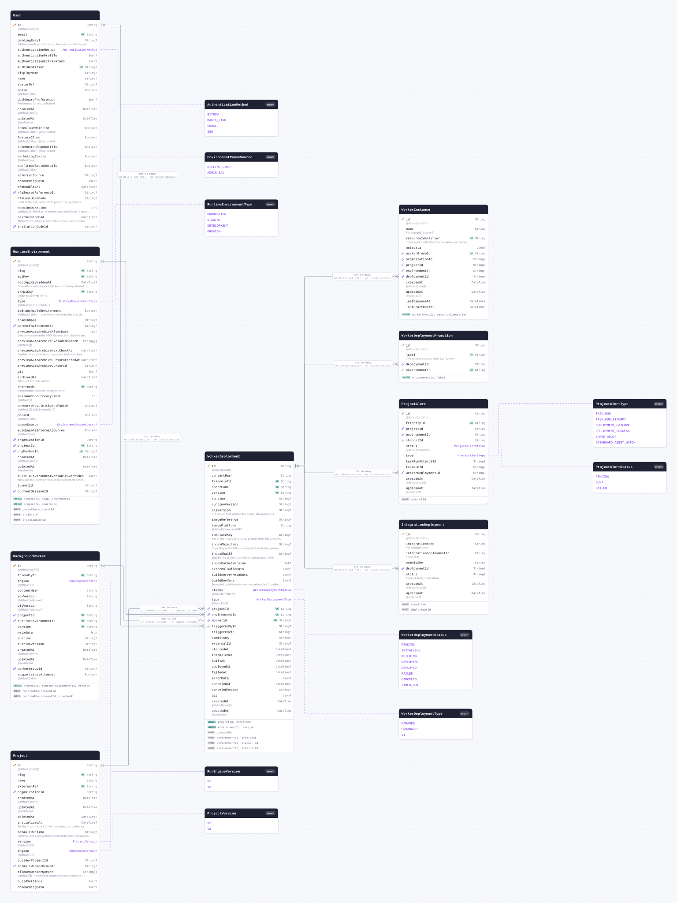

| Field                 | Type                                                     | Constraints                                                   | Default         | Description                                                                                                                                                     |
| --------------------- | -------------------------------------------------------- | ------------------------------------------------------------- | --------------- | --------------------------------------------------------------------------------------------------------------------------------------------------------------- |
| `id`                  | `String`                                                 | PK NOT NULL                                                   | `cuid(1)`       |                                                                                                                                                                 |
| `contentHash`         | `String`                                                 | NOT NULL                                                      |                 |                                                                                                                                                                 |
| `friendlyId`          | `String`                                                 | UNIQUE NOT NULL                                               |                 |                                                                                                                                                                 |
| `shortCode`           | `String`                                                 | NOT NULL                                                      |                 |                                                                                                                                                                 |
| `version`             | `String`                                                 | NOT NULL                                                      |                 |                                                                                                                                                                 |
| `runtime`             | `String`                                                 | NULL                                                          |                 |                                                                                                                                                                 |
| `runtimeVersion`      | `String`                                                 | NULL                                                          |                 |                                                                                                                                                                 |
| `cliVersion`          | `String`                                                 | NULL                                                          |                 | CLI version that initiated the deploy, stamped at initialization                                                                                                |
| `imageReference`      | `String`                                                 | NULL                                                          |                 |                                                                                                                                                                 |
| `imagePlatform`       | `String`                                                 | NOT NULL                                                      | `"linux/amd64"` |                                                                                                                                                                 |
| `templateKey`         | `String`                                                 | NULL                                                          |                 | Key of the microVM template prebuilt from this deployment's image, set when the builder succeeds                                                                |
| `indexObjectKey`      | `String`                                                 | NULL                                                          |                 | Object key of the full index snapshot in the deployment index store. Set only after the upload succeeds.                                                        |
| `indexSha256`         | `String`                                                 | NULL                                                          |                 | sha256 hex of the snapshot's uncompressed JSON                                                                                                                  |
| `indexFormatVersion`  | `Int`                                                    | NULL                                                          |                 |                                                                                                                                                                 |
| `externalBuildData`   | `Json`                                                   | NULL                                                          |                 |                                                                                                                                                                 |
| `buildServerMetadata` | `Json`                                                   | NULL                                                          |                 |                                                                                                                                                                 |
| `buildEnvVars`        | `Json`                                                   | NULL                                                          |                 | Encrypted build-time env vars for pre-bundled (fromBundle) deploys, as an EncryptedSecretValue envelope. Kept for the redeploy window, then cleared by a sweep. |
| `status`              | [`WorkerDeploymentStatus`](#enum-WorkerDeploymentStatus) | NOT NULL                                                      | `PENDING`       |                                                                                                                                                                 |
| `type`                | [`WorkerDeploymentType`](#enum-WorkerDeploymentType)     | NOT NULL                                                      | `V1`            |                                                                                                                                                                 |
| `projectId`           | `String`                                                 | NOT NULL → [Project.id](#model-Project)                       |                 |                                                                                                                                                                 |
| `environmentId`       | `String`                                                 | NOT NULL → [RuntimeEnvironment.id](#model-RuntimeEnvironment) |                 |                                                                                                                                                                 |
| `workerId`            | `String`                                                 | UNIQUE NULL → [BackgroundWorker.id](#model-BackgroundWorker)  |                 |                                                                                                                                                                 |
| `triggeredById`       | `String`                                                 | NULL → [User.id](#model-User)                                 |                 |                                                                                                                                                                 |
| `triggeredVia`        | `String`                                                 | NULL                                                          |                 |                                                                                                                                                                 |
| `commitSHA`           | `String`                                                 | NULL                                                          |                 |                                                                                                                                                                 |
| `externalId`          | `String`                                                 | NULL                                                          |                 |                                                                                                                                                                 |
| `startedAt`           | `DateTime`                                               | NULL                                                          |                 |                                                                                                                                                                 |
| `installedAt`         | `DateTime`                                               | NULL                                                          |                 |                                                                                                                                                                 |
| `builtAt`             | `DateTime`                                               | NULL                                                          |                 |                                                                                                                                                                 |
| `deployedAt`          | `DateTime`                                               | NULL                                                          |                 |                                                                                                                                                                 |
| `failedAt`            | `DateTime`                                               | NULL                                                          |                 |                                                                                                                                                                 |
| `errorData`           | `Json`                                                   | NULL                                                          |                 |                                                                                                                                                                 |
| `canceledAt`          | `DateTime`                                               | NULL                                                          |                 |                                                                                                                                                                 |
| `canceledReason`      | `String`                                                 | NULL                                                          |                 |                                                                                                                                                                 |
| `git`                 | `Json`                                                   | NULL                                                          |                 |                                                                                                                                                                 |
| `createdAt`           | `DateTime`                                               | NOT NULL                                                      | `now()`         |                                                                                                                                                                 |
| `updatedAt`           | `DateTime`                                               | NOT NULL                                                      | `@updatedAt`    |                                                                                                                                                                 |

#### Indexes

- `@@index([commitSHA])`
- `@@index([environmentId, createdAt])`
- `@@index([environmentId, status, id])`
- `@@index([environmentId, externalId])`
- `@@unique([projectId, shortCode])`
- `@@unique([environmentId, version])`

#### References

- `projectId` → [Project.id](#model-Project) (many-to-one, on delete Cascade, on update Cascade)
- `environmentId` → [RuntimeEnvironment.id](#model-RuntimeEnvironment) (many-to-one, on delete Cascade, on update Cascade)
- `workerId` → [BackgroundWorker.id](#model-BackgroundWorker) (one-to-one, on delete Cascade, on update Cascade)
- `triggeredById` → [User.id](#model-User) (many-to-one, on delete SetNull, on update Cascade)

#### Referenced by

- `id` ← [WorkerInstance.deploymentId](#model-WorkerInstance) (one-to-many, on delete SetNull, on update Cascade)
- `id` ← [WorkerDeploymentPromotion.deploymentId](#model-WorkerDeploymentPromotion) (one-to-many, on delete Cascade, on update Cascade)
- `id` ← [ProjectAlert.workerDeploymentId](#model-ProjectAlert) (one-to-many, on delete Cascade, on update Cascade)
- `id` ← [IntegrationDeployment.deploymentId](#model-IntegrationDeployment) (one-to-many, on delete SetNull, on update Cascade)

#### Definition

```sql
CREATE TABLE "WorkerDeployment" (
    "id" TEXT NOT NULL,
    "contentHash" TEXT NOT NULL,
    "friendlyId" TEXT NOT NULL,
    "shortCode" TEXT NOT NULL,
    "version" TEXT NOT NULL,
    "runtime" TEXT,
    "runtimeVersion" TEXT,
    "cliVersion" TEXT,
    "imageReference" TEXT,
    "imagePlatform" TEXT NOT NULL DEFAULT 'linux/amd64',
    "templateKey" TEXT,
    "indexObjectKey" TEXT,
    "indexSha256" TEXT,
    "indexFormatVersion" INTEGER,
    "externalBuildData" JSONB,
    "buildServerMetadata" JSONB,
    "buildEnvVars" JSONB,
    "status" "WorkerDeploymentStatus" NOT NULL DEFAULT 'PENDING',
    "type" "WorkerDeploymentType" NOT NULL DEFAULT 'V1',
    "projectId" TEXT NOT NULL,
    "environmentId" TEXT NOT NULL,
    "workerId" TEXT,
    "triggeredById" TEXT,
    "triggeredVia" TEXT,
    "commitSHA" TEXT,
    "externalId" TEXT,
    "startedAt" TIMESTAMP(3),
    "installedAt" TIMESTAMP(3),
    "builtAt" TIMESTAMP(3),
    "deployedAt" TIMESTAMP(3),
    "failedAt" TIMESTAMP(3),
    "errorData" JSONB,
    "canceledAt" TIMESTAMP(3),
    "canceledReason" TEXT,
    "git" JSONB,
    "createdAt" TIMESTAMP(3) NOT NULL DEFAULT CURRENT_TIMESTAMP,
    "updatedAt" TIMESTAMP(3) NOT NULL,

    CONSTRAINT "WorkerDeployment_pkey" PRIMARY KEY ("id")
);

CREATE UNIQUE INDEX "WorkerDeployment_friendlyId_key" ON "WorkerDeployment"("friendlyId");

CREATE UNIQUE INDEX "WorkerDeployment_workerId_key" ON "WorkerDeployment"("workerId");

CREATE INDEX "WorkerDeployment_commitSHA_idx" ON "WorkerDeployment"("commitSHA");

CREATE INDEX "WorkerDeployment_environmentId_createdAt_idx" ON "WorkerDeployment"("environmentId", "createdAt");

CREATE INDEX "WorkerDeployment_environmentId_status_id_idx" ON "WorkerDeployment"("environmentId", "status", "id");

CREATE INDEX "WorkerDeployment_environmentId_externalId_idx" ON "WorkerDeployment"("environmentId", "externalId");

CREATE UNIQUE INDEX "WorkerDeployment_projectId_shortCode_key" ON "WorkerDeployment"("projectId", "shortCode");

CREATE UNIQUE INDEX "WorkerDeployment_environmentId_version_key" ON "WorkerDeployment"("environmentId", "version");

ALTER TABLE "WorkerDeployment" ADD CONSTRAINT "WorkerDeployment_projectId_fkey" FOREIGN KEY ("projectId") REFERENCES "Project"("id") ON DELETE CASCADE ON UPDATE CASCADE;

ALTER TABLE "WorkerDeployment" ADD CONSTRAINT "WorkerDeployment_environmentId_fkey" FOREIGN KEY ("environmentId") REFERENCES "RuntimeEnvironment"("id") ON DELETE CASCADE ON UPDATE CASCADE;

ALTER TABLE "WorkerDeployment" ADD CONSTRAINT "WorkerDeployment_workerId_fkey" FOREIGN KEY ("workerId") REFERENCES "BackgroundWorker"("id") ON DELETE CASCADE ON UPDATE CASCADE;

ALTER TABLE "WorkerDeployment" ADD CONSTRAINT "WorkerDeployment_triggeredById_fkey" FOREIGN KEY ("triggeredById") REFERENCES "User"("id") ON DELETE SET NULL ON UPDATE CASCADE;
```

<details>
<summary>Queries and their SQL</summary>

**findMany**: Every row

```ts
await prisma.workerDeployment.findMany();
```

```sql
SELECT
  "public"."WorkerDeployment"."id",
  "public"."WorkerDeployment"."contentHash",
  "public"."WorkerDeployment"."friendlyId",
  "public"."WorkerDeployment"."shortCode",
  "public"."WorkerDeployment"."version",
  "public"."WorkerDeployment"."runtime",
  "public"."WorkerDeployment"."runtimeVersion",
  "public"."WorkerDeployment"."cliVersion",
  "public"."WorkerDeployment"."imageReference",
  "public"."WorkerDeployment"."imagePlatform",
  "public"."WorkerDeployment"."templateKey",
  "public"."WorkerDeployment"."indexObjectKey",
  "public"."WorkerDeployment"."indexSha256",
  "public"."WorkerDeployment"."indexFormatVersion",
  "public"."WorkerDeployment"."externalBuildData",
  "public"."WorkerDeployment"."buildServerMetadata",
  "public"."WorkerDeployment"."buildEnvVars",
  "public"."WorkerDeployment"."status"::text,
  "public"."WorkerDeployment"."type"::text,
  "public"."WorkerDeployment"."projectId",
  "public"."WorkerDeployment"."environmentId",
  "public"."WorkerDeployment"."workerId",
  "public"."WorkerDeployment"."triggeredById",
  "public"."WorkerDeployment"."triggeredVia",
  "public"."WorkerDeployment"."commitSHA",
  "public"."WorkerDeployment"."externalId",
  "public"."WorkerDeployment"."startedAt",
  "public"."WorkerDeployment"."installedAt",
  "public"."WorkerDeployment"."builtAt",
  "public"."WorkerDeployment"."deployedAt",
  "public"."WorkerDeployment"."failedAt",
  "public"."WorkerDeployment"."errorData",
  "public"."WorkerDeployment"."canceledAt",
  "public"."WorkerDeployment"."canceledReason",
  "public"."WorkerDeployment"."git",
  "public"."WorkerDeployment"."createdAt",
  "public"."WorkerDeployment"."updatedAt"
FROM
  "public"."WorkerDeployment"
WHERE
  1 = 1
OFFSET
  $1
-- params: ["0"]
```

**count**: How many rows there are

```ts
await prisma.workerDeployment.count();
```

```sql
SELECT
  COUNT(*) AS "_count$_all"
FROM
  (
    SELECT
      "public"."WorkerDeployment"."id"
    FROM
      "public"."WorkerDeployment"
    WHERE
      1 = 1
    OFFSET
      $1
  ) AS "sub"
-- params: ["0"]
```

**findMany**: Every row with its relations

```ts
await prisma.workerDeployment.findMany({
  include: {
    project: true,
    environment: true,
    worker: true,
    triggeredBy: true,
    promotions: true,
    alerts: true,
    workerInstance: true,
    integrationDeployments: true,
  },
});
```

```sql
SELECT
  "public"."WorkerDeployment"."id",
  "public"."WorkerDeployment"."contentHash",
  "public"."WorkerDeployment"."friendlyId",
  "public"."WorkerDeployment"."shortCode",
  "public"."WorkerDeployment"."version",
  "public"."WorkerDeployment"."runtime",
  "public"."WorkerDeployment"."runtimeVersion",
  "public"."WorkerDeployment"."cliVersion",
  "public"."WorkerDeployment"."imageReference",
  "public"."WorkerDeployment"."imagePlatform",
  "public"."WorkerDeployment"."templateKey",
  "public"."WorkerDeployment"."indexObjectKey",
  "public"."WorkerDeployment"."indexSha256",
  "public"."WorkerDeployment"."indexFormatVersion",
  "public"."WorkerDeployment"."externalBuildData",
  "public"."WorkerDeployment"."buildServerMetadata",
  "public"."WorkerDeployment"."buildEnvVars",
  "public"."WorkerDeployment"."status"::text,
  "public"."WorkerDeployment"."type"::text,
  "public"."WorkerDeployment"."projectId",
  "public"."WorkerDeployment"."environmentId",
  "public"."WorkerDeployment"."workerId",
  "public"."WorkerDeployment"."triggeredById",
  "public"."WorkerDeployment"."triggeredVia",
  "public"."WorkerDeployment"."commitSHA",
  "public"."WorkerDeployment"."externalId",
  "public"."WorkerDeployment"."startedAt",
  "public"."WorkerDeployment"."installedAt",
  "public"."WorkerDeployment"."builtAt",
  "public"."WorkerDeployment"."deployedAt",
  "public"."WorkerDeployment"."failedAt",
  "public"."WorkerDeployment"."errorData",
  "public"."WorkerDeployment"."canceledAt",
  "public"."WorkerDeployment"."canceledReason",
  "public"."WorkerDeployment"."git",
  "public"."WorkerDeployment"."createdAt",
  "public"."WorkerDeployment"."updatedAt"
FROM
  "public"."WorkerDeployment"
WHERE
  1 = 1
OFFSET
  $1
-- params: ["0"]

SELECT
  "public"."Project"."id",
  "public"."Project"."slug",
  "public"."Project"."name",
  "public"."Project"."externalRef",
  "public"."Project"."organizationId",
  "public"."Project"."createdAt",
  "public"."Project"."updatedAt",
  "public"."Project"."deletedAt",
  "public"."Project"."initializedAt",
  "public"."Project"."defaultRuntime",
  "public"."Project"."version"::text,
  "public"."Project"."engine"::text,
  "public"."Project"."builderProjectId",
  "public"."Project"."defaultWorkerGroupId",
  "public"."Project"."allowedMasterQueues",
  "public"."Project"."buildSettings",
  "public"."Project"."onboardingData"
FROM
  "public"."Project"
WHERE
  "public"."Project"."id" IN ($1)
OFFSET
  $2
-- params: ["<projectId of the rows above>","0"]

SELECT
  "public"."RuntimeEnvironment"."id",
  "public"."RuntimeEnvironment"."slug",
  "public"."RuntimeEnvironment"."apiKey",
  "public"."RuntimeEnvironment"."rootApiKeyHiddenAt",
  "public"."RuntimeEnvironment"."pkApiKey",
  "public"."RuntimeEnvironment"."type"::text,
  "public"."RuntimeEnvironment"."isBranchableEnvironment",
  "public"."RuntimeEnvironment"."branchName",
  "public"."RuntimeEnvironment"."parentEnvironmentId",
  "public"."RuntimeEnvironment"."previewAutoArchiveAfterDays",
  "public"."RuntimeEnvironment"."previewAutoArchiveExcludedBranches",
  "public"."RuntimeEnvironment"."previewAutoArchiveNextCheckAt",
  "public"."RuntimeEnvironment"."previewAutoArchiveCursorCreatedAt",
  "public"."RuntimeEnvironment"."previewAutoArchiveCursorId",
  "public"."RuntimeEnvironment"."git",
  "public"."RuntimeEnvironment"."archivedAt",
  "public"."RuntimeEnvironment"."shortcode",
  "public"."RuntimeEnvironment"."maximumConcurrencyLimit",
  "public"."RuntimeEnvironment"."concurrencyLimitBurstFactor",
  "public"."RuntimeEnvironment"."paused",
  "public"."RuntimeEnvironment"."pauseSource"::text,
  "public"."RuntimeEnvironment"."autoEnableInternalSources",
  "public"."RuntimeEnvironment"."organizationId",
  "public"."RuntimeEnvironment"."projectId",
  "public"."RuntimeEnvironment"."orgMemberId",
  "public"."RuntimeEnvironment"."createdAt",
  "public"."RuntimeEnvironment"."updatedAt",
  "public"."RuntimeEnvironment"."builtInEnvironmentVariableOverrides",
  "public"."RuntimeEnvironment"."tunnelId",
  "public"."RuntimeEnvironment"."currentSessionId"
FROM
  "public"."RuntimeEnvironment"
WHERE
  "public"."RuntimeEnvironment"."id" IN ($1)
OFFSET
  $2
-- params: ["<environmentId of the rows above>","0"]

SELECT
  "public"."BackgroundWorker"."id",
  "public"."BackgroundWorker"."friendlyId",
  "public"."BackgroundWorker"."engine"::text,
  "public"."BackgroundWorker"."contentHash",
  "public"."BackgroundWorker"."sdkVersion",
  "public"."BackgroundWorker"."cliVersion",
  "public"."BackgroundWorker"."projectId",
  "public"."BackgroundWorker"."runtimeEnvironmentId",
  "public"."BackgroundWorker"."version",
  "public"."BackgroundWorker"."metadata",
  "public"."BackgroundWorker"."runtime",
  "public"."BackgroundWorker"."runtimeVersion",
  "public"."BackgroundWorker"."createdAt",
  "public"."BackgroundWorker"."updatedAt",
  "public"."BackgroundWorker"."workerGroupId",
  "public"."BackgroundWorker"."supportsLazyAttempts"
FROM
  "public"."BackgroundWorker"
WHERE
  "public"."BackgroundWorker"."id" IN ($1)
OFFSET
  $2
-- params: ["<workerId of the rows above>","0"]

SELECT
  "public"."User"."id",
  "public"."User"."email",
  "public"."User"."pendingEmail",
  "public"."User"."authenticationMethod"::text,
  "public"."User"."authenticationProfile",
  "public"."User"."authenticationExtraParams",
  "public"."User"."authIdentifier",
  "public"."User"."displayName",
  "public"."User"."name",
  "public"."User"."avatarUrl",
  "public"."User"."admin",
  "public"."User"."dashboardPreferences",
  "public"."User"."createdAt",
  "public"."User"."updatedAt",
  "public"."User"."isOnCloudWaitlist",
  "public"."User"."featureCloud",
  "public"."User"."isOnHostedRepoWaitlist",
  "public"."User"."marketingEmails",
  "public"."User"."confirmedBasicDetails",
  "public"."User"."referralSource",
  "public"."User"."onboardingData",
  "public"."User"."mfaEnabledAt",
  "public"."User"."mfaSecretReferenceId",
  "public"."User"."mfaLastUsedCode",
  "public"."User"."sessionDuration",
  "public"."User"."nextSessionEnd",
  "public"."User"."invitationCodeId"
FROM
  "public"."User"
WHERE
  "public"."User"."id" IN ($1)
OFFSET
  $2
-- params: ["<triggeredById of the rows above>","0"]

SELECT
  "public"."WorkerDeploymentPromotion"."id",
  "public"."WorkerDeploymentPromotion"."label",
  "public"."WorkerDeploymentPromotion"."deploymentId",
  "public"."WorkerDeploymentPromotion"."environmentId"
FROM
  "public"."WorkerDeploymentPromotion"
WHERE
  "public"."WorkerDeploymentPromotion"."deploymentId" IN ($1)
OFFSET
  $2
-- params: ["<id of the rows above>","0"]

SELECT
  "public"."ProjectAlert"."id",
  "public"."ProjectAlert"."friendlyId",
  "public"."ProjectAlert"."projectId",
  "public"."ProjectAlert"."environmentId",
  "public"."ProjectAlert"."channelId",
  "public"."ProjectAlert"."status"::text,
  "public"."ProjectAlert"."type"::text,
  "public"."ProjectAlert"."taskRunAttemptId",
  "public"."ProjectAlert"."taskRunId",
  "public"."ProjectAlert"."workerDeploymentId",
  "public"."ProjectAlert"."createdAt",
  "public"."ProjectAlert"."updatedAt"
FROM
  "public"."ProjectAlert"
WHERE
  "public"."ProjectAlert"."workerDeploymentId" IN ($1)
OFFSET
  $2
-- params: ["<id of the rows above>","0"]

SELECT
  "public"."WorkerInstance"."id",
  "public"."WorkerInstance"."name",
  "public"."WorkerInstance"."resourceIdentifier",
  "public"."WorkerInstance"."metadata",
  "public"."WorkerInstance"."workerGroupId",
  "public"."WorkerInstance"."organizationId",
  "public"."WorkerInstance"."projectId",
  "public"."WorkerInstance"."environmentId",
  "public"."WorkerInstance"."deploymentId",
  "public"."WorkerInstance"."createdAt",
  "public"."WorkerInstance"."updatedAt",
  "public"."WorkerInstance"."lastDequeueAt",
  "public"."WorkerInstance"."lastHeartbeatAt"
FROM
  "public"."WorkerInstance"
WHERE
  "public"."WorkerInstance"."deploymentId" IN ($1)
OFFSET
  $2
-- params: ["<id of the rows above>","0"]

SELECT
  "public"."IntegrationDeployment"."id",
  "public"."IntegrationDeployment"."integrationName",
  "public"."IntegrationDeployment"."integrationDeploymentId",
  "public"."IntegrationDeployment"."commitSHA",
  "public"."IntegrationDeployment"."deploymentId",
  "public"."IntegrationDeployment"."status",
  "public"."IntegrationDeployment"."createdAt",
  "public"."IntegrationDeployment"."updatedAt"
FROM
  "public"."IntegrationDeployment"
WHERE
  "public"."IntegrationDeployment"."deploymentId" IN ($1)
OFFSET
  $2
-- params: ["<id of the rows above>","0"]
```

**findUnique**: One row by what is unique to it

```ts
await prisma.workerDeployment.findUnique({ where: { id: "example" } });
```

```sql
SELECT
  "public"."WorkerDeployment"."id",
  "public"."WorkerDeployment"."contentHash",
  "public"."WorkerDeployment"."friendlyId",
  "public"."WorkerDeployment"."shortCode",
  "public"."WorkerDeployment"."version",
  "public"."WorkerDeployment"."runtime",
  "public"."WorkerDeployment"."runtimeVersion",
  "public"."WorkerDeployment"."cliVersion",
  "public"."WorkerDeployment"."imageReference",
  "public"."WorkerDeployment"."imagePlatform",
  "public"."WorkerDeployment"."templateKey",
  "public"."WorkerDeployment"."indexObjectKey",
  "public"."WorkerDeployment"."indexSha256",
  "public"."WorkerDeployment"."indexFormatVersion",
  "public"."WorkerDeployment"."externalBuildData",
  "public"."WorkerDeployment"."buildServerMetadata",
  "public"."WorkerDeployment"."buildEnvVars",
  "public"."WorkerDeployment"."status"::text,
  "public"."WorkerDeployment"."type"::text,
  "public"."WorkerDeployment"."projectId",
  "public"."WorkerDeployment"."environmentId",
  "public"."WorkerDeployment"."workerId",
  "public"."WorkerDeployment"."triggeredById",
  "public"."WorkerDeployment"."triggeredVia",
  "public"."WorkerDeployment"."commitSHA",
  "public"."WorkerDeployment"."externalId",
  "public"."WorkerDeployment"."startedAt",
  "public"."WorkerDeployment"."installedAt",
  "public"."WorkerDeployment"."builtAt",
  "public"."WorkerDeployment"."deployedAt",
  "public"."WorkerDeployment"."failedAt",
  "public"."WorkerDeployment"."errorData",
  "public"."WorkerDeployment"."canceledAt",
  "public"."WorkerDeployment"."canceledReason",
  "public"."WorkerDeployment"."git",
  "public"."WorkerDeployment"."createdAt",
  "public"."WorkerDeployment"."updatedAt"
FROM
  "public"."WorkerDeployment"
WHERE
  (
    "public"."WorkerDeployment"."id" = $1
    AND 1 = 1
  )
LIMIT
  $2
OFFSET
  $3
-- params: ["example","1","0"]
```

**create**: Create a row

```ts
await prisma.workerDeployment.create({
  data: {
    contentHash: "example",
    friendlyId: "example",
    shortCode: "example",
    version: "example",
    projectId: "example",
    environmentId: "example",
  },
});
```

```sql
INSERT INTO
  "public"."WorkerDeployment" (
    "id",
    "contentHash",
    "friendlyId",
    "shortCode",
    "version",
    "imagePlatform",
    "status",
    "type",
    "projectId",
    "environmentId",
    "createdAt",
    "updatedAt"
  )
VALUES
  (
    $1,
    $2,
    $3,
    $4,
    $5,
    $6,
    CAST($7::text AS "public"."WorkerDeploymentStatus"),
    CAST($8::text AS "public"."WorkerDeploymentType"),
    $9,
    $10,
    $11,
    $12
  )
RETURNING
  "public"."WorkerDeployment"."id",
  "public"."WorkerDeployment"."contentHash",
  "public"."WorkerDeployment"."friendlyId",
  "public"."WorkerDeployment"."shortCode",
  "public"."WorkerDeployment"."version",
  "public"."WorkerDeployment"."runtime",
  "public"."WorkerDeployment"."runtimeVersion",
  "public"."WorkerDeployment"."cliVersion",
  "public"."WorkerDeployment"."imageReference",
  "public"."WorkerDeployment"."imagePlatform",
  "public"."WorkerDeployment"."templateKey",
  "public"."WorkerDeployment"."indexObjectKey",
  "public"."WorkerDeployment"."indexSha256",
  "public"."WorkerDeployment"."indexFormatVersion",
  "public"."WorkerDeployment"."externalBuildData",
  "public"."WorkerDeployment"."buildServerMetadata",
  "public"."WorkerDeployment"."buildEnvVars",
  "public"."WorkerDeployment"."status"::text,
  "public"."WorkerDeployment"."type"::text,
  "public"."WorkerDeployment"."projectId",
  "public"."WorkerDeployment"."environmentId",
  "public"."WorkerDeployment"."workerId",
  "public"."WorkerDeployment"."triggeredById",
  "public"."WorkerDeployment"."triggeredVia",
  "public"."WorkerDeployment"."commitSHA",
  "public"."WorkerDeployment"."externalId",
  "public"."WorkerDeployment"."startedAt",
  "public"."WorkerDeployment"."installedAt",
  "public"."WorkerDeployment"."builtAt",
  "public"."WorkerDeployment"."deployedAt",
  "public"."WorkerDeployment"."failedAt",
  "public"."WorkerDeployment"."errorData",
  "public"."WorkerDeployment"."canceledAt",
  "public"."WorkerDeployment"."canceledReason",
  "public"."WorkerDeployment"."git",
  "public"."WorkerDeployment"."createdAt",
  "public"."WorkerDeployment"."updatedAt"
-- params: ["<cuid(1)>","example","example","example","example","linux/amd64","PENDING","V1","example","example","<now()>","<now()>"]
```

**update**: Update a row

```ts
await prisma.workerDeployment.update({
  where: { id: "example" },
  data: { contentHash: "example" },
});
```

```sql
UPDATE "public"."WorkerDeployment"
SET
  "contentHash" = $1,
  "updatedAt" = $2
WHERE
  (
    "public"."WorkerDeployment"."id" = $3
    AND 1 = 1
  )
RETURNING
  "public"."WorkerDeployment"."id",
  "public"."WorkerDeployment"."contentHash",
  "public"."WorkerDeployment"."friendlyId",
  "public"."WorkerDeployment"."shortCode",
  "public"."WorkerDeployment"."version",
  "public"."WorkerDeployment"."runtime",
  "public"."WorkerDeployment"."runtimeVersion",
  "public"."WorkerDeployment"."cliVersion",
  "public"."WorkerDeployment"."imageReference",
  "public"."WorkerDeployment"."imagePlatform",
  "public"."WorkerDeployment"."templateKey",
  "public"."WorkerDeployment"."indexObjectKey",
  "public"."WorkerDeployment"."indexSha256",
  "public"."WorkerDeployment"."indexFormatVersion",
  "public"."WorkerDeployment"."externalBuildData",
  "public"."WorkerDeployment"."buildServerMetadata",
  "public"."WorkerDeployment"."buildEnvVars",
  "public"."WorkerDeployment"."status"::text,
  "public"."WorkerDeployment"."type"::text,
  "public"."WorkerDeployment"."projectId",
  "public"."WorkerDeployment"."environmentId",
  "public"."WorkerDeployment"."workerId",
  "public"."WorkerDeployment"."triggeredById",
  "public"."WorkerDeployment"."triggeredVia",
  "public"."WorkerDeployment"."commitSHA",
  "public"."WorkerDeployment"."externalId",
  "public"."WorkerDeployment"."startedAt",
  "public"."WorkerDeployment"."installedAt",
  "public"."WorkerDeployment"."builtAt",
  "public"."WorkerDeployment"."deployedAt",
  "public"."WorkerDeployment"."failedAt",
  "public"."WorkerDeployment"."errorData",
  "public"."WorkerDeployment"."canceledAt",
  "public"."WorkerDeployment"."canceledReason",
  "public"."WorkerDeployment"."git",
  "public"."WorkerDeployment"."createdAt",
  "public"."WorkerDeployment"."updatedAt"
-- params: ["example",{"prisma__type":"generatorCall","prisma__value":{"name":"now","args":[],"returnType":{"type":"DateTime"}}},"example"]
```

**delete**: Delete a row

```ts
await prisma.workerDeployment.delete({ where: { id: "example" } });
```

```sql
DELETE FROM "public"."WorkerDeployment"
WHERE
  (
    "public"."WorkerDeployment"."id" = $1
    AND 1 = 1
  )
RETURNING
  "public"."WorkerDeployment"."id",
  "public"."WorkerDeployment"."contentHash",
  "public"."WorkerDeployment"."friendlyId",
  "public"."WorkerDeployment"."shortCode",
  "public"."WorkerDeployment"."version",
  "public"."WorkerDeployment"."runtime",
  "public"."WorkerDeployment"."runtimeVersion",
  "public"."WorkerDeployment"."cliVersion",
  "public"."WorkerDeployment"."imageReference",
  "public"."WorkerDeployment"."imagePlatform",
  "public"."WorkerDeployment"."templateKey",
  "public"."WorkerDeployment"."indexObjectKey",
  "public"."WorkerDeployment"."indexSha256",
  "public"."WorkerDeployment"."indexFormatVersion",
  "public"."WorkerDeployment"."externalBuildData",
  "public"."WorkerDeployment"."buildServerMetadata",
  "public"."WorkerDeployment"."buildEnvVars",
  "public"."WorkerDeployment"."status"::text,
  "public"."WorkerDeployment"."type"::text,
  "public"."WorkerDeployment"."projectId",
  "public"."WorkerDeployment"."environmentId",
  "public"."WorkerDeployment"."workerId",
  "public"."WorkerDeployment"."triggeredById",
  "public"."WorkerDeployment"."triggeredVia",
  "public"."WorkerDeployment"."commitSHA",
  "public"."WorkerDeployment"."externalId",
  "public"."WorkerDeployment"."startedAt",
  "public"."WorkerDeployment"."installedAt",
  "public"."WorkerDeployment"."builtAt",
  "public"."WorkerDeployment"."deployedAt",
  "public"."WorkerDeployment"."failedAt",
  "public"."WorkerDeployment"."errorData",
  "public"."WorkerDeployment"."canceledAt",
  "public"."WorkerDeployment"."canceledReason",
  "public"."WorkerDeployment"."git",
  "public"."WorkerDeployment"."createdAt",
  "public"."WorkerDeployment"."updatedAt"
-- params: ["example"]
```

</details>

<a id="model-WorkerDeploymentPromotion"></a>

### WorkerDeploymentPromotion

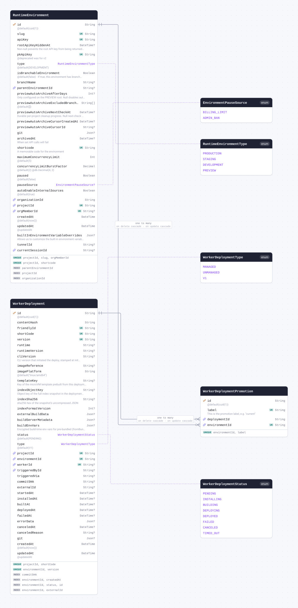

| Field           | Type     | Constraints                                                   | Default   | Description                                 |
| --------------- | -------- | ------------------------------------------------------------- | --------- | ------------------------------------------- |
| `id`            | `String` | PK NOT NULL                                                   | `cuid(1)` |                                             |
| `label`         | `String` | NOT NULL                                                      |           | This is the promotion label, e.g. "current" |
| `deploymentId`  | `String` | NOT NULL → [WorkerDeployment.id](#model-WorkerDeployment)     |           |                                             |
| `environmentId` | `String` | NOT NULL → [RuntimeEnvironment.id](#model-RuntimeEnvironment) |           |                                             |

#### Indexes

- `@@unique([environmentId, label])`

#### References

- `deploymentId` → [WorkerDeployment.id](#model-WorkerDeployment) (many-to-one, on delete Cascade, on update Cascade)
- `environmentId` → [RuntimeEnvironment.id](#model-RuntimeEnvironment) (many-to-one, on delete Cascade, on update Cascade)

#### Definition

```sql
CREATE TABLE "WorkerDeploymentPromotion" (
    "id" TEXT NOT NULL,
    "label" TEXT NOT NULL,
    "deploymentId" TEXT NOT NULL,
    "environmentId" TEXT NOT NULL,

    CONSTRAINT "WorkerDeploymentPromotion_pkey" PRIMARY KEY ("id")
);

CREATE UNIQUE INDEX "WorkerDeploymentPromotion_environmentId_label_key" ON "WorkerDeploymentPromotion"("environmentId", "label");

ALTER TABLE "WorkerDeploymentPromotion" ADD CONSTRAINT "WorkerDeploymentPromotion_deploymentId_fkey" FOREIGN KEY ("deploymentId") REFERENCES "WorkerDeployment"("id") ON DELETE CASCADE ON UPDATE CASCADE;

ALTER TABLE "WorkerDeploymentPromotion" ADD CONSTRAINT "WorkerDeploymentPromotion_environmentId_fkey" FOREIGN KEY ("environmentId") REFERENCES "RuntimeEnvironment"("id") ON DELETE CASCADE ON UPDATE CASCADE;
```

<details>
<summary>Queries and their SQL</summary>

**findMany**: Every row

```ts
await prisma.workerDeploymentPromotion.findMany();
```

```sql
SELECT
  "public"."WorkerDeploymentPromotion"."id",
  "public"."WorkerDeploymentPromotion"."label",
  "public"."WorkerDeploymentPromotion"."deploymentId",
  "public"."WorkerDeploymentPromotion"."environmentId"
FROM
  "public"."WorkerDeploymentPromotion"
WHERE
  1 = 1
OFFSET
  $1
-- params: ["0"]
```

**count**: How many rows there are

```ts
await prisma.workerDeploymentPromotion.count();
```

```sql
SELECT
  COUNT(*) AS "_count$_all"
FROM
  (
    SELECT
      "public"."WorkerDeploymentPromotion"."id"
    FROM
      "public"."WorkerDeploymentPromotion"
    WHERE
      1 = 1
    OFFSET
      $1
  ) AS "sub"
-- params: ["0"]
```

**findMany**: Every row with its relations

```ts
await prisma.workerDeploymentPromotion.findMany({
  include: { deployment: true, environment: true },
});
```

```sql
SELECT
  "public"."WorkerDeploymentPromotion"."id",
  "public"."WorkerDeploymentPromotion"."label",
  "public"."WorkerDeploymentPromotion"."deploymentId",
  "public"."WorkerDeploymentPromotion"."environmentId"
FROM
  "public"."WorkerDeploymentPromotion"
WHERE
  1 = 1
OFFSET
  $1
-- params: ["0"]

SELECT
  "public"."WorkerDeployment"."id",
  "public"."WorkerDeployment"."contentHash",
  "public"."WorkerDeployment"."friendlyId",
  "public"."WorkerDeployment"."shortCode",
  "public"."WorkerDeployment"."version",
  "public"."WorkerDeployment"."runtime",
  "public"."WorkerDeployment"."runtimeVersion",
  "public"."WorkerDeployment"."cliVersion",
  "public"."WorkerDeployment"."imageReference",
  "public"."WorkerDeployment"."imagePlatform",
  "public"."WorkerDeployment"."templateKey",
  "public"."WorkerDeployment"."indexObjectKey",
  "public"."WorkerDeployment"."indexSha256",
  "public"."WorkerDeployment"."indexFormatVersion",
  "public"."WorkerDeployment"."externalBuildData",
  "public"."WorkerDeployment"."buildServerMetadata",
  "public"."WorkerDeployment"."buildEnvVars",
  "public"."WorkerDeployment"."status"::text,
  "public"."WorkerDeployment"."type"::text,
  "public"."WorkerDeployment"."projectId",
  "public"."WorkerDeployment"."environmentId",
  "public"."WorkerDeployment"."workerId",
  "public"."WorkerDeployment"."triggeredById",
  "public"."WorkerDeployment"."triggeredVia",
  "public"."WorkerDeployment"."commitSHA",
  "public"."WorkerDeployment"."externalId",
  "public"."WorkerDeployment"."startedAt",
  "public"."WorkerDeployment"."installedAt",
  "public"."WorkerDeployment"."builtAt",
  "public"."WorkerDeployment"."deployedAt",
  "public"."WorkerDeployment"."failedAt",
  "public"."WorkerDeployment"."errorData",
  "public"."WorkerDeployment"."canceledAt",
  "public"."WorkerDeployment"."canceledReason",
  "public"."WorkerDeployment"."git",
  "public"."WorkerDeployment"."createdAt",
  "public"."WorkerDeployment"."updatedAt"
FROM
  "public"."WorkerDeployment"
WHERE
  "public"."WorkerDeployment"."id" IN ($1)
OFFSET
  $2
-- params: ["<deploymentId of the rows above>","0"]

SELECT
  "public"."RuntimeEnvironment"."id",
  "public"."RuntimeEnvironment"."slug",
  "public"."RuntimeEnvironment"."apiKey",
  "public"."RuntimeEnvironment"."rootApiKeyHiddenAt",
  "public"."RuntimeEnvironment"."pkApiKey",
  "public"."RuntimeEnvironment"."type"::text,
  "public"."RuntimeEnvironment"."isBranchableEnvironment",
  "public"."RuntimeEnvironment"."branchName",
  "public"."RuntimeEnvironment"."parentEnvironmentId",
  "public"."RuntimeEnvironment"."previewAutoArchiveAfterDays",
  "public"."RuntimeEnvironment"."previewAutoArchiveExcludedBranches",
  "public"."RuntimeEnvironment"."previewAutoArchiveNextCheckAt",
  "public"."RuntimeEnvironment"."previewAutoArchiveCursorCreatedAt",
  "public"."RuntimeEnvironment"."previewAutoArchiveCursorId",
  "public"."RuntimeEnvironment"."git",
  "public"."RuntimeEnvironment"."archivedAt",
  "public"."RuntimeEnvironment"."shortcode",
  "public"."RuntimeEnvironment"."maximumConcurrencyLimit",
  "public"."RuntimeEnvironment"."concurrencyLimitBurstFactor",
  "public"."RuntimeEnvironment"."paused",
  "public"."RuntimeEnvironment"."pauseSource"::text,
  "public"."RuntimeEnvironment"."autoEnableInternalSources",
  "public"."RuntimeEnvironment"."organizationId",
  "public"."RuntimeEnvironment"."projectId",
  "public"."RuntimeEnvironment"."orgMemberId",
  "public"."RuntimeEnvironment"."createdAt",
  "public"."RuntimeEnvironment"."updatedAt",
  "public"."RuntimeEnvironment"."builtInEnvironmentVariableOverrides",
  "public"."RuntimeEnvironment"."tunnelId",
  "public"."RuntimeEnvironment"."currentSessionId"
FROM
  "public"."RuntimeEnvironment"
WHERE
  "public"."RuntimeEnvironment"."id" IN ($1)
OFFSET
  $2
-- params: ["<environmentId of the rows above>","0"]
```

**findUnique**: One row by what is unique to it

```ts
await prisma.workerDeploymentPromotion.findUnique({ where: { id: "example" } });
```

```sql
SELECT
  "public"."WorkerDeploymentPromotion"."id",
  "public"."WorkerDeploymentPromotion"."label",
  "public"."WorkerDeploymentPromotion"."deploymentId",
  "public"."WorkerDeploymentPromotion"."environmentId"
FROM
  "public"."WorkerDeploymentPromotion"
WHERE
  (
    "public"."WorkerDeploymentPromotion"."id" = $1
    AND 1 = 1
  )
LIMIT
  $2
OFFSET
  $3
-- params: ["example","1","0"]
```

**create**: Create a row

```ts
await prisma.workerDeploymentPromotion.create({
  data: { label: "example", deploymentId: "example", environmentId: "example" },
});
```

```sql
INSERT INTO
  "public"."WorkerDeploymentPromotion" ("id", "label", "deploymentId", "environmentId")
VALUES
  ($1, $2, $3, $4)
RETURNING
  "public"."WorkerDeploymentPromotion"."id",
  "public"."WorkerDeploymentPromotion"."label",
  "public"."WorkerDeploymentPromotion"."deploymentId",
  "public"."WorkerDeploymentPromotion"."environmentId"
-- params: ["<cuid(1)>","example","example","example"]
```

**update**: Update a row

```ts
await prisma.workerDeploymentPromotion.update({
  where: { id: "example" },
  data: { label: "example" },
});
```

```sql
UPDATE "public"."WorkerDeploymentPromotion"
SET
  "label" = $1
WHERE
  (
    "public"."WorkerDeploymentPromotion"."id" = $2
    AND 1 = 1
  )
RETURNING
  "public"."WorkerDeploymentPromotion"."id",
  "public"."WorkerDeploymentPromotion"."label",
  "public"."WorkerDeploymentPromotion"."deploymentId",
  "public"."WorkerDeploymentPromotion"."environmentId"
-- params: ["example","example"]
```

**delete**: Delete a row

```ts
await prisma.workerDeploymentPromotion.delete({ where: { id: "example" } });
```

```sql
DELETE FROM "public"."WorkerDeploymentPromotion"
WHERE
  (
    "public"."WorkerDeploymentPromotion"."id" = $1
    AND 1 = 1
  )
RETURNING
  "public"."WorkerDeploymentPromotion"."id",
  "public"."WorkerDeploymentPromotion"."label",
  "public"."WorkerDeploymentPromotion"."deploymentId",
  "public"."WorkerDeploymentPromotion"."environmentId"
-- params: ["example"]
```

</details>

<a id="model-TaskSchedule"></a>

### TaskSchedule

Schedules can be attached to tasks to trigger them on a schedule

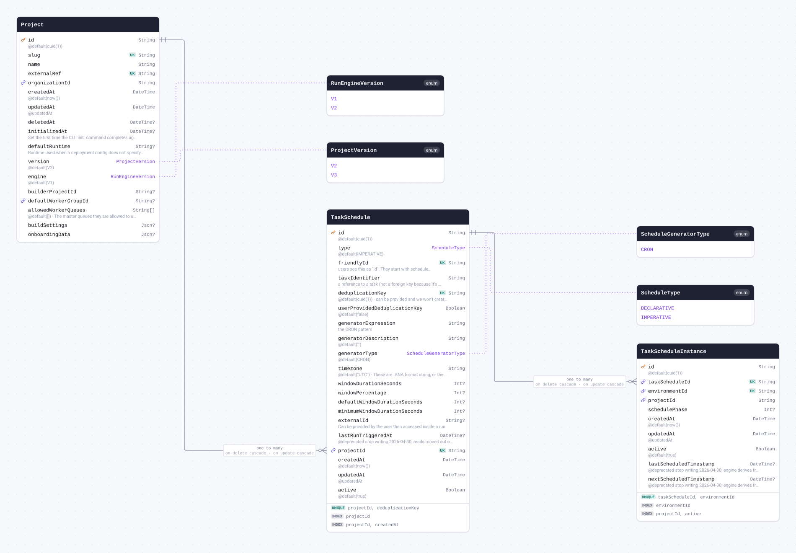

| Field                          | Type                                                   | Constraints                             | Default      | Description                                                                                                                 |
| ------------------------------ | ------------------------------------------------------ | --------------------------------------- | ------------ | --------------------------------------------------------------------------------------------------------------------------- |
| `id`                           | `String`                                               | PK NOT NULL                             | `cuid(1)`    |                                                                                                                             |
| `type`                         | [`ScheduleType`](#enum-ScheduleType)                   | NOT NULL                                | `IMPERATIVE` |                                                                                                                             |
| `friendlyId`                   | `String`                                               | UNIQUE NOT NULL                         |              | users see this as `id`. They start with schedule_                                                                           |
| `taskIdentifier`               | `String`                                               | NOT NULL                                |              | a reference to a task (not a foreign key because it's across versions)                                                      |
| `deduplicationKey`             | `String`                                               | NOT NULL                                | `cuid(1)`    | can be provided and we won't create another with the same key                                                               |
| `userProvidedDeduplicationKey` | `Boolean`                                              | NOT NULL                                | `false`      |                                                                                                                             |
| `generatorExpression`          | `String`                                               | NOT NULL                                |              | the CRON pattern                                                                                                            |
| `generatorDescription`         | `String`                                               | NOT NULL                                | `""`         |                                                                                                                             |
| `generatorType`                | [`ScheduleGeneratorType`](#enum-ScheduleGeneratorType) | NOT NULL                                | `CRON`       |                                                                                                                             |
| `timezone`                     | `String`                                               | NOT NULL                                | `"UTC"`      | These are IANA format string, or the default "UTC". E.g. "America/New_York"                                                 |
| `windowDurationSeconds`        | `Int`                                                  | NULL                                    |              |                                                                                                                             |
| `windowPercentage`             | `Int`                                                  | NULL                                    |              |                                                                                                                             |
| `defaultWindowDurationSeconds` | `Int`                                                  | NULL                                    |              |                                                                                                                             |
| `minimumWindowDurationSeconds` | `Int`                                                  | NULL                                    |              |                                                                                                                             |
| `externalId`                   | `String`                                               | NULL                                    |              | Can be provided by the user then accessed inside a run                                                                      |
| `lastRunTriggeredAt`           | `DateTime`                                             | NULL                                    |              | @deprecated stop writing 2026-04-30; reads moved out of code (UI now derives from cron's previous slot). Drop in follow-up. |
| `projectId`                    | `String`                                               | NOT NULL → [Project.id](#model-Project) |              |                                                                                                                             |
| `createdAt`                    | `DateTime`                                             | NOT NULL                                | `now()`      |                                                                                                                             |
| `updatedAt`                    | `DateTime`                                             | NOT NULL                                | `@updatedAt` |                                                                                                                             |
| `active`                       | `Boolean`                                              | NOT NULL                                | `true`       |                                                                                                                             |

#### Indexes

- `@@index([projectId])`
- `@@index([projectId, createdAt])`
- `@@unique([projectId, deduplicationKey])`

#### References

- `projectId` → [Project.id](#model-Project) (many-to-one, on delete Cascade, on update Cascade)

#### Referenced by

- `id` ← [TaskScheduleInstance.taskScheduleId](#model-TaskScheduleInstance) (one-to-many, on delete Cascade, on update Cascade)

#### Definition

```sql
CREATE TABLE "TaskSchedule" (
    "id" TEXT NOT NULL,
    "type" "ScheduleType" NOT NULL DEFAULT 'IMPERATIVE',
    "friendlyId" TEXT NOT NULL,
    "taskIdentifier" TEXT NOT NULL,
    "deduplicationKey" TEXT NOT NULL,
    "userProvidedDeduplicationKey" BOOLEAN NOT NULL DEFAULT false,
    "generatorExpression" TEXT NOT NULL,
    "generatorDescription" TEXT NOT NULL DEFAULT '',
    "generatorType" "ScheduleGeneratorType" NOT NULL DEFAULT 'CRON',
    "timezone" TEXT NOT NULL DEFAULT 'UTC',
    "windowDurationSeconds" INTEGER,
    "windowPercentage" INTEGER,
    "defaultWindowDurationSeconds" INTEGER,
    "minimumWindowDurationSeconds" INTEGER,
    "externalId" TEXT,
    "lastRunTriggeredAt" TIMESTAMP(3),
    "projectId" TEXT NOT NULL,
    "createdAt" TIMESTAMP(3) NOT NULL DEFAULT CURRENT_TIMESTAMP,
    "updatedAt" TIMESTAMP(3) NOT NULL,
    "active" BOOLEAN NOT NULL DEFAULT true,

    CONSTRAINT "TaskSchedule_pkey" PRIMARY KEY ("id")
);

CREATE UNIQUE INDEX "TaskSchedule_friendlyId_key" ON "TaskSchedule"("friendlyId");

CREATE INDEX "TaskSchedule_projectId_idx" ON "TaskSchedule"("projectId");

CREATE INDEX "TaskSchedule_projectId_createdAt_idx" ON "TaskSchedule"("projectId", "createdAt" DESC);

CREATE UNIQUE INDEX "TaskSchedule_projectId_deduplicationKey_key" ON "TaskSchedule"("projectId", "deduplicationKey");

ALTER TABLE "TaskSchedule" ADD CONSTRAINT "TaskSchedule_projectId_fkey" FOREIGN KEY ("projectId") REFERENCES "Project"("id") ON DELETE CASCADE ON UPDATE CASCADE;
```

<details>
<summary>Queries and their SQL</summary>

**findMany**: Every row

```ts
await prisma.taskSchedule.findMany();
```

```sql
SELECT
  "public"."TaskSchedule"."id",
  "public"."TaskSchedule"."type"::text,
  "public"."TaskSchedule"."friendlyId",
  "public"."TaskSchedule"."taskIdentifier",
  "public"."TaskSchedule"."deduplicationKey",
  "public"."TaskSchedule"."userProvidedDeduplicationKey",
  "public"."TaskSchedule"."generatorExpression",
  "public"."TaskSchedule"."generatorDescription",
  "public"."TaskSchedule"."generatorType"::text,
  "public"."TaskSchedule"."timezone",
  "public"."TaskSchedule"."windowDurationSeconds",
  "public"."TaskSchedule"."windowPercentage",
  "public"."TaskSchedule"."defaultWindowDurationSeconds",
  "public"."TaskSchedule"."minimumWindowDurationSeconds",
  "public"."TaskSchedule"."externalId",
  "public"."TaskSchedule"."lastRunTriggeredAt",
  "public"."TaskSchedule"."projectId",
  "public"."TaskSchedule"."createdAt",
  "public"."TaskSchedule"."updatedAt",
  "public"."TaskSchedule"."active"
FROM
  "public"."TaskSchedule"
WHERE
  1 = 1
OFFSET
  $1
-- params: ["0"]
```

**count**: How many rows there are

```ts
await prisma.taskSchedule.count();
```

```sql
SELECT
  COUNT(*) AS "_count$_all"
FROM
  (
    SELECT
      "public"."TaskSchedule"."id"
    FROM
      "public"."TaskSchedule"
    WHERE
      1 = 1
    OFFSET
      $1
  ) AS "sub"
-- params: ["0"]
```

**findMany**: Every row with its relations

```ts
await prisma.taskSchedule.findMany({ include: { instances: true, project: true } });
```

```sql
SELECT
  "public"."TaskSchedule"."id",
  "public"."TaskSchedule"."type"::text,
  "public"."TaskSchedule"."friendlyId",
  "public"."TaskSchedule"."taskIdentifier",
  "public"."TaskSchedule"."deduplicationKey",
  "public"."TaskSchedule"."userProvidedDeduplicationKey",
  "public"."TaskSchedule"."generatorExpression",
  "public"."TaskSchedule"."generatorDescription",
  "public"."TaskSchedule"."generatorType"::text,
  "public"."TaskSchedule"."timezone",
  "public"."TaskSchedule"."windowDurationSeconds",
  "public"."TaskSchedule"."windowPercentage",
  "public"."TaskSchedule"."defaultWindowDurationSeconds",
  "public"."TaskSchedule"."minimumWindowDurationSeconds",
  "public"."TaskSchedule"."externalId",
  "public"."TaskSchedule"."lastRunTriggeredAt",
  "public"."TaskSchedule"."projectId",
  "public"."TaskSchedule"."createdAt",
  "public"."TaskSchedule"."updatedAt",
  "public"."TaskSchedule"."active"
FROM
  "public"."TaskSchedule"
WHERE
  1 = 1
OFFSET
  $1
-- params: ["0"]

SELECT
  "public"."TaskScheduleInstance"."id",
  "public"."TaskScheduleInstance"."taskScheduleId",
  "public"."TaskScheduleInstance"."environmentId",
  "public"."TaskScheduleInstance"."projectId",
  "public"."TaskScheduleInstance"."schedulePhase",
  "public"."TaskScheduleInstance"."createdAt",
  "public"."TaskScheduleInstance"."updatedAt",
  "public"."TaskScheduleInstance"."active",
  "public"."TaskScheduleInstance"."lastScheduledTimestamp",
  "public"."TaskScheduleInstance"."nextScheduledTimestamp"
FROM
  "public"."TaskScheduleInstance"
WHERE
  "public"."TaskScheduleInstance"."taskScheduleId" IN ($1)
OFFSET
  $2
-- params: ["<id of the rows above>","0"]

SELECT
  "public"."Project"."id",
  "public"."Project"."slug",
  "public"."Project"."name",
  "public"."Project"."externalRef",
  "public"."Project"."organizationId",
  "public"."Project"."createdAt",
  "public"."Project"."updatedAt",
  "public"."Project"."deletedAt",
  "public"."Project"."initializedAt",
  "public"."Project"."defaultRuntime",
  "public"."Project"."version"::text,
  "public"."Project"."engine"::text,
  "public"."Project"."builderProjectId",
  "public"."Project"."defaultWorkerGroupId",
  "public"."Project"."allowedMasterQueues",
  "public"."Project"."buildSettings",
  "public"."Project"."onboardingData"
FROM
  "public"."Project"
WHERE
  "public"."Project"."id" IN ($1)
OFFSET
  $2
-- params: ["<projectId of the rows above>","0"]
```

**findUnique**: One row by what is unique to it

```ts
await prisma.taskSchedule.findUnique({ where: { id: "example" } });
```

```sql
SELECT
  "public"."TaskSchedule"."id",
  "public"."TaskSchedule"."type"::text,
  "public"."TaskSchedule"."friendlyId",
  "public"."TaskSchedule"."taskIdentifier",
  "public"."TaskSchedule"."deduplicationKey",
  "public"."TaskSchedule"."userProvidedDeduplicationKey",
  "public"."TaskSchedule"."generatorExpression",
  "public"."TaskSchedule"."generatorDescription",
  "public"."TaskSchedule"."generatorType"::text,
  "public"."TaskSchedule"."timezone",
  "public"."TaskSchedule"."windowDurationSeconds",
  "public"."TaskSchedule"."windowPercentage",
  "public"."TaskSchedule"."defaultWindowDurationSeconds",
  "public"."TaskSchedule"."minimumWindowDurationSeconds",
  "public"."TaskSchedule"."externalId",
  "public"."TaskSchedule"."lastRunTriggeredAt",
  "public"."TaskSchedule"."projectId",
  "public"."TaskSchedule"."createdAt",
  "public"."TaskSchedule"."updatedAt",
  "public"."TaskSchedule"."active"
FROM
  "public"."TaskSchedule"
WHERE
  (
    "public"."TaskSchedule"."id" = $1
    AND 1 = 1
  )
LIMIT
  $2
OFFSET
  $3
-- params: ["example","1","0"]
```

**create**: Create a row

```ts
await prisma.taskSchedule.create({
  data: {
    friendlyId: "example",
    taskIdentifier: "example",
    generatorExpression: "example",
    projectId: "example",
  },
});
```

```sql
INSERT INTO
  "public"."TaskSchedule" (
    "id",
    "type",
    "friendlyId",
    "taskIdentifier",
    "deduplicationKey",
    "userProvidedDeduplicationKey",
    "generatorExpression",
    "generatorDescription",
    "generatorType",
    "timezone",
    "projectId",
    "createdAt",
    "updatedAt",
    "active"
  )
VALUES
  (
    $1,
    CAST($2::text AS "public"."ScheduleType"),
    $3,
    $4,
    $5,
    $6,
    $7,
    $8,
    CAST($9::text AS "public"."ScheduleGeneratorType"),
    $10,
    $11,
    $12,
    $13,
    $14
  )
RETURNING
  "public"."TaskSchedule"."id",
  "public"."TaskSchedule"."type"::text,
  "public"."TaskSchedule"."friendlyId",
  "public"."TaskSchedule"."taskIdentifier",
  "public"."TaskSchedule"."deduplicationKey",
  "public"."TaskSchedule"."userProvidedDeduplicationKey",
  "public"."TaskSchedule"."generatorExpression",
  "public"."TaskSchedule"."generatorDescription",
  "public"."TaskSchedule"."generatorType"::text,
  "public"."TaskSchedule"."timezone",
  "public"."TaskSchedule"."windowDurationSeconds",
  "public"."TaskSchedule"."windowPercentage",
  "public"."TaskSchedule"."defaultWindowDurationSeconds",
  "public"."TaskSchedule"."minimumWindowDurationSeconds",
  "public"."TaskSchedule"."externalId",
  "public"."TaskSchedule"."lastRunTriggeredAt",
  "public"."TaskSchedule"."projectId",
  "public"."TaskSchedule"."createdAt",
  "public"."TaskSchedule"."updatedAt",
  "public"."TaskSchedule"."active"
-- params: ["<cuid(1)>","IMPERATIVE","example","example","<cuid(1)>",false,"example","","CRON","UTC","example","<now()>","<now()>",true]
```

**update**: Update a row

```ts
await prisma.taskSchedule.update({ where: { id: "example" }, data: { type: "DECLARATIVE" } });
```

```sql
UPDATE "public"."TaskSchedule"
SET
  "type" = CAST($1::text AS "public"."ScheduleType"),
  "updatedAt" = $2
WHERE
  (
    "public"."TaskSchedule"."id" = $3
    AND 1 = 1
  )
RETURNING
  "public"."TaskSchedule"."id",
  "public"."TaskSchedule"."type"::text,
  "public"."TaskSchedule"."friendlyId",
  "public"."TaskSchedule"."taskIdentifier",
  "public"."TaskSchedule"."deduplicationKey",
  "public"."TaskSchedule"."userProvidedDeduplicationKey",
  "public"."TaskSchedule"."generatorExpression",
  "public"."TaskSchedule"."generatorDescription",
  "public"."TaskSchedule"."generatorType"::text,
  "public"."TaskSchedule"."timezone",
  "public"."TaskSchedule"."windowDurationSeconds",
  "public"."TaskSchedule"."windowPercentage",
  "public"."TaskSchedule"."defaultWindowDurationSeconds",
  "public"."TaskSchedule"."minimumWindowDurationSeconds",
  "public"."TaskSchedule"."externalId",
  "public"."TaskSchedule"."lastRunTriggeredAt",
  "public"."TaskSchedule"."projectId",
  "public"."TaskSchedule"."createdAt",
  "public"."TaskSchedule"."updatedAt",
  "public"."TaskSchedule"."active"
-- params: ["DECLARATIVE",{"prisma__type":"generatorCall","prisma__value":{"name":"now","args":[],"returnType":{"type":"DateTime"}}},"example"]
```

**delete**: Delete a row

```ts
await prisma.taskSchedule.delete({ where: { id: "example" } });
```

```sql
DELETE FROM "public"."TaskSchedule"
WHERE
  (
    "public"."TaskSchedule"."id" = $1
    AND 1 = 1
  )
RETURNING
  "public"."TaskSchedule"."id",
  "public"."TaskSchedule"."type"::text,
  "public"."TaskSchedule"."friendlyId",
  "public"."TaskSchedule"."taskIdentifier",
  "public"."TaskSchedule"."deduplicationKey",
  "public"."TaskSchedule"."userProvidedDeduplicationKey",
  "public"."TaskSchedule"."generatorExpression",
  "public"."TaskSchedule"."generatorDescription",
  "public"."TaskSchedule"."generatorType"::text,
  "public"."TaskSchedule"."timezone",
  "public"."TaskSchedule"."windowDurationSeconds",
  "public"."TaskSchedule"."windowPercentage",
  "public"."TaskSchedule"."defaultWindowDurationSeconds",
  "public"."TaskSchedule"."minimumWindowDurationSeconds",
  "public"."TaskSchedule"."externalId",
  "public"."TaskSchedule"."lastRunTriggeredAt",
  "public"."TaskSchedule"."projectId",
  "public"."TaskSchedule"."createdAt",
  "public"."TaskSchedule"."updatedAt",
  "public"."TaskSchedule"."active"
-- params: ["example"]
```

</details>

<a id="model-TaskScheduleInstance"></a>

### TaskScheduleInstance

An instance links a schedule with an environment

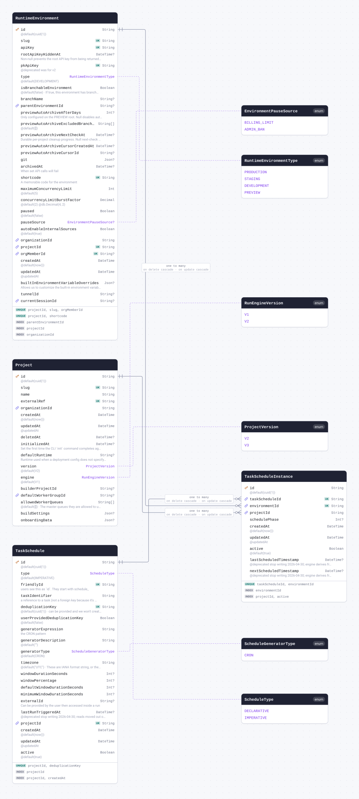

| Field                    | Type       | Constraints                                                   | Default      | Description                                                                                           |
| ------------------------ | ---------- | ------------------------------------------------------------- | ------------ | ----------------------------------------------------------------------------------------------------- |
| `id`                     | `String`   | PK NOT NULL                                                   | `cuid(1)`    |                                                                                                       |
| `taskScheduleId`         | `String`   | NOT NULL → [TaskSchedule.id](#model-TaskSchedule)             |              |                                                                                                       |
| `environmentId`          | `String`   | NOT NULL → [RuntimeEnvironment.id](#model-RuntimeEnvironment) |              |                                                                                                       |
| `projectId`              | `String`   | NOT NULL → [Project.id](#model-Project)                       |              |                                                                                                       |
| `schedulePhase`          | `Int`      | NULL                                                          |              |                                                                                                       |
| `createdAt`              | `DateTime` | NOT NULL                                                      | `now()`      |                                                                                                       |
| `updatedAt`              | `DateTime` | NOT NULL                                                      | `@updatedAt` |                                                                                                       |
| `active`                 | `Boolean`  | NOT NULL                                                      | `true`       |                                                                                                       |
| `lastScheduledTimestamp` | `DateTime` | NULL                                                          |              | @deprecated stop writing 2026-04-30; engine derives from cron + exactScheduleTime. Drop in follow-up. |
| `nextScheduledTimestamp` | `DateTime` | NULL                                                          |              | @deprecated stop writing 2026-04-30; engine derives from cron + now(). Drop in follow-up.             |

#### Indexes

- `@@index([environmentId])`
- `@@index([projectId, active])`
- `@@unique([taskScheduleId, environmentId])`

#### References

- `taskScheduleId` → [TaskSchedule.id](#model-TaskSchedule) (many-to-one, on delete Cascade, on update Cascade)
- `environmentId` → [RuntimeEnvironment.id](#model-RuntimeEnvironment) (many-to-one, on delete Cascade, on update Cascade)
- `projectId` → [Project.id](#model-Project) (many-to-one, on delete Cascade, on update Cascade)

#### Definition

```sql
CREATE TABLE "TaskScheduleInstance" (
    "id" TEXT NOT NULL,
    "taskScheduleId" TEXT NOT NULL,
    "environmentId" TEXT NOT NULL,
    "projectId" TEXT NOT NULL,
    "schedulePhase" INTEGER,
    "createdAt" TIMESTAMP(3) NOT NULL DEFAULT CURRENT_TIMESTAMP,
    "updatedAt" TIMESTAMP(3) NOT NULL,
    "active" BOOLEAN NOT NULL DEFAULT true,
    "lastScheduledTimestamp" TIMESTAMP(3),
    "nextScheduledTimestamp" TIMESTAMP(3),

    CONSTRAINT "TaskScheduleInstance_pkey" PRIMARY KEY ("id")
);

CREATE INDEX "TaskScheduleInstance_environmentId_idx" ON "TaskScheduleInstance"("environmentId");

CREATE INDEX "TaskScheduleInstance_projectId_active_idx" ON "TaskScheduleInstance"("projectId", "active");

CREATE UNIQUE INDEX "TaskScheduleInstance_taskScheduleId_environmentId_key" ON "TaskScheduleInstance"("taskScheduleId", "environmentId");

ALTER TABLE "TaskScheduleInstance" ADD CONSTRAINT "TaskScheduleInstance_taskScheduleId_fkey" FOREIGN KEY ("taskScheduleId") REFERENCES "TaskSchedule"("id") ON DELETE CASCADE ON UPDATE CASCADE;

ALTER TABLE "TaskScheduleInstance" ADD CONSTRAINT "TaskScheduleInstance_environmentId_fkey" FOREIGN KEY ("environmentId") REFERENCES "RuntimeEnvironment"("id") ON DELETE CASCADE ON UPDATE CASCADE;

ALTER TABLE "TaskScheduleInstance" ADD CONSTRAINT "TaskScheduleInstance_projectId_fkey" FOREIGN KEY ("projectId") REFERENCES "Project"("id") ON DELETE CASCADE ON UPDATE CASCADE;
```

<details>
<summary>Queries and their SQL</summary>

**findMany**: Every row

```ts
await prisma.taskScheduleInstance.findMany();
```

```sql
SELECT
  "public"."TaskScheduleInstance"."id",
  "public"."TaskScheduleInstance"."taskScheduleId",
  "public"."TaskScheduleInstance"."environmentId",
  "public"."TaskScheduleInstance"."projectId",
  "public"."TaskScheduleInstance"."schedulePhase",
  "public"."TaskScheduleInstance"."createdAt",
  "public"."TaskScheduleInstance"."updatedAt",
  "public"."TaskScheduleInstance"."active",
  "public"."TaskScheduleInstance"."lastScheduledTimestamp",
  "public"."TaskScheduleInstance"."nextScheduledTimestamp"
FROM
  "public"."TaskScheduleInstance"
WHERE
  1 = 1
OFFSET
  $1
-- params: ["0"]
```

**count**: How many rows there are

```ts
await prisma.taskScheduleInstance.count();
```

```sql
SELECT
  COUNT(*) AS "_count$_all"
FROM
  (
    SELECT
      "public"."TaskScheduleInstance"."id"
    FROM
      "public"."TaskScheduleInstance"
    WHERE
      1 = 1
    OFFSET
      $1
  ) AS "sub"
-- params: ["0"]
```

**findMany**: Every row with its relations

```ts
await prisma.taskScheduleInstance.findMany({
  include: { taskSchedule: true, environment: true, project: true },
});
```

```sql
SELECT
  "public"."TaskScheduleInstance"."id",
  "public"."TaskScheduleInstance"."taskScheduleId",
  "public"."TaskScheduleInstance"."environmentId",
  "public"."TaskScheduleInstance"."projectId",
  "public"."TaskScheduleInstance"."schedulePhase",
  "public"."TaskScheduleInstance"."createdAt",
  "public"."TaskScheduleInstance"."updatedAt",
  "public"."TaskScheduleInstance"."active",
  "public"."TaskScheduleInstance"."lastScheduledTimestamp",
  "public"."TaskScheduleInstance"."nextScheduledTimestamp"
FROM
  "public"."TaskScheduleInstance"
WHERE
  1 = 1
OFFSET
  $1
-- params: ["0"]

SELECT
  "public"."TaskSchedule"."id",
  "public"."TaskSchedule"."type"::text,
  "public"."TaskSchedule"."friendlyId",
  "public"."TaskSchedule"."taskIdentifier",
  "public"."TaskSchedule"."deduplicationKey",
  "public"."TaskSchedule"."userProvidedDeduplicationKey",
  "public"."TaskSchedule"."generatorExpression",
  "public"."TaskSchedule"."generatorDescription",
  "public"."TaskSchedule"."generatorType"::text,
  "public"."TaskSchedule"."timezone",
  "public"."TaskSchedule"."windowDurationSeconds",
  "public"."TaskSchedule"."windowPercentage",
  "public"."TaskSchedule"."defaultWindowDurationSeconds",
  "public"."TaskSchedule"."minimumWindowDurationSeconds",
  "public"."TaskSchedule"."externalId",
  "public"."TaskSchedule"."lastRunTriggeredAt",
  "public"."TaskSchedule"."projectId",
  "public"."TaskSchedule"."createdAt",
  "public"."TaskSchedule"."updatedAt",
  "public"."TaskSchedule"."active"
FROM
  "public"."TaskSchedule"
WHERE
  "public"."TaskSchedule"."id" IN ($1)
OFFSET
  $2
-- params: ["<taskScheduleId of the rows above>","0"]

SELECT
  "public"."RuntimeEnvironment"."id",
  "public"."RuntimeEnvironment"."slug",
  "public"."RuntimeEnvironment"."apiKey",
  "public"."RuntimeEnvironment"."rootApiKeyHiddenAt",
  "public"."RuntimeEnvironment"."pkApiKey",
  "public"."RuntimeEnvironment"."type"::text,
  "public"."RuntimeEnvironment"."isBranchableEnvironment",
  "public"."RuntimeEnvironment"."branchName",
  "public"."RuntimeEnvironment"."parentEnvironmentId",
  "public"."RuntimeEnvironment"."previewAutoArchiveAfterDays",
  "public"."RuntimeEnvironment"."previewAutoArchiveExcludedBranches",
  "public"."RuntimeEnvironment"."previewAutoArchiveNextCheckAt",
  "public"."RuntimeEnvironment"."previewAutoArchiveCursorCreatedAt",
  "public"."RuntimeEnvironment"."previewAutoArchiveCursorId",
  "public"."RuntimeEnvironment"."git",
  "public"."RuntimeEnvironment"."archivedAt",
  "public"."RuntimeEnvironment"."shortcode",
  "public"."RuntimeEnvironment"."maximumConcurrencyLimit",
  "public"."RuntimeEnvironment"."concurrencyLimitBurstFactor",
  "public"."RuntimeEnvironment"."paused",
  "public"."RuntimeEnvironment"."pauseSource"::text,
  "public"."RuntimeEnvironment"."autoEnableInternalSources",
  "public"."RuntimeEnvironment"."organizationId",
  "public"."RuntimeEnvironment"."projectId",
  "public"."RuntimeEnvironment"."orgMemberId",
  "public"."RuntimeEnvironment"."createdAt",
  "public"."RuntimeEnvironment"."updatedAt",
  "public"."RuntimeEnvironment"."builtInEnvironmentVariableOverrides",
  "public"."RuntimeEnvironment"."tunnelId",
  "public"."RuntimeEnvironment"."currentSessionId"
FROM
  "public"."RuntimeEnvironment"
WHERE
  "public"."RuntimeEnvironment"."id" IN ($1)
OFFSET
  $2
-- params: ["<environmentId of the rows above>","0"]

SELECT
  "public"."Project"."id",
  "public"."Project"."slug",
  "public"."Project"."name",
  "public"."Project"."externalRef",
  "public"."Project"."organizationId",
  "public"."Project"."createdAt",
  "public"."Project"."updatedAt",
  "public"."Project"."deletedAt",
  "public"."Project"."initializedAt",
  "public"."Project"."defaultRuntime",
  "public"."Project"."version"::text,
  "public"."Project"."engine"::text,
  "public"."Project"."builderProjectId",
  "public"."Project"."defaultWorkerGroupId",
  "public"."Project"."allowedMasterQueues",
  "public"."Project"."buildSettings",
  "public"."Project"."onboardingData"
FROM
  "public"."Project"
WHERE
  "public"."Project"."id" IN ($1)
OFFSET
  $2
-- params: ["<projectId of the rows above>","0"]
```

**findUnique**: One row by what is unique to it

```ts
await prisma.taskScheduleInstance.findUnique({ where: { id: "example" } });
```

```sql
SELECT
  "public"."TaskScheduleInstance"."id",
  "public"."TaskScheduleInstance"."taskScheduleId",
  "public"."TaskScheduleInstance"."environmentId",
  "public"."TaskScheduleInstance"."projectId",
  "public"."TaskScheduleInstance"."schedulePhase",
  "public"."TaskScheduleInstance"."createdAt",
  "public"."TaskScheduleInstance"."updatedAt",
  "public"."TaskScheduleInstance"."active",
  "public"."TaskScheduleInstance"."lastScheduledTimestamp",
  "public"."TaskScheduleInstance"."nextScheduledTimestamp"
FROM
  "public"."TaskScheduleInstance"
WHERE
  (
    "public"."TaskScheduleInstance"."id" = $1
    AND 1 = 1
  )
LIMIT
  $2
OFFSET
  $3
-- params: ["example","1","0"]
```

**create**: Create a row

```ts
await prisma.taskScheduleInstance.create({
  data: { taskScheduleId: "example", environmentId: "example", projectId: "example" },
});
```

```sql
INSERT INTO
  "public"."TaskScheduleInstance" (
    "id",
    "taskScheduleId",
    "environmentId",
    "projectId",
    "createdAt",
    "updatedAt",
    "active"
  )
VALUES
  ($1, $2, $3, $4, $5, $6, $7)
RETURNING
  "public"."TaskScheduleInstance"."id",
  "public"."TaskScheduleInstance"."taskScheduleId",
  "public"."TaskScheduleInstance"."environmentId",
  "public"."TaskScheduleInstance"."projectId",
  "public"."TaskScheduleInstance"."schedulePhase",
  "public"."TaskScheduleInstance"."createdAt",
  "public"."TaskScheduleInstance"."updatedAt",
  "public"."TaskScheduleInstance"."active",
  "public"."TaskScheduleInstance"."lastScheduledTimestamp",
  "public"."TaskScheduleInstance"."nextScheduledTimestamp"
-- params: ["<cuid(1)>","example","example","example","<now()>","<now()>",true]
```

**update**: Update a row

```ts
await prisma.taskScheduleInstance.update({ where: { id: "example" }, data: { schedulePhase: 1 } });
```

```sql
UPDATE "public"."TaskScheduleInstance"
SET
  "schedulePhase" = $1,
  "updatedAt" = $2
WHERE
  (
    "public"."TaskScheduleInstance"."id" = $3
    AND 1 = 1
  )
RETURNING
  "public"."TaskScheduleInstance"."id",
  "public"."TaskScheduleInstance"."taskScheduleId",
  "public"."TaskScheduleInstance"."environmentId",
  "public"."TaskScheduleInstance"."projectId",
  "public"."TaskScheduleInstance"."schedulePhase",
  "public"."TaskScheduleInstance"."createdAt",
  "public"."TaskScheduleInstance"."updatedAt",
  "public"."TaskScheduleInstance"."active",
  "public"."TaskScheduleInstance"."lastScheduledTimestamp",
  "public"."TaskScheduleInstance"."nextScheduledTimestamp"
-- params: ["1",{"prisma__type":"generatorCall","prisma__value":{"name":"now","args":[],"returnType":{"type":"DateTime"}}},"example"]
```

**delete**: Delete a row

```ts
await prisma.taskScheduleInstance.delete({ where: { id: "example" } });
```

```sql
DELETE FROM "public"."TaskScheduleInstance"
WHERE
  (
    "public"."TaskScheduleInstance"."id" = $1
    AND 1 = 1
  )
RETURNING
  "public"."TaskScheduleInstance"."id",
  "public"."TaskScheduleInstance"."taskScheduleId",
  "public"."TaskScheduleInstance"."environmentId",
  "public"."TaskScheduleInstance"."projectId",
  "public"."TaskScheduleInstance"."schedulePhase",
  "public"."TaskScheduleInstance"."createdAt",
  "public"."TaskScheduleInstance"."updatedAt",
  "public"."TaskScheduleInstance"."active",
  "public"."TaskScheduleInstance"."lastScheduledTimestamp",
  "public"."TaskScheduleInstance"."nextScheduledTimestamp"
-- params: ["example"]
```

</details>

<a id="model-RuntimeEnvironmentSession"></a>

### RuntimeEnvironmentSession

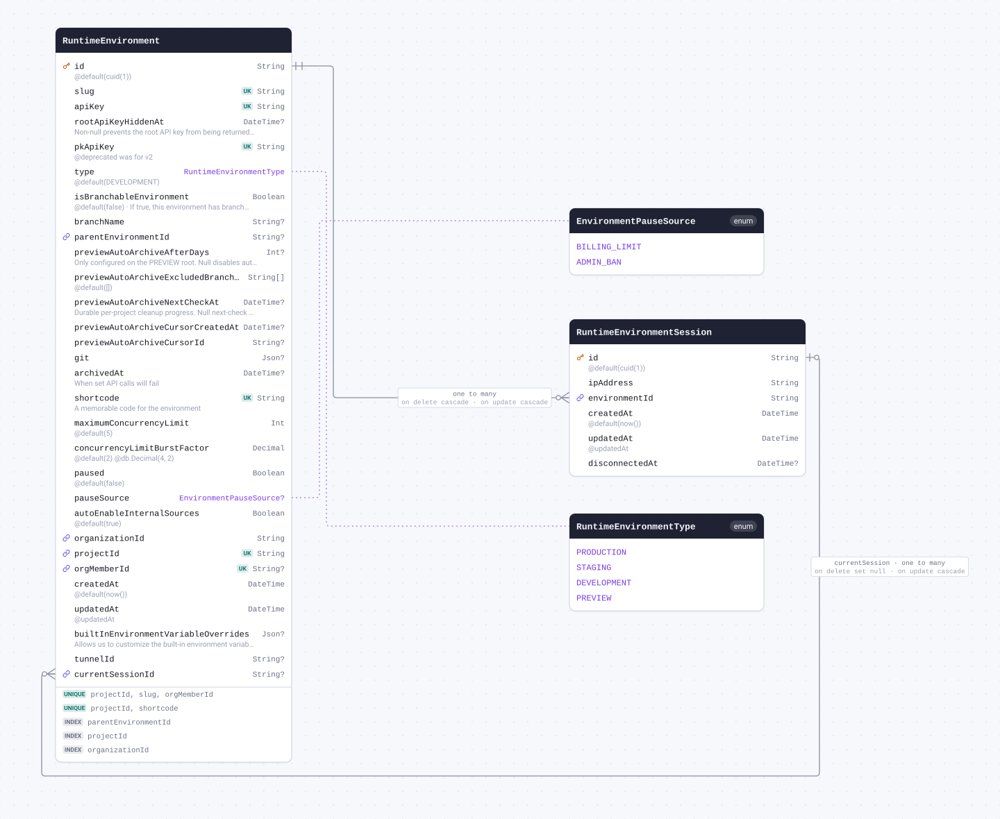

| Field            | Type       | Constraints                                                   | Default      | Description |
| ---------------- | ---------- | ------------------------------------------------------------- | ------------ | ----------- |
| `id`             | `String`   | PK NOT NULL                                                   | `cuid(1)`    |             |
| `ipAddress`      | `String`   | NOT NULL                                                      |              |             |
| `environmentId`  | `String`   | NOT NULL → [RuntimeEnvironment.id](#model-RuntimeEnvironment) |              |             |
| `createdAt`      | `DateTime` | NOT NULL                                                      | `now()`      |             |
| `updatedAt`      | `DateTime` | NOT NULL                                                      | `@updatedAt` |             |
| `disconnectedAt` | `DateTime` | NULL                                                          |              |             |

#### References

- `environmentId` → [RuntimeEnvironment.id](#model-RuntimeEnvironment) (many-to-one, on delete Cascade, on update Cascade)

#### Referenced by

- `id` ← [RuntimeEnvironment.currentSessionId](#model-RuntimeEnvironment) (one-to-many, on delete SetNull, on update Cascade)

#### Definition

```sql
CREATE TABLE "RuntimeEnvironmentSession" (
    "id" TEXT NOT NULL,
    "ipAddress" TEXT NOT NULL,
    "environmentId" TEXT NOT NULL,
    "createdAt" TIMESTAMP(3) NOT NULL DEFAULT CURRENT_TIMESTAMP,
    "updatedAt" TIMESTAMP(3) NOT NULL,
    "disconnectedAt" TIMESTAMP(3),

    CONSTRAINT "RuntimeEnvironmentSession_pkey" PRIMARY KEY ("id")
);

ALTER TABLE "RuntimeEnvironmentSession" ADD CONSTRAINT "RuntimeEnvironmentSession_environmentId_fkey" FOREIGN KEY ("environmentId") REFERENCES "RuntimeEnvironment"("id") ON DELETE CASCADE ON UPDATE CASCADE;
```

<details>
<summary>Queries and their SQL</summary>

**findMany**: Every row

```ts
await prisma.runtimeEnvironmentSession.findMany();
```

```sql
SELECT
  "public"."RuntimeEnvironmentSession"."id",
  "public"."RuntimeEnvironmentSession"."ipAddress",
  "public"."RuntimeEnvironmentSession"."environmentId",
  "public"."RuntimeEnvironmentSession"."createdAt",
  "public"."RuntimeEnvironmentSession"."updatedAt",
  "public"."RuntimeEnvironmentSession"."disconnectedAt"
FROM
  "public"."RuntimeEnvironmentSession"
WHERE
  1 = 1
OFFSET
  $1
-- params: ["0"]
```

**count**: How many rows there are

```ts
await prisma.runtimeEnvironmentSession.count();
```

```sql
SELECT
  COUNT(*) AS "_count$_all"
FROM
  (
    SELECT
      "public"."RuntimeEnvironmentSession"."id"
    FROM
      "public"."RuntimeEnvironmentSession"
    WHERE
      1 = 1
    OFFSET
      $1
  ) AS "sub"
-- params: ["0"]
```

**findMany**: Every row with its relations

```ts
await prisma.runtimeEnvironmentSession.findMany({
  include: { environment: true, currentEnvironments: true },
});
```

```sql
SELECT
  "public"."RuntimeEnvironmentSession"."id",
  "public"."RuntimeEnvironmentSession"."ipAddress",
  "public"."RuntimeEnvironmentSession"."environmentId",
  "public"."RuntimeEnvironmentSession"."createdAt",
  "public"."RuntimeEnvironmentSession"."updatedAt",
  "public"."RuntimeEnvironmentSession"."disconnectedAt"
FROM
  "public"."RuntimeEnvironmentSession"
WHERE
  1 = 1
OFFSET
  $1
-- params: ["0"]

SELECT
  "public"."RuntimeEnvironment"."id",
  "public"."RuntimeEnvironment"."slug",
  "public"."RuntimeEnvironment"."apiKey",
  "public"."RuntimeEnvironment"."rootApiKeyHiddenAt",
  "public"."RuntimeEnvironment"."pkApiKey",
  "public"."RuntimeEnvironment"."type"::text,
  "public"."RuntimeEnvironment"."isBranchableEnvironment",
  "public"."RuntimeEnvironment"."branchName",
  "public"."RuntimeEnvironment"."parentEnvironmentId",
  "public"."RuntimeEnvironment"."previewAutoArchiveAfterDays",
  "public"."RuntimeEnvironment"."previewAutoArchiveExcludedBranches",
  "public"."RuntimeEnvironment"."previewAutoArchiveNextCheckAt",
  "public"."RuntimeEnvironment"."previewAutoArchiveCursorCreatedAt",
  "public"."RuntimeEnvironment"."previewAutoArchiveCursorId",
  "public"."RuntimeEnvironment"."git",
  "public"."RuntimeEnvironment"."archivedAt",
  "public"."RuntimeEnvironment"."shortcode",
  "public"."RuntimeEnvironment"."maximumConcurrencyLimit",
  "public"."RuntimeEnvironment"."concurrencyLimitBurstFactor",
  "public"."RuntimeEnvironment"."paused",
  "public"."RuntimeEnvironment"."pauseSource"::text,
  "public"."RuntimeEnvironment"."autoEnableInternalSources",
  "public"."RuntimeEnvironment"."organizationId",
  "public"."RuntimeEnvironment"."projectId",
  "public"."RuntimeEnvironment"."orgMemberId",
  "public"."RuntimeEnvironment"."createdAt",
  "public"."RuntimeEnvironment"."updatedAt",
  "public"."RuntimeEnvironment"."builtInEnvironmentVariableOverrides",
  "public"."RuntimeEnvironment"."tunnelId",
  "public"."RuntimeEnvironment"."currentSessionId"
FROM
  "public"."RuntimeEnvironment"
WHERE
  "public"."RuntimeEnvironment"."id" IN ($1)
OFFSET
  $2
-- params: ["<environmentId of the rows above>","0"]

SELECT
  "public"."RuntimeEnvironment"."id",
  "public"."RuntimeEnvironment"."slug",
  "public"."RuntimeEnvironment"."apiKey",
  "public"."RuntimeEnvironment"."rootApiKeyHiddenAt",
  "public"."RuntimeEnvironment"."pkApiKey",
  "public"."RuntimeEnvironment"."type"::text,
  "public"."RuntimeEnvironment"."isBranchableEnvironment",
  "public"."RuntimeEnvironment"."branchName",
  "public"."RuntimeEnvironment"."parentEnvironmentId",
  "public"."RuntimeEnvironment"."previewAutoArchiveAfterDays",
  "public"."RuntimeEnvironment"."previewAutoArchiveExcludedBranches",
  "public"."RuntimeEnvironment"."previewAutoArchiveNextCheckAt",
  "public"."RuntimeEnvironment"."previewAutoArchiveCursorCreatedAt",
  "public"."RuntimeEnvironment"."previewAutoArchiveCursorId",
  "public"."RuntimeEnvironment"."git",
  "public"."RuntimeEnvironment"."archivedAt",
  "public"."RuntimeEnvironment"."shortcode",
  "public"."RuntimeEnvironment"."maximumConcurrencyLimit",
  "public"."RuntimeEnvironment"."concurrencyLimitBurstFactor",
  "public"."RuntimeEnvironment"."paused",
  "public"."RuntimeEnvironment"."pauseSource"::text,
  "public"."RuntimeEnvironment"."autoEnableInternalSources",
  "public"."RuntimeEnvironment"."organizationId",
  "public"."RuntimeEnvironment"."projectId",
  "public"."RuntimeEnvironment"."orgMemberId",
  "public"."RuntimeEnvironment"."createdAt",
  "public"."RuntimeEnvironment"."updatedAt",
  "public"."RuntimeEnvironment"."builtInEnvironmentVariableOverrides",
  "public"."RuntimeEnvironment"."tunnelId",
  "public"."RuntimeEnvironment"."currentSessionId"
FROM
  "public"."RuntimeEnvironment"
WHERE
  "public"."RuntimeEnvironment"."currentSessionId" IN ($1)
OFFSET
  $2
-- params: ["<id of the rows above>","0"]
```

**findUnique**: One row by what is unique to it

```ts
await prisma.runtimeEnvironmentSession.findUnique({ where: { id: "example" } });
```

```sql
SELECT
  "public"."RuntimeEnvironmentSession"."id",
  "public"."RuntimeEnvironmentSession"."ipAddress",
  "public"."RuntimeEnvironmentSession"."environmentId",
  "public"."RuntimeEnvironmentSession"."createdAt",
  "public"."RuntimeEnvironmentSession"."updatedAt",
  "public"."RuntimeEnvironmentSession"."disconnectedAt"
FROM
  "public"."RuntimeEnvironmentSession"
WHERE
  (
    "public"."RuntimeEnvironmentSession"."id" = $1
    AND 1 = 1
  )
LIMIT
  $2
OFFSET
  $3
-- params: ["example","1","0"]
```

**create**: Create a row

```ts
await prisma.runtimeEnvironmentSession.create({
  data: { ipAddress: "example", environmentId: "example" },
});
```

```sql
INSERT INTO
  "public"."RuntimeEnvironmentSession" (
    "id",
    "ipAddress",
    "environmentId",
    "createdAt",
    "updatedAt"
  )
VALUES
  ($1, $2, $3, $4, $5)
RETURNING
  "public"."RuntimeEnvironmentSession"."id",
  "public"."RuntimeEnvironmentSession"."ipAddress",
  "public"."RuntimeEnvironmentSession"."environmentId",
  "public"."RuntimeEnvironmentSession"."createdAt",
  "public"."RuntimeEnvironmentSession"."updatedAt",
  "public"."RuntimeEnvironmentSession"."disconnectedAt"
-- params: ["<cuid(1)>","example","example","<now()>","<now()>"]
```

**update**: Update a row

```ts
await prisma.runtimeEnvironmentSession.update({
  where: { id: "example" },
  data: { ipAddress: "example" },
});
```

```sql
UPDATE "public"."RuntimeEnvironmentSession"
SET
  "ipAddress" = $1,
  "updatedAt" = $2
WHERE
  (
    "public"."RuntimeEnvironmentSession"."id" = $3
    AND 1 = 1
  )
RETURNING
  "public"."RuntimeEnvironmentSession"."id",
  "public"."RuntimeEnvironmentSession"."ipAddress",
  "public"."RuntimeEnvironmentSession"."environmentId",
  "public"."RuntimeEnvironmentSession"."createdAt",
  "public"."RuntimeEnvironmentSession"."updatedAt",
  "public"."RuntimeEnvironmentSession"."disconnectedAt"
-- params: ["example",{"prisma__type":"generatorCall","prisma__value":{"name":"now","args":[],"returnType":{"type":"DateTime"}}},"example"]
```

**delete**: Delete a row

```ts
await prisma.runtimeEnvironmentSession.delete({ where: { id: "example" } });
```

```sql
DELETE FROM "public"."RuntimeEnvironmentSession"
WHERE
  (
    "public"."RuntimeEnvironmentSession"."id" = $1
    AND 1 = 1
  )
RETURNING
  "public"."RuntimeEnvironmentSession"."id",
  "public"."RuntimeEnvironmentSession"."ipAddress",
  "public"."RuntimeEnvironmentSession"."environmentId",
  "public"."RuntimeEnvironmentSession"."createdAt",
  "public"."RuntimeEnvironmentSession"."updatedAt",
  "public"."RuntimeEnvironmentSession"."disconnectedAt"
-- params: ["example"]
```

</details>

<a id="model-ProjectAlertChannel"></a>

### ProjectAlertChannel


| Field                          | Type                                                       | Constraints                                                         | Default                 | Description                                                   |
| ------------------------------ | ---------------------------------------------------------- | ------------------------------------------------------------------- | ----------------------- | ------------------------------------------------------------- |
| `id`                           | `String`                                                   | PK NOT NULL                                                         | `cuid(1)`               |                                                               |
| `friendlyId`                   | `String`                                                   | UNIQUE NOT NULL                                                     |                         |                                                               |
| `deduplicationKey`             | `String`                                                   | NOT NULL                                                            | `cuid(1)`               | can be provided and we won't create another with the same key |
| `userProvidedDeduplicationKey` | `Boolean`                                                  | NOT NULL                                                            | `false`                 |                                                               |
| `integrationId`                | `String`                                                   | NULL → [OrganizationIntegration.id](#model-OrganizationIntegration) |                         |                                                               |
| `enabled`                      | `Boolean`                                                  | NOT NULL                                                            | `true`                  |                                                               |
| `type`                         | [`ProjectAlertChannelType`](#enum-ProjectAlertChannelType) | NOT NULL                                                            |                         |                                                               |
| `name`                         | `String`                                                   | NOT NULL                                                            |                         |                                                               |
| `properties`                   | `Json`                                                     | NOT NULL                                                            |                         |                                                               |
| `alertTypes`                   | [`ProjectAlertType[]`](#enum-ProjectAlertType)             | NOT NULL                                                            |                         |                                                               |
| `environmentTypes`             | [`RuntimeEnvironmentType[]`](#enum-RuntimeEnvironmentType) | NOT NULL                                                            | `[STAGING, PRODUCTION]` |                                                               |
| `errorAlertConfig`             | `Json`                                                     | NULL                                                                |                         |                                                               |
| `projectId`                    | `String`                                                   | NOT NULL → [Project.id](#model-Project)                             |                         |                                                               |
| `createdAt`                    | `DateTime`                                                 | NOT NULL                                                            | `now()`                 |                                                               |
| `updatedAt`                    | `DateTime`                                                 | NOT NULL                                                            | `@updatedAt`            |                                                               |

#### Indexes

- `@@unique([projectId, deduplicationKey])`

#### References

- `integrationId` → [OrganizationIntegration.id](#model-OrganizationIntegration) (many-to-one, on delete SetNull, on update Cascade)
- `projectId` → [Project.id](#model-Project) (many-to-one, on delete Cascade, on update Cascade)

#### Referenced by

- `id` ← [ProjectAlert.channelId](#model-ProjectAlert) (one-to-many, on delete Cascade, on update Cascade)
- `id` ← [ProjectAlertStorage.alertChannelId](#model-ProjectAlertStorage) (one-to-many, on delete Cascade, on update Cascade)

#### Definition

```sql
CREATE TABLE "ProjectAlertChannel" (
    "id" TEXT NOT NULL,
    "friendlyId" TEXT NOT NULL,
    "deduplicationKey" TEXT NOT NULL,
    "userProvidedDeduplicationKey" BOOLEAN NOT NULL DEFAULT false,
    "integrationId" TEXT,
    "enabled" BOOLEAN NOT NULL DEFAULT true,
    "type" "ProjectAlertChannelType" NOT NULL,
    "name" TEXT NOT NULL,
    "properties" JSONB NOT NULL,
    "alertTypes" "ProjectAlertType"[],
    "environmentTypes" "RuntimeEnvironmentType"[] DEFAULT ARRAY['STAGING', 'PRODUCTION']::"RuntimeEnvironmentType"[],
    "errorAlertConfig" JSONB,
    "projectId" TEXT NOT NULL,
    "createdAt" TIMESTAMP(3) NOT NULL DEFAULT CURRENT_TIMESTAMP,
    "updatedAt" TIMESTAMP(3) NOT NULL,

    CONSTRAINT "ProjectAlertChannel_pkey" PRIMARY KEY ("id")
);

CREATE UNIQUE INDEX "ProjectAlertChannel_friendlyId_key" ON "ProjectAlertChannel"("friendlyId");

CREATE UNIQUE INDEX "ProjectAlertChannel_projectId_deduplicationKey_key" ON "ProjectAlertChannel"("projectId", "deduplicationKey");

ALTER TABLE "ProjectAlertChannel" ADD CONSTRAINT "ProjectAlertChannel_integrationId_fkey" FOREIGN KEY ("integrationId") REFERENCES "OrganizationIntegration"("id") ON DELETE SET NULL ON UPDATE CASCADE;

ALTER TABLE "ProjectAlertChannel" ADD CONSTRAINT "ProjectAlertChannel_projectId_fkey" FOREIGN KEY ("projectId") REFERENCES "Project"("id") ON DELETE CASCADE ON UPDATE CASCADE;
```

<details>
<summary>Queries and their SQL</summary>

**findMany**: Every row

```ts
await prisma.projectAlertChannel.findMany();
```

```sql
SELECT
  "public"."ProjectAlertChannel"."id",
  "public"."ProjectAlertChannel"."friendlyId",
  "public"."ProjectAlertChannel"."deduplicationKey",
  "public"."ProjectAlertChannel"."userProvidedDeduplicationKey",
  "public"."ProjectAlertChannel"."integrationId",
  "public"."ProjectAlertChannel"."enabled",
  "public"."ProjectAlertChannel"."type"::text,
  "public"."ProjectAlertChannel"."name",
  "public"."ProjectAlertChannel"."properties",
  "public"."ProjectAlertChannel"."alertTypes"::text[],
  "public"."ProjectAlertChannel"."environmentTypes"::text[],
  "public"."ProjectAlertChannel"."errorAlertConfig",
  "public"."ProjectAlertChannel"."projectId",
  "public"."ProjectAlertChannel"."createdAt",
  "public"."ProjectAlertChannel"."updatedAt"
FROM
  "public"."ProjectAlertChannel"
WHERE
  1 = 1
OFFSET
  $1
-- params: ["0"]
```

**count**: How many rows there are

```ts
await prisma.projectAlertChannel.count();
```

```sql
SELECT
  COUNT(*) AS "_count$_all"
FROM
  (
    SELECT
      "public"."ProjectAlertChannel"."id"
    FROM
      "public"."ProjectAlertChannel"
    WHERE
      1 = 1
    OFFSET
      $1
  ) AS "sub"
-- params: ["0"]
```

**findMany**: Every row with its relations

```ts
await prisma.projectAlertChannel.findMany({
  include: { integration: true, project: true, alerts: true, alertStorages: true },
});
```

```sql
SELECT
  "public"."ProjectAlertChannel"."id",
  "public"."ProjectAlertChannel"."friendlyId",
  "public"."ProjectAlertChannel"."deduplicationKey",
  "public"."ProjectAlertChannel"."userProvidedDeduplicationKey",
  "public"."ProjectAlertChannel"."integrationId",
  "public"."ProjectAlertChannel"."enabled",
  "public"."ProjectAlertChannel"."type"::text,
  "public"."ProjectAlertChannel"."name",
  "public"."ProjectAlertChannel"."properties",
  "public"."ProjectAlertChannel"."alertTypes"::text[],
  "public"."ProjectAlertChannel"."environmentTypes"::text[],
  "public"."ProjectAlertChannel"."errorAlertConfig",
  "public"."ProjectAlertChannel"."projectId",
  "public"."ProjectAlertChannel"."createdAt",
  "public"."ProjectAlertChannel"."updatedAt"
FROM
  "public"."ProjectAlertChannel"
WHERE
  1 = 1
OFFSET
  $1
-- params: ["0"]

SELECT
  "public"."OrganizationIntegration"."id",
  "public"."OrganizationIntegration"."friendlyId",
  "public"."OrganizationIntegration"."service"::text,
  "public"."OrganizationIntegration"."externalOrganizationId",
  "public"."OrganizationIntegration"."integrationData",
  "public"."OrganizationIntegration"."tokenReferenceId",
  "public"."OrganizationIntegration"."organizationId",
  "public"."OrganizationIntegration"."createdAt",
  "public"."OrganizationIntegration"."updatedAt",
  "public"."OrganizationIntegration"."deletedAt"
FROM
  "public"."OrganizationIntegration"
WHERE
  "public"."OrganizationIntegration"."id" IN ($1)
OFFSET
  $2
-- params: ["<integrationId of the rows above>","0"]

SELECT
  "public"."Project"."id",
  "public"."Project"."slug",
  "public"."Project"."name",
  "public"."Project"."externalRef",
  "public"."Project"."organizationId",
  "public"."Project"."createdAt",
  "public"."Project"."updatedAt",
  "public"."Project"."deletedAt",
  "public"."Project"."initializedAt",
  "public"."Project"."defaultRuntime",
  "public"."Project"."version"::text,
  "public"."Project"."engine"::text,
  "public"."Project"."builderProjectId",
  "public"."Project"."defaultWorkerGroupId",
  "public"."Project"."allowedMasterQueues",
  "public"."Project"."buildSettings",
  "public"."Project"."onboardingData"
FROM
  "public"."Project"
WHERE
  "public"."Project"."id" IN ($1)
OFFSET
  $2
-- params: ["<projectId of the rows above>","0"]

SELECT
  "public"."ProjectAlert"."id",
  "public"."ProjectAlert"."friendlyId",
  "public"."ProjectAlert"."projectId",
  "public"."ProjectAlert"."environmentId",
  "public"."ProjectAlert"."channelId",
  "public"."ProjectAlert"."status"::text,
  "public"."ProjectAlert"."type"::text,
  "public"."ProjectAlert"."taskRunAttemptId",
  "public"."ProjectAlert"."taskRunId",
  "public"."ProjectAlert"."workerDeploymentId",
  "public"."ProjectAlert"."createdAt",
  "public"."ProjectAlert"."updatedAt"
FROM
  "public"."ProjectAlert"
WHERE
  "public"."ProjectAlert"."channelId" IN ($1)
OFFSET
  $2
-- params: ["<id of the rows above>","0"]

SELECT
  "public"."ProjectAlertStorage"."id",
  "public"."ProjectAlertStorage"."projectId",
  "public"."ProjectAlertStorage"."alertChannelId",
  "public"."ProjectAlertStorage"."alertType"::text,
  "public"."ProjectAlertStorage"."storageId",
  "public"."ProjectAlertStorage"."storageData",
  "public"."ProjectAlertStorage"."createdAt",
  "public"."ProjectAlertStorage"."updatedAt"
FROM
  "public"."ProjectAlertStorage"
WHERE
  "public"."ProjectAlertStorage"."alertChannelId" IN ($1)
OFFSET
  $2
-- params: ["<id of the rows above>","0"]
```

**findUnique**: One row by what is unique to it

```ts
await prisma.projectAlertChannel.findUnique({ where: { id: "example" } });
```

```sql
SELECT
  "public"."ProjectAlertChannel"."id",
  "public"."ProjectAlertChannel"."friendlyId",
  "public"."ProjectAlertChannel"."deduplicationKey",
  "public"."ProjectAlertChannel"."userProvidedDeduplicationKey",
  "public"."ProjectAlertChannel"."integrationId",
  "public"."ProjectAlertChannel"."enabled",
  "public"."ProjectAlertChannel"."type"::text,
  "public"."ProjectAlertChannel"."name",
  "public"."ProjectAlertChannel"."properties",
  "public"."ProjectAlertChannel"."alertTypes"::text[],
  "public"."ProjectAlertChannel"."environmentTypes"::text[],
  "public"."ProjectAlertChannel"."errorAlertConfig",
  "public"."ProjectAlertChannel"."projectId",
  "public"."ProjectAlertChannel"."createdAt",
  "public"."ProjectAlertChannel"."updatedAt"
FROM
  "public"."ProjectAlertChannel"
WHERE
  (
    "public"."ProjectAlertChannel"."id" = $1
    AND 1 = 1
  )
LIMIT
  $2
OFFSET
  $3
-- params: ["example","1","0"]
```

**create**: Create a row

```ts
await prisma.projectAlertChannel.create({
  data: {
    friendlyId: "example",
    type: "EMAIL",
    name: "example",
    properties: {},
    alertTypes: ["TASK_RUN"],
    projectId: "example",
  },
});
```

```sql
INSERT INTO
  "public"."ProjectAlertChannel" (
    "id",
    "friendlyId",
    "deduplicationKey",
    "userProvidedDeduplicationKey",
    "enabled",
    "type",
    "name",
    "properties",
    "alertTypes",
    "environmentTypes",
    "projectId",
    "createdAt",
    "updatedAt"
  )
VALUES
  (
    $1,
    $2,
    $3,
    $4,
    $5,
    CAST($6::text AS "public"."ProjectAlertChannelType"),
    $7,
    $8,
    CAST($9::text[] AS "public"."ProjectAlertType" []),
    CAST(
      $10::text[] AS "public"."RuntimeEnvironmentType" []
    ),
    $11,
    $12,
    $13
  )
RETURNING
  "public"."ProjectAlertChannel"."id",
  "public"."ProjectAlertChannel"."friendlyId",
  "public"."ProjectAlertChannel"."deduplicationKey",
  "public"."ProjectAlertChannel"."userProvidedDeduplicationKey",
  "public"."ProjectAlertChannel"."integrationId",
  "public"."ProjectAlertChannel"."enabled",
  "public"."ProjectAlertChannel"."type"::text,
  "public"."ProjectAlertChannel"."name",
  "public"."ProjectAlertChannel"."properties",
  "public"."ProjectAlertChannel"."alertTypes"::text[],
  "public"."ProjectAlertChannel"."environmentTypes"::text[],
  "public"."ProjectAlertChannel"."errorAlertConfig",
  "public"."ProjectAlertChannel"."projectId",
  "public"."ProjectAlertChannel"."createdAt",
  "public"."ProjectAlertChannel"."updatedAt"
-- params: ["<cuid(1)>","example","<cuid(1)>",false,true,"EMAIL","example","{}",["TASK_RUN"],["STAGING","PRODUCTION"],"example","<now()>","<now()>"]
```

**update**: Update a row

```ts
await prisma.projectAlertChannel.update({
  where: { id: "example" },
  data: { friendlyId: "example" },
});
```

```sql
UPDATE "public"."ProjectAlertChannel"
SET
  "friendlyId" = $1,
  "updatedAt" = $2
WHERE
  (
    "public"."ProjectAlertChannel"."id" = $3
    AND 1 = 1
  )
RETURNING
  "public"."ProjectAlertChannel"."id",
  "public"."ProjectAlertChannel"."friendlyId",
  "public"."ProjectAlertChannel"."deduplicationKey",
  "public"."ProjectAlertChannel"."userProvidedDeduplicationKey",
  "public"."ProjectAlertChannel"."integrationId",
  "public"."ProjectAlertChannel"."enabled",
  "public"."ProjectAlertChannel"."type"::text,
  "public"."ProjectAlertChannel"."name",
  "public"."ProjectAlertChannel"."properties",
  "public"."ProjectAlertChannel"."alertTypes"::text[],
  "public"."ProjectAlertChannel"."environmentTypes"::text[],
  "public"."ProjectAlertChannel"."errorAlertConfig",
  "public"."ProjectAlertChannel"."projectId",
  "public"."ProjectAlertChannel"."createdAt",
  "public"."ProjectAlertChannel"."updatedAt"
-- params: ["example",{"prisma__type":"generatorCall","prisma__value":{"name":"now","args":[],"returnType":{"type":"DateTime"}}},"example"]
```

**delete**: Delete a row

```ts
await prisma.projectAlertChannel.delete({ where: { id: "example" } });
```

```sql
DELETE FROM "public"."ProjectAlertChannel"
WHERE
  (
    "public"."ProjectAlertChannel"."id" = $1
    AND 1 = 1
  )
RETURNING
  "public"."ProjectAlertChannel"."id",
  "public"."ProjectAlertChannel"."friendlyId",
  "public"."ProjectAlertChannel"."deduplicationKey",
  "public"."ProjectAlertChannel"."userProvidedDeduplicationKey",
  "public"."ProjectAlertChannel"."integrationId",
  "public"."ProjectAlertChannel"."enabled",
  "public"."ProjectAlertChannel"."type"::text,
  "public"."ProjectAlertChannel"."name",
  "public"."ProjectAlertChannel"."properties",
  "public"."ProjectAlertChannel"."alertTypes"::text[],
  "public"."ProjectAlertChannel"."environmentTypes"::text[],
  "public"."ProjectAlertChannel"."errorAlertConfig",
  "public"."ProjectAlertChannel"."projectId",
  "public"."ProjectAlertChannel"."createdAt",
  "public"."ProjectAlertChannel"."updatedAt"
-- params: ["example"]
```

</details>

<a id="model-ProjectAlert"></a>

### ProjectAlert


| Field                | Type                                             | Constraints                                                     | Default      | Description |
| -------------------- | ------------------------------------------------ | --------------------------------------------------------------- | ------------ | ----------- |
| `id`                 | `String`                                         | PK NOT NULL                                                     | `cuid(1)`    |             |
| `friendlyId`         | `String`                                         | UNIQUE NOT NULL                                                 |              |             |
| `projectId`          | `String`                                         | NOT NULL → [Project.id](#model-Project)                         |              |             |
| `environmentId`      | `String`                                         | NOT NULL → [RuntimeEnvironment.id](#model-RuntimeEnvironment)   |              |             |
| `channelId`          | `String`                                         | NOT NULL → [ProjectAlertChannel.id](#model-ProjectAlertChannel) |              |             |
| `status`             | [`ProjectAlertStatus`](#enum-ProjectAlertStatus) | NOT NULL                                                        | `PENDING`    |             |
| `type`               | [`ProjectAlertType`](#enum-ProjectAlertType)     | NOT NULL                                                        |              |             |
| `taskRunAttemptId`   | `String`                                         | NULL                                                            |              |             |
| `taskRunId`          | `String`                                         | NULL                                                            |              |             |
| `workerDeploymentId` | `String`                                         | NULL → [WorkerDeployment.id](#model-WorkerDeployment)           |              |             |
| `createdAt`          | `DateTime`                                       | NOT NULL                                                        | `now()`      |             |
| `updatedAt`          | `DateTime`                                       | NOT NULL                                                        | `@updatedAt` |             |

#### Indexes

- `@@index([channelId])`

#### References

- `projectId` → [Project.id](#model-Project) (many-to-one, on delete Cascade, on update Cascade)
- `environmentId` → [RuntimeEnvironment.id](#model-RuntimeEnvironment) (many-to-one, on delete Cascade, on update Cascade)
- `channelId` → [ProjectAlertChannel.id](#model-ProjectAlertChannel) (many-to-one, on delete Cascade, on update Cascade)
- `workerDeploymentId` → [WorkerDeployment.id](#model-WorkerDeployment) (many-to-one, on delete Cascade, on update Cascade)

#### Definition

```sql
CREATE TABLE "ProjectAlert" (
    "id" TEXT NOT NULL,
    "friendlyId" TEXT NOT NULL,
    "projectId" TEXT NOT NULL,
    "environmentId" TEXT NOT NULL,
    "channelId" TEXT NOT NULL,
    "status" "ProjectAlertStatus" NOT NULL DEFAULT 'PENDING',
    "type" "ProjectAlertType" NOT NULL,
    "taskRunAttemptId" TEXT,
    "taskRunId" TEXT,
    "workerDeploymentId" TEXT,
    "createdAt" TIMESTAMP(3) NOT NULL DEFAULT CURRENT_TIMESTAMP,
    "updatedAt" TIMESTAMP(3) NOT NULL,

    CONSTRAINT "ProjectAlert_pkey" PRIMARY KEY ("id")
);

CREATE UNIQUE INDEX "ProjectAlert_friendlyId_key" ON "ProjectAlert"("friendlyId");

CREATE INDEX "ProjectAlert_channelId_idx" ON "ProjectAlert"("channelId");

ALTER TABLE "ProjectAlert" ADD CONSTRAINT "ProjectAlert_projectId_fkey" FOREIGN KEY ("projectId") REFERENCES "Project"("id") ON DELETE CASCADE ON UPDATE CASCADE;

ALTER TABLE "ProjectAlert" ADD CONSTRAINT "ProjectAlert_environmentId_fkey" FOREIGN KEY ("environmentId") REFERENCES "RuntimeEnvironment"("id") ON DELETE CASCADE ON UPDATE CASCADE;

ALTER TABLE "ProjectAlert" ADD CONSTRAINT "ProjectAlert_channelId_fkey" FOREIGN KEY ("channelId") REFERENCES "ProjectAlertChannel"("id") ON DELETE CASCADE ON UPDATE CASCADE;

ALTER TABLE "ProjectAlert" ADD CONSTRAINT "ProjectAlert_workerDeploymentId_fkey" FOREIGN KEY ("workerDeploymentId") REFERENCES "WorkerDeployment"("id") ON DELETE CASCADE ON UPDATE CASCADE;
```

<details>
<summary>Queries and their SQL</summary>

**findMany**: Every row

```ts
await prisma.projectAlert.findMany();
```

```sql
SELECT
  "public"."ProjectAlert"."id",
  "public"."ProjectAlert"."friendlyId",
  "public"."ProjectAlert"."projectId",
  "public"."ProjectAlert"."environmentId",
  "public"."ProjectAlert"."channelId",
  "public"."ProjectAlert"."status"::text,
  "public"."ProjectAlert"."type"::text,
  "public"."ProjectAlert"."taskRunAttemptId",
  "public"."ProjectAlert"."taskRunId",
  "public"."ProjectAlert"."workerDeploymentId",
  "public"."ProjectAlert"."createdAt",
  "public"."ProjectAlert"."updatedAt"
FROM
  "public"."ProjectAlert"
WHERE
  1 = 1
OFFSET
  $1
-- params: ["0"]
```

**count**: How many rows there are

```ts
await prisma.projectAlert.count();
```

```sql
SELECT
  COUNT(*) AS "_count$_all"
FROM
  (
    SELECT
      "public"."ProjectAlert"."id"
    FROM
      "public"."ProjectAlert"
    WHERE
      1 = 1
    OFFSET
      $1
  ) AS "sub"
-- params: ["0"]
```

**findMany**: Every row with its relations

```ts
await prisma.projectAlert.findMany({
  include: { project: true, environment: true, channel: true, workerDeployment: true },
});
```

```sql
SELECT
  "public"."ProjectAlert"."id",
  "public"."ProjectAlert"."friendlyId",
  "public"."ProjectAlert"."projectId",
  "public"."ProjectAlert"."environmentId",
  "public"."ProjectAlert"."channelId",
  "public"."ProjectAlert"."status"::text,
  "public"."ProjectAlert"."type"::text,
  "public"."ProjectAlert"."taskRunAttemptId",
  "public"."ProjectAlert"."taskRunId",
  "public"."ProjectAlert"."workerDeploymentId",
  "public"."ProjectAlert"."createdAt",
  "public"."ProjectAlert"."updatedAt"
FROM
  "public"."ProjectAlert"
WHERE
  1 = 1
OFFSET
  $1
-- params: ["0"]

SELECT
  "public"."Project"."id",
  "public"."Project"."slug",
  "public"."Project"."name",
  "public"."Project"."externalRef",
  "public"."Project"."organizationId",
  "public"."Project"."createdAt",
  "public"."Project"."updatedAt",
  "public"."Project"."deletedAt",
  "public"."Project"."initializedAt",
  "public"."Project"."defaultRuntime",
  "public"."Project"."version"::text,
  "public"."Project"."engine"::text,
  "public"."Project"."builderProjectId",
  "public"."Project"."defaultWorkerGroupId",
  "public"."Project"."allowedMasterQueues",
  "public"."Project"."buildSettings",
  "public"."Project"."onboardingData"
FROM
  "public"."Project"
WHERE
  "public"."Project"."id" IN ($1)
OFFSET
  $2
-- params: ["<projectId of the rows above>","0"]

SELECT
  "public"."RuntimeEnvironment"."id",
  "public"."RuntimeEnvironment"."slug",
  "public"."RuntimeEnvironment"."apiKey",
  "public"."RuntimeEnvironment"."rootApiKeyHiddenAt",
  "public"."RuntimeEnvironment"."pkApiKey",
  "public"."RuntimeEnvironment"."type"::text,
  "public"."RuntimeEnvironment"."isBranchableEnvironment",
  "public"."RuntimeEnvironment"."branchName",
  "public"."RuntimeEnvironment"."parentEnvironmentId",
  "public"."RuntimeEnvironment"."previewAutoArchiveAfterDays",
  "public"."RuntimeEnvironment"."previewAutoArchiveExcludedBranches",
  "public"."RuntimeEnvironment"."previewAutoArchiveNextCheckAt",
  "public"."RuntimeEnvironment"."previewAutoArchiveCursorCreatedAt",
  "public"."RuntimeEnvironment"."previewAutoArchiveCursorId",
  "public"."RuntimeEnvironment"."git",
  "public"."RuntimeEnvironment"."archivedAt",
  "public"."RuntimeEnvironment"."shortcode",
  "public"."RuntimeEnvironment"."maximumConcurrencyLimit",
  "public"."RuntimeEnvironment"."concurrencyLimitBurstFactor",
  "public"."RuntimeEnvironment"."paused",
  "public"."RuntimeEnvironment"."pauseSource"::text,
  "public"."RuntimeEnvironment"."autoEnableInternalSources",
  "public"."RuntimeEnvironment"."organizationId",
  "public"."RuntimeEnvironment"."projectId",
  "public"."RuntimeEnvironment"."orgMemberId",
  "public"."RuntimeEnvironment"."createdAt",
  "public"."RuntimeEnvironment"."updatedAt",
  "public"."RuntimeEnvironment"."builtInEnvironmentVariableOverrides",
  "public"."RuntimeEnvironment"."tunnelId",
  "public"."RuntimeEnvironment"."currentSessionId"
FROM
  "public"."RuntimeEnvironment"
WHERE
  "public"."RuntimeEnvironment"."id" IN ($1)
OFFSET
  $2
-- params: ["<environmentId of the rows above>","0"]

SELECT
  "public"."ProjectAlertChannel"."id",
  "public"."ProjectAlertChannel"."friendlyId",
  "public"."ProjectAlertChannel"."deduplicationKey",
  "public"."ProjectAlertChannel"."userProvidedDeduplicationKey",
  "public"."ProjectAlertChannel"."integrationId",
  "public"."ProjectAlertChannel"."enabled",
  "public"."ProjectAlertChannel"."type"::text,
  "public"."ProjectAlertChannel"."name",
  "public"."ProjectAlertChannel"."properties",
  "public"."ProjectAlertChannel"."alertTypes"::text[],
  "public"."ProjectAlertChannel"."environmentTypes"::text[],
  "public"."ProjectAlertChannel"."errorAlertConfig",
  "public"."ProjectAlertChannel"."projectId",
  "public"."ProjectAlertChannel"."createdAt",
  "public"."ProjectAlertChannel"."updatedAt"
FROM
  "public"."ProjectAlertChannel"
WHERE
  "public"."ProjectAlertChannel"."id" IN ($1)
OFFSET
  $2
-- params: ["<channelId of the rows above>","0"]

SELECT
  "public"."WorkerDeployment"."id",
  "public"."WorkerDeployment"."contentHash",
  "public"."WorkerDeployment"."friendlyId",
  "public"."WorkerDeployment"."shortCode",
  "public"."WorkerDeployment"."version",
  "public"."WorkerDeployment"."runtime",
  "public"."WorkerDeployment"."runtimeVersion",
  "public"."WorkerDeployment"."cliVersion",
  "public"."WorkerDeployment"."imageReference",
  "public"."WorkerDeployment"."imagePlatform",
  "public"."WorkerDeployment"."templateKey",
  "public"."WorkerDeployment"."indexObjectKey",
  "public"."WorkerDeployment"."indexSha256",
  "public"."WorkerDeployment"."indexFormatVersion",
  "public"."WorkerDeployment"."externalBuildData",
  "public"."WorkerDeployment"."buildServerMetadata",
  "public"."WorkerDeployment"."buildEnvVars",
  "public"."WorkerDeployment"."status"::text,
  "public"."WorkerDeployment"."type"::text,
  "public"."WorkerDeployment"."projectId",
  "public"."WorkerDeployment"."environmentId",
  "public"."WorkerDeployment"."workerId",
  "public"."WorkerDeployment"."triggeredById",
  "public"."WorkerDeployment"."triggeredVia",
  "public"."WorkerDeployment"."commitSHA",
  "public"."WorkerDeployment"."externalId",
  "public"."WorkerDeployment"."startedAt",
  "public"."WorkerDeployment"."installedAt",
  "public"."WorkerDeployment"."builtAt",
  "public"."WorkerDeployment"."deployedAt",
  "public"."WorkerDeployment"."failedAt",
  "public"."WorkerDeployment"."errorData",
  "public"."WorkerDeployment"."canceledAt",
  "public"."WorkerDeployment"."canceledReason",
  "public"."WorkerDeployment"."git",
  "public"."WorkerDeployment"."createdAt",
  "public"."WorkerDeployment"."updatedAt"
FROM
  "public"."WorkerDeployment"
WHERE
  "public"."WorkerDeployment"."id" IN ($1)
OFFSET
  $2
-- params: ["<workerDeploymentId of the rows above>","0"]
```

**findUnique**: One row by what is unique to it

```ts
await prisma.projectAlert.findUnique({ where: { id: "example" } });
```

```sql
SELECT
  "public"."ProjectAlert"."id",
  "public"."ProjectAlert"."friendlyId",
  "public"."ProjectAlert"."projectId",
  "public"."ProjectAlert"."environmentId",
  "public"."ProjectAlert"."channelId",
  "public"."ProjectAlert"."status"::text,
  "public"."ProjectAlert"."type"::text,
  "public"."ProjectAlert"."taskRunAttemptId",
  "public"."ProjectAlert"."taskRunId",
  "public"."ProjectAlert"."workerDeploymentId",
  "public"."ProjectAlert"."createdAt",
  "public"."ProjectAlert"."updatedAt"
FROM
  "public"."ProjectAlert"
WHERE
  (
    "public"."ProjectAlert"."id" = $1
    AND 1 = 1
  )
LIMIT
  $2
OFFSET
  $3
-- params: ["example","1","0"]
```

**create**: Create a row

```ts
await prisma.projectAlert.create({
  data: {
    friendlyId: "example",
    projectId: "example",
    environmentId: "example",
    channelId: "example",
    type: "TASK_RUN",
  },
});
```

```sql
INSERT INTO
  "public"."ProjectAlert" (
    "id",
    "friendlyId",
    "projectId",
    "environmentId",
    "channelId",
    "status",
    "type",
    "createdAt",
    "updatedAt"
  )
VALUES
  (
    $1,
    $2,
    $3,
    $4,
    $5,
    CAST($6::text AS "public"."ProjectAlertStatus"),
    CAST($7::text AS "public"."ProjectAlertType"),
    $8,
    $9
  )
RETURNING
  "public"."ProjectAlert"."id",
  "public"."ProjectAlert"."friendlyId",
  "public"."ProjectAlert"."projectId",
  "public"."ProjectAlert"."environmentId",
  "public"."ProjectAlert"."channelId",
  "public"."ProjectAlert"."status"::text,
  "public"."ProjectAlert"."type"::text,
  "public"."ProjectAlert"."taskRunAttemptId",
  "public"."ProjectAlert"."taskRunId",
  "public"."ProjectAlert"."workerDeploymentId",
  "public"."ProjectAlert"."createdAt",
  "public"."ProjectAlert"."updatedAt"
-- params: ["<cuid(1)>","example","example","example","example","PENDING","TASK_RUN","<now()>","<now()>"]
```

**update**: Update a row

```ts
await prisma.projectAlert.update({ where: { id: "example" }, data: { friendlyId: "example" } });
```

```sql
UPDATE "public"."ProjectAlert"
SET
  "friendlyId" = $1,
  "updatedAt" = $2
WHERE
  (
    "public"."ProjectAlert"."id" = $3
    AND 1 = 1
  )
RETURNING
  "public"."ProjectAlert"."id",
  "public"."ProjectAlert"."friendlyId",
  "public"."ProjectAlert"."projectId",
  "public"."ProjectAlert"."environmentId",
  "public"."ProjectAlert"."channelId",
  "public"."ProjectAlert"."status"::text,
  "public"."ProjectAlert"."type"::text,
  "public"."ProjectAlert"."taskRunAttemptId",
  "public"."ProjectAlert"."taskRunId",
  "public"."ProjectAlert"."workerDeploymentId",
  "public"."ProjectAlert"."createdAt",
  "public"."ProjectAlert"."updatedAt"
-- params: ["example",{"prisma__type":"generatorCall","prisma__value":{"name":"now","args":[],"returnType":{"type":"DateTime"}}},"example"]
```

**delete**: Delete a row

```ts
await prisma.projectAlert.delete({ where: { id: "example" } });
```

```sql
DELETE FROM "public"."ProjectAlert"
WHERE
  (
    "public"."ProjectAlert"."id" = $1
    AND 1 = 1
  )
RETURNING
  "public"."ProjectAlert"."id",
  "public"."ProjectAlert"."friendlyId",
  "public"."ProjectAlert"."projectId",
  "public"."ProjectAlert"."environmentId",
  "public"."ProjectAlert"."channelId",
  "public"."ProjectAlert"."status"::text,
  "public"."ProjectAlert"."type"::text,
  "public"."ProjectAlert"."taskRunAttemptId",
  "public"."ProjectAlert"."taskRunId",
  "public"."ProjectAlert"."workerDeploymentId",
  "public"."ProjectAlert"."createdAt",
  "public"."ProjectAlert"."updatedAt"
-- params: ["example"]
```

</details>

<a id="model-ProjectAlertStorage"></a>

### ProjectAlertStorage


| Field            | Type                                         | Constraints                                                     | Default      | Description |
| ---------------- | -------------------------------------------- | --------------------------------------------------------------- | ------------ | ----------- |
| `id`             | `String`                                     | PK NOT NULL                                                     | `cuid(1)`    |             |
| `projectId`      | `String`                                     | NOT NULL → [Project.id](#model-Project)                         |              |             |
| `alertChannelId` | `String`                                     | NOT NULL → [ProjectAlertChannel.id](#model-ProjectAlertChannel) |              |             |
| `alertType`      | [`ProjectAlertType`](#enum-ProjectAlertType) | NOT NULL                                                        |              |             |
| `storageId`      | `String`                                     | NOT NULL                                                        |              |             |
| `storageData`    | `Json`                                       | NOT NULL                                                        |              |             |
| `createdAt`      | `DateTime`                                   | NOT NULL                                                        | `now()`      |             |
| `updatedAt`      | `DateTime`                                   | NOT NULL                                                        | `@updatedAt` |             |

#### Indexes

- `@@index([alertChannelId, alertType, storageId])`

#### References

- `projectId` → [Project.id](#model-Project) (many-to-one, on delete Cascade, on update Cascade)
- `alertChannelId` → [ProjectAlertChannel.id](#model-ProjectAlertChannel) (many-to-one, on delete Cascade, on update Cascade)

#### Definition

```sql
CREATE TABLE "ProjectAlertStorage" (
    "id" TEXT NOT NULL,
    "projectId" TEXT NOT NULL,
    "alertChannelId" TEXT NOT NULL,
    "alertType" "ProjectAlertType" NOT NULL,
    "storageId" TEXT NOT NULL,
    "storageData" JSONB NOT NULL,
    "createdAt" TIMESTAMP(3) NOT NULL DEFAULT CURRENT_TIMESTAMP,
    "updatedAt" TIMESTAMP(3) NOT NULL,

    CONSTRAINT "ProjectAlertStorage_pkey" PRIMARY KEY ("id")
);

CREATE INDEX "ProjectAlertStorage_alertChannelId_alertType_storageId_idx" ON "ProjectAlertStorage"("alertChannelId", "alertType", "storageId");

ALTER TABLE "ProjectAlertStorage" ADD CONSTRAINT "ProjectAlertStorage_projectId_fkey" FOREIGN KEY ("projectId") REFERENCES "Project"("id") ON DELETE CASCADE ON UPDATE CASCADE;

ALTER TABLE "ProjectAlertStorage" ADD CONSTRAINT "ProjectAlertStorage_alertChannelId_fkey" FOREIGN KEY ("alertChannelId") REFERENCES "ProjectAlertChannel"("id") ON DELETE CASCADE ON UPDATE CASCADE;
```

<details>
<summary>Queries and their SQL</summary>

**findMany**: Every row

```ts
await prisma.projectAlertStorage.findMany();
```

```sql
SELECT
  "public"."ProjectAlertStorage"."id",
  "public"."ProjectAlertStorage"."projectId",
  "public"."ProjectAlertStorage"."alertChannelId",
  "public"."ProjectAlertStorage"."alertType"::text,
  "public"."ProjectAlertStorage"."storageId",
  "public"."ProjectAlertStorage"."storageData",
  "public"."ProjectAlertStorage"."createdAt",
  "public"."ProjectAlertStorage"."updatedAt"
FROM
  "public"."ProjectAlertStorage"
WHERE
  1 = 1
OFFSET
  $1
-- params: ["0"]
```

**count**: How many rows there are

```ts
await prisma.projectAlertStorage.count();
```

```sql
SELECT
  COUNT(*) AS "_count$_all"
FROM
  (
    SELECT
      "public"."ProjectAlertStorage"."id"
    FROM
      "public"."ProjectAlertStorage"
    WHERE
      1 = 1
    OFFSET
      $1
  ) AS "sub"
-- params: ["0"]
```

**findMany**: Every row with its relations

```ts
await prisma.projectAlertStorage.findMany({ include: { project: true, alertChannel: true } });
```

```sql
SELECT
  "public"."ProjectAlertStorage"."id",
  "public"."ProjectAlertStorage"."projectId",
  "public"."ProjectAlertStorage"."alertChannelId",
  "public"."ProjectAlertStorage"."alertType"::text,
  "public"."ProjectAlertStorage"."storageId",
  "public"."ProjectAlertStorage"."storageData",
  "public"."ProjectAlertStorage"."createdAt",
  "public"."ProjectAlertStorage"."updatedAt"
FROM
  "public"."ProjectAlertStorage"
WHERE
  1 = 1
OFFSET
  $1
-- params: ["0"]

SELECT
  "public"."Project"."id",
  "public"."Project"."slug",
  "public"."Project"."name",
  "public"."Project"."externalRef",
  "public"."Project"."organizationId",
  "public"."Project"."createdAt",
  "public"."Project"."updatedAt",
  "public"."Project"."deletedAt",
  "public"."Project"."initializedAt",
  "public"."Project"."defaultRuntime",
  "public"."Project"."version"::text,
  "public"."Project"."engine"::text,
  "public"."Project"."builderProjectId",
  "public"."Project"."defaultWorkerGroupId",
  "public"."Project"."allowedMasterQueues",
  "public"."Project"."buildSettings",
  "public"."Project"."onboardingData"
FROM
  "public"."Project"
WHERE
  "public"."Project"."id" IN ($1)
OFFSET
  $2
-- params: ["<projectId of the rows above>","0"]

SELECT
  "public"."ProjectAlertChannel"."id",
  "public"."ProjectAlertChannel"."friendlyId",
  "public"."ProjectAlertChannel"."deduplicationKey",
  "public"."ProjectAlertChannel"."userProvidedDeduplicationKey",
  "public"."ProjectAlertChannel"."integrationId",
  "public"."ProjectAlertChannel"."enabled",
  "public"."ProjectAlertChannel"."type"::text,
  "public"."ProjectAlertChannel"."name",
  "public"."ProjectAlertChannel"."properties",
  "public"."ProjectAlertChannel"."alertTypes"::text[],
  "public"."ProjectAlertChannel"."environmentTypes"::text[],
  "public"."ProjectAlertChannel"."errorAlertConfig",
  "public"."ProjectAlertChannel"."projectId",
  "public"."ProjectAlertChannel"."createdAt",
  "public"."ProjectAlertChannel"."updatedAt"
FROM
  "public"."ProjectAlertChannel"
WHERE
  "public"."ProjectAlertChannel"."id" IN ($1)
OFFSET
  $2
-- params: ["<alertChannelId of the rows above>","0"]
```

**findUnique**: One row by what is unique to it

```ts
await prisma.projectAlertStorage.findUnique({ where: { id: "example" } });
```

```sql
SELECT
  "public"."ProjectAlertStorage"."id",
  "public"."ProjectAlertStorage"."projectId",
  "public"."ProjectAlertStorage"."alertChannelId",
  "public"."ProjectAlertStorage"."alertType"::text,
  "public"."ProjectAlertStorage"."storageId",
  "public"."ProjectAlertStorage"."storageData",
  "public"."ProjectAlertStorage"."createdAt",
  "public"."ProjectAlertStorage"."updatedAt"
FROM
  "public"."ProjectAlertStorage"
WHERE
  (
    "public"."ProjectAlertStorage"."id" = $1
    AND 1 = 1
  )
LIMIT
  $2
OFFSET
  $3
-- params: ["example","1","0"]
```

**create**: Create a row

```ts
await prisma.projectAlertStorage.create({
  data: {
    projectId: "example",
    alertChannelId: "example",
    alertType: "TASK_RUN",
    storageId: "example",
    storageData: {},
  },
});
```

```sql
INSERT INTO
  "public"."ProjectAlertStorage" (
    "id",
    "projectId",
    "alertChannelId",
    "alertType",
    "storageId",
    "storageData",
    "createdAt",
    "updatedAt"
  )
VALUES
  (
    $1,
    $2,
    $3,
    CAST($4::text AS "public"."ProjectAlertType"),
    $5,
    $6,
    $7,
    $8
  )
RETURNING
  "public"."ProjectAlertStorage"."id",
  "public"."ProjectAlertStorage"."projectId",
  "public"."ProjectAlertStorage"."alertChannelId",
  "public"."ProjectAlertStorage"."alertType"::text,
  "public"."ProjectAlertStorage"."storageId",
  "public"."ProjectAlertStorage"."storageData",
  "public"."ProjectAlertStorage"."createdAt",
  "public"."ProjectAlertStorage"."updatedAt"
-- params: ["<cuid(1)>","example","example","TASK_RUN","example","{}","<now()>","<now()>"]
```

**update**: Update a row

```ts
await prisma.projectAlertStorage.update({
  where: { id: "example" },
  data: { alertType: "TASK_RUN" },
});
```

```sql
UPDATE "public"."ProjectAlertStorage"
SET
  "alertType" = CAST($1::text AS "public"."ProjectAlertType"),
  "updatedAt" = $2
WHERE
  (
    "public"."ProjectAlertStorage"."id" = $3
    AND 1 = 1
  )
RETURNING
  "public"."ProjectAlertStorage"."id",
  "public"."ProjectAlertStorage"."projectId",
  "public"."ProjectAlertStorage"."alertChannelId",
  "public"."ProjectAlertStorage"."alertType"::text,
  "public"."ProjectAlertStorage"."storageId",
  "public"."ProjectAlertStorage"."storageData",
  "public"."ProjectAlertStorage"."createdAt",
  "public"."ProjectAlertStorage"."updatedAt"
-- params: ["TASK_RUN",{"prisma__type":"generatorCall","prisma__value":{"name":"now","args":[],"returnType":{"type":"DateTime"}}},"example"]
```

**delete**: Delete a row

```ts
await prisma.projectAlertStorage.delete({ where: { id: "example" } });
```

```sql
DELETE FROM "public"."ProjectAlertStorage"
WHERE
  (
    "public"."ProjectAlertStorage"."id" = $1
    AND 1 = 1
  )
RETURNING
  "public"."ProjectAlertStorage"."id",
  "public"."ProjectAlertStorage"."projectId",
  "public"."ProjectAlertStorage"."alertChannelId",
  "public"."ProjectAlertStorage"."alertType"::text,
  "public"."ProjectAlertStorage"."storageId",
  "public"."ProjectAlertStorage"."storageData",
  "public"."ProjectAlertStorage"."createdAt",
  "public"."ProjectAlertStorage"."updatedAt"
-- params: ["example"]
```

</details>

<a id="model-OrganizationIntegration"></a>

### OrganizationIntegration


| Field                    | Type                                             | Constraints                                             | Default      | Description                                                              |
| ------------------------ | ------------------------------------------------ | ------------------------------------------------------- | ------------ | ------------------------------------------------------------------------ |
| `id`                     | `String`                                         | PK NOT NULL                                             | `cuid(1)`    |                                                                          |
| `friendlyId`             | `String`                                         | UNIQUE NOT NULL                                         |              |                                                                          |
| `service`                | [`IntegrationService`](#enum-IntegrationService) | NOT NULL                                                |              |                                                                          |
| `externalOrganizationId` | `String`                                         | NULL                                                    |              | Identifier for external, integration's organization (e.g. Vercel's team) |
| `integrationData`        | `Json`                                           | NOT NULL                                                |              |                                                                          |
| `tokenReferenceId`       | `String`                                         | NOT NULL → [SecretReference.id](#model-SecretReference) |              |                                                                          |
| `organizationId`         | `String`                                         | NOT NULL → [Organization.id](#model-Organization)       |              |                                                                          |
| `createdAt`              | `DateTime`                                       | NOT NULL                                                | `now()`      |                                                                          |
| `updatedAt`              | `DateTime`                                       | NOT NULL                                                | `@updatedAt` |                                                                          |
| `deletedAt`              | `DateTime`                                       | NULL                                                    |              |                                                                          |

#### Indexes

- `@@index([externalOrganizationId])`

#### References

- `tokenReferenceId` → [SecretReference.id](#model-SecretReference) (many-to-one, on delete Cascade, on update Cascade)
- `organizationId` → [Organization.id](#model-Organization) (many-to-one, on delete Cascade, on update Cascade)

#### Referenced by

- `id` ← [ProjectAlertChannel.integrationId](#model-ProjectAlertChannel) (one-to-many, on delete SetNull, on update Cascade)
- `id` ← [OrganizationProjectIntegration.organizationIntegrationId](#model-OrganizationProjectIntegration) (one-to-many, on delete Cascade, on update Cascade)

#### Definition

```sql
CREATE TABLE "OrganizationIntegration" (
    "id" TEXT NOT NULL,
    "friendlyId" TEXT NOT NULL,
    "service" "IntegrationService" NOT NULL,
    "externalOrganizationId" TEXT,
    "integrationData" JSONB NOT NULL,
    "tokenReferenceId" TEXT NOT NULL,
    "organizationId" TEXT NOT NULL,
    "createdAt" TIMESTAMP(3) NOT NULL DEFAULT CURRENT_TIMESTAMP,
    "updatedAt" TIMESTAMP(3) NOT NULL,
    "deletedAt" TIMESTAMP(3),

    CONSTRAINT "OrganizationIntegration_pkey" PRIMARY KEY ("id")
);

CREATE UNIQUE INDEX "OrganizationIntegration_friendlyId_key" ON "OrganizationIntegration"("friendlyId");

CREATE INDEX "OrganizationIntegration_externalOrganizationId_idx" ON "OrganizationIntegration"("externalOrganizationId");

ALTER TABLE "OrganizationIntegration" ADD CONSTRAINT "OrganizationIntegration_tokenReferenceId_fkey" FOREIGN KEY ("tokenReferenceId") REFERENCES "SecretReference"("id") ON DELETE CASCADE ON UPDATE CASCADE;

ALTER TABLE "OrganizationIntegration" ADD CONSTRAINT "OrganizationIntegration_organizationId_fkey" FOREIGN KEY ("organizationId") REFERENCES "Organization"("id") ON DELETE CASCADE ON UPDATE CASCADE;
```

<details>
<summary>Queries and their SQL</summary>

**findMany**: Every row

```ts
await prisma.organizationIntegration.findMany();
```

```sql
SELECT
  "public"."OrganizationIntegration"."id",
  "public"."OrganizationIntegration"."friendlyId",
  "public"."OrganizationIntegration"."service"::text,
  "public"."OrganizationIntegration"."externalOrganizationId",
  "public"."OrganizationIntegration"."integrationData",
  "public"."OrganizationIntegration"."tokenReferenceId",
  "public"."OrganizationIntegration"."organizationId",
  "public"."OrganizationIntegration"."createdAt",
  "public"."OrganizationIntegration"."updatedAt",
  "public"."OrganizationIntegration"."deletedAt"
FROM
  "public"."OrganizationIntegration"
WHERE
  1 = 1
OFFSET
  $1
-- params: ["0"]
```

**count**: How many rows there are

```ts
await prisma.organizationIntegration.count();
```

```sql
SELECT
  COUNT(*) AS "_count$_all"
FROM
  (
    SELECT
      "public"."OrganizationIntegration"."id"
    FROM
      "public"."OrganizationIntegration"
    WHERE
      1 = 1
    OFFSET
      $1
  ) AS "sub"
-- params: ["0"]
```

**findMany**: Every row with its relations

```ts
await prisma.organizationIntegration.findMany({
  include: {
    tokenReference: true,
    organization: true,
    alertChannels: true,
    organizationProjectIntegration: true,
  },
});
```

```sql
SELECT
  "public"."OrganizationIntegration"."id",
  "public"."OrganizationIntegration"."friendlyId",
  "public"."OrganizationIntegration"."service"::text,
  "public"."OrganizationIntegration"."externalOrganizationId",
  "public"."OrganizationIntegration"."integrationData",
  "public"."OrganizationIntegration"."tokenReferenceId",
  "public"."OrganizationIntegration"."organizationId",
  "public"."OrganizationIntegration"."createdAt",
  "public"."OrganizationIntegration"."updatedAt",
  "public"."OrganizationIntegration"."deletedAt"
FROM
  "public"."OrganizationIntegration"
WHERE
  1 = 1
OFFSET
  $1
-- params: ["0"]

SELECT
  "public"."SecretReference"."id",
  "public"."SecretReference"."key",
  "public"."SecretReference"."provider"::text,
  "public"."SecretReference"."createdAt",
  "public"."SecretReference"."updatedAt"
FROM
  "public"."SecretReference"
WHERE
  "public"."SecretReference"."id" IN ($1)
OFFSET
  $2
-- params: ["<tokenReferenceId of the rows above>","0"]

SELECT
  "public"."Organization"."id",
  "public"."Organization"."slug",
  "public"."Organization"."title",
  "public"."Organization"."maximumExecutionTimePerRunInMs",
  "public"."Organization"."maximumConcurrencyLimit",
  "public"."Organization"."maximumSchedulesLimit",
  "public"."Organization"."maximumDevQueueSize",
  "public"."Organization"."maximumDeployedQueueSize",
  "public"."Organization"."createdAt",
  "public"."Organization"."updatedAt",
  "public"."Organization"."deletedAt",
  "public"."Organization"."companySize",
  "public"."Organization"."onboardingData",
  "public"."Organization"."avatar",
  "public"."Organization"."runsEnabled",
  "public"."Organization"."v3Enabled",
  "public"."Organization"."v2Enabled",
  "public"."Organization"."v2MarqsEnabled",
  "public"."Organization"."hasRequestedV3",
  "public"."Organization"."apiRateLimiterConfig",
  "public"."Organization"."realtimeRateLimiterConfig",
  "public"."Organization"."batchRateLimitConfig",
  "public"."Organization"."batchQueueConcurrencyConfig",
  "public"."Organization"."webhookLimitsConfig",
  "public"."Organization"."featureFlags",
  "public"."Organization"."maximumProjectCount",
  "public"."Organization"."maxSessionDuration",
  "public"."Organization"."streamBasinName",
  "public"."Organization"."supportAccessMode"::text,
  "public"."Organization"."supportAccessModeUpdatedAt",
  "public"."Organization"."supportAccessModeUpdatedById"
FROM
  "public"."Organization"
WHERE
  "public"."Organization"."id" IN ($1)
OFFSET
  $2
-- params: ["<organizationId of the rows above>","0"]

SELECT
  "public"."ProjectAlertChannel"."id",
  "public"."ProjectAlertChannel"."friendlyId",
  "public"."ProjectAlertChannel"."deduplicationKey",
  "public"."ProjectAlertChannel"."userProvidedDeduplicationKey",
  "public"."ProjectAlertChannel"."integrationId",
  "public"."ProjectAlertChannel"."enabled",
  "public"."ProjectAlertChannel"."type"::text,
  "public"."ProjectAlertChannel"."name",
  "public"."ProjectAlertChannel"."properties",
  "public"."ProjectAlertChannel"."alertTypes"::text[],
  "public"."ProjectAlertChannel"."environmentTypes"::text[],
  "public"."ProjectAlertChannel"."errorAlertConfig",
  "public"."ProjectAlertChannel"."projectId",
  "public"."ProjectAlertChannel"."createdAt",
  "public"."ProjectAlertChannel"."updatedAt"
FROM
  "public"."ProjectAlertChannel"
WHERE
  "public"."ProjectAlertChannel"."integrationId" IN ($1)
OFFSET
  $2
-- params: ["<id of the rows above>","0"]

SELECT
  "public"."OrganizationProjectIntegration"."id",
  "public"."OrganizationProjectIntegration"."organizationIntegrationId",
  "public"."OrganizationProjectIntegration"."projectId",
  "public"."OrganizationProjectIntegration"."externalEntityId",
  "public"."OrganizationProjectIntegration"."integrationData",
  "public"."OrganizationProjectIntegration"."installedBy",
  "public"."OrganizationProjectIntegration"."createdAt",
  "public"."OrganizationProjectIntegration"."updatedAt",
  "public"."OrganizationProjectIntegration"."deletedAt"
FROM
  "public"."OrganizationProjectIntegration"
WHERE
  "public"."OrganizationProjectIntegration"."organizationIntegrationId" IN ($1)
OFFSET
  $2
-- params: ["<id of the rows above>","0"]
```

**findUnique**: One row by what is unique to it

```ts
await prisma.organizationIntegration.findUnique({ where: { id: "example" } });
```

```sql
SELECT
  "public"."OrganizationIntegration"."id",
  "public"."OrganizationIntegration"."friendlyId",
  "public"."OrganizationIntegration"."service"::text,
  "public"."OrganizationIntegration"."externalOrganizationId",
  "public"."OrganizationIntegration"."integrationData",
  "public"."OrganizationIntegration"."tokenReferenceId",
  "public"."OrganizationIntegration"."organizationId",
  "public"."OrganizationIntegration"."createdAt",
  "public"."OrganizationIntegration"."updatedAt",
  "public"."OrganizationIntegration"."deletedAt"
FROM
  "public"."OrganizationIntegration"
WHERE
  (
    "public"."OrganizationIntegration"."id" = $1
    AND 1 = 1
  )
LIMIT
  $2
OFFSET
  $3
-- params: ["example","1","0"]
```

**create**: Create a row

```ts
await prisma.organizationIntegration.create({
  data: {
    friendlyId: "example",
    service: "SLACK",
    integrationData: {},
    tokenReferenceId: "example",
    organizationId: "example",
  },
});
```

```sql
INSERT INTO
  "public"."OrganizationIntegration" (
    "id",
    "friendlyId",
    "service",
    "integrationData",
    "tokenReferenceId",
    "organizationId",
    "createdAt",
    "updatedAt"
  )
VALUES
  (
    $1,
    $2,
    CAST($3::text AS "public"."IntegrationService"),
    $4,
    $5,
    $6,
    $7,
    $8
  )
RETURNING
  "public"."OrganizationIntegration"."id",
  "public"."OrganizationIntegration"."friendlyId",
  "public"."OrganizationIntegration"."service"::text,
  "public"."OrganizationIntegration"."externalOrganizationId",
  "public"."OrganizationIntegration"."integrationData",
  "public"."OrganizationIntegration"."tokenReferenceId",
  "public"."OrganizationIntegration"."organizationId",
  "public"."OrganizationIntegration"."createdAt",
  "public"."OrganizationIntegration"."updatedAt",
  "public"."OrganizationIntegration"."deletedAt"
-- params: ["<cuid(1)>","example","SLACK","{}","example","example","<now()>","<now()>"]
```

**update**: Update a row

```ts
await prisma.organizationIntegration.update({
  where: { id: "example" },
  data: { friendlyId: "example" },
});
```

```sql
UPDATE "public"."OrganizationIntegration"
SET
  "friendlyId" = $1,
  "updatedAt" = $2
WHERE
  (
    "public"."OrganizationIntegration"."id" = $3
    AND 1 = 1
  )
RETURNING
  "public"."OrganizationIntegration"."id",
  "public"."OrganizationIntegration"."friendlyId",
  "public"."OrganizationIntegration"."service"::text,
  "public"."OrganizationIntegration"."externalOrganizationId",
  "public"."OrganizationIntegration"."integrationData",
  "public"."OrganizationIntegration"."tokenReferenceId",
  "public"."OrganizationIntegration"."organizationId",
  "public"."OrganizationIntegration"."createdAt",
  "public"."OrganizationIntegration"."updatedAt",
  "public"."OrganizationIntegration"."deletedAt"
-- params: ["example",{"prisma__type":"generatorCall","prisma__value":{"name":"now","args":[],"returnType":{"type":"DateTime"}}},"example"]
```

**delete**: Delete a row

```ts
await prisma.organizationIntegration.delete({ where: { id: "example" } });
```

```sql
DELETE FROM "public"."OrganizationIntegration"
WHERE
  (
    "public"."OrganizationIntegration"."id" = $1
    AND 1 = 1
  )
RETURNING
  "public"."OrganizationIntegration"."id",
  "public"."OrganizationIntegration"."friendlyId",
  "public"."OrganizationIntegration"."service"::text,
  "public"."OrganizationIntegration"."externalOrganizationId",
  "public"."OrganizationIntegration"."integrationData",
  "public"."OrganizationIntegration"."tokenReferenceId",
  "public"."OrganizationIntegration"."organizationId",
  "public"."OrganizationIntegration"."createdAt",
  "public"."OrganizationIntegration"."updatedAt",
  "public"."OrganizationIntegration"."deletedAt"
-- params: ["example"]
```

</details>

<a id="model-OrganizationProjectIntegration"></a>

### OrganizationProjectIntegration


| Field                       | Type       | Constraints                                                             | Default      | Description                                             |
| --------------------------- | ---------- | ----------------------------------------------------------------------- | ------------ | ------------------------------------------------------- |
| `id`                        | `String`   | PK NOT NULL                                                             | `cuid(1)`    |                                                         |
| `organizationIntegrationId` | `String`   | NOT NULL → [OrganizationIntegration.id](#model-OrganizationIntegration) |              |                                                         |
| `projectId`                 | `String`   | NOT NULL → [Project.id](#model-Project)                                 |              |                                                         |
| `externalEntityId`          | `String`   | NOT NULL                                                                |              | Identifier for webhooks, for example Vercel's projectId |
| `integrationData`           | `Json`     | NOT NULL                                                                |              | Save useful data like config or external entity name    |
| `installedBy`               | `String`   | NULL                                                                    |              | UserId who installed the integration                    |
| `createdAt`                 | `DateTime` | NOT NULL                                                                | `now()`      |                                                         |
| `updatedAt`                 | `DateTime` | NOT NULL                                                                | `@updatedAt` |                                                         |
| `deletedAt`                 | `DateTime` | NULL                                                                    |              |                                                         |

#### Indexes

- `@@index([projectId])`
- `@@index([projectId, organizationIntegrationId])`
- `@@index([externalEntityId])`

#### References

- `organizationIntegrationId` → [OrganizationIntegration.id](#model-OrganizationIntegration) (many-to-one, on delete Cascade, on update Cascade)
- `projectId` → [Project.id](#model-Project) (many-to-one, on delete Cascade, on update Cascade)

#### Definition

```sql
CREATE TABLE "OrganizationProjectIntegration" (
    "id" TEXT NOT NULL,
    "organizationIntegrationId" TEXT NOT NULL,
    "projectId" TEXT NOT NULL,
    "externalEntityId" TEXT NOT NULL,
    "integrationData" JSONB NOT NULL,
    "installedBy" TEXT,
    "createdAt" TIMESTAMP(3) NOT NULL DEFAULT CURRENT_TIMESTAMP,
    "updatedAt" TIMESTAMP(3) NOT NULL,
    "deletedAt" TIMESTAMP(3),

    CONSTRAINT "OrganizationProjectIntegration_pkey" PRIMARY KEY ("id")
);

CREATE INDEX "OrganizationProjectIntegration_projectId_idx" ON "OrganizationProjectIntegration"("projectId");

CREATE INDEX "OrganizationProjectIntegration_projectId_organizationIntegr_idx" ON "OrganizationProjectIntegration"("projectId", "organizationIntegrationId");

CREATE INDEX "OrganizationProjectIntegration_externalEntityId_idx" ON "OrganizationProjectIntegration"("externalEntityId");

ALTER TABLE "OrganizationProjectIntegration" ADD CONSTRAINT "OrganizationProjectIntegration_organizationIntegrationId_fkey" FOREIGN KEY ("organizationIntegrationId") REFERENCES "OrganizationIntegration"("id") ON DELETE CASCADE ON UPDATE CASCADE;

ALTER TABLE "OrganizationProjectIntegration" ADD CONSTRAINT "OrganizationProjectIntegration_projectId_fkey" FOREIGN KEY ("projectId") REFERENCES "Project"("id") ON DELETE CASCADE ON UPDATE CASCADE;
```

<details>
<summary>Queries and their SQL</summary>

**findMany**: Every row

```ts
await prisma.organizationProjectIntegration.findMany();
```

```sql
SELECT
  "public"."OrganizationProjectIntegration"."id",
  "public"."OrganizationProjectIntegration"."organizationIntegrationId",
  "public"."OrganizationProjectIntegration"."projectId",
  "public"."OrganizationProjectIntegration"."externalEntityId",
  "public"."OrganizationProjectIntegration"."integrationData",
  "public"."OrganizationProjectIntegration"."installedBy",
  "public"."OrganizationProjectIntegration"."createdAt",
  "public"."OrganizationProjectIntegration"."updatedAt",
  "public"."OrganizationProjectIntegration"."deletedAt"
FROM
  "public"."OrganizationProjectIntegration"
WHERE
  1 = 1
OFFSET
  $1
-- params: ["0"]
```

**count**: How many rows there are

```ts
await prisma.organizationProjectIntegration.count();
```

```sql
SELECT
  COUNT(*) AS "_count$_all"
FROM
  (
    SELECT
      "public"."OrganizationProjectIntegration"."id"
    FROM
      "public"."OrganizationProjectIntegration"
    WHERE
      1 = 1
    OFFSET
      $1
  ) AS "sub"
-- params: ["0"]
```

**findMany**: Every row with its relations

```ts
await prisma.organizationProjectIntegration.findMany({
  include: { organizationIntegration: true, project: true },
});
```

```sql
SELECT
  "public"."OrganizationProjectIntegration"."id",
  "public"."OrganizationProjectIntegration"."organizationIntegrationId",
  "public"."OrganizationProjectIntegration"."projectId",
  "public"."OrganizationProjectIntegration"."externalEntityId",
  "public"."OrganizationProjectIntegration"."integrationData",
  "public"."OrganizationProjectIntegration"."installedBy",
  "public"."OrganizationProjectIntegration"."createdAt",
  "public"."OrganizationProjectIntegration"."updatedAt",
  "public"."OrganizationProjectIntegration"."deletedAt"
FROM
  "public"."OrganizationProjectIntegration"
WHERE
  1 = 1
OFFSET
  $1
-- params: ["0"]

SELECT
  "public"."OrganizationIntegration"."id",
  "public"."OrganizationIntegration"."friendlyId",
  "public"."OrganizationIntegration"."service"::text,
  "public"."OrganizationIntegration"."externalOrganizationId",
  "public"."OrganizationIntegration"."integrationData",
  "public"."OrganizationIntegration"."tokenReferenceId",
  "public"."OrganizationIntegration"."organizationId",
  "public"."OrganizationIntegration"."createdAt",
  "public"."OrganizationIntegration"."updatedAt",
  "public"."OrganizationIntegration"."deletedAt"
FROM
  "public"."OrganizationIntegration"
WHERE
  "public"."OrganizationIntegration"."id" IN ($1)
OFFSET
  $2
-- params: ["<organizationIntegrationId of the rows above>","0"]

SELECT
  "public"."Project"."id",
  "public"."Project"."slug",
  "public"."Project"."name",
  "public"."Project"."externalRef",
  "public"."Project"."organizationId",
  "public"."Project"."createdAt",
  "public"."Project"."updatedAt",
  "public"."Project"."deletedAt",
  "public"."Project"."initializedAt",
  "public"."Project"."defaultRuntime",
  "public"."Project"."version"::text,
  "public"."Project"."engine"::text,
  "public"."Project"."builderProjectId",
  "public"."Project"."defaultWorkerGroupId",
  "public"."Project"."allowedMasterQueues",
  "public"."Project"."buildSettings",
  "public"."Project"."onboardingData"
FROM
  "public"."Project"
WHERE
  "public"."Project"."id" IN ($1)
OFFSET
  $2
-- params: ["<projectId of the rows above>","0"]
```

**findUnique**: One row by what is unique to it

```ts
await prisma.organizationProjectIntegration.findUnique({ where: { id: "example" } });
```

```sql
SELECT
  "public"."OrganizationProjectIntegration"."id",
  "public"."OrganizationProjectIntegration"."organizationIntegrationId",
  "public"."OrganizationProjectIntegration"."projectId",
  "public"."OrganizationProjectIntegration"."externalEntityId",
  "public"."OrganizationProjectIntegration"."integrationData",
  "public"."OrganizationProjectIntegration"."installedBy",
  "public"."OrganizationProjectIntegration"."createdAt",
  "public"."OrganizationProjectIntegration"."updatedAt",
  "public"."OrganizationProjectIntegration"."deletedAt"
FROM
  "public"."OrganizationProjectIntegration"
WHERE
  (
    "public"."OrganizationProjectIntegration"."id" = $1
    AND 1 = 1
  )
LIMIT
  $2
OFFSET
  $3
-- params: ["example","1","0"]
```

**create**: Create a row

```ts
await prisma.organizationProjectIntegration.create({
  data: {
    organizationIntegrationId: "example",
    projectId: "example",
    externalEntityId: "example",
    integrationData: {},
  },
});
```

```sql
INSERT INTO
  "public"."OrganizationProjectIntegration" (
    "id",
    "organizationIntegrationId",
    "projectId",
    "externalEntityId",
    "integrationData",
    "createdAt",
    "updatedAt"
  )
VALUES
  ($1, $2, $3, $4, $5, $6, $7)
RETURNING
  "public"."OrganizationProjectIntegration"."id",
  "public"."OrganizationProjectIntegration"."organizationIntegrationId",
  "public"."OrganizationProjectIntegration"."projectId",
  "public"."OrganizationProjectIntegration"."externalEntityId",
  "public"."OrganizationProjectIntegration"."integrationData",
  "public"."OrganizationProjectIntegration"."installedBy",
  "public"."OrganizationProjectIntegration"."createdAt",
  "public"."OrganizationProjectIntegration"."updatedAt",
  "public"."OrganizationProjectIntegration"."deletedAt"
-- params: ["<cuid(1)>","example","example","example","{}","<now()>","<now()>"]
```

**update**: Update a row

```ts
await prisma.organizationProjectIntegration.update({
  where: { id: "example" },
  data: { externalEntityId: "example" },
});
```

```sql
UPDATE "public"."OrganizationProjectIntegration"
SET
  "externalEntityId" = $1,
  "updatedAt" = $2
WHERE
  (
    "public"."OrganizationProjectIntegration"."id" = $3
    AND 1 = 1
  )
RETURNING
  "public"."OrganizationProjectIntegration"."id",
  "public"."OrganizationProjectIntegration"."organizationIntegrationId",
  "public"."OrganizationProjectIntegration"."projectId",
  "public"."OrganizationProjectIntegration"."externalEntityId",
  "public"."OrganizationProjectIntegration"."integrationData",
  "public"."OrganizationProjectIntegration"."installedBy",
  "public"."OrganizationProjectIntegration"."createdAt",
  "public"."OrganizationProjectIntegration"."updatedAt",
  "public"."OrganizationProjectIntegration"."deletedAt"
-- params: ["example",{"prisma__type":"generatorCall","prisma__value":{"name":"now","args":[],"returnType":{"type":"DateTime"}}},"example"]
```

**delete**: Delete a row

```ts
await prisma.organizationProjectIntegration.delete({ where: { id: "example" } });
```

```sql
DELETE FROM "public"."OrganizationProjectIntegration"
WHERE
  (
    "public"."OrganizationProjectIntegration"."id" = $1
    AND 1 = 1
  )
RETURNING
  "public"."OrganizationProjectIntegration"."id",
  "public"."OrganizationProjectIntegration"."organizationIntegrationId",
  "public"."OrganizationProjectIntegration"."projectId",
  "public"."OrganizationProjectIntegration"."externalEntityId",
  "public"."OrganizationProjectIntegration"."integrationData",
  "public"."OrganizationProjectIntegration"."installedBy",
  "public"."OrganizationProjectIntegration"."createdAt",
  "public"."OrganizationProjectIntegration"."updatedAt",
  "public"."OrganizationProjectIntegration"."deletedAt"
-- params: ["example"]
```

</details>

<a id="model-BulkActionGroup"></a>

### BulkActionGroup

Bulk actions, like canceling and replaying runs


| Field                    | Type                                                             | Constraints                                               | Default      | Description                                                                                                                                       |
| ------------------------ | ---------------------------------------------------------------- | --------------------------------------------------------- | ------------ | ------------------------------------------------------------------------------------------------------------------------------------------------- |
| `id`                     | `String`                                                         | PK NOT NULL                                               | `cuid(1)`    |                                                                                                                                                   |
| `friendlyId`             | `String`                                                         | UNIQUE NOT NULL                                           |              |                                                                                                                                                   |
| `projectId`              | `String`                                                         | NOT NULL → [Project.id](#model-Project)                   |              |                                                                                                                                                   |
| `environmentId`          | `String`                                                         | NULL → [RuntimeEnvironment.id](#model-RuntimeEnvironment) |              |                                                                                                                                                   |
| `type`                   | [`BulkActionType`](#enum-BulkActionType)                         | NOT NULL                                                  |              |                                                                                                                                                   |
| `status`                 | [`BulkActionStatus`](#enum-BulkActionStatus)                     | NOT NULL                                                  | `PENDING`    | When the group is created it's pending. After we've processed all the items it's completed. This does not mean the associated runs are completed. |
| `queryName`              | `String`                                                         | NULL                                                      |              | The query that will be executed to get the runs to process (if null, we are passing run ids directly)                                             |
| `params`                 | `Json`                                                           | NULL                                                      |              | The params that will be passed to the query                                                                                                       |
| `dedupeKey`              | `String`                                                         | NULL                                                      |              | Billing-limit dedupe key (grace hitAt or resolve job key). Null for dashboard bulk actions.                                                       |
| `cursor`                 | `Json`                                                           | NULL                                                      |              | The cursor that will be passed to the query (null for the first page)                                                                             |
| `successCount`           | `Int`                                                            | NOT NULL                                                  | `0`          | The number of runs that have been processed successfully                                                                                          |
| `failureCount`           | `Int`                                                            | NOT NULL                                                  | `0`          | The number of runs that have been failed                                                                                                          |
| `totalCount`             | `Int`                                                            | NOT NULL                                                  | `0`          | The total number of runs that will be processed                                                                                                   |
| `completionNotification` | [`BulkActionNotificationType`](#enum-BulkActionNotificationType) | NOT NULL                                                  | `NONE`       |                                                                                                                                                   |
| `userId`                 | `String`                                                         | NULL → [User.id](#model-User)                             |              |                                                                                                                                                   |
| `name`                   | `String`                                                         | NULL                                                      |              | The name of the bulk action                                                                                                                       |
| `completedAt`            | `DateTime`                                                       | NULL                                                      |              | The time the bulk action was completed                                                                                                            |
| `createdAt`              | `DateTime`                                                       | NOT NULL                                                  | `now()`      |                                                                                                                                                   |
| `updatedAt`              | `DateTime`                                                       | NOT NULL                                                  | `@updatedAt` |                                                                                                                                                   |

#### Indexes

- `@@index([environmentId, createdAt])`
- `@@index([environmentId, type, dedupeKey])`
- `@@index([environmentId, status, type])`

#### References

- `projectId` → [Project.id](#model-Project) (many-to-one, on delete Cascade, on update Cascade)
- `environmentId` → [RuntimeEnvironment.id](#model-RuntimeEnvironment) (many-to-one, on delete Cascade, on update Cascade)
- `userId` → [User.id](#model-User) (many-to-one, on delete SetNull, on update Cascade)

#### Definition

```sql
CREATE TABLE "BulkActionGroup" (
    "id" TEXT NOT NULL,
    "friendlyId" TEXT NOT NULL,
    "projectId" TEXT NOT NULL,
    "environmentId" TEXT,
    "type" "BulkActionType" NOT NULL,
    "status" "BulkActionStatus" NOT NULL DEFAULT 'PENDING',
    "queryName" TEXT,
    "params" JSONB,
    "dedupeKey" TEXT,
    "cursor" JSONB,
    "successCount" INTEGER NOT NULL DEFAULT 0,
    "failureCount" INTEGER NOT NULL DEFAULT 0,
    "totalCount" INTEGER NOT NULL DEFAULT 0,
    "completionNotification" "BulkActionNotificationType" NOT NULL DEFAULT 'NONE',
    "userId" TEXT,
    "name" TEXT,
    "completedAt" TIMESTAMP(3),
    "createdAt" TIMESTAMP(3) NOT NULL DEFAULT CURRENT_TIMESTAMP,
    "updatedAt" TIMESTAMP(3) NOT NULL,

    CONSTRAINT "BulkActionGroup_pkey" PRIMARY KEY ("id")
);

CREATE UNIQUE INDEX "BulkActionGroup_friendlyId_key" ON "BulkActionGroup"("friendlyId");

CREATE INDEX "BulkActionGroup_environmentId_createdAt_idx" ON "BulkActionGroup"("environmentId", "createdAt" DESC);

CREATE INDEX "BulkActionGroup_environmentId_type_dedupeKey_idx" ON "BulkActionGroup"("environmentId", "type", "dedupeKey");

CREATE INDEX "BulkActionGroup_environmentId_status_type_idx" ON "BulkActionGroup"("environmentId", "status", "type");

ALTER TABLE "BulkActionGroup" ADD CONSTRAINT "BulkActionGroup_projectId_fkey" FOREIGN KEY ("projectId") REFERENCES "Project"("id") ON DELETE CASCADE ON UPDATE CASCADE;

ALTER TABLE "BulkActionGroup" ADD CONSTRAINT "BulkActionGroup_environmentId_fkey" FOREIGN KEY ("environmentId") REFERENCES "RuntimeEnvironment"("id") ON DELETE CASCADE ON UPDATE CASCADE;

ALTER TABLE "BulkActionGroup" ADD CONSTRAINT "BulkActionGroup_userId_fkey" FOREIGN KEY ("userId") REFERENCES "User"("id") ON DELETE SET NULL ON UPDATE CASCADE;
```

<details>
<summary>Queries and their SQL</summary>

**findMany**: Every row

```ts
await prisma.bulkActionGroup.findMany();
```

```sql
SELECT
  "public"."BulkActionGroup"."id",
  "public"."BulkActionGroup"."friendlyId",
  "public"."BulkActionGroup"."projectId",
  "public"."BulkActionGroup"."environmentId",
  "public"."BulkActionGroup"."type"::text,
  "public"."BulkActionGroup"."status"::text,
  "public"."BulkActionGroup"."queryName",
  "public"."BulkActionGroup"."params",
  "public"."BulkActionGroup"."dedupeKey",
  "public"."BulkActionGroup"."cursor",
  "public"."BulkActionGroup"."successCount",
  "public"."BulkActionGroup"."failureCount",
  "public"."BulkActionGroup"."totalCount",
  "public"."BulkActionGroup"."completionNotification"::text,
  "public"."BulkActionGroup"."userId",
  "public"."BulkActionGroup"."name",
  "public"."BulkActionGroup"."completedAt",
  "public"."BulkActionGroup"."createdAt",
  "public"."BulkActionGroup"."updatedAt"
FROM
  "public"."BulkActionGroup"
WHERE
  1 = 1
OFFSET
  $1
-- params: ["0"]
```

**count**: How many rows there are

```ts
await prisma.bulkActionGroup.count();
```

```sql
SELECT
  COUNT(*) AS "_count$_all"
FROM
  (
    SELECT
      "public"."BulkActionGroup"."id"
    FROM
      "public"."BulkActionGroup"
    WHERE
      1 = 1
    OFFSET
      $1
  ) AS "sub"
-- params: ["0"]
```

**findMany**: Every row with its relations

```ts
await prisma.bulkActionGroup.findMany({
  include: { project: true, environment: true, user: true },
});
```

```sql
SELECT
  "public"."BulkActionGroup"."id",
  "public"."BulkActionGroup"."friendlyId",
  "public"."BulkActionGroup"."projectId",
  "public"."BulkActionGroup"."environmentId",
  "public"."BulkActionGroup"."type"::text,
  "public"."BulkActionGroup"."status"::text,
  "public"."BulkActionGroup"."queryName",
  "public"."BulkActionGroup"."params",
  "public"."BulkActionGroup"."dedupeKey",
  "public"."BulkActionGroup"."cursor",
  "public"."BulkActionGroup"."successCount",
  "public"."BulkActionGroup"."failureCount",
  "public"."BulkActionGroup"."totalCount",
  "public"."BulkActionGroup"."completionNotification"::text,
  "public"."BulkActionGroup"."userId",
  "public"."BulkActionGroup"."name",
  "public"."BulkActionGroup"."completedAt",
  "public"."BulkActionGroup"."createdAt",
  "public"."BulkActionGroup"."updatedAt"
FROM
  "public"."BulkActionGroup"
WHERE
  1 = 1
OFFSET
  $1
-- params: ["0"]

SELECT
  "public"."Project"."id",
  "public"."Project"."slug",
  "public"."Project"."name",
  "public"."Project"."externalRef",
  "public"."Project"."organizationId",
  "public"."Project"."createdAt",
  "public"."Project"."updatedAt",
  "public"."Project"."deletedAt",
  "public"."Project"."initializedAt",
  "public"."Project"."defaultRuntime",
  "public"."Project"."version"::text,
  "public"."Project"."engine"::text,
  "public"."Project"."builderProjectId",
  "public"."Project"."defaultWorkerGroupId",
  "public"."Project"."allowedMasterQueues",
  "public"."Project"."buildSettings",
  "public"."Project"."onboardingData"
FROM
  "public"."Project"
WHERE
  "public"."Project"."id" IN ($1)
OFFSET
  $2
-- params: ["<projectId of the rows above>","0"]

SELECT
  "public"."RuntimeEnvironment"."id",
  "public"."RuntimeEnvironment"."slug",
  "public"."RuntimeEnvironment"."apiKey",
  "public"."RuntimeEnvironment"."rootApiKeyHiddenAt",
  "public"."RuntimeEnvironment"."pkApiKey",
  "public"."RuntimeEnvironment"."type"::text,
  "public"."RuntimeEnvironment"."isBranchableEnvironment",
  "public"."RuntimeEnvironment"."branchName",
  "public"."RuntimeEnvironment"."parentEnvironmentId",
  "public"."RuntimeEnvironment"."previewAutoArchiveAfterDays",
  "public"."RuntimeEnvironment"."previewAutoArchiveExcludedBranches",
  "public"."RuntimeEnvironment"."previewAutoArchiveNextCheckAt",
  "public"."RuntimeEnvironment"."previewAutoArchiveCursorCreatedAt",
  "public"."RuntimeEnvironment"."previewAutoArchiveCursorId",
  "public"."RuntimeEnvironment"."git",
  "public"."RuntimeEnvironment"."archivedAt",
  "public"."RuntimeEnvironment"."shortcode",
  "public"."RuntimeEnvironment"."maximumConcurrencyLimit",
  "public"."RuntimeEnvironment"."concurrencyLimitBurstFactor",
  "public"."RuntimeEnvironment"."paused",
  "public"."RuntimeEnvironment"."pauseSource"::text,
  "public"."RuntimeEnvironment"."autoEnableInternalSources",
  "public"."RuntimeEnvironment"."organizationId",
  "public"."RuntimeEnvironment"."projectId",
  "public"."RuntimeEnvironment"."orgMemberId",
  "public"."RuntimeEnvironment"."createdAt",
  "public"."RuntimeEnvironment"."updatedAt",
  "public"."RuntimeEnvironment"."builtInEnvironmentVariableOverrides",
  "public"."RuntimeEnvironment"."tunnelId",
  "public"."RuntimeEnvironment"."currentSessionId"
FROM
  "public"."RuntimeEnvironment"
WHERE
  "public"."RuntimeEnvironment"."id" IN ($1)
OFFSET
  $2
-- params: ["<environmentId of the rows above>","0"]

SELECT
  "public"."User"."id",
  "public"."User"."email",
  "public"."User"."pendingEmail",
  "public"."User"."authenticationMethod"::text,
  "public"."User"."authenticationProfile",
  "public"."User"."authenticationExtraParams",
  "public"."User"."authIdentifier",
  "public"."User"."displayName",
  "public"."User"."name",
  "public"."User"."avatarUrl",
  "public"."User"."admin",
  "public"."User"."dashboardPreferences",
  "public"."User"."createdAt",
  "public"."User"."updatedAt",
  "public"."User"."isOnCloudWaitlist",
  "public"."User"."featureCloud",
  "public"."User"."isOnHostedRepoWaitlist",
  "public"."User"."marketingEmails",
  "public"."User"."confirmedBasicDetails",
  "public"."User"."referralSource",
  "public"."User"."onboardingData",
  "public"."User"."mfaEnabledAt",
  "public"."User"."mfaSecretReferenceId",
  "public"."User"."mfaLastUsedCode",
  "public"."User"."sessionDuration",
  "public"."User"."nextSessionEnd",
  "public"."User"."invitationCodeId"
FROM
  "public"."User"
WHERE
  "public"."User"."id" IN ($1)
OFFSET
  $2
-- params: ["<userId of the rows above>","0"]
```

**findUnique**: One row by what is unique to it

```ts
await prisma.bulkActionGroup.findUnique({ where: { id: "example" } });
```

```sql
SELECT
  "public"."BulkActionGroup"."id",
  "public"."BulkActionGroup"."friendlyId",
  "public"."BulkActionGroup"."projectId",
  "public"."BulkActionGroup"."environmentId",
  "public"."BulkActionGroup"."type"::text,
  "public"."BulkActionGroup"."status"::text,
  "public"."BulkActionGroup"."queryName",
  "public"."BulkActionGroup"."params",
  "public"."BulkActionGroup"."dedupeKey",
  "public"."BulkActionGroup"."cursor",
  "public"."BulkActionGroup"."successCount",
  "public"."BulkActionGroup"."failureCount",
  "public"."BulkActionGroup"."totalCount",
  "public"."BulkActionGroup"."completionNotification"::text,
  "public"."BulkActionGroup"."userId",
  "public"."BulkActionGroup"."name",
  "public"."BulkActionGroup"."completedAt",
  "public"."BulkActionGroup"."createdAt",
  "public"."BulkActionGroup"."updatedAt"
FROM
  "public"."BulkActionGroup"
WHERE
  (
    "public"."BulkActionGroup"."id" = $1
    AND 1 = 1
  )
LIMIT
  $2
OFFSET
  $3
-- params: ["example","1","0"]
```

**create**: Create a row

```ts
await prisma.bulkActionGroup.create({
  data: { friendlyId: "example", projectId: "example", type: "CANCEL" },
});
```

```sql
INSERT INTO
  "public"."BulkActionGroup" (
    "id",
    "friendlyId",
    "projectId",
    "type",
    "status",
    "successCount",
    "failureCount",
    "totalCount",
    "completionNotification",
    "createdAt",
    "updatedAt"
  )
VALUES
  (
    $1,
    $2,
    $3,
    CAST($4::text AS "public"."BulkActionType"),
    CAST($5::text AS "public"."BulkActionStatus"),
    $6,
    $7,
    $8,
    CAST($9::text AS "public"."BulkActionNotificationType"),
    $10,
    $11
  )
RETURNING
  "public"."BulkActionGroup"."id",
  "public"."BulkActionGroup"."friendlyId",
  "public"."BulkActionGroup"."projectId",
  "public"."BulkActionGroup"."environmentId",
  "public"."BulkActionGroup"."type"::text,
  "public"."BulkActionGroup"."status"::text,
  "public"."BulkActionGroup"."queryName",
  "public"."BulkActionGroup"."params",
  "public"."BulkActionGroup"."dedupeKey",
  "public"."BulkActionGroup"."cursor",
  "public"."BulkActionGroup"."successCount",
  "public"."BulkActionGroup"."failureCount",
  "public"."BulkActionGroup"."totalCount",
  "public"."BulkActionGroup"."completionNotification"::text,
  "public"."BulkActionGroup"."userId",
  "public"."BulkActionGroup"."name",
  "public"."BulkActionGroup"."completedAt",
  "public"."BulkActionGroup"."createdAt",
  "public"."BulkActionGroup"."updatedAt"
-- params: ["<cuid(1)>","example","example","CANCEL","PENDING","0","0","0","NONE","<now()>","<now()>"]
```

**update**: Update a row

```ts
await prisma.bulkActionGroup.update({ where: { id: "example" }, data: { friendlyId: "example" } });
```

```sql
UPDATE "public"."BulkActionGroup"
SET
  "friendlyId" = $1,
  "updatedAt" = $2
WHERE
  (
    "public"."BulkActionGroup"."id" = $3
    AND 1 = 1
  )
RETURNING
  "public"."BulkActionGroup"."id",
  "public"."BulkActionGroup"."friendlyId",
  "public"."BulkActionGroup"."projectId",
  "public"."BulkActionGroup"."environmentId",
  "public"."BulkActionGroup"."type"::text,
  "public"."BulkActionGroup"."status"::text,
  "public"."BulkActionGroup"."queryName",
  "public"."BulkActionGroup"."params",
  "public"."BulkActionGroup"."dedupeKey",
  "public"."BulkActionGroup"."cursor",
  "public"."BulkActionGroup"."successCount",
  "public"."BulkActionGroup"."failureCount",
  "public"."BulkActionGroup"."totalCount",
  "public"."BulkActionGroup"."completionNotification"::text,
  "public"."BulkActionGroup"."userId",
  "public"."BulkActionGroup"."name",
  "public"."BulkActionGroup"."completedAt",
  "public"."BulkActionGroup"."createdAt",
  "public"."BulkActionGroup"."updatedAt"
-- params: ["example",{"prisma__type":"generatorCall","prisma__value":{"name":"now","args":[],"returnType":{"type":"DateTime"}}},"example"]
```

**delete**: Delete a row

```ts
await prisma.bulkActionGroup.delete({ where: { id: "example" } });
```

```sql
DELETE FROM "public"."BulkActionGroup"
WHERE
  (
    "public"."BulkActionGroup"."id" = $1
    AND 1 = 1
  )
RETURNING
  "public"."BulkActionGroup"."id",
  "public"."BulkActionGroup"."friendlyId",
  "public"."BulkActionGroup"."projectId",
  "public"."BulkActionGroup"."environmentId",
  "public"."BulkActionGroup"."type"::text,
  "public"."BulkActionGroup"."status"::text,
  "public"."BulkActionGroup"."queryName",
  "public"."BulkActionGroup"."params",
  "public"."BulkActionGroup"."dedupeKey",
  "public"."BulkActionGroup"."cursor",
  "public"."BulkActionGroup"."successCount",
  "public"."BulkActionGroup"."failureCount",
  "public"."BulkActionGroup"."totalCount",
  "public"."BulkActionGroup"."completionNotification"::text,
  "public"."BulkActionGroup"."userId",
  "public"."BulkActionGroup"."name",
  "public"."BulkActionGroup"."completedAt",
  "public"."BulkActionGroup"."createdAt",
  "public"."BulkActionGroup"."updatedAt"
-- params: ["example"]
```

</details>

<a id="model-BulkActionItem"></a>

### BulkActionItem


| Field              | Type                                                 | Constraints                             | Default      | Description                                                                                                                                 |
| ------------------ | ---------------------------------------------------- | --------------------------------------- | ------------ | ------------------------------------------------------------------------------------------------------------------------------------------- |
| `id`               | `String`                                             | PK NOT NULL                             | `cuid(1)`    |                                                                                                                                             |
| `friendlyId`       | `String`                                             | NULL                                    |              | @deprecated not used in new BulkActions                                                                                                     |
| `groupId`          | `String`                                             | NOT NULL                                |              |                                                                                                                                             |
| `type`             | [`BulkActionType`](#enum-BulkActionType)             | NOT NULL                                |              |                                                                                                                                             |
| `status`           | [`BulkActionItemStatus`](#enum-BulkActionItemStatus) | NOT NULL                                | `PENDING`    | When the item is created it's pending. After we've processed the item it's completed. This does not mean the associated runs are completed. |
| `sourceRunId`      | `String`                                             | NOT NULL → [TaskRun.id](#model-TaskRun) |              |                                                                                                                                             |
| `destinationRunId` | `String`                                             | NULL → [TaskRun.id](#model-TaskRun)     |              |                                                                                                                                             |
| `error`            | `String`                                             | NULL                                    |              |                                                                                                                                             |
| `createdAt`        | `DateTime`                                           | NOT NULL                                | `now()`      |                                                                                                                                             |
| `updatedAt`        | `DateTime`                                           | NOT NULL                                | `@updatedAt` |                                                                                                                                             |

#### References

- `sourceRunId` → [TaskRun.id](#model-TaskRun) (many-to-one, on delete Cascade, on update Cascade)
- `destinationRunId` → [TaskRun.id](#model-TaskRun) (many-to-one, on delete Cascade, on update Cascade)

#### Definition

```sql
CREATE TABLE "BulkActionItem" (
    "id" TEXT NOT NULL,
    "friendlyId" TEXT,
    "groupId" TEXT NOT NULL,
    "type" "BulkActionType" NOT NULL,
    "status" "BulkActionItemStatus" NOT NULL DEFAULT 'PENDING',
    "sourceRunId" TEXT NOT NULL,
    "destinationRunId" TEXT,
    "error" TEXT,
    "createdAt" TIMESTAMP(3) NOT NULL DEFAULT CURRENT_TIMESTAMP,
    "updatedAt" TIMESTAMP(3) NOT NULL,

    CONSTRAINT "BulkActionItem_pkey" PRIMARY KEY ("id")
);

ALTER TABLE "BulkActionItem" ADD CONSTRAINT "BulkActionItem_sourceRunId_fkey" FOREIGN KEY ("sourceRunId") REFERENCES "TaskRun"("id") ON DELETE CASCADE ON UPDATE CASCADE;

ALTER TABLE "BulkActionItem" ADD CONSTRAINT "BulkActionItem_destinationRunId_fkey" FOREIGN KEY ("destinationRunId") REFERENCES "TaskRun"("id") ON DELETE CASCADE ON UPDATE CASCADE;
```

<details>
<summary>Queries and their SQL</summary>

**findMany**: Every row

```ts
await prisma.bulkActionItem.findMany();
```

```sql
SELECT
  "public"."BulkActionItem"."id",
  "public"."BulkActionItem"."friendlyId",
  "public"."BulkActionItem"."groupId",
  "public"."BulkActionItem"."type"::text,
  "public"."BulkActionItem"."status"::text,
  "public"."BulkActionItem"."sourceRunId",
  "public"."BulkActionItem"."destinationRunId",
  "public"."BulkActionItem"."error",
  "public"."BulkActionItem"."createdAt",
  "public"."BulkActionItem"."updatedAt"
FROM
  "public"."BulkActionItem"
WHERE
  1 = 1
OFFSET
  $1
-- params: ["0"]
```

**count**: How many rows there are

```ts
await prisma.bulkActionItem.count();
```

```sql
SELECT
  COUNT(*) AS "_count$_all"
FROM
  (
    SELECT
      "public"."BulkActionItem"."id"
    FROM
      "public"."BulkActionItem"
    WHERE
      1 = 1
    OFFSET
      $1
  ) AS "sub"
-- params: ["0"]
```

**findMany**: Every row with its relations

```ts
await prisma.bulkActionItem.findMany({ include: { sourceRun: true, destinationRun: true } });
```

```sql
SELECT
  "public"."BulkActionItem"."id",
  "public"."BulkActionItem"."friendlyId",
  "public"."BulkActionItem"."groupId",
  "public"."BulkActionItem"."type"::text,
  "public"."BulkActionItem"."status"::text,
  "public"."BulkActionItem"."sourceRunId",
  "public"."BulkActionItem"."destinationRunId",
  "public"."BulkActionItem"."error",
  "public"."BulkActionItem"."createdAt",
  "public"."BulkActionItem"."updatedAt"
FROM
  "public"."BulkActionItem"
WHERE
  1 = 1
OFFSET
  $1
-- params: ["0"]

SELECT
  "public"."TaskRun"."id",
  "public"."TaskRun"."number",
  "public"."TaskRun"."friendlyId",
  "public"."TaskRun"."engine"::text,
  "public"."TaskRun"."status"::text,
  "public"."TaskRun"."statusReason",
  "public"."TaskRun"."idempotencyKey",
  "public"."TaskRun"."idempotencyKeyExpiresAt",
  "public"."TaskRun"."idempotencyKeyOptions",
  "public"."TaskRun"."debounce",
  "public"."TaskRun"."taskIdentifier",
  "public"."TaskRun"."isTest",
  "public"."TaskRun"."payload",
  "public"."TaskRun"."payloadType",
  "public"."TaskRun"."context",
  "public"."TaskRun"."traceContext",
  "public"."TaskRun"."traceId",
  "public"."TaskRun"."spanId",
  "public"."TaskRun"."runtimeEnvironmentId",
  "public"."TaskRun"."environmentType"::text,
  "public"."TaskRun"."projectId",
  "public"."TaskRun"."organizationId",
  "public"."TaskRun"."queue",
  "public"."TaskRun"."lockedQueueId",
  "public"."TaskRun"."masterQueue",
  "public"."TaskRun"."region",
  "public"."TaskRun"."secondaryMasterQueue",
  "public"."TaskRun"."attemptNumber",
  "public"."TaskRun"."createdAt",
  "public"."TaskRun"."updatedAt",
  "public"."TaskRun"."runTags",
  "public"."TaskRun"."taskVersion",
  "public"."TaskRun"."sdkVersion",
  "public"."TaskRun"."cliVersion",
  "public"."TaskRun"."startedAt",
  "public"."TaskRun"."executedAt",
  "public"."TaskRun"."completedAt",
  "public"."TaskRun"."machinePreset",
  "public"."TaskRun"."usageDurationMs",
  "public"."TaskRun"."costInCents",
  "public"."TaskRun"."baseCostInCents",
  "public"."TaskRun"."lockedAt",
  "public"."TaskRun"."lockedById",
  "public"."TaskRun"."lockedToVersionId",
  "public"."TaskRun"."priorityMs",
  "public"."TaskRun"."concurrencyKey",
  "public"."TaskRun"."gates",
  "public"."TaskRun"."delayUntil",
  "public"."TaskRun"."queuedAt",
  "public"."TaskRun"."ttl",
  "public"."TaskRun"."expiredAt",
  "public"."TaskRun"."maxAttempts",
  "public"."TaskRun"."lockedRetryConfig",
  "public"."TaskRun"."oneTimeUseToken",
  "public"."TaskRun"."taskEventStore",
  "public"."TaskRun"."queueTimestamp",
  "public"."TaskRun"."scheduleInstanceId",
  "public"."TaskRun"."scheduleId",
  "public"."TaskRun"."bulkActionGroupIds",
  "public"."TaskRun"."logsDeletedAt",
  "public"."TaskRun"."replayedFromTaskRunFriendlyId",
  "public"."TaskRun"."rootTaskRunId",
  "public"."TaskRun"."parentTaskRunId",
  "public"."TaskRun"."parentTaskRunAttemptId",
  "public"."TaskRun"."batchId",
  "public"."TaskRun"."resumeParentOnCompletion",
  "public"."TaskRun"."depth",
  "public"."TaskRun"."parentSpanId",
  "public"."TaskRun"."runChainState",
  "public"."TaskRun"."seedMetadata",
  "public"."TaskRun"."seedMetadataType",
  "public"."TaskRun"."metadata",
  "public"."TaskRun"."metadataType",
  "public"."TaskRun"."metadataVersion",
  "public"."TaskRun"."annotations",
  "public"."TaskRun"."isWarmStart",
  "public"."TaskRun"."output",
  "public"."TaskRun"."outputType",
  "public"."TaskRun"."error",
  "public"."TaskRun"."planType",
  "public"."TaskRun"."maxDurationInSeconds",
  "public"."TaskRun"."realtimeStreamsVersion",
  "public"."TaskRun"."realtimeStreams",
  "public"."TaskRun"."streamBasinName"
FROM
  "public"."TaskRun"
WHERE
  "public"."TaskRun"."id" IN ($1)
OFFSET
  $2
-- params: ["<sourceRunId of the rows above>","0"]

SELECT
  "public"."TaskRun"."id",
  "public"."TaskRun"."number",
  "public"."TaskRun"."friendlyId",
  "public"."TaskRun"."engine"::text,
  "public"."TaskRun"."status"::text,
  "public"."TaskRun"."statusReason",
  "public"."TaskRun"."idempotencyKey",
  "public"."TaskRun"."idempotencyKeyExpiresAt",
  "public"."TaskRun"."idempotencyKeyOptions",
  "public"."TaskRun"."debounce",
  "public"."TaskRun"."taskIdentifier",
  "public"."TaskRun"."isTest",
  "public"."TaskRun"."payload",
  "public"."TaskRun"."payloadType",
  "public"."TaskRun"."context",
  "public"."TaskRun"."traceContext",
  "public"."TaskRun"."traceId",
  "public"."TaskRun"."spanId",
  "public"."TaskRun"."runtimeEnvironmentId",
  "public"."TaskRun"."environmentType"::text,
  "public"."TaskRun"."projectId",
  "public"."TaskRun"."organizationId",
  "public"."TaskRun"."queue",
  "public"."TaskRun"."lockedQueueId",
  "public"."TaskRun"."masterQueue",
  "public"."TaskRun"."region",
  "public"."TaskRun"."secondaryMasterQueue",
  "public"."TaskRun"."attemptNumber",
  "public"."TaskRun"."createdAt",
  "public"."TaskRun"."updatedAt",
  "public"."TaskRun"."runTags",
  "public"."TaskRun"."taskVersion",
  "public"."TaskRun"."sdkVersion",
  "public"."TaskRun"."cliVersion",
  "public"."TaskRun"."startedAt",
  "public"."TaskRun"."executedAt",
  "public"."TaskRun"."completedAt",
  "public"."TaskRun"."machinePreset",
  "public"."TaskRun"."usageDurationMs",
  "public"."TaskRun"."costInCents",
  "public"."TaskRun"."baseCostInCents",
  "public"."TaskRun"."lockedAt",
  "public"."TaskRun"."lockedById",
  "public"."TaskRun"."lockedToVersionId",
  "public"."TaskRun"."priorityMs",
  "public"."TaskRun"."concurrencyKey",
  "public"."TaskRun"."gates",
  "public"."TaskRun"."delayUntil",
  "public"."TaskRun"."queuedAt",
  "public"."TaskRun"."ttl",
  "public"."TaskRun"."expiredAt",
  "public"."TaskRun"."maxAttempts",
  "public"."TaskRun"."lockedRetryConfig",
  "public"."TaskRun"."oneTimeUseToken",
  "public"."TaskRun"."taskEventStore",
  "public"."TaskRun"."queueTimestamp",
  "public"."TaskRun"."scheduleInstanceId",
  "public"."TaskRun"."scheduleId",
  "public"."TaskRun"."bulkActionGroupIds",
  "public"."TaskRun"."logsDeletedAt",
  "public"."TaskRun"."replayedFromTaskRunFriendlyId",
  "public"."TaskRun"."rootTaskRunId",
  "public"."TaskRun"."parentTaskRunId",
  "public"."TaskRun"."parentTaskRunAttemptId",
  "public"."TaskRun"."batchId",
  "public"."TaskRun"."resumeParentOnCompletion",
  "public"."TaskRun"."depth",
  "public"."TaskRun"."parentSpanId",
  "public"."TaskRun"."runChainState",
  "public"."TaskRun"."seedMetadata",
  "public"."TaskRun"."seedMetadataType",
  "public"."TaskRun"."metadata",
  "public"."TaskRun"."metadataType",
  "public"."TaskRun"."metadataVersion",
  "public"."TaskRun"."annotations",
  "public"."TaskRun"."isWarmStart",
  "public"."TaskRun"."output",
  "public"."TaskRun"."outputType",
  "public"."TaskRun"."error",
  "public"."TaskRun"."planType",
  "public"."TaskRun"."maxDurationInSeconds",
  "public"."TaskRun"."realtimeStreamsVersion",
  "public"."TaskRun"."realtimeStreams",
  "public"."TaskRun"."streamBasinName"
FROM
  "public"."TaskRun"
WHERE
  "public"."TaskRun"."id" IN ($1)
OFFSET
  $2
-- params: ["<destinationRunId of the rows above>","0"]
```

**findUnique**: One row by what is unique to it

```ts
await prisma.bulkActionItem.findUnique({ where: { id: "example" } });
```

```sql
SELECT
  "public"."BulkActionItem"."id",
  "public"."BulkActionItem"."friendlyId",
  "public"."BulkActionItem"."groupId",
  "public"."BulkActionItem"."type"::text,
  "public"."BulkActionItem"."status"::text,
  "public"."BulkActionItem"."sourceRunId",
  "public"."BulkActionItem"."destinationRunId",
  "public"."BulkActionItem"."error",
  "public"."BulkActionItem"."createdAt",
  "public"."BulkActionItem"."updatedAt"
FROM
  "public"."BulkActionItem"
WHERE
  (
    "public"."BulkActionItem"."id" = $1
    AND 1 = 1
  )
LIMIT
  $2
OFFSET
  $3
-- params: ["example","1","0"]
```

**create**: Create a row

```ts
await prisma.bulkActionItem.create({
  data: { groupId: "example", type: "CANCEL", sourceRunId: "example" },
});
```

```sql
INSERT INTO
  "public"."BulkActionItem" (
    "id",
    "groupId",
    "type",
    "status",
    "sourceRunId",
    "createdAt",
    "updatedAt"
  )
VALUES
  (
    $1,
    $2,
    CAST($3::text AS "public"."BulkActionType"),
    CAST($4::text AS "public"."BulkActionItemStatus"),
    $5,
    $6,
    $7
  )
RETURNING
  "public"."BulkActionItem"."id",
  "public"."BulkActionItem"."friendlyId",
  "public"."BulkActionItem"."groupId",
  "public"."BulkActionItem"."type"::text,
  "public"."BulkActionItem"."status"::text,
  "public"."BulkActionItem"."sourceRunId",
  "public"."BulkActionItem"."destinationRunId",
  "public"."BulkActionItem"."error",
  "public"."BulkActionItem"."createdAt",
  "public"."BulkActionItem"."updatedAt"
-- params: ["<cuid(1)>","example","CANCEL","PENDING","example","<now()>","<now()>"]
```

**update**: Update a row

```ts
await prisma.bulkActionItem.update({ where: { id: "example" }, data: { friendlyId: "example" } });
```

```sql
UPDATE "public"."BulkActionItem"
SET
  "friendlyId" = $1,
  "updatedAt" = $2
WHERE
  (
    "public"."BulkActionItem"."id" = $3
    AND 1 = 1
  )
RETURNING
  "public"."BulkActionItem"."id",
  "public"."BulkActionItem"."friendlyId",
  "public"."BulkActionItem"."groupId",
  "public"."BulkActionItem"."type"::text,
  "public"."BulkActionItem"."status"::text,
  "public"."BulkActionItem"."sourceRunId",
  "public"."BulkActionItem"."destinationRunId",
  "public"."BulkActionItem"."error",
  "public"."BulkActionItem"."createdAt",
  "public"."BulkActionItem"."updatedAt"
-- params: ["example",{"prisma__type":"generatorCall","prisma__value":{"name":"now","args":[],"returnType":{"type":"DateTime"}}},"example"]
```

**delete**: Delete a row

```ts
await prisma.bulkActionItem.delete({ where: { id: "example" } });
```

```sql
DELETE FROM "public"."BulkActionItem"
WHERE
  (
    "public"."BulkActionItem"."id" = $1
    AND 1 = 1
  )
RETURNING
  "public"."BulkActionItem"."id",
  "public"."BulkActionItem"."friendlyId",
  "public"."BulkActionItem"."groupId",
  "public"."BulkActionItem"."type"::text,
  "public"."BulkActionItem"."status"::text,
  "public"."BulkActionItem"."sourceRunId",
  "public"."BulkActionItem"."destinationRunId",
  "public"."BulkActionItem"."error",
  "public"."BulkActionItem"."createdAt",
  "public"."BulkActionItem"."updatedAt"
-- params: ["example"]
```

</details>

<a id="model-RealtimeStreamChunk"></a>

### RealtimeStreamChunk

| Field       | Type       | Constraints | Default   | Description |
| ----------- | ---------- | ----------- | --------- | ----------- |
| `id`        | `String`   | PK NOT NULL | `cuid(1)` |             |
| `key`       | `String`   | NOT NULL    |           |             |
| `value`     | `String`   | NOT NULL    |           |             |
| `sequence`  | `Int`      | NOT NULL    |           |             |
| `runId`     | `String`   | NOT NULL    |           |             |
| `createdAt` | `DateTime` | NOT NULL    | `now()`   |             |

#### Indexes

- `@@index([runId])`
- `@@index([createdAt])`

#### Definition

```sql
CREATE TABLE "RealtimeStreamChunk" (
    "id" TEXT NOT NULL,
    "key" TEXT NOT NULL,
    "value" TEXT NOT NULL,
    "sequence" INTEGER NOT NULL,
    "runId" TEXT NOT NULL,
    "createdAt" TIMESTAMP(3) NOT NULL DEFAULT CURRENT_TIMESTAMP,

    CONSTRAINT "RealtimeStreamChunk_pkey" PRIMARY KEY ("id")
);

CREATE INDEX "RealtimeStreamChunk_runId_idx" ON "RealtimeStreamChunk"("runId");

CREATE INDEX "RealtimeStreamChunk_createdAt_idx" ON "RealtimeStreamChunk"("createdAt");
```

<details>
<summary>Queries and their SQL</summary>

**findMany**: Every row

```ts
await prisma.realtimeStreamChunk.findMany();
```

```sql
SELECT
  "public"."RealtimeStreamChunk"."id",
  "public"."RealtimeStreamChunk"."key",
  "public"."RealtimeStreamChunk"."value",
  "public"."RealtimeStreamChunk"."sequence",
  "public"."RealtimeStreamChunk"."runId",
  "public"."RealtimeStreamChunk"."createdAt"
FROM
  "public"."RealtimeStreamChunk"
WHERE
  1 = 1
OFFSET
  $1
-- params: ["0"]
```

**count**: How many rows there are

```ts
await prisma.realtimeStreamChunk.count();
```

```sql
SELECT
  COUNT(*) AS "_count$_all"
FROM
  (
    SELECT
      "public"."RealtimeStreamChunk"."id"
    FROM
      "public"."RealtimeStreamChunk"
    WHERE
      1 = 1
    OFFSET
      $1
  ) AS "sub"
-- params: ["0"]
```

**findUnique**: One row by what is unique to it

```ts
await prisma.realtimeStreamChunk.findUnique({ where: { id: "example" } });
```

```sql
SELECT
  "public"."RealtimeStreamChunk"."id",
  "public"."RealtimeStreamChunk"."key",
  "public"."RealtimeStreamChunk"."value",
  "public"."RealtimeStreamChunk"."sequence",
  "public"."RealtimeStreamChunk"."runId",
  "public"."RealtimeStreamChunk"."createdAt"
FROM
  "public"."RealtimeStreamChunk"
WHERE
  (
    "public"."RealtimeStreamChunk"."id" = $1
    AND 1 = 1
  )
LIMIT
  $2
OFFSET
  $3
-- params: ["example","1","0"]
```

**create**: Create a row

```ts
await prisma.realtimeStreamChunk.create({
  data: { key: "example", value: "example", sequence: 1, runId: "example" },
});
```

```sql
INSERT INTO
  "public"."RealtimeStreamChunk" (
    "id",
    "key",
    "value",
    "sequence",
    "runId",
    "createdAt"
  )
VALUES
  ($1, $2, $3, $4, $5, $6)
RETURNING
  "public"."RealtimeStreamChunk"."id",
  "public"."RealtimeStreamChunk"."key",
  "public"."RealtimeStreamChunk"."value",
  "public"."RealtimeStreamChunk"."sequence",
  "public"."RealtimeStreamChunk"."runId",
  "public"."RealtimeStreamChunk"."createdAt"
-- params: ["<cuid(1)>","example","example","1","example","<now()>"]
```

**update**: Update a row

```ts
await prisma.realtimeStreamChunk.update({ where: { id: "example" }, data: { key: "example" } });
```

```sql
UPDATE "public"."RealtimeStreamChunk"
SET
  "key" = $1
WHERE
  (
    "public"."RealtimeStreamChunk"."id" = $2
    AND 1 = 1
  )
RETURNING
  "public"."RealtimeStreamChunk"."id",
  "public"."RealtimeStreamChunk"."key",
  "public"."RealtimeStreamChunk"."value",
  "public"."RealtimeStreamChunk"."sequence",
  "public"."RealtimeStreamChunk"."runId",
  "public"."RealtimeStreamChunk"."createdAt"
-- params: ["example","example"]
```

**delete**: Delete a row

```ts
await prisma.realtimeStreamChunk.delete({ where: { id: "example" } });
```

```sql
DELETE FROM "public"."RealtimeStreamChunk"
WHERE
  (
    "public"."RealtimeStreamChunk"."id" = $1
    AND 1 = 1
  )
RETURNING
  "public"."RealtimeStreamChunk"."id",
  "public"."RealtimeStreamChunk"."key",
  "public"."RealtimeStreamChunk"."value",
  "public"."RealtimeStreamChunk"."sequence",
  "public"."RealtimeStreamChunk"."runId",
  "public"."RealtimeStreamChunk"."createdAt"
-- params: ["example"]
```

</details>

<a id="model-TaskEventPartitioned"></a>

### TaskEventPartitioned

This is the unified otel span/log model that will eventually be replaced by clickhouse

| Field                     | Type                                                     | Constraints | Default    | Description                                                                                                                                                                                    |
| ------------------------- | -------------------------------------------------------- | ----------- | ---------- | ---------------------------------------------------------------------------------------------------------------------------------------------------------------------------------------------- |
| `id`                      | `String`                                                 | PK NOT NULL | `cuid(1)`  |                                                                                                                                                                                                |
| `message`                 | `String`                                                 | NOT NULL    |            | This matches the span name for a trace event, or the log body for a log event                                                                                                                  |
| `traceId`                 | `String`                                                 | NOT NULL    |            |                                                                                                                                                                                                |
| `spanId`                  | `String`                                                 | NOT NULL    |            |                                                                                                                                                                                                |
| `parentId`                | `String`                                                 | NULL        |            |                                                                                                                                                                                                |
| `tracestate`              | `String`                                                 | NULL        |            |                                                                                                                                                                                                |
| `isError`                 | `Boolean`                                                | NOT NULL    | `false`    |                                                                                                                                                                                                |
| `isPartial`               | `Boolean`                                                | NOT NULL    | `false`    |                                                                                                                                                                                                |
| `isCancelled`             | `Boolean`                                                | NOT NULL    | `false`    |                                                                                                                                                                                                |
| `serviceName`             | `String`                                                 | NOT NULL    |            |                                                                                                                                                                                                |
| `serviceNamespace`        | `String`                                                 | NOT NULL    |            |                                                                                                                                                                                                |
| `level`                   | [`TaskEventLevel`](#enum-TaskEventLevel)                 | NOT NULL    | `TRACE`    |                                                                                                                                                                                                |
| `kind`                    | [`TaskEventKind`](#enum-TaskEventKind)                   | NOT NULL    | `INTERNAL` |                                                                                                                                                                                                |
| `status`                  | [`TaskEventStatus`](#enum-TaskEventStatus)               | NOT NULL    | `UNSET`    |                                                                                                                                                                                                |
| `links`                   | `Json`                                                   | NULL        |            |                                                                                                                                                                                                |
| `events`                  | `Json`                                                   | NULL        |            |                                                                                                                                                                                                |
| `startTime`               | `BigInt`                                                 | NOT NULL    |            | This is the time the event started in nanoseconds since the epoch                                                                                                                              |
| `duration`                | `BigInt`                                                 | NOT NULL    | `"0"`      | This is the duration of the event in nanoseconds                                                                                                                                               |
| `attemptId`               | `String`                                                 | NULL        |            |                                                                                                                                                                                                |
| `attemptNumber`           | `Int`                                                    | NULL        |            |                                                                                                                                                                                                |
| `environmentId`           | `String`                                                 | NOT NULL    |            |                                                                                                                                                                                                |
| `environmentType`         | [`RuntimeEnvironmentType`](#enum-RuntimeEnvironmentType) | NOT NULL    |            |                                                                                                                                                                                                |
| `organizationId`          | `String`                                                 | NOT NULL    |            |                                                                                                                                                                                                |
| `projectId`               | `String`                                                 | NOT NULL    |            |                                                                                                                                                                                                |
| `projectRef`              | `String`                                                 | NOT NULL    |            |                                                                                                                                                                                                |
| `runId`                   | `String`                                                 | NOT NULL    |            |                                                                                                                                                                                                |
| `runIsTest`               | `Boolean`                                                | NOT NULL    | `false`    |                                                                                                                                                                                                |
| `idempotencyKey`          | `String`                                                 | NULL        |            |                                                                                                                                                                                                |
| `taskSlug`                | `String`                                                 | NOT NULL    |            |                                                                                                                                                                                                |
| `taskPath`                | `String`                                                 | NULL        |            |                                                                                                                                                                                                |
| `taskExportName`          | `String`                                                 | NULL        |            |                                                                                                                                                                                                |
| `workerId`                | `String`                                                 | NULL        |            |                                                                                                                                                                                                |
| `workerVersion`           | `String`                                                 | NULL        |            |                                                                                                                                                                                                |
| `queueId`                 | `String`                                                 | NULL        |            |                                                                                                                                                                                                |
| `queueName`               | `String`                                                 | NULL        |            |                                                                                                                                                                                                |
| `batchId`                 | `String`                                                 | NULL        |            |                                                                                                                                                                                                |
| `properties`              | `Json`                                                   | NOT NULL    |            | This represents all the span attributes available, like http.status_code, and special attributes like $style.icon, $output, $metadata.payload.userId, as it's used for searching and filtering |
| `metadata`                | `Json`                                                   | NULL        |            | This represents all span attributes in the $metadata namespace, like $metadata.payload                                                                                                         |
| `style`                   | `Json`                                                   | NULL        |            | This represents all span attributes in the $style namespace, like $style                                                                                                                       |
| `output`                  | `Json`                                                   | NULL        |            | This represents all span attributes in the $output namespace, like $output                                                                                                                     |
| `outputType`              | `String`                                                 | NULL        |            | This represents the mimetype of the output, such as application/json or application/super+json                                                                                                 |
| `payload`                 | `Json`                                                   | NULL        |            |                                                                                                                                                                                                |
| `payloadType`             | `String`                                                 | NULL        |            |                                                                                                                                                                                                |
| `createdAt`               | `DateTime`                                               | PK NOT NULL | `now()`    |                                                                                                                                                                                                |
| `usageDurationMs`         | `Int`                                                    | NOT NULL    | `0`        |                                                                                                                                                                                                |
| `usageCostInCents`        | `Float`                                                  | NOT NULL    | `0`        |                                                                                                                                                                                                |
| `machinePreset`           | `String`                                                 | NULL        |            |                                                                                                                                                                                                |
| `machinePresetCpu`        | `Float`                                                  | NULL        |            |                                                                                                                                                                                                |
| `machinePresetMemory`     | `Float`                                                  | NULL        |            |                                                                                                                                                                                                |
| `machinePresetCentsPerMs` | `Float`                                                  | NULL        |            |                                                                                                                                                                                                |

#### Indexes

- `@@id([id, createdAt])`
- `@@index([traceId])`
- `@@index([spanId])`
- `@@index([runId])`

#### Definition

```sql
CREATE TABLE "TaskEventPartitioned" (
    "id" TEXT NOT NULL,
    "message" TEXT NOT NULL,
    "traceId" TEXT NOT NULL,
    "spanId" TEXT NOT NULL,
    "parentId" TEXT,
    "tracestate" TEXT,
    "isError" BOOLEAN NOT NULL DEFAULT false,
    "isPartial" BOOLEAN NOT NULL DEFAULT false,
    "isCancelled" BOOLEAN NOT NULL DEFAULT false,
    "serviceName" TEXT NOT NULL,
    "serviceNamespace" TEXT NOT NULL,
    "level" "TaskEventLevel" NOT NULL DEFAULT 'TRACE',
    "kind" "TaskEventKind" NOT NULL DEFAULT 'INTERNAL',
    "status" "TaskEventStatus" NOT NULL DEFAULT 'UNSET',
    "links" JSONB,
    "events" JSONB,
    "startTime" BIGINT NOT NULL,
    "duration" BIGINT NOT NULL DEFAULT 0,
    "attemptId" TEXT,
    "attemptNumber" INTEGER,
    "environmentId" TEXT NOT NULL,
    "environmentType" "RuntimeEnvironmentType" NOT NULL,
    "organizationId" TEXT NOT NULL,
    "projectId" TEXT NOT NULL,
    "projectRef" TEXT NOT NULL,
    "runId" TEXT NOT NULL,
    "runIsTest" BOOLEAN NOT NULL DEFAULT false,
    "idempotencyKey" TEXT,
    "taskSlug" TEXT NOT NULL,
    "taskPath" TEXT,
    "taskExportName" TEXT,
    "workerId" TEXT,
    "workerVersion" TEXT,
    "queueId" TEXT,
    "queueName" TEXT,
    "batchId" TEXT,
    "properties" JSONB NOT NULL,
    "metadata" JSONB,
    "style" JSONB,
    "output" JSONB,
    "outputType" TEXT,
    "payload" JSONB,
    "payloadType" TEXT,
    "createdAt" TIMESTAMP(3) NOT NULL DEFAULT CURRENT_TIMESTAMP,
    "usageDurationMs" INTEGER NOT NULL DEFAULT 0,
    "usageCostInCents" DOUBLE PRECISION NOT NULL DEFAULT 0,
    "machinePreset" TEXT,
    "machinePresetCpu" DOUBLE PRECISION,
    "machinePresetMemory" DOUBLE PRECISION,
    "machinePresetCentsPerMs" DOUBLE PRECISION,

    CONSTRAINT "TaskEventPartitioned_pkey" PRIMARY KEY ("id","createdAt")
);

CREATE INDEX "TaskEventPartitioned_traceId_idx" ON "TaskEventPartitioned"("traceId");

CREATE INDEX "TaskEventPartitioned_spanId_idx" ON "TaskEventPartitioned"("spanId");

CREATE INDEX "TaskEventPartitioned_runId_idx" ON "TaskEventPartitioned"("runId");
```

<details>
<summary>Queries and their SQL</summary>

**findMany**: Every row

```ts
await prisma.taskEventPartitioned.findMany();
```

```sql
SELECT
  "public"."TaskEventPartitioned"."id",
  "public"."TaskEventPartitioned"."createdAt",
  "public"."TaskEventPartitioned"."message",
  "public"."TaskEventPartitioned"."traceId",
  "public"."TaskEventPartitioned"."spanId",
  "public"."TaskEventPartitioned"."parentId",
  "public"."TaskEventPartitioned"."tracestate",
  "public"."TaskEventPartitioned"."isError",
  "public"."TaskEventPartitioned"."isPartial",
  "public"."TaskEventPartitioned"."isCancelled",
  "public"."TaskEventPartitioned"."serviceName",
  "public"."TaskEventPartitioned"."serviceNamespace",
  "public"."TaskEventPartitioned"."level"::text,
  "public"."TaskEventPartitioned"."kind"::text,
  "public"."TaskEventPartitioned"."status"::text,
  "public"."TaskEventPartitioned"."links",
  "public"."TaskEventPartitioned"."events",
  "public"."TaskEventPartitioned"."startTime",
  "public"."TaskEventPartitioned"."duration",
  "public"."TaskEventPartitioned"."attemptId",
  "public"."TaskEventPartitioned"."attemptNumber",
  "public"."TaskEventPartitioned"."environmentId",
  "public"."TaskEventPartitioned"."environmentType"::text,
  "public"."TaskEventPartitioned"."organizationId",
  "public"."TaskEventPartitioned"."projectId",
  "public"."TaskEventPartitioned"."projectRef",
  "public"."TaskEventPartitioned"."runId",
  "public"."TaskEventPartitioned"."runIsTest",
  "public"."TaskEventPartitioned"."idempotencyKey",
  "public"."TaskEventPartitioned"."taskSlug",
  "public"."TaskEventPartitioned"."taskPath",
  "public"."TaskEventPartitioned"."taskExportName",
  "public"."TaskEventPartitioned"."workerId",
  "public"."TaskEventPartitioned"."workerVersion",
  "public"."TaskEventPartitioned"."queueId",
  "public"."TaskEventPartitioned"."queueName",
  "public"."TaskEventPartitioned"."batchId",
  "public"."TaskEventPartitioned"."properties",
  "public"."TaskEventPartitioned"."metadata",
  "public"."TaskEventPartitioned"."style",
  "public"."TaskEventPartitioned"."output",
  "public"."TaskEventPartitioned"."outputType",
  "public"."TaskEventPartitioned"."payload",
  "public"."TaskEventPartitioned"."payloadType",
  "public"."TaskEventPartitioned"."usageDurationMs",
  "public"."TaskEventPartitioned"."usageCostInCents",
  "public"."TaskEventPartitioned"."machinePreset",
  "public"."TaskEventPartitioned"."machinePresetCpu",
  "public"."TaskEventPartitioned"."machinePresetMemory",
  "public"."TaskEventPartitioned"."machinePresetCentsPerMs"
FROM
  "public"."TaskEventPartitioned"
WHERE
  1 = 1
OFFSET
  $1
-- params: ["0"]
```

**count**: How many rows there are

```ts
await prisma.taskEventPartitioned.count();
```

```sql
SELECT
  COUNT(*) AS "_count$_all"
FROM
  (
    SELECT
      "public"."TaskEventPartitioned"."id",
      "public"."TaskEventPartitioned"."createdAt"
    FROM
      "public"."TaskEventPartitioned"
    WHERE
      1 = 1
    OFFSET
      $1
  ) AS "sub"
-- params: ["0"]
```

**findUnique**: One row by what is unique to it

```ts
await prisma.taskEventPartitioned.findUnique({
  where: { id_createdAt: { id: "example", createdAt: new Date("2026-01-01T00:00:00.000Z") } },
});
```

```sql
SELECT
  "public"."TaskEventPartitioned"."id",
  "public"."TaskEventPartitioned"."createdAt",
  "public"."TaskEventPartitioned"."message",
  "public"."TaskEventPartitioned"."traceId",
  "public"."TaskEventPartitioned"."spanId",
  "public"."TaskEventPartitioned"."parentId",
  "public"."TaskEventPartitioned"."tracestate",
  "public"."TaskEventPartitioned"."isError",
  "public"."TaskEventPartitioned"."isPartial",
  "public"."TaskEventPartitioned"."isCancelled",
  "public"."TaskEventPartitioned"."serviceName",
  "public"."TaskEventPartitioned"."serviceNamespace",
  "public"."TaskEventPartitioned"."level"::text,
  "public"."TaskEventPartitioned"."kind"::text,
  "public"."TaskEventPartitioned"."status"::text,
  "public"."TaskEventPartitioned"."links",
  "public"."TaskEventPartitioned"."events",
  "public"."TaskEventPartitioned"."startTime",
  "public"."TaskEventPartitioned"."duration",
  "public"."TaskEventPartitioned"."attemptId",
  "public"."TaskEventPartitioned"."attemptNumber",
  "public"."TaskEventPartitioned"."environmentId",
  "public"."TaskEventPartitioned"."environmentType"::text,
  "public"."TaskEventPartitioned"."organizationId",
  "public"."TaskEventPartitioned"."projectId",
  "public"."TaskEventPartitioned"."projectRef",
  "public"."TaskEventPartitioned"."runId",
  "public"."TaskEventPartitioned"."runIsTest",
  "public"."TaskEventPartitioned"."idempotencyKey",
  "public"."TaskEventPartitioned"."taskSlug",
  "public"."TaskEventPartitioned"."taskPath",
  "public"."TaskEventPartitioned"."taskExportName",
  "public"."TaskEventPartitioned"."workerId",
  "public"."TaskEventPartitioned"."workerVersion",
  "public"."TaskEventPartitioned"."queueId",
  "public"."TaskEventPartitioned"."queueName",
  "public"."TaskEventPartitioned"."batchId",
  "public"."TaskEventPartitioned"."properties",
  "public"."TaskEventPartitioned"."metadata",
  "public"."TaskEventPartitioned"."style",
  "public"."TaskEventPartitioned"."output",
  "public"."TaskEventPartitioned"."outputType",
  "public"."TaskEventPartitioned"."payload",
  "public"."TaskEventPartitioned"."payloadType",
  "public"."TaskEventPartitioned"."usageDurationMs",
  "public"."TaskEventPartitioned"."usageCostInCents",
  "public"."TaskEventPartitioned"."machinePreset",
  "public"."TaskEventPartitioned"."machinePresetCpu",
  "public"."TaskEventPartitioned"."machinePresetMemory",
  "public"."TaskEventPartitioned"."machinePresetCentsPerMs"
FROM
  "public"."TaskEventPartitioned"
WHERE
  (
    (
      "public"."TaskEventPartitioned"."id" = $1
      AND "public"."TaskEventPartitioned"."createdAt" = $2
    )
    AND 1 = 1
  )
LIMIT
  $3
OFFSET
  $4
-- params: ["example","2026-01-01T00:00:00.000Z","1","0"]
```

**create**: Create a row

```ts
await prisma.taskEventPartitioned.create({
  data: {
    message: "example",
    traceId: "example",
    spanId: "example",
    serviceName: "example",
    serviceNamespace: "example",
    startTime: 1n,
    environmentId: "example",
    environmentType: "PRODUCTION",
    organizationId: "example",
    projectId: "example",
    projectRef: "example",
    runId: "example",
    taskSlug: "example",
    properties: {},
  },
});
```

```sql
INSERT INTO
  "public"."TaskEventPartitioned" (
    "id",
    "message",
    "traceId",
    "spanId",
    "isError",
    "isPartial",
    "isCancelled",
    "serviceName",
    "serviceNamespace",
    "level",
    "kind",
    "status",
    "startTime",
    "duration",
    "environmentId",
    "environmentType",
    "organizationId",
    "projectId",
    "projectRef",
    "runId",
    "runIsTest",
    "taskSlug",
    "properties",
    "createdAt",
    "usageDurationMs",
    "usageCostInCents"
  )
VALUES
  (
    $1,
    $2,
    $3,
    $4,
    $5,
    $6,
    $7,
    $8,
    $9,
    CAST($10::text AS "public"."TaskEventLevel"),
    CAST($11::text AS "public"."TaskEventKind"),
    CAST($12::text AS "public"."TaskEventStatus"),
    $13,
    $14,
    $15,
    CAST($16::text AS "public"."RuntimeEnvironmentType"),
    $17,
    $18,
    $19,
    $20,
    $21,
    $22,
    $23,
    $24,
    $25,
    $26
  )
RETURNING
  "public"."TaskEventPartitioned"."id",
  "public"."TaskEventPartitioned"."createdAt",
  "public"."TaskEventPartitioned"."message",
  "public"."TaskEventPartitioned"."traceId",
  "public"."TaskEventPartitioned"."spanId",
  "public"."TaskEventPartitioned"."parentId",
  "public"."TaskEventPartitioned"."tracestate",
  "public"."TaskEventPartitioned"."isError",
  "public"."TaskEventPartitioned"."isPartial",
  "public"."TaskEventPartitioned"."isCancelled",
  "public"."TaskEventPartitioned"."serviceName",
  "public"."TaskEventPartitioned"."serviceNamespace",
  "public"."TaskEventPartitioned"."level"::text,
  "public"."TaskEventPartitioned"."kind"::text,
  "public"."TaskEventPartitioned"."status"::text,
  "public"."TaskEventPartitioned"."links",
  "public"."TaskEventPartitioned"."events",
  "public"."TaskEventPartitioned"."startTime",
  "public"."TaskEventPartitioned"."duration",
  "public"."TaskEventPartitioned"."attemptId",
  "public"."TaskEventPartitioned"."attemptNumber",
  "public"."TaskEventPartitioned"."environmentId",
  "public"."TaskEventPartitioned"."environmentType"::text,
  "public"."TaskEventPartitioned"."organizationId",
  "public"."TaskEventPartitioned"."projectId",
  "public"."TaskEventPartitioned"."projectRef",
  "public"."TaskEventPartitioned"."runId",
  "public"."TaskEventPartitioned"."runIsTest",
  "public"."TaskEventPartitioned"."idempotencyKey",
  "public"."TaskEventPartitioned"."taskSlug",
  "public"."TaskEventPartitioned"."taskPath",
  "public"."TaskEventPartitioned"."taskExportName",
  "public"."TaskEventPartitioned"."workerId",
  "public"."TaskEventPartitioned"."workerVersion",
  "public"."TaskEventPartitioned"."queueId",
  "public"."TaskEventPartitioned"."queueName",
  "public"."TaskEventPartitioned"."batchId",
  "public"."TaskEventPartitioned"."properties",
  "public"."TaskEventPartitioned"."metadata",
  "public"."TaskEventPartitioned"."style",
  "public"."TaskEventPartitioned"."output",
  "public"."TaskEventPartitioned"."outputType",
  "public"."TaskEventPartitioned"."payload",
  "public"."TaskEventPartitioned"."payloadType",
  "public"."TaskEventPartitioned"."usageDurationMs",
  "public"."TaskEventPartitioned"."usageCostInCents",
  "public"."TaskEventPartitioned"."machinePreset",
  "public"."TaskEventPartitioned"."machinePresetCpu",
  "public"."TaskEventPartitioned"."machinePresetMemory",
  "public"."TaskEventPartitioned"."machinePresetCentsPerMs"
-- params: ["<cuid(1)>","example","example","example",false,false,false,"example","example","TRACE","INTERNAL","UNSET","1","0","example","PRODUCTION","example","example","example","example",false,"example","{}","<now()>","0","0"]
```

**update**: Update a row

```ts
await prisma.taskEventPartitioned.update({
  where: { id_createdAt: { id: "example", createdAt: new Date("2026-01-01T00:00:00.000Z") } },
  data: { message: "example" },
});
```

```sql
UPDATE "public"."TaskEventPartitioned"
SET
  "message" = $1
WHERE
  (
    (
      "public"."TaskEventPartitioned"."id" = $2
      AND "public"."TaskEventPartitioned"."createdAt" = $3
    )
    AND 1 = 1
  )
RETURNING
  "public"."TaskEventPartitioned"."id",
  "public"."TaskEventPartitioned"."createdAt",
  "public"."TaskEventPartitioned"."message",
  "public"."TaskEventPartitioned"."traceId",
  "public"."TaskEventPartitioned"."spanId",
  "public"."TaskEventPartitioned"."parentId",
  "public"."TaskEventPartitioned"."tracestate",
  "public"."TaskEventPartitioned"."isError",
  "public"."TaskEventPartitioned"."isPartial",
  "public"."TaskEventPartitioned"."isCancelled",
  "public"."TaskEventPartitioned"."serviceName",
  "public"."TaskEventPartitioned"."serviceNamespace",
  "public"."TaskEventPartitioned"."level"::text,
  "public"."TaskEventPartitioned"."kind"::text,
  "public"."TaskEventPartitioned"."status"::text,
  "public"."TaskEventPartitioned"."links",
  "public"."TaskEventPartitioned"."events",
  "public"."TaskEventPartitioned"."startTime",
  "public"."TaskEventPartitioned"."duration",
  "public"."TaskEventPartitioned"."attemptId",
  "public"."TaskEventPartitioned"."attemptNumber",
  "public"."TaskEventPartitioned"."environmentId",
  "public"."TaskEventPartitioned"."environmentType"::text,
  "public"."TaskEventPartitioned"."organizationId",
  "public"."TaskEventPartitioned"."projectId",
  "public"."TaskEventPartitioned"."projectRef",
  "public"."TaskEventPartitioned"."runId",
  "public"."TaskEventPartitioned"."runIsTest",
  "public"."TaskEventPartitioned"."idempotencyKey",
  "public"."TaskEventPartitioned"."taskSlug",
  "public"."TaskEventPartitioned"."taskPath",
  "public"."TaskEventPartitioned"."taskExportName",
  "public"."TaskEventPartitioned"."workerId",
  "public"."TaskEventPartitioned"."workerVersion",
  "public"."TaskEventPartitioned"."queueId",
  "public"."TaskEventPartitioned"."queueName",
  "public"."TaskEventPartitioned"."batchId",
  "public"."TaskEventPartitioned"."properties",
  "public"."TaskEventPartitioned"."metadata",
  "public"."TaskEventPartitioned"."style",
  "public"."TaskEventPartitioned"."output",
  "public"."TaskEventPartitioned"."outputType",
  "public"."TaskEventPartitioned"."payload",
  "public"."TaskEventPartitioned"."payloadType",
  "public"."TaskEventPartitioned"."usageDurationMs",
  "public"."TaskEventPartitioned"."usageCostInCents",
  "public"."TaskEventPartitioned"."machinePreset",
  "public"."TaskEventPartitioned"."machinePresetCpu",
  "public"."TaskEventPartitioned"."machinePresetMemory",
  "public"."TaskEventPartitioned"."machinePresetCentsPerMs"
-- params: ["example","example","2026-01-01T00:00:00.000Z"]
```

**delete**: Delete a row

```ts
await prisma.taskEventPartitioned.delete({
  where: { id_createdAt: { id: "example", createdAt: new Date("2026-01-01T00:00:00.000Z") } },
});
```

```sql
DELETE FROM "public"."TaskEventPartitioned"
WHERE
  (
    (
      "public"."TaskEventPartitioned"."id" = $1
      AND "public"."TaskEventPartitioned"."createdAt" = $2
    )
    AND 1 = 1
  )
RETURNING
  "public"."TaskEventPartitioned"."id",
  "public"."TaskEventPartitioned"."createdAt",
  "public"."TaskEventPartitioned"."message",
  "public"."TaskEventPartitioned"."traceId",
  "public"."TaskEventPartitioned"."spanId",
  "public"."TaskEventPartitioned"."parentId",
  "public"."TaskEventPartitioned"."tracestate",
  "public"."TaskEventPartitioned"."isError",
  "public"."TaskEventPartitioned"."isPartial",
  "public"."TaskEventPartitioned"."isCancelled",
  "public"."TaskEventPartitioned"."serviceName",
  "public"."TaskEventPartitioned"."serviceNamespace",
  "public"."TaskEventPartitioned"."level"::text,
  "public"."TaskEventPartitioned"."kind"::text,
  "public"."TaskEventPartitioned"."status"::text,
  "public"."TaskEventPartitioned"."links",
  "public"."TaskEventPartitioned"."events",
  "public"."TaskEventPartitioned"."startTime",
  "public"."TaskEventPartitioned"."duration",
  "public"."TaskEventPartitioned"."attemptId",
  "public"."TaskEventPartitioned"."attemptNumber",
  "public"."TaskEventPartitioned"."environmentId",
  "public"."TaskEventPartitioned"."environmentType"::text,
  "public"."TaskEventPartitioned"."organizationId",
  "public"."TaskEventPartitioned"."projectId",
  "public"."TaskEventPartitioned"."projectRef",
  "public"."TaskEventPartitioned"."runId",
  "public"."TaskEventPartitioned"."runIsTest",
  "public"."TaskEventPartitioned"."idempotencyKey",
  "public"."TaskEventPartitioned"."taskSlug",
  "public"."TaskEventPartitioned"."taskPath",
  "public"."TaskEventPartitioned"."taskExportName",
  "public"."TaskEventPartitioned"."workerId",
  "public"."TaskEventPartitioned"."workerVersion",
  "public"."TaskEventPartitioned"."queueId",
  "public"."TaskEventPartitioned"."queueName",
  "public"."TaskEventPartitioned"."batchId",
  "public"."TaskEventPartitioned"."properties",
  "public"."TaskEventPartitioned"."metadata",
  "public"."TaskEventPartitioned"."style",
  "public"."TaskEventPartitioned"."output",
  "public"."TaskEventPartitioned"."outputType",
  "public"."TaskEventPartitioned"."payload",
  "public"."TaskEventPartitioned"."payloadType",
  "public"."TaskEventPartitioned"."usageDurationMs",
  "public"."TaskEventPartitioned"."usageCostInCents",
  "public"."TaskEventPartitioned"."machinePreset",
  "public"."TaskEventPartitioned"."machinePresetCpu",
  "public"."TaskEventPartitioned"."machinePresetMemory",
  "public"."TaskEventPartitioned"."machinePresetCentsPerMs"
-- params: ["example","2026-01-01T00:00:00.000Z"]
```

</details>

<a id="model-GithubAppInstallation"></a>

### GithubAppInstallation


| Field                 | Type                                                           | Constraints                                       | Default      | Description |
| --------------------- | -------------------------------------------------------------- | ------------------------------------------------- | ------------ | ----------- |
| `id`                  | `String`                                                       | PK NOT NULL                                       | `cuid(1)`    |             |
| `appInstallationId`   | `BigInt`                                                       | UNIQUE NOT NULL                                   |              |             |
| `targetId`            | `BigInt`                                                       | NOT NULL                                          |              |             |
| `targetType`          | `String`                                                       | NOT NULL                                          |              |             |
| `accountHandle`       | `String`                                                       | NOT NULL                                          |              |             |
| `permissions`         | `Json`                                                         | NULL                                              |              |             |
| `repositorySelection` | [`GithubRepositorySelection`](#enum-GithubRepositorySelection) | NOT NULL                                          |              |             |
| `installedBy`         | `String`                                                       | NULL                                              |              |             |
| `installedByUserId`   | `String`                                                       | NULL                                              |              |             |
| `organizationId`      | `String`                                                       | NOT NULL → [Organization.id](#model-Organization) |              |             |
| `deletedAt`           | `DateTime`                                                     | NULL                                              |              |             |
| `suspendedAt`         | `DateTime`                                                     | NULL                                              |              |             |
| `createdAt`           | `DateTime`                                                     | NOT NULL                                          | `now()`      |             |
| `updatedAt`           | `DateTime`                                                     | NOT NULL                                          | `@updatedAt` |             |

#### Indexes

- `@@index([organizationId])`

#### References

- `organizationId` → [Organization.id](#model-Organization) (many-to-one)

#### Referenced by

- `id` ← [GithubRepository.installationId](#model-GithubRepository) (one-to-many, on delete Cascade, on update Cascade)

#### Definition

```sql
CREATE TABLE "GithubAppInstallation" (
    "id" TEXT NOT NULL,
    "appInstallationId" BIGINT NOT NULL,
    "targetId" BIGINT NOT NULL,
    "targetType" TEXT NOT NULL,
    "accountHandle" TEXT NOT NULL,
    "permissions" JSONB,
    "repositorySelection" "GithubRepositorySelection" NOT NULL,
    "installedBy" TEXT,
    "installedByUserId" TEXT,
    "organizationId" TEXT NOT NULL,
    "deletedAt" TIMESTAMP(3),
    "suspendedAt" TIMESTAMP(3),
    "createdAt" TIMESTAMP(3) NOT NULL DEFAULT CURRENT_TIMESTAMP,
    "updatedAt" TIMESTAMP(3) NOT NULL,

    CONSTRAINT "GithubAppInstallation_pkey" PRIMARY KEY ("id")
);

CREATE UNIQUE INDEX "GithubAppInstallation_appInstallationId_key" ON "GithubAppInstallation"("appInstallationId");

CREATE INDEX "GithubAppInstallation_organizationId_idx" ON "GithubAppInstallation"("organizationId");

ALTER TABLE "GithubAppInstallation" ADD CONSTRAINT "GithubAppInstallation_organizationId_fkey" FOREIGN KEY ("organizationId") REFERENCES "Organization"("id") ON DELETE RESTRICT ON UPDATE CASCADE;
```

<details>
<summary>Queries and their SQL</summary>

**findMany**: Every row

```ts
await prisma.githubAppInstallation.findMany();
```

```sql
SELECT
  "public"."GithubAppInstallation"."id",
  "public"."GithubAppInstallation"."appInstallationId",
  "public"."GithubAppInstallation"."targetId",
  "public"."GithubAppInstallation"."targetType",
  "public"."GithubAppInstallation"."accountHandle",
  "public"."GithubAppInstallation"."permissions",
  "public"."GithubAppInstallation"."repositorySelection"::text,
  "public"."GithubAppInstallation"."installedBy",
  "public"."GithubAppInstallation"."installedByUserId",
  "public"."GithubAppInstallation"."organizationId",
  "public"."GithubAppInstallation"."deletedAt",
  "public"."GithubAppInstallation"."suspendedAt",
  "public"."GithubAppInstallation"."createdAt",
  "public"."GithubAppInstallation"."updatedAt"
FROM
  "public"."GithubAppInstallation"
WHERE
  1 = 1
OFFSET
  $1
-- params: ["0"]
```

**count**: How many rows there are

```ts
await prisma.githubAppInstallation.count();
```

```sql
SELECT
  COUNT(*) AS "_count$_all"
FROM
  (
    SELECT
      "public"."GithubAppInstallation"."id"
    FROM
      "public"."GithubAppInstallation"
    WHERE
      1 = 1
    OFFSET
      $1
  ) AS "sub"
-- params: ["0"]
```

**findMany**: Every row with its relations

```ts
await prisma.githubAppInstallation.findMany({
  include: { organization: true, repositories: true },
});
```

```sql
SELECT
  "public"."GithubAppInstallation"."id",
  "public"."GithubAppInstallation"."appInstallationId",
  "public"."GithubAppInstallation"."targetId",
  "public"."GithubAppInstallation"."targetType",
  "public"."GithubAppInstallation"."accountHandle",
  "public"."GithubAppInstallation"."permissions",
  "public"."GithubAppInstallation"."repositorySelection"::text,
  "public"."GithubAppInstallation"."installedBy",
  "public"."GithubAppInstallation"."installedByUserId",
  "public"."GithubAppInstallation"."organizationId",
  "public"."GithubAppInstallation"."deletedAt",
  "public"."GithubAppInstallation"."suspendedAt",
  "public"."GithubAppInstallation"."createdAt",
  "public"."GithubAppInstallation"."updatedAt"
FROM
  "public"."GithubAppInstallation"
WHERE
  1 = 1
OFFSET
  $1
-- params: ["0"]

SELECT
  "public"."Organization"."id",
  "public"."Organization"."slug",
  "public"."Organization"."title",
  "public"."Organization"."maximumExecutionTimePerRunInMs",
  "public"."Organization"."maximumConcurrencyLimit",
  "public"."Organization"."maximumSchedulesLimit",
  "public"."Organization"."maximumDevQueueSize",
  "public"."Organization"."maximumDeployedQueueSize",
  "public"."Organization"."createdAt",
  "public"."Organization"."updatedAt",
  "public"."Organization"."deletedAt",
  "public"."Organization"."companySize",
  "public"."Organization"."onboardingData",
  "public"."Organization"."avatar",
  "public"."Organization"."runsEnabled",
  "public"."Organization"."v3Enabled",
  "public"."Organization"."v2Enabled",
  "public"."Organization"."v2MarqsEnabled",
  "public"."Organization"."hasRequestedV3",
  "public"."Organization"."apiRateLimiterConfig",
  "public"."Organization"."realtimeRateLimiterConfig",
  "public"."Organization"."batchRateLimitConfig",
  "public"."Organization"."batchQueueConcurrencyConfig",
  "public"."Organization"."webhookLimitsConfig",
  "public"."Organization"."featureFlags",
  "public"."Organization"."maximumProjectCount",
  "public"."Organization"."maxSessionDuration",
  "public"."Organization"."streamBasinName",
  "public"."Organization"."supportAccessMode"::text,
  "public"."Organization"."supportAccessModeUpdatedAt",
  "public"."Organization"."supportAccessModeUpdatedById"
FROM
  "public"."Organization"
WHERE
  "public"."Organization"."id" IN ($1)
OFFSET
  $2
-- params: ["<organizationId of the rows above>","0"]

SELECT
  "public"."GithubRepository"."id",
  "public"."GithubRepository"."githubId",
  "public"."GithubRepository"."name",
  "public"."GithubRepository"."fullName",
  "public"."GithubRepository"."htmlUrl",
  "public"."GithubRepository"."private",
  "public"."GithubRepository"."defaultBranch",
  "public"."GithubRepository"."installationId",
  "public"."GithubRepository"."createdAt",
  "public"."GithubRepository"."updatedAt"
FROM
  "public"."GithubRepository"
WHERE
  "public"."GithubRepository"."installationId" IN ($1)
OFFSET
  $2
-- params: ["<id of the rows above>","0"]
```

**findUnique**: One row by what is unique to it

```ts
await prisma.githubAppInstallation.findUnique({ where: { id: "example" } });
```

```sql
SELECT
  "public"."GithubAppInstallation"."id",
  "public"."GithubAppInstallation"."appInstallationId",
  "public"."GithubAppInstallation"."targetId",
  "public"."GithubAppInstallation"."targetType",
  "public"."GithubAppInstallation"."accountHandle",
  "public"."GithubAppInstallation"."permissions",
  "public"."GithubAppInstallation"."repositorySelection"::text,
  "public"."GithubAppInstallation"."installedBy",
  "public"."GithubAppInstallation"."installedByUserId",
  "public"."GithubAppInstallation"."organizationId",
  "public"."GithubAppInstallation"."deletedAt",
  "public"."GithubAppInstallation"."suspendedAt",
  "public"."GithubAppInstallation"."createdAt",
  "public"."GithubAppInstallation"."updatedAt"
FROM
  "public"."GithubAppInstallation"
WHERE
  (
    "public"."GithubAppInstallation"."id" = $1
    AND 1 = 1
  )
LIMIT
  $2
OFFSET
  $3
-- params: ["example","1","0"]
```

**create**: Create a row

```ts
await prisma.githubAppInstallation.create({
  data: {
    appInstallationId: 1n,
    targetId: 1n,
    targetType: "example",
    accountHandle: "example",
    repositorySelection: "ALL",
    organizationId: "example",
  },
});
```

```sql
INSERT INTO
  "public"."GithubAppInstallation" (
    "id",
    "appInstallationId",
    "targetId",
    "targetType",
    "accountHandle",
    "repositorySelection",
    "organizationId",
    "createdAt",
    "updatedAt"
  )
VALUES
  (
    $1,
    $2,
    $3,
    $4,
    $5,
    CAST($6::text AS "public"."GithubRepositorySelection"),
    $7,
    $8,
    $9
  )
RETURNING
  "public"."GithubAppInstallation"."id",
  "public"."GithubAppInstallation"."appInstallationId",
  "public"."GithubAppInstallation"."targetId",
  "public"."GithubAppInstallation"."targetType",
  "public"."GithubAppInstallation"."accountHandle",
  "public"."GithubAppInstallation"."permissions",
  "public"."GithubAppInstallation"."repositorySelection"::text,
  "public"."GithubAppInstallation"."installedBy",
  "public"."GithubAppInstallation"."installedByUserId",
  "public"."GithubAppInstallation"."organizationId",
  "public"."GithubAppInstallation"."deletedAt",
  "public"."GithubAppInstallation"."suspendedAt",
  "public"."GithubAppInstallation"."createdAt",
  "public"."GithubAppInstallation"."updatedAt"
-- params: ["<cuid(1)>","1","1","example","example","ALL","example","<now()>","<now()>"]
```

**update**: Update a row

```ts
await prisma.githubAppInstallation.update({
  where: { id: "example" },
  data: { appInstallationId: 1n },
});
```

```sql
UPDATE "public"."GithubAppInstallation"
SET
  "appInstallationId" = $1,
  "updatedAt" = $2
WHERE
  (
    "public"."GithubAppInstallation"."id" = $3
    AND 1 = 1
  )
RETURNING
  "public"."GithubAppInstallation"."id",
  "public"."GithubAppInstallation"."appInstallationId",
  "public"."GithubAppInstallation"."targetId",
  "public"."GithubAppInstallation"."targetType",
  "public"."GithubAppInstallation"."accountHandle",
  "public"."GithubAppInstallation"."permissions",
  "public"."GithubAppInstallation"."repositorySelection"::text,
  "public"."GithubAppInstallation"."installedBy",
  "public"."GithubAppInstallation"."installedByUserId",
  "public"."GithubAppInstallation"."organizationId",
  "public"."GithubAppInstallation"."deletedAt",
  "public"."GithubAppInstallation"."suspendedAt",
  "public"."GithubAppInstallation"."createdAt",
  "public"."GithubAppInstallation"."updatedAt"
-- params: ["1",{"prisma__type":"generatorCall","prisma__value":{"name":"now","args":[],"returnType":{"type":"DateTime"}}},"example"]
```

**delete**: Delete a row

```ts
await prisma.githubAppInstallation.delete({ where: { id: "example" } });
```

```sql
DELETE FROM "public"."GithubAppInstallation"
WHERE
  (
    "public"."GithubAppInstallation"."id" = $1
    AND 1 = 1
  )
RETURNING
  "public"."GithubAppInstallation"."id",
  "public"."GithubAppInstallation"."appInstallationId",
  "public"."GithubAppInstallation"."targetId",
  "public"."GithubAppInstallation"."targetType",
  "public"."GithubAppInstallation"."accountHandle",
  "public"."GithubAppInstallation"."permissions",
  "public"."GithubAppInstallation"."repositorySelection"::text,
  "public"."GithubAppInstallation"."installedBy",
  "public"."GithubAppInstallation"."installedByUserId",
  "public"."GithubAppInstallation"."organizationId",
  "public"."GithubAppInstallation"."deletedAt",
  "public"."GithubAppInstallation"."suspendedAt",
  "public"."GithubAppInstallation"."createdAt",
  "public"."GithubAppInstallation"."updatedAt"
-- params: ["example"]
```

</details>

<a id="model-GithubRepository"></a>

### GithubRepository


| Field            | Type       | Constraints                                                         | Default      | Description |
| ---------------- | ---------- | ------------------------------------------------------------------- | ------------ | ----------- |
| `id`             | `String`   | PK NOT NULL                                                         | `cuid(1)`    |             |
| `githubId`       | `BigInt`   | NOT NULL                                                            |              |             |
| `name`           | `String`   | NOT NULL                                                            |              |             |
| `fullName`       | `String`   | NOT NULL                                                            |              |             |
| `htmlUrl`        | `String`   | NOT NULL                                                            |              |             |
| `private`        | `Boolean`  | NOT NULL                                                            |              |             |
| `defaultBranch`  | `String`   | NOT NULL                                                            |              |             |
| `installationId` | `String`   | NOT NULL → [GithubAppInstallation.id](#model-GithubAppInstallation) |              |             |
| `createdAt`      | `DateTime` | NOT NULL                                                            | `now()`      |             |
| `updatedAt`      | `DateTime` | NOT NULL                                                            | `@updatedAt` |             |

#### Indexes

- `@@index([installationId])`
- `@@unique([installationId, githubId])`

#### References

- `installationId` → [GithubAppInstallation.id](#model-GithubAppInstallation) (many-to-one, on delete Cascade, on update Cascade)

#### Referenced by

- `id` ← [ConnectedGithubRepository.repositoryId](#model-ConnectedGithubRepository) (one-to-many, on delete Cascade, on update Cascade)

#### Definition

```sql
CREATE TABLE "GithubRepository" (
    "id" TEXT NOT NULL,
    "githubId" BIGINT NOT NULL,
    "name" TEXT NOT NULL,
    "fullName" TEXT NOT NULL,
    "htmlUrl" TEXT NOT NULL,
    "private" BOOLEAN NOT NULL,
    "defaultBranch" TEXT NOT NULL,
    "installationId" TEXT NOT NULL,
    "createdAt" TIMESTAMP(3) NOT NULL DEFAULT CURRENT_TIMESTAMP,
    "updatedAt" TIMESTAMP(3) NOT NULL,

    CONSTRAINT "GithubRepository_pkey" PRIMARY KEY ("id")
);

CREATE INDEX "GithubRepository_installationId_idx" ON "GithubRepository"("installationId");

CREATE UNIQUE INDEX "GithubRepository_installationId_githubId_key" ON "GithubRepository"("installationId", "githubId");

ALTER TABLE "GithubRepository" ADD CONSTRAINT "GithubRepository_installationId_fkey" FOREIGN KEY ("installationId") REFERENCES "GithubAppInstallation"("id") ON DELETE CASCADE ON UPDATE CASCADE;
```

<details>
<summary>Queries and their SQL</summary>

**findMany**: Every row

```ts
await prisma.githubRepository.findMany();
```

```sql
SELECT
  "public"."GithubRepository"."id",
  "public"."GithubRepository"."githubId",
  "public"."GithubRepository"."name",
  "public"."GithubRepository"."fullName",
  "public"."GithubRepository"."htmlUrl",
  "public"."GithubRepository"."private",
  "public"."GithubRepository"."defaultBranch",
  "public"."GithubRepository"."installationId",
  "public"."GithubRepository"."createdAt",
  "public"."GithubRepository"."updatedAt"
FROM
  "public"."GithubRepository"
WHERE
  1 = 1
OFFSET
  $1
-- params: ["0"]
```

**count**: How many rows there are

```ts
await prisma.githubRepository.count();
```

```sql
SELECT
  COUNT(*) AS "_count$_all"
FROM
  (
    SELECT
      "public"."GithubRepository"."id"
    FROM
      "public"."GithubRepository"
    WHERE
      1 = 1
    OFFSET
      $1
  ) AS "sub"
-- params: ["0"]
```

**findMany**: Every row with its relations

```ts
await prisma.githubRepository.findMany({
  include: { installation: true, ConnectedGithubRepository: true },
});
```

```sql
SELECT
  "public"."GithubRepository"."id",
  "public"."GithubRepository"."githubId",
  "public"."GithubRepository"."name",
  "public"."GithubRepository"."fullName",
  "public"."GithubRepository"."htmlUrl",
  "public"."GithubRepository"."private",
  "public"."GithubRepository"."defaultBranch",
  "public"."GithubRepository"."installationId",
  "public"."GithubRepository"."createdAt",
  "public"."GithubRepository"."updatedAt"
FROM
  "public"."GithubRepository"
WHERE
  1 = 1
OFFSET
  $1
-- params: ["0"]

SELECT
  "public"."GithubAppInstallation"."id",
  "public"."GithubAppInstallation"."appInstallationId",
  "public"."GithubAppInstallation"."targetId",
  "public"."GithubAppInstallation"."targetType",
  "public"."GithubAppInstallation"."accountHandle",
  "public"."GithubAppInstallation"."permissions",
  "public"."GithubAppInstallation"."repositorySelection"::text,
  "public"."GithubAppInstallation"."installedBy",
  "public"."GithubAppInstallation"."installedByUserId",
  "public"."GithubAppInstallation"."organizationId",
  "public"."GithubAppInstallation"."deletedAt",
  "public"."GithubAppInstallation"."suspendedAt",
  "public"."GithubAppInstallation"."createdAt",
  "public"."GithubAppInstallation"."updatedAt"
FROM
  "public"."GithubAppInstallation"
WHERE
  "public"."GithubAppInstallation"."id" IN ($1)
OFFSET
  $2
-- params: ["<installationId of the rows above>","0"]

SELECT
  "public"."ConnectedGithubRepository"."id",
  "public"."ConnectedGithubRepository"."projectId",
  "public"."ConnectedGithubRepository"."repositoryId",
  "public"."ConnectedGithubRepository"."branchTracking",
  "public"."ConnectedGithubRepository"."previewDeploymentsEnabled",
  "public"."ConnectedGithubRepository"."buildFilters",
  "public"."ConnectedGithubRepository"."createdAt",
  "public"."ConnectedGithubRepository"."updatedAt"
FROM
  "public"."ConnectedGithubRepository"
WHERE
  "public"."ConnectedGithubRepository"."repositoryId" IN ($1)
OFFSET
  $2
-- params: ["<id of the rows above>","0"]
```

**findUnique**: One row by what is unique to it

```ts
await prisma.githubRepository.findUnique({ where: { id: "example" } });
```

```sql
SELECT
  "public"."GithubRepository"."id",
  "public"."GithubRepository"."githubId",
  "public"."GithubRepository"."name",
  "public"."GithubRepository"."fullName",
  "public"."GithubRepository"."htmlUrl",
  "public"."GithubRepository"."private",
  "public"."GithubRepository"."defaultBranch",
  "public"."GithubRepository"."installationId",
  "public"."GithubRepository"."createdAt",
  "public"."GithubRepository"."updatedAt"
FROM
  "public"."GithubRepository"
WHERE
  (
    "public"."GithubRepository"."id" = $1
    AND 1 = 1
  )
LIMIT
  $2
OFFSET
  $3
-- params: ["example","1","0"]
```

**create**: Create a row

```ts
await prisma.githubRepository.create({
  data: {
    githubId: 1n,
    name: "example",
    fullName: "example",
    htmlUrl: "example",
    private: true,
    defaultBranch: "example",
    installationId: "example",
  },
});
```

```sql
INSERT INTO
  "public"."GithubRepository" (
    "id",
    "githubId",
    "name",
    "fullName",
    "htmlUrl",
    "private",
    "defaultBranch",
    "installationId",
    "createdAt",
    "updatedAt"
  )
VALUES
  ($1, $2, $3, $4, $5, $6, $7, $8, $9, $10)
RETURNING
  "public"."GithubRepository"."id",
  "public"."GithubRepository"."githubId",
  "public"."GithubRepository"."name",
  "public"."GithubRepository"."fullName",
  "public"."GithubRepository"."htmlUrl",
  "public"."GithubRepository"."private",
  "public"."GithubRepository"."defaultBranch",
  "public"."GithubRepository"."installationId",
  "public"."GithubRepository"."createdAt",
  "public"."GithubRepository"."updatedAt"
-- params: ["<cuid(1)>","1","example","example","example",true,"example","example","<now()>","<now()>"]
```

**update**: Update a row

```ts
await prisma.githubRepository.update({ where: { id: "example" }, data: { githubId: 1n } });
```

```sql
UPDATE "public"."GithubRepository"
SET
  "githubId" = $1,
  "updatedAt" = $2
WHERE
  (
    "public"."GithubRepository"."id" = $3
    AND 1 = 1
  )
RETURNING
  "public"."GithubRepository"."id",
  "public"."GithubRepository"."githubId",
  "public"."GithubRepository"."name",
  "public"."GithubRepository"."fullName",
  "public"."GithubRepository"."htmlUrl",
  "public"."GithubRepository"."private",
  "public"."GithubRepository"."defaultBranch",
  "public"."GithubRepository"."installationId",
  "public"."GithubRepository"."createdAt",
  "public"."GithubRepository"."updatedAt"
-- params: ["1",{"prisma__type":"generatorCall","prisma__value":{"name":"now","args":[],"returnType":{"type":"DateTime"}}},"example"]
```

**delete**: Delete a row

```ts
await prisma.githubRepository.delete({ where: { id: "example" } });
```

```sql
DELETE FROM "public"."GithubRepository"
WHERE
  (
    "public"."GithubRepository"."id" = $1
    AND 1 = 1
  )
RETURNING
  "public"."GithubRepository"."id",
  "public"."GithubRepository"."githubId",
  "public"."GithubRepository"."name",
  "public"."GithubRepository"."fullName",
  "public"."GithubRepository"."htmlUrl",
  "public"."GithubRepository"."private",
  "public"."GithubRepository"."defaultBranch",
  "public"."GithubRepository"."installationId",
  "public"."GithubRepository"."createdAt",
  "public"."GithubRepository"."updatedAt"
-- params: ["example"]
```

</details>

<a id="model-TrustedDeployRepository"></a>

### TrustedDeployRepository


| Field               | Type       | Constraints                                    | Default                                         | Description |
| ------------------- | ---------- | ---------------------------------------------- | ----------------------------------------------- | ----------- |
| `id`                | `String`   | PK NOT NULL                                    | `cuid(1)`                                       |             |
| `projectId`         | `String`   | UNIQUE NOT NULL → [Project.id](#model-Project) |                                                 |             |
| `issuer`            | `String`   | NOT NULL                                       | `"https://token.actions.githubusercontent.com"` |             |
| `repositoryOwner`   | `String`   | NOT NULL                                       |                                                 |             |
| `repositoryName`    | `String`   | NOT NULL                                       |                                                 |             |
| `repositoryId`      | `String`   | NULL                                           |                                                 |             |
| `repositoryOwnerId` | `String`   | NULL                                           |                                                 |             |
| `createdAt`         | `DateTime` | NOT NULL                                       | `now()`                                         |             |
| `updatedAt`         | `DateTime` | NOT NULL                                       | `@updatedAt`                                    |             |

#### References

- `projectId` → [Project.id](#model-Project) (one-to-one, on delete Cascade)

#### Referenced by

- `id` ← [TrustedDeployEnvironment.trustedDeployRepositoryId](#model-TrustedDeployEnvironment) (one-to-many, on delete Cascade)

#### Definition

```sql
CREATE TABLE "TrustedDeployRepository" (
    "id" TEXT NOT NULL,
    "projectId" TEXT NOT NULL,
    "issuer" TEXT NOT NULL DEFAULT 'https://token.actions.githubusercontent.com',
    "repositoryOwner" TEXT NOT NULL,
    "repositoryName" TEXT NOT NULL,
    "repositoryId" TEXT,
    "repositoryOwnerId" TEXT,
    "createdAt" TIMESTAMP(3) NOT NULL DEFAULT CURRENT_TIMESTAMP,
    "updatedAt" TIMESTAMP(3) NOT NULL,

    CONSTRAINT "TrustedDeployRepository_pkey" PRIMARY KEY ("id")
);

CREATE UNIQUE INDEX "TrustedDeployRepository_projectId_key" ON "TrustedDeployRepository"("projectId");

ALTER TABLE "TrustedDeployRepository" ADD CONSTRAINT "TrustedDeployRepository_projectId_fkey" FOREIGN KEY ("projectId") REFERENCES "Project"("id") ON DELETE CASCADE ON UPDATE CASCADE;
```

<details>
<summary>Queries and their SQL</summary>

**findMany**: Every row

```ts
await prisma.trustedDeployRepository.findMany();
```

```sql
SELECT
  "public"."TrustedDeployRepository"."id",
  "public"."TrustedDeployRepository"."projectId",
  "public"."TrustedDeployRepository"."issuer",
  "public"."TrustedDeployRepository"."repositoryOwner",
  "public"."TrustedDeployRepository"."repositoryName",
  "public"."TrustedDeployRepository"."repositoryId",
  "public"."TrustedDeployRepository"."repositoryOwnerId",
  "public"."TrustedDeployRepository"."createdAt",
  "public"."TrustedDeployRepository"."updatedAt"
FROM
  "public"."TrustedDeployRepository"
WHERE
  1 = 1
OFFSET
  $1
-- params: ["0"]
```

**count**: How many rows there are

```ts
await prisma.trustedDeployRepository.count();
```

```sql
SELECT
  COUNT(*) AS "_count$_all"
FROM
  (
    SELECT
      "public"."TrustedDeployRepository"."id"
    FROM
      "public"."TrustedDeployRepository"
    WHERE
      1 = 1
    OFFSET
      $1
  ) AS "sub"
-- params: ["0"]
```

**findMany**: Every row with its relations

```ts
await prisma.trustedDeployRepository.findMany({ include: { project: true, environments: true } });
```

```sql
SELECT
  "public"."TrustedDeployRepository"."id",
  "public"."TrustedDeployRepository"."projectId",
  "public"."TrustedDeployRepository"."issuer",
  "public"."TrustedDeployRepository"."repositoryOwner",
  "public"."TrustedDeployRepository"."repositoryName",
  "public"."TrustedDeployRepository"."repositoryId",
  "public"."TrustedDeployRepository"."repositoryOwnerId",
  "public"."TrustedDeployRepository"."createdAt",
  "public"."TrustedDeployRepository"."updatedAt"
FROM
  "public"."TrustedDeployRepository"
WHERE
  1 = 1
OFFSET
  $1
-- params: ["0"]

SELECT
  "public"."Project"."id",
  "public"."Project"."slug",
  "public"."Project"."name",
  "public"."Project"."externalRef",
  "public"."Project"."organizationId",
  "public"."Project"."createdAt",
  "public"."Project"."updatedAt",
  "public"."Project"."deletedAt",
  "public"."Project"."initializedAt",
  "public"."Project"."defaultRuntime",
  "public"."Project"."version"::text,
  "public"."Project"."engine"::text,
  "public"."Project"."builderProjectId",
  "public"."Project"."defaultWorkerGroupId",
  "public"."Project"."allowedMasterQueues",
  "public"."Project"."buildSettings",
  "public"."Project"."onboardingData"
FROM
  "public"."Project"
WHERE
  "public"."Project"."id" IN ($1)
OFFSET
  $2
-- params: ["<projectId of the rows above>","0"]

SELECT
  "public"."TrustedDeployEnvironment"."id",
  "public"."TrustedDeployEnvironment"."trustedDeployRepositoryId",
  "public"."TrustedDeployEnvironment"."runtimeEnvironmentId",
  "public"."TrustedDeployEnvironment"."enabled",
  "public"."TrustedDeployEnvironment"."scope"::text,
  "public"."TrustedDeployEnvironment"."scopeValue",
  "public"."TrustedDeployEnvironment"."additionalClaims",
  "public"."TrustedDeployEnvironment"."createdAt",
  "public"."TrustedDeployEnvironment"."updatedAt"
FROM
  "public"."TrustedDeployEnvironment"
WHERE
  "public"."TrustedDeployEnvironment"."trustedDeployRepositoryId" IN ($1)
OFFSET
  $2
-- params: ["<id of the rows above>","0"]
```

**findUnique**: One row by what is unique to it

```ts
await prisma.trustedDeployRepository.findUnique({ where: { id: "example" } });
```

```sql
SELECT
  "public"."TrustedDeployRepository"."id",
  "public"."TrustedDeployRepository"."projectId",
  "public"."TrustedDeployRepository"."issuer",
  "public"."TrustedDeployRepository"."repositoryOwner",
  "public"."TrustedDeployRepository"."repositoryName",
  "public"."TrustedDeployRepository"."repositoryId",
  "public"."TrustedDeployRepository"."repositoryOwnerId",
  "public"."TrustedDeployRepository"."createdAt",
  "public"."TrustedDeployRepository"."updatedAt"
FROM
  "public"."TrustedDeployRepository"
WHERE
  (
    "public"."TrustedDeployRepository"."id" = $1
    AND 1 = 1
  )
LIMIT
  $2
OFFSET
  $3
-- params: ["example","1","0"]
```

**create**: Create a row

```ts
await prisma.trustedDeployRepository.create({
  data: { projectId: "example", repositoryOwner: "example", repositoryName: "example" },
});
```

```sql
INSERT INTO
  "public"."TrustedDeployRepository" (
    "id",
    "projectId",
    "issuer",
    "repositoryOwner",
    "repositoryName",
    "createdAt",
    "updatedAt"
  )
VALUES
  ($1, $2, $3, $4, $5, $6, $7)
RETURNING
  "public"."TrustedDeployRepository"."id",
  "public"."TrustedDeployRepository"."projectId",
  "public"."TrustedDeployRepository"."issuer",
  "public"."TrustedDeployRepository"."repositoryOwner",
  "public"."TrustedDeployRepository"."repositoryName",
  "public"."TrustedDeployRepository"."repositoryId",
  "public"."TrustedDeployRepository"."repositoryOwnerId",
  "public"."TrustedDeployRepository"."createdAt",
  "public"."TrustedDeployRepository"."updatedAt"
-- params: ["<cuid(1)>","example","https://token.actions.githubusercontent.com","example","example","<now()>","<now()>"]
```

**update**: Update a row

```ts
await prisma.trustedDeployRepository.update({
  where: { id: "example" },
  data: { issuer: "example" },
});
```

```sql
UPDATE "public"."TrustedDeployRepository"
SET
  "issuer" = $1,
  "updatedAt" = $2
WHERE
  (
    "public"."TrustedDeployRepository"."id" = $3
    AND 1 = 1
  )
RETURNING
  "public"."TrustedDeployRepository"."id",
  "public"."TrustedDeployRepository"."projectId",
  "public"."TrustedDeployRepository"."issuer",
  "public"."TrustedDeployRepository"."repositoryOwner",
  "public"."TrustedDeployRepository"."repositoryName",
  "public"."TrustedDeployRepository"."repositoryId",
  "public"."TrustedDeployRepository"."repositoryOwnerId",
  "public"."TrustedDeployRepository"."createdAt",
  "public"."TrustedDeployRepository"."updatedAt"
-- params: ["example",{"prisma__type":"generatorCall","prisma__value":{"name":"now","args":[],"returnType":{"type":"DateTime"}}},"example"]
```

**delete**: Delete a row

```ts
await prisma.trustedDeployRepository.delete({ where: { id: "example" } });
```

```sql
DELETE FROM "public"."TrustedDeployRepository"
WHERE
  (
    "public"."TrustedDeployRepository"."id" = $1
    AND 1 = 1
  )
RETURNING
  "public"."TrustedDeployRepository"."id",
  "public"."TrustedDeployRepository"."projectId",
  "public"."TrustedDeployRepository"."issuer",
  "public"."TrustedDeployRepository"."repositoryOwner",
  "public"."TrustedDeployRepository"."repositoryName",
  "public"."TrustedDeployRepository"."repositoryId",
  "public"."TrustedDeployRepository"."repositoryOwnerId",
  "public"."TrustedDeployRepository"."createdAt",
  "public"."TrustedDeployRepository"."updatedAt"
-- params: ["example"]
```

</details>

<a id="model-TrustedDeployEnvironment"></a>

### TrustedDeployEnvironment


| Field                       | Type                                             | Constraints                                                             | Default      | Description |
| --------------------------- | ------------------------------------------------ | ----------------------------------------------------------------------- | ------------ | ----------- |
| `id`                        | `String`                                         | PK NOT NULL                                                             | `cuid(1)`    |             |
| `trustedDeployRepositoryId` | `String`                                         | NOT NULL → [TrustedDeployRepository.id](#model-TrustedDeployRepository) |              |             |
| `runtimeEnvironmentId`      | `String`                                         | UNIQUE NOT NULL → [RuntimeEnvironment.id](#model-RuntimeEnvironment)    |              |             |
| `enabled`                   | `Boolean`                                        | NOT NULL                                                                | `false`      |             |
| `scope`                     | [`TrustedDeployScope`](#enum-TrustedDeployScope) | NOT NULL                                                                |              |             |
| `scopeValue`                | `String`                                         | NULL                                                                    |              |             |
| `additionalClaims`          | `Json`                                           | NOT NULL                                                                | `"{}"`       |             |
| `createdAt`                 | `DateTime`                                       | NOT NULL                                                                | `now()`      |             |
| `updatedAt`                 | `DateTime`                                       | NOT NULL                                                                | `@updatedAt` |             |

#### Indexes

- `@@index([trustedDeployRepositoryId])`

#### References

- `trustedDeployRepositoryId` → [TrustedDeployRepository.id](#model-TrustedDeployRepository) (many-to-one, on delete Cascade)
- `runtimeEnvironmentId` → [RuntimeEnvironment.id](#model-RuntimeEnvironment) (one-to-one, on delete Cascade)

#### Definition

```sql
CREATE TABLE "TrustedDeployEnvironment" (
    "id" TEXT NOT NULL,
    "trustedDeployRepositoryId" TEXT NOT NULL,
    "runtimeEnvironmentId" TEXT NOT NULL,
    "enabled" BOOLEAN NOT NULL DEFAULT false,
    "scope" "TrustedDeployScope" NOT NULL,
    "scopeValue" TEXT,
    "additionalClaims" JSONB NOT NULL DEFAULT '{}',
    "createdAt" TIMESTAMP(3) NOT NULL DEFAULT CURRENT_TIMESTAMP,
    "updatedAt" TIMESTAMP(3) NOT NULL,

    CONSTRAINT "TrustedDeployEnvironment_pkey" PRIMARY KEY ("id")
);

CREATE UNIQUE INDEX "TrustedDeployEnvironment_runtimeEnvironmentId_key" ON "TrustedDeployEnvironment"("runtimeEnvironmentId");

CREATE INDEX "TrustedDeployEnvironment_trustedDeployRepositoryId_idx" ON "TrustedDeployEnvironment"("trustedDeployRepositoryId");

ALTER TABLE "TrustedDeployEnvironment" ADD CONSTRAINT "TrustedDeployEnvironment_trustedDeployRepositoryId_fkey" FOREIGN KEY ("trustedDeployRepositoryId") REFERENCES "TrustedDeployRepository"("id") ON DELETE CASCADE ON UPDATE CASCADE;

ALTER TABLE "TrustedDeployEnvironment" ADD CONSTRAINT "TrustedDeployEnvironment_runtimeEnvironmentId_fkey" FOREIGN KEY ("runtimeEnvironmentId") REFERENCES "RuntimeEnvironment"("id") ON DELETE CASCADE ON UPDATE CASCADE;
```

<details>
<summary>Queries and their SQL</summary>

**findMany**: Every row

```ts
await prisma.trustedDeployEnvironment.findMany();
```

```sql
SELECT
  "public"."TrustedDeployEnvironment"."id",
  "public"."TrustedDeployEnvironment"."trustedDeployRepositoryId",
  "public"."TrustedDeployEnvironment"."runtimeEnvironmentId",
  "public"."TrustedDeployEnvironment"."enabled",
  "public"."TrustedDeployEnvironment"."scope"::text,
  "public"."TrustedDeployEnvironment"."scopeValue",
  "public"."TrustedDeployEnvironment"."additionalClaims",
  "public"."TrustedDeployEnvironment"."createdAt",
  "public"."TrustedDeployEnvironment"."updatedAt"
FROM
  "public"."TrustedDeployEnvironment"
WHERE
  1 = 1
OFFSET
  $1
-- params: ["0"]
```

**count**: How many rows there are

```ts
await prisma.trustedDeployEnvironment.count();
```

```sql
SELECT
  COUNT(*) AS "_count$_all"
FROM
  (
    SELECT
      "public"."TrustedDeployEnvironment"."id"
    FROM
      "public"."TrustedDeployEnvironment"
    WHERE
      1 = 1
    OFFSET
      $1
  ) AS "sub"
-- params: ["0"]
```

**findMany**: Every row with its relations

```ts
await prisma.trustedDeployEnvironment.findMany({
  include: { trustedDeployRepository: true, runtimeEnvironment: true },
});
```

```sql
SELECT
  "public"."TrustedDeployEnvironment"."id",
  "public"."TrustedDeployEnvironment"."trustedDeployRepositoryId",
  "public"."TrustedDeployEnvironment"."runtimeEnvironmentId",
  "public"."TrustedDeployEnvironment"."enabled",
  "public"."TrustedDeployEnvironment"."scope"::text,
  "public"."TrustedDeployEnvironment"."scopeValue",
  "public"."TrustedDeployEnvironment"."additionalClaims",
  "public"."TrustedDeployEnvironment"."createdAt",
  "public"."TrustedDeployEnvironment"."updatedAt"
FROM
  "public"."TrustedDeployEnvironment"
WHERE
  1 = 1
OFFSET
  $1
-- params: ["0"]

SELECT
  "public"."TrustedDeployRepository"."id",
  "public"."TrustedDeployRepository"."projectId",
  "public"."TrustedDeployRepository"."issuer",
  "public"."TrustedDeployRepository"."repositoryOwner",
  "public"."TrustedDeployRepository"."repositoryName",
  "public"."TrustedDeployRepository"."repositoryId",
  "public"."TrustedDeployRepository"."repositoryOwnerId",
  "public"."TrustedDeployRepository"."createdAt",
  "public"."TrustedDeployRepository"."updatedAt"
FROM
  "public"."TrustedDeployRepository"
WHERE
  "public"."TrustedDeployRepository"."id" IN ($1)
OFFSET
  $2
-- params: ["<trustedDeployRepositoryId of the rows above>","0"]

SELECT
  "public"."RuntimeEnvironment"."id",
  "public"."RuntimeEnvironment"."slug",
  "public"."RuntimeEnvironment"."apiKey",
  "public"."RuntimeEnvironment"."rootApiKeyHiddenAt",
  "public"."RuntimeEnvironment"."pkApiKey",
  "public"."RuntimeEnvironment"."type"::text,
  "public"."RuntimeEnvironment"."isBranchableEnvironment",
  "public"."RuntimeEnvironment"."branchName",
  "public"."RuntimeEnvironment"."parentEnvironmentId",
  "public"."RuntimeEnvironment"."previewAutoArchiveAfterDays",
  "public"."RuntimeEnvironment"."previewAutoArchiveExcludedBranches",
  "public"."RuntimeEnvironment"."previewAutoArchiveNextCheckAt",
  "public"."RuntimeEnvironment"."previewAutoArchiveCursorCreatedAt",
  "public"."RuntimeEnvironment"."previewAutoArchiveCursorId",
  "public"."RuntimeEnvironment"."git",
  "public"."RuntimeEnvironment"."archivedAt",
  "public"."RuntimeEnvironment"."shortcode",
  "public"."RuntimeEnvironment"."maximumConcurrencyLimit",
  "public"."RuntimeEnvironment"."concurrencyLimitBurstFactor",
  "public"."RuntimeEnvironment"."paused",
  "public"."RuntimeEnvironment"."pauseSource"::text,
  "public"."RuntimeEnvironment"."autoEnableInternalSources",
  "public"."RuntimeEnvironment"."organizationId",
  "public"."RuntimeEnvironment"."projectId",
  "public"."RuntimeEnvironment"."orgMemberId",
  "public"."RuntimeEnvironment"."createdAt",
  "public"."RuntimeEnvironment"."updatedAt",
  "public"."RuntimeEnvironment"."builtInEnvironmentVariableOverrides",
  "public"."RuntimeEnvironment"."tunnelId",
  "public"."RuntimeEnvironment"."currentSessionId"
FROM
  "public"."RuntimeEnvironment"
WHERE
  "public"."RuntimeEnvironment"."id" IN ($1)
OFFSET
  $2
-- params: ["<runtimeEnvironmentId of the rows above>","0"]
```

**findUnique**: One row by what is unique to it

```ts
await prisma.trustedDeployEnvironment.findUnique({ where: { id: "example" } });
```

```sql
SELECT
  "public"."TrustedDeployEnvironment"."id",
  "public"."TrustedDeployEnvironment"."trustedDeployRepositoryId",
  "public"."TrustedDeployEnvironment"."runtimeEnvironmentId",
  "public"."TrustedDeployEnvironment"."enabled",
  "public"."TrustedDeployEnvironment"."scope"::text,
  "public"."TrustedDeployEnvironment"."scopeValue",
  "public"."TrustedDeployEnvironment"."additionalClaims",
  "public"."TrustedDeployEnvironment"."createdAt",
  "public"."TrustedDeployEnvironment"."updatedAt"
FROM
  "public"."TrustedDeployEnvironment"
WHERE
  (
    "public"."TrustedDeployEnvironment"."id" = $1
    AND 1 = 1
  )
LIMIT
  $2
OFFSET
  $3
-- params: ["example","1","0"]
```

**create**: Create a row

```ts
await prisma.trustedDeployEnvironment.create({
  data: { trustedDeployRepositoryId: "example", runtimeEnvironmentId: "example", scope: "ANY" },
});
```

```sql
INSERT INTO
  "public"."TrustedDeployEnvironment" (
    "id",
    "trustedDeployRepositoryId",
    "runtimeEnvironmentId",
    "enabled",
    "scope",
    "additionalClaims",
    "createdAt",
    "updatedAt"
  )
VALUES
  (
    $1,
    $2,
    $3,
    $4,
    CAST($5::text AS "public"."TrustedDeployScope"),
    $6,
    $7,
    $8
  )
RETURNING
  "public"."TrustedDeployEnvironment"."id",
  "public"."TrustedDeployEnvironment"."trustedDeployRepositoryId",
  "public"."TrustedDeployEnvironment"."runtimeEnvironmentId",
  "public"."TrustedDeployEnvironment"."enabled",
  "public"."TrustedDeployEnvironment"."scope"::text,
  "public"."TrustedDeployEnvironment"."scopeValue",
  "public"."TrustedDeployEnvironment"."additionalClaims",
  "public"."TrustedDeployEnvironment"."createdAt",
  "public"."TrustedDeployEnvironment"."updatedAt"
-- params: ["<cuid(1)>","example","example",false,"ANY","{}","<now()>","<now()>"]
```

**update**: Update a row

```ts
await prisma.trustedDeployEnvironment.update({ where: { id: "example" }, data: { enabled: true } });
```

```sql
UPDATE "public"."TrustedDeployEnvironment"
SET
  "enabled" = $1,
  "updatedAt" = $2
WHERE
  (
    "public"."TrustedDeployEnvironment"."id" = $3
    AND 1 = 1
  )
RETURNING
  "public"."TrustedDeployEnvironment"."id",
  "public"."TrustedDeployEnvironment"."trustedDeployRepositoryId",
  "public"."TrustedDeployEnvironment"."runtimeEnvironmentId",
  "public"."TrustedDeployEnvironment"."enabled",
  "public"."TrustedDeployEnvironment"."scope"::text,
  "public"."TrustedDeployEnvironment"."scopeValue",
  "public"."TrustedDeployEnvironment"."additionalClaims",
  "public"."TrustedDeployEnvironment"."createdAt",
  "public"."TrustedDeployEnvironment"."updatedAt"
-- params: [true,{"prisma__type":"generatorCall","prisma__value":{"name":"now","args":[],"returnType":{"type":"DateTime"}}},"example"]
```

**delete**: Delete a row

```ts
await prisma.trustedDeployEnvironment.delete({ where: { id: "example" } });
```

```sql
DELETE FROM "public"."TrustedDeployEnvironment"
WHERE
  (
    "public"."TrustedDeployEnvironment"."id" = $1
    AND 1 = 1
  )
RETURNING
  "public"."TrustedDeployEnvironment"."id",
  "public"."TrustedDeployEnvironment"."trustedDeployRepositoryId",
  "public"."TrustedDeployEnvironment"."runtimeEnvironmentId",
  "public"."TrustedDeployEnvironment"."enabled",
  "public"."TrustedDeployEnvironment"."scope"::text,
  "public"."TrustedDeployEnvironment"."scopeValue",
  "public"."TrustedDeployEnvironment"."additionalClaims",
  "public"."TrustedDeployEnvironment"."createdAt",
  "public"."TrustedDeployEnvironment"."updatedAt"
-- params: ["example"]
```

</details>

<a id="model-ConnectedGithubRepository"></a>

### ConnectedGithubRepository


| Field                       | Type       | Constraints                                               | Default      | Description |
| --------------------------- | ---------- | --------------------------------------------------------- | ------------ | ----------- |
| `id`                        | `String`   | PK NOT NULL                                               | `cuid(1)`    |             |
| `projectId`                 | `String`   | UNIQUE NOT NULL → [Project.id](#model-Project)            |              |             |
| `repositoryId`              | `String`   | NOT NULL → [GithubRepository.id](#model-GithubRepository) |              |             |
| `branchTracking`            | `Json`     | NOT NULL                                                  |              |             |
| `previewDeploymentsEnabled` | `Boolean`  | NOT NULL                                                  | `true`       |             |
| `buildFilters`              | `Json`     | NULL                                                      |              |             |
| `createdAt`                 | `DateTime` | NOT NULL                                                  | `now()`      |             |
| `updatedAt`                 | `DateTime` | NOT NULL                                                  | `@updatedAt` |             |

#### Indexes

- `@@index([repositoryId])`
- `@@unique([projectId])`

#### References

- `projectId` → [Project.id](#model-Project) (one-to-one, on delete Cascade, on update Cascade)
- `repositoryId` → [GithubRepository.id](#model-GithubRepository) (many-to-one, on delete Cascade, on update Cascade)

#### Definition

```sql
CREATE TABLE "ConnectedGithubRepository" (
    "id" TEXT NOT NULL,
    "projectId" TEXT NOT NULL,
    "repositoryId" TEXT NOT NULL,
    "branchTracking" JSONB NOT NULL,
    "previewDeploymentsEnabled" BOOLEAN NOT NULL DEFAULT true,
    "buildFilters" JSONB,
    "createdAt" TIMESTAMP(3) NOT NULL DEFAULT CURRENT_TIMESTAMP,
    "updatedAt" TIMESTAMP(3) NOT NULL,

    CONSTRAINT "ConnectedGithubRepository_pkey" PRIMARY KEY ("id")
);

CREATE INDEX "ConnectedGithubRepository_repositoryId_idx" ON "ConnectedGithubRepository"("repositoryId");

CREATE UNIQUE INDEX "ConnectedGithubRepository_projectId_key" ON "ConnectedGithubRepository"("projectId");

ALTER TABLE "ConnectedGithubRepository" ADD CONSTRAINT "ConnectedGithubRepository_projectId_fkey" FOREIGN KEY ("projectId") REFERENCES "Project"("id") ON DELETE CASCADE ON UPDATE CASCADE;

ALTER TABLE "ConnectedGithubRepository" ADD CONSTRAINT "ConnectedGithubRepository_repositoryId_fkey" FOREIGN KEY ("repositoryId") REFERENCES "GithubRepository"("id") ON DELETE CASCADE ON UPDATE CASCADE;
```

<details>
<summary>Queries and their SQL</summary>

**findMany**: Every row

```ts
await prisma.connectedGithubRepository.findMany();
```

```sql
SELECT
  "public"."ConnectedGithubRepository"."id",
  "public"."ConnectedGithubRepository"."projectId",
  "public"."ConnectedGithubRepository"."repositoryId",
  "public"."ConnectedGithubRepository"."branchTracking",
  "public"."ConnectedGithubRepository"."previewDeploymentsEnabled",
  "public"."ConnectedGithubRepository"."buildFilters",
  "public"."ConnectedGithubRepository"."createdAt",
  "public"."ConnectedGithubRepository"."updatedAt"
FROM
  "public"."ConnectedGithubRepository"
WHERE
  1 = 1
OFFSET
  $1
-- params: ["0"]
```

**count**: How many rows there are

```ts
await prisma.connectedGithubRepository.count();
```

```sql
SELECT
  COUNT(*) AS "_count$_all"
FROM
  (
    SELECT
      "public"."ConnectedGithubRepository"."id"
    FROM
      "public"."ConnectedGithubRepository"
    WHERE
      1 = 1
    OFFSET
      $1
  ) AS "sub"
-- params: ["0"]
```

**findMany**: Every row with its relations

```ts
await prisma.connectedGithubRepository.findMany({ include: { project: true, repository: true } });
```

```sql
SELECT
  "public"."ConnectedGithubRepository"."id",
  "public"."ConnectedGithubRepository"."projectId",
  "public"."ConnectedGithubRepository"."repositoryId",
  "public"."ConnectedGithubRepository"."branchTracking",
  "public"."ConnectedGithubRepository"."previewDeploymentsEnabled",
  "public"."ConnectedGithubRepository"."buildFilters",
  "public"."ConnectedGithubRepository"."createdAt",
  "public"."ConnectedGithubRepository"."updatedAt"
FROM
  "public"."ConnectedGithubRepository"
WHERE
  1 = 1
OFFSET
  $1
-- params: ["0"]

SELECT
  "public"."Project"."id",
  "public"."Project"."slug",
  "public"."Project"."name",
  "public"."Project"."externalRef",
  "public"."Project"."organizationId",
  "public"."Project"."createdAt",
  "public"."Project"."updatedAt",
  "public"."Project"."deletedAt",
  "public"."Project"."initializedAt",
  "public"."Project"."defaultRuntime",
  "public"."Project"."version"::text,
  "public"."Project"."engine"::text,
  "public"."Project"."builderProjectId",
  "public"."Project"."defaultWorkerGroupId",
  "public"."Project"."allowedMasterQueues",
  "public"."Project"."buildSettings",
  "public"."Project"."onboardingData"
FROM
  "public"."Project"
WHERE
  "public"."Project"."id" IN ($1)
OFFSET
  $2
-- params: ["<projectId of the rows above>","0"]

SELECT
  "public"."GithubRepository"."id",
  "public"."GithubRepository"."githubId",
  "public"."GithubRepository"."name",
  "public"."GithubRepository"."fullName",
  "public"."GithubRepository"."htmlUrl",
  "public"."GithubRepository"."private",
  "public"."GithubRepository"."defaultBranch",
  "public"."GithubRepository"."installationId",
  "public"."GithubRepository"."createdAt",
  "public"."GithubRepository"."updatedAt"
FROM
  "public"."GithubRepository"
WHERE
  "public"."GithubRepository"."id" IN ($1)
OFFSET
  $2
-- params: ["<repositoryId of the rows above>","0"]
```

**findUnique**: One row by what is unique to it

```ts
await prisma.connectedGithubRepository.findUnique({ where: { id: "example" } });
```

```sql
SELECT
  "public"."ConnectedGithubRepository"."id",
  "public"."ConnectedGithubRepository"."projectId",
  "public"."ConnectedGithubRepository"."repositoryId",
  "public"."ConnectedGithubRepository"."branchTracking",
  "public"."ConnectedGithubRepository"."previewDeploymentsEnabled",
  "public"."ConnectedGithubRepository"."buildFilters",
  "public"."ConnectedGithubRepository"."createdAt",
  "public"."ConnectedGithubRepository"."updatedAt"
FROM
  "public"."ConnectedGithubRepository"
WHERE
  (
    "public"."ConnectedGithubRepository"."id" = $1
    AND 1 = 1
  )
LIMIT
  $2
OFFSET
  $3
-- params: ["example","1","0"]
```

**create**: Create a row

```ts
await prisma.connectedGithubRepository.create({
  data: { projectId: "example", repositoryId: "example", branchTracking: {} },
});
```

```sql
INSERT INTO
  "public"."ConnectedGithubRepository" (
    "id",
    "projectId",
    "repositoryId",
    "branchTracking",
    "previewDeploymentsEnabled",
    "createdAt",
    "updatedAt"
  )
VALUES
  ($1, $2, $3, $4, $5, $6, $7)
RETURNING
  "public"."ConnectedGithubRepository"."id",
  "public"."ConnectedGithubRepository"."projectId",
  "public"."ConnectedGithubRepository"."repositoryId",
  "public"."ConnectedGithubRepository"."branchTracking",
  "public"."ConnectedGithubRepository"."previewDeploymentsEnabled",
  "public"."ConnectedGithubRepository"."buildFilters",
  "public"."ConnectedGithubRepository"."createdAt",
  "public"."ConnectedGithubRepository"."updatedAt"
-- params: ["<cuid(1)>","example","example","{}",true,"<now()>","<now()>"]
```

**update**: Update a row

```ts
await prisma.connectedGithubRepository.update({
  where: { id: "example" },
  data: { branchTracking: {} },
});
```

```sql
UPDATE "public"."ConnectedGithubRepository"
SET
  "branchTracking" = $1,
  "updatedAt" = $2
WHERE
  (
    "public"."ConnectedGithubRepository"."id" = $3
    AND 1 = 1
  )
RETURNING
  "public"."ConnectedGithubRepository"."id",
  "public"."ConnectedGithubRepository"."projectId",
  "public"."ConnectedGithubRepository"."repositoryId",
  "public"."ConnectedGithubRepository"."branchTracking",
  "public"."ConnectedGithubRepository"."previewDeploymentsEnabled",
  "public"."ConnectedGithubRepository"."buildFilters",
  "public"."ConnectedGithubRepository"."createdAt",
  "public"."ConnectedGithubRepository"."updatedAt"
-- params: ["{}",{"prisma__type":"generatorCall","prisma__value":{"name":"now","args":[],"returnType":{"type":"DateTime"}}},"example"]
```

**delete**: Delete a row

```ts
await prisma.connectedGithubRepository.delete({ where: { id: "example" } });
```

```sql
DELETE FROM "public"."ConnectedGithubRepository"
WHERE
  (
    "public"."ConnectedGithubRepository"."id" = $1
    AND 1 = 1
  )
RETURNING
  "public"."ConnectedGithubRepository"."id",
  "public"."ConnectedGithubRepository"."projectId",
  "public"."ConnectedGithubRepository"."repositoryId",
  "public"."ConnectedGithubRepository"."branchTracking",
  "public"."ConnectedGithubRepository"."previewDeploymentsEnabled",
  "public"."ConnectedGithubRepository"."buildFilters",
  "public"."ConnectedGithubRepository"."createdAt",
  "public"."ConnectedGithubRepository"."updatedAt"
-- params: ["example"]
```

</details>

<a id="model-ImpersonationAuditLog"></a>

### ImpersonationAuditLog


| Field       | Type                                                               | Constraints                       | Default   | Description |
| ----------- | ------------------------------------------------------------------ | --------------------------------- | --------- | ----------- |
| `id`        | `String`                                                           | PK NOT NULL                       | `cuid(1)` |             |
| `action`    | [`ImpersonationAuditLogAction`](#enum-ImpersonationAuditLogAction) | NOT NULL                          |           |             |
| `adminId`   | `String`                                                           | NOT NULL → [User.id](#model-User) |           |             |
| `targetId`  | `String`                                                           | NOT NULL → [User.id](#model-User) |           |             |
| `ipAddress` | `String`                                                           | NULL                              |           |             |
| `createdAt` | `DateTime`                                                         | NOT NULL                          | `now()`   |             |

#### Indexes

- `@@index([adminId])`
- `@@index([targetId])`
- `@@index([createdAt])`

#### References

- `adminId` → [User.id](#model-User) (many-to-one, on delete Cascade, on update Cascade)
- `targetId` → [User.id](#model-User) (many-to-one, on delete Cascade, on update Cascade)

#### Definition

```sql
CREATE TABLE "ImpersonationAuditLog" (
    "id" TEXT NOT NULL,
    "action" "ImpersonationAuditLogAction" NOT NULL,
    "adminId" TEXT NOT NULL,
    "targetId" TEXT NOT NULL,
    "ipAddress" TEXT,
    "createdAt" TIMESTAMP(3) NOT NULL DEFAULT CURRENT_TIMESTAMP,

    CONSTRAINT "ImpersonationAuditLog_pkey" PRIMARY KEY ("id")
);

CREATE INDEX "ImpersonationAuditLog_adminId_idx" ON "ImpersonationAuditLog"("adminId");

CREATE INDEX "ImpersonationAuditLog_targetId_idx" ON "ImpersonationAuditLog"("targetId");

CREATE INDEX "ImpersonationAuditLog_createdAt_idx" ON "ImpersonationAuditLog"("createdAt");

ALTER TABLE "ImpersonationAuditLog" ADD CONSTRAINT "ImpersonationAuditLog_adminId_fkey" FOREIGN KEY ("adminId") REFERENCES "User"("id") ON DELETE CASCADE ON UPDATE CASCADE;

ALTER TABLE "ImpersonationAuditLog" ADD CONSTRAINT "ImpersonationAuditLog_targetId_fkey" FOREIGN KEY ("targetId") REFERENCES "User"("id") ON DELETE CASCADE ON UPDATE CASCADE;
```

<details>
<summary>Queries and their SQL</summary>

**findMany**: Every row

```ts
await prisma.impersonationAuditLog.findMany();
```

```sql
SELECT
  "public"."ImpersonationAuditLog"."id",
  "public"."ImpersonationAuditLog"."action"::text,
  "public"."ImpersonationAuditLog"."adminId",
  "public"."ImpersonationAuditLog"."targetId",
  "public"."ImpersonationAuditLog"."ipAddress",
  "public"."ImpersonationAuditLog"."createdAt"
FROM
  "public"."ImpersonationAuditLog"
WHERE
  1 = 1
OFFSET
  $1
-- params: ["0"]
```

**count**: How many rows there are

```ts
await prisma.impersonationAuditLog.count();
```

```sql
SELECT
  COUNT(*) AS "_count$_all"
FROM
  (
    SELECT
      "public"."ImpersonationAuditLog"."id"
    FROM
      "public"."ImpersonationAuditLog"
    WHERE
      1 = 1
    OFFSET
      $1
  ) AS "sub"
-- params: ["0"]
```

**findMany**: Every row with its relations

```ts
await prisma.impersonationAuditLog.findMany({ include: { admin: true, target: true } });
```

```sql
SELECT
  "public"."ImpersonationAuditLog"."id",
  "public"."ImpersonationAuditLog"."action"::text,
  "public"."ImpersonationAuditLog"."adminId",
  "public"."ImpersonationAuditLog"."targetId",
  "public"."ImpersonationAuditLog"."ipAddress",
  "public"."ImpersonationAuditLog"."createdAt"
FROM
  "public"."ImpersonationAuditLog"
WHERE
  1 = 1
OFFSET
  $1
-- params: ["0"]

SELECT
  "public"."User"."id",
  "public"."User"."email",
  "public"."User"."pendingEmail",
  "public"."User"."authenticationMethod"::text,
  "public"."User"."authenticationProfile",
  "public"."User"."authenticationExtraParams",
  "public"."User"."authIdentifier",
  "public"."User"."displayName",
  "public"."User"."name",
  "public"."User"."avatarUrl",
  "public"."User"."admin",
  "public"."User"."dashboardPreferences",
  "public"."User"."createdAt",
  "public"."User"."updatedAt",
  "public"."User"."isOnCloudWaitlist",
  "public"."User"."featureCloud",
  "public"."User"."isOnHostedRepoWaitlist",
  "public"."User"."marketingEmails",
  "public"."User"."confirmedBasicDetails",
  "public"."User"."referralSource",
  "public"."User"."onboardingData",
  "public"."User"."mfaEnabledAt",
  "public"."User"."mfaSecretReferenceId",
  "public"."User"."mfaLastUsedCode",
  "public"."User"."sessionDuration",
  "public"."User"."nextSessionEnd",
  "public"."User"."invitationCodeId"
FROM
  "public"."User"
WHERE
  "public"."User"."id" IN ($1)
OFFSET
  $2
-- params: ["<adminId of the rows above>","0"]

SELECT
  "public"."User"."id",
  "public"."User"."email",
  "public"."User"."pendingEmail",
  "public"."User"."authenticationMethod"::text,
  "public"."User"."authenticationProfile",
  "public"."User"."authenticationExtraParams",
  "public"."User"."authIdentifier",
  "public"."User"."displayName",
  "public"."User"."name",
  "public"."User"."avatarUrl",
  "public"."User"."admin",
  "public"."User"."dashboardPreferences",
  "public"."User"."createdAt",
  "public"."User"."updatedAt",
  "public"."User"."isOnCloudWaitlist",
  "public"."User"."featureCloud",
  "public"."User"."isOnHostedRepoWaitlist",
  "public"."User"."marketingEmails",
  "public"."User"."confirmedBasicDetails",
  "public"."User"."referralSource",
  "public"."User"."onboardingData",
  "public"."User"."mfaEnabledAt",
  "public"."User"."mfaSecretReferenceId",
  "public"."User"."mfaLastUsedCode",
  "public"."User"."sessionDuration",
  "public"."User"."nextSessionEnd",
  "public"."User"."invitationCodeId"
FROM
  "public"."User"
WHERE
  "public"."User"."id" IN ($1)
OFFSET
  $2
-- params: ["<targetId of the rows above>","0"]
```

**findUnique**: One row by what is unique to it

```ts
await prisma.impersonationAuditLog.findUnique({ where: { id: "example" } });
```

```sql
SELECT
  "public"."ImpersonationAuditLog"."id",
  "public"."ImpersonationAuditLog"."action"::text,
  "public"."ImpersonationAuditLog"."adminId",
  "public"."ImpersonationAuditLog"."targetId",
  "public"."ImpersonationAuditLog"."ipAddress",
  "public"."ImpersonationAuditLog"."createdAt"
FROM
  "public"."ImpersonationAuditLog"
WHERE
  (
    "public"."ImpersonationAuditLog"."id" = $1
    AND 1 = 1
  )
LIMIT
  $2
OFFSET
  $3
-- params: ["example","1","0"]
```

**create**: Create a row

```ts
await prisma.impersonationAuditLog.create({
  data: { action: "START", adminId: "example", targetId: "example" },
});
```

```sql
INSERT INTO
  "public"."ImpersonationAuditLog" (
    "id",
    "action",
    "adminId",
    "targetId",
    "createdAt"
  )
VALUES
  (
    $1,
    CAST(
      $2::text AS "public"."ImpersonationAuditLogAction"
    ),
    $3,
    $4,
    $5
  )
RETURNING
  "public"."ImpersonationAuditLog"."id",
  "public"."ImpersonationAuditLog"."action"::text,
  "public"."ImpersonationAuditLog"."adminId",
  "public"."ImpersonationAuditLog"."targetId",
  "public"."ImpersonationAuditLog"."ipAddress",
  "public"."ImpersonationAuditLog"."createdAt"
-- params: ["<cuid(1)>","START","example","example","<now()>"]
```

**update**: Update a row

```ts
await prisma.impersonationAuditLog.update({ where: { id: "example" }, data: { action: "START" } });
```

```sql
UPDATE "public"."ImpersonationAuditLog"
SET
  "action" = CAST(
    $1::text AS "public"."ImpersonationAuditLogAction"
  )
WHERE
  (
    "public"."ImpersonationAuditLog"."id" = $2
    AND 1 = 1
  )
RETURNING
  "public"."ImpersonationAuditLog"."id",
  "public"."ImpersonationAuditLog"."action"::text,
  "public"."ImpersonationAuditLog"."adminId",
  "public"."ImpersonationAuditLog"."targetId",
  "public"."ImpersonationAuditLog"."ipAddress",
  "public"."ImpersonationAuditLog"."createdAt"
-- params: ["START","example"]
```

**delete**: Delete a row

```ts
await prisma.impersonationAuditLog.delete({ where: { id: "example" } });
```

```sql
DELETE FROM "public"."ImpersonationAuditLog"
WHERE
  (
    "public"."ImpersonationAuditLog"."id" = $1
    AND 1 = 1
  )
RETURNING
  "public"."ImpersonationAuditLog"."id",
  "public"."ImpersonationAuditLog"."action"::text,
  "public"."ImpersonationAuditLog"."adminId",
  "public"."ImpersonationAuditLog"."targetId",
  "public"."ImpersonationAuditLog"."ipAddress",
  "public"."ImpersonationAuditLog"."createdAt"
-- params: ["example"]
```

</details>

<a id="model-SupportAccessRequest"></a>

### SupportAccessRequest


| Field            | Type                                                             | Constraints                                       | Default      | Description |
| ---------------- | ---------------------------------------------------------------- | ------------------------------------------------- | ------------ | ----------- |
| `id`             | `String`                                                         | PK NOT NULL                                       | `cuid(1)`    |             |
| `organizationId` | `String`                                                         | NOT NULL → [Organization.id](#model-Organization) |              |             |
| `requestedById`  | `String`                                                         | NULL → [User.id](#model-User)                     |              |             |
| `reason`         | `String`                                                         | NOT NULL                                          |              |             |
| `status`         | [`SupportAccessRequestStatus`](#enum-SupportAccessRequestStatus) | NOT NULL                                          | `PENDING`    |             |
| `approvedById`   | `String`                                                         | NULL → [User.id](#model-User)                     |              |             |
| `approvedAt`     | `DateTime`                                                       | NULL                                              |              |             |
| `expiresAt`      | `DateTime`                                                       | NULL                                              |              |             |
| `cancelledById`  | `String`                                                         | NULL                                              |              |             |
| `cancelledAt`    | `DateTime`                                                       | NULL                                              |              |             |
| `createdAt`      | `DateTime`                                                       | NOT NULL                                          | `now()`      |             |
| `updatedAt`      | `DateTime`                                                       | NOT NULL                                          | `@updatedAt` |             |

#### Indexes

- `@@index([organizationId, status, expiresAt])`
- `@@index([requestedById])`
- `@@index([approvedById])`

#### References

- `organizationId` → [Organization.id](#model-Organization) (many-to-one, on delete Cascade, on update Cascade)
- `requestedById` → [User.id](#model-User) (many-to-one, on delete SetNull, on update Cascade)
- `approvedById` → [User.id](#model-User) (many-to-one, on delete SetNull, on update Cascade)

#### Definition

```sql
CREATE TABLE "SupportAccessRequest" (
    "id" TEXT NOT NULL,
    "organizationId" TEXT NOT NULL,
    "requestedById" TEXT,
    "reason" TEXT NOT NULL,
    "status" "SupportAccessRequestStatus" NOT NULL DEFAULT 'PENDING',
    "approvedById" TEXT,
    "approvedAt" TIMESTAMP(3),
    "expiresAt" TIMESTAMP(3),
    "cancelledById" TEXT,
    "cancelledAt" TIMESTAMP(3),
    "createdAt" TIMESTAMP(3) NOT NULL DEFAULT CURRENT_TIMESTAMP,
    "updatedAt" TIMESTAMP(3) NOT NULL,

    CONSTRAINT "SupportAccessRequest_pkey" PRIMARY KEY ("id")
);

CREATE INDEX "SupportAccessRequest_organizationId_status_expiresAt_idx" ON "SupportAccessRequest"("organizationId", "status", "expiresAt");

CREATE INDEX "SupportAccessRequest_requestedById_idx" ON "SupportAccessRequest"("requestedById");

CREATE INDEX "SupportAccessRequest_approvedById_idx" ON "SupportAccessRequest"("approvedById");

ALTER TABLE "SupportAccessRequest" ADD CONSTRAINT "SupportAccessRequest_organizationId_fkey" FOREIGN KEY ("organizationId") REFERENCES "Organization"("id") ON DELETE CASCADE ON UPDATE CASCADE;

ALTER TABLE "SupportAccessRequest" ADD CONSTRAINT "SupportAccessRequest_requestedById_fkey" FOREIGN KEY ("requestedById") REFERENCES "User"("id") ON DELETE SET NULL ON UPDATE CASCADE;

ALTER TABLE "SupportAccessRequest" ADD CONSTRAINT "SupportAccessRequest_approvedById_fkey" FOREIGN KEY ("approvedById") REFERENCES "User"("id") ON DELETE SET NULL ON UPDATE CASCADE;
```

<details>
<summary>Queries and their SQL</summary>

**findMany**: Every row

```ts
await prisma.supportAccessRequest.findMany();
```

```sql
SELECT
  "public"."SupportAccessRequest"."id",
  "public"."SupportAccessRequest"."organizationId",
  "public"."SupportAccessRequest"."requestedById",
  "public"."SupportAccessRequest"."reason",
  "public"."SupportAccessRequest"."status"::text,
  "public"."SupportAccessRequest"."approvedById",
  "public"."SupportAccessRequest"."approvedAt",
  "public"."SupportAccessRequest"."expiresAt",
  "public"."SupportAccessRequest"."cancelledById",
  "public"."SupportAccessRequest"."cancelledAt",
  "public"."SupportAccessRequest"."createdAt",
  "public"."SupportAccessRequest"."updatedAt"
FROM
  "public"."SupportAccessRequest"
WHERE
  1 = 1
OFFSET
  $1
-- params: ["0"]
```

**count**: How many rows there are

```ts
await prisma.supportAccessRequest.count();
```

```sql
SELECT
  COUNT(*) AS "_count$_all"
FROM
  (
    SELECT
      "public"."SupportAccessRequest"."id"
    FROM
      "public"."SupportAccessRequest"
    WHERE
      1 = 1
    OFFSET
      $1
  ) AS "sub"
-- params: ["0"]
```

**findMany**: Every row with its relations

```ts
await prisma.supportAccessRequest.findMany({
  include: { organization: true, requestedBy: true, approvedBy: true },
});
```

```sql
SELECT
  "public"."SupportAccessRequest"."id",
  "public"."SupportAccessRequest"."organizationId",
  "public"."SupportAccessRequest"."requestedById",
  "public"."SupportAccessRequest"."reason",
  "public"."SupportAccessRequest"."status"::text,
  "public"."SupportAccessRequest"."approvedById",
  "public"."SupportAccessRequest"."approvedAt",
  "public"."SupportAccessRequest"."expiresAt",
  "public"."SupportAccessRequest"."cancelledById",
  "public"."SupportAccessRequest"."cancelledAt",
  "public"."SupportAccessRequest"."createdAt",
  "public"."SupportAccessRequest"."updatedAt"
FROM
  "public"."SupportAccessRequest"
WHERE
  1 = 1
OFFSET
  $1
-- params: ["0"]

SELECT
  "public"."Organization"."id",
  "public"."Organization"."slug",
  "public"."Organization"."title",
  "public"."Organization"."maximumExecutionTimePerRunInMs",
  "public"."Organization"."maximumConcurrencyLimit",
  "public"."Organization"."maximumSchedulesLimit",
  "public"."Organization"."maximumDevQueueSize",
  "public"."Organization"."maximumDeployedQueueSize",
  "public"."Organization"."createdAt",
  "public"."Organization"."updatedAt",
  "public"."Organization"."deletedAt",
  "public"."Organization"."companySize",
  "public"."Organization"."onboardingData",
  "public"."Organization"."avatar",
  "public"."Organization"."runsEnabled",
  "public"."Organization"."v3Enabled",
  "public"."Organization"."v2Enabled",
  "public"."Organization"."v2MarqsEnabled",
  "public"."Organization"."hasRequestedV3",
  "public"."Organization"."apiRateLimiterConfig",
  "public"."Organization"."realtimeRateLimiterConfig",
  "public"."Organization"."batchRateLimitConfig",
  "public"."Organization"."batchQueueConcurrencyConfig",
  "public"."Organization"."webhookLimitsConfig",
  "public"."Organization"."featureFlags",
  "public"."Organization"."maximumProjectCount",
  "public"."Organization"."maxSessionDuration",
  "public"."Organization"."streamBasinName",
  "public"."Organization"."supportAccessMode"::text,
  "public"."Organization"."supportAccessModeUpdatedAt",
  "public"."Organization"."supportAccessModeUpdatedById"
FROM
  "public"."Organization"
WHERE
  "public"."Organization"."id" IN ($1)
OFFSET
  $2
-- params: ["<organizationId of the rows above>","0"]

SELECT
  "public"."User"."id",
  "public"."User"."email",
  "public"."User"."pendingEmail",
  "public"."User"."authenticationMethod"::text,
  "public"."User"."authenticationProfile",
  "public"."User"."authenticationExtraParams",
  "public"."User"."authIdentifier",
  "public"."User"."displayName",
  "public"."User"."name",
  "public"."User"."avatarUrl",
  "public"."User"."admin",
  "public"."User"."dashboardPreferences",
  "public"."User"."createdAt",
  "public"."User"."updatedAt",
  "public"."User"."isOnCloudWaitlist",
  "public"."User"."featureCloud",
  "public"."User"."isOnHostedRepoWaitlist",
  "public"."User"."marketingEmails",
  "public"."User"."confirmedBasicDetails",
  "public"."User"."referralSource",
  "public"."User"."onboardingData",
  "public"."User"."mfaEnabledAt",
  "public"."User"."mfaSecretReferenceId",
  "public"."User"."mfaLastUsedCode",
  "public"."User"."sessionDuration",
  "public"."User"."nextSessionEnd",
  "public"."User"."invitationCodeId"
FROM
  "public"."User"
WHERE
  "public"."User"."id" IN ($1)
OFFSET
  $2
-- params: ["<requestedById of the rows above>","0"]

SELECT
  "public"."User"."id",
  "public"."User"."email",
  "public"."User"."pendingEmail",
  "public"."User"."authenticationMethod"::text,
  "public"."User"."authenticationProfile",
  "public"."User"."authenticationExtraParams",
  "public"."User"."authIdentifier",
  "public"."User"."displayName",
  "public"."User"."name",
  "public"."User"."avatarUrl",
  "public"."User"."admin",
  "public"."User"."dashboardPreferences",
  "public"."User"."createdAt",
  "public"."User"."updatedAt",
  "public"."User"."isOnCloudWaitlist",
  "public"."User"."featureCloud",
  "public"."User"."isOnHostedRepoWaitlist",
  "public"."User"."marketingEmails",
  "public"."User"."confirmedBasicDetails",
  "public"."User"."referralSource",
  "public"."User"."onboardingData",
  "public"."User"."mfaEnabledAt",
  "public"."User"."mfaSecretReferenceId",
  "public"."User"."mfaLastUsedCode",
  "public"."User"."sessionDuration",
  "public"."User"."nextSessionEnd",
  "public"."User"."invitationCodeId"
FROM
  "public"."User"
WHERE
  "public"."User"."id" IN ($1)
OFFSET
  $2
-- params: ["<approvedById of the rows above>","0"]
```

**findUnique**: One row by what is unique to it

```ts
await prisma.supportAccessRequest.findUnique({ where: { id: "example" } });
```

```sql
SELECT
  "public"."SupportAccessRequest"."id",
  "public"."SupportAccessRequest"."organizationId",
  "public"."SupportAccessRequest"."requestedById",
  "public"."SupportAccessRequest"."reason",
  "public"."SupportAccessRequest"."status"::text,
  "public"."SupportAccessRequest"."approvedById",
  "public"."SupportAccessRequest"."approvedAt",
  "public"."SupportAccessRequest"."expiresAt",
  "public"."SupportAccessRequest"."cancelledById",
  "public"."SupportAccessRequest"."cancelledAt",
  "public"."SupportAccessRequest"."createdAt",
  "public"."SupportAccessRequest"."updatedAt"
FROM
  "public"."SupportAccessRequest"
WHERE
  (
    "public"."SupportAccessRequest"."id" = $1
    AND 1 = 1
  )
LIMIT
  $2
OFFSET
  $3
-- params: ["example","1","0"]
```

**create**: Create a row

```ts
await prisma.supportAccessRequest.create({
  data: { organizationId: "example", reason: "example" },
});
```

```sql
INSERT INTO
  "public"."SupportAccessRequest" (
    "id",
    "organizationId",
    "reason",
    "status",
    "createdAt",
    "updatedAt"
  )
VALUES
  (
    $1,
    $2,
    $3,
    CAST($4::text AS "public"."SupportAccessRequestStatus"),
    $5,
    $6
  )
RETURNING
  "public"."SupportAccessRequest"."id",
  "public"."SupportAccessRequest"."organizationId",
  "public"."SupportAccessRequest"."requestedById",
  "public"."SupportAccessRequest"."reason",
  "public"."SupportAccessRequest"."status"::text,
  "public"."SupportAccessRequest"."approvedById",
  "public"."SupportAccessRequest"."approvedAt",
  "public"."SupportAccessRequest"."expiresAt",
  "public"."SupportAccessRequest"."cancelledById",
  "public"."SupportAccessRequest"."cancelledAt",
  "public"."SupportAccessRequest"."createdAt",
  "public"."SupportAccessRequest"."updatedAt"
-- params: ["<cuid(1)>","example","example","PENDING","<now()>","<now()>"]
```

**update**: Update a row

```ts
await prisma.supportAccessRequest.update({ where: { id: "example" }, data: { reason: "example" } });
```

```sql
UPDATE "public"."SupportAccessRequest"
SET
  "reason" = $1,
  "updatedAt" = $2
WHERE
  (
    "public"."SupportAccessRequest"."id" = $3
    AND 1 = 1
  )
RETURNING
  "public"."SupportAccessRequest"."id",
  "public"."SupportAccessRequest"."organizationId",
  "public"."SupportAccessRequest"."requestedById",
  "public"."SupportAccessRequest"."reason",
  "public"."SupportAccessRequest"."status"::text,
  "public"."SupportAccessRequest"."approvedById",
  "public"."SupportAccessRequest"."approvedAt",
  "public"."SupportAccessRequest"."expiresAt",
  "public"."SupportAccessRequest"."cancelledById",
  "public"."SupportAccessRequest"."cancelledAt",
  "public"."SupportAccessRequest"."createdAt",
  "public"."SupportAccessRequest"."updatedAt"
-- params: ["example",{"prisma__type":"generatorCall","prisma__value":{"name":"now","args":[],"returnType":{"type":"DateTime"}}},"example"]
```

**delete**: Delete a row

```ts
await prisma.supportAccessRequest.delete({ where: { id: "example" } });
```

```sql
DELETE FROM "public"."SupportAccessRequest"
WHERE
  (
    "public"."SupportAccessRequest"."id" = $1
    AND 1 = 1
  )
RETURNING
  "public"."SupportAccessRequest"."id",
  "public"."SupportAccessRequest"."organizationId",
  "public"."SupportAccessRequest"."requestedById",
  "public"."SupportAccessRequest"."reason",
  "public"."SupportAccessRequest"."status"::text,
  "public"."SupportAccessRequest"."approvedById",
  "public"."SupportAccessRequest"."approvedAt",
  "public"."SupportAccessRequest"."expiresAt",
  "public"."SupportAccessRequest"."cancelledById",
  "public"."SupportAccessRequest"."cancelledAt",
  "public"."SupportAccessRequest"."createdAt",
  "public"."SupportAccessRequest"."updatedAt"
-- params: ["example"]
```

</details>

<a id="model-CustomerQuery"></a>

### CustomerQuery


| Field            | Type                                               | Constraints                                               | Default     | Description                                                                         |
| ---------------- | -------------------------------------------------- | --------------------------------------------------------- | ----------- | ----------------------------------------------------------------------------------- |
| `id`             | `String`                                           | PK NOT NULL                                               | `cuid(1)`   |                                                                                     |
| `query`          | `String`                                           | NOT NULL                                                  |             | The TSQL query text that was executed                                               |
| `scope`          | [`CustomerQueryScope`](#enum-CustomerQueryScope)   | NOT NULL                                                  |             | The scope of the query (determines which tenant IDs were used)                      |
| `stats`          | `Json`                                             | NOT NULL                                                  |             | Query execution statistics from ClickHouse                                          |
| `title`          | `String`                                           | NULL                                                      |             | AI-generated title summarizing the query                                            |
| `source`         | [`CustomerQuerySource`](#enum-CustomerQuerySource) | NOT NULL                                                  | `DASHBOARD` | Where the query originated from                                                     |
| `organizationId` | `String`                                           | NOT NULL → [Organization.id](#model-Organization)         |             |                                                                                     |
| `projectId`      | `String`                                           | NULL → [Project.id](#model-Project)                       |             |                                                                                     |
| `environmentId`  | `String`                                           | NULL → [RuntimeEnvironment.id](#model-RuntimeEnvironment) |             |                                                                                     |
| `userId`         | `String`                                           | NULL → [User.id](#model-User)                             |             |                                                                                     |
| `filterPeriod`   | `String`                                           | NULL                                                      |             | Time filter settings used when the query was executed Period like "7d", "24h", etc. |
| `filterFrom`     | `DateTime`                                         | NULL                                                      |             | Custom start date (ISO 8601)                                                        |
| `filterTo`       | `DateTime`                                         | NULL                                                      |             | Custom end date (ISO 8601)                                                          |
| `createdAt`      | `DateTime`                                         | NOT NULL                                                  | `now()`     |                                                                                     |

#### Indexes

- `@@index([organizationId, createdAt])`
- `@@index([createdAt])`

#### References

- `organizationId` → [Organization.id](#model-Organization) (many-to-one, on delete Cascade, on update Cascade)
- `projectId` → [Project.id](#model-Project) (many-to-one, on delete Cascade, on update Cascade)
- `environmentId` → [RuntimeEnvironment.id](#model-RuntimeEnvironment) (many-to-one, on delete Cascade, on update Cascade)
- `userId` → [User.id](#model-User) (many-to-one, on delete SetNull, on update Cascade)

#### Definition

```sql
CREATE TABLE "CustomerQuery" (
    "id" TEXT NOT NULL,
    "query" TEXT NOT NULL,
    "scope" "CustomerQueryScope" NOT NULL,
    "stats" JSONB NOT NULL,
    "title" TEXT,
    "source" "CustomerQuerySource" NOT NULL DEFAULT 'DASHBOARD',
    "organizationId" TEXT NOT NULL,
    "projectId" TEXT,
    "environmentId" TEXT,
    "userId" TEXT,
    "filterPeriod" TEXT,
    "filterFrom" TIMESTAMP(3),
    "filterTo" TIMESTAMP(3),
    "createdAt" TIMESTAMP(3) NOT NULL DEFAULT CURRENT_TIMESTAMP,

    CONSTRAINT "CustomerQuery_pkey" PRIMARY KEY ("id")
);

CREATE INDEX "CustomerQuery_organizationId_createdAt_idx" ON "CustomerQuery"("organizationId", "createdAt" DESC);

CREATE INDEX "CustomerQuery_createdAt_idx" ON "CustomerQuery"("createdAt");

ALTER TABLE "CustomerQuery" ADD CONSTRAINT "CustomerQuery_organizationId_fkey" FOREIGN KEY ("organizationId") REFERENCES "Organization"("id") ON DELETE CASCADE ON UPDATE CASCADE;

ALTER TABLE "CustomerQuery" ADD CONSTRAINT "CustomerQuery_projectId_fkey" FOREIGN KEY ("projectId") REFERENCES "Project"("id") ON DELETE CASCADE ON UPDATE CASCADE;

ALTER TABLE "CustomerQuery" ADD CONSTRAINT "CustomerQuery_environmentId_fkey" FOREIGN KEY ("environmentId") REFERENCES "RuntimeEnvironment"("id") ON DELETE CASCADE ON UPDATE CASCADE;

ALTER TABLE "CustomerQuery" ADD CONSTRAINT "CustomerQuery_userId_fkey" FOREIGN KEY ("userId") REFERENCES "User"("id") ON DELETE SET NULL ON UPDATE CASCADE;
```

<details>
<summary>Queries and their SQL</summary>

**findMany**: Every row

```ts
await prisma.customerQuery.findMany();
```

```sql
SELECT
  "public"."CustomerQuery"."id",
  "public"."CustomerQuery"."query",
  "public"."CustomerQuery"."scope"::text,
  "public"."CustomerQuery"."stats",
  "public"."CustomerQuery"."title",
  "public"."CustomerQuery"."source"::text,
  "public"."CustomerQuery"."organizationId",
  "public"."CustomerQuery"."projectId",
  "public"."CustomerQuery"."environmentId",
  "public"."CustomerQuery"."userId",
  "public"."CustomerQuery"."filterPeriod",
  "public"."CustomerQuery"."filterFrom",
  "public"."CustomerQuery"."filterTo",
  "public"."CustomerQuery"."createdAt"
FROM
  "public"."CustomerQuery"
WHERE
  1 = 1
OFFSET
  $1
-- params: ["0"]
```

**count**: How many rows there are

```ts
await prisma.customerQuery.count();
```

```sql
SELECT
  COUNT(*) AS "_count$_all"
FROM
  (
    SELECT
      "public"."CustomerQuery"."id"
    FROM
      "public"."CustomerQuery"
    WHERE
      1 = 1
    OFFSET
      $1
  ) AS "sub"
-- params: ["0"]
```

**findMany**: Every row with its relations

```ts
await prisma.customerQuery.findMany({
  include: { organization: true, project: true, environment: true, user: true },
});
```

```sql
SELECT
  "public"."CustomerQuery"."id",
  "public"."CustomerQuery"."query",
  "public"."CustomerQuery"."scope"::text,
  "public"."CustomerQuery"."stats",
  "public"."CustomerQuery"."title",
  "public"."CustomerQuery"."source"::text,
  "public"."CustomerQuery"."organizationId",
  "public"."CustomerQuery"."projectId",
  "public"."CustomerQuery"."environmentId",
  "public"."CustomerQuery"."userId",
  "public"."CustomerQuery"."filterPeriod",
  "public"."CustomerQuery"."filterFrom",
  "public"."CustomerQuery"."filterTo",
  "public"."CustomerQuery"."createdAt"
FROM
  "public"."CustomerQuery"
WHERE
  1 = 1
OFFSET
  $1
-- params: ["0"]

SELECT
  "public"."Organization"."id",
  "public"."Organization"."slug",
  "public"."Organization"."title",
  "public"."Organization"."maximumExecutionTimePerRunInMs",
  "public"."Organization"."maximumConcurrencyLimit",
  "public"."Organization"."maximumSchedulesLimit",
  "public"."Organization"."maximumDevQueueSize",
  "public"."Organization"."maximumDeployedQueueSize",
  "public"."Organization"."createdAt",
  "public"."Organization"."updatedAt",
  "public"."Organization"."deletedAt",
  "public"."Organization"."companySize",
  "public"."Organization"."onboardingData",
  "public"."Organization"."avatar",
  "public"."Organization"."runsEnabled",
  "public"."Organization"."v3Enabled",
  "public"."Organization"."v2Enabled",
  "public"."Organization"."v2MarqsEnabled",
  "public"."Organization"."hasRequestedV3",
  "public"."Organization"."apiRateLimiterConfig",
  "public"."Organization"."realtimeRateLimiterConfig",
  "public"."Organization"."batchRateLimitConfig",
  "public"."Organization"."batchQueueConcurrencyConfig",
  "public"."Organization"."webhookLimitsConfig",
  "public"."Organization"."featureFlags",
  "public"."Organization"."maximumProjectCount",
  "public"."Organization"."maxSessionDuration",
  "public"."Organization"."streamBasinName",
  "public"."Organization"."supportAccessMode"::text,
  "public"."Organization"."supportAccessModeUpdatedAt",
  "public"."Organization"."supportAccessModeUpdatedById"
FROM
  "public"."Organization"
WHERE
  "public"."Organization"."id" IN ($1)
OFFSET
  $2
-- params: ["<organizationId of the rows above>","0"]

SELECT
  "public"."Project"."id",
  "public"."Project"."slug",
  "public"."Project"."name",
  "public"."Project"."externalRef",
  "public"."Project"."organizationId",
  "public"."Project"."createdAt",
  "public"."Project"."updatedAt",
  "public"."Project"."deletedAt",
  "public"."Project"."initializedAt",
  "public"."Project"."defaultRuntime",
  "public"."Project"."version"::text,
  "public"."Project"."engine"::text,
  "public"."Project"."builderProjectId",
  "public"."Project"."defaultWorkerGroupId",
  "public"."Project"."allowedMasterQueues",
  "public"."Project"."buildSettings",
  "public"."Project"."onboardingData"
FROM
  "public"."Project"
WHERE
  "public"."Project"."id" IN ($1)
OFFSET
  $2
-- params: ["<projectId of the rows above>","0"]

SELECT
  "public"."RuntimeEnvironment"."id",
  "public"."RuntimeEnvironment"."slug",
  "public"."RuntimeEnvironment"."apiKey",
  "public"."RuntimeEnvironment"."rootApiKeyHiddenAt",
  "public"."RuntimeEnvironment"."pkApiKey",
  "public"."RuntimeEnvironment"."type"::text,
  "public"."RuntimeEnvironment"."isBranchableEnvironment",
  "public"."RuntimeEnvironment"."branchName",
  "public"."RuntimeEnvironment"."parentEnvironmentId",
  "public"."RuntimeEnvironment"."previewAutoArchiveAfterDays",
  "public"."RuntimeEnvironment"."previewAutoArchiveExcludedBranches",
  "public"."RuntimeEnvironment"."previewAutoArchiveNextCheckAt",
  "public"."RuntimeEnvironment"."previewAutoArchiveCursorCreatedAt",
  "public"."RuntimeEnvironment"."previewAutoArchiveCursorId",
  "public"."RuntimeEnvironment"."git",
  "public"."RuntimeEnvironment"."archivedAt",
  "public"."RuntimeEnvironment"."shortcode",
  "public"."RuntimeEnvironment"."maximumConcurrencyLimit",
  "public"."RuntimeEnvironment"."concurrencyLimitBurstFactor",
  "public"."RuntimeEnvironment"."paused",
  "public"."RuntimeEnvironment"."pauseSource"::text,
  "public"."RuntimeEnvironment"."autoEnableInternalSources",
  "public"."RuntimeEnvironment"."organizationId",
  "public"."RuntimeEnvironment"."projectId",
  "public"."RuntimeEnvironment"."orgMemberId",
  "public"."RuntimeEnvironment"."createdAt",
  "public"."RuntimeEnvironment"."updatedAt",
  "public"."RuntimeEnvironment"."builtInEnvironmentVariableOverrides",
  "public"."RuntimeEnvironment"."tunnelId",
  "public"."RuntimeEnvironment"."currentSessionId"
FROM
  "public"."RuntimeEnvironment"
WHERE
  "public"."RuntimeEnvironment"."id" IN ($1)
OFFSET
  $2
-- params: ["<environmentId of the rows above>","0"]

SELECT
  "public"."User"."id",
  "public"."User"."email",
  "public"."User"."pendingEmail",
  "public"."User"."authenticationMethod"::text,
  "public"."User"."authenticationProfile",
  "public"."User"."authenticationExtraParams",
  "public"."User"."authIdentifier",
  "public"."User"."displayName",
  "public"."User"."name",
  "public"."User"."avatarUrl",
  "public"."User"."admin",
  "public"."User"."dashboardPreferences",
  "public"."User"."createdAt",
  "public"."User"."updatedAt",
  "public"."User"."isOnCloudWaitlist",
  "public"."User"."featureCloud",
  "public"."User"."isOnHostedRepoWaitlist",
  "public"."User"."marketingEmails",
  "public"."User"."confirmedBasicDetails",
  "public"."User"."referralSource",
  "public"."User"."onboardingData",
  "public"."User"."mfaEnabledAt",
  "public"."User"."mfaSecretReferenceId",
  "public"."User"."mfaLastUsedCode",
  "public"."User"."sessionDuration",
  "public"."User"."nextSessionEnd",
  "public"."User"."invitationCodeId"
FROM
  "public"."User"
WHERE
  "public"."User"."id" IN ($1)
OFFSET
  $2
-- params: ["<userId of the rows above>","0"]
```

**findUnique**: One row by what is unique to it

```ts
await prisma.customerQuery.findUnique({ where: { id: "example" } });
```

```sql
SELECT
  "public"."CustomerQuery"."id",
  "public"."CustomerQuery"."query",
  "public"."CustomerQuery"."scope"::text,
  "public"."CustomerQuery"."stats",
  "public"."CustomerQuery"."title",
  "public"."CustomerQuery"."source"::text,
  "public"."CustomerQuery"."organizationId",
  "public"."CustomerQuery"."projectId",
  "public"."CustomerQuery"."environmentId",
  "public"."CustomerQuery"."userId",
  "public"."CustomerQuery"."filterPeriod",
  "public"."CustomerQuery"."filterFrom",
  "public"."CustomerQuery"."filterTo",
  "public"."CustomerQuery"."createdAt"
FROM
  "public"."CustomerQuery"
WHERE
  (
    "public"."CustomerQuery"."id" = $1
    AND 1 = 1
  )
LIMIT
  $2
OFFSET
  $3
-- params: ["example","1","0"]
```

**create**: Create a row

```ts
await prisma.customerQuery.create({
  data: { query: "example", scope: "ORGANIZATION", stats: {}, organizationId: "example" },
});
```

```sql
INSERT INTO
  "public"."CustomerQuery" (
    "id",
    "query",
    "scope",
    "stats",
    "source",
    "organizationId",
    "createdAt"
  )
VALUES
  (
    $1,
    $2,
    CAST($3::text AS "public"."CustomerQueryScope"),
    $4,
    CAST($5::text AS "public"."CustomerQuerySource"),
    $6,
    $7
  )
RETURNING
  "public"."CustomerQuery"."id",
  "public"."CustomerQuery"."query",
  "public"."CustomerQuery"."scope"::text,
  "public"."CustomerQuery"."stats",
  "public"."CustomerQuery"."title",
  "public"."CustomerQuery"."source"::text,
  "public"."CustomerQuery"."organizationId",
  "public"."CustomerQuery"."projectId",
  "public"."CustomerQuery"."environmentId",
  "public"."CustomerQuery"."userId",
  "public"."CustomerQuery"."filterPeriod",
  "public"."CustomerQuery"."filterFrom",
  "public"."CustomerQuery"."filterTo",
  "public"."CustomerQuery"."createdAt"
-- params: ["<cuid(1)>","example","ORGANIZATION","{}","DASHBOARD","example","<now()>"]
```

**update**: Update a row

```ts
await prisma.customerQuery.update({ where: { id: "example" }, data: { query: "example" } });
```

```sql
UPDATE "public"."CustomerQuery"
SET
  "query" = $1
WHERE
  (
    "public"."CustomerQuery"."id" = $2
    AND 1 = 1
  )
RETURNING
  "public"."CustomerQuery"."id",
  "public"."CustomerQuery"."query",
  "public"."CustomerQuery"."scope"::text,
  "public"."CustomerQuery"."stats",
  "public"."CustomerQuery"."title",
  "public"."CustomerQuery"."source"::text,
  "public"."CustomerQuery"."organizationId",
  "public"."CustomerQuery"."projectId",
  "public"."CustomerQuery"."environmentId",
  "public"."CustomerQuery"."userId",
  "public"."CustomerQuery"."filterPeriod",
  "public"."CustomerQuery"."filterFrom",
  "public"."CustomerQuery"."filterTo",
  "public"."CustomerQuery"."createdAt"
-- params: ["example","example"]
```

**delete**: Delete a row

```ts
await prisma.customerQuery.delete({ where: { id: "example" } });
```

```sql
DELETE FROM "public"."CustomerQuery"
WHERE
  (
    "public"."CustomerQuery"."id" = $1
    AND 1 = 1
  )
RETURNING
  "public"."CustomerQuery"."id",
  "public"."CustomerQuery"."query",
  "public"."CustomerQuery"."scope"::text,
  "public"."CustomerQuery"."stats",
  "public"."CustomerQuery"."title",
  "public"."CustomerQuery"."source"::text,
  "public"."CustomerQuery"."organizationId",
  "public"."CustomerQuery"."projectId",
  "public"."CustomerQuery"."environmentId",
  "public"."CustomerQuery"."userId",
  "public"."CustomerQuery"."filterPeriod",
  "public"."CustomerQuery"."filterFrom",
  "public"."CustomerQuery"."filterTo",
  "public"."CustomerQuery"."createdAt"
-- params: ["example"]
```

</details>

<a id="model-IntegrationDeployment"></a>

### IntegrationDeployment


| Field                     | Type       | Constraints                                           | Default      | Description                |
| ------------------------- | ---------- | ----------------------------------------------------- | ------------ | -------------------------- |
| `id`                      | `String`   | PK NOT NULL                                           | `cuid(1)`    |                            |
| `integrationName`         | `String`   | NOT NULL                                              |              | For example Vercel         |
| `integrationDeploymentId` | `String`   | NOT NULL                                              |              | External ID                |
| `commitSHA`               | `String`   | NOT NULL                                              |              |                            |
| `deploymentId`            | `String`   | NULL → [WorkerDeployment.id](#model-WorkerDeployment) |              |                            |
| `status`                  | `String`   | NULL                                                  |              | External deployment status |
| `createdAt`               | `DateTime` | NOT NULL                                              | `now()`      |                            |
| `updatedAt`               | `DateTime` | NOT NULL                                              | `@updatedAt` |                            |

#### Indexes

- `@@index([commitSHA])`
- `@@index([deploymentId])`

#### References

- `deploymentId` → [WorkerDeployment.id](#model-WorkerDeployment) (many-to-one, on delete SetNull, on update Cascade)

#### Definition

```sql
CREATE TABLE "IntegrationDeployment" (
    "id" TEXT NOT NULL,
    "integrationName" TEXT NOT NULL,
    "integrationDeploymentId" TEXT NOT NULL,
    "commitSHA" TEXT NOT NULL,
    "deploymentId" TEXT,
    "status" TEXT,
    "createdAt" TIMESTAMP(3) NOT NULL DEFAULT CURRENT_TIMESTAMP,
    "updatedAt" TIMESTAMP(3) NOT NULL,

    CONSTRAINT "IntegrationDeployment_pkey" PRIMARY KEY ("id")
);

CREATE INDEX "IntegrationDeployment_commitSHA_idx" ON "IntegrationDeployment"("commitSHA");

CREATE INDEX "IntegrationDeployment_deploymentId_idx" ON "IntegrationDeployment"("deploymentId");

ALTER TABLE "IntegrationDeployment" ADD CONSTRAINT "IntegrationDeployment_deploymentId_fkey" FOREIGN KEY ("deploymentId") REFERENCES "WorkerDeployment"("id") ON DELETE SET NULL ON UPDATE CASCADE;
```

<details>
<summary>Queries and their SQL</summary>

**findMany**: Every row

```ts
await prisma.integrationDeployment.findMany();
```

```sql
SELECT
  "public"."IntegrationDeployment"."id",
  "public"."IntegrationDeployment"."integrationName",
  "public"."IntegrationDeployment"."integrationDeploymentId",
  "public"."IntegrationDeployment"."commitSHA",
  "public"."IntegrationDeployment"."deploymentId",
  "public"."IntegrationDeployment"."status",
  "public"."IntegrationDeployment"."createdAt",
  "public"."IntegrationDeployment"."updatedAt"
FROM
  "public"."IntegrationDeployment"
WHERE
  1 = 1
OFFSET
  $1
-- params: ["0"]
```

**count**: How many rows there are

```ts
await prisma.integrationDeployment.count();
```

```sql
SELECT
  COUNT(*) AS "_count$_all"
FROM
  (
    SELECT
      "public"."IntegrationDeployment"."id"
    FROM
      "public"."IntegrationDeployment"
    WHERE
      1 = 1
    OFFSET
      $1
  ) AS "sub"
-- params: ["0"]
```

**findMany**: Every row with its relations

```ts
await prisma.integrationDeployment.findMany({ include: { workerDeployment: true } });
```

```sql
SELECT
  "public"."IntegrationDeployment"."id",
  "public"."IntegrationDeployment"."integrationName",
  "public"."IntegrationDeployment"."integrationDeploymentId",
  "public"."IntegrationDeployment"."commitSHA",
  "public"."IntegrationDeployment"."deploymentId",
  "public"."IntegrationDeployment"."status",
  "public"."IntegrationDeployment"."createdAt",
  "public"."IntegrationDeployment"."updatedAt"
FROM
  "public"."IntegrationDeployment"
WHERE
  1 = 1
OFFSET
  $1
-- params: ["0"]

SELECT
  "public"."WorkerDeployment"."id",
  "public"."WorkerDeployment"."contentHash",
  "public"."WorkerDeployment"."friendlyId",
  "public"."WorkerDeployment"."shortCode",
  "public"."WorkerDeployment"."version",
  "public"."WorkerDeployment"."runtime",
  "public"."WorkerDeployment"."runtimeVersion",
  "public"."WorkerDeployment"."cliVersion",
  "public"."WorkerDeployment"."imageReference",
  "public"."WorkerDeployment"."imagePlatform",
  "public"."WorkerDeployment"."templateKey",
  "public"."WorkerDeployment"."indexObjectKey",
  "public"."WorkerDeployment"."indexSha256",
  "public"."WorkerDeployment"."indexFormatVersion",
  "public"."WorkerDeployment"."externalBuildData",
  "public"."WorkerDeployment"."buildServerMetadata",
  "public"."WorkerDeployment"."buildEnvVars",
  "public"."WorkerDeployment"."status"::text,
  "public"."WorkerDeployment"."type"::text,
  "public"."WorkerDeployment"."projectId",
  "public"."WorkerDeployment"."environmentId",
  "public"."WorkerDeployment"."workerId",
  "public"."WorkerDeployment"."triggeredById",
  "public"."WorkerDeployment"."triggeredVia",
  "public"."WorkerDeployment"."commitSHA",
  "public"."WorkerDeployment"."externalId",
  "public"."WorkerDeployment"."startedAt",
  "public"."WorkerDeployment"."installedAt",
  "public"."WorkerDeployment"."builtAt",
  "public"."WorkerDeployment"."deployedAt",
  "public"."WorkerDeployment"."failedAt",
  "public"."WorkerDeployment"."errorData",
  "public"."WorkerDeployment"."canceledAt",
  "public"."WorkerDeployment"."canceledReason",
  "public"."WorkerDeployment"."git",
  "public"."WorkerDeployment"."createdAt",
  "public"."WorkerDeployment"."updatedAt"
FROM
  "public"."WorkerDeployment"
WHERE
  "public"."WorkerDeployment"."id" IN ($1)
OFFSET
  $2
-- params: ["<deploymentId of the rows above>","0"]
```

**findUnique**: One row by what is unique to it

```ts
await prisma.integrationDeployment.findUnique({ where: { id: "example" } });
```

```sql
SELECT
  "public"."IntegrationDeployment"."id",
  "public"."IntegrationDeployment"."integrationName",
  "public"."IntegrationDeployment"."integrationDeploymentId",
  "public"."IntegrationDeployment"."commitSHA",
  "public"."IntegrationDeployment"."deploymentId",
  "public"."IntegrationDeployment"."status",
  "public"."IntegrationDeployment"."createdAt",
  "public"."IntegrationDeployment"."updatedAt"
FROM
  "public"."IntegrationDeployment"
WHERE
  (
    "public"."IntegrationDeployment"."id" = $1
    AND 1 = 1
  )
LIMIT
  $2
OFFSET
  $3
-- params: ["example","1","0"]
```

**create**: Create a row

```ts
await prisma.integrationDeployment.create({
  data: { integrationName: "example", integrationDeploymentId: "example", commitSHA: "example" },
});
```

```sql
INSERT INTO
  "public"."IntegrationDeployment" (
    "id",
    "integrationName",
    "integrationDeploymentId",
    "commitSHA",
    "createdAt",
    "updatedAt"
  )
VALUES
  ($1, $2, $3, $4, $5, $6)
RETURNING
  "public"."IntegrationDeployment"."id",
  "public"."IntegrationDeployment"."integrationName",
  "public"."IntegrationDeployment"."integrationDeploymentId",
  "public"."IntegrationDeployment"."commitSHA",
  "public"."IntegrationDeployment"."deploymentId",
  "public"."IntegrationDeployment"."status",
  "public"."IntegrationDeployment"."createdAt",
  "public"."IntegrationDeployment"."updatedAt"
-- params: ["<cuid(1)>","example","example","example","<now()>","<now()>"]
```

**update**: Update a row

```ts
await prisma.integrationDeployment.update({
  where: { id: "example" },
  data: { integrationName: "example" },
});
```

```sql
UPDATE "public"."IntegrationDeployment"
SET
  "integrationName" = $1,
  "updatedAt" = $2
WHERE
  (
    "public"."IntegrationDeployment"."id" = $3
    AND 1 = 1
  )
RETURNING
  "public"."IntegrationDeployment"."id",
  "public"."IntegrationDeployment"."integrationName",
  "public"."IntegrationDeployment"."integrationDeploymentId",
  "public"."IntegrationDeployment"."commitSHA",
  "public"."IntegrationDeployment"."deploymentId",
  "public"."IntegrationDeployment"."status",
  "public"."IntegrationDeployment"."createdAt",
  "public"."IntegrationDeployment"."updatedAt"
-- params: ["example",{"prisma__type":"generatorCall","prisma__value":{"name":"now","args":[],"returnType":{"type":"DateTime"}}},"example"]
```

**delete**: Delete a row

```ts
await prisma.integrationDeployment.delete({ where: { id: "example" } });
```

```sql
DELETE FROM "public"."IntegrationDeployment"
WHERE
  (
    "public"."IntegrationDeployment"."id" = $1
    AND 1 = 1
  )
RETURNING
  "public"."IntegrationDeployment"."id",
  "public"."IntegrationDeployment"."integrationName",
  "public"."IntegrationDeployment"."integrationDeploymentId",
  "public"."IntegrationDeployment"."commitSHA",
  "public"."IntegrationDeployment"."deploymentId",
  "public"."IntegrationDeployment"."status",
  "public"."IntegrationDeployment"."createdAt",
  "public"."IntegrationDeployment"."updatedAt"
-- params: ["example"]
```

</details>

<a id="model-MetricsDashboard"></a>

### MetricsDashboard

A user-defined metrics dashboard


| Field            | Type       | Constraints                                       | Default      | Description                                                                                                            |
| ---------------- | ---------- | ------------------------------------------------- | ------------ | ---------------------------------------------------------------------------------------------------------------------- |
| `id`             | `String`   | PK NOT NULL                                       | `cuid(1)`    |                                                                                                                        |
| `friendlyId`     | `String`   | UNIQUE NOT NULL                                   |              |                                                                                                                        |
| `title`          | `String`   | NOT NULL                                          |              |                                                                                                                        |
| `description`    | `String`   | NOT NULL                                          | `""`         |                                                                                                                        |
| `organizationId` | `String`   | NOT NULL → [Organization.id](#model-Organization) |              |                                                                                                                        |
| `projectId`      | `String`   | NULL → [Project.id](#model-Project)               |              |                                                                                                                        |
| `ownerId`        | `String`   | NULL → [User.id](#model-User)                     |              |                                                                                                                        |
| `createdAt`      | `DateTime` | NOT NULL                                          | `now()`      |                                                                                                                        |
| `updatedAt`      | `DateTime` | NOT NULL                                          | `@updatedAt` |                                                                                                                        |
| `layout`         | `String`   | NOT NULL                                          |              | JSON that defines the config, queries, layout and config of all widgets. There will be a version field for the format. |

#### Indexes

- `@@index([projectId, createdAt])`

#### References

- `organizationId` → [Organization.id](#model-Organization) (many-to-one, on delete Cascade, on update Cascade)
- `projectId` → [Project.id](#model-Project) (many-to-one, on delete Cascade, on update Cascade)
- `ownerId` → [User.id](#model-User) (many-to-one, on delete SetNull, on update Cascade)

#### Definition

```sql
CREATE TABLE "MetricsDashboard" (
    "id" TEXT NOT NULL,
    "friendlyId" TEXT NOT NULL,
    "title" TEXT NOT NULL,
    "description" TEXT NOT NULL DEFAULT '',
    "organizationId" TEXT NOT NULL,
    "projectId" TEXT,
    "ownerId" TEXT,
    "createdAt" TIMESTAMP(3) NOT NULL DEFAULT CURRENT_TIMESTAMP,
    "updatedAt" TIMESTAMP(3) NOT NULL,
    "layout" TEXT NOT NULL,

    CONSTRAINT "MetricsDashboard_pkey" PRIMARY KEY ("id")
);

CREATE UNIQUE INDEX "MetricsDashboard_friendlyId_key" ON "MetricsDashboard"("friendlyId");

CREATE INDEX "MetricsDashboard_projectId_createdAt_idx" ON "MetricsDashboard"("projectId", "createdAt" DESC);

ALTER TABLE "MetricsDashboard" ADD CONSTRAINT "MetricsDashboard_organizationId_fkey" FOREIGN KEY ("organizationId") REFERENCES "Organization"("id") ON DELETE CASCADE ON UPDATE CASCADE;

ALTER TABLE "MetricsDashboard" ADD CONSTRAINT "MetricsDashboard_projectId_fkey" FOREIGN KEY ("projectId") REFERENCES "Project"("id") ON DELETE CASCADE ON UPDATE CASCADE;

ALTER TABLE "MetricsDashboard" ADD CONSTRAINT "MetricsDashboard_ownerId_fkey" FOREIGN KEY ("ownerId") REFERENCES "User"("id") ON DELETE SET NULL ON UPDATE CASCADE;
```

<details>
<summary>Queries and their SQL</summary>

**findMany**: Every row

```ts
await prisma.metricsDashboard.findMany();
```

```sql
SELECT
  "public"."MetricsDashboard"."id",
  "public"."MetricsDashboard"."friendlyId",
  "public"."MetricsDashboard"."title",
  "public"."MetricsDashboard"."description",
  "public"."MetricsDashboard"."organizationId",
  "public"."MetricsDashboard"."projectId",
  "public"."MetricsDashboard"."ownerId",
  "public"."MetricsDashboard"."createdAt",
  "public"."MetricsDashboard"."updatedAt",
  "public"."MetricsDashboard"."layout"
FROM
  "public"."MetricsDashboard"
WHERE
  1 = 1
OFFSET
  $1
-- params: ["0"]
```

**count**: How many rows there are

```ts
await prisma.metricsDashboard.count();
```

```sql
SELECT
  COUNT(*) AS "_count$_all"
FROM
  (
    SELECT
      "public"."MetricsDashboard"."id"
    FROM
      "public"."MetricsDashboard"
    WHERE
      1 = 1
    OFFSET
      $1
  ) AS "sub"
-- params: ["0"]
```

**findMany**: Every row with its relations

```ts
await prisma.metricsDashboard.findMany({
  include: { organization: true, project: true, owner: true },
});
```

```sql
SELECT
  "public"."MetricsDashboard"."id",
  "public"."MetricsDashboard"."friendlyId",
  "public"."MetricsDashboard"."title",
  "public"."MetricsDashboard"."description",
  "public"."MetricsDashboard"."organizationId",
  "public"."MetricsDashboard"."projectId",
  "public"."MetricsDashboard"."ownerId",
  "public"."MetricsDashboard"."createdAt",
  "public"."MetricsDashboard"."updatedAt",
  "public"."MetricsDashboard"."layout"
FROM
  "public"."MetricsDashboard"
WHERE
  1 = 1
OFFSET
  $1
-- params: ["0"]

SELECT
  "public"."Organization"."id",
  "public"."Organization"."slug",
  "public"."Organization"."title",
  "public"."Organization"."maximumExecutionTimePerRunInMs",
  "public"."Organization"."maximumConcurrencyLimit",
  "public"."Organization"."maximumSchedulesLimit",
  "public"."Organization"."maximumDevQueueSize",
  "public"."Organization"."maximumDeployedQueueSize",
  "public"."Organization"."createdAt",
  "public"."Organization"."updatedAt",
  "public"."Organization"."deletedAt",
  "public"."Organization"."companySize",
  "public"."Organization"."onboardingData",
  "public"."Organization"."avatar",
  "public"."Organization"."runsEnabled",
  "public"."Organization"."v3Enabled",
  "public"."Organization"."v2Enabled",
  "public"."Organization"."v2MarqsEnabled",
  "public"."Organization"."hasRequestedV3",
  "public"."Organization"."apiRateLimiterConfig",
  "public"."Organization"."realtimeRateLimiterConfig",
  "public"."Organization"."batchRateLimitConfig",
  "public"."Organization"."batchQueueConcurrencyConfig",
  "public"."Organization"."webhookLimitsConfig",
  "public"."Organization"."featureFlags",
  "public"."Organization"."maximumProjectCount",
  "public"."Organization"."maxSessionDuration",
  "public"."Organization"."streamBasinName",
  "public"."Organization"."supportAccessMode"::text,
  "public"."Organization"."supportAccessModeUpdatedAt",
  "public"."Organization"."supportAccessModeUpdatedById"
FROM
  "public"."Organization"
WHERE
  "public"."Organization"."id" IN ($1)
OFFSET
  $2
-- params: ["<organizationId of the rows above>","0"]

SELECT
  "public"."Project"."id",
  "public"."Project"."slug",
  "public"."Project"."name",
  "public"."Project"."externalRef",
  "public"."Project"."organizationId",
  "public"."Project"."createdAt",
  "public"."Project"."updatedAt",
  "public"."Project"."deletedAt",
  "public"."Project"."initializedAt",
  "public"."Project"."defaultRuntime",
  "public"."Project"."version"::text,
  "public"."Project"."engine"::text,
  "public"."Project"."builderProjectId",
  "public"."Project"."defaultWorkerGroupId",
  "public"."Project"."allowedMasterQueues",
  "public"."Project"."buildSettings",
  "public"."Project"."onboardingData"
FROM
  "public"."Project"
WHERE
  "public"."Project"."id" IN ($1)
OFFSET
  $2
-- params: ["<projectId of the rows above>","0"]

SELECT
  "public"."User"."id",
  "public"."User"."email",
  "public"."User"."pendingEmail",
  "public"."User"."authenticationMethod"::text,
  "public"."User"."authenticationProfile",
  "public"."User"."authenticationExtraParams",
  "public"."User"."authIdentifier",
  "public"."User"."displayName",
  "public"."User"."name",
  "public"."User"."avatarUrl",
  "public"."User"."admin",
  "public"."User"."dashboardPreferences",
  "public"."User"."createdAt",
  "public"."User"."updatedAt",
  "public"."User"."isOnCloudWaitlist",
  "public"."User"."featureCloud",
  "public"."User"."isOnHostedRepoWaitlist",
  "public"."User"."marketingEmails",
  "public"."User"."confirmedBasicDetails",
  "public"."User"."referralSource",
  "public"."User"."onboardingData",
  "public"."User"."mfaEnabledAt",
  "public"."User"."mfaSecretReferenceId",
  "public"."User"."mfaLastUsedCode",
  "public"."User"."sessionDuration",
  "public"."User"."nextSessionEnd",
  "public"."User"."invitationCodeId"
FROM
  "public"."User"
WHERE
  "public"."User"."id" IN ($1)
OFFSET
  $2
-- params: ["<ownerId of the rows above>","0"]
```

**findUnique**: One row by what is unique to it

```ts
await prisma.metricsDashboard.findUnique({ where: { id: "example" } });
```

```sql
SELECT
  "public"."MetricsDashboard"."id",
  "public"."MetricsDashboard"."friendlyId",
  "public"."MetricsDashboard"."title",
  "public"."MetricsDashboard"."description",
  "public"."MetricsDashboard"."organizationId",
  "public"."MetricsDashboard"."projectId",
  "public"."MetricsDashboard"."ownerId",
  "public"."MetricsDashboard"."createdAt",
  "public"."MetricsDashboard"."updatedAt",
  "public"."MetricsDashboard"."layout"
FROM
  "public"."MetricsDashboard"
WHERE
  (
    "public"."MetricsDashboard"."id" = $1
    AND 1 = 1
  )
LIMIT
  $2
OFFSET
  $3
-- params: ["example","1","0"]
```

**create**: Create a row

```ts
await prisma.metricsDashboard.create({
  data: { friendlyId: "example", title: "example", organizationId: "example", layout: "example" },
});
```

```sql
INSERT INTO
  "public"."MetricsDashboard" (
    "id",
    "friendlyId",
    "title",
    "description",
    "organizationId",
    "createdAt",
    "updatedAt",
    "layout"
  )
VALUES
  ($1, $2, $3, $4, $5, $6, $7, $8)
RETURNING
  "public"."MetricsDashboard"."id",
  "public"."MetricsDashboard"."friendlyId",
  "public"."MetricsDashboard"."title",
  "public"."MetricsDashboard"."description",
  "public"."MetricsDashboard"."organizationId",
  "public"."MetricsDashboard"."projectId",
  "public"."MetricsDashboard"."ownerId",
  "public"."MetricsDashboard"."createdAt",
  "public"."MetricsDashboard"."updatedAt",
  "public"."MetricsDashboard"."layout"
-- params: ["<cuid(1)>","example","example","","example","<now()>","<now()>","example"]
```

**update**: Update a row

```ts
await prisma.metricsDashboard.update({ where: { id: "example" }, data: { friendlyId: "example" } });
```

```sql
UPDATE "public"."MetricsDashboard"
SET
  "friendlyId" = $1,
  "updatedAt" = $2
WHERE
  (
    "public"."MetricsDashboard"."id" = $3
    AND 1 = 1
  )
RETURNING
  "public"."MetricsDashboard"."id",
  "public"."MetricsDashboard"."friendlyId",
  "public"."MetricsDashboard"."title",
  "public"."MetricsDashboard"."description",
  "public"."MetricsDashboard"."organizationId",
  "public"."MetricsDashboard"."projectId",
  "public"."MetricsDashboard"."ownerId",
  "public"."MetricsDashboard"."createdAt",
  "public"."MetricsDashboard"."updatedAt",
  "public"."MetricsDashboard"."layout"
-- params: ["example",{"prisma__type":"generatorCall","prisma__value":{"name":"now","args":[],"returnType":{"type":"DateTime"}}},"example"]
```

**delete**: Delete a row

```ts
await prisma.metricsDashboard.delete({ where: { id: "example" } });
```

```sql
DELETE FROM "public"."MetricsDashboard"
WHERE
  (
    "public"."MetricsDashboard"."id" = $1
    AND 1 = 1
  )
RETURNING
  "public"."MetricsDashboard"."id",
  "public"."MetricsDashboard"."friendlyId",
  "public"."MetricsDashboard"."title",
  "public"."MetricsDashboard"."description",
  "public"."MetricsDashboard"."organizationId",
  "public"."MetricsDashboard"."projectId",
  "public"."MetricsDashboard"."ownerId",
  "public"."MetricsDashboard"."createdAt",
  "public"."MetricsDashboard"."updatedAt",
  "public"."MetricsDashboard"."layout"
-- params: ["example"]
```

</details>

<a id="model-LlmModel"></a>

### LlmModel

Table `llm_models`. A known LLM model or model pattern for cost tracking


| Field                                   | Type       | Constraints                         | Default      | Description |
| --------------------------------------- | ---------- | ----------------------------------- | ------------ | ----------- |
| `id`                                    | `String`   | PK NOT NULL                         | `cuid(1)`    |             |
| `friendlyId` (`friendly_id`)            | `String`   | UNIQUE NOT NULL                     |              |             |
| `projectId` (`project_id`)              | `String`   | NULL → [Project.id](#model-Project) |              |             |
| `modelName` (`model_name`)              | `String`   | NOT NULL                            |              |             |
| `matchPattern` (`match_pattern`)        | `String`   | NOT NULL                            |              |             |
| `startDate` (`start_date`)              | `DateTime` | NULL                                |              |             |
| `source`                                | `String`   | NOT NULL                            | `"default"`  |             |
| `createdAt` (`created_at`)              | `DateTime` | NOT NULL                            | `now()`      |             |
| `updatedAt` (`updated_at`)              | `DateTime` | NOT NULL                            | `@updatedAt` |             |
| `provider` (`provider`)                 | `String`   | NULL                                |              |             |
| `description` (`description`)           | `String`   | NULL                                |              |             |
| `contextWindow` (`context_window`)      | `Int`      | NULL                                |              |             |
| `maxOutputTokens` (`max_output_tokens`) | `Int`      | NULL                                |              |             |
| `capabilities` (`capabilities`)         | `String[]` | NOT NULL                            | `[]`         |             |
| `isHidden` (`is_hidden`)                | `Boolean`  | NOT NULL                            | `false`      |             |
| `baseModelName` (`base_model_name`)     | `String`   | NULL                                |              |             |
| `pricingUnit` (`pricing_unit`)          | `String`   | NULL                                |              |             |

#### Indexes

- `@@index([projectId])`
- `@@unique([projectId, modelName, startDate])`

#### References

- `projectId` → [Project.id](#model-Project) (many-to-one, on delete Cascade)

#### Referenced by

- `id` ← [LlmPricingTier.modelId](#model-LlmPricingTier) (one-to-many, on delete Cascade)
- `id` ← [LlmPrice.modelId](#model-LlmPrice) (one-to-many, on delete Cascade)

#### Definition

```sql
CREATE TABLE "llm_models" (
    "id" TEXT NOT NULL,
    "friendly_id" TEXT NOT NULL,
    "project_id" TEXT,
    "model_name" TEXT NOT NULL,
    "match_pattern" TEXT NOT NULL,
    "start_date" TIMESTAMP(3),
    "source" TEXT NOT NULL DEFAULT 'default',
    "created_at" TIMESTAMP(3) NOT NULL DEFAULT CURRENT_TIMESTAMP,
    "updated_at" TIMESTAMP(3) NOT NULL,
    "provider" TEXT,
    "description" TEXT,
    "context_window" INTEGER,
    "max_output_tokens" INTEGER,
    "capabilities" TEXT[] DEFAULT ARRAY[]::TEXT[],
    "is_hidden" BOOLEAN NOT NULL DEFAULT false,
    "base_model_name" TEXT,
    "pricing_unit" TEXT,

    CONSTRAINT "llm_models_pkey" PRIMARY KEY ("id")
);

CREATE UNIQUE INDEX "llm_models_friendly_id_key" ON "llm_models"("friendly_id");

CREATE INDEX "llm_models_project_id_idx" ON "llm_models"("project_id");

CREATE UNIQUE INDEX "llm_models_project_id_model_name_start_date_key" ON "llm_models"("project_id", "model_name", "start_date");

ALTER TABLE "llm_models" ADD CONSTRAINT "llm_models_project_id_fkey" FOREIGN KEY ("project_id") REFERENCES "Project"("id") ON DELETE CASCADE ON UPDATE CASCADE;
```

<details>
<summary>Queries and their SQL</summary>

**findMany**: Every row

```ts
await prisma.llmModel.findMany();
```

```sql
SELECT
  "public"."llm_models"."id",
  "public"."llm_models"."friendly_id",
  "public"."llm_models"."project_id",
  "public"."llm_models"."model_name",
  "public"."llm_models"."match_pattern",
  "public"."llm_models"."start_date",
  "public"."llm_models"."source",
  "public"."llm_models"."created_at",
  "public"."llm_models"."updated_at",
  "public"."llm_models"."provider",
  "public"."llm_models"."description",
  "public"."llm_models"."context_window",
  "public"."llm_models"."max_output_tokens",
  "public"."llm_models"."capabilities",
  "public"."llm_models"."is_hidden",
  "public"."llm_models"."base_model_name",
  "public"."llm_models"."pricing_unit"
FROM
  "public"."llm_models"
WHERE
  1 = 1
OFFSET
  $1
-- params: ["0"]
```

**count**: How many rows there are

```ts
await prisma.llmModel.count();
```

```sql
SELECT
  COUNT(*) AS "_count$_all"
FROM
  (
    SELECT
      "public"."llm_models"."id"
    FROM
      "public"."llm_models"
    WHERE
      1 = 1
    OFFSET
      $1
  ) AS "sub"
-- params: ["0"]
```

**findMany**: Every row with its relations

```ts
await prisma.llmModel.findMany({ include: { project: true, pricingTiers: true, prices: true } });
```

```sql
SELECT
  "public"."llm_models"."id",
  "public"."llm_models"."friendly_id",
  "public"."llm_models"."project_id",
  "public"."llm_models"."model_name",
  "public"."llm_models"."match_pattern",
  "public"."llm_models"."start_date",
  "public"."llm_models"."source",
  "public"."llm_models"."created_at",
  "public"."llm_models"."updated_at",
  "public"."llm_models"."provider",
  "public"."llm_models"."description",
  "public"."llm_models"."context_window",
  "public"."llm_models"."max_output_tokens",
  "public"."llm_models"."capabilities",
  "public"."llm_models"."is_hidden",
  "public"."llm_models"."base_model_name",
  "public"."llm_models"."pricing_unit"
FROM
  "public"."llm_models"
WHERE
  1 = 1
OFFSET
  $1
-- params: ["0"]

SELECT
  "public"."Project"."id",
  "public"."Project"."slug",
  "public"."Project"."name",
  "public"."Project"."externalRef",
  "public"."Project"."organizationId",
  "public"."Project"."createdAt",
  "public"."Project"."updatedAt",
  "public"."Project"."deletedAt",
  "public"."Project"."initializedAt",
  "public"."Project"."defaultRuntime",
  "public"."Project"."version"::text,
  "public"."Project"."engine"::text,
  "public"."Project"."builderProjectId",
  "public"."Project"."defaultWorkerGroupId",
  "public"."Project"."allowedMasterQueues",
  "public"."Project"."buildSettings",
  "public"."Project"."onboardingData"
FROM
  "public"."Project"
WHERE
  "public"."Project"."id" IN ($1)
OFFSET
  $2
-- params: ["<projectId of the rows above>","0"]

SELECT
  "public"."llm_pricing_tiers"."id",
  "public"."llm_pricing_tiers"."model_id",
  "public"."llm_pricing_tiers"."name",
  "public"."llm_pricing_tiers"."is_default",
  "public"."llm_pricing_tiers"."priority",
  "public"."llm_pricing_tiers"."conditions"
FROM
  "public"."llm_pricing_tiers"
WHERE
  "public"."llm_pricing_tiers"."model_id" IN ($1)
OFFSET
  $2
-- params: ["<id of the rows above>","0"]

SELECT
  "public"."llm_prices"."id",
  "public"."llm_prices"."model_id",
  "public"."llm_prices"."pricing_tier_id",
  "public"."llm_prices"."usage_type",
  "public"."llm_prices"."price"
FROM
  "public"."llm_prices"
WHERE
  "public"."llm_prices"."model_id" IN ($1)
OFFSET
  $2
-- params: ["<id of the rows above>","0"]
```

**findUnique**: One row by what is unique to it

```ts
await prisma.llmModel.findUnique({ where: { id: "example" } });
```

```sql
SELECT
  "public"."llm_models"."id",
  "public"."llm_models"."friendly_id",
  "public"."llm_models"."project_id",
  "public"."llm_models"."model_name",
  "public"."llm_models"."match_pattern",
  "public"."llm_models"."start_date",
  "public"."llm_models"."source",
  "public"."llm_models"."created_at",
  "public"."llm_models"."updated_at",
  "public"."llm_models"."provider",
  "public"."llm_models"."description",
  "public"."llm_models"."context_window",
  "public"."llm_models"."max_output_tokens",
  "public"."llm_models"."capabilities",
  "public"."llm_models"."is_hidden",
  "public"."llm_models"."base_model_name",
  "public"."llm_models"."pricing_unit"
FROM
  "public"."llm_models"
WHERE
  (
    "public"."llm_models"."id" = $1
    AND 1 = 1
  )
LIMIT
  $2
OFFSET
  $3
-- params: ["example","1","0"]
```

**create**: Create a row

```ts
await prisma.llmModel.create({
  data: { friendlyId: "example", modelName: "example", matchPattern: "example" },
});
```

```sql
INSERT INTO
  "public"."llm_models" (
    "id",
    "friendly_id",
    "model_name",
    "match_pattern",
    "source",
    "created_at",
    "updated_at",
    "capabilities",
    "is_hidden"
  )
VALUES
  ($1, $2, $3, $4, $5, $6, $7, $8, $9)
RETURNING
  "public"."llm_models"."id",
  "public"."llm_models"."friendly_id",
  "public"."llm_models"."project_id",
  "public"."llm_models"."model_name",
  "public"."llm_models"."match_pattern",
  "public"."llm_models"."start_date",
  "public"."llm_models"."source",
  "public"."llm_models"."created_at",
  "public"."llm_models"."updated_at",
  "public"."llm_models"."provider",
  "public"."llm_models"."description",
  "public"."llm_models"."context_window",
  "public"."llm_models"."max_output_tokens",
  "public"."llm_models"."capabilities",
  "public"."llm_models"."is_hidden",
  "public"."llm_models"."base_model_name",
  "public"."llm_models"."pricing_unit"
-- params: ["<cuid(1)>","example","example","example","default","<now()>","<now()>",[],false]
```

**update**: Update a row

```ts
await prisma.llmModel.update({ where: { id: "example" }, data: { friendlyId: "example" } });
```

```sql
UPDATE "public"."llm_models"
SET
  "friendly_id" = $1,
  "updated_at" = $2
WHERE
  (
    "public"."llm_models"."id" = $3
    AND 1 = 1
  )
RETURNING
  "public"."llm_models"."id",
  "public"."llm_models"."friendly_id",
  "public"."llm_models"."project_id",
  "public"."llm_models"."model_name",
  "public"."llm_models"."match_pattern",
  "public"."llm_models"."start_date",
  "public"."llm_models"."source",
  "public"."llm_models"."created_at",
  "public"."llm_models"."updated_at",
  "public"."llm_models"."provider",
  "public"."llm_models"."description",
  "public"."llm_models"."context_window",
  "public"."llm_models"."max_output_tokens",
  "public"."llm_models"."capabilities",
  "public"."llm_models"."is_hidden",
  "public"."llm_models"."base_model_name",
  "public"."llm_models"."pricing_unit"
-- params: ["example",{"prisma__type":"generatorCall","prisma__value":{"name":"now","args":[],"returnType":{"type":"DateTime"}}},"example"]
```

**delete**: Delete a row

```ts
await prisma.llmModel.delete({ where: { id: "example" } });
```

```sql
DELETE FROM "public"."llm_models"
WHERE
  (
    "public"."llm_models"."id" = $1
    AND 1 = 1
  )
RETURNING
  "public"."llm_models"."id",
  "public"."llm_models"."friendly_id",
  "public"."llm_models"."project_id",
  "public"."llm_models"."model_name",
  "public"."llm_models"."match_pattern",
  "public"."llm_models"."start_date",
  "public"."llm_models"."source",
  "public"."llm_models"."created_at",
  "public"."llm_models"."updated_at",
  "public"."llm_models"."provider",
  "public"."llm_models"."description",
  "public"."llm_models"."context_window",
  "public"."llm_models"."max_output_tokens",
  "public"."llm_models"."capabilities",
  "public"."llm_models"."is_hidden",
  "public"."llm_models"."base_model_name",
  "public"."llm_models"."pricing_unit"
-- params: ["example"]
```

</details>

<a id="model-LlmPricingTier"></a>

### LlmPricingTier

Table `llm_pricing_tiers`. A pricing tier for a model (supports volume-based or conditional pricing)


| Field                      | Type               | Constraints                               | Default   | Description |
| -------------------------- | ------------------ | ----------------------------------------- | --------- | ----------- |
| `id`                       | `String`           | PK NOT NULL                               | `cuid(1)` |             |
| `modelId` (`model_id`)     | `String`           | NOT NULL → [LlmModel.id](#model-LlmModel) |           |             |
| `name`                     | `String`           | NOT NULL                                  |           |             |
| `isDefault` (`is_default`) | `Boolean`          | NOT NULL                                  | `true`    |             |
| `priority`                 | `Int`              | NOT NULL                                  | `0`       |             |
| `conditions`               | `Json` `@db.JsonB` | NOT NULL                                  | `"[]"`    |             |

#### Indexes

- `@@unique([modelId, priority])`
- `@@unique([modelId, name])`

#### References

- `modelId` → [LlmModel.id](#model-LlmModel) (many-to-one, on delete Cascade)

#### Referenced by

- `id` ← [LlmPrice.pricingTierId](#model-LlmPrice) (one-to-many, on delete Cascade)

#### Definition

```sql
CREATE TABLE "llm_pricing_tiers" (
    "id" TEXT NOT NULL,
    "model_id" TEXT NOT NULL,
    "name" TEXT NOT NULL,
    "is_default" BOOLEAN NOT NULL DEFAULT true,
    "priority" INTEGER NOT NULL DEFAULT 0,
    "conditions" JSONB NOT NULL DEFAULT '[]',

    CONSTRAINT "llm_pricing_tiers_pkey" PRIMARY KEY ("id")
);

CREATE UNIQUE INDEX "llm_pricing_tiers_model_id_priority_key" ON "llm_pricing_tiers"("model_id", "priority");

CREATE UNIQUE INDEX "llm_pricing_tiers_model_id_name_key" ON "llm_pricing_tiers"("model_id", "name");

ALTER TABLE "llm_pricing_tiers" ADD CONSTRAINT "llm_pricing_tiers_model_id_fkey" FOREIGN KEY ("model_id") REFERENCES "llm_models"("id") ON DELETE CASCADE ON UPDATE CASCADE;
```

<details>
<summary>Queries and their SQL</summary>

**findMany**: Every row

```ts
await prisma.llmPricingTier.findMany();
```

```sql
SELECT
  "public"."llm_pricing_tiers"."id",
  "public"."llm_pricing_tiers"."model_id",
  "public"."llm_pricing_tiers"."name",
  "public"."llm_pricing_tiers"."is_default",
  "public"."llm_pricing_tiers"."priority",
  "public"."llm_pricing_tiers"."conditions"
FROM
  "public"."llm_pricing_tiers"
WHERE
  1 = 1
OFFSET
  $1
-- params: ["0"]
```

**count**: How many rows there are

```ts
await prisma.llmPricingTier.count();
```

```sql
SELECT
  COUNT(*) AS "_count$_all"
FROM
  (
    SELECT
      "public"."llm_pricing_tiers"."id"
    FROM
      "public"."llm_pricing_tiers"
    WHERE
      1 = 1
    OFFSET
      $1
  ) AS "sub"
-- params: ["0"]
```

**findMany**: Every row with its relations

```ts
await prisma.llmPricingTier.findMany({ include: { model: true, prices: true } });
```

```sql
SELECT
  "public"."llm_pricing_tiers"."id",
  "public"."llm_pricing_tiers"."model_id",
  "public"."llm_pricing_tiers"."name",
  "public"."llm_pricing_tiers"."is_default",
  "public"."llm_pricing_tiers"."priority",
  "public"."llm_pricing_tiers"."conditions"
FROM
  "public"."llm_pricing_tiers"
WHERE
  1 = 1
OFFSET
  $1
-- params: ["0"]

SELECT
  "public"."llm_models"."id",
  "public"."llm_models"."friendly_id",
  "public"."llm_models"."project_id",
  "public"."llm_models"."model_name",
  "public"."llm_models"."match_pattern",
  "public"."llm_models"."start_date",
  "public"."llm_models"."source",
  "public"."llm_models"."created_at",
  "public"."llm_models"."updated_at",
  "public"."llm_models"."provider",
  "public"."llm_models"."description",
  "public"."llm_models"."context_window",
  "public"."llm_models"."max_output_tokens",
  "public"."llm_models"."capabilities",
  "public"."llm_models"."is_hidden",
  "public"."llm_models"."base_model_name",
  "public"."llm_models"."pricing_unit"
FROM
  "public"."llm_models"
WHERE
  "public"."llm_models"."id" IN ($1)
OFFSET
  $2
-- params: ["<modelId of the rows above>","0"]

SELECT
  "public"."llm_prices"."id",
  "public"."llm_prices"."model_id",
  "public"."llm_prices"."pricing_tier_id",
  "public"."llm_prices"."usage_type",
  "public"."llm_prices"."price"
FROM
  "public"."llm_prices"
WHERE
  "public"."llm_prices"."pricing_tier_id" IN ($1)
OFFSET
  $2
-- params: ["<id of the rows above>","0"]
```

**findUnique**: One row by what is unique to it

```ts
await prisma.llmPricingTier.findUnique({ where: { id: "example" } });
```

```sql
SELECT
  "public"."llm_pricing_tiers"."id",
  "public"."llm_pricing_tiers"."model_id",
  "public"."llm_pricing_tiers"."name",
  "public"."llm_pricing_tiers"."is_default",
  "public"."llm_pricing_tiers"."priority",
  "public"."llm_pricing_tiers"."conditions"
FROM
  "public"."llm_pricing_tiers"
WHERE
  (
    "public"."llm_pricing_tiers"."id" = $1
    AND 1 = 1
  )
LIMIT
  $2
OFFSET
  $3
-- params: ["example","1","0"]
```

**create**: Create a row

```ts
await prisma.llmPricingTier.create({ data: { modelId: "example", name: "example" } });
```

```sql
INSERT INTO
  "public"."llm_pricing_tiers" (
    "id",
    "model_id",
    "name",
    "is_default",
    "priority",
    "conditions"
  )
VALUES
  ($1, $2, $3, $4, $5, $6)
RETURNING
  "public"."llm_pricing_tiers"."id",
  "public"."llm_pricing_tiers"."model_id",
  "public"."llm_pricing_tiers"."name",
  "public"."llm_pricing_tiers"."is_default",
  "public"."llm_pricing_tiers"."priority",
  "public"."llm_pricing_tiers"."conditions"
-- params: ["<cuid(1)>","example","example",true,"0","[]"]
```

**update**: Update a row

```ts
await prisma.llmPricingTier.update({ where: { id: "example" }, data: { name: "example" } });
```

```sql
UPDATE "public"."llm_pricing_tiers"
SET
  "name" = $1
WHERE
  (
    "public"."llm_pricing_tiers"."id" = $2
    AND 1 = 1
  )
RETURNING
  "public"."llm_pricing_tiers"."id",
  "public"."llm_pricing_tiers"."model_id",
  "public"."llm_pricing_tiers"."name",
  "public"."llm_pricing_tiers"."is_default",
  "public"."llm_pricing_tiers"."priority",
  "public"."llm_pricing_tiers"."conditions"
-- params: ["example","example"]
```

**delete**: Delete a row

```ts
await prisma.llmPricingTier.delete({ where: { id: "example" } });
```

```sql
DELETE FROM "public"."llm_pricing_tiers"
WHERE
  (
    "public"."llm_pricing_tiers"."id" = $1
    AND 1 = 1
  )
RETURNING
  "public"."llm_pricing_tiers"."id",
  "public"."llm_pricing_tiers"."model_id",
  "public"."llm_pricing_tiers"."name",
  "public"."llm_pricing_tiers"."is_default",
  "public"."llm_pricing_tiers"."priority",
  "public"."llm_pricing_tiers"."conditions"
-- params: ["example"]
```

</details>

<a id="model-LlmPrice"></a>

### LlmPrice

Table `llm_prices`. A price point for a usage type within a pricing tier


| Field                               | Type                            | Constraints                                           | Default   | Description |
| ----------------------------------- | ------------------------------- | ----------------------------------------------------- | --------- | ----------- |
| `id`                                | `String`                        | PK NOT NULL                                           | `cuid(1)` |             |
| `modelId` (`model_id`)              | `String`                        | NOT NULL → [LlmModel.id](#model-LlmModel)             |           |             |
| `pricingTierId` (`pricing_tier_id`) | `String`                        | NOT NULL → [LlmPricingTier.id](#model-LlmPricingTier) |           |             |
| `usageType` (`usage_type`)          | `String`                        | NOT NULL                                              |           |             |
| `price`                             | `Decimal` `@db.Decimal(20, 12)` | NOT NULL                                              |           |             |

#### Indexes

- `@@unique([modelId, usageType, pricingTierId])`

#### References

- `modelId` → [LlmModel.id](#model-LlmModel) (many-to-one, on delete Cascade)
- `pricingTierId` → [LlmPricingTier.id](#model-LlmPricingTier) (many-to-one, on delete Cascade)

#### Definition

```sql
CREATE TABLE "llm_prices" (
    "id" TEXT NOT NULL,
    "model_id" TEXT NOT NULL,
    "pricing_tier_id" TEXT NOT NULL,
    "usage_type" TEXT NOT NULL,
    "price" DECIMAL(20,12) NOT NULL,

    CONSTRAINT "llm_prices_pkey" PRIMARY KEY ("id")
);

CREATE UNIQUE INDEX "llm_prices_model_id_usage_type_pricing_tier_id_key" ON "llm_prices"("model_id", "usage_type", "pricing_tier_id");

ALTER TABLE "llm_prices" ADD CONSTRAINT "llm_prices_model_id_fkey" FOREIGN KEY ("model_id") REFERENCES "llm_models"("id") ON DELETE CASCADE ON UPDATE CASCADE;

ALTER TABLE "llm_prices" ADD CONSTRAINT "llm_prices_pricing_tier_id_fkey" FOREIGN KEY ("pricing_tier_id") REFERENCES "llm_pricing_tiers"("id") ON DELETE CASCADE ON UPDATE CASCADE;
```

<details>
<summary>Queries and their SQL</summary>

**findMany**: Every row

```ts
await prisma.llmPrice.findMany();
```

```sql
SELECT
  "public"."llm_prices"."id",
  "public"."llm_prices"."model_id",
  "public"."llm_prices"."pricing_tier_id",
  "public"."llm_prices"."usage_type",
  "public"."llm_prices"."price"
FROM
  "public"."llm_prices"
WHERE
  1 = 1
OFFSET
  $1
-- params: ["0"]
```

**count**: How many rows there are

```ts
await prisma.llmPrice.count();
```

```sql
SELECT
  COUNT(*) AS "_count$_all"
FROM
  (
    SELECT
      "public"."llm_prices"."id"
    FROM
      "public"."llm_prices"
    WHERE
      1 = 1
    OFFSET
      $1
  ) AS "sub"
-- params: ["0"]
```

**findMany**: Every row with its relations

```ts
await prisma.llmPrice.findMany({ include: { model: true, pricingTier: true } });
```

```sql
SELECT
  "public"."llm_prices"."id",
  "public"."llm_prices"."model_id",
  "public"."llm_prices"."pricing_tier_id",
  "public"."llm_prices"."usage_type",
  "public"."llm_prices"."price"
FROM
  "public"."llm_prices"
WHERE
  1 = 1
OFFSET
  $1
-- params: ["0"]

SELECT
  "public"."llm_models"."id",
  "public"."llm_models"."friendly_id",
  "public"."llm_models"."project_id",
  "public"."llm_models"."model_name",
  "public"."llm_models"."match_pattern",
  "public"."llm_models"."start_date",
  "public"."llm_models"."source",
  "public"."llm_models"."created_at",
  "public"."llm_models"."updated_at",
  "public"."llm_models"."provider",
  "public"."llm_models"."description",
  "public"."llm_models"."context_window",
  "public"."llm_models"."max_output_tokens",
  "public"."llm_models"."capabilities",
  "public"."llm_models"."is_hidden",
  "public"."llm_models"."base_model_name",
  "public"."llm_models"."pricing_unit"
FROM
  "public"."llm_models"
WHERE
  "public"."llm_models"."id" IN ($1)
OFFSET
  $2
-- params: ["<modelId of the rows above>","0"]

SELECT
  "public"."llm_pricing_tiers"."id",
  "public"."llm_pricing_tiers"."model_id",
  "public"."llm_pricing_tiers"."name",
  "public"."llm_pricing_tiers"."is_default",
  "public"."llm_pricing_tiers"."priority",
  "public"."llm_pricing_tiers"."conditions"
FROM
  "public"."llm_pricing_tiers"
WHERE
  "public"."llm_pricing_tiers"."id" IN ($1)
OFFSET
  $2
-- params: ["<pricingTierId of the rows above>","0"]
```

**findUnique**: One row by what is unique to it

```ts
await prisma.llmPrice.findUnique({ where: { id: "example" } });
```

```sql
SELECT
  "public"."llm_prices"."id",
  "public"."llm_prices"."model_id",
  "public"."llm_prices"."pricing_tier_id",
  "public"."llm_prices"."usage_type",
  "public"."llm_prices"."price"
FROM
  "public"."llm_prices"
WHERE
  (
    "public"."llm_prices"."id" = $1
    AND 1 = 1
  )
LIMIT
  $2
OFFSET
  $3
-- params: ["example","1","0"]
```

**create**: Create a row

```ts
await prisma.llmPrice.create({
  data: { modelId: "example", pricingTierId: "example", usageType: "example", price: "9.99" },
});
```

```sql
INSERT INTO
  "public"."llm_prices" (
    "id",
    "model_id",
    "pricing_tier_id",
    "usage_type",
    "price"
  )
VALUES
  ($1, $2, $3, $4, $5)
RETURNING
  "public"."llm_prices"."id",
  "public"."llm_prices"."model_id",
  "public"."llm_prices"."pricing_tier_id",
  "public"."llm_prices"."usage_type",
  "public"."llm_prices"."price"
-- params: ["<cuid(1)>","example","example","example","9.99"]
```

**update**: Update a row

```ts
await prisma.llmPrice.update({ where: { id: "example" }, data: { usageType: "example" } });
```

```sql
UPDATE "public"."llm_prices"
SET
  "usage_type" = $1
WHERE
  (
    "public"."llm_prices"."id" = $2
    AND 1 = 1
  )
RETURNING
  "public"."llm_prices"."id",
  "public"."llm_prices"."model_id",
  "public"."llm_prices"."pricing_tier_id",
  "public"."llm_prices"."usage_type",
  "public"."llm_prices"."price"
-- params: ["example","example"]
```

**delete**: Delete a row

```ts
await prisma.llmPrice.delete({ where: { id: "example" } });
```

```sql
DELETE FROM "public"."llm_prices"
WHERE
  (
    "public"."llm_prices"."id" = $1
    AND 1 = 1
  )
RETURNING
  "public"."llm_prices"."id",
  "public"."llm_prices"."model_id",
  "public"."llm_prices"."pricing_tier_id",
  "public"."llm_prices"."usage_type",
  "public"."llm_prices"."price"
-- params: ["example"]
```

</details>

<a id="model-PlatformNotification"></a>

### PlatformNotification

Admin-created notification definitions


| Field                      | Type                                                               | Constraints                                   | Default      | Description                                                                                                                                                                 |
| -------------------------- | ------------------------------------------------------------------ | --------------------------------------------- | ------------ | --------------------------------------------------------------------------------------------------------------------------------------------------------------------------- |
| `id`                       | `String`                                                           | PK NOT NULL                                   | `cuid(1)`    |                                                                                                                                                                             |
| `friendlyId`               | `String`                                                           | UNIQUE NOT NULL                               | `cuid(1)`    |                                                                                                                                                                             |
| `title`                    | `String`                                                           | NOT NULL                                      |              | Admin-facing title for identification in admin tools                                                                                                                        |
| `payload`                  | `Json`                                                             | NOT NULL                                      |              | Versioned JSON rendering content (see payload schema in spec)                                                                                                               |
| `surface`                  | [`PlatformNotificationSurface`](#enum-PlatformNotificationSurface) | NOT NULL                                      |              |                                                                                                                                                                             |
| `scope`                    | [`PlatformNotificationScope`](#enum-PlatformNotificationScope)     | NOT NULL                                      |              |                                                                                                                                                                             |
| `userId`                   | `String`                                                           | NULL → [User.id](#model-User)                 |              |                                                                                                                                                                             |
| `organizationId`           | `String`                                                           | NULL → [Organization.id](#model-Organization) |              |                                                                                                                                                                             |
| `projectId`                | `String`                                                           | NULL → [Project.id](#model-Project)           |              |                                                                                                                                                                             |
| `startsAt`                 | `DateTime`                                                         | NOT NULL                                      |              | When notification becomes active                                                                                                                                            |
| `endsAt`                   | `DateTime`                                                         | NOT NULL                                      |              | When notification expires                                                                                                                                                   |
| `cliMaxDaysAfterFirstSeen` | `Int`                                                              | NULL                                          |              | CLI: auto-expire N days after user first saw it                                                                                                                             |
| `cliMaxShowCount`          | `Int`                                                              | NULL                                          |              | CLI: auto-expire after shown N times to user                                                                                                                                |
| `cliShowEvery`             | `Int`                                                              | NULL                                          |              | CLI: only show every N-th request (e.g. cliShowEvery=3 means show on 3rd, 6th, 9th…)                                                                                        |
| `priority`                 | `Int`                                                              | NOT NULL                                      | `0`          | Ordering within same scope level (higher = more important)                                                                                                                  |
| `isDraft`                  | `Boolean`                                                          | NOT NULL                                      | `false`      | Staged-but-unpublished. While true the notification is hidden from all user-facing reads regardless of startsAt/endsAt; publishing sets real dates and flips this to false. |
| `archivedAt`               | `DateTime`                                                         | NULL                                          |              | Soft delete                                                                                                                                                                 |
| `createdAt`                | `DateTime`                                                         | NOT NULL                                      | `now()`      |                                                                                                                                                                             |
| `updatedAt`                | `DateTime`                                                         | NOT NULL                                      | `@updatedAt` |                                                                                                                                                                             |

#### Indexes

- `@@index([surface, scope, startsAt])`

#### References

- `userId` → [User.id](#model-User) (many-to-one, on delete Cascade, on update Cascade)
- `organizationId` → [Organization.id](#model-Organization) (many-to-one, on delete Cascade, on update Cascade)
- `projectId` → [Project.id](#model-Project) (many-to-one, on delete Cascade, on update Cascade)

#### Referenced by

- `id` ← [PlatformNotificationInteraction.notificationId](#model-PlatformNotificationInteraction) (one-to-many, on delete Cascade, on update Cascade)

#### Definition

```sql
CREATE TABLE "PlatformNotification" (
    "id" TEXT NOT NULL,
    "friendlyId" TEXT NOT NULL,
    "title" TEXT NOT NULL,
    "payload" JSONB NOT NULL,
    "surface" "PlatformNotificationSurface" NOT NULL,
    "scope" "PlatformNotificationScope" NOT NULL,
    "userId" TEXT,
    "organizationId" TEXT,
    "projectId" TEXT,
    "startsAt" TIMESTAMP(3) NOT NULL,
    "endsAt" TIMESTAMP(3) NOT NULL,
    "cliMaxDaysAfterFirstSeen" INTEGER,
    "cliMaxShowCount" INTEGER,
    "cliShowEvery" INTEGER,
    "priority" INTEGER NOT NULL DEFAULT 0,
    "isDraft" BOOLEAN NOT NULL DEFAULT false,
    "archivedAt" TIMESTAMP(3),
    "createdAt" TIMESTAMP(3) NOT NULL DEFAULT CURRENT_TIMESTAMP,
    "updatedAt" TIMESTAMP(3) NOT NULL,

    CONSTRAINT "PlatformNotification_pkey" PRIMARY KEY ("id")
);

CREATE UNIQUE INDEX "PlatformNotification_friendlyId_key" ON "PlatformNotification"("friendlyId");

CREATE INDEX "PlatformNotification_surface_scope_startsAt_idx" ON "PlatformNotification"("surface", "scope", "startsAt");

ALTER TABLE "PlatformNotification" ADD CONSTRAINT "PlatformNotification_userId_fkey" FOREIGN KEY ("userId") REFERENCES "User"("id") ON DELETE CASCADE ON UPDATE CASCADE;

ALTER TABLE "PlatformNotification" ADD CONSTRAINT "PlatformNotification_organizationId_fkey" FOREIGN KEY ("organizationId") REFERENCES "Organization"("id") ON DELETE CASCADE ON UPDATE CASCADE;

ALTER TABLE "PlatformNotification" ADD CONSTRAINT "PlatformNotification_projectId_fkey" FOREIGN KEY ("projectId") REFERENCES "Project"("id") ON DELETE CASCADE ON UPDATE CASCADE;
```

<details>
<summary>Queries and their SQL</summary>

**findMany**: Every row

```ts
await prisma.platformNotification.findMany();
```

```sql
SELECT
  "public"."PlatformNotification"."id",
  "public"."PlatformNotification"."friendlyId",
  "public"."PlatformNotification"."title",
  "public"."PlatformNotification"."payload",
  "public"."PlatformNotification"."surface"::text,
  "public"."PlatformNotification"."scope"::text,
  "public"."PlatformNotification"."userId",
  "public"."PlatformNotification"."organizationId",
  "public"."PlatformNotification"."projectId",
  "public"."PlatformNotification"."startsAt",
  "public"."PlatformNotification"."endsAt",
  "public"."PlatformNotification"."cliMaxDaysAfterFirstSeen",
  "public"."PlatformNotification"."cliMaxShowCount",
  "public"."PlatformNotification"."cliShowEvery",
  "public"."PlatformNotification"."priority",
  "public"."PlatformNotification"."isDraft",
  "public"."PlatformNotification"."archivedAt",
  "public"."PlatformNotification"."createdAt",
  "public"."PlatformNotification"."updatedAt"
FROM
  "public"."PlatformNotification"
WHERE
  1 = 1
OFFSET
  $1
-- params: ["0"]
```

**count**: How many rows there are

```ts
await prisma.platformNotification.count();
```

```sql
SELECT
  COUNT(*) AS "_count$_all"
FROM
  (
    SELECT
      "public"."PlatformNotification"."id"
    FROM
      "public"."PlatformNotification"
    WHERE
      1 = 1
    OFFSET
      $1
  ) AS "sub"
-- params: ["0"]
```

**findMany**: Every row with its relations

```ts
await prisma.platformNotification.findMany({
  include: { user: true, organization: true, project: true, interactions: true },
});
```

```sql
SELECT
  "public"."PlatformNotification"."id",
  "public"."PlatformNotification"."friendlyId",
  "public"."PlatformNotification"."title",
  "public"."PlatformNotification"."payload",
  "public"."PlatformNotification"."surface"::text,
  "public"."PlatformNotification"."scope"::text,
  "public"."PlatformNotification"."userId",
  "public"."PlatformNotification"."organizationId",
  "public"."PlatformNotification"."projectId",
  "public"."PlatformNotification"."startsAt",
  "public"."PlatformNotification"."endsAt",
  "public"."PlatformNotification"."cliMaxDaysAfterFirstSeen",
  "public"."PlatformNotification"."cliMaxShowCount",
  "public"."PlatformNotification"."cliShowEvery",
  "public"."PlatformNotification"."priority",
  "public"."PlatformNotification"."isDraft",
  "public"."PlatformNotification"."archivedAt",
  "public"."PlatformNotification"."createdAt",
  "public"."PlatformNotification"."updatedAt"
FROM
  "public"."PlatformNotification"
WHERE
  1 = 1
OFFSET
  $1
-- params: ["0"]

SELECT
  "public"."User"."id",
  "public"."User"."email",
  "public"."User"."pendingEmail",
  "public"."User"."authenticationMethod"::text,
  "public"."User"."authenticationProfile",
  "public"."User"."authenticationExtraParams",
  "public"."User"."authIdentifier",
  "public"."User"."displayName",
  "public"."User"."name",
  "public"."User"."avatarUrl",
  "public"."User"."admin",
  "public"."User"."dashboardPreferences",
  "public"."User"."createdAt",
  "public"."User"."updatedAt",
  "public"."User"."isOnCloudWaitlist",
  "public"."User"."featureCloud",
  "public"."User"."isOnHostedRepoWaitlist",
  "public"."User"."marketingEmails",
  "public"."User"."confirmedBasicDetails",
  "public"."User"."referralSource",
  "public"."User"."onboardingData",
  "public"."User"."mfaEnabledAt",
  "public"."User"."mfaSecretReferenceId",
  "public"."User"."mfaLastUsedCode",
  "public"."User"."sessionDuration",
  "public"."User"."nextSessionEnd",
  "public"."User"."invitationCodeId"
FROM
  "public"."User"
WHERE
  "public"."User"."id" IN ($1)
OFFSET
  $2
-- params: ["<userId of the rows above>","0"]

SELECT
  "public"."Organization"."id",
  "public"."Organization"."slug",
  "public"."Organization"."title",
  "public"."Organization"."maximumExecutionTimePerRunInMs",
  "public"."Organization"."maximumConcurrencyLimit",
  "public"."Organization"."maximumSchedulesLimit",
  "public"."Organization"."maximumDevQueueSize",
  "public"."Organization"."maximumDeployedQueueSize",
  "public"."Organization"."createdAt",
  "public"."Organization"."updatedAt",
  "public"."Organization"."deletedAt",
  "public"."Organization"."companySize",
  "public"."Organization"."onboardingData",
  "public"."Organization"."avatar",
  "public"."Organization"."runsEnabled",
  "public"."Organization"."v3Enabled",
  "public"."Organization"."v2Enabled",
  "public"."Organization"."v2MarqsEnabled",
  "public"."Organization"."hasRequestedV3",
  "public"."Organization"."apiRateLimiterConfig",
  "public"."Organization"."realtimeRateLimiterConfig",
  "public"."Organization"."batchRateLimitConfig",
  "public"."Organization"."batchQueueConcurrencyConfig",
  "public"."Organization"."webhookLimitsConfig",
  "public"."Organization"."featureFlags",
  "public"."Organization"."maximumProjectCount",
  "public"."Organization"."maxSessionDuration",
  "public"."Organization"."streamBasinName",
  "public"."Organization"."supportAccessMode"::text,
  "public"."Organization"."supportAccessModeUpdatedAt",
  "public"."Organization"."supportAccessModeUpdatedById"
FROM
  "public"."Organization"
WHERE
  "public"."Organization"."id" IN ($1)
OFFSET
  $2
-- params: ["<organizationId of the rows above>","0"]

SELECT
  "public"."Project"."id",
  "public"."Project"."slug",
  "public"."Project"."name",
  "public"."Project"."externalRef",
  "public"."Project"."organizationId",
  "public"."Project"."createdAt",
  "public"."Project"."updatedAt",
  "public"."Project"."deletedAt",
  "public"."Project"."initializedAt",
  "public"."Project"."defaultRuntime",
  "public"."Project"."version"::text,
  "public"."Project"."engine"::text,
  "public"."Project"."builderProjectId",
  "public"."Project"."defaultWorkerGroupId",
  "public"."Project"."allowedMasterQueues",
  "public"."Project"."buildSettings",
  "public"."Project"."onboardingData"
FROM
  "public"."Project"
WHERE
  "public"."Project"."id" IN ($1)
OFFSET
  $2
-- params: ["<projectId of the rows above>","0"]

SELECT
  "public"."PlatformNotificationInteraction"."id",
  "public"."PlatformNotificationInteraction"."notificationId",
  "public"."PlatformNotificationInteraction"."userId",
  "public"."PlatformNotificationInteraction"."firstSeenAt",
  "public"."PlatformNotificationInteraction"."showCount",
  "public"."PlatformNotificationInteraction"."webappDismissedAt",
  "public"."PlatformNotificationInteraction"."webappClickedAt",
  "public"."PlatformNotificationInteraction"."cliDismissedAt",
  "public"."PlatformNotificationInteraction"."createdAt",
  "public"."PlatformNotificationInteraction"."updatedAt"
FROM
  "public"."PlatformNotificationInteraction"
WHERE
  "public"."PlatformNotificationInteraction"."notificationId" IN ($1)
OFFSET
  $2
-- params: ["<id of the rows above>","0"]
```

**findUnique**: One row by what is unique to it

```ts
await prisma.platformNotification.findUnique({ where: { id: "example" } });
```

```sql
SELECT
  "public"."PlatformNotification"."id",
  "public"."PlatformNotification"."friendlyId",
  "public"."PlatformNotification"."title",
  "public"."PlatformNotification"."payload",
  "public"."PlatformNotification"."surface"::text,
  "public"."PlatformNotification"."scope"::text,
  "public"."PlatformNotification"."userId",
  "public"."PlatformNotification"."organizationId",
  "public"."PlatformNotification"."projectId",
  "public"."PlatformNotification"."startsAt",
  "public"."PlatformNotification"."endsAt",
  "public"."PlatformNotification"."cliMaxDaysAfterFirstSeen",
  "public"."PlatformNotification"."cliMaxShowCount",
  "public"."PlatformNotification"."cliShowEvery",
  "public"."PlatformNotification"."priority",
  "public"."PlatformNotification"."isDraft",
  "public"."PlatformNotification"."archivedAt",
  "public"."PlatformNotification"."createdAt",
  "public"."PlatformNotification"."updatedAt"
FROM
  "public"."PlatformNotification"
WHERE
  (
    "public"."PlatformNotification"."id" = $1
    AND 1 = 1
  )
LIMIT
  $2
OFFSET
  $3
-- params: ["example","1","0"]
```

**create**: Create a row

```ts
await prisma.platformNotification.create({
  data: {
    title: "example",
    payload: {},
    surface: "WEBAPP",
    scope: "USER",
    startsAt: new Date("2026-01-01T00:00:00.000Z"),
    endsAt: new Date("2026-01-01T00:00:00.000Z"),
  },
});
```

```sql
INSERT INTO
  "public"."PlatformNotification" (
    "id",
    "friendlyId",
    "title",
    "payload",
    "surface",
    "scope",
    "startsAt",
    "endsAt",
    "priority",
    "isDraft",
    "createdAt",
    "updatedAt"
  )
VALUES
  (
    $1,
    $2,
    $3,
    $4,
    CAST(
      $5::text AS "public"."PlatformNotificationSurface"
    ),
    CAST($6::text AS "public"."PlatformNotificationScope"),
    $7,
    $8,
    $9,
    $10,
    $11,
    $12
  )
RETURNING
  "public"."PlatformNotification"."id",
  "public"."PlatformNotification"."friendlyId",
  "public"."PlatformNotification"."title",
  "public"."PlatformNotification"."payload",
  "public"."PlatformNotification"."surface"::text,
  "public"."PlatformNotification"."scope"::text,
  "public"."PlatformNotification"."userId",
  "public"."PlatformNotification"."organizationId",
  "public"."PlatformNotification"."projectId",
  "public"."PlatformNotification"."startsAt",
  "public"."PlatformNotification"."endsAt",
  "public"."PlatformNotification"."cliMaxDaysAfterFirstSeen",
  "public"."PlatformNotification"."cliMaxShowCount",
  "public"."PlatformNotification"."cliShowEvery",
  "public"."PlatformNotification"."priority",
  "public"."PlatformNotification"."isDraft",
  "public"."PlatformNotification"."archivedAt",
  "public"."PlatformNotification"."createdAt",
  "public"."PlatformNotification"."updatedAt"
-- params: ["<cuid(1)>","<cuid(1)>","example","{}","WEBAPP","USER","2026-01-01T00:00:00.000Z","2026-01-01T00:00:00.000Z","0",false,"<now()>","<now()>"]
```

**update**: Update a row

```ts
await prisma.platformNotification.update({
  where: { id: "example" },
  data: { friendlyId: "example" },
});
```

```sql
UPDATE "public"."PlatformNotification"
SET
  "friendlyId" = $1,
  "updatedAt" = $2
WHERE
  (
    "public"."PlatformNotification"."id" = $3
    AND 1 = 1
  )
RETURNING
  "public"."PlatformNotification"."id",
  "public"."PlatformNotification"."friendlyId",
  "public"."PlatformNotification"."title",
  "public"."PlatformNotification"."payload",
  "public"."PlatformNotification"."surface"::text,
  "public"."PlatformNotification"."scope"::text,
  "public"."PlatformNotification"."userId",
  "public"."PlatformNotification"."organizationId",
  "public"."PlatformNotification"."projectId",
  "public"."PlatformNotification"."startsAt",
  "public"."PlatformNotification"."endsAt",
  "public"."PlatformNotification"."cliMaxDaysAfterFirstSeen",
  "public"."PlatformNotification"."cliMaxShowCount",
  "public"."PlatformNotification"."cliShowEvery",
  "public"."PlatformNotification"."priority",
  "public"."PlatformNotification"."isDraft",
  "public"."PlatformNotification"."archivedAt",
  "public"."PlatformNotification"."createdAt",
  "public"."PlatformNotification"."updatedAt"
-- params: ["example",{"prisma__type":"generatorCall","prisma__value":{"name":"now","args":[],"returnType":{"type":"DateTime"}}},"example"]
```

**delete**: Delete a row

```ts
await prisma.platformNotification.delete({ where: { id: "example" } });
```

```sql
DELETE FROM "public"."PlatformNotification"
WHERE
  (
    "public"."PlatformNotification"."id" = $1
    AND 1 = 1
  )
RETURNING
  "public"."PlatformNotification"."id",
  "public"."PlatformNotification"."friendlyId",
  "public"."PlatformNotification"."title",
  "public"."PlatformNotification"."payload",
  "public"."PlatformNotification"."surface"::text,
  "public"."PlatformNotification"."scope"::text,
  "public"."PlatformNotification"."userId",
  "public"."PlatformNotification"."organizationId",
  "public"."PlatformNotification"."projectId",
  "public"."PlatformNotification"."startsAt",
  "public"."PlatformNotification"."endsAt",
  "public"."PlatformNotification"."cliMaxDaysAfterFirstSeen",
  "public"."PlatformNotification"."cliMaxShowCount",
  "public"."PlatformNotification"."cliShowEvery",
  "public"."PlatformNotification"."priority",
  "public"."PlatformNotification"."isDraft",
  "public"."PlatformNotification"."archivedAt",
  "public"."PlatformNotification"."createdAt",
  "public"."PlatformNotification"."updatedAt"
-- params: ["example"]
```

</details>

<a id="model-PlatformNotificationInteraction"></a>

### PlatformNotificationInteraction

Per-user tracking of notification views and dismissals


| Field               | Type       | Constraints                                                       | Default      | Description                                   |
| ------------------- | ---------- | ----------------------------------------------------------------- | ------------ | --------------------------------------------- |
| `id`                | `String`   | PK NOT NULL                                                       | `cuid(1)`    |                                               |
| `notificationId`    | `String`   | NOT NULL → [PlatformNotification.id](#model-PlatformNotification) |              |                                               |
| `userId`            | `String`   | NOT NULL → [User.id](#model-User)                                 |              |                                               |
| `firstSeenAt`       | `DateTime` | NOT NULL                                                          | `now()`      | Set by beacon/CLI GET on first impression     |
| `showCount`         | `Int`      | NOT NULL                                                          | `1`          | Times shown (incremented per beacon/CLI view) |
| `webappDismissedAt` | `DateTime` | NULL                                                              |              | User dismissed in webapp                      |
| `webappClickedAt`   | `DateTime` | NULL                                                              |              | User clicked a link in webapp                 |
| `cliDismissedAt`    | `DateTime` | NULL                                                              |              | Auto-dismissed or expired in CLI              |
| `createdAt`         | `DateTime` | NOT NULL                                                          | `now()`      |                                               |
| `updatedAt`         | `DateTime` | NOT NULL                                                          | `@updatedAt` |                                               |

#### Indexes

- `@@unique([notificationId, userId])`

#### References

- `notificationId` → [PlatformNotification.id](#model-PlatformNotification) (many-to-one, on delete Cascade, on update Cascade)
- `userId` → [User.id](#model-User) (many-to-one, on delete Cascade, on update Cascade)

#### Definition

```sql
CREATE TABLE "PlatformNotificationInteraction" (
    "id" TEXT NOT NULL,
    "notificationId" TEXT NOT NULL,
    "userId" TEXT NOT NULL,
    "firstSeenAt" TIMESTAMP(3) NOT NULL DEFAULT CURRENT_TIMESTAMP,
    "showCount" INTEGER NOT NULL DEFAULT 1,
    "webappDismissedAt" TIMESTAMP(3),
    "webappClickedAt" TIMESTAMP(3),
    "cliDismissedAt" TIMESTAMP(3),
    "createdAt" TIMESTAMP(3) NOT NULL DEFAULT CURRENT_TIMESTAMP,
    "updatedAt" TIMESTAMP(3) NOT NULL,

    CONSTRAINT "PlatformNotificationInteraction_pkey" PRIMARY KEY ("id")
);

CREATE UNIQUE INDEX "PlatformNotificationInteraction_notificationId_userId_key" ON "PlatformNotificationInteraction"("notificationId", "userId");

ALTER TABLE "PlatformNotificationInteraction" ADD CONSTRAINT "PlatformNotificationInteraction_notificationId_fkey" FOREIGN KEY ("notificationId") REFERENCES "PlatformNotification"("id") ON DELETE CASCADE ON UPDATE CASCADE;

ALTER TABLE "PlatformNotificationInteraction" ADD CONSTRAINT "PlatformNotificationInteraction_userId_fkey" FOREIGN KEY ("userId") REFERENCES "User"("id") ON DELETE CASCADE ON UPDATE CASCADE;
```

<details>
<summary>Queries and their SQL</summary>

**findMany**: Every row

```ts
await prisma.platformNotificationInteraction.findMany();
```

```sql
SELECT
  "public"."PlatformNotificationInteraction"."id",
  "public"."PlatformNotificationInteraction"."notificationId",
  "public"."PlatformNotificationInteraction"."userId",
  "public"."PlatformNotificationInteraction"."firstSeenAt",
  "public"."PlatformNotificationInteraction"."showCount",
  "public"."PlatformNotificationInteraction"."webappDismissedAt",
  "public"."PlatformNotificationInteraction"."webappClickedAt",
  "public"."PlatformNotificationInteraction"."cliDismissedAt",
  "public"."PlatformNotificationInteraction"."createdAt",
  "public"."PlatformNotificationInteraction"."updatedAt"
FROM
  "public"."PlatformNotificationInteraction"
WHERE
  1 = 1
OFFSET
  $1
-- params: ["0"]
```

**count**: How many rows there are

```ts
await prisma.platformNotificationInteraction.count();
```

```sql
SELECT
  COUNT(*) AS "_count$_all"
FROM
  (
    SELECT
      "public"."PlatformNotificationInteraction"."id"
    FROM
      "public"."PlatformNotificationInteraction"
    WHERE
      1 = 1
    OFFSET
      $1
  ) AS "sub"
-- params: ["0"]
```

**findMany**: Every row with its relations

```ts
await prisma.platformNotificationInteraction.findMany({
  include: { notification: true, user: true },
});
```

```sql
SELECT
  "public"."PlatformNotificationInteraction"."id",
  "public"."PlatformNotificationInteraction"."notificationId",
  "public"."PlatformNotificationInteraction"."userId",
  "public"."PlatformNotificationInteraction"."firstSeenAt",
  "public"."PlatformNotificationInteraction"."showCount",
  "public"."PlatformNotificationInteraction"."webappDismissedAt",
  "public"."PlatformNotificationInteraction"."webappClickedAt",
  "public"."PlatformNotificationInteraction"."cliDismissedAt",
  "public"."PlatformNotificationInteraction"."createdAt",
  "public"."PlatformNotificationInteraction"."updatedAt"
FROM
  "public"."PlatformNotificationInteraction"
WHERE
  1 = 1
OFFSET
  $1
-- params: ["0"]

SELECT
  "public"."PlatformNotification"."id",
  "public"."PlatformNotification"."friendlyId",
  "public"."PlatformNotification"."title",
  "public"."PlatformNotification"."payload",
  "public"."PlatformNotification"."surface"::text,
  "public"."PlatformNotification"."scope"::text,
  "public"."PlatformNotification"."userId",
  "public"."PlatformNotification"."organizationId",
  "public"."PlatformNotification"."projectId",
  "public"."PlatformNotification"."startsAt",
  "public"."PlatformNotification"."endsAt",
  "public"."PlatformNotification"."cliMaxDaysAfterFirstSeen",
  "public"."PlatformNotification"."cliMaxShowCount",
  "public"."PlatformNotification"."cliShowEvery",
  "public"."PlatformNotification"."priority",
  "public"."PlatformNotification"."isDraft",
  "public"."PlatformNotification"."archivedAt",
  "public"."PlatformNotification"."createdAt",
  "public"."PlatformNotification"."updatedAt"
FROM
  "public"."PlatformNotification"
WHERE
  "public"."PlatformNotification"."id" IN ($1)
OFFSET
  $2
-- params: ["<notificationId of the rows above>","0"]

SELECT
  "public"."User"."id",
  "public"."User"."email",
  "public"."User"."pendingEmail",
  "public"."User"."authenticationMethod"::text,
  "public"."User"."authenticationProfile",
  "public"."User"."authenticationExtraParams",
  "public"."User"."authIdentifier",
  "public"."User"."displayName",
  "public"."User"."name",
  "public"."User"."avatarUrl",
  "public"."User"."admin",
  "public"."User"."dashboardPreferences",
  "public"."User"."createdAt",
  "public"."User"."updatedAt",
  "public"."User"."isOnCloudWaitlist",
  "public"."User"."featureCloud",
  "public"."User"."isOnHostedRepoWaitlist",
  "public"."User"."marketingEmails",
  "public"."User"."confirmedBasicDetails",
  "public"."User"."referralSource",
  "public"."User"."onboardingData",
  "public"."User"."mfaEnabledAt",
  "public"."User"."mfaSecretReferenceId",
  "public"."User"."mfaLastUsedCode",
  "public"."User"."sessionDuration",
  "public"."User"."nextSessionEnd",
  "public"."User"."invitationCodeId"
FROM
  "public"."User"
WHERE
  "public"."User"."id" IN ($1)
OFFSET
  $2
-- params: ["<userId of the rows above>","0"]
```

**findUnique**: One row by what is unique to it

```ts
await prisma.platformNotificationInteraction.findUnique({ where: { id: "example" } });
```

```sql
SELECT
  "public"."PlatformNotificationInteraction"."id",
  "public"."PlatformNotificationInteraction"."notificationId",
  "public"."PlatformNotificationInteraction"."userId",
  "public"."PlatformNotificationInteraction"."firstSeenAt",
  "public"."PlatformNotificationInteraction"."showCount",
  "public"."PlatformNotificationInteraction"."webappDismissedAt",
  "public"."PlatformNotificationInteraction"."webappClickedAt",
  "public"."PlatformNotificationInteraction"."cliDismissedAt",
  "public"."PlatformNotificationInteraction"."createdAt",
  "public"."PlatformNotificationInteraction"."updatedAt"
FROM
  "public"."PlatformNotificationInteraction"
WHERE
  (
    "public"."PlatformNotificationInteraction"."id" = $1
    AND 1 = 1
  )
LIMIT
  $2
OFFSET
  $3
-- params: ["example","1","0"]
```

**create**: Create a row

```ts
await prisma.platformNotificationInteraction.create({
  data: { notificationId: "example", userId: "example" },
});
```

```sql
INSERT INTO
  "public"."PlatformNotificationInteraction" (
    "id",
    "notificationId",
    "userId",
    "firstSeenAt",
    "showCount",
    "createdAt",
    "updatedAt"
  )
VALUES
  ($1, $2, $3, $4, $5, $6, $7)
RETURNING
  "public"."PlatformNotificationInteraction"."id",
  "public"."PlatformNotificationInteraction"."notificationId",
  "public"."PlatformNotificationInteraction"."userId",
  "public"."PlatformNotificationInteraction"."firstSeenAt",
  "public"."PlatformNotificationInteraction"."showCount",
  "public"."PlatformNotificationInteraction"."webappDismissedAt",
  "public"."PlatformNotificationInteraction"."webappClickedAt",
  "public"."PlatformNotificationInteraction"."cliDismissedAt",
  "public"."PlatformNotificationInteraction"."createdAt",
  "public"."PlatformNotificationInteraction"."updatedAt"
-- params: ["<cuid(1)>","example","example","<now()>","1","<now()>","<now()>"]
```

**update**: Update a row

```ts
await prisma.platformNotificationInteraction.update({
  where: { id: "example" },
  data: { firstSeenAt: new Date("2026-01-01T00:00:00.000Z") },
});
```

```sql
UPDATE "public"."PlatformNotificationInteraction"
SET
  "firstSeenAt" = $1,
  "updatedAt" = $2
WHERE
  (
    "public"."PlatformNotificationInteraction"."id" = $3
    AND 1 = 1
  )
RETURNING
  "public"."PlatformNotificationInteraction"."id",
  "public"."PlatformNotificationInteraction"."notificationId",
  "public"."PlatformNotificationInteraction"."userId",
  "public"."PlatformNotificationInteraction"."firstSeenAt",
  "public"."PlatformNotificationInteraction"."showCount",
  "public"."PlatformNotificationInteraction"."webappDismissedAt",
  "public"."PlatformNotificationInteraction"."webappClickedAt",
  "public"."PlatformNotificationInteraction"."cliDismissedAt",
  "public"."PlatformNotificationInteraction"."createdAt",
  "public"."PlatformNotificationInteraction"."updatedAt"
-- params: ["2026-01-01T00:00:00.000Z",{"prisma__type":"generatorCall","prisma__value":{"name":"now","args":[],"returnType":{"type":"DateTime"}}},"example"]
```

**delete**: Delete a row

```ts
await prisma.platformNotificationInteraction.delete({ where: { id: "example" } });
```

```sql
DELETE FROM "public"."PlatformNotificationInteraction"
WHERE
  (
    "public"."PlatformNotificationInteraction"."id" = $1
    AND 1 = 1
  )
RETURNING
  "public"."PlatformNotificationInteraction"."id",
  "public"."PlatformNotificationInteraction"."notificationId",
  "public"."PlatformNotificationInteraction"."userId",
  "public"."PlatformNotificationInteraction"."firstSeenAt",
  "public"."PlatformNotificationInteraction"."showCount",
  "public"."PlatformNotificationInteraction"."webappDismissedAt",
  "public"."PlatformNotificationInteraction"."webappClickedAt",
  "public"."PlatformNotificationInteraction"."cliDismissedAt",
  "public"."PlatformNotificationInteraction"."createdAt",
  "public"."PlatformNotificationInteraction"."updatedAt"
-- params: ["example"]
```

</details>

<a id="model-ErrorGroupState"></a>

### ErrorGroupState

-
- Error group state is used to track when a user has interacted with an error (ignored/resolved)
- The actual error data is in ClickHouse.


| Field                          | Type                                         | Constraints                                               | Default      | Description                                                                                                                                               |
| ------------------------------ | -------------------------------------------- | --------------------------------------------------------- | ------------ | --------------------------------------------------------------------------------------------------------------------------------------------------------- |
| `id`                           | `String`                                     | PK NOT NULL                                               | `cuid(1)`    |                                                                                                                                                           |
| `organizationId`               | `String`                                     | NOT NULL → [Organization.id](#model-Organization)         |              |                                                                                                                                                           |
| `projectId`                    | `String`                                     | NOT NULL → [Project.id](#model-Project)                   |              |                                                                                                                                                           |
| `environmentId`                | `String`                                     | NULL → [RuntimeEnvironment.id](#model-RuntimeEnvironment) |              |                                                                                                                                                           |
| `taskIdentifier`               | `String`                                     | NOT NULL                                                  |              |                                                                                                                                                           |
| `errorFingerprint`             | `String`                                     | NOT NULL                                                  |              |                                                                                                                                                           |
| `status`                       | [`ErrorGroupStatus`](#enum-ErrorGroupStatus) | NOT NULL                                                  | `UNRESOLVED` |                                                                                                                                                           |
| `ignoredUntil`                 | `DateTime`                                   | NULL                                                      |              | * * Error is ignored until this date                                                                                                                      |
| `ignoredUntilOccurrenceRate`   | `Int`                                        | NULL                                                      |              | * * Error is ignored until this occurrence rate                                                                                                           |
| `ignoredUntilTotalOccurrences` | `Int`                                        | NULL                                                      |              | * * Error is ignored until this total occurrences                                                                                                         |
| `ignoredAtOccurrenceCount`     | `BigInt`                                     | NULL                                                      |              | Total occurrence count at the time the error was ignored (from ClickHouse). Used with ignoredUntilTotalOccurrences to compute occurrences since ignoring. |
| `ignoredAt`                    | `DateTime`                                   | NULL                                                      |              | * * Error was ignored at this date                                                                                                                        |
| `ignoredReason`                | `String`                                     | NULL                                                      |              | * * Reason for ignoring the error                                                                                                                         |
| `ignoredByUserId`              | `String`                                     | NULL                                                      |              | * * User who ignored the error                                                                                                                            |
| `resolvedAt`                   | `DateTime`                                   | NULL                                                      |              | * * Error was resolved at this date                                                                                                                       |
| `resolvedInVersion`            | `String`                                     | NULL                                                      |              | * * Error was resolved in this version                                                                                                                    |
| `resolvedBy`                   | `String`                                     | NULL                                                      |              | * * User who resolved the error                                                                                                                           |
| `createdAt`                    | `DateTime`                                   | NOT NULL                                                  | `now()`      |                                                                                                                                                           |
| `updatedAt`                    | `DateTime`                                   | NOT NULL                                                  | `@updatedAt` |                                                                                                                                                           |

#### Indexes

- `@@index([environmentId, status])`
- `@@unique([environmentId, taskIdentifier, errorFingerprint])`

#### References

- `organizationId` → [Organization.id](#model-Organization) (many-to-one, on delete Cascade, on update Cascade)
- `projectId` → [Project.id](#model-Project) (many-to-one, on delete Cascade, on update Cascade)
- `environmentId` → [RuntimeEnvironment.id](#model-RuntimeEnvironment) (many-to-one, on delete Cascade, on update Cascade)

#### Definition

```sql
CREATE TABLE "ErrorGroupState" (
    "id" TEXT NOT NULL,
    "organizationId" TEXT NOT NULL,
    "projectId" TEXT NOT NULL,
    "environmentId" TEXT,
    "taskIdentifier" TEXT NOT NULL,
    "errorFingerprint" TEXT NOT NULL,
    "status" "ErrorGroupStatus" NOT NULL DEFAULT 'UNRESOLVED',
    "ignoredUntil" TIMESTAMP(3),
    "ignoredUntilOccurrenceRate" INTEGER,
    "ignoredUntilTotalOccurrences" INTEGER,
    "ignoredAtOccurrenceCount" BIGINT,
    "ignoredAt" TIMESTAMP(3),
    "ignoredReason" TEXT,
    "ignoredByUserId" TEXT,
    "resolvedAt" TIMESTAMP(3),
    "resolvedInVersion" TEXT,
    "resolvedBy" TEXT,
    "createdAt" TIMESTAMP(3) NOT NULL DEFAULT CURRENT_TIMESTAMP,
    "updatedAt" TIMESTAMP(3) NOT NULL,

    CONSTRAINT "ErrorGroupState_pkey" PRIMARY KEY ("id")
);

CREATE INDEX "ErrorGroupState_environmentId_status_idx" ON "ErrorGroupState"("environmentId", "status");

CREATE UNIQUE INDEX "ErrorGroupState_environmentId_taskIdentifier_errorFingerpri_key" ON "ErrorGroupState"("environmentId", "taskIdentifier", "errorFingerprint");

ALTER TABLE "ErrorGroupState" ADD CONSTRAINT "ErrorGroupState_organizationId_fkey" FOREIGN KEY ("organizationId") REFERENCES "Organization"("id") ON DELETE CASCADE ON UPDATE CASCADE;

ALTER TABLE "ErrorGroupState" ADD CONSTRAINT "ErrorGroupState_projectId_fkey" FOREIGN KEY ("projectId") REFERENCES "Project"("id") ON DELETE CASCADE ON UPDATE CASCADE;

ALTER TABLE "ErrorGroupState" ADD CONSTRAINT "ErrorGroupState_environmentId_fkey" FOREIGN KEY ("environmentId") REFERENCES "RuntimeEnvironment"("id") ON DELETE CASCADE ON UPDATE CASCADE;
```

<details>
<summary>Queries and their SQL</summary>

**findMany**: Every row

```ts
await prisma.errorGroupState.findMany();
```

```sql
SELECT
  "public"."ErrorGroupState"."id",
  "public"."ErrorGroupState"."organizationId",
  "public"."ErrorGroupState"."projectId",
  "public"."ErrorGroupState"."environmentId",
  "public"."ErrorGroupState"."taskIdentifier",
  "public"."ErrorGroupState"."errorFingerprint",
  "public"."ErrorGroupState"."status"::text,
  "public"."ErrorGroupState"."ignoredUntil",
  "public"."ErrorGroupState"."ignoredUntilOccurrenceRate",
  "public"."ErrorGroupState"."ignoredUntilTotalOccurrences",
  "public"."ErrorGroupState"."ignoredAtOccurrenceCount",
  "public"."ErrorGroupState"."ignoredAt",
  "public"."ErrorGroupState"."ignoredReason",
  "public"."ErrorGroupState"."ignoredByUserId",
  "public"."ErrorGroupState"."resolvedAt",
  "public"."ErrorGroupState"."resolvedInVersion",
  "public"."ErrorGroupState"."resolvedBy",
  "public"."ErrorGroupState"."createdAt",
  "public"."ErrorGroupState"."updatedAt"
FROM
  "public"."ErrorGroupState"
WHERE
  1 = 1
OFFSET
  $1
-- params: ["0"]
```

**count**: How many rows there are

```ts
await prisma.errorGroupState.count();
```

```sql
SELECT
  COUNT(*) AS "_count$_all"
FROM
  (
    SELECT
      "public"."ErrorGroupState"."id"
    FROM
      "public"."ErrorGroupState"
    WHERE
      1 = 1
    OFFSET
      $1
  ) AS "sub"
-- params: ["0"]
```

**findMany**: Every row with its relations

```ts
await prisma.errorGroupState.findMany({
  include: { organization: true, project: true, environment: true },
});
```

```sql
SELECT
  "public"."ErrorGroupState"."id",
  "public"."ErrorGroupState"."organizationId",
  "public"."ErrorGroupState"."projectId",
  "public"."ErrorGroupState"."environmentId",
  "public"."ErrorGroupState"."taskIdentifier",
  "public"."ErrorGroupState"."errorFingerprint",
  "public"."ErrorGroupState"."status"::text,
  "public"."ErrorGroupState"."ignoredUntil",
  "public"."ErrorGroupState"."ignoredUntilOccurrenceRate",
  "public"."ErrorGroupState"."ignoredUntilTotalOccurrences",
  "public"."ErrorGroupState"."ignoredAtOccurrenceCount",
  "public"."ErrorGroupState"."ignoredAt",
  "public"."ErrorGroupState"."ignoredReason",
  "public"."ErrorGroupState"."ignoredByUserId",
  "public"."ErrorGroupState"."resolvedAt",
  "public"."ErrorGroupState"."resolvedInVersion",
  "public"."ErrorGroupState"."resolvedBy",
  "public"."ErrorGroupState"."createdAt",
  "public"."ErrorGroupState"."updatedAt"
FROM
  "public"."ErrorGroupState"
WHERE
  1 = 1
OFFSET
  $1
-- params: ["0"]

SELECT
  "public"."Organization"."id",
  "public"."Organization"."slug",
  "public"."Organization"."title",
  "public"."Organization"."maximumExecutionTimePerRunInMs",
  "public"."Organization"."maximumConcurrencyLimit",
  "public"."Organization"."maximumSchedulesLimit",
  "public"."Organization"."maximumDevQueueSize",
  "public"."Organization"."maximumDeployedQueueSize",
  "public"."Organization"."createdAt",
  "public"."Organization"."updatedAt",
  "public"."Organization"."deletedAt",
  "public"."Organization"."companySize",
  "public"."Organization"."onboardingData",
  "public"."Organization"."avatar",
  "public"."Organization"."runsEnabled",
  "public"."Organization"."v3Enabled",
  "public"."Organization"."v2Enabled",
  "public"."Organization"."v2MarqsEnabled",
  "public"."Organization"."hasRequestedV3",
  "public"."Organization"."apiRateLimiterConfig",
  "public"."Organization"."realtimeRateLimiterConfig",
  "public"."Organization"."batchRateLimitConfig",
  "public"."Organization"."batchQueueConcurrencyConfig",
  "public"."Organization"."webhookLimitsConfig",
  "public"."Organization"."featureFlags",
  "public"."Organization"."maximumProjectCount",
  "public"."Organization"."maxSessionDuration",
  "public"."Organization"."streamBasinName",
  "public"."Organization"."supportAccessMode"::text,
  "public"."Organization"."supportAccessModeUpdatedAt",
  "public"."Organization"."supportAccessModeUpdatedById"
FROM
  "public"."Organization"
WHERE
  "public"."Organization"."id" IN ($1)
OFFSET
  $2
-- params: ["<organizationId of the rows above>","0"]

SELECT
  "public"."Project"."id",
  "public"."Project"."slug",
  "public"."Project"."name",
  "public"."Project"."externalRef",
  "public"."Project"."organizationId",
  "public"."Project"."createdAt",
  "public"."Project"."updatedAt",
  "public"."Project"."deletedAt",
  "public"."Project"."initializedAt",
  "public"."Project"."defaultRuntime",
  "public"."Project"."version"::text,
  "public"."Project"."engine"::text,
  "public"."Project"."builderProjectId",
  "public"."Project"."defaultWorkerGroupId",
  "public"."Project"."allowedMasterQueues",
  "public"."Project"."buildSettings",
  "public"."Project"."onboardingData"
FROM
  "public"."Project"
WHERE
  "public"."Project"."id" IN ($1)
OFFSET
  $2
-- params: ["<projectId of the rows above>","0"]

SELECT
  "public"."RuntimeEnvironment"."id",
  "public"."RuntimeEnvironment"."slug",
  "public"."RuntimeEnvironment"."apiKey",
  "public"."RuntimeEnvironment"."rootApiKeyHiddenAt",
  "public"."RuntimeEnvironment"."pkApiKey",
  "public"."RuntimeEnvironment"."type"::text,
  "public"."RuntimeEnvironment"."isBranchableEnvironment",
  "public"."RuntimeEnvironment"."branchName",
  "public"."RuntimeEnvironment"."parentEnvironmentId",
  "public"."RuntimeEnvironment"."previewAutoArchiveAfterDays",
  "public"."RuntimeEnvironment"."previewAutoArchiveExcludedBranches",
  "public"."RuntimeEnvironment"."previewAutoArchiveNextCheckAt",
  "public"."RuntimeEnvironment"."previewAutoArchiveCursorCreatedAt",
  "public"."RuntimeEnvironment"."previewAutoArchiveCursorId",
  "public"."RuntimeEnvironment"."git",
  "public"."RuntimeEnvironment"."archivedAt",
  "public"."RuntimeEnvironment"."shortcode",
  "public"."RuntimeEnvironment"."maximumConcurrencyLimit",
  "public"."RuntimeEnvironment"."concurrencyLimitBurstFactor",
  "public"."RuntimeEnvironment"."paused",
  "public"."RuntimeEnvironment"."pauseSource"::text,
  "public"."RuntimeEnvironment"."autoEnableInternalSources",
  "public"."RuntimeEnvironment"."organizationId",
  "public"."RuntimeEnvironment"."projectId",
  "public"."RuntimeEnvironment"."orgMemberId",
  "public"."RuntimeEnvironment"."createdAt",
  "public"."RuntimeEnvironment"."updatedAt",
  "public"."RuntimeEnvironment"."builtInEnvironmentVariableOverrides",
  "public"."RuntimeEnvironment"."tunnelId",
  "public"."RuntimeEnvironment"."currentSessionId"
FROM
  "public"."RuntimeEnvironment"
WHERE
  "public"."RuntimeEnvironment"."id" IN ($1)
OFFSET
  $2
-- params: ["<environmentId of the rows above>","0"]
```

**findUnique**: One row by what is unique to it

```ts
await prisma.errorGroupState.findUnique({ where: { id: "example" } });
```

```sql
SELECT
  "public"."ErrorGroupState"."id",
  "public"."ErrorGroupState"."organizationId",
  "public"."ErrorGroupState"."projectId",
  "public"."ErrorGroupState"."environmentId",
  "public"."ErrorGroupState"."taskIdentifier",
  "public"."ErrorGroupState"."errorFingerprint",
  "public"."ErrorGroupState"."status"::text,
  "public"."ErrorGroupState"."ignoredUntil",
  "public"."ErrorGroupState"."ignoredUntilOccurrenceRate",
  "public"."ErrorGroupState"."ignoredUntilTotalOccurrences",
  "public"."ErrorGroupState"."ignoredAtOccurrenceCount",
  "public"."ErrorGroupState"."ignoredAt",
  "public"."ErrorGroupState"."ignoredReason",
  "public"."ErrorGroupState"."ignoredByUserId",
  "public"."ErrorGroupState"."resolvedAt",
  "public"."ErrorGroupState"."resolvedInVersion",
  "public"."ErrorGroupState"."resolvedBy",
  "public"."ErrorGroupState"."createdAt",
  "public"."ErrorGroupState"."updatedAt"
FROM
  "public"."ErrorGroupState"
WHERE
  (
    "public"."ErrorGroupState"."id" = $1
    AND 1 = 1
  )
LIMIT
  $2
OFFSET
  $3
-- params: ["example","1","0"]
```

**create**: Create a row

```ts
await prisma.errorGroupState.create({
  data: {
    organizationId: "example",
    projectId: "example",
    taskIdentifier: "example",
    errorFingerprint: "example",
  },
});
```

```sql
INSERT INTO
  "public"."ErrorGroupState" (
    "id",
    "organizationId",
    "projectId",
    "taskIdentifier",
    "errorFingerprint",
    "status",
    "createdAt",
    "updatedAt"
  )
VALUES
  (
    $1,
    $2,
    $3,
    $4,
    $5,
    CAST($6::text AS "public"."ErrorGroupStatus"),
    $7,
    $8
  )
RETURNING
  "public"."ErrorGroupState"."id",
  "public"."ErrorGroupState"."organizationId",
  "public"."ErrorGroupState"."projectId",
  "public"."ErrorGroupState"."environmentId",
  "public"."ErrorGroupState"."taskIdentifier",
  "public"."ErrorGroupState"."errorFingerprint",
  "public"."ErrorGroupState"."status"::text,
  "public"."ErrorGroupState"."ignoredUntil",
  "public"."ErrorGroupState"."ignoredUntilOccurrenceRate",
  "public"."ErrorGroupState"."ignoredUntilTotalOccurrences",
  "public"."ErrorGroupState"."ignoredAtOccurrenceCount",
  "public"."ErrorGroupState"."ignoredAt",
  "public"."ErrorGroupState"."ignoredReason",
  "public"."ErrorGroupState"."ignoredByUserId",
  "public"."ErrorGroupState"."resolvedAt",
  "public"."ErrorGroupState"."resolvedInVersion",
  "public"."ErrorGroupState"."resolvedBy",
  "public"."ErrorGroupState"."createdAt",
  "public"."ErrorGroupState"."updatedAt"
-- params: ["<cuid(1)>","example","example","example","example","UNRESOLVED","<now()>","<now()>"]
```

**update**: Update a row

```ts
await prisma.errorGroupState.update({
  where: { id: "example" },
  data: { taskIdentifier: "example" },
});
```

```sql
UPDATE "public"."ErrorGroupState"
SET
  "taskIdentifier" = $1,
  "updatedAt" = $2
WHERE
  (
    "public"."ErrorGroupState"."id" = $3
    AND 1 = 1
  )
RETURNING
  "public"."ErrorGroupState"."id",
  "public"."ErrorGroupState"."organizationId",
  "public"."ErrorGroupState"."projectId",
  "public"."ErrorGroupState"."environmentId",
  "public"."ErrorGroupState"."taskIdentifier",
  "public"."ErrorGroupState"."errorFingerprint",
  "public"."ErrorGroupState"."status"::text,
  "public"."ErrorGroupState"."ignoredUntil",
  "public"."ErrorGroupState"."ignoredUntilOccurrenceRate",
  "public"."ErrorGroupState"."ignoredUntilTotalOccurrences",
  "public"."ErrorGroupState"."ignoredAtOccurrenceCount",
  "public"."ErrorGroupState"."ignoredAt",
  "public"."ErrorGroupState"."ignoredReason",
  "public"."ErrorGroupState"."ignoredByUserId",
  "public"."ErrorGroupState"."resolvedAt",
  "public"."ErrorGroupState"."resolvedInVersion",
  "public"."ErrorGroupState"."resolvedBy",
  "public"."ErrorGroupState"."createdAt",
  "public"."ErrorGroupState"."updatedAt"
-- params: ["example",{"prisma__type":"generatorCall","prisma__value":{"name":"now","args":[],"returnType":{"type":"DateTime"}}},"example"]
```

**delete**: Delete a row

```ts
await prisma.errorGroupState.delete({ where: { id: "example" } });
```

```sql
DELETE FROM "public"."ErrorGroupState"
WHERE
  (
    "public"."ErrorGroupState"."id" = $1
    AND 1 = 1
  )
RETURNING
  "public"."ErrorGroupState"."id",
  "public"."ErrorGroupState"."organizationId",
  "public"."ErrorGroupState"."projectId",
  "public"."ErrorGroupState"."environmentId",
  "public"."ErrorGroupState"."taskIdentifier",
  "public"."ErrorGroupState"."errorFingerprint",
  "public"."ErrorGroupState"."status"::text,
  "public"."ErrorGroupState"."ignoredUntil",
  "public"."ErrorGroupState"."ignoredUntilOccurrenceRate",
  "public"."ErrorGroupState"."ignoredUntilTotalOccurrences",
  "public"."ErrorGroupState"."ignoredAtOccurrenceCount",
  "public"."ErrorGroupState"."ignoredAt",
  "public"."ErrorGroupState"."ignoredReason",
  "public"."ErrorGroupState"."ignoredByUserId",
  "public"."ErrorGroupState"."resolvedAt",
  "public"."ErrorGroupState"."resolvedInVersion",
  "public"."ErrorGroupState"."resolvedBy",
  "public"."ErrorGroupState"."createdAt",
  "public"."ErrorGroupState"."updatedAt"
-- params: ["example"]
```

</details>

<a id="model-TaskIdentifier"></a>

### TaskIdentifier


| Field                  | Type                                           | Constraints                                                   | Default    | Description |
| ---------------------- | ---------------------------------------------- | ------------------------------------------------------------- | ---------- | ----------- |
| `id`                   | `String`                                       | PK NOT NULL                                                   | `cuid(1)`  |             |
| `runtimeEnvironmentId` | `String`                                       | NOT NULL → [RuntimeEnvironment.id](#model-RuntimeEnvironment) |            |             |
| `projectId`            | `String`                                       | NOT NULL → [Project.id](#model-Project)                       |            |             |
| `slug`                 | `String`                                       | NOT NULL                                                      |            |             |
| `currentTriggerSource` | [`TaskTriggerSource`](#enum-TaskTriggerSource) | NOT NULL                                                      | `STANDARD` |             |
| `currentWorkerId`      | `String`                                       | NULL → [BackgroundWorker.id](#model-BackgroundWorker)         |            |             |
| `firstSeenAt`          | `DateTime`                                     | NOT NULL                                                      | `now()`    |             |
| `lastSeenAt`           | `DateTime`                                     | NOT NULL                                                      | `now()`    |             |
| `isInLatestDeployment` | `Boolean`                                      | NOT NULL                                                      | `true`     |             |

#### Indexes

- `@@index([runtimeEnvironmentId, isInLatestDeployment])`
- `@@unique([runtimeEnvironmentId, slug])`

#### References

- `runtimeEnvironmentId` → [RuntimeEnvironment.id](#model-RuntimeEnvironment) (many-to-one, on delete Cascade, on update Cascade)
- `projectId` → [Project.id](#model-Project) (many-to-one, on delete Cascade, on update Cascade)
- `currentWorkerId` → [BackgroundWorker.id](#model-BackgroundWorker) (many-to-one, on delete SetNull, on update Cascade)

#### Definition

```sql
CREATE TABLE "TaskIdentifier" (
    "id" TEXT NOT NULL,
    "runtimeEnvironmentId" TEXT NOT NULL,
    "projectId" TEXT NOT NULL,
    "slug" TEXT NOT NULL,
    "currentTriggerSource" "TaskTriggerSource" NOT NULL DEFAULT 'STANDARD',
    "currentWorkerId" TEXT,
    "firstSeenAt" TIMESTAMP(3) NOT NULL DEFAULT CURRENT_TIMESTAMP,
    "lastSeenAt" TIMESTAMP(3) NOT NULL DEFAULT CURRENT_TIMESTAMP,
    "isInLatestDeployment" BOOLEAN NOT NULL DEFAULT true,

    CONSTRAINT "TaskIdentifier_pkey" PRIMARY KEY ("id")
);

CREATE INDEX "TaskIdentifier_runtimeEnvironmentId_isInLatestDeployment_idx" ON "TaskIdentifier"("runtimeEnvironmentId", "isInLatestDeployment");

CREATE UNIQUE INDEX "TaskIdentifier_runtimeEnvironmentId_slug_key" ON "TaskIdentifier"("runtimeEnvironmentId", "slug");

ALTER TABLE "TaskIdentifier" ADD CONSTRAINT "TaskIdentifier_runtimeEnvironmentId_fkey" FOREIGN KEY ("runtimeEnvironmentId") REFERENCES "RuntimeEnvironment"("id") ON DELETE CASCADE ON UPDATE CASCADE;

ALTER TABLE "TaskIdentifier" ADD CONSTRAINT "TaskIdentifier_projectId_fkey" FOREIGN KEY ("projectId") REFERENCES "Project"("id") ON DELETE CASCADE ON UPDATE CASCADE;

ALTER TABLE "TaskIdentifier" ADD CONSTRAINT "TaskIdentifier_currentWorkerId_fkey" FOREIGN KEY ("currentWorkerId") REFERENCES "BackgroundWorker"("id") ON DELETE SET NULL ON UPDATE CASCADE;
```

<details>
<summary>Queries and their SQL</summary>

**findMany**: Every row

```ts
await prisma.taskIdentifier.findMany();
```

```sql
SELECT
  "public"."TaskIdentifier"."id",
  "public"."TaskIdentifier"."runtimeEnvironmentId",
  "public"."TaskIdentifier"."projectId",
  "public"."TaskIdentifier"."slug",
  "public"."TaskIdentifier"."currentTriggerSource"::text,
  "public"."TaskIdentifier"."currentWorkerId",
  "public"."TaskIdentifier"."firstSeenAt",
  "public"."TaskIdentifier"."lastSeenAt",
  "public"."TaskIdentifier"."isInLatestDeployment"
FROM
  "public"."TaskIdentifier"
WHERE
  1 = 1
OFFSET
  $1
-- params: ["0"]
```

**count**: How many rows there are

```ts
await prisma.taskIdentifier.count();
```

```sql
SELECT
  COUNT(*) AS "_count$_all"
FROM
  (
    SELECT
      "public"."TaskIdentifier"."id"
    FROM
      "public"."TaskIdentifier"
    WHERE
      1 = 1
    OFFSET
      $1
  ) AS "sub"
-- params: ["0"]
```

**findMany**: Every row with its relations

```ts
await prisma.taskIdentifier.findMany({
  include: { runtimeEnvironment: true, project: true, currentWorker: true },
});
```

```sql
SELECT
  "public"."TaskIdentifier"."id",
  "public"."TaskIdentifier"."runtimeEnvironmentId",
  "public"."TaskIdentifier"."projectId",
  "public"."TaskIdentifier"."slug",
  "public"."TaskIdentifier"."currentTriggerSource"::text,
  "public"."TaskIdentifier"."currentWorkerId",
  "public"."TaskIdentifier"."firstSeenAt",
  "public"."TaskIdentifier"."lastSeenAt",
  "public"."TaskIdentifier"."isInLatestDeployment"
FROM
  "public"."TaskIdentifier"
WHERE
  1 = 1
OFFSET
  $1
-- params: ["0"]

SELECT
  "public"."RuntimeEnvironment"."id",
  "public"."RuntimeEnvironment"."slug",
  "public"."RuntimeEnvironment"."apiKey",
  "public"."RuntimeEnvironment"."rootApiKeyHiddenAt",
  "public"."RuntimeEnvironment"."pkApiKey",
  "public"."RuntimeEnvironment"."type"::text,
  "public"."RuntimeEnvironment"."isBranchableEnvironment",
  "public"."RuntimeEnvironment"."branchName",
  "public"."RuntimeEnvironment"."parentEnvironmentId",
  "public"."RuntimeEnvironment"."previewAutoArchiveAfterDays",
  "public"."RuntimeEnvironment"."previewAutoArchiveExcludedBranches",
  "public"."RuntimeEnvironment"."previewAutoArchiveNextCheckAt",
  "public"."RuntimeEnvironment"."previewAutoArchiveCursorCreatedAt",
  "public"."RuntimeEnvironment"."previewAutoArchiveCursorId",
  "public"."RuntimeEnvironment"."git",
  "public"."RuntimeEnvironment"."archivedAt",
  "public"."RuntimeEnvironment"."shortcode",
  "public"."RuntimeEnvironment"."maximumConcurrencyLimit",
  "public"."RuntimeEnvironment"."concurrencyLimitBurstFactor",
  "public"."RuntimeEnvironment"."paused",
  "public"."RuntimeEnvironment"."pauseSource"::text,
  "public"."RuntimeEnvironment"."autoEnableInternalSources",
  "public"."RuntimeEnvironment"."organizationId",
  "public"."RuntimeEnvironment"."projectId",
  "public"."RuntimeEnvironment"."orgMemberId",
  "public"."RuntimeEnvironment"."createdAt",
  "public"."RuntimeEnvironment"."updatedAt",
  "public"."RuntimeEnvironment"."builtInEnvironmentVariableOverrides",
  "public"."RuntimeEnvironment"."tunnelId",
  "public"."RuntimeEnvironment"."currentSessionId"
FROM
  "public"."RuntimeEnvironment"
WHERE
  "public"."RuntimeEnvironment"."id" IN ($1)
OFFSET
  $2
-- params: ["<runtimeEnvironmentId of the rows above>","0"]

SELECT
  "public"."Project"."id",
  "public"."Project"."slug",
  "public"."Project"."name",
  "public"."Project"."externalRef",
  "public"."Project"."organizationId",
  "public"."Project"."createdAt",
  "public"."Project"."updatedAt",
  "public"."Project"."deletedAt",
  "public"."Project"."initializedAt",
  "public"."Project"."defaultRuntime",
  "public"."Project"."version"::text,
  "public"."Project"."engine"::text,
  "public"."Project"."builderProjectId",
  "public"."Project"."defaultWorkerGroupId",
  "public"."Project"."allowedMasterQueues",
  "public"."Project"."buildSettings",
  "public"."Project"."onboardingData"
FROM
  "public"."Project"
WHERE
  "public"."Project"."id" IN ($1)
OFFSET
  $2
-- params: ["<projectId of the rows above>","0"]

SELECT
  "public"."BackgroundWorker"."id",
  "public"."BackgroundWorker"."friendlyId",
  "public"."BackgroundWorker"."engine"::text,
  "public"."BackgroundWorker"."contentHash",
  "public"."BackgroundWorker"."sdkVersion",
  "public"."BackgroundWorker"."cliVersion",
  "public"."BackgroundWorker"."projectId",
  "public"."BackgroundWorker"."runtimeEnvironmentId",
  "public"."BackgroundWorker"."version",
  "public"."BackgroundWorker"."metadata",
  "public"."BackgroundWorker"."runtime",
  "public"."BackgroundWorker"."runtimeVersion",
  "public"."BackgroundWorker"."createdAt",
  "public"."BackgroundWorker"."updatedAt",
  "public"."BackgroundWorker"."workerGroupId",
  "public"."BackgroundWorker"."supportsLazyAttempts"
FROM
  "public"."BackgroundWorker"
WHERE
  "public"."BackgroundWorker"."id" IN ($1)
OFFSET
  $2
-- params: ["<currentWorkerId of the rows above>","0"]
```

**findUnique**: One row by what is unique to it

```ts
await prisma.taskIdentifier.findUnique({ where: { id: "example" } });
```

```sql
SELECT
  "public"."TaskIdentifier"."id",
  "public"."TaskIdentifier"."runtimeEnvironmentId",
  "public"."TaskIdentifier"."projectId",
  "public"."TaskIdentifier"."slug",
  "public"."TaskIdentifier"."currentTriggerSource"::text,
  "public"."TaskIdentifier"."currentWorkerId",
  "public"."TaskIdentifier"."firstSeenAt",
  "public"."TaskIdentifier"."lastSeenAt",
  "public"."TaskIdentifier"."isInLatestDeployment"
FROM
  "public"."TaskIdentifier"
WHERE
  (
    "public"."TaskIdentifier"."id" = $1
    AND 1 = 1
  )
LIMIT
  $2
OFFSET
  $3
-- params: ["example","1","0"]
```

**create**: Create a row

```ts
await prisma.taskIdentifier.create({
  data: { runtimeEnvironmentId: "example", projectId: "example", slug: "example" },
});
```

```sql
INSERT INTO
  "public"."TaskIdentifier" (
    "id",
    "runtimeEnvironmentId",
    "projectId",
    "slug",
    "currentTriggerSource",
    "firstSeenAt",
    "lastSeenAt",
    "isInLatestDeployment"
  )
VALUES
  (
    $1,
    $2,
    $3,
    $4,
    CAST($5::text AS "public"."TaskTriggerSource"),
    $6,
    $7,
    $8
  )
RETURNING
  "public"."TaskIdentifier"."id",
  "public"."TaskIdentifier"."runtimeEnvironmentId",
  "public"."TaskIdentifier"."projectId",
  "public"."TaskIdentifier"."slug",
  "public"."TaskIdentifier"."currentTriggerSource"::text,
  "public"."TaskIdentifier"."currentWorkerId",
  "public"."TaskIdentifier"."firstSeenAt",
  "public"."TaskIdentifier"."lastSeenAt",
  "public"."TaskIdentifier"."isInLatestDeployment"
-- params: ["<cuid(1)>","example","example","example","STANDARD","<now()>","<now()>",true]
```

**update**: Update a row

```ts
await prisma.taskIdentifier.update({ where: { id: "example" }, data: { slug: "example" } });
```

```sql
UPDATE "public"."TaskIdentifier"
SET
  "slug" = $1
WHERE
  (
    "public"."TaskIdentifier"."id" = $2
    AND 1 = 1
  )
RETURNING
  "public"."TaskIdentifier"."id",
  "public"."TaskIdentifier"."runtimeEnvironmentId",
  "public"."TaskIdentifier"."projectId",
  "public"."TaskIdentifier"."slug",
  "public"."TaskIdentifier"."currentTriggerSource"::text,
  "public"."TaskIdentifier"."currentWorkerId",
  "public"."TaskIdentifier"."firstSeenAt",
  "public"."TaskIdentifier"."lastSeenAt",
  "public"."TaskIdentifier"."isInLatestDeployment"
-- params: ["example","example"]
```

**delete**: Delete a row

```ts
await prisma.taskIdentifier.delete({ where: { id: "example" } });
```

```sql
DELETE FROM "public"."TaskIdentifier"
WHERE
  (
    "public"."TaskIdentifier"."id" = $1
    AND 1 = 1
  )
RETURNING
  "public"."TaskIdentifier"."id",
  "public"."TaskIdentifier"."runtimeEnvironmentId",
  "public"."TaskIdentifier"."projectId",
  "public"."TaskIdentifier"."slug",
  "public"."TaskIdentifier"."currentTriggerSource"::text,
  "public"."TaskIdentifier"."currentWorkerId",
  "public"."TaskIdentifier"."firstSeenAt",
  "public"."TaskIdentifier"."lastSeenAt",
  "public"."TaskIdentifier"."isInLatestDeployment"
-- params: ["example"]
```

</details>

<a id="model-OrganizationDataStore"></a>

### OrganizationDataStore

Defines org-scoped data store overrides (e.g. dedicated ClickHouse for HIPAA orgs).
Multiple organizations can share a single data store row via organizationIds.

| Field             | Type                                   | Constraints     | Default      | Description                                                                         |
| ----------------- | -------------------------------------- | --------------- | ------------ | ----------------------------------------------------------------------------------- |
| `id`              | `String`                               | PK NOT NULL     | `cuid(1)`    |                                                                                     |
| `key`             | `String`                               | UNIQUE NOT NULL |              | Human-readable unique key (e.g. "hipaa-clickhouse-us-east")                         |
| `organizationIds` | `String[]`                             | NOT NULL        |              | Organization IDs that use this data store                                           |
| `kind`            | [`DataStoreKind`](#enum-DataStoreKind) | NOT NULL        |              |                                                                                     |
| `config`          | `Json`                                 | NOT NULL        |              | Versioned config JSON. Structure is discriminated by the top-level `version` field. |
| `createdAt`       | `DateTime`                             | NOT NULL        | `now()`      |                                                                                     |
| `updatedAt`       | `DateTime`                             | NOT NULL        | `@updatedAt` |                                                                                     |

#### Indexes

- `@@index([kind])`

#### Definition

```sql
CREATE TABLE "OrganizationDataStore" (
    "id" TEXT NOT NULL,
    "key" TEXT NOT NULL,
    "organizationIds" TEXT[],
    "kind" "DataStoreKind" NOT NULL,
    "config" JSONB NOT NULL,
    "createdAt" TIMESTAMP(3) NOT NULL DEFAULT CURRENT_TIMESTAMP,
    "updatedAt" TIMESTAMP(3) NOT NULL,

    CONSTRAINT "OrganizationDataStore_pkey" PRIMARY KEY ("id")
);

CREATE UNIQUE INDEX "OrganizationDataStore_key_key" ON "OrganizationDataStore"("key");

CREATE INDEX "OrganizationDataStore_kind_idx" ON "OrganizationDataStore"("kind");
```

<details>
<summary>Queries and their SQL</summary>

**findMany**: Every row

```ts
await prisma.organizationDataStore.findMany();
```

```sql
SELECT
  "public"."OrganizationDataStore"."id",
  "public"."OrganizationDataStore"."key",
  "public"."OrganizationDataStore"."organizationIds",
  "public"."OrganizationDataStore"."kind"::text,
  "public"."OrganizationDataStore"."config",
  "public"."OrganizationDataStore"."createdAt",
  "public"."OrganizationDataStore"."updatedAt"
FROM
  "public"."OrganizationDataStore"
WHERE
  1 = 1
OFFSET
  $1
-- params: ["0"]
```

**count**: How many rows there are

```ts
await prisma.organizationDataStore.count();
```

```sql
SELECT
  COUNT(*) AS "_count$_all"
FROM
  (
    SELECT
      "public"."OrganizationDataStore"."id"
    FROM
      "public"."OrganizationDataStore"
    WHERE
      1 = 1
    OFFSET
      $1
  ) AS "sub"
-- params: ["0"]
```

**findUnique**: One row by what is unique to it

```ts
await prisma.organizationDataStore.findUnique({ where: { id: "example" } });
```

```sql
SELECT
  "public"."OrganizationDataStore"."id",
  "public"."OrganizationDataStore"."key",
  "public"."OrganizationDataStore"."organizationIds",
  "public"."OrganizationDataStore"."kind"::text,
  "public"."OrganizationDataStore"."config",
  "public"."OrganizationDataStore"."createdAt",
  "public"."OrganizationDataStore"."updatedAt"
FROM
  "public"."OrganizationDataStore"
WHERE
  (
    "public"."OrganizationDataStore"."id" = $1
    AND 1 = 1
  )
LIMIT
  $2
OFFSET
  $3
-- params: ["example","1","0"]
```

**create**: Create a row

```ts
await prisma.organizationDataStore.create({
  data: { key: "example", organizationIds: ["example"], kind: "CLICKHOUSE", config: {} },
});
```

```sql
INSERT INTO
  "public"."OrganizationDataStore" (
    "id",
    "key",
    "organizationIds",
    "kind",
    "config",
    "createdAt",
    "updatedAt"
  )
VALUES
  (
    $1,
    $2,
    $3,
    CAST($4::text AS "public"."DataStoreKind"),
    $5,
    $6,
    $7
  )
RETURNING
  "public"."OrganizationDataStore"."id",
  "public"."OrganizationDataStore"."key",
  "public"."OrganizationDataStore"."organizationIds",
  "public"."OrganizationDataStore"."kind"::text,
  "public"."OrganizationDataStore"."config",
  "public"."OrganizationDataStore"."createdAt",
  "public"."OrganizationDataStore"."updatedAt"
-- params: ["<cuid(1)>","example",["example"],"CLICKHOUSE","{}","<now()>","<now()>"]
```

**update**: Update a row

```ts
await prisma.organizationDataStore.update({ where: { id: "example" }, data: { key: "example" } });
```

```sql
UPDATE "public"."OrganizationDataStore"
SET
  "key" = $1,
  "updatedAt" = $2
WHERE
  (
    "public"."OrganizationDataStore"."id" = $3
    AND 1 = 1
  )
RETURNING
  "public"."OrganizationDataStore"."id",
  "public"."OrganizationDataStore"."key",
  "public"."OrganizationDataStore"."organizationIds",
  "public"."OrganizationDataStore"."kind"::text,
  "public"."OrganizationDataStore"."config",
  "public"."OrganizationDataStore"."createdAt",
  "public"."OrganizationDataStore"."updatedAt"
-- params: ["example",{"prisma__type":"generatorCall","prisma__value":{"name":"now","args":[],"returnType":{"type":"DateTime"}}},"example"]
```

**delete**: Delete a row

```ts
await prisma.organizationDataStore.delete({ where: { id: "example" } });
```

```sql
DELETE FROM "public"."OrganizationDataStore"
WHERE
  (
    "public"."OrganizationDataStore"."id" = $1
    AND 1 = 1
  )
RETURNING
  "public"."OrganizationDataStore"."id",
  "public"."OrganizationDataStore"."key",
  "public"."OrganizationDataStore"."organizationIds",
  "public"."OrganizationDataStore"."kind"::text,
  "public"."OrganizationDataStore"."config",
  "public"."OrganizationDataStore"."createdAt",
  "public"."OrganizationDataStore"."updatedAt"
-- params: ["example"]
```

</details>

## Enums

<a id="enum-AuthenticationMethod"></a>

### AuthenticationMethod

- `GITHUB`
- `MAGIC_LINK`
- `GOOGLE`
- `SSO`

#### Definition

```sql
CREATE TYPE "AuthenticationMethod" AS ENUM ('GITHUB', 'MAGIC_LINK', 'GOOGLE', 'SSO');
```

<a id="enum-OrganizationAccessTokenType"></a>

### OrganizationAccessTokenType

- `USER`
- `SYSTEM`

#### Definition

```sql
CREATE TYPE "OrganizationAccessTokenType" AS ENUM ('USER', 'SYSTEM');
```

<a id="enum-OrgMemberRole"></a>

### OrgMemberRole

- `ADMIN`
- `MEMBER`

#### Definition

```sql
CREATE TYPE "OrgMemberRole" AS ENUM ('ADMIN', 'MEMBER');
```

<a id="enum-ApiKeyIssuer"></a>

### ApiKeyIssuer

- `USER`
- `SYSTEM`

#### Definition

```sql
CREATE TYPE "ApiKeyIssuer" AS ENUM ('USER', 'SYSTEM');
```

<a id="enum-RuntimeEnvironmentType"></a>

### RuntimeEnvironmentType

- `PRODUCTION`
- `STAGING`
- `DEVELOPMENT`
- `PREVIEW`

#### Definition

```sql
CREATE TYPE "RuntimeEnvironmentType" AS ENUM ('PRODUCTION', 'STAGING', 'DEVELOPMENT', 'PREVIEW');
```

<a id="enum-EnvironmentPauseSource"></a>

### EnvironmentPauseSource

- `BILLING_LIMIT`
- `ADMIN_BAN`

#### Definition

```sql
CREATE TYPE "EnvironmentPauseSource" AS ENUM ('BILLING_LIMIT', 'ADMIN_BAN');
```

<a id="enum-ProjectVersion"></a>

### ProjectVersion

- `V2`
- `V3`

#### Definition

```sql
CREATE TYPE "ProjectVersion" AS ENUM ('V2', 'V3');
```

<a id="enum-EnvironmentKeyWrappingProvider"></a>

### EnvironmentKeyWrappingProvider

- `PLATFORM_KEYRING`
- `AWS_KMS`

#### Definition

```sql
CREATE TYPE "EnvironmentKeyWrappingProvider" AS ENUM ('PLATFORM_KEYRING', 'AWS_KMS');
```

<a id="enum-SecretStoreProvider"></a>

### SecretStoreProvider

- `DATABASE`
- `AWS_PARAM_STORE`

#### Definition

```sql
CREATE TYPE "SecretStoreProvider" AS ENUM ('DATABASE', 'AWS_PARAM_STORE');
```

<a id="enum-OidcSigningKeyStatus"></a>

### OidcSigningKeyStatus

- `STAGED`
- `ACTIVE`
- `RETIRED`

#### Definition

```sql
CREATE TYPE "OidcSigningKeyStatus" AS ENUM ('STAGED', 'ACTIVE', 'RETIRED');
```

<a id="enum-OidcSigningKeyPurpose"></a>

### OidcSigningKeyPurpose

Each purpose is a separate key set with its own issuer, rotation and publication.

- `EXTERNAL_OIDC`
- `INTERNAL_RUN`

#### Definition

```sql
CREATE TYPE "OidcSigningKeyPurpose" AS ENUM ('EXTERNAL_OIDC', 'INTERNAL_RUN');
```

<a id="enum-TaskTriggerSource"></a>

### TaskTriggerSource

- `STANDARD`
- `SCHEDULED`
- `AGENT`
- `WEBHOOK`

#### Definition

```sql
CREATE TYPE "TaskTriggerSource" AS ENUM ('STANDARD', 'SCHEDULED', 'AGENT', 'WEBHOOK');
```

<a id="enum-WebhookEndpointStatus"></a>

### WebhookEndpointStatus

- `ACTIVE`
- `INACTIVE`
- `DELETING`

#### Definition

```sql
CREATE TYPE "WebhookEndpointStatus" AS ENUM ('ACTIVE', 'INACTIVE', 'DELETING');
```

<a id="enum-WebhookDeliveryStatus"></a>

### WebhookDeliveryStatus

- `PENDING`
- `PROCESSING`
- `SUCCEEDED`
- `FAILED`
- `FILTERED`
- `UNMATCHED`

#### Definition

```sql
CREATE TYPE "WebhookDeliveryStatus" AS ENUM ('PENDING', 'PROCESSING', 'SUCCEEDED', 'FAILED', 'FILTERED', 'UNMATCHED');
```

<a id="enum-TaskRunStatus"></a>

### TaskRunStatus

- `DELAYED`
- `PENDING`
- `PENDING_VERSION`
- `WAITING_FOR_DEPLOY`
- `DEQUEUED`
- `EXECUTING`
- `WAITING_TO_RESUME`
- `RETRYING_AFTER_FAILURE`
- `PAUSED`
- `CANCELED`
- `INTERRUPTED`
- `COMPLETED_SUCCESSFULLY`
- `COMPLETED_WITH_ERRORS`
- `SYSTEM_FAILURE`
- `CRASHED`
- `EXPIRED`
- `TIMED_OUT`

#### Definition

```sql
CREATE TYPE "TaskRunStatus" AS ENUM ('DELAYED', 'PENDING', 'PENDING_VERSION', 'WAITING_FOR_DEPLOY', 'DEQUEUED', 'EXECUTING', 'WAITING_TO_RESUME', 'RETRYING_AFTER_FAILURE', 'PAUSED', 'CANCELED', 'INTERRUPTED', 'COMPLETED_SUCCESSFULLY', 'COMPLETED_WITH_ERRORS', 'SYSTEM_FAILURE', 'CRASHED', 'EXPIRED', 'TIMED_OUT');
```

<a id="enum-RunEngineVersion"></a>

### RunEngineVersion

- `V1`
- `V2`

#### Definition

```sql
CREATE TYPE "RunEngineVersion" AS ENUM ('V1', 'V2');
```

<a id="enum-TaskRunExecutionStatus"></a>

### TaskRunExecutionStatus

- `RUN_CREATED`
- `DELAYED`
- `QUEUED`
- `QUEUED_EXECUTING`
- `PENDING_EXECUTING`
- `EXECUTING`
- `EXECUTING_WITH_WAITPOINTS`
- `SUSPENDED`
- `PENDING_CANCEL`
- `FINISHED`

#### Definition

```sql
CREATE TYPE "TaskRunExecutionStatus" AS ENUM ('RUN_CREATED', 'DELAYED', 'QUEUED', 'QUEUED_EXECUTING', 'PENDING_EXECUTING', 'EXECUTING', 'EXECUTING_WITH_WAITPOINTS', 'SUSPENDED', 'PENDING_CANCEL', 'FINISHED');
```

<a id="enum-TaskRunCheckpointType"></a>

### TaskRunCheckpointType

- `DOCKER`
- `KUBERNETES`
- `COMPUTE`

#### Definition

```sql
CREATE TYPE "TaskRunCheckpointType" AS ENUM ('DOCKER', 'KUBERNETES', 'COMPUTE');
```

<a id="enum-WaitpointType"></a>

### WaitpointType

- `RUN`
- `DATETIME`
- `MANUAL`
- `BATCH`

#### Definition

```sql
CREATE TYPE "WaitpointType" AS ENUM ('RUN', 'DATETIME', 'MANUAL', 'BATCH');
```

<a id="enum-WaitpointStatus"></a>

### WaitpointStatus

- `PENDING`
- `COMPLETED`

#### Definition

```sql
CREATE TYPE "WaitpointStatus" AS ENUM ('PENDING', 'COMPLETED');
```

<a id="enum-WorkerInstanceGroupType"></a>

### WorkerInstanceGroupType

- `MANAGED`
- `UNMANAGED`

#### Definition

```sql
CREATE TYPE "WorkerInstanceGroupType" AS ENUM ('MANAGED', 'UNMANAGED');
```

<a id="enum-WorkloadType"></a>

### WorkloadType

- `CONTAINER`
- `MICROVM`

#### Definition

```sql
CREATE TYPE "WorkloadType" AS ENUM ('CONTAINER', 'MICROVM');
```

<a id="enum-TaskRunAttemptStatus"></a>

### TaskRunAttemptStatus

- `PENDING`
- `EXECUTING`
- `PAUSED`
- `FAILED`
- `CANCELED`
- `COMPLETED`

#### Definition

```sql
CREATE TYPE "TaskRunAttemptStatus" AS ENUM ('PENDING', 'EXECUTING', 'PAUSED', 'FAILED', 'CANCELED', 'COMPLETED');
```

<a id="enum-TaskEventLevel"></a>

### TaskEventLevel

- `TRACE`
- `DEBUG`
- `LOG`
- `INFO`
- `WARN`
- `ERROR`

#### Definition

```sql
CREATE TYPE "TaskEventLevel" AS ENUM ('TRACE', 'DEBUG', 'LOG', 'INFO', 'WARN', 'ERROR');
```

<a id="enum-TaskEventKind"></a>

### TaskEventKind

- `UNSPECIFIED`
- `INTERNAL`
- `SERVER`
- `CLIENT`
- `PRODUCER`
- `CONSUMER`
- `UNRECOGNIZED`
- `LOG`

#### Definition

```sql
CREATE TYPE "TaskEventKind" AS ENUM ('UNSPECIFIED', 'INTERNAL', 'SERVER', 'CLIENT', 'PRODUCER', 'CONSUMER', 'UNRECOGNIZED', 'LOG');
```

<a id="enum-TaskEventStatus"></a>

### TaskEventStatus

- `UNSET`
- `OK`
- `ERROR`
- `UNRECOGNIZED`

#### Definition

```sql
CREATE TYPE "TaskEventStatus" AS ENUM ('UNSET', 'OK', 'ERROR', 'UNRECOGNIZED');
```

<a id="enum-TaskQueueType"></a>

### TaskQueueType

- `VIRTUAL`
- `NAMED`

#### Definition

```sql
CREATE TYPE "TaskQueueType" AS ENUM ('VIRTUAL', 'NAMED');
```

<a id="enum-TaskQueueVersion"></a>

### TaskQueueVersion

- `V1`
- `V2`

#### Definition

```sql
CREATE TYPE "TaskQueueVersion" AS ENUM ('V1', 'V2');
```

<a id="enum-TaskQueueConcurrencyVersion"></a>

### TaskQueueConcurrencyVersion

- `V1`
- `V2`

#### Definition

```sql
CREATE TYPE "TaskQueueConcurrencyVersion" AS ENUM ('V1', 'V2');
```

<a id="enum-TaskQueueRole"></a>

### TaskQueueRole

- `QUEUE`
- `LIMIT`

#### Definition

```sql
CREATE TYPE "TaskQueueRole" AS ENUM ('QUEUE', 'LIMIT');
```

<a id="enum-BatchTaskRunStatus"></a>

### BatchTaskRunStatus

- `PENDING`
- `PROCESSING`
- `COMPLETED`
- `PARTIAL_FAILED`
- `ABORTED`

#### Definition

```sql
CREATE TYPE "BatchTaskRunStatus" AS ENUM ('PENDING', 'PROCESSING', 'COMPLETED', 'PARTIAL_FAILED', 'ABORTED');
```

<a id="enum-BatchTaskRunItemStatus"></a>

### BatchTaskRunItemStatus

- `PENDING`
- `FAILED`
- `CANCELED`
- `COMPLETED`

#### Definition

```sql
CREATE TYPE "BatchTaskRunItemStatus" AS ENUM ('PENDING', 'FAILED', 'CANCELED', 'COMPLETED');
```

<a id="enum-CheckpointType"></a>

### CheckpointType

- `DOCKER`
- `KUBERNETES`

#### Definition

```sql
CREATE TYPE "CheckpointType" AS ENUM ('DOCKER', 'KUBERNETES');
```

<a id="enum-CheckpointRestoreEventType"></a>

### CheckpointRestoreEventType

- `CHECKPOINT`
- `RESTORE`

#### Definition

```sql
CREATE TYPE "CheckpointRestoreEventType" AS ENUM ('CHECKPOINT', 'RESTORE');
```

<a id="enum-WorkerDeploymentType"></a>

### WorkerDeploymentType

- `MANAGED`
- `UNMANAGED`
- `V1`

#### Definition

```sql
CREATE TYPE "WorkerDeploymentType" AS ENUM ('MANAGED', 'UNMANAGED', 'V1');
```

<a id="enum-WorkerDeploymentStatus"></a>

### WorkerDeploymentStatus

- `PENDING`
- `INSTALLING`
- `BUILDING`
- `DEPLOYING`
- `DEPLOYED`
- `FAILED`
- `CANCELED`
- `TIMED_OUT`

#### Definition

```sql
CREATE TYPE "WorkerDeploymentStatus" AS ENUM ('PENDING', 'INSTALLING', 'BUILDING', 'DEPLOYING', 'DEPLOYED', 'FAILED', 'CANCELED', 'TIMED_OUT');
```

<a id="enum-ScheduleType"></a>

### ScheduleType

- `DECLARATIVE`
- `IMPERATIVE`

#### Definition

```sql
CREATE TYPE "ScheduleType" AS ENUM ('DECLARATIVE', 'IMPERATIVE');
```

<a id="enum-ScheduleGeneratorType"></a>

### ScheduleGeneratorType

- `CRON`

#### Definition

```sql
CREATE TYPE "ScheduleGeneratorType" AS ENUM ('CRON');
```

<a id="enum-ProjectAlertChannelType"></a>

### ProjectAlertChannelType

- `EMAIL`
- `SLACK`
- `WEBHOOK`

#### Definition

```sql
CREATE TYPE "ProjectAlertChannelType" AS ENUM ('EMAIL', 'SLACK', 'WEBHOOK');
```

<a id="enum-ProjectAlertType"></a>

### ProjectAlertType

- `TASK_RUN`
- `TASK_RUN_ATTEMPT`
- `DEPLOYMENT_FAILURE`
- `DEPLOYMENT_SUCCESS`
- `ERROR_GROUP`
- `DASHBOARD_AGENT_WATCH`

#### Definition

```sql
CREATE TYPE "ProjectAlertType" AS ENUM ('TASK_RUN', 'TASK_RUN_ATTEMPT', 'DEPLOYMENT_FAILURE', 'DEPLOYMENT_SUCCESS', 'ERROR_GROUP', 'DASHBOARD_AGENT_WATCH');
```

<a id="enum-ProjectAlertStatus"></a>

### ProjectAlertStatus

- `PENDING`
- `SENT`
- `FAILED`

#### Definition

```sql
CREATE TYPE "ProjectAlertStatus" AS ENUM ('PENDING', 'SENT', 'FAILED');
```

<a id="enum-IntegrationService"></a>

### IntegrationService

- `SLACK`
- `VERCEL`

#### Definition

```sql
CREATE TYPE "IntegrationService" AS ENUM ('SLACK', 'VERCEL');
```

<a id="enum-BulkActionType"></a>

### BulkActionType

- `CANCEL`
- `REPLAY`

#### Definition

```sql
CREATE TYPE "BulkActionType" AS ENUM ('CANCEL', 'REPLAY');
```

<a id="enum-BulkActionStatus"></a>

### BulkActionStatus

- `PENDING`
- `COMPLETED`
- `ABORTED`

#### Definition

```sql
CREATE TYPE "BulkActionStatus" AS ENUM ('PENDING', 'COMPLETED', 'ABORTED');
```

<a id="enum-BulkActionNotificationType"></a>

### BulkActionNotificationType

- `NONE`
- `EMAIL`

#### Definition

```sql
CREATE TYPE "BulkActionNotificationType" AS ENUM ('NONE', 'EMAIL');
```

<a id="enum-BulkActionItemStatus"></a>

### BulkActionItemStatus

- `PENDING`
- `COMPLETED`
- `FAILED`

#### Definition

```sql
CREATE TYPE "BulkActionItemStatus" AS ENUM ('PENDING', 'COMPLETED', 'FAILED');
```

<a id="enum-GithubRepositorySelection"></a>

### GithubRepositorySelection

- `ALL`
- `SELECTED`

#### Definition

```sql
CREATE TYPE "GithubRepositorySelection" AS ENUM ('ALL', 'SELECTED');
```

<a id="enum-TrustedDeployScope"></a>

### TrustedDeployScope

- `ANY`
- `BRANCH`
- `TAG`
- `ENVIRONMENT`

#### Definition

```sql
CREATE TYPE "TrustedDeployScope" AS ENUM ('ANY', 'BRANCH', 'TAG', 'ENVIRONMENT');
```

<a id="enum-ImpersonationAuditLogAction"></a>

### ImpersonationAuditLogAction

- `START`
- `STOP`

#### Definition

```sql
CREATE TYPE "ImpersonationAuditLogAction" AS ENUM ('START', 'STOP');
```

<a id="enum-SupportAccessMode"></a>

### SupportAccessMode

- `ALLOW`
- `REQUIRES_REQUEST`

#### Definition

```sql
CREATE TYPE "SupportAccessMode" AS ENUM ('ALLOW', 'REQUIRES_REQUEST');
```

<a id="enum-SupportAccessRequestStatus"></a>

### SupportAccessRequestStatus

- `PENDING`
- `APPROVED`
- `CANCELLED`

#### Definition

```sql
CREATE TYPE "SupportAccessRequestStatus" AS ENUM ('PENDING', 'APPROVED', 'CANCELLED');
```

<a id="enum-CustomerQuerySource"></a>

### CustomerQuerySource

- `DASHBOARD`
- `API`

#### Definition

```sql
CREATE TYPE "CustomerQuerySource" AS ENUM ('DASHBOARD', 'API');
```

<a id="enum-CustomerQueryScope"></a>

### CustomerQueryScope

- `ORGANIZATION`
- `PROJECT`
- `ENVIRONMENT`

#### Definition

```sql
CREATE TYPE "CustomerQueryScope" AS ENUM ('ORGANIZATION', 'PROJECT', 'ENVIRONMENT');
```

<a id="enum-PlatformNotificationSurface"></a>

### PlatformNotificationSurface

- `WEBAPP`
- `CLI`

#### Definition

```sql
CREATE TYPE "PlatformNotificationSurface" AS ENUM ('WEBAPP', 'CLI');
```

<a id="enum-PlatformNotificationScope"></a>

### PlatformNotificationScope

- `USER`
- `PROJECT`
- `ORGANIZATION`
- `GLOBAL`

#### Definition

```sql
CREATE TYPE "PlatformNotificationScope" AS ENUM ('USER', 'PROJECT', 'ORGANIZATION', 'GLOBAL');
```

<a id="enum-ErrorGroupStatus"></a>

### ErrorGroupStatus

- `UNRESOLVED`
- `RESOLVED`
- `IGNORED`

#### Definition

```sql
CREATE TYPE "ErrorGroupStatus" AS ENUM ('UNRESOLVED', 'RESOLVED', 'IGNORED');
```

<a id="enum-DataStoreKind"></a>

### DataStoreKind

- `CLICKHOUSE`

#### Definition

```sql
CREATE TYPE "DataStoreKind" AS ENUM ('CLICKHOUSE');
```
