# Schema docs

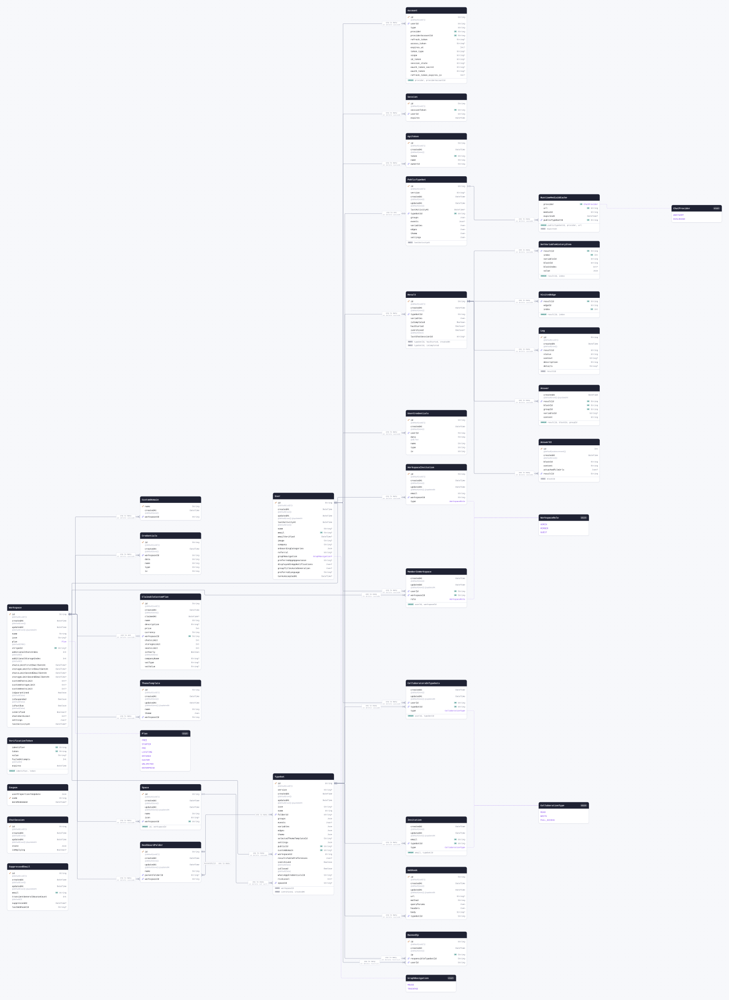

<details>
<summary>The whole schema as SQL</summary>

```sql
CREATE SCHEMA IF NOT EXISTS "public";

CREATE TYPE "ChatProvider" AS ENUM ('WHATSAPP', 'DIALOG360');

CREATE TYPE "WorkspaceRole" AS ENUM ('ADMIN', 'MEMBER', 'GUEST');

CREATE TYPE "GraphNavigation" AS ENUM ('MOUSE', 'TRACKPAD');

CREATE TYPE "Plan" AS ENUM ('FREE', 'STARTER', 'PRO', 'LIFETIME', 'OFFERED', 'CUSTOM', 'UNLIMITED', 'ENTERPRISE');

CREATE TYPE "CollaborationType" AS ENUM ('READ', 'WRITE', 'FULL_ACCESS');

CREATE TABLE "Account" (
    "id" TEXT NOT NULL,
    "userId" TEXT NOT NULL,
    "type" TEXT NOT NULL,
    "provider" TEXT NOT NULL,
    "providerAccountId" TEXT NOT NULL,
    "refresh_token" TEXT,
    "access_token" TEXT,
    "expires_at" INTEGER,
    "token_type" TEXT,
    "scope" TEXT,
    "id_token" TEXT,
    "session_state" TEXT,
    "oauth_token_secret" TEXT,
    "oauth_token" TEXT,
    "refresh_token_expires_in" INTEGER,

    CONSTRAINT "Account_pkey" PRIMARY KEY ("id")
);

CREATE TABLE "Session" (
    "id" TEXT NOT NULL,
    "sessionToken" TEXT NOT NULL,
    "userId" TEXT NOT NULL,
    "expires" TIMESTAMP(3) NOT NULL,

    CONSTRAINT "Session_pkey" PRIMARY KEY ("id")
);

CREATE TABLE "User" (
    "id" TEXT NOT NULL,
    "createdAt" TIMESTAMP(3) NOT NULL DEFAULT CURRENT_TIMESTAMP,
    "updatedAt" TIMESTAMP(3) NOT NULL DEFAULT CURRENT_TIMESTAMP,
    "lastActivityAt" TIMESTAMP(3) NOT NULL DEFAULT CURRENT_TIMESTAMP,
    "name" TEXT,
    "email" TEXT,
    "emailVerified" TIMESTAMP(3),
    "image" TEXT,
    "company" TEXT,
    "onboardingCategories" JSONB NOT NULL,
    "referral" TEXT,
    "graphNavigation" "GraphNavigation",
    "preferredAppAppearance" TEXT,
    "displayedInAppNotifications" JSONB,
    "groupTitlesAutoGeneration" JSONB,
    "preferredLanguage" TEXT,
    "termsAcceptedAt" TIMESTAMP(3),

    CONSTRAINT "User_pkey" PRIMARY KEY ("id")
);

CREATE TABLE "ApiToken" (
    "id" TEXT NOT NULL,
    "createdAt" TIMESTAMP(3) NOT NULL DEFAULT CURRENT_TIMESTAMP,
    "token" TEXT NOT NULL,
    "name" TEXT NOT NULL,
    "ownerId" TEXT NOT NULL,

    CONSTRAINT "ApiToken_pkey" PRIMARY KEY ("id")
);

CREATE TABLE "Workspace" (
    "id" TEXT NOT NULL,
    "createdAt" TIMESTAMP(3) NOT NULL DEFAULT CURRENT_TIMESTAMP,
    "updatedAt" TIMESTAMP(3) NOT NULL DEFAULT CURRENT_TIMESTAMP,
    "name" TEXT NOT NULL,
    "icon" TEXT,
    "plan" "Plan" NOT NULL DEFAULT 'FREE',
    "stripeId" TEXT,
    "additionalChatsIndex" INTEGER NOT NULL DEFAULT 0,
    "additionalStorageIndex" INTEGER NOT NULL DEFAULT 0,
    "chatsLimitFirstEmailSentAt" TIMESTAMP(3),
    "storageLimitFirstEmailSentAt" TIMESTAMP(3),
    "chatsLimitSecondEmailSentAt" TIMESTAMP(3),
    "storageLimitSecondEmailSentAt" TIMESTAMP(3),
    "customChatsLimit" INTEGER,
    "customStorageLimit" INTEGER,
    "customSeatsLimit" INTEGER,
    "isQuarantined" BOOLEAN NOT NULL DEFAULT false,
    "isSuspended" BOOLEAN NOT NULL DEFAULT false,
    "isPastDue" BOOLEAN NOT NULL DEFAULT false,
    "isVerified" BOOLEAN,
    "chatsHardLimit" INTEGER,
    "settings" JSONB,
    "lastActivityAt" TIMESTAMP(3),

    CONSTRAINT "Workspace_pkey" PRIMARY KEY ("id")
);

CREATE TABLE "Space" (
    "id" TEXT NOT NULL,
    "createdAt" TIMESTAMP(3) NOT NULL DEFAULT CURRENT_TIMESTAMP,
    "updatedAt" TIMESTAMP(3) NOT NULL DEFAULT CURRENT_TIMESTAMP,
    "name" TEXT NOT NULL,
    "icon" TEXT,
    "workspaceId" TEXT NOT NULL,

    CONSTRAINT "Space_pkey" PRIMARY KEY ("id")
);

CREATE TABLE "MemberInWorkspace" (
    "createdAt" TIMESTAMP(3) NOT NULL DEFAULT CURRENT_TIMESTAMP,
    "updatedAt" TIMESTAMP(3) NOT NULL DEFAULT CURRENT_TIMESTAMP,
    "userId" TEXT NOT NULL,
    "workspaceId" TEXT NOT NULL,
    "role" "WorkspaceRole" NOT NULL
);

CREATE TABLE "WorkspaceInvitation" (
    "id" TEXT NOT NULL,
    "createdAt" TIMESTAMP(3) NOT NULL DEFAULT CURRENT_TIMESTAMP,
    "updatedAt" TIMESTAMP(3) NOT NULL DEFAULT CURRENT_TIMESTAMP,
    "email" TEXT NOT NULL,
    "workspaceId" TEXT NOT NULL,
    "type" "WorkspaceRole" NOT NULL,

    CONSTRAINT "WorkspaceInvitation_pkey" PRIMARY KEY ("id")
);

CREATE TABLE "CustomDomain" (
    "name" TEXT NOT NULL,
    "createdAt" TIMESTAMP(3) NOT NULL DEFAULT CURRENT_TIMESTAMP,
    "workspaceId" TEXT NOT NULL,

    CONSTRAINT "CustomDomain_pkey" PRIMARY KEY ("name")
);

CREATE TABLE "Credentials" (
    "id" TEXT NOT NULL,
    "createdAt" TIMESTAMP(3) NOT NULL DEFAULT CURRENT_TIMESTAMP,
    "workspaceId" TEXT NOT NULL,
    "data" TEXT NOT NULL,
    "name" TEXT NOT NULL,
    "type" TEXT NOT NULL,
    "iv" TEXT NOT NULL,

    CONSTRAINT "Credentials_pkey" PRIMARY KEY ("id")
);

CREATE TABLE "UserCredentials" (
    "id" TEXT NOT NULL,
    "createdAt" TIMESTAMP(3) NOT NULL DEFAULT CURRENT_TIMESTAMP,
    "userId" TEXT NOT NULL,
    "data" TEXT NOT NULL,
    "name" TEXT NOT NULL,
    "type" TEXT NOT NULL,
    "iv" TEXT NOT NULL,

    CONSTRAINT "UserCredentials_pkey" PRIMARY KEY ("id")
);

CREATE TABLE "VerificationToken" (
    "identifier" TEXT NOT NULL,
    "token" TEXT NOT NULL,
    "value" TEXT,
    "failedAttempts" INTEGER NOT NULL DEFAULT 0,
    "expires" TIMESTAMP(3) NOT NULL
);

CREATE TABLE "DashboardFolder" (
    "id" TEXT NOT NULL,
    "createdAt" TIMESTAMP(3) NOT NULL DEFAULT CURRENT_TIMESTAMP,
    "updatedAt" TIMESTAMP(3) NOT NULL DEFAULT CURRENT_TIMESTAMP,
    "name" TEXT NOT NULL,
    "parentFolderId" TEXT,
    "workspaceId" TEXT NOT NULL,

    CONSTRAINT "DashboardFolder_pkey" PRIMARY KEY ("id")
);

CREATE TABLE "Typebot" (
    "id" TEXT NOT NULL,
    "version" TEXT,
    "createdAt" TIMESTAMP(3) NOT NULL DEFAULT CURRENT_TIMESTAMP,
    "updatedAt" TIMESTAMP(3) NOT NULL DEFAULT CURRENT_TIMESTAMP,
    "icon" TEXT,
    "name" TEXT NOT NULL,
    "folderId" TEXT,
    "groups" JSONB NOT NULL,
    "events" JSONB,
    "variables" JSONB NOT NULL,
    "edges" JSONB NOT NULL,
    "theme" JSONB NOT NULL,
    "selectedThemeTemplateId" TEXT,
    "settings" JSONB NOT NULL,
    "publicId" TEXT,
    "customDomain" TEXT,
    "workspaceId" TEXT NOT NULL,
    "resultsTablePreferences" JSONB,
    "isArchived" BOOLEAN NOT NULL DEFAULT false,
    "isClosed" BOOLEAN NOT NULL DEFAULT false,
    "whatsAppCredentialsId" TEXT,
    "riskLevel" INTEGER,
    "spaceId" TEXT,

    CONSTRAINT "Typebot_pkey" PRIMARY KEY ("id")
);

CREATE TABLE "Invitation" (
    "createdAt" TIMESTAMP(3) NOT NULL DEFAULT CURRENT_TIMESTAMP,
    "updatedAt" TIMESTAMP(3) NOT NULL DEFAULT CURRENT_TIMESTAMP,
    "email" TEXT NOT NULL,
    "typebotId" TEXT NOT NULL,
    "type" "CollaborationType" NOT NULL
);

CREATE TABLE "CollaboratorsOnTypebots" (
    "createdAt" TIMESTAMP(3) NOT NULL DEFAULT CURRENT_TIMESTAMP,
    "updatedAt" TIMESTAMP(3) NOT NULL DEFAULT CURRENT_TIMESTAMP,
    "userId" TEXT NOT NULL,
    "typebotId" TEXT NOT NULL,
    "type" "CollaborationType" NOT NULL
);

CREATE TABLE "PublicTypebot" (
    "id" TEXT NOT NULL,
    "version" TEXT,
    "createdAt" TIMESTAMP(3) NOT NULL DEFAULT CURRENT_TIMESTAMP,
    "updatedAt" TIMESTAMP(3) NOT NULL DEFAULT CURRENT_TIMESTAMP,
    "lastActivityAt" TIMESTAMP(3),
    "typebotId" TEXT NOT NULL,
    "groups" JSONB NOT NULL,
    "events" JSONB,
    "variables" JSONB NOT NULL,
    "edges" JSONB NOT NULL,
    "theme" JSONB NOT NULL,
    "settings" JSONB NOT NULL,

    CONSTRAINT "PublicTypebot_pkey" PRIMARY KEY ("id")
);

CREATE TABLE "RuntimeMediaIdCache" (
    "provider" "ChatProvider" NOT NULL,
    "url" TEXT NOT NULL,
    "mediaId" TEXT NOT NULL,
    "expiresAt" TIMESTAMP(3),
    "publicTypebotId" TEXT NOT NULL
);

CREATE TABLE "Result" (
    "id" TEXT NOT NULL,
    "createdAt" TIMESTAMP(3) NOT NULL DEFAULT CURRENT_TIMESTAMP,
    "typebotId" TEXT NOT NULL,
    "variables" JSONB NOT NULL,
    "isCompleted" BOOLEAN NOT NULL,
    "hasStarted" BOOLEAN,
    "isArchived" BOOLEAN DEFAULT false,
    "lastChatSessionId" TEXT,

    CONSTRAINT "Result_pkey" PRIMARY KEY ("id")
);

CREATE TABLE "SetVariableHistoryItem" (
    "resultId" TEXT NOT NULL,
    "index" INTEGER NOT NULL,
    "variableId" TEXT NOT NULL,
    "blockId" TEXT NOT NULL,
    "blockIndex" INTEGER,
    "value" JSONB NOT NULL
);

CREATE TABLE "VisitedEdge" (
    "resultId" TEXT NOT NULL,
    "edgeId" TEXT NOT NULL,
    "index" INTEGER NOT NULL
);

CREATE TABLE "Log" (
    "id" TEXT NOT NULL,
    "createdAt" TIMESTAMP(3) NOT NULL DEFAULT CURRENT_TIMESTAMP,
    "resultId" TEXT NOT NULL,
    "status" TEXT NOT NULL,
    "context" TEXT,
    "description" TEXT NOT NULL,
    "details" TEXT,

    CONSTRAINT "Log_pkey" PRIMARY KEY ("id")
);

CREATE TABLE "Answer" (
    "createdAt" TIMESTAMP(3) NOT NULL DEFAULT CURRENT_TIMESTAMP,
    "resultId" TEXT NOT NULL,
    "blockId" TEXT NOT NULL,
    "groupId" TEXT NOT NULL,
    "variableId" TEXT,
    "content" TEXT NOT NULL
);

CREATE TABLE "AnswerV2" (
    "id" SERIAL NOT NULL,
    "createdAt" TIMESTAMP(3) NOT NULL DEFAULT CURRENT_TIMESTAMP,
    "blockId" TEXT NOT NULL,
    "content" TEXT NOT NULL,
    "attachedFileUrls" JSONB,
    "resultId" TEXT NOT NULL,

    CONSTRAINT "AnswerV2_pkey" PRIMARY KEY ("id")
);

CREATE TABLE "Coupon" (
    "userPropertiesToUpdate" JSONB NOT NULL,
    "code" TEXT NOT NULL,
    "dateRedeemed" TIMESTAMP(3),

    CONSTRAINT "Coupon_pkey" PRIMARY KEY ("code")
);

CREATE TABLE "Webhook" (
    "id" TEXT NOT NULL,
    "createdAt" TIMESTAMP(3) NOT NULL DEFAULT CURRENT_TIMESTAMP,
    "updatedAt" TIMESTAMP(3) NOT NULL DEFAULT CURRENT_TIMESTAMP,
    "url" TEXT,
    "method" TEXT NOT NULL,
    "queryParams" JSONB NOT NULL,
    "headers" JSONB NOT NULL,
    "body" TEXT,
    "typebotId" TEXT NOT NULL,

    CONSTRAINT "Webhook_pkey" PRIMARY KEY ("id")
);

CREATE TABLE "ClaimableCustomPlan" (
    "id" TEXT NOT NULL,
    "createdAt" TIMESTAMP(3) NOT NULL DEFAULT CURRENT_TIMESTAMP,
    "claimedAt" TIMESTAMP(3),
    "name" TEXT NOT NULL,
    "description" TEXT,
    "price" INTEGER NOT NULL,
    "currency" TEXT NOT NULL,
    "workspaceId" TEXT NOT NULL,
    "chatsLimit" INTEGER NOT NULL,
    "storageLimit" INTEGER NOT NULL,
    "seatsLimit" INTEGER NOT NULL,
    "isYearly" BOOLEAN NOT NULL DEFAULT false,
    "companyName" TEXT,
    "vatType" TEXT,
    "vatValue" TEXT,

    CONSTRAINT "ClaimableCustomPlan_pkey" PRIMARY KEY ("id")
);

CREATE TABLE "ChatSession" (
    "id" TEXT NOT NULL,
    "createdAt" TIMESTAMP(3) NOT NULL DEFAULT CURRENT_TIMESTAMP,
    "updatedAt" TIMESTAMP(3) NOT NULL DEFAULT CURRENT_TIMESTAMP,
    "state" JSONB NOT NULL,
    "isReplying" BOOLEAN,

    CONSTRAINT "ChatSession_pkey" PRIMARY KEY ("id")
);

CREATE TABLE "ThemeTemplate" (
    "id" TEXT NOT NULL,
    "createdAt" TIMESTAMP(3) NOT NULL DEFAULT CURRENT_TIMESTAMP,
    "updatedAt" TIMESTAMP(3) NOT NULL DEFAULT CURRENT_TIMESTAMP,
    "name" TEXT NOT NULL,
    "theme" JSONB NOT NULL,
    "workspaceId" TEXT NOT NULL,

    CONSTRAINT "ThemeTemplate_pkey" PRIMARY KEY ("id")
);

CREATE TABLE "BannedIp" (
    "id" TEXT NOT NULL,
    "createdAt" TIMESTAMP(3) NOT NULL DEFAULT CURRENT_TIMESTAMP,
    "ip" TEXT NOT NULL,
    "responsibleTypebotId" TEXT NOT NULL,
    "userId" TEXT NOT NULL,

    CONSTRAINT "BannedIp_pkey" PRIMARY KEY ("id")
);

CREATE TABLE "SuppressedEmail" (
    "id" TEXT NOT NULL,
    "createdAt" TIMESTAMP(3) NOT NULL DEFAULT CURRENT_TIMESTAMP,
    "updatedAt" TIMESTAMP(3) NOT NULL DEFAULT CURRENT_TIMESTAMP,
    "email" TEXT NOT NULL,
    "transientGeneralBounceCount" INTEGER NOT NULL DEFAULT 0,
    "suppressedAt" TIMESTAMP(3),
    "lastWebhookId" TEXT,

    CONSTRAINT "SuppressedEmail_pkey" PRIMARY KEY ("id")
);

CREATE UNIQUE INDEX "Account_provider_providerAccountId_key" ON "Account"("provider", "providerAccountId");

CREATE UNIQUE INDEX "Session_sessionToken_key" ON "Session"("sessionToken");

CREATE UNIQUE INDEX "User_email_key" ON "User"("email");

CREATE UNIQUE INDEX "ApiToken_token_key" ON "ApiToken"("token");

CREATE UNIQUE INDEX "Workspace_stripeId_key" ON "Workspace"("stripeId");

CREATE UNIQUE INDEX "Space_id_workspaceId_key" ON "Space"("id", "workspaceId");

CREATE UNIQUE INDEX "MemberInWorkspace_userId_workspaceId_key" ON "MemberInWorkspace"("userId", "workspaceId");

CREATE UNIQUE INDEX "VerificationToken_token_key" ON "VerificationToken"("token");

CREATE UNIQUE INDEX "VerificationToken_identifier_token_key" ON "VerificationToken"("identifier", "token");

CREATE UNIQUE INDEX "Typebot_publicId_key" ON "Typebot"("publicId");

CREATE UNIQUE INDEX "Typebot_customDomain_key" ON "Typebot"("customDomain");

CREATE INDEX "Typebot_workspaceId_idx" ON "Typebot"("workspaceId");

CREATE INDEX "Typebot_isArchived_createdAt_idx" ON "Typebot"("isArchived", "createdAt" DESC);

CREATE UNIQUE INDEX "Invitation_email_typebotId_key" ON "Invitation"("email", "typebotId");

CREATE UNIQUE INDEX "CollaboratorsOnTypebots_userId_typebotId_key" ON "CollaboratorsOnTypebots"("userId", "typebotId");

CREATE UNIQUE INDEX "PublicTypebot_typebotId_key" ON "PublicTypebot"("typebotId");

CREATE INDEX "PublicTypebot_lastActivityAt_idx" ON "PublicTypebot"("lastActivityAt");

CREATE INDEX "RuntimeMediaIdCache_expiresAt_idx" ON "RuntimeMediaIdCache"("expiresAt");

CREATE UNIQUE INDEX "RuntimeMediaIdCache_publicTypebotId_provider_url_key" ON "RuntimeMediaIdCache"("publicTypebotId", "provider", "url");

CREATE INDEX "Result_typebotId_hasStarted_createdAt_idx" ON "Result"("typebotId", "hasStarted", "createdAt" DESC);

CREATE INDEX "Result_typebotId_isCompleted_idx" ON "Result"("typebotId", "isCompleted");

CREATE UNIQUE INDEX "SetVariableHistoryItem_resultId_index_key" ON "SetVariableHistoryItem"("resultId", "index");

CREATE UNIQUE INDEX "VisitedEdge_resultId_index_key" ON "VisitedEdge"("resultId", "index");

CREATE INDEX "Log_resultId_idx" ON "Log"("resultId");

CREATE UNIQUE INDEX "Answer_resultId_blockId_groupId_key" ON "Answer"("resultId", "blockId", "groupId");

CREATE INDEX "AnswerV2_blockId_idx" ON "AnswerV2"("blockId");

CREATE UNIQUE INDEX "Coupon_code_key" ON "Coupon"("code");

CREATE UNIQUE INDEX "ClaimableCustomPlan_workspaceId_key" ON "ClaimableCustomPlan"("workspaceId");

CREATE UNIQUE INDEX "BannedIp_ip_key" ON "BannedIp"("ip");

CREATE UNIQUE INDEX "SuppressedEmail_email_key" ON "SuppressedEmail"("email");

ALTER TABLE "Account" ADD CONSTRAINT "Account_userId_fkey" FOREIGN KEY ("userId") REFERENCES "User"("id") ON DELETE CASCADE ON UPDATE CASCADE;

ALTER TABLE "Session" ADD CONSTRAINT "Session_userId_fkey" FOREIGN KEY ("userId") REFERENCES "User"("id") ON DELETE CASCADE ON UPDATE CASCADE;

ALTER TABLE "ApiToken" ADD CONSTRAINT "ApiToken_ownerId_fkey" FOREIGN KEY ("ownerId") REFERENCES "User"("id") ON DELETE CASCADE ON UPDATE CASCADE;

ALTER TABLE "Space" ADD CONSTRAINT "Space_workspaceId_fkey" FOREIGN KEY ("workspaceId") REFERENCES "Workspace"("id") ON DELETE CASCADE ON UPDATE CASCADE;

ALTER TABLE "MemberInWorkspace" ADD CONSTRAINT "MemberInWorkspace_userId_fkey" FOREIGN KEY ("userId") REFERENCES "User"("id") ON DELETE CASCADE ON UPDATE CASCADE;

ALTER TABLE "MemberInWorkspace" ADD CONSTRAINT "MemberInWorkspace_workspaceId_fkey" FOREIGN KEY ("workspaceId") REFERENCES "Workspace"("id") ON DELETE CASCADE ON UPDATE CASCADE;

ALTER TABLE "WorkspaceInvitation" ADD CONSTRAINT "WorkspaceInvitation_workspaceId_fkey" FOREIGN KEY ("workspaceId") REFERENCES "Workspace"("id") ON DELETE CASCADE ON UPDATE CASCADE;

ALTER TABLE "CustomDomain" ADD CONSTRAINT "CustomDomain_workspaceId_fkey" FOREIGN KEY ("workspaceId") REFERENCES "Workspace"("id") ON DELETE CASCADE ON UPDATE CASCADE;

ALTER TABLE "Credentials" ADD CONSTRAINT "Credentials_workspaceId_fkey" FOREIGN KEY ("workspaceId") REFERENCES "Workspace"("id") ON DELETE CASCADE ON UPDATE CASCADE;

ALTER TABLE "UserCredentials" ADD CONSTRAINT "UserCredentials_userId_fkey" FOREIGN KEY ("userId") REFERENCES "User"("id") ON DELETE CASCADE ON UPDATE CASCADE;

ALTER TABLE "DashboardFolder" ADD CONSTRAINT "DashboardFolder_parentFolderId_fkey" FOREIGN KEY ("parentFolderId") REFERENCES "DashboardFolder"("id") ON DELETE SET NULL ON UPDATE CASCADE;

ALTER TABLE "DashboardFolder" ADD CONSTRAINT "DashboardFolder_workspaceId_fkey" FOREIGN KEY ("workspaceId") REFERENCES "Workspace"("id") ON DELETE CASCADE ON UPDATE CASCADE;

ALTER TABLE "Typebot" ADD CONSTRAINT "Typebot_folderId_fkey" FOREIGN KEY ("folderId") REFERENCES "DashboardFolder"("id") ON DELETE SET NULL ON UPDATE CASCADE;

ALTER TABLE "Typebot" ADD CONSTRAINT "Typebot_workspaceId_fkey" FOREIGN KEY ("workspaceId") REFERENCES "Workspace"("id") ON DELETE CASCADE ON UPDATE CASCADE;

ALTER TABLE "Typebot" ADD CONSTRAINT "Typebot_spaceId_fkey" FOREIGN KEY ("spaceId") REFERENCES "Space"("id") ON DELETE SET NULL ON UPDATE CASCADE;

ALTER TABLE "Invitation" ADD CONSTRAINT "Invitation_typebotId_fkey" FOREIGN KEY ("typebotId") REFERENCES "Typebot"("id") ON DELETE CASCADE ON UPDATE CASCADE;

ALTER TABLE "CollaboratorsOnTypebots" ADD CONSTRAINT "CollaboratorsOnTypebots_typebotId_fkey" FOREIGN KEY ("typebotId") REFERENCES "Typebot"("id") ON DELETE CASCADE ON UPDATE CASCADE;

ALTER TABLE "CollaboratorsOnTypebots" ADD CONSTRAINT "CollaboratorsOnTypebots_userId_fkey" FOREIGN KEY ("userId") REFERENCES "User"("id") ON DELETE CASCADE ON UPDATE CASCADE;

ALTER TABLE "PublicTypebot" ADD CONSTRAINT "PublicTypebot_typebotId_fkey" FOREIGN KEY ("typebotId") REFERENCES "Typebot"("id") ON DELETE CASCADE ON UPDATE CASCADE;

ALTER TABLE "RuntimeMediaIdCache" ADD CONSTRAINT "RuntimeMediaIdCache_publicTypebotId_fkey" FOREIGN KEY ("publicTypebotId") REFERENCES "PublicTypebot"("id") ON DELETE CASCADE ON UPDATE CASCADE;

ALTER TABLE "Result" ADD CONSTRAINT "Result_typebotId_fkey" FOREIGN KEY ("typebotId") REFERENCES "Typebot"("id") ON DELETE CASCADE ON UPDATE CASCADE;

ALTER TABLE "SetVariableHistoryItem" ADD CONSTRAINT "SetVariableHistoryItem_resultId_fkey" FOREIGN KEY ("resultId") REFERENCES "Result"("id") ON DELETE CASCADE ON UPDATE CASCADE;

ALTER TABLE "VisitedEdge" ADD CONSTRAINT "VisitedEdge_resultId_fkey" FOREIGN KEY ("resultId") REFERENCES "Result"("id") ON DELETE CASCADE ON UPDATE CASCADE;

ALTER TABLE "Log" ADD CONSTRAINT "Log_resultId_fkey" FOREIGN KEY ("resultId") REFERENCES "Result"("id") ON DELETE CASCADE ON UPDATE CASCADE;

ALTER TABLE "Answer" ADD CONSTRAINT "Answer_resultId_fkey" FOREIGN KEY ("resultId") REFERENCES "Result"("id") ON DELETE CASCADE ON UPDATE CASCADE;

ALTER TABLE "AnswerV2" ADD CONSTRAINT "AnswerV2_resultId_fkey" FOREIGN KEY ("resultId") REFERENCES "Result"("id") ON DELETE CASCADE ON UPDATE CASCADE;

ALTER TABLE "Webhook" ADD CONSTRAINT "Webhook_typebotId_fkey" FOREIGN KEY ("typebotId") REFERENCES "Typebot"("id") ON DELETE CASCADE ON UPDATE CASCADE;

ALTER TABLE "ClaimableCustomPlan" ADD CONSTRAINT "ClaimableCustomPlan_workspaceId_fkey" FOREIGN KEY ("workspaceId") REFERENCES "Workspace"("id") ON DELETE CASCADE ON UPDATE CASCADE;

ALTER TABLE "ThemeTemplate" ADD CONSTRAINT "ThemeTemplate_workspaceId_fkey" FOREIGN KEY ("workspaceId") REFERENCES "Workspace"("id") ON DELETE CASCADE ON UPDATE CASCADE;

ALTER TABLE "BannedIp" ADD CONSTRAINT "BannedIp_responsibleTypebotId_fkey" FOREIGN KEY ("responsibleTypebotId") REFERENCES "Typebot"("id") ON DELETE RESTRICT ON UPDATE CASCADE;

ALTER TABLE "BannedIp" ADD CONSTRAINT "BannedIp_userId_fkey" FOREIGN KEY ("userId") REFERENCES "User"("id") ON DELETE RESTRICT ON UPDATE CASCADE;
```

</details>

## Contents

| Model                                                     | Table                     | Description |
| --------------------------------------------------------- | ------------------------- | ----------- |
| [Account](#model-Account)                                 | `Account`                 |             |
| [Session](#model-Session)                                 | `Session`                 |             |
| [User](#model-User)                                       | `User`                    |             |
| [ApiToken](#model-ApiToken)                               | `ApiToken`                |             |
| [Workspace](#model-Workspace)                             | `Workspace`               |             |
| [Space](#model-Space)                                     | `Space`                   |             |
| [MemberInWorkspace](#model-MemberInWorkspace)             | `MemberInWorkspace`       |             |
| [WorkspaceInvitation](#model-WorkspaceInvitation)         | `WorkspaceInvitation`     |             |
| [CustomDomain](#model-CustomDomain)                       | `CustomDomain`            |             |
| [Credentials](#model-Credentials)                         | `Credentials`             |             |
| [UserCredentials](#model-UserCredentials)                 | `UserCredentials`         |             |
| [VerificationToken](#model-VerificationToken)             | `VerificationToken`       |             |
| [DashboardFolder](#model-DashboardFolder)                 | `DashboardFolder`         |             |
| [Typebot](#model-Typebot)                                 | `Typebot`                 |             |
| [Invitation](#model-Invitation)                           | `Invitation`              |             |
| [CollaboratorsOnTypebots](#model-CollaboratorsOnTypebots) | `CollaboratorsOnTypebots` |             |
| [PublicTypebot](#model-PublicTypebot)                     | `PublicTypebot`           |             |
| [RuntimeMediaIdCache](#model-RuntimeMediaIdCache)         | `RuntimeMediaIdCache`     |             |
| [Result](#model-Result)                                   | `Result`                  |             |
| [SetVariableHistoryItem](#model-SetVariableHistoryItem)   | `SetVariableHistoryItem`  |             |
| [VisitedEdge](#model-VisitedEdge)                         | `VisitedEdge`             |             |
| [Log](#model-Log)                                         | `Log`                     |             |
| [Answer](#model-Answer)                                   | `Answer`                  |             |
| [AnswerV2](#model-AnswerV2)                               | `AnswerV2`                |             |
| [Coupon](#model-Coupon)                                   | `Coupon`                  |             |
| [Webhook](#model-Webhook)                                 | `Webhook`                 |             |
| [ClaimableCustomPlan](#model-ClaimableCustomPlan)         | `ClaimableCustomPlan`     |             |
| [ChatSession](#model-ChatSession)                         | `ChatSession`             |             |
| [ThemeTemplate](#model-ThemeTemplate)                     | `ThemeTemplate`           |             |
| [BannedIp](#model-BannedIp)                               | `BannedIp`                |             |
| [SuppressedEmail](#model-SuppressedEmail)                 | `SuppressedEmail`         |             |

| Enum                                         | Name in the database | Description |
| -------------------------------------------- | -------------------- | ----------- |
| [ChatProvider](#enum-ChatProvider)           | `ChatProvider`       |             |
| [WorkspaceRole](#enum-WorkspaceRole)         | `WorkspaceRole`      |             |
| [GraphNavigation](#enum-GraphNavigation)     | `GraphNavigation`    |             |
| [Plan](#enum-Plan)                           | `Plan`               |             |
| [CollaborationType](#enum-CollaborationType) | `CollaborationType`  |             |

## Models

<a id="model-Account"></a>

### Account

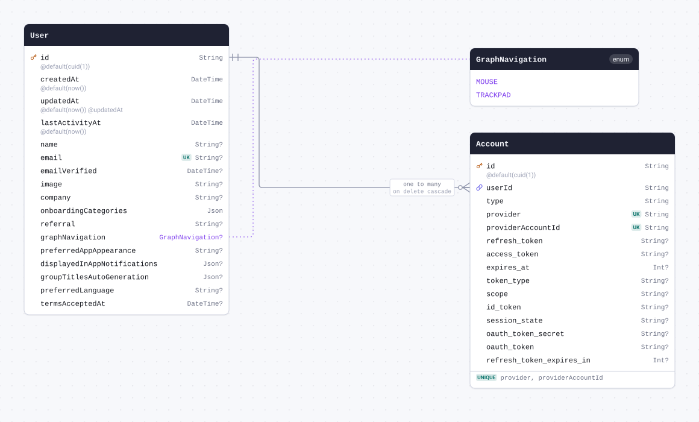

| Field                      | Type     | Constraints                       | Default   | Description |
| -------------------------- | -------- | --------------------------------- | --------- | ----------- |
| `id`                       | `String` | PK NOT NULL                       | `cuid(1)` |             |
| `userId`                   | `String` | NOT NULL → [User.id](#model-User) |           |             |
| `type`                     | `String` | NOT NULL                          |           |             |
| `provider`                 | `String` | NOT NULL                          |           |             |
| `providerAccountId`        | `String` | NOT NULL                          |           |             |
| `refresh_token`            | `String` | NULL                              |           |             |
| `access_token`             | `String` | NULL                              |           |             |
| `expires_at`               | `Int`    | NULL                              |           |             |
| `token_type`               | `String` | NULL                              |           |             |
| `scope`                    | `String` | NULL                              |           |             |
| `id_token`                 | `String` | NULL                              |           |             |
| `session_state`            | `String` | NULL                              |           |             |
| `oauth_token_secret`       | `String` | NULL                              |           |             |
| `oauth_token`              | `String` | NULL                              |           |             |
| `refresh_token_expires_in` | `Int`    | NULL                              |           |             |

#### Indexes

- `@@unique([provider, providerAccountId])`

#### References

- `userId` → [User.id](#model-User) (many-to-one, on delete Cascade)

#### Definition

```sql
CREATE TABLE "Account" (
    "id" TEXT NOT NULL,
    "userId" TEXT NOT NULL,
    "type" TEXT NOT NULL,
    "provider" TEXT NOT NULL,
    "providerAccountId" TEXT NOT NULL,
    "refresh_token" TEXT,
    "access_token" TEXT,
    "expires_at" INTEGER,
    "token_type" TEXT,
    "scope" TEXT,
    "id_token" TEXT,
    "session_state" TEXT,
    "oauth_token_secret" TEXT,
    "oauth_token" TEXT,
    "refresh_token_expires_in" INTEGER,

    CONSTRAINT "Account_pkey" PRIMARY KEY ("id")
);

CREATE UNIQUE INDEX "Account_provider_providerAccountId_key" ON "Account"("provider", "providerAccountId");

ALTER TABLE "Account" ADD CONSTRAINT "Account_userId_fkey" FOREIGN KEY ("userId") REFERENCES "User"("id") ON DELETE CASCADE ON UPDATE CASCADE;
```

<details>
<summary>Queries and their SQL</summary>

**findMany**: Every row

```ts
await prisma.account.findMany();
```

```sql
SELECT
  "public"."Account"."id",
  "public"."Account"."userId",
  "public"."Account"."type",
  "public"."Account"."provider",
  "public"."Account"."providerAccountId",
  "public"."Account"."refresh_token",
  "public"."Account"."access_token",
  "public"."Account"."expires_at",
  "public"."Account"."token_type",
  "public"."Account"."scope",
  "public"."Account"."id_token",
  "public"."Account"."session_state",
  "public"."Account"."oauth_token_secret",
  "public"."Account"."oauth_token",
  "public"."Account"."refresh_token_expires_in"
FROM
  "public"."Account"
WHERE
  1 = 1
OFFSET
  $1
-- params: ["0"]
```

**count**: How many rows there are

```ts
await prisma.account.count();
```

```sql
SELECT
  COUNT(*) AS "_count$_all"
FROM
  (
    SELECT
      "public"."Account"."id"
    FROM
      "public"."Account"
    WHERE
      1 = 1
    OFFSET
      $1
  ) AS "sub"
-- params: ["0"]
```

**findMany**: Every row with its relations

```ts
await prisma.account.findMany({ include: { user: true } });
```

```sql
SELECT
  "public"."Account"."id",
  "public"."Account"."userId",
  "public"."Account"."type",
  "public"."Account"."provider",
  "public"."Account"."providerAccountId",
  "public"."Account"."refresh_token",
  "public"."Account"."access_token",
  "public"."Account"."expires_at",
  "public"."Account"."token_type",
  "public"."Account"."scope",
  "public"."Account"."id_token",
  "public"."Account"."session_state",
  "public"."Account"."oauth_token_secret",
  "public"."Account"."oauth_token",
  "public"."Account"."refresh_token_expires_in"
FROM
  "public"."Account"
WHERE
  1 = 1
OFFSET
  $1
-- params: ["0"]

SELECT
  "public"."User"."id",
  "public"."User"."createdAt",
  "public"."User"."updatedAt",
  "public"."User"."lastActivityAt",
  "public"."User"."name",
  "public"."User"."email",
  "public"."User"."emailVerified",
  "public"."User"."image",
  "public"."User"."company",
  "public"."User"."onboardingCategories",
  "public"."User"."referral",
  "public"."User"."graphNavigation"::text,
  "public"."User"."preferredAppAppearance",
  "public"."User"."displayedInAppNotifications",
  "public"."User"."groupTitlesAutoGeneration",
  "public"."User"."preferredLanguage",
  "public"."User"."termsAcceptedAt"
FROM
  "public"."User"
WHERE
  "public"."User"."id" IN ($1)
OFFSET
  $2
-- params: ["<userId of the rows above>","0"]
```

**findUnique**: One row by what is unique to it

```ts
await prisma.account.findUnique({ where: { id: "example" } });
```

```sql
SELECT
  "public"."Account"."id",
  "public"."Account"."userId",
  "public"."Account"."type",
  "public"."Account"."provider",
  "public"."Account"."providerAccountId",
  "public"."Account"."refresh_token",
  "public"."Account"."access_token",
  "public"."Account"."expires_at",
  "public"."Account"."token_type",
  "public"."Account"."scope",
  "public"."Account"."id_token",
  "public"."Account"."session_state",
  "public"."Account"."oauth_token_secret",
  "public"."Account"."oauth_token",
  "public"."Account"."refresh_token_expires_in"
FROM
  "public"."Account"
WHERE
  (
    "public"."Account"."id" = $1
    AND 1 = 1
  )
LIMIT
  $2
OFFSET
  $3
-- params: ["example","1","0"]
```

**create**: Create a row

```ts
await prisma.account.create({
  data: { userId: "example", type: "example", provider: "example", providerAccountId: "example" },
});
```

```sql
INSERT INTO
  "public"."Account" (
    "id",
    "userId",
    "type",
    "provider",
    "providerAccountId"
  )
VALUES
  ($1, $2, $3, $4, $5)
RETURNING
  "public"."Account"."id",
  "public"."Account"."userId",
  "public"."Account"."type",
  "public"."Account"."provider",
  "public"."Account"."providerAccountId",
  "public"."Account"."refresh_token",
  "public"."Account"."access_token",
  "public"."Account"."expires_at",
  "public"."Account"."token_type",
  "public"."Account"."scope",
  "public"."Account"."id_token",
  "public"."Account"."session_state",
  "public"."Account"."oauth_token_secret",
  "public"."Account"."oauth_token",
  "public"."Account"."refresh_token_expires_in"
-- params: ["<cuid(1)>","example","example","example","example"]
```

**update**: Update a row

```ts
await prisma.account.update({ where: { id: "example" }, data: { type: "example" } });
```

```sql
UPDATE "public"."Account"
SET
  "type" = $1
WHERE
  (
    "public"."Account"."id" = $2
    AND 1 = 1
  )
RETURNING
  "public"."Account"."id",
  "public"."Account"."userId",
  "public"."Account"."type",
  "public"."Account"."provider",
  "public"."Account"."providerAccountId",
  "public"."Account"."refresh_token",
  "public"."Account"."access_token",
  "public"."Account"."expires_at",
  "public"."Account"."token_type",
  "public"."Account"."scope",
  "public"."Account"."id_token",
  "public"."Account"."session_state",
  "public"."Account"."oauth_token_secret",
  "public"."Account"."oauth_token",
  "public"."Account"."refresh_token_expires_in"
-- params: ["example","example"]
```

**delete**: Delete a row

```ts
await prisma.account.delete({ where: { id: "example" } });
```

```sql
DELETE FROM "public"."Account"
WHERE
  (
    "public"."Account"."id" = $1
    AND 1 = 1
  )
RETURNING
  "public"."Account"."id",
  "public"."Account"."userId",
  "public"."Account"."type",
  "public"."Account"."provider",
  "public"."Account"."providerAccountId",
  "public"."Account"."refresh_token",
  "public"."Account"."access_token",
  "public"."Account"."expires_at",
  "public"."Account"."token_type",
  "public"."Account"."scope",
  "public"."Account"."id_token",
  "public"."Account"."session_state",
  "public"."Account"."oauth_token_secret",
  "public"."Account"."oauth_token",
  "public"."Account"."refresh_token_expires_in"
-- params: ["example"]
```

</details>

<a id="model-Session"></a>

### Session

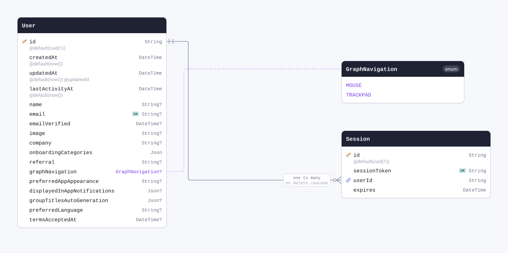

| Field          | Type       | Constraints                       | Default   | Description |
| -------------- | ---------- | --------------------------------- | --------- | ----------- |
| `id`           | `String`   | PK NOT NULL                       | `cuid(1)` |             |
| `sessionToken` | `String`   | UNIQUE NOT NULL                   |           |             |
| `userId`       | `String`   | NOT NULL → [User.id](#model-User) |           |             |
| `expires`      | `DateTime` | NOT NULL                          |           |             |

#### References

- `userId` → [User.id](#model-User) (many-to-one, on delete Cascade)

#### Definition

```sql
CREATE TABLE "Session" (
    "id" TEXT NOT NULL,
    "sessionToken" TEXT NOT NULL,
    "userId" TEXT NOT NULL,
    "expires" TIMESTAMP(3) NOT NULL,

    CONSTRAINT "Session_pkey" PRIMARY KEY ("id")
);

CREATE UNIQUE INDEX "Session_sessionToken_key" ON "Session"("sessionToken");

ALTER TABLE "Session" ADD CONSTRAINT "Session_userId_fkey" FOREIGN KEY ("userId") REFERENCES "User"("id") ON DELETE CASCADE ON UPDATE CASCADE;
```

<details>
<summary>Queries and their SQL</summary>

**findMany**: Every row

```ts
await prisma.session.findMany();
```

```sql
SELECT
  "public"."Session"."id",
  "public"."Session"."sessionToken",
  "public"."Session"."userId",
  "public"."Session"."expires"
FROM
  "public"."Session"
WHERE
  1 = 1
OFFSET
  $1
-- params: ["0"]
```

**count**: How many rows there are

```ts
await prisma.session.count();
```

```sql
SELECT
  COUNT(*) AS "_count$_all"
FROM
  (
    SELECT
      "public"."Session"."id"
    FROM
      "public"."Session"
    WHERE
      1 = 1
    OFFSET
      $1
  ) AS "sub"
-- params: ["0"]
```

**findMany**: Every row with its relations

```ts
await prisma.session.findMany({ include: { user: true } });
```

```sql
SELECT
  "public"."Session"."id",
  "public"."Session"."sessionToken",
  "public"."Session"."userId",
  "public"."Session"."expires"
FROM
  "public"."Session"
WHERE
  1 = 1
OFFSET
  $1
-- params: ["0"]

SELECT
  "public"."User"."id",
  "public"."User"."createdAt",
  "public"."User"."updatedAt",
  "public"."User"."lastActivityAt",
  "public"."User"."name",
  "public"."User"."email",
  "public"."User"."emailVerified",
  "public"."User"."image",
  "public"."User"."company",
  "public"."User"."onboardingCategories",
  "public"."User"."referral",
  "public"."User"."graphNavigation"::text,
  "public"."User"."preferredAppAppearance",
  "public"."User"."displayedInAppNotifications",
  "public"."User"."groupTitlesAutoGeneration",
  "public"."User"."preferredLanguage",
  "public"."User"."termsAcceptedAt"
FROM
  "public"."User"
WHERE
  "public"."User"."id" IN ($1)
OFFSET
  $2
-- params: ["<userId of the rows above>","0"]
```

**findUnique**: One row by what is unique to it

```ts
await prisma.session.findUnique({ where: { id: "example" } });
```

```sql
SELECT
  "public"."Session"."id",
  "public"."Session"."sessionToken",
  "public"."Session"."userId",
  "public"."Session"."expires"
FROM
  "public"."Session"
WHERE
  (
    "public"."Session"."id" = $1
    AND 1 = 1
  )
LIMIT
  $2
OFFSET
  $3
-- params: ["example","1","0"]
```

**create**: Create a row

```ts
await prisma.session.create({
  data: {
    sessionToken: "example",
    userId: "example",
    expires: new Date("2026-01-01T00:00:00.000Z"),
  },
});
```

```sql
INSERT INTO
  "public"."Session" ("id", "sessionToken", "userId", "expires")
VALUES
  ($1, $2, $3, $4)
RETURNING
  "public"."Session"."id",
  "public"."Session"."sessionToken",
  "public"."Session"."userId",
  "public"."Session"."expires"
-- params: ["<cuid(1)>","example","example","2026-01-01T00:00:00.000Z"]
```

**update**: Update a row

```ts
await prisma.session.update({ where: { id: "example" }, data: { sessionToken: "example" } });
```

```sql
UPDATE "public"."Session"
SET
  "sessionToken" = $1
WHERE
  (
    "public"."Session"."id" = $2
    AND 1 = 1
  )
RETURNING
  "public"."Session"."id",
  "public"."Session"."sessionToken",
  "public"."Session"."userId",
  "public"."Session"."expires"
-- params: ["example","example"]
```

**delete**: Delete a row

```ts
await prisma.session.delete({ where: { id: "example" } });
```

```sql
DELETE FROM "public"."Session"
WHERE
  (
    "public"."Session"."id" = $1
    AND 1 = 1
  )
RETURNING
  "public"."Session"."id",
  "public"."Session"."sessionToken",
  "public"."Session"."userId",
  "public"."Session"."expires"
-- params: ["example"]
```

</details>

<a id="model-User"></a>

### User

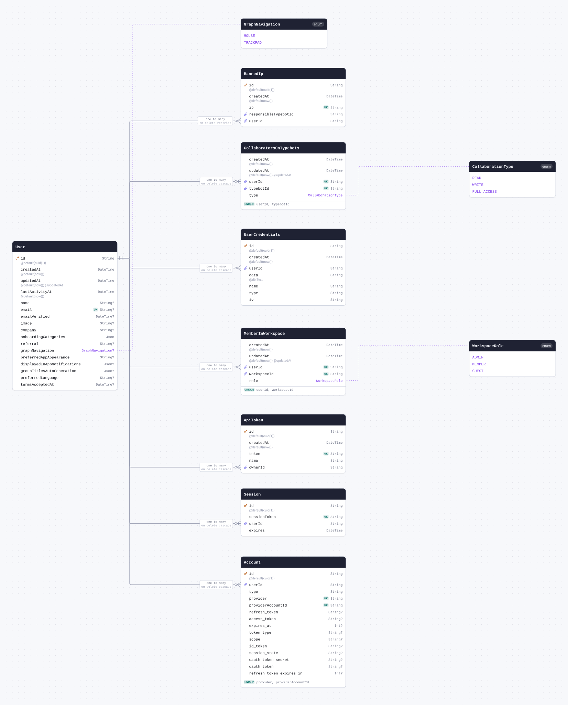

| Field                         | Type                                       | Constraints | Default              | Description |
| ----------------------------- | ------------------------------------------ | ----------- | -------------------- | ----------- |
| `id`                          | `String`                                   | PK NOT NULL | `cuid(1)`            |             |
| `createdAt`                   | `DateTime`                                 | NOT NULL    | `now()`              |             |
| `updatedAt`                   | `DateTime`                                 | NOT NULL    | `now()` `@updatedAt` |             |
| `lastActivityAt`              | `DateTime`                                 | NOT NULL    | `now()`              |             |
| `name`                        | `String`                                   | NULL        |                      |             |
| `email`                       | `String`                                   | UNIQUE NULL |                      |             |
| `emailVerified`               | `DateTime`                                 | NULL        |                      |             |
| `image`                       | `String`                                   | NULL        |                      |             |
| `company`                     | `String`                                   | NULL        |                      |             |
| `onboardingCategories`        | `Json`                                     | NOT NULL    |                      |             |
| `referral`                    | `String`                                   | NULL        |                      |             |
| `graphNavigation`             | [`GraphNavigation`](#enum-GraphNavigation) | NULL        |                      |             |
| `preferredAppAppearance`      | `String`                                   | NULL        |                      |             |
| `displayedInAppNotifications` | `Json`                                     | NULL        |                      |             |
| `groupTitlesAutoGeneration`   | `Json`                                     | NULL        |                      |             |
| `preferredLanguage`           | `String`                                   | NULL        |                      |             |
| `termsAcceptedAt`             | `DateTime`                                 | NULL        |                      |             |

#### Referenced by

- `id` ← [Account.userId](#model-Account) (one-to-many, on delete Cascade)
- `id` ← [Session.userId](#model-Session) (one-to-many, on delete Cascade)
- `id` ← [ApiToken.ownerId](#model-ApiToken) (one-to-many, on delete Cascade)
- `id` ← [MemberInWorkspace.userId](#model-MemberInWorkspace) (one-to-many, on delete Cascade)
- `id` ← [UserCredentials.userId](#model-UserCredentials) (one-to-many, on delete Cascade)
- `id` ← [CollaboratorsOnTypebots.userId](#model-CollaboratorsOnTypebots) (one-to-many, on delete Cascade)
- `id` ← [BannedIp.userId](#model-BannedIp) (one-to-many, on delete Restrict)

#### Definition

```sql
CREATE TABLE "User" (
    "id" TEXT NOT NULL,
    "createdAt" TIMESTAMP(3) NOT NULL DEFAULT CURRENT_TIMESTAMP,
    "updatedAt" TIMESTAMP(3) NOT NULL DEFAULT CURRENT_TIMESTAMP,
    "lastActivityAt" TIMESTAMP(3) NOT NULL DEFAULT CURRENT_TIMESTAMP,
    "name" TEXT,
    "email" TEXT,
    "emailVerified" TIMESTAMP(3),
    "image" TEXT,
    "company" TEXT,
    "onboardingCategories" JSONB NOT NULL,
    "referral" TEXT,
    "graphNavigation" "GraphNavigation",
    "preferredAppAppearance" TEXT,
    "displayedInAppNotifications" JSONB,
    "groupTitlesAutoGeneration" JSONB,
    "preferredLanguage" TEXT,
    "termsAcceptedAt" TIMESTAMP(3),

    CONSTRAINT "User_pkey" PRIMARY KEY ("id")
);

CREATE UNIQUE INDEX "User_email_key" ON "User"("email");
```

<details>
<summary>Queries and their SQL</summary>

**findMany**: Every row

```ts
await prisma.user.findMany();
```

```sql
SELECT
  "public"."User"."id",
  "public"."User"."createdAt",
  "public"."User"."updatedAt",
  "public"."User"."lastActivityAt",
  "public"."User"."name",
  "public"."User"."email",
  "public"."User"."emailVerified",
  "public"."User"."image",
  "public"."User"."company",
  "public"."User"."onboardingCategories",
  "public"."User"."referral",
  "public"."User"."graphNavigation"::text,
  "public"."User"."preferredAppAppearance",
  "public"."User"."displayedInAppNotifications",
  "public"."User"."groupTitlesAutoGeneration",
  "public"."User"."preferredLanguage",
  "public"."User"."termsAcceptedAt"
FROM
  "public"."User"
WHERE
  1 = 1
OFFSET
  $1
-- params: ["0"]
```

**count**: How many rows there are

```ts
await prisma.user.count();
```

```sql
SELECT
  COUNT(*) AS "_count$_all"
FROM
  (
    SELECT
      "public"."User"."id"
    FROM
      "public"."User"
    WHERE
      1 = 1
    OFFSET
      $1
  ) AS "sub"
-- params: ["0"]
```

**findMany**: Every row with its relations

```ts
await prisma.user.findMany({
  include: {
    accounts: true,
    apiTokens: true,
    CollaboratorsOnTypebots: true,
    workspaces: true,
    sessions: true,
    bannedIps: true,
    credentials: true,
  },
});
```

```sql
SELECT
  "public"."User"."id",
  "public"."User"."createdAt",
  "public"."User"."updatedAt",
  "public"."User"."lastActivityAt",
  "public"."User"."name",
  "public"."User"."email",
  "public"."User"."emailVerified",
  "public"."User"."image",
  "public"."User"."company",
  "public"."User"."onboardingCategories",
  "public"."User"."referral",
  "public"."User"."graphNavigation"::text,
  "public"."User"."preferredAppAppearance",
  "public"."User"."displayedInAppNotifications",
  "public"."User"."groupTitlesAutoGeneration",
  "public"."User"."preferredLanguage",
  "public"."User"."termsAcceptedAt"
FROM
  "public"."User"
WHERE
  1 = 1
OFFSET
  $1
-- params: ["0"]

SELECT
  "public"."Account"."id",
  "public"."Account"."userId",
  "public"."Account"."type",
  "public"."Account"."provider",
  "public"."Account"."providerAccountId",
  "public"."Account"."refresh_token",
  "public"."Account"."access_token",
  "public"."Account"."expires_at",
  "public"."Account"."token_type",
  "public"."Account"."scope",
  "public"."Account"."id_token",
  "public"."Account"."session_state",
  "public"."Account"."oauth_token_secret",
  "public"."Account"."oauth_token",
  "public"."Account"."refresh_token_expires_in"
FROM
  "public"."Account"
WHERE
  "public"."Account"."userId" IN ($1)
OFFSET
  $2
-- params: ["<id of the rows above>","0"]

SELECT
  "public"."ApiToken"."id",
  "public"."ApiToken"."createdAt",
  "public"."ApiToken"."token",
  "public"."ApiToken"."name",
  "public"."ApiToken"."ownerId"
FROM
  "public"."ApiToken"
WHERE
  "public"."ApiToken"."ownerId" IN ($1)
OFFSET
  $2
-- params: ["<id of the rows above>","0"]

SELECT
  "public"."CollaboratorsOnTypebots"."userId",
  "public"."CollaboratorsOnTypebots"."typebotId",
  "public"."CollaboratorsOnTypebots"."createdAt",
  "public"."CollaboratorsOnTypebots"."updatedAt",
  "public"."CollaboratorsOnTypebots"."type"::text
FROM
  "public"."CollaboratorsOnTypebots"
WHERE
  "public"."CollaboratorsOnTypebots"."userId" IN ($1)
OFFSET
  $2
-- params: ["<id of the rows above>","0"]

SELECT
  "public"."MemberInWorkspace"."userId",
  "public"."MemberInWorkspace"."workspaceId",
  "public"."MemberInWorkspace"."createdAt",
  "public"."MemberInWorkspace"."updatedAt",
  "public"."MemberInWorkspace"."role"::text
FROM
  "public"."MemberInWorkspace"
WHERE
  "public"."MemberInWorkspace"."userId" IN ($1)
OFFSET
  $2
-- params: ["<id of the rows above>","0"]

SELECT
  "public"."Session"."id",
  "public"."Session"."sessionToken",
  "public"."Session"."userId",
  "public"."Session"."expires"
FROM
  "public"."Session"
WHERE
  "public"."Session"."userId" IN ($1)
OFFSET
  $2
-- params: ["<id of the rows above>","0"]

SELECT
  "public"."BannedIp"."id",
  "public"."BannedIp"."createdAt",
  "public"."BannedIp"."ip",
  "public"."BannedIp"."responsibleTypebotId",
  "public"."BannedIp"."userId"
FROM
  "public"."BannedIp"
WHERE
  "public"."BannedIp"."userId" IN ($1)
OFFSET
  $2
-- params: ["<id of the rows above>","0"]

SELECT
  "public"."UserCredentials"."id",
  "public"."UserCredentials"."createdAt",
  "public"."UserCredentials"."userId",
  "public"."UserCredentials"."data",
  "public"."UserCredentials"."name",
  "public"."UserCredentials"."type",
  "public"."UserCredentials"."iv"
FROM
  "public"."UserCredentials"
WHERE
  "public"."UserCredentials"."userId" IN ($1)
OFFSET
  $2
-- params: ["<id of the rows above>","0"]
```

**findUnique**: One row by what is unique to it

```ts
await prisma.user.findUnique({ where: { id: "example" } });
```

```sql
SELECT
  "public"."User"."id",
  "public"."User"."createdAt",
  "public"."User"."updatedAt",
  "public"."User"."lastActivityAt",
  "public"."User"."name",
  "public"."User"."email",
  "public"."User"."emailVerified",
  "public"."User"."image",
  "public"."User"."company",
  "public"."User"."onboardingCategories",
  "public"."User"."referral",
  "public"."User"."graphNavigation"::text,
  "public"."User"."preferredAppAppearance",
  "public"."User"."displayedInAppNotifications",
  "public"."User"."groupTitlesAutoGeneration",
  "public"."User"."preferredLanguage",
  "public"."User"."termsAcceptedAt"
FROM
  "public"."User"
WHERE
  (
    "public"."User"."id" = $1
    AND 1 = 1
  )
LIMIT
  $2
OFFSET
  $3
-- params: ["example","1","0"]
```

**create**: Create a row

```ts
await prisma.user.create({ data: { onboardingCategories: {} } });
```

```sql
INSERT INTO
  "public"."User" (
    "id",
    "createdAt",
    "updatedAt",
    "lastActivityAt",
    "onboardingCategories"
  )
VALUES
  ($1, $2, $3, $4, $5)
RETURNING
  "public"."User"."id",
  "public"."User"."createdAt",
  "public"."User"."updatedAt",
  "public"."User"."lastActivityAt",
  "public"."User"."name",
  "public"."User"."email",
  "public"."User"."emailVerified",
  "public"."User"."image",
  "public"."User"."company",
  "public"."User"."onboardingCategories",
  "public"."User"."referral",
  "public"."User"."graphNavigation"::text,
  "public"."User"."preferredAppAppearance",
  "public"."User"."displayedInAppNotifications",
  "public"."User"."groupTitlesAutoGeneration",
  "public"."User"."preferredLanguage",
  "public"."User"."termsAcceptedAt"
-- params: ["<cuid(1)>","<now()>","<now()>","<now()>","{}"]
```

**update**: Update a row

```ts
await prisma.user.update({
  where: { id: "example" },
  data: { createdAt: new Date("2026-01-01T00:00:00.000Z") },
});
```

```sql
UPDATE "public"."User"
SET
  "createdAt" = $1,
  "updatedAt" = $2
WHERE
  (
    "public"."User"."id" = $3
    AND 1 = 1
  )
RETURNING
  "public"."User"."id",
  "public"."User"."createdAt",
  "public"."User"."updatedAt",
  "public"."User"."lastActivityAt",
  "public"."User"."name",
  "public"."User"."email",
  "public"."User"."emailVerified",
  "public"."User"."image",
  "public"."User"."company",
  "public"."User"."onboardingCategories",
  "public"."User"."referral",
  "public"."User"."graphNavigation"::text,
  "public"."User"."preferredAppAppearance",
  "public"."User"."displayedInAppNotifications",
  "public"."User"."groupTitlesAutoGeneration",
  "public"."User"."preferredLanguage",
  "public"."User"."termsAcceptedAt"
-- params: ["2026-01-01T00:00:00.000Z",{"prisma__type":"generatorCall","prisma__value":{"name":"now","args":[],"returnType":{"type":"DateTime"}}},"example"]
```

**delete**: Delete a row

```ts
await prisma.user.delete({ where: { id: "example" } });
```

```sql
DELETE FROM "public"."User"
WHERE
  (
    "public"."User"."id" = $1
    AND 1 = 1
  )
RETURNING
  "public"."User"."id",
  "public"."User"."createdAt",
  "public"."User"."updatedAt",
  "public"."User"."lastActivityAt",
  "public"."User"."name",
  "public"."User"."email",
  "public"."User"."emailVerified",
  "public"."User"."image",
  "public"."User"."company",
  "public"."User"."onboardingCategories",
  "public"."User"."referral",
  "public"."User"."graphNavigation"::text,
  "public"."User"."preferredAppAppearance",
  "public"."User"."displayedInAppNotifications",
  "public"."User"."groupTitlesAutoGeneration",
  "public"."User"."preferredLanguage",
  "public"."User"."termsAcceptedAt"
-- params: ["example"]
```

</details>

<a id="model-ApiToken"></a>

### ApiToken

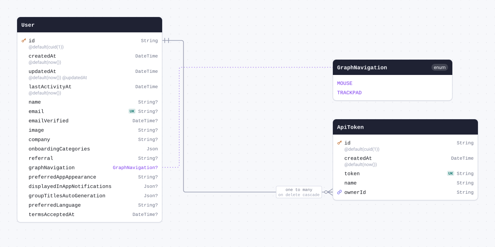

| Field       | Type       | Constraints                       | Default   | Description |
| ----------- | ---------- | --------------------------------- | --------- | ----------- |
| `id`        | `String`   | PK NOT NULL                       | `cuid(1)` |             |
| `createdAt` | `DateTime` | NOT NULL                          | `now()`   |             |
| `token`     | `String`   | UNIQUE NOT NULL                   |           |             |
| `name`      | `String`   | NOT NULL                          |           |             |
| `ownerId`   | `String`   | NOT NULL → [User.id](#model-User) |           |             |

#### References

- `ownerId` → [User.id](#model-User) (many-to-one, on delete Cascade)

#### Definition

```sql
CREATE TABLE "ApiToken" (
    "id" TEXT NOT NULL,
    "createdAt" TIMESTAMP(3) NOT NULL DEFAULT CURRENT_TIMESTAMP,
    "token" TEXT NOT NULL,
    "name" TEXT NOT NULL,
    "ownerId" TEXT NOT NULL,

    CONSTRAINT "ApiToken_pkey" PRIMARY KEY ("id")
);

CREATE UNIQUE INDEX "ApiToken_token_key" ON "ApiToken"("token");

ALTER TABLE "ApiToken" ADD CONSTRAINT "ApiToken_ownerId_fkey" FOREIGN KEY ("ownerId") REFERENCES "User"("id") ON DELETE CASCADE ON UPDATE CASCADE;
```

<details>
<summary>Queries and their SQL</summary>

**findMany**: Every row

```ts
await prisma.apiToken.findMany();
```

```sql
SELECT
  "public"."ApiToken"."id",
  "public"."ApiToken"."createdAt",
  "public"."ApiToken"."token",
  "public"."ApiToken"."name",
  "public"."ApiToken"."ownerId"
FROM
  "public"."ApiToken"
WHERE
  1 = 1
OFFSET
  $1
-- params: ["0"]
```

**count**: How many rows there are

```ts
await prisma.apiToken.count();
```

```sql
SELECT
  COUNT(*) AS "_count$_all"
FROM
  (
    SELECT
      "public"."ApiToken"."id"
    FROM
      "public"."ApiToken"
    WHERE
      1 = 1
    OFFSET
      $1
  ) AS "sub"
-- params: ["0"]
```

**findMany**: Every row with its relations

```ts
await prisma.apiToken.findMany({ include: { owner: true } });
```

```sql
SELECT
  "public"."ApiToken"."id",
  "public"."ApiToken"."createdAt",
  "public"."ApiToken"."token",
  "public"."ApiToken"."name",
  "public"."ApiToken"."ownerId"
FROM
  "public"."ApiToken"
WHERE
  1 = 1
OFFSET
  $1
-- params: ["0"]

SELECT
  "public"."User"."id",
  "public"."User"."createdAt",
  "public"."User"."updatedAt",
  "public"."User"."lastActivityAt",
  "public"."User"."name",
  "public"."User"."email",
  "public"."User"."emailVerified",
  "public"."User"."image",
  "public"."User"."company",
  "public"."User"."onboardingCategories",
  "public"."User"."referral",
  "public"."User"."graphNavigation"::text,
  "public"."User"."preferredAppAppearance",
  "public"."User"."displayedInAppNotifications",
  "public"."User"."groupTitlesAutoGeneration",
  "public"."User"."preferredLanguage",
  "public"."User"."termsAcceptedAt"
FROM
  "public"."User"
WHERE
  "public"."User"."id" IN ($1)
OFFSET
  $2
-- params: ["<ownerId of the rows above>","0"]
```

**findUnique**: One row by what is unique to it

```ts
await prisma.apiToken.findUnique({ where: { id: "example" } });
```

```sql
SELECT
  "public"."ApiToken"."id",
  "public"."ApiToken"."createdAt",
  "public"."ApiToken"."token",
  "public"."ApiToken"."name",
  "public"."ApiToken"."ownerId"
FROM
  "public"."ApiToken"
WHERE
  (
    "public"."ApiToken"."id" = $1
    AND 1 = 1
  )
LIMIT
  $2
OFFSET
  $3
-- params: ["example","1","0"]
```

**create**: Create a row

```ts
await prisma.apiToken.create({ data: { token: "example", name: "example", ownerId: "example" } });
```

```sql
INSERT INTO
  "public"."ApiToken" ("id", "createdAt", "token", "name", "ownerId")
VALUES
  ($1, $2, $3, $4, $5)
RETURNING
  "public"."ApiToken"."id",
  "public"."ApiToken"."createdAt",
  "public"."ApiToken"."token",
  "public"."ApiToken"."name",
  "public"."ApiToken"."ownerId"
-- params: ["<cuid(1)>","<now()>","example","example","example"]
```

**update**: Update a row

```ts
await prisma.apiToken.update({
  where: { id: "example" },
  data: { createdAt: new Date("2026-01-01T00:00:00.000Z") },
});
```

```sql
UPDATE "public"."ApiToken"
SET
  "createdAt" = $1
WHERE
  (
    "public"."ApiToken"."id" = $2
    AND 1 = 1
  )
RETURNING
  "public"."ApiToken"."id",
  "public"."ApiToken"."createdAt",
  "public"."ApiToken"."token",
  "public"."ApiToken"."name",
  "public"."ApiToken"."ownerId"
-- params: ["2026-01-01T00:00:00.000Z","example"]
```

**delete**: Delete a row

```ts
await prisma.apiToken.delete({ where: { id: "example" } });
```

```sql
DELETE FROM "public"."ApiToken"
WHERE
  (
    "public"."ApiToken"."id" = $1
    AND 1 = 1
  )
RETURNING
  "public"."ApiToken"."id",
  "public"."ApiToken"."createdAt",
  "public"."ApiToken"."token",
  "public"."ApiToken"."name",
  "public"."ApiToken"."ownerId"
-- params: ["example"]
```

</details>

<a id="model-Workspace"></a>

### Workspace

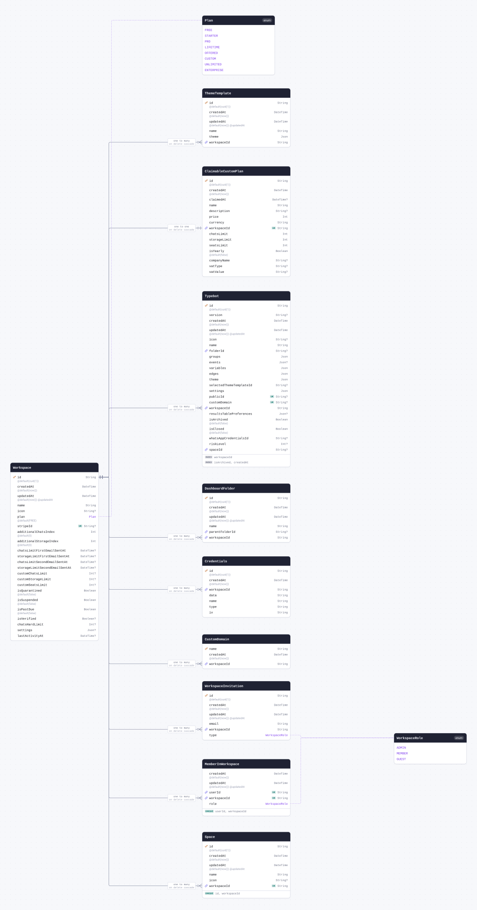

| Field                           | Type                 | Constraints | Default              | Description |
| ------------------------------- | -------------------- | ----------- | -------------------- | ----------- |
| `id`                            | `String`             | PK NOT NULL | `cuid(1)`            |             |
| `createdAt`                     | `DateTime`           | NOT NULL    | `now()`              |             |
| `updatedAt`                     | `DateTime`           | NOT NULL    | `now()` `@updatedAt` |             |
| `name`                          | `String`             | NOT NULL    |                      |             |
| `icon`                          | `String`             | NULL        |                      |             |
| `plan`                          | [`Plan`](#enum-Plan) | NOT NULL    | `FREE`               |             |
| `stripeId`                      | `String`             | UNIQUE NULL |                      |             |
| `additionalChatsIndex`          | `Int`                | NOT NULL    | `0`                  |             |
| `additionalStorageIndex`        | `Int`                | NOT NULL    | `0`                  |             |
| `chatsLimitFirstEmailSentAt`    | `DateTime`           | NULL        |                      |             |
| `storageLimitFirstEmailSentAt`  | `DateTime`           | NULL        |                      |             |
| `chatsLimitSecondEmailSentAt`   | `DateTime`           | NULL        |                      |             |
| `storageLimitSecondEmailSentAt` | `DateTime`           | NULL        |                      |             |
| `customChatsLimit`              | `Int`                | NULL        |                      |             |
| `customStorageLimit`            | `Int`                | NULL        |                      |             |
| `customSeatsLimit`              | `Int`                | NULL        |                      |             |
| `isQuarantined`                 | `Boolean`            | NOT NULL    | `false`              |             |
| `isSuspended`                   | `Boolean`            | NOT NULL    | `false`              |             |
| `isPastDue`                     | `Boolean`            | NOT NULL    | `false`              |             |
| `isVerified`                    | `Boolean`            | NULL        |                      |             |
| `chatsHardLimit`                | `Int`                | NULL        |                      |             |
| `settings`                      | `Json`               | NULL        |                      |             |
| `lastActivityAt`                | `DateTime`           | NULL        |                      |             |

#### Referenced by

- `id` ← [Space.workspaceId](#model-Space) (one-to-many, on delete Cascade)
- `id` ← [MemberInWorkspace.workspaceId](#model-MemberInWorkspace) (one-to-many, on delete Cascade)
- `id` ← [WorkspaceInvitation.workspaceId](#model-WorkspaceInvitation) (one-to-many, on delete Cascade)
- `id` ← [CustomDomain.workspaceId](#model-CustomDomain) (one-to-many, on delete Cascade)
- `id` ← [Credentials.workspaceId](#model-Credentials) (one-to-many, on delete Cascade)
- `id` ← [DashboardFolder.workspaceId](#model-DashboardFolder) (one-to-many, on delete Cascade)
- `id` ← [Typebot.workspaceId](#model-Typebot) (one-to-many, on delete Cascade)
- `id` ← [ClaimableCustomPlan.workspaceId](#model-ClaimableCustomPlan) (one-to-one, on delete Cascade)
- `id` ← [ThemeTemplate.workspaceId](#model-ThemeTemplate) (one-to-many, on delete Cascade)

#### Definition

```sql
CREATE TABLE "Workspace" (
    "id" TEXT NOT NULL,
    "createdAt" TIMESTAMP(3) NOT NULL DEFAULT CURRENT_TIMESTAMP,
    "updatedAt" TIMESTAMP(3) NOT NULL DEFAULT CURRENT_TIMESTAMP,
    "name" TEXT NOT NULL,
    "icon" TEXT,
    "plan" "Plan" NOT NULL DEFAULT 'FREE',
    "stripeId" TEXT,
    "additionalChatsIndex" INTEGER NOT NULL DEFAULT 0,
    "additionalStorageIndex" INTEGER NOT NULL DEFAULT 0,
    "chatsLimitFirstEmailSentAt" TIMESTAMP(3),
    "storageLimitFirstEmailSentAt" TIMESTAMP(3),
    "chatsLimitSecondEmailSentAt" TIMESTAMP(3),
    "storageLimitSecondEmailSentAt" TIMESTAMP(3),
    "customChatsLimit" INTEGER,
    "customStorageLimit" INTEGER,
    "customSeatsLimit" INTEGER,
    "isQuarantined" BOOLEAN NOT NULL DEFAULT false,
    "isSuspended" BOOLEAN NOT NULL DEFAULT false,
    "isPastDue" BOOLEAN NOT NULL DEFAULT false,
    "isVerified" BOOLEAN,
    "chatsHardLimit" INTEGER,
    "settings" JSONB,
    "lastActivityAt" TIMESTAMP(3),

    CONSTRAINT "Workspace_pkey" PRIMARY KEY ("id")
);

CREATE UNIQUE INDEX "Workspace_stripeId_key" ON "Workspace"("stripeId");
```

<details>
<summary>Queries and their SQL</summary>

**findMany**: Every row

```ts
await prisma.workspace.findMany();
```

```sql
SELECT
  "public"."Workspace"."id",
  "public"."Workspace"."createdAt",
  "public"."Workspace"."updatedAt",
  "public"."Workspace"."name",
  "public"."Workspace"."icon",
  "public"."Workspace"."plan"::text,
  "public"."Workspace"."stripeId",
  "public"."Workspace"."additionalChatsIndex",
  "public"."Workspace"."additionalStorageIndex",
  "public"."Workspace"."chatsLimitFirstEmailSentAt",
  "public"."Workspace"."storageLimitFirstEmailSentAt",
  "public"."Workspace"."chatsLimitSecondEmailSentAt",
  "public"."Workspace"."storageLimitSecondEmailSentAt",
  "public"."Workspace"."customChatsLimit",
  "public"."Workspace"."customStorageLimit",
  "public"."Workspace"."customSeatsLimit",
  "public"."Workspace"."isQuarantined",
  "public"."Workspace"."isSuspended",
  "public"."Workspace"."isPastDue",
  "public"."Workspace"."isVerified",
  "public"."Workspace"."chatsHardLimit",
  "public"."Workspace"."settings",
  "public"."Workspace"."lastActivityAt"
FROM
  "public"."Workspace"
WHERE
  1 = 1
OFFSET
  $1
-- params: ["0"]
```

**count**: How many rows there are

```ts
await prisma.workspace.count();
```

```sql
SELECT
  COUNT(*) AS "_count$_all"
FROM
  (
    SELECT
      "public"."Workspace"."id"
    FROM
      "public"."Workspace"
    WHERE
      1 = 1
    OFFSET
      $1
  ) AS "sub"
-- params: ["0"]
```

**findMany**: Every row with its relations

```ts
await prisma.workspace.findMany({
  include: {
    credentials: true,
    customDomains: true,
    folders: true,
    members: true,
    typebots: true,
    invitations: true,
    claimableCustomPlan: true,
    themeTemplates: true,
    spaces: true,
  },
});
```

```sql
SELECT
  "public"."Workspace"."id",
  "public"."Workspace"."createdAt",
  "public"."Workspace"."updatedAt",
  "public"."Workspace"."name",
  "public"."Workspace"."icon",
  "public"."Workspace"."plan"::text,
  "public"."Workspace"."stripeId",
  "public"."Workspace"."additionalChatsIndex",
  "public"."Workspace"."additionalStorageIndex",
  "public"."Workspace"."chatsLimitFirstEmailSentAt",
  "public"."Workspace"."storageLimitFirstEmailSentAt",
  "public"."Workspace"."chatsLimitSecondEmailSentAt",
  "public"."Workspace"."storageLimitSecondEmailSentAt",
  "public"."Workspace"."customChatsLimit",
  "public"."Workspace"."customStorageLimit",
  "public"."Workspace"."customSeatsLimit",
  "public"."Workspace"."isQuarantined",
  "public"."Workspace"."isSuspended",
  "public"."Workspace"."isPastDue",
  "public"."Workspace"."isVerified",
  "public"."Workspace"."chatsHardLimit",
  "public"."Workspace"."settings",
  "public"."Workspace"."lastActivityAt"
FROM
  "public"."Workspace"
WHERE
  1 = 1
OFFSET
  $1
-- params: ["0"]

SELECT
  "public"."Credentials"."id",
  "public"."Credentials"."createdAt",
  "public"."Credentials"."workspaceId",
  "public"."Credentials"."data",
  "public"."Credentials"."name",
  "public"."Credentials"."type",
  "public"."Credentials"."iv"
FROM
  "public"."Credentials"
WHERE
  "public"."Credentials"."workspaceId" IN ($1)
OFFSET
  $2
-- params: ["<id of the rows above>","0"]

SELECT
  "public"."CustomDomain"."name",
  "public"."CustomDomain"."createdAt",
  "public"."CustomDomain"."workspaceId"
FROM
  "public"."CustomDomain"
WHERE
  "public"."CustomDomain"."workspaceId" IN ($1)
OFFSET
  $2
-- params: ["<id of the rows above>","0"]

SELECT
  "public"."DashboardFolder"."id",
  "public"."DashboardFolder"."createdAt",
  "public"."DashboardFolder"."updatedAt",
  "public"."DashboardFolder"."name",
  "public"."DashboardFolder"."parentFolderId",
  "public"."DashboardFolder"."workspaceId"
FROM
  "public"."DashboardFolder"
WHERE
  "public"."DashboardFolder"."workspaceId" IN ($1)
OFFSET
  $2
-- params: ["<id of the rows above>","0"]

SELECT
  "public"."MemberInWorkspace"."userId",
  "public"."MemberInWorkspace"."workspaceId",
  "public"."MemberInWorkspace"."createdAt",
  "public"."MemberInWorkspace"."updatedAt",
  "public"."MemberInWorkspace"."role"::text
FROM
  "public"."MemberInWorkspace"
WHERE
  "public"."MemberInWorkspace"."workspaceId" IN ($1)
OFFSET
  $2
-- params: ["<id of the rows above>","0"]

SELECT
  "public"."Typebot"."id",
  "public"."Typebot"."version",
  "public"."Typebot"."createdAt",
  "public"."Typebot"."updatedAt",
  "public"."Typebot"."icon",
  "public"."Typebot"."name",
  "public"."Typebot"."folderId",
  "public"."Typebot"."groups",
  "public"."Typebot"."events",
  "public"."Typebot"."variables",
  "public"."Typebot"."edges",
  "public"."Typebot"."theme",
  "public"."Typebot"."selectedThemeTemplateId",
  "public"."Typebot"."settings",
  "public"."Typebot"."publicId",
  "public"."Typebot"."customDomain",
  "public"."Typebot"."workspaceId",
  "public"."Typebot"."resultsTablePreferences",
  "public"."Typebot"."isArchived",
  "public"."Typebot"."isClosed",
  "public"."Typebot"."whatsAppCredentialsId",
  "public"."Typebot"."riskLevel",
  "public"."Typebot"."spaceId"
FROM
  "public"."Typebot"
WHERE
  "public"."Typebot"."workspaceId" IN ($1)
OFFSET
  $2
-- params: ["<id of the rows above>","0"]

SELECT
  "public"."WorkspaceInvitation"."id",
  "public"."WorkspaceInvitation"."createdAt",
  "public"."WorkspaceInvitation"."updatedAt",
  "public"."WorkspaceInvitation"."email",
  "public"."WorkspaceInvitation"."workspaceId",
  "public"."WorkspaceInvitation"."type"::text
FROM
  "public"."WorkspaceInvitation"
WHERE
  "public"."WorkspaceInvitation"."workspaceId" IN ($1)
OFFSET
  $2
-- params: ["<id of the rows above>","0"]

SELECT
  "public"."ClaimableCustomPlan"."id",
  "public"."ClaimableCustomPlan"."createdAt",
  "public"."ClaimableCustomPlan"."claimedAt",
  "public"."ClaimableCustomPlan"."name",
  "public"."ClaimableCustomPlan"."description",
  "public"."ClaimableCustomPlan"."price",
  "public"."ClaimableCustomPlan"."currency",
  "public"."ClaimableCustomPlan"."workspaceId",
  "public"."ClaimableCustomPlan"."chatsLimit",
  "public"."ClaimableCustomPlan"."storageLimit",
  "public"."ClaimableCustomPlan"."seatsLimit",
  "public"."ClaimableCustomPlan"."isYearly",
  "public"."ClaimableCustomPlan"."companyName",
  "public"."ClaimableCustomPlan"."vatType",
  "public"."ClaimableCustomPlan"."vatValue"
FROM
  "public"."ClaimableCustomPlan"
WHERE
  "public"."ClaimableCustomPlan"."workspaceId" IN ($1)
OFFSET
  $2
-- params: ["<id of the rows above>","0"]

SELECT
  "public"."ThemeTemplate"."id",
  "public"."ThemeTemplate"."createdAt",
  "public"."ThemeTemplate"."updatedAt",
  "public"."ThemeTemplate"."name",
  "public"."ThemeTemplate"."theme",
  "public"."ThemeTemplate"."workspaceId"
FROM
  "public"."ThemeTemplate"
WHERE
  "public"."ThemeTemplate"."workspaceId" IN ($1)
OFFSET
  $2
-- params: ["<id of the rows above>","0"]

SELECT
  "public"."Space"."id",
  "public"."Space"."createdAt",
  "public"."Space"."updatedAt",
  "public"."Space"."name",
  "public"."Space"."icon",
  "public"."Space"."workspaceId"
FROM
  "public"."Space"
WHERE
  "public"."Space"."workspaceId" IN ($1)
OFFSET
  $2
-- params: ["<id of the rows above>","0"]
```

**findUnique**: One row by what is unique to it

```ts
await prisma.workspace.findUnique({ where: { id: "example" } });
```

```sql
SELECT
  "public"."Workspace"."id",
  "public"."Workspace"."createdAt",
  "public"."Workspace"."updatedAt",
  "public"."Workspace"."name",
  "public"."Workspace"."icon",
  "public"."Workspace"."plan"::text,
  "public"."Workspace"."stripeId",
  "public"."Workspace"."additionalChatsIndex",
  "public"."Workspace"."additionalStorageIndex",
  "public"."Workspace"."chatsLimitFirstEmailSentAt",
  "public"."Workspace"."storageLimitFirstEmailSentAt",
  "public"."Workspace"."chatsLimitSecondEmailSentAt",
  "public"."Workspace"."storageLimitSecondEmailSentAt",
  "public"."Workspace"."customChatsLimit",
  "public"."Workspace"."customStorageLimit",
  "public"."Workspace"."customSeatsLimit",
  "public"."Workspace"."isQuarantined",
  "public"."Workspace"."isSuspended",
  "public"."Workspace"."isPastDue",
  "public"."Workspace"."isVerified",
  "public"."Workspace"."chatsHardLimit",
  "public"."Workspace"."settings",
  "public"."Workspace"."lastActivityAt"
FROM
  "public"."Workspace"
WHERE
  (
    "public"."Workspace"."id" = $1
    AND 1 = 1
  )
LIMIT
  $2
OFFSET
  $3
-- params: ["example","1","0"]
```

**create**: Create a row

```ts
await prisma.workspace.create({ data: { name: "example" } });
```

```sql
INSERT INTO
  "public"."Workspace" (
    "id",
    "createdAt",
    "updatedAt",
    "name",
    "plan",
    "additionalChatsIndex",
    "additionalStorageIndex",
    "isQuarantined",
    "isSuspended",
    "isPastDue"
  )
VALUES
  (
    $1,
    $2,
    $3,
    $4,
    CAST($5::text AS "public"."Plan"),
    $6,
    $7,
    $8,
    $9,
    $10
  )
RETURNING
  "public"."Workspace"."id",
  "public"."Workspace"."createdAt",
  "public"."Workspace"."updatedAt",
  "public"."Workspace"."name",
  "public"."Workspace"."icon",
  "public"."Workspace"."plan"::text,
  "public"."Workspace"."stripeId",
  "public"."Workspace"."additionalChatsIndex",
  "public"."Workspace"."additionalStorageIndex",
  "public"."Workspace"."chatsLimitFirstEmailSentAt",
  "public"."Workspace"."storageLimitFirstEmailSentAt",
  "public"."Workspace"."chatsLimitSecondEmailSentAt",
  "public"."Workspace"."storageLimitSecondEmailSentAt",
  "public"."Workspace"."customChatsLimit",
  "public"."Workspace"."customStorageLimit",
  "public"."Workspace"."customSeatsLimit",
  "public"."Workspace"."isQuarantined",
  "public"."Workspace"."isSuspended",
  "public"."Workspace"."isPastDue",
  "public"."Workspace"."isVerified",
  "public"."Workspace"."chatsHardLimit",
  "public"."Workspace"."settings",
  "public"."Workspace"."lastActivityAt"
-- params: ["<cuid(1)>","<now()>","<now()>","example","FREE","0","0",false,false,false]
```

**update**: Update a row

```ts
await prisma.workspace.update({
  where: { id: "example" },
  data: { createdAt: new Date("2026-01-01T00:00:00.000Z") },
});
```

```sql
UPDATE "public"."Workspace"
SET
  "createdAt" = $1,
  "updatedAt" = $2
WHERE
  (
    "public"."Workspace"."id" = $3
    AND 1 = 1
  )
RETURNING
  "public"."Workspace"."id",
  "public"."Workspace"."createdAt",
  "public"."Workspace"."updatedAt",
  "public"."Workspace"."name",
  "public"."Workspace"."icon",
  "public"."Workspace"."plan"::text,
  "public"."Workspace"."stripeId",
  "public"."Workspace"."additionalChatsIndex",
  "public"."Workspace"."additionalStorageIndex",
  "public"."Workspace"."chatsLimitFirstEmailSentAt",
  "public"."Workspace"."storageLimitFirstEmailSentAt",
  "public"."Workspace"."chatsLimitSecondEmailSentAt",
  "public"."Workspace"."storageLimitSecondEmailSentAt",
  "public"."Workspace"."customChatsLimit",
  "public"."Workspace"."customStorageLimit",
  "public"."Workspace"."customSeatsLimit",
  "public"."Workspace"."isQuarantined",
  "public"."Workspace"."isSuspended",
  "public"."Workspace"."isPastDue",
  "public"."Workspace"."isVerified",
  "public"."Workspace"."chatsHardLimit",
  "public"."Workspace"."settings",
  "public"."Workspace"."lastActivityAt"
-- params: ["2026-01-01T00:00:00.000Z",{"prisma__type":"generatorCall","prisma__value":{"name":"now","args":[],"returnType":{"type":"DateTime"}}},"example"]
```

**delete**: Delete a row

```ts
await prisma.workspace.delete({ where: { id: "example" } });
```

```sql
DELETE FROM "public"."Workspace"
WHERE
  (
    "public"."Workspace"."id" = $1
    AND 1 = 1
  )
RETURNING
  "public"."Workspace"."id",
  "public"."Workspace"."createdAt",
  "public"."Workspace"."updatedAt",
  "public"."Workspace"."name",
  "public"."Workspace"."icon",
  "public"."Workspace"."plan"::text,
  "public"."Workspace"."stripeId",
  "public"."Workspace"."additionalChatsIndex",
  "public"."Workspace"."additionalStorageIndex",
  "public"."Workspace"."chatsLimitFirstEmailSentAt",
  "public"."Workspace"."storageLimitFirstEmailSentAt",
  "public"."Workspace"."chatsLimitSecondEmailSentAt",
  "public"."Workspace"."storageLimitSecondEmailSentAt",
  "public"."Workspace"."customChatsLimit",
  "public"."Workspace"."customStorageLimit",
  "public"."Workspace"."customSeatsLimit",
  "public"."Workspace"."isQuarantined",
  "public"."Workspace"."isSuspended",
  "public"."Workspace"."isPastDue",
  "public"."Workspace"."isVerified",
  "public"."Workspace"."chatsHardLimit",
  "public"."Workspace"."settings",
  "public"."Workspace"."lastActivityAt"
-- params: ["example"]
```

</details>

<a id="model-Space"></a>

### Space

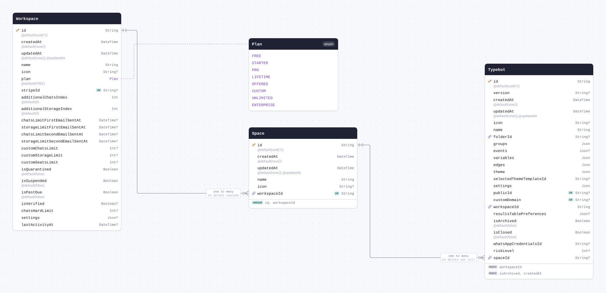

| Field         | Type       | Constraints                                 | Default              | Description |
| ------------- | ---------- | ------------------------------------------- | -------------------- | ----------- |
| `id`          | `String`   | PK NOT NULL                                 | `cuid(1)`            |             |
| `createdAt`   | `DateTime` | NOT NULL                                    | `now()`              |             |
| `updatedAt`   | `DateTime` | NOT NULL                                    | `now()` `@updatedAt` |             |
| `name`        | `String`   | NOT NULL                                    |                      |             |
| `icon`        | `String`   | NULL                                        |                      |             |
| `workspaceId` | `String`   | NOT NULL → [Workspace.id](#model-Workspace) |                      |             |

#### Indexes

- `@@unique([id, workspaceId])`

#### References

- `workspaceId` → [Workspace.id](#model-Workspace) (many-to-one, on delete Cascade)

#### Referenced by

- `id` ← [Typebot.spaceId](#model-Typebot) (one-to-many, on delete SetNull)

#### Definition

```sql
CREATE TABLE "Space" (
    "id" TEXT NOT NULL,
    "createdAt" TIMESTAMP(3) NOT NULL DEFAULT CURRENT_TIMESTAMP,
    "updatedAt" TIMESTAMP(3) NOT NULL DEFAULT CURRENT_TIMESTAMP,
    "name" TEXT NOT NULL,
    "icon" TEXT,
    "workspaceId" TEXT NOT NULL,

    CONSTRAINT "Space_pkey" PRIMARY KEY ("id")
);

CREATE UNIQUE INDEX "Space_id_workspaceId_key" ON "Space"("id", "workspaceId");

ALTER TABLE "Space" ADD CONSTRAINT "Space_workspaceId_fkey" FOREIGN KEY ("workspaceId") REFERENCES "Workspace"("id") ON DELETE CASCADE ON UPDATE CASCADE;
```

<details>
<summary>Queries and their SQL</summary>

**findMany**: Every row

```ts
await prisma.space.findMany();
```

```sql
SELECT
  "public"."Space"."id",
  "public"."Space"."createdAt",
  "public"."Space"."updatedAt",
  "public"."Space"."name",
  "public"."Space"."icon",
  "public"."Space"."workspaceId"
FROM
  "public"."Space"
WHERE
  1 = 1
OFFSET
  $1
-- params: ["0"]
```

**count**: How many rows there are

```ts
await prisma.space.count();
```

```sql
SELECT
  COUNT(*) AS "_count$_all"
FROM
  (
    SELECT
      "public"."Space"."id"
    FROM
      "public"."Space"
    WHERE
      1 = 1
    OFFSET
      $1
  ) AS "sub"
-- params: ["0"]
```

**findMany**: Every row with its relations

```ts
await prisma.space.findMany({ include: { workspace: true, typebots: true } });
```

```sql
SELECT
  "public"."Space"."id",
  "public"."Space"."createdAt",
  "public"."Space"."updatedAt",
  "public"."Space"."name",
  "public"."Space"."icon",
  "public"."Space"."workspaceId"
FROM
  "public"."Space"
WHERE
  1 = 1
OFFSET
  $1
-- params: ["0"]

SELECT
  "public"."Workspace"."id",
  "public"."Workspace"."createdAt",
  "public"."Workspace"."updatedAt",
  "public"."Workspace"."name",
  "public"."Workspace"."icon",
  "public"."Workspace"."plan"::text,
  "public"."Workspace"."stripeId",
  "public"."Workspace"."additionalChatsIndex",
  "public"."Workspace"."additionalStorageIndex",
  "public"."Workspace"."chatsLimitFirstEmailSentAt",
  "public"."Workspace"."storageLimitFirstEmailSentAt",
  "public"."Workspace"."chatsLimitSecondEmailSentAt",
  "public"."Workspace"."storageLimitSecondEmailSentAt",
  "public"."Workspace"."customChatsLimit",
  "public"."Workspace"."customStorageLimit",
  "public"."Workspace"."customSeatsLimit",
  "public"."Workspace"."isQuarantined",
  "public"."Workspace"."isSuspended",
  "public"."Workspace"."isPastDue",
  "public"."Workspace"."isVerified",
  "public"."Workspace"."chatsHardLimit",
  "public"."Workspace"."settings",
  "public"."Workspace"."lastActivityAt"
FROM
  "public"."Workspace"
WHERE
  "public"."Workspace"."id" IN ($1)
OFFSET
  $2
-- params: ["<workspaceId of the rows above>","0"]

SELECT
  "public"."Typebot"."id",
  "public"."Typebot"."version",
  "public"."Typebot"."createdAt",
  "public"."Typebot"."updatedAt",
  "public"."Typebot"."icon",
  "public"."Typebot"."name",
  "public"."Typebot"."folderId",
  "public"."Typebot"."groups",
  "public"."Typebot"."events",
  "public"."Typebot"."variables",
  "public"."Typebot"."edges",
  "public"."Typebot"."theme",
  "public"."Typebot"."selectedThemeTemplateId",
  "public"."Typebot"."settings",
  "public"."Typebot"."publicId",
  "public"."Typebot"."customDomain",
  "public"."Typebot"."workspaceId",
  "public"."Typebot"."resultsTablePreferences",
  "public"."Typebot"."isArchived",
  "public"."Typebot"."isClosed",
  "public"."Typebot"."whatsAppCredentialsId",
  "public"."Typebot"."riskLevel",
  "public"."Typebot"."spaceId"
FROM
  "public"."Typebot"
WHERE
  "public"."Typebot"."spaceId" IN ($1)
OFFSET
  $2
-- params: ["<id of the rows above>","0"]
```

**findUnique**: One row by what is unique to it

```ts
await prisma.space.findUnique({ where: { id: "example" } });
```

```sql
SELECT
  "public"."Space"."id",
  "public"."Space"."createdAt",
  "public"."Space"."updatedAt",
  "public"."Space"."name",
  "public"."Space"."icon",
  "public"."Space"."workspaceId"
FROM
  "public"."Space"
WHERE
  (
    "public"."Space"."id" = $1
    AND 1 = 1
  )
LIMIT
  $2
OFFSET
  $3
-- params: ["example","1","0"]
```

**create**: Create a row

```ts
await prisma.space.create({ data: { name: "example", workspaceId: "example" } });
```

```sql
INSERT INTO
  "public"."Space" (
    "id",
    "createdAt",
    "updatedAt",
    "name",
    "workspaceId"
  )
VALUES
  ($1, $2, $3, $4, $5)
RETURNING
  "public"."Space"."id",
  "public"."Space"."createdAt",
  "public"."Space"."updatedAt",
  "public"."Space"."name",
  "public"."Space"."icon",
  "public"."Space"."workspaceId"
-- params: ["<cuid(1)>","<now()>","<now()>","example","example"]
```

**update**: Update a row

```ts
await prisma.space.update({
  where: { id: "example" },
  data: { createdAt: new Date("2026-01-01T00:00:00.000Z") },
});
```

```sql
UPDATE "public"."Space"
SET
  "createdAt" = $1,
  "updatedAt" = $2
WHERE
  (
    "public"."Space"."id" = $3
    AND 1 = 1
  )
RETURNING
  "public"."Space"."id",
  "public"."Space"."createdAt",
  "public"."Space"."updatedAt",
  "public"."Space"."name",
  "public"."Space"."icon",
  "public"."Space"."workspaceId"
-- params: ["2026-01-01T00:00:00.000Z",{"prisma__type":"generatorCall","prisma__value":{"name":"now","args":[],"returnType":{"type":"DateTime"}}},"example"]
```

**delete**: Delete a row

```ts
await prisma.space.delete({ where: { id: "example" } });
```

```sql
DELETE FROM "public"."Space"
WHERE
  (
    "public"."Space"."id" = $1
    AND 1 = 1
  )
RETURNING
  "public"."Space"."id",
  "public"."Space"."createdAt",
  "public"."Space"."updatedAt",
  "public"."Space"."name",
  "public"."Space"."icon",
  "public"."Space"."workspaceId"
-- params: ["example"]
```

</details>

<a id="model-MemberInWorkspace"></a>

### MemberInWorkspace

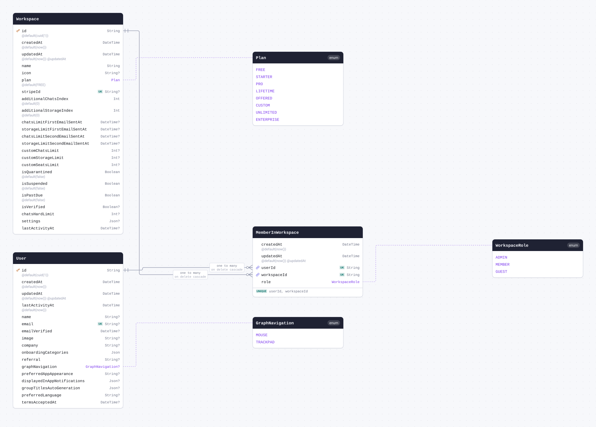

| Field         | Type                                   | Constraints                                 | Default              | Description |
| ------------- | -------------------------------------- | ------------------------------------------- | -------------------- | ----------- |
| `createdAt`   | `DateTime`                             | NOT NULL                                    | `now()`              |             |
| `updatedAt`   | `DateTime`                             | NOT NULL                                    | `now()` `@updatedAt` |             |
| `userId`      | `String`                               | NOT NULL → [User.id](#model-User)           |                      |             |
| `workspaceId` | `String`                               | NOT NULL → [Workspace.id](#model-Workspace) |                      |             |
| `role`        | [`WorkspaceRole`](#enum-WorkspaceRole) | NOT NULL                                    |                      |             |

#### Indexes

- `@@unique([userId, workspaceId])`

#### References

- `userId` → [User.id](#model-User) (many-to-one, on delete Cascade)
- `workspaceId` → [Workspace.id](#model-Workspace) (many-to-one, on delete Cascade)

#### Definition

```sql
CREATE TABLE "MemberInWorkspace" (
    "createdAt" TIMESTAMP(3) NOT NULL DEFAULT CURRENT_TIMESTAMP,
    "updatedAt" TIMESTAMP(3) NOT NULL DEFAULT CURRENT_TIMESTAMP,
    "userId" TEXT NOT NULL,
    "workspaceId" TEXT NOT NULL,
    "role" "WorkspaceRole" NOT NULL
);

CREATE UNIQUE INDEX "MemberInWorkspace_userId_workspaceId_key" ON "MemberInWorkspace"("userId", "workspaceId");

ALTER TABLE "MemberInWorkspace" ADD CONSTRAINT "MemberInWorkspace_userId_fkey" FOREIGN KEY ("userId") REFERENCES "User"("id") ON DELETE CASCADE ON UPDATE CASCADE;

ALTER TABLE "MemberInWorkspace" ADD CONSTRAINT "MemberInWorkspace_workspaceId_fkey" FOREIGN KEY ("workspaceId") REFERENCES "Workspace"("id") ON DELETE CASCADE ON UPDATE CASCADE;
```

<details>
<summary>Queries and their SQL</summary>

**findMany**: Every row

```ts
await prisma.memberInWorkspace.findMany();
```

```sql
SELECT
  "public"."MemberInWorkspace"."userId",
  "public"."MemberInWorkspace"."workspaceId",
  "public"."MemberInWorkspace"."createdAt",
  "public"."MemberInWorkspace"."updatedAt",
  "public"."MemberInWorkspace"."role"::text
FROM
  "public"."MemberInWorkspace"
WHERE
  1 = 1
OFFSET
  $1
-- params: ["0"]
```

**count**: How many rows there are

```ts
await prisma.memberInWorkspace.count();
```

```sql
SELECT
  COUNT(*) AS "_count$_all"
FROM
  (
    SELECT
      "public"."MemberInWorkspace"."userId",
      "public"."MemberInWorkspace"."workspaceId"
    FROM
      "public"."MemberInWorkspace"
    WHERE
      1 = 1
    OFFSET
      $1
  ) AS "sub"
-- params: ["0"]
```

**findMany**: Every row with its relations

```ts
await prisma.memberInWorkspace.findMany({ include: { user: true, workspace: true } });
```

```sql
SELECT
  "public"."MemberInWorkspace"."userId",
  "public"."MemberInWorkspace"."workspaceId",
  "public"."MemberInWorkspace"."createdAt",
  "public"."MemberInWorkspace"."updatedAt",
  "public"."MemberInWorkspace"."role"::text
FROM
  "public"."MemberInWorkspace"
WHERE
  1 = 1
OFFSET
  $1
-- params: ["0"]

SELECT
  "public"."User"."id",
  "public"."User"."createdAt",
  "public"."User"."updatedAt",
  "public"."User"."lastActivityAt",
  "public"."User"."name",
  "public"."User"."email",
  "public"."User"."emailVerified",
  "public"."User"."image",
  "public"."User"."company",
  "public"."User"."onboardingCategories",
  "public"."User"."referral",
  "public"."User"."graphNavigation"::text,
  "public"."User"."preferredAppAppearance",
  "public"."User"."displayedInAppNotifications",
  "public"."User"."groupTitlesAutoGeneration",
  "public"."User"."preferredLanguage",
  "public"."User"."termsAcceptedAt"
FROM
  "public"."User"
WHERE
  "public"."User"."id" IN ($1)
OFFSET
  $2
-- params: ["<userId of the rows above>","0"]

SELECT
  "public"."Workspace"."id",
  "public"."Workspace"."createdAt",
  "public"."Workspace"."updatedAt",
  "public"."Workspace"."name",
  "public"."Workspace"."icon",
  "public"."Workspace"."plan"::text,
  "public"."Workspace"."stripeId",
  "public"."Workspace"."additionalChatsIndex",
  "public"."Workspace"."additionalStorageIndex",
  "public"."Workspace"."chatsLimitFirstEmailSentAt",
  "public"."Workspace"."storageLimitFirstEmailSentAt",
  "public"."Workspace"."chatsLimitSecondEmailSentAt",
  "public"."Workspace"."storageLimitSecondEmailSentAt",
  "public"."Workspace"."customChatsLimit",
  "public"."Workspace"."customStorageLimit",
  "public"."Workspace"."customSeatsLimit",
  "public"."Workspace"."isQuarantined",
  "public"."Workspace"."isSuspended",
  "public"."Workspace"."isPastDue",
  "public"."Workspace"."isVerified",
  "public"."Workspace"."chatsHardLimit",
  "public"."Workspace"."settings",
  "public"."Workspace"."lastActivityAt"
FROM
  "public"."Workspace"
WHERE
  "public"."Workspace"."id" IN ($1)
OFFSET
  $2
-- params: ["<workspaceId of the rows above>","0"]
```

**findUnique**: One row by what is unique to it

```ts
await prisma.memberInWorkspace.findUnique({
  where: { userId_workspaceId: { userId: "example", workspaceId: "example" } },
});
```

```sql
SELECT
  "public"."MemberInWorkspace"."userId",
  "public"."MemberInWorkspace"."workspaceId",
  "public"."MemberInWorkspace"."createdAt",
  "public"."MemberInWorkspace"."updatedAt",
  "public"."MemberInWorkspace"."role"::text
FROM
  "public"."MemberInWorkspace"
WHERE
  (
    (
      "public"."MemberInWorkspace"."userId" = $1
      AND "public"."MemberInWorkspace"."workspaceId" = $2
    )
    AND 1 = 1
  )
LIMIT
  $3
OFFSET
  $4
-- params: ["example","example","1","0"]
```

**create**: Create a row

```ts
await prisma.memberInWorkspace.create({
  data: { userId: "example", workspaceId: "example", role: "ADMIN" },
});
```

```sql
INSERT INTO
  "public"."MemberInWorkspace" (
    "createdAt",
    "updatedAt",
    "userId",
    "workspaceId",
    "role"
  )
VALUES
  (
    $1,
    $2,
    $3,
    $4,
    CAST($5::text AS "public"."WorkspaceRole")
  )
RETURNING
  "public"."MemberInWorkspace"."userId",
  "public"."MemberInWorkspace"."workspaceId",
  "public"."MemberInWorkspace"."createdAt",
  "public"."MemberInWorkspace"."updatedAt",
  "public"."MemberInWorkspace"."role"::text
-- params: ["<now()>","<now()>","example","example","ADMIN"]
```

**update**: Update a row

```ts
await prisma.memberInWorkspace.update({
  where: { userId_workspaceId: { userId: "example", workspaceId: "example" } },
  data: { createdAt: new Date("2026-01-01T00:00:00.000Z") },
});
```

```sql
UPDATE "public"."MemberInWorkspace"
SET
  "createdAt" = $1,
  "updatedAt" = $2
WHERE
  (
    (
      "public"."MemberInWorkspace"."userId" = $3
      AND "public"."MemberInWorkspace"."workspaceId" = $4
    )
    AND 1 = 1
  )
RETURNING
  "public"."MemberInWorkspace"."userId",
  "public"."MemberInWorkspace"."workspaceId",
  "public"."MemberInWorkspace"."createdAt",
  "public"."MemberInWorkspace"."updatedAt",
  "public"."MemberInWorkspace"."role"::text
-- params: ["2026-01-01T00:00:00.000Z",{"prisma__type":"generatorCall","prisma__value":{"name":"now","args":[],"returnType":{"type":"DateTime"}}},"example","example"]
```

**delete**: Delete a row

```ts
await prisma.memberInWorkspace.delete({
  where: { userId_workspaceId: { userId: "example", workspaceId: "example" } },
});
```

```sql
DELETE FROM "public"."MemberInWorkspace"
WHERE
  (
    (
      "public"."MemberInWorkspace"."userId" = $1
      AND "public"."MemberInWorkspace"."workspaceId" = $2
    )
    AND 1 = 1
  )
RETURNING
  "public"."MemberInWorkspace"."userId",
  "public"."MemberInWorkspace"."workspaceId",
  "public"."MemberInWorkspace"."createdAt",
  "public"."MemberInWorkspace"."updatedAt",
  "public"."MemberInWorkspace"."role"::text
-- params: ["example","example"]
```

</details>

<a id="model-WorkspaceInvitation"></a>

### WorkspaceInvitation

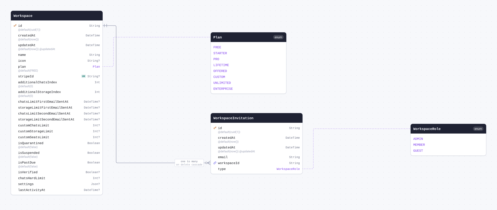

| Field         | Type                                   | Constraints                                 | Default              | Description |
| ------------- | -------------------------------------- | ------------------------------------------- | -------------------- | ----------- |
| `id`          | `String`                               | PK NOT NULL                                 | `cuid(1)`            |             |
| `createdAt`   | `DateTime`                             | NOT NULL                                    | `now()`              |             |
| `updatedAt`   | `DateTime`                             | NOT NULL                                    | `now()` `@updatedAt` |             |
| `email`       | `String`                               | NOT NULL                                    |                      |             |
| `workspaceId` | `String`                               | NOT NULL → [Workspace.id](#model-Workspace) |                      |             |
| `type`        | [`WorkspaceRole`](#enum-WorkspaceRole) | NOT NULL                                    |                      |             |

#### References

- `workspaceId` → [Workspace.id](#model-Workspace) (many-to-one, on delete Cascade)

#### Definition

```sql
CREATE TABLE "WorkspaceInvitation" (
    "id" TEXT NOT NULL,
    "createdAt" TIMESTAMP(3) NOT NULL DEFAULT CURRENT_TIMESTAMP,
    "updatedAt" TIMESTAMP(3) NOT NULL DEFAULT CURRENT_TIMESTAMP,
    "email" TEXT NOT NULL,
    "workspaceId" TEXT NOT NULL,
    "type" "WorkspaceRole" NOT NULL,

    CONSTRAINT "WorkspaceInvitation_pkey" PRIMARY KEY ("id")
);

ALTER TABLE "WorkspaceInvitation" ADD CONSTRAINT "WorkspaceInvitation_workspaceId_fkey" FOREIGN KEY ("workspaceId") REFERENCES "Workspace"("id") ON DELETE CASCADE ON UPDATE CASCADE;
```

<details>
<summary>Queries and their SQL</summary>

**findMany**: Every row

```ts
await prisma.workspaceInvitation.findMany();
```

```sql
SELECT
  "public"."WorkspaceInvitation"."id",
  "public"."WorkspaceInvitation"."createdAt",
  "public"."WorkspaceInvitation"."updatedAt",
  "public"."WorkspaceInvitation"."email",
  "public"."WorkspaceInvitation"."workspaceId",
  "public"."WorkspaceInvitation"."type"::text
FROM
  "public"."WorkspaceInvitation"
WHERE
  1 = 1
OFFSET
  $1
-- params: ["0"]
```

**count**: How many rows there are

```ts
await prisma.workspaceInvitation.count();
```

```sql
SELECT
  COUNT(*) AS "_count$_all"
FROM
  (
    SELECT
      "public"."WorkspaceInvitation"."id"
    FROM
      "public"."WorkspaceInvitation"
    WHERE
      1 = 1
    OFFSET
      $1
  ) AS "sub"
-- params: ["0"]
```

**findMany**: Every row with its relations

```ts
await prisma.workspaceInvitation.findMany({ include: { workspace: true } });
```

```sql
SELECT
  "public"."WorkspaceInvitation"."id",
  "public"."WorkspaceInvitation"."createdAt",
  "public"."WorkspaceInvitation"."updatedAt",
  "public"."WorkspaceInvitation"."email",
  "public"."WorkspaceInvitation"."workspaceId",
  "public"."WorkspaceInvitation"."type"::text
FROM
  "public"."WorkspaceInvitation"
WHERE
  1 = 1
OFFSET
  $1
-- params: ["0"]

SELECT
  "public"."Workspace"."id",
  "public"."Workspace"."createdAt",
  "public"."Workspace"."updatedAt",
  "public"."Workspace"."name",
  "public"."Workspace"."icon",
  "public"."Workspace"."plan"::text,
  "public"."Workspace"."stripeId",
  "public"."Workspace"."additionalChatsIndex",
  "public"."Workspace"."additionalStorageIndex",
  "public"."Workspace"."chatsLimitFirstEmailSentAt",
  "public"."Workspace"."storageLimitFirstEmailSentAt",
  "public"."Workspace"."chatsLimitSecondEmailSentAt",
  "public"."Workspace"."storageLimitSecondEmailSentAt",
  "public"."Workspace"."customChatsLimit",
  "public"."Workspace"."customStorageLimit",
  "public"."Workspace"."customSeatsLimit",
  "public"."Workspace"."isQuarantined",
  "public"."Workspace"."isSuspended",
  "public"."Workspace"."isPastDue",
  "public"."Workspace"."isVerified",
  "public"."Workspace"."chatsHardLimit",
  "public"."Workspace"."settings",
  "public"."Workspace"."lastActivityAt"
FROM
  "public"."Workspace"
WHERE
  "public"."Workspace"."id" IN ($1)
OFFSET
  $2
-- params: ["<workspaceId of the rows above>","0"]
```

**findUnique**: One row by what is unique to it

```ts
await prisma.workspaceInvitation.findUnique({ where: { id: "example" } });
```

```sql
SELECT
  "public"."WorkspaceInvitation"."id",
  "public"."WorkspaceInvitation"."createdAt",
  "public"."WorkspaceInvitation"."updatedAt",
  "public"."WorkspaceInvitation"."email",
  "public"."WorkspaceInvitation"."workspaceId",
  "public"."WorkspaceInvitation"."type"::text
FROM
  "public"."WorkspaceInvitation"
WHERE
  (
    "public"."WorkspaceInvitation"."id" = $1
    AND 1 = 1
  )
LIMIT
  $2
OFFSET
  $3
-- params: ["example","1","0"]
```

**create**: Create a row

```ts
await prisma.workspaceInvitation.create({
  data: { email: "example", workspaceId: "example", type: "ADMIN" },
});
```

```sql
INSERT INTO
  "public"."WorkspaceInvitation" (
    "id",
    "createdAt",
    "updatedAt",
    "email",
    "workspaceId",
    "type"
  )
VALUES
  (
    $1,
    $2,
    $3,
    $4,
    $5,
    CAST($6::text AS "public"."WorkspaceRole")
  )
RETURNING
  "public"."WorkspaceInvitation"."id",
  "public"."WorkspaceInvitation"."createdAt",
  "public"."WorkspaceInvitation"."updatedAt",
  "public"."WorkspaceInvitation"."email",
  "public"."WorkspaceInvitation"."workspaceId",
  "public"."WorkspaceInvitation"."type"::text
-- params: ["<cuid(1)>","<now()>","<now()>","example","example","ADMIN"]
```

**update**: Update a row

```ts
await prisma.workspaceInvitation.update({
  where: { id: "example" },
  data: { createdAt: new Date("2026-01-01T00:00:00.000Z") },
});
```

```sql
UPDATE "public"."WorkspaceInvitation"
SET
  "createdAt" = $1,
  "updatedAt" = $2
WHERE
  (
    "public"."WorkspaceInvitation"."id" = $3
    AND 1 = 1
  )
RETURNING
  "public"."WorkspaceInvitation"."id",
  "public"."WorkspaceInvitation"."createdAt",
  "public"."WorkspaceInvitation"."updatedAt",
  "public"."WorkspaceInvitation"."email",
  "public"."WorkspaceInvitation"."workspaceId",
  "public"."WorkspaceInvitation"."type"::text
-- params: ["2026-01-01T00:00:00.000Z",{"prisma__type":"generatorCall","prisma__value":{"name":"now","args":[],"returnType":{"type":"DateTime"}}},"example"]
```

**delete**: Delete a row

```ts
await prisma.workspaceInvitation.delete({ where: { id: "example" } });
```

```sql
DELETE FROM "public"."WorkspaceInvitation"
WHERE
  (
    "public"."WorkspaceInvitation"."id" = $1
    AND 1 = 1
  )
RETURNING
  "public"."WorkspaceInvitation"."id",
  "public"."WorkspaceInvitation"."createdAt",
  "public"."WorkspaceInvitation"."updatedAt",
  "public"."WorkspaceInvitation"."email",
  "public"."WorkspaceInvitation"."workspaceId",
  "public"."WorkspaceInvitation"."type"::text
-- params: ["example"]
```

</details>

<a id="model-CustomDomain"></a>

### CustomDomain

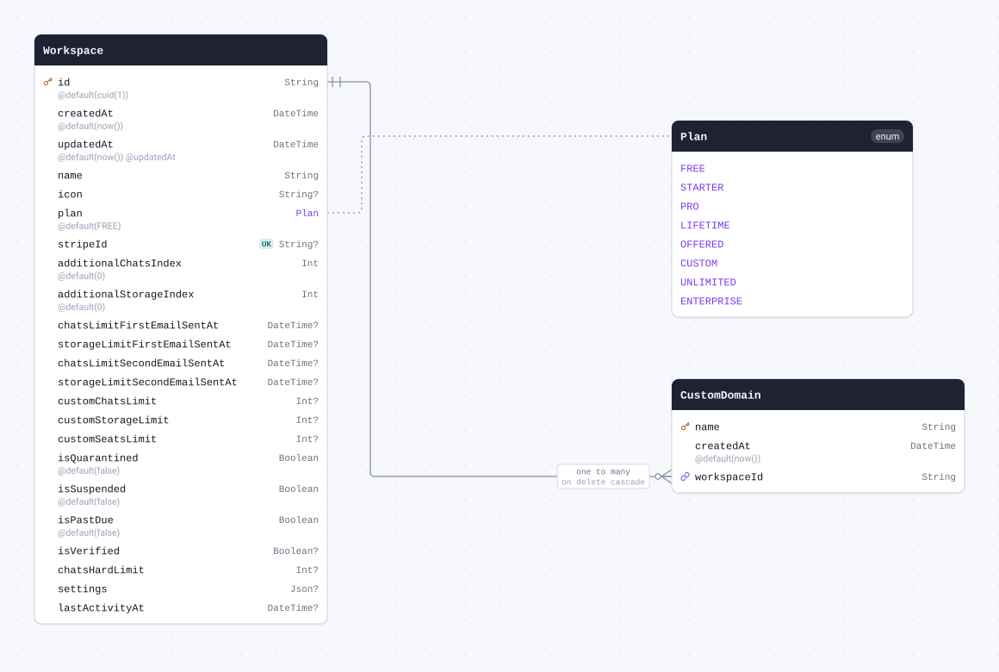

| Field         | Type       | Constraints                                 | Default | Description |
| ------------- | ---------- | ------------------------------------------- | ------- | ----------- |
| `name`        | `String`   | PK NOT NULL                                 |         |             |
| `createdAt`   | `DateTime` | NOT NULL                                    | `now()` |             |
| `workspaceId` | `String`   | NOT NULL → [Workspace.id](#model-Workspace) |         |             |

#### References

- `workspaceId` → [Workspace.id](#model-Workspace) (many-to-one, on delete Cascade)

#### Definition

```sql
CREATE TABLE "CustomDomain" (
    "name" TEXT NOT NULL,
    "createdAt" TIMESTAMP(3) NOT NULL DEFAULT CURRENT_TIMESTAMP,
    "workspaceId" TEXT NOT NULL,

    CONSTRAINT "CustomDomain_pkey" PRIMARY KEY ("name")
);

ALTER TABLE "CustomDomain" ADD CONSTRAINT "CustomDomain_workspaceId_fkey" FOREIGN KEY ("workspaceId") REFERENCES "Workspace"("id") ON DELETE CASCADE ON UPDATE CASCADE;
```

<details>
<summary>Queries and their SQL</summary>

**findMany**: Every row

```ts
await prisma.customDomain.findMany();
```

```sql
SELECT
  "public"."CustomDomain"."name",
  "public"."CustomDomain"."createdAt",
  "public"."CustomDomain"."workspaceId"
FROM
  "public"."CustomDomain"
WHERE
  1 = 1
OFFSET
  $1
-- params: ["0"]
```

**count**: How many rows there are

```ts
await prisma.customDomain.count();
```

```sql
SELECT
  COUNT(*) AS "_count$_all"
FROM
  (
    SELECT
      "public"."CustomDomain"."name"
    FROM
      "public"."CustomDomain"
    WHERE
      1 = 1
    OFFSET
      $1
  ) AS "sub"
-- params: ["0"]
```

**findMany**: Every row with its relations

```ts
await prisma.customDomain.findMany({ include: { workspace: true } });
```

```sql
SELECT
  "public"."CustomDomain"."name",
  "public"."CustomDomain"."createdAt",
  "public"."CustomDomain"."workspaceId"
FROM
  "public"."CustomDomain"
WHERE
  1 = 1
OFFSET
  $1
-- params: ["0"]

SELECT
  "public"."Workspace"."id",
  "public"."Workspace"."createdAt",
  "public"."Workspace"."updatedAt",
  "public"."Workspace"."name",
  "public"."Workspace"."icon",
  "public"."Workspace"."plan"::text,
  "public"."Workspace"."stripeId",
  "public"."Workspace"."additionalChatsIndex",
  "public"."Workspace"."additionalStorageIndex",
  "public"."Workspace"."chatsLimitFirstEmailSentAt",
  "public"."Workspace"."storageLimitFirstEmailSentAt",
  "public"."Workspace"."chatsLimitSecondEmailSentAt",
  "public"."Workspace"."storageLimitSecondEmailSentAt",
  "public"."Workspace"."customChatsLimit",
  "public"."Workspace"."customStorageLimit",
  "public"."Workspace"."customSeatsLimit",
  "public"."Workspace"."isQuarantined",
  "public"."Workspace"."isSuspended",
  "public"."Workspace"."isPastDue",
  "public"."Workspace"."isVerified",
  "public"."Workspace"."chatsHardLimit",
  "public"."Workspace"."settings",
  "public"."Workspace"."lastActivityAt"
FROM
  "public"."Workspace"
WHERE
  "public"."Workspace"."id" IN ($1)
OFFSET
  $2
-- params: ["<workspaceId of the rows above>","0"]
```

**findUnique**: One row by what is unique to it

```ts
await prisma.customDomain.findUnique({ where: { name: "example" } });
```

```sql
SELECT
  "public"."CustomDomain"."name",
  "public"."CustomDomain"."createdAt",
  "public"."CustomDomain"."workspaceId"
FROM
  "public"."CustomDomain"
WHERE
  (
    "public"."CustomDomain"."name" = $1
    AND 1 = 1
  )
LIMIT
  $2
OFFSET
  $3
-- params: ["example","1","0"]
```

**create**: Create a row

```ts
await prisma.customDomain.create({ data: { name: "example", workspaceId: "example" } });
```

```sql
INSERT INTO
  "public"."CustomDomain" ("name", "createdAt", "workspaceId")
VALUES
  ($1, $2, $3)
RETURNING
  "public"."CustomDomain"."name",
  "public"."CustomDomain"."createdAt",
  "public"."CustomDomain"."workspaceId"
-- params: ["example","<now()>","example"]
```

**update**: Update a row

```ts
await prisma.customDomain.update({
  where: { name: "example" },
  data: { createdAt: new Date("2026-01-01T00:00:00.000Z") },
});
```

```sql
UPDATE "public"."CustomDomain"
SET
  "createdAt" = $1
WHERE
  (
    "public"."CustomDomain"."name" = $2
    AND 1 = 1
  )
RETURNING
  "public"."CustomDomain"."name",
  "public"."CustomDomain"."createdAt",
  "public"."CustomDomain"."workspaceId"
-- params: ["2026-01-01T00:00:00.000Z","example"]
```

**delete**: Delete a row

```ts
await prisma.customDomain.delete({ where: { name: "example" } });
```

```sql
DELETE FROM "public"."CustomDomain"
WHERE
  (
    "public"."CustomDomain"."name" = $1
    AND 1 = 1
  )
RETURNING
  "public"."CustomDomain"."name",
  "public"."CustomDomain"."createdAt",
  "public"."CustomDomain"."workspaceId"
-- params: ["example"]
```

</details>

<a id="model-Credentials"></a>

### Credentials


| Field         | Type       | Constraints                                 | Default   | Description |
| ------------- | ---------- | ------------------------------------------- | --------- | ----------- |
| `id`          | `String`   | PK NOT NULL                                 | `cuid(1)` |             |
| `createdAt`   | `DateTime` | NOT NULL                                    | `now()`   |             |
| `workspaceId` | `String`   | NOT NULL → [Workspace.id](#model-Workspace) |           |             |
| `data`        | `String`   | NOT NULL                                    |           |             |
| `name`        | `String`   | NOT NULL                                    |           |             |
| `type`        | `String`   | NOT NULL                                    |           |             |
| `iv`          | `String`   | NOT NULL                                    |           |             |

#### References

- `workspaceId` → [Workspace.id](#model-Workspace) (many-to-one, on delete Cascade)

#### Definition

```sql
CREATE TABLE "Credentials" (
    "id" TEXT NOT NULL,
    "createdAt" TIMESTAMP(3) NOT NULL DEFAULT CURRENT_TIMESTAMP,
    "workspaceId" TEXT NOT NULL,
    "data" TEXT NOT NULL,
    "name" TEXT NOT NULL,
    "type" TEXT NOT NULL,
    "iv" TEXT NOT NULL,

    CONSTRAINT "Credentials_pkey" PRIMARY KEY ("id")
);

ALTER TABLE "Credentials" ADD CONSTRAINT "Credentials_workspaceId_fkey" FOREIGN KEY ("workspaceId") REFERENCES "Workspace"("id") ON DELETE CASCADE ON UPDATE CASCADE;
```

<details>
<summary>Queries and their SQL</summary>

**findMany**: Every row

```ts
await prisma.credentials.findMany();
```

```sql
SELECT
  "public"."Credentials"."id",
  "public"."Credentials"."createdAt",
  "public"."Credentials"."workspaceId",
  "public"."Credentials"."data",
  "public"."Credentials"."name",
  "public"."Credentials"."type",
  "public"."Credentials"."iv"
FROM
  "public"."Credentials"
WHERE
  1 = 1
OFFSET
  $1
-- params: ["0"]
```

**count**: How many rows there are

```ts
await prisma.credentials.count();
```

```sql
SELECT
  COUNT(*) AS "_count$_all"
FROM
  (
    SELECT
      "public"."Credentials"."id"
    FROM
      "public"."Credentials"
    WHERE
      1 = 1
    OFFSET
      $1
  ) AS "sub"
-- params: ["0"]
```

**findMany**: Every row with its relations

```ts
await prisma.credentials.findMany({ include: { workspace: true } });
```

```sql
SELECT
  "public"."Credentials"."id",
  "public"."Credentials"."createdAt",
  "public"."Credentials"."workspaceId",
  "public"."Credentials"."data",
  "public"."Credentials"."name",
  "public"."Credentials"."type",
  "public"."Credentials"."iv"
FROM
  "public"."Credentials"
WHERE
  1 = 1
OFFSET
  $1
-- params: ["0"]

SELECT
  "public"."Workspace"."id",
  "public"."Workspace"."createdAt",
  "public"."Workspace"."updatedAt",
  "public"."Workspace"."name",
  "public"."Workspace"."icon",
  "public"."Workspace"."plan"::text,
  "public"."Workspace"."stripeId",
  "public"."Workspace"."additionalChatsIndex",
  "public"."Workspace"."additionalStorageIndex",
  "public"."Workspace"."chatsLimitFirstEmailSentAt",
  "public"."Workspace"."storageLimitFirstEmailSentAt",
  "public"."Workspace"."chatsLimitSecondEmailSentAt",
  "public"."Workspace"."storageLimitSecondEmailSentAt",
  "public"."Workspace"."customChatsLimit",
  "public"."Workspace"."customStorageLimit",
  "public"."Workspace"."customSeatsLimit",
  "public"."Workspace"."isQuarantined",
  "public"."Workspace"."isSuspended",
  "public"."Workspace"."isPastDue",
  "public"."Workspace"."isVerified",
  "public"."Workspace"."chatsHardLimit",
  "public"."Workspace"."settings",
  "public"."Workspace"."lastActivityAt"
FROM
  "public"."Workspace"
WHERE
  "public"."Workspace"."id" IN ($1)
OFFSET
  $2
-- params: ["<workspaceId of the rows above>","0"]
```

**findUnique**: One row by what is unique to it

```ts
await prisma.credentials.findUnique({ where: { id: "example" } });
```

```sql
SELECT
  "public"."Credentials"."id",
  "public"."Credentials"."createdAt",
  "public"."Credentials"."workspaceId",
  "public"."Credentials"."data",
  "public"."Credentials"."name",
  "public"."Credentials"."type",
  "public"."Credentials"."iv"
FROM
  "public"."Credentials"
WHERE
  (
    "public"."Credentials"."id" = $1
    AND 1 = 1
  )
LIMIT
  $2
OFFSET
  $3
-- params: ["example","1","0"]
```

**create**: Create a row

```ts
await prisma.credentials.create({
  data: {
    workspaceId: "example",
    data: "example",
    name: "example",
    type: "example",
    iv: "example",
  },
});
```

```sql
INSERT INTO
  "public"."Credentials" (
    "id",
    "createdAt",
    "workspaceId",
    "data",
    "name",
    "type",
    "iv"
  )
VALUES
  ($1, $2, $3, $4, $5, $6, $7)
RETURNING
  "public"."Credentials"."id",
  "public"."Credentials"."createdAt",
  "public"."Credentials"."workspaceId",
  "public"."Credentials"."data",
  "public"."Credentials"."name",
  "public"."Credentials"."type",
  "public"."Credentials"."iv"
-- params: ["<cuid(1)>","<now()>","example","example","example","example","example"]
```

**update**: Update a row

```ts
await prisma.credentials.update({
  where: { id: "example" },
  data: { createdAt: new Date("2026-01-01T00:00:00.000Z") },
});
```

```sql
UPDATE "public"."Credentials"
SET
  "createdAt" = $1
WHERE
  (
    "public"."Credentials"."id" = $2
    AND 1 = 1
  )
RETURNING
  "public"."Credentials"."id",
  "public"."Credentials"."createdAt",
  "public"."Credentials"."workspaceId",
  "public"."Credentials"."data",
  "public"."Credentials"."name",
  "public"."Credentials"."type",
  "public"."Credentials"."iv"
-- params: ["2026-01-01T00:00:00.000Z","example"]
```

**delete**: Delete a row

```ts
await prisma.credentials.delete({ where: { id: "example" } });
```

```sql
DELETE FROM "public"."Credentials"
WHERE
  (
    "public"."Credentials"."id" = $1
    AND 1 = 1
  )
RETURNING
  "public"."Credentials"."id",
  "public"."Credentials"."createdAt",
  "public"."Credentials"."workspaceId",
  "public"."Credentials"."data",
  "public"."Credentials"."name",
  "public"."Credentials"."type",
  "public"."Credentials"."iv"
-- params: ["example"]
```

</details>

<a id="model-UserCredentials"></a>

### UserCredentials

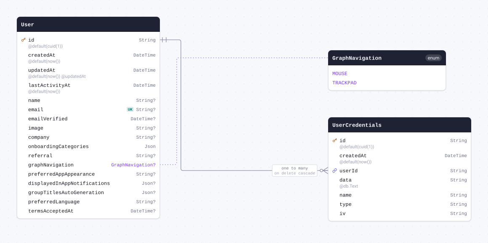

| Field       | Type                | Constraints                       | Default   | Description |
| ----------- | ------------------- | --------------------------------- | --------- | ----------- |
| `id`        | `String`            | PK NOT NULL                       | `cuid(1)` |             |
| `createdAt` | `DateTime`          | NOT NULL                          | `now()`   |             |
| `userId`    | `String`            | NOT NULL → [User.id](#model-User) |           |             |
| `data`      | `String` `@db.Text` | NOT NULL                          |           |             |
| `name`      | `String`            | NOT NULL                          |           |             |
| `type`      | `String`            | NOT NULL                          |           |             |
| `iv`        | `String`            | NOT NULL                          |           |             |

#### References

- `userId` → [User.id](#model-User) (many-to-one, on delete Cascade)

#### Definition

```sql
CREATE TABLE "UserCredentials" (
    "id" TEXT NOT NULL,
    "createdAt" TIMESTAMP(3) NOT NULL DEFAULT CURRENT_TIMESTAMP,
    "userId" TEXT NOT NULL,
    "data" TEXT NOT NULL,
    "name" TEXT NOT NULL,
    "type" TEXT NOT NULL,
    "iv" TEXT NOT NULL,

    CONSTRAINT "UserCredentials_pkey" PRIMARY KEY ("id")
);

ALTER TABLE "UserCredentials" ADD CONSTRAINT "UserCredentials_userId_fkey" FOREIGN KEY ("userId") REFERENCES "User"("id") ON DELETE CASCADE ON UPDATE CASCADE;
```

<details>
<summary>Queries and their SQL</summary>

**findMany**: Every row

```ts
await prisma.userCredentials.findMany();
```

```sql
SELECT
  "public"."UserCredentials"."id",
  "public"."UserCredentials"."createdAt",
  "public"."UserCredentials"."userId",
  "public"."UserCredentials"."data",
  "public"."UserCredentials"."name",
  "public"."UserCredentials"."type",
  "public"."UserCredentials"."iv"
FROM
  "public"."UserCredentials"
WHERE
  1 = 1
OFFSET
  $1
-- params: ["0"]
```

**count**: How many rows there are

```ts
await prisma.userCredentials.count();
```

```sql
SELECT
  COUNT(*) AS "_count$_all"
FROM
  (
    SELECT
      "public"."UserCredentials"."id"
    FROM
      "public"."UserCredentials"
    WHERE
      1 = 1
    OFFSET
      $1
  ) AS "sub"
-- params: ["0"]
```

**findMany**: Every row with its relations

```ts
await prisma.userCredentials.findMany({ include: { user: true } });
```

```sql
SELECT
  "public"."UserCredentials"."id",
  "public"."UserCredentials"."createdAt",
  "public"."UserCredentials"."userId",
  "public"."UserCredentials"."data",
  "public"."UserCredentials"."name",
  "public"."UserCredentials"."type",
  "public"."UserCredentials"."iv"
FROM
  "public"."UserCredentials"
WHERE
  1 = 1
OFFSET
  $1
-- params: ["0"]

SELECT
  "public"."User"."id",
  "public"."User"."createdAt",
  "public"."User"."updatedAt",
  "public"."User"."lastActivityAt",
  "public"."User"."name",
  "public"."User"."email",
  "public"."User"."emailVerified",
  "public"."User"."image",
  "public"."User"."company",
  "public"."User"."onboardingCategories",
  "public"."User"."referral",
  "public"."User"."graphNavigation"::text,
  "public"."User"."preferredAppAppearance",
  "public"."User"."displayedInAppNotifications",
  "public"."User"."groupTitlesAutoGeneration",
  "public"."User"."preferredLanguage",
  "public"."User"."termsAcceptedAt"
FROM
  "public"."User"
WHERE
  "public"."User"."id" IN ($1)
OFFSET
  $2
-- params: ["<userId of the rows above>","0"]
```

**findUnique**: One row by what is unique to it

```ts
await prisma.userCredentials.findUnique({ where: { id: "example" } });
```

```sql
SELECT
  "public"."UserCredentials"."id",
  "public"."UserCredentials"."createdAt",
  "public"."UserCredentials"."userId",
  "public"."UserCredentials"."data",
  "public"."UserCredentials"."name",
  "public"."UserCredentials"."type",
  "public"."UserCredentials"."iv"
FROM
  "public"."UserCredentials"
WHERE
  (
    "public"."UserCredentials"."id" = $1
    AND 1 = 1
  )
LIMIT
  $2
OFFSET
  $3
-- params: ["example","1","0"]
```

**create**: Create a row

```ts
await prisma.userCredentials.create({
  data: { userId: "example", data: "example", name: "example", type: "example", iv: "example" },
});
```

```sql
INSERT INTO
  "public"."UserCredentials" (
    "id",
    "createdAt",
    "userId",
    "data",
    "name",
    "type",
    "iv"
  )
VALUES
  ($1, $2, $3, $4, $5, $6, $7)
RETURNING
  "public"."UserCredentials"."id",
  "public"."UserCredentials"."createdAt",
  "public"."UserCredentials"."userId",
  "public"."UserCredentials"."data",
  "public"."UserCredentials"."name",
  "public"."UserCredentials"."type",
  "public"."UserCredentials"."iv"
-- params: ["<cuid(1)>","<now()>","example","example","example","example","example"]
```

**update**: Update a row

```ts
await prisma.userCredentials.update({
  where: { id: "example" },
  data: { createdAt: new Date("2026-01-01T00:00:00.000Z") },
});
```

```sql
UPDATE "public"."UserCredentials"
SET
  "createdAt" = $1
WHERE
  (
    "public"."UserCredentials"."id" = $2
    AND 1 = 1
  )
RETURNING
  "public"."UserCredentials"."id",
  "public"."UserCredentials"."createdAt",
  "public"."UserCredentials"."userId",
  "public"."UserCredentials"."data",
  "public"."UserCredentials"."name",
  "public"."UserCredentials"."type",
  "public"."UserCredentials"."iv"
-- params: ["2026-01-01T00:00:00.000Z","example"]
```

**delete**: Delete a row

```ts
await prisma.userCredentials.delete({ where: { id: "example" } });
```

```sql
DELETE FROM "public"."UserCredentials"
WHERE
  (
    "public"."UserCredentials"."id" = $1
    AND 1 = 1
  )
RETURNING
  "public"."UserCredentials"."id",
  "public"."UserCredentials"."createdAt",
  "public"."UserCredentials"."userId",
  "public"."UserCredentials"."data",
  "public"."UserCredentials"."name",
  "public"."UserCredentials"."type",
  "public"."UserCredentials"."iv"
-- params: ["example"]
```

</details>

<a id="model-VerificationToken"></a>

### VerificationToken

| Field            | Type       | Constraints     | Default | Description |
| ---------------- | ---------- | --------------- | ------- | ----------- |
| `identifier`     | `String`   | NOT NULL        |         |             |
| `token`          | `String`   | UNIQUE NOT NULL |         |             |
| `value`          | `String`   | NULL            |         |             |
| `failedAttempts` | `Int`      | NOT NULL        | `0`     |             |
| `expires`        | `DateTime` | NOT NULL        |         |             |

#### Indexes

- `@@unique([identifier, token])`

#### Definition

```sql
CREATE TABLE "VerificationToken" (
    "identifier" TEXT NOT NULL,
    "token" TEXT NOT NULL,
    "value" TEXT,
    "failedAttempts" INTEGER NOT NULL DEFAULT 0,
    "expires" TIMESTAMP(3) NOT NULL
);

CREATE UNIQUE INDEX "VerificationToken_token_key" ON "VerificationToken"("token");

CREATE UNIQUE INDEX "VerificationToken_identifier_token_key" ON "VerificationToken"("identifier", "token");
```

<details>
<summary>Queries and their SQL</summary>

**findMany**: Every row

```ts
await prisma.verificationToken.findMany();
```

```sql
SELECT
  "public"."VerificationToken"."token",
  "public"."VerificationToken"."identifier",
  "public"."VerificationToken"."value",
  "public"."VerificationToken"."failedAttempts",
  "public"."VerificationToken"."expires"
FROM
  "public"."VerificationToken"
WHERE
  1 = 1
OFFSET
  $1
-- params: ["0"]
```

**count**: How many rows there are

```ts
await prisma.verificationToken.count();
```

```sql
SELECT
  COUNT(*) AS "_count$_all"
FROM
  (
    SELECT
      "public"."VerificationToken"."token"
    FROM
      "public"."VerificationToken"
    WHERE
      1 = 1
    OFFSET
      $1
  ) AS "sub"
-- params: ["0"]
```

**findUnique**: One row by what is unique to it

```ts
await prisma.verificationToken.findUnique({ where: { token: "example" } });
```

```sql
SELECT
  "public"."VerificationToken"."token",
  "public"."VerificationToken"."identifier",
  "public"."VerificationToken"."value",
  "public"."VerificationToken"."failedAttempts",
  "public"."VerificationToken"."expires"
FROM
  "public"."VerificationToken"
WHERE
  (
    "public"."VerificationToken"."token" = $1
    AND 1 = 1
  )
LIMIT
  $2
OFFSET
  $3
-- params: ["example","1","0"]
```

**create**: Create a row

```ts
await prisma.verificationToken.create({
  data: { identifier: "example", token: "example", expires: new Date("2026-01-01T00:00:00.000Z") },
});
```

```sql
INSERT INTO
  "public"."VerificationToken" (
    "identifier",
    "token",
    "failedAttempts",
    "expires"
  )
VALUES
  ($1, $2, $3, $4)
RETURNING
  "public"."VerificationToken"."token",
  "public"."VerificationToken"."identifier",
  "public"."VerificationToken"."value",
  "public"."VerificationToken"."failedAttempts",
  "public"."VerificationToken"."expires"
-- params: ["example","example","0","2026-01-01T00:00:00.000Z"]
```

**update**: Update a row

```ts
await prisma.verificationToken.update({
  where: { token: "example" },
  data: { identifier: "example" },
});
```

```sql
UPDATE "public"."VerificationToken"
SET
  "identifier" = $1
WHERE
  (
    "public"."VerificationToken"."token" = $2
    AND 1 = 1
  )
RETURNING
  "public"."VerificationToken"."token",
  "public"."VerificationToken"."identifier",
  "public"."VerificationToken"."value",
  "public"."VerificationToken"."failedAttempts",
  "public"."VerificationToken"."expires"
-- params: ["example","example"]
```

**delete**: Delete a row

```ts
await prisma.verificationToken.delete({ where: { token: "example" } });
```

```sql
DELETE FROM "public"."VerificationToken"
WHERE
  (
    "public"."VerificationToken"."token" = $1
    AND 1 = 1
  )
RETURNING
  "public"."VerificationToken"."token",
  "public"."VerificationToken"."identifier",
  "public"."VerificationToken"."value",
  "public"."VerificationToken"."failedAttempts",
  "public"."VerificationToken"."expires"
-- params: ["example"]
```

</details>

<a id="model-DashboardFolder"></a>

### DashboardFolder

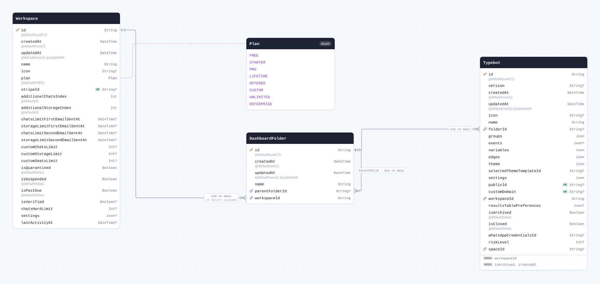

| Field            | Type       | Constraints                                         | Default              | Description |
| ---------------- | ---------- | --------------------------------------------------- | -------------------- | ----------- |
| `id`             | `String`   | PK NOT NULL                                         | `cuid(1)`            |             |
| `createdAt`      | `DateTime` | NOT NULL                                            | `now()`              |             |
| `updatedAt`      | `DateTime` | NOT NULL                                            | `now()` `@updatedAt` |             |
| `name`           | `String`   | NOT NULL                                            |                      |             |
| `parentFolderId` | `String`   | NULL → [DashboardFolder.id](#model-DashboardFolder) |                      |             |
| `workspaceId`    | `String`   | NOT NULL → [Workspace.id](#model-Workspace)         |                      |             |

#### References

- `parentFolderId` → [DashboardFolder.id](#model-DashboardFolder) (many-to-one)
- `workspaceId` → [Workspace.id](#model-Workspace) (many-to-one, on delete Cascade)

#### Referenced by

- `id` ← [DashboardFolder.parentFolderId](#model-DashboardFolder) (one-to-many)
- `id` ← [Typebot.folderId](#model-Typebot) (one-to-many)

#### Definition

```sql
CREATE TABLE "DashboardFolder" (
    "id" TEXT NOT NULL,
    "createdAt" TIMESTAMP(3) NOT NULL DEFAULT CURRENT_TIMESTAMP,
    "updatedAt" TIMESTAMP(3) NOT NULL DEFAULT CURRENT_TIMESTAMP,
    "name" TEXT NOT NULL,
    "parentFolderId" TEXT,
    "workspaceId" TEXT NOT NULL,

    CONSTRAINT "DashboardFolder_pkey" PRIMARY KEY ("id")
);

ALTER TABLE "DashboardFolder" ADD CONSTRAINT "DashboardFolder_parentFolderId_fkey" FOREIGN KEY ("parentFolderId") REFERENCES "DashboardFolder"("id") ON DELETE SET NULL ON UPDATE CASCADE;

ALTER TABLE "DashboardFolder" ADD CONSTRAINT "DashboardFolder_workspaceId_fkey" FOREIGN KEY ("workspaceId") REFERENCES "Workspace"("id") ON DELETE CASCADE ON UPDATE CASCADE;
```

<details>
<summary>Queries and their SQL</summary>

**findMany**: Every row

```ts
await prisma.dashboardFolder.findMany();
```

```sql
SELECT
  "public"."DashboardFolder"."id",
  "public"."DashboardFolder"."createdAt",
  "public"."DashboardFolder"."updatedAt",
  "public"."DashboardFolder"."name",
  "public"."DashboardFolder"."parentFolderId",
  "public"."DashboardFolder"."workspaceId"
FROM
  "public"."DashboardFolder"
WHERE
  1 = 1
OFFSET
  $1
-- params: ["0"]
```

**count**: How many rows there are

```ts
await prisma.dashboardFolder.count();
```

```sql
SELECT
  COUNT(*) AS "_count$_all"
FROM
  (
    SELECT
      "public"."DashboardFolder"."id"
    FROM
      "public"."DashboardFolder"
    WHERE
      1 = 1
    OFFSET
      $1
  ) AS "sub"
-- params: ["0"]
```

**findMany**: Every row with its relations

```ts
await prisma.dashboardFolder.findMany({
  include: { parentFolder: true, workspace: true, childrenFolder: true, typebots: true },
});
```

```sql
SELECT
  "public"."DashboardFolder"."id",
  "public"."DashboardFolder"."createdAt",
  "public"."DashboardFolder"."updatedAt",
  "public"."DashboardFolder"."name",
  "public"."DashboardFolder"."parentFolderId",
  "public"."DashboardFolder"."workspaceId"
FROM
  "public"."DashboardFolder"
WHERE
  1 = 1
OFFSET
  $1
-- params: ["0"]

SELECT
  "public"."DashboardFolder"."id",
  "public"."DashboardFolder"."createdAt",
  "public"."DashboardFolder"."updatedAt",
  "public"."DashboardFolder"."name",
  "public"."DashboardFolder"."parentFolderId",
  "public"."DashboardFolder"."workspaceId"
FROM
  "public"."DashboardFolder"
WHERE
  "public"."DashboardFolder"."id" IN ($1)
OFFSET
  $2
-- params: ["<parentFolderId of the rows above>","0"]

SELECT
  "public"."Workspace"."id",
  "public"."Workspace"."createdAt",
  "public"."Workspace"."updatedAt",
  "public"."Workspace"."name",
  "public"."Workspace"."icon",
  "public"."Workspace"."plan"::text,
  "public"."Workspace"."stripeId",
  "public"."Workspace"."additionalChatsIndex",
  "public"."Workspace"."additionalStorageIndex",
  "public"."Workspace"."chatsLimitFirstEmailSentAt",
  "public"."Workspace"."storageLimitFirstEmailSentAt",
  "public"."Workspace"."chatsLimitSecondEmailSentAt",
  "public"."Workspace"."storageLimitSecondEmailSentAt",
  "public"."Workspace"."customChatsLimit",
  "public"."Workspace"."customStorageLimit",
  "public"."Workspace"."customSeatsLimit",
  "public"."Workspace"."isQuarantined",
  "public"."Workspace"."isSuspended",
  "public"."Workspace"."isPastDue",
  "public"."Workspace"."isVerified",
  "public"."Workspace"."chatsHardLimit",
  "public"."Workspace"."settings",
  "public"."Workspace"."lastActivityAt"
FROM
  "public"."Workspace"
WHERE
  "public"."Workspace"."id" IN ($1)
OFFSET
  $2
-- params: ["<workspaceId of the rows above>","0"]

SELECT
  "public"."DashboardFolder"."id",
  "public"."DashboardFolder"."createdAt",
  "public"."DashboardFolder"."updatedAt",
  "public"."DashboardFolder"."name",
  "public"."DashboardFolder"."parentFolderId",
  "public"."DashboardFolder"."workspaceId"
FROM
  "public"."DashboardFolder"
WHERE
  "public"."DashboardFolder"."parentFolderId" IN ($1)
OFFSET
  $2
-- params: ["<id of the rows above>","0"]

SELECT
  "public"."Typebot"."id",
  "public"."Typebot"."version",
  "public"."Typebot"."createdAt",
  "public"."Typebot"."updatedAt",
  "public"."Typebot"."icon",
  "public"."Typebot"."name",
  "public"."Typebot"."folderId",
  "public"."Typebot"."groups",
  "public"."Typebot"."events",
  "public"."Typebot"."variables",
  "public"."Typebot"."edges",
  "public"."Typebot"."theme",
  "public"."Typebot"."selectedThemeTemplateId",
  "public"."Typebot"."settings",
  "public"."Typebot"."publicId",
  "public"."Typebot"."customDomain",
  "public"."Typebot"."workspaceId",
  "public"."Typebot"."resultsTablePreferences",
  "public"."Typebot"."isArchived",
  "public"."Typebot"."isClosed",
  "public"."Typebot"."whatsAppCredentialsId",
  "public"."Typebot"."riskLevel",
  "public"."Typebot"."spaceId"
FROM
  "public"."Typebot"
WHERE
  "public"."Typebot"."folderId" IN ($1)
OFFSET
  $2
-- params: ["<id of the rows above>","0"]
```

**findUnique**: One row by what is unique to it

```ts
await prisma.dashboardFolder.findUnique({ where: { id: "example" } });
```

```sql
SELECT
  "public"."DashboardFolder"."id",
  "public"."DashboardFolder"."createdAt",
  "public"."DashboardFolder"."updatedAt",
  "public"."DashboardFolder"."name",
  "public"."DashboardFolder"."parentFolderId",
  "public"."DashboardFolder"."workspaceId"
FROM
  "public"."DashboardFolder"
WHERE
  (
    "public"."DashboardFolder"."id" = $1
    AND 1 = 1
  )
LIMIT
  $2
OFFSET
  $3
-- params: ["example","1","0"]
```

**create**: Create a row

```ts
await prisma.dashboardFolder.create({ data: { name: "example", workspaceId: "example" } });
```

```sql
INSERT INTO
  "public"."DashboardFolder" (
    "id",
    "createdAt",
    "updatedAt",
    "name",
    "workspaceId"
  )
VALUES
  ($1, $2, $3, $4, $5)
RETURNING
  "public"."DashboardFolder"."id",
  "public"."DashboardFolder"."createdAt",
  "public"."DashboardFolder"."updatedAt",
  "public"."DashboardFolder"."name",
  "public"."DashboardFolder"."parentFolderId",
  "public"."DashboardFolder"."workspaceId"
-- params: ["<cuid(1)>","<now()>","<now()>","example","example"]
```

**update**: Update a row

```ts
await prisma.dashboardFolder.update({
  where: { id: "example" },
  data: { createdAt: new Date("2026-01-01T00:00:00.000Z") },
});
```

```sql
UPDATE "public"."DashboardFolder"
SET
  "createdAt" = $1,
  "updatedAt" = $2
WHERE
  (
    "public"."DashboardFolder"."id" = $3
    AND 1 = 1
  )
RETURNING
  "public"."DashboardFolder"."id",
  "public"."DashboardFolder"."createdAt",
  "public"."DashboardFolder"."updatedAt",
  "public"."DashboardFolder"."name",
  "public"."DashboardFolder"."parentFolderId",
  "public"."DashboardFolder"."workspaceId"
-- params: ["2026-01-01T00:00:00.000Z",{"prisma__type":"generatorCall","prisma__value":{"name":"now","args":[],"returnType":{"type":"DateTime"}}},"example"]
```

**delete**: Delete a row

```ts
await prisma.dashboardFolder.delete({ where: { id: "example" } });
```

```sql
DELETE FROM "public"."DashboardFolder"
WHERE
  (
    "public"."DashboardFolder"."id" = $1
    AND 1 = 1
  )
RETURNING
  "public"."DashboardFolder"."id",
  "public"."DashboardFolder"."createdAt",
  "public"."DashboardFolder"."updatedAt",
  "public"."DashboardFolder"."name",
  "public"."DashboardFolder"."parentFolderId",
  "public"."DashboardFolder"."workspaceId"
-- params: ["example"]
```

</details>

<a id="model-Typebot"></a>

### Typebot

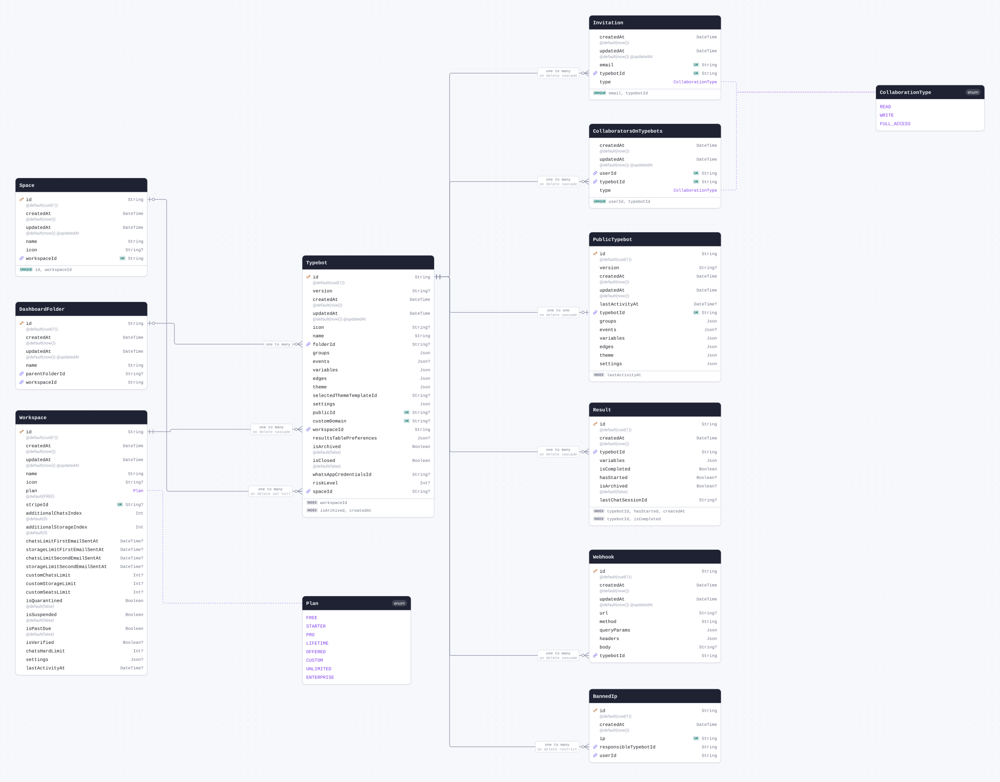

| Field                     | Type       | Constraints                                         | Default              | Description |
| ------------------------- | ---------- | --------------------------------------------------- | -------------------- | ----------- |
| `id`                      | `String`   | PK NOT NULL                                         | `cuid(1)`            |             |
| `version`                 | `String`   | NULL                                                |                      |             |
| `createdAt`               | `DateTime` | NOT NULL                                            | `now()`              |             |
| `updatedAt`               | `DateTime` | NOT NULL                                            | `now()` `@updatedAt` |             |
| `icon`                    | `String`   | NULL                                                |                      |             |
| `name`                    | `String`   | NOT NULL                                            |                      |             |
| `folderId`                | `String`   | NULL → [DashboardFolder.id](#model-DashboardFolder) |                      |             |
| `groups`                  | `Json`     | NOT NULL                                            |                      |             |
| `events`                  | `Json`     | NULL                                                |                      |             |
| `variables`               | `Json`     | NOT NULL                                            |                      |             |
| `edges`                   | `Json`     | NOT NULL                                            |                      |             |
| `theme`                   | `Json`     | NOT NULL                                            |                      |             |
| `selectedThemeTemplateId` | `String`   | NULL                                                |                      |             |
| `settings`                | `Json`     | NOT NULL                                            |                      |             |
| `publicId`                | `String`   | UNIQUE NULL                                         |                      |             |
| `customDomain`            | `String`   | UNIQUE NULL                                         |                      |             |
| `workspaceId`             | `String`   | NOT NULL → [Workspace.id](#model-Workspace)         |                      |             |
| `resultsTablePreferences` | `Json`     | NULL                                                |                      |             |
| `isArchived`              | `Boolean`  | NOT NULL                                            | `false`              |             |
| `isClosed`                | `Boolean`  | NOT NULL                                            | `false`              |             |
| `whatsAppCredentialsId`   | `String`   | NULL                                                |                      |             |
| `riskLevel`               | `Int`      | NULL                                                |                      |             |
| `spaceId`                 | `String`   | NULL → [Space.id](#model-Space)                     |                      |             |

#### Indexes

- `@@index([workspaceId])`
- `@@index([isArchived, createdAt])`

#### References

- `folderId` → [DashboardFolder.id](#model-DashboardFolder) (many-to-one)
- `workspaceId` → [Workspace.id](#model-Workspace) (many-to-one, on delete Cascade)
- `spaceId` → [Space.id](#model-Space) (many-to-one, on delete SetNull)

#### Referenced by

- `id` ← [Invitation.typebotId](#model-Invitation) (one-to-many, on delete Cascade)
- `id` ← [CollaboratorsOnTypebots.typebotId](#model-CollaboratorsOnTypebots) (one-to-many, on delete Cascade)
- `id` ← [PublicTypebot.typebotId](#model-PublicTypebot) (one-to-one, on delete Cascade)
- `id` ← [Result.typebotId](#model-Result) (one-to-many, on delete Cascade)
- `id` ← [Webhook.typebotId](#model-Webhook) (one-to-many, on delete Cascade)
- `id` ← [BannedIp.responsibleTypebotId](#model-BannedIp) (one-to-many, on delete Restrict)

#### Definition

```sql
CREATE TABLE "Typebot" (
    "id" TEXT NOT NULL,
    "version" TEXT,
    "createdAt" TIMESTAMP(3) NOT NULL DEFAULT CURRENT_TIMESTAMP,
    "updatedAt" TIMESTAMP(3) NOT NULL DEFAULT CURRENT_TIMESTAMP,
    "icon" TEXT,
    "name" TEXT NOT NULL,
    "folderId" TEXT,
    "groups" JSONB NOT NULL,
    "events" JSONB,
    "variables" JSONB NOT NULL,
    "edges" JSONB NOT NULL,
    "theme" JSONB NOT NULL,
    "selectedThemeTemplateId" TEXT,
    "settings" JSONB NOT NULL,
    "publicId" TEXT,
    "customDomain" TEXT,
    "workspaceId" TEXT NOT NULL,
    "resultsTablePreferences" JSONB,
    "isArchived" BOOLEAN NOT NULL DEFAULT false,
    "isClosed" BOOLEAN NOT NULL DEFAULT false,
    "whatsAppCredentialsId" TEXT,
    "riskLevel" INTEGER,
    "spaceId" TEXT,

    CONSTRAINT "Typebot_pkey" PRIMARY KEY ("id")
);

CREATE UNIQUE INDEX "Typebot_publicId_key" ON "Typebot"("publicId");

CREATE UNIQUE INDEX "Typebot_customDomain_key" ON "Typebot"("customDomain");

CREATE INDEX "Typebot_workspaceId_idx" ON "Typebot"("workspaceId");

CREATE INDEX "Typebot_isArchived_createdAt_idx" ON "Typebot"("isArchived", "createdAt" DESC);

ALTER TABLE "Typebot" ADD CONSTRAINT "Typebot_folderId_fkey" FOREIGN KEY ("folderId") REFERENCES "DashboardFolder"("id") ON DELETE SET NULL ON UPDATE CASCADE;

ALTER TABLE "Typebot" ADD CONSTRAINT "Typebot_workspaceId_fkey" FOREIGN KEY ("workspaceId") REFERENCES "Workspace"("id") ON DELETE CASCADE ON UPDATE CASCADE;

ALTER TABLE "Typebot" ADD CONSTRAINT "Typebot_spaceId_fkey" FOREIGN KEY ("spaceId") REFERENCES "Space"("id") ON DELETE SET NULL ON UPDATE CASCADE;
```

<details>
<summary>Queries and their SQL</summary>

**findMany**: Every row

```ts
await prisma.typebot.findMany();
```

```sql
SELECT
  "public"."Typebot"."id",
  "public"."Typebot"."version",
  "public"."Typebot"."createdAt",
  "public"."Typebot"."updatedAt",
  "public"."Typebot"."icon",
  "public"."Typebot"."name",
  "public"."Typebot"."folderId",
  "public"."Typebot"."groups",
  "public"."Typebot"."events",
  "public"."Typebot"."variables",
  "public"."Typebot"."edges",
  "public"."Typebot"."theme",
  "public"."Typebot"."selectedThemeTemplateId",
  "public"."Typebot"."settings",
  "public"."Typebot"."publicId",
  "public"."Typebot"."customDomain",
  "public"."Typebot"."workspaceId",
  "public"."Typebot"."resultsTablePreferences",
  "public"."Typebot"."isArchived",
  "public"."Typebot"."isClosed",
  "public"."Typebot"."whatsAppCredentialsId",
  "public"."Typebot"."riskLevel",
  "public"."Typebot"."spaceId"
FROM
  "public"."Typebot"
WHERE
  1 = 1
OFFSET
  $1
-- params: ["0"]
```

**count**: How many rows there are

```ts
await prisma.typebot.count();
```

```sql
SELECT
  COUNT(*) AS "_count$_all"
FROM
  (
    SELECT
      "public"."Typebot"."id"
    FROM
      "public"."Typebot"
    WHERE
      1 = 1
    OFFSET
      $1
  ) AS "sub"
-- params: ["0"]
```

**findMany**: Every row with its relations

```ts
await prisma.typebot.findMany({
  include: {
    folder: true,
    workspace: true,
    collaborators: true,
    invitations: true,
    publishedTypebot: true,
    results: true,
    webhooks: true,
    bannedIps: true,
    space: true,
  },
});
```

```sql
SELECT
  "public"."Typebot"."id",
  "public"."Typebot"."version",
  "public"."Typebot"."createdAt",
  "public"."Typebot"."updatedAt",
  "public"."Typebot"."icon",
  "public"."Typebot"."name",
  "public"."Typebot"."folderId",
  "public"."Typebot"."groups",
  "public"."Typebot"."events",
  "public"."Typebot"."variables",
  "public"."Typebot"."edges",
  "public"."Typebot"."theme",
  "public"."Typebot"."selectedThemeTemplateId",
  "public"."Typebot"."settings",
  "public"."Typebot"."publicId",
  "public"."Typebot"."customDomain",
  "public"."Typebot"."workspaceId",
  "public"."Typebot"."resultsTablePreferences",
  "public"."Typebot"."isArchived",
  "public"."Typebot"."isClosed",
  "public"."Typebot"."whatsAppCredentialsId",
  "public"."Typebot"."riskLevel",
  "public"."Typebot"."spaceId"
FROM
  "public"."Typebot"
WHERE
  1 = 1
OFFSET
  $1
-- params: ["0"]

SELECT
  "public"."DashboardFolder"."id",
  "public"."DashboardFolder"."createdAt",
  "public"."DashboardFolder"."updatedAt",
  "public"."DashboardFolder"."name",
  "public"."DashboardFolder"."parentFolderId",
  "public"."DashboardFolder"."workspaceId"
FROM
  "public"."DashboardFolder"
WHERE
  "public"."DashboardFolder"."id" IN ($1)
OFFSET
  $2
-- params: ["<folderId of the rows above>","0"]

SELECT
  "public"."Workspace"."id",
  "public"."Workspace"."createdAt",
  "public"."Workspace"."updatedAt",
  "public"."Workspace"."name",
  "public"."Workspace"."icon",
  "public"."Workspace"."plan"::text,
  "public"."Workspace"."stripeId",
  "public"."Workspace"."additionalChatsIndex",
  "public"."Workspace"."additionalStorageIndex",
  "public"."Workspace"."chatsLimitFirstEmailSentAt",
  "public"."Workspace"."storageLimitFirstEmailSentAt",
  "public"."Workspace"."chatsLimitSecondEmailSentAt",
  "public"."Workspace"."storageLimitSecondEmailSentAt",
  "public"."Workspace"."customChatsLimit",
  "public"."Workspace"."customStorageLimit",
  "public"."Workspace"."customSeatsLimit",
  "public"."Workspace"."isQuarantined",
  "public"."Workspace"."isSuspended",
  "public"."Workspace"."isPastDue",
  "public"."Workspace"."isVerified",
  "public"."Workspace"."chatsHardLimit",
  "public"."Workspace"."settings",
  "public"."Workspace"."lastActivityAt"
FROM
  "public"."Workspace"
WHERE
  "public"."Workspace"."id" IN ($1)
OFFSET
  $2
-- params: ["<workspaceId of the rows above>","0"]

SELECT
  "public"."CollaboratorsOnTypebots"."userId",
  "public"."CollaboratorsOnTypebots"."typebotId",
  "public"."CollaboratorsOnTypebots"."createdAt",
  "public"."CollaboratorsOnTypebots"."updatedAt",
  "public"."CollaboratorsOnTypebots"."type"::text
FROM
  "public"."CollaboratorsOnTypebots"
WHERE
  "public"."CollaboratorsOnTypebots"."typebotId" IN ($1)
OFFSET
  $2
-- params: ["<id of the rows above>","0"]

SELECT
  "public"."Invitation"."email",
  "public"."Invitation"."typebotId",
  "public"."Invitation"."createdAt",
  "public"."Invitation"."updatedAt",
  "public"."Invitation"."type"::text
FROM
  "public"."Invitation"
WHERE
  "public"."Invitation"."typebotId" IN ($1)
OFFSET
  $2
-- params: ["<id of the rows above>","0"]

SELECT
  "public"."PublicTypebot"."id",
  "public"."PublicTypebot"."version",
  "public"."PublicTypebot"."createdAt",
  "public"."PublicTypebot"."updatedAt",
  "public"."PublicTypebot"."lastActivityAt",
  "public"."PublicTypebot"."typebotId",
  "public"."PublicTypebot"."groups",
  "public"."PublicTypebot"."events",
  "public"."PublicTypebot"."variables",
  "public"."PublicTypebot"."edges",
  "public"."PublicTypebot"."theme",
  "public"."PublicTypebot"."settings"
FROM
  "public"."PublicTypebot"
WHERE
  "public"."PublicTypebot"."typebotId" IN ($1)
OFFSET
  $2
-- params: ["<id of the rows above>","0"]

SELECT
  "public"."Result"."id",
  "public"."Result"."createdAt",
  "public"."Result"."typebotId",
  "public"."Result"."variables",
  "public"."Result"."isCompleted",
  "public"."Result"."hasStarted",
  "public"."Result"."isArchived",
  "public"."Result"."lastChatSessionId"
FROM
  "public"."Result"
WHERE
  "public"."Result"."typebotId" IN ($1)
OFFSET
  $2
-- params: ["<id of the rows above>","0"]

SELECT
  "public"."Webhook"."id",
  "public"."Webhook"."createdAt",
  "public"."Webhook"."updatedAt",
  "public"."Webhook"."url",
  "public"."Webhook"."method",
  "public"."Webhook"."queryParams",
  "public"."Webhook"."headers",
  "public"."Webhook"."body",
  "public"."Webhook"."typebotId"
FROM
  "public"."Webhook"
WHERE
  "public"."Webhook"."typebotId" IN ($1)
OFFSET
  $2
-- params: ["<id of the rows above>","0"]

SELECT
  "public"."BannedIp"."id",
  "public"."BannedIp"."createdAt",
  "public"."BannedIp"."ip",
  "public"."BannedIp"."responsibleTypebotId",
  "public"."BannedIp"."userId"
FROM
  "public"."BannedIp"
WHERE
  "public"."BannedIp"."responsibleTypebotId" IN ($1)
OFFSET
  $2
-- params: ["<id of the rows above>","0"]

SELECT
  "public"."Space"."id",
  "public"."Space"."createdAt",
  "public"."Space"."updatedAt",
  "public"."Space"."name",
  "public"."Space"."icon",
  "public"."Space"."workspaceId"
FROM
  "public"."Space"
WHERE
  "public"."Space"."id" IN ($1)
OFFSET
  $2
-- params: ["<spaceId of the rows above>","0"]
```

**findUnique**: One row by what is unique to it

```ts
await prisma.typebot.findUnique({ where: { id: "example" } });
```

```sql
SELECT
  "public"."Typebot"."id",
  "public"."Typebot"."version",
  "public"."Typebot"."createdAt",
  "public"."Typebot"."updatedAt",
  "public"."Typebot"."icon",
  "public"."Typebot"."name",
  "public"."Typebot"."folderId",
  "public"."Typebot"."groups",
  "public"."Typebot"."events",
  "public"."Typebot"."variables",
  "public"."Typebot"."edges",
  "public"."Typebot"."theme",
  "public"."Typebot"."selectedThemeTemplateId",
  "public"."Typebot"."settings",
  "public"."Typebot"."publicId",
  "public"."Typebot"."customDomain",
  "public"."Typebot"."workspaceId",
  "public"."Typebot"."resultsTablePreferences",
  "public"."Typebot"."isArchived",
  "public"."Typebot"."isClosed",
  "public"."Typebot"."whatsAppCredentialsId",
  "public"."Typebot"."riskLevel",
  "public"."Typebot"."spaceId"
FROM
  "public"."Typebot"
WHERE
  (
    "public"."Typebot"."id" = $1
    AND 1 = 1
  )
LIMIT
  $2
OFFSET
  $3
-- params: ["example","1","0"]
```

**create**: Create a row

```ts
await prisma.typebot.create({
  data: {
    name: "example",
    groups: {},
    variables: {},
    edges: {},
    theme: {},
    settings: {},
    workspaceId: "example",
  },
});
```

```sql
INSERT INTO
  "public"."Typebot" (
    "id",
    "createdAt",
    "updatedAt",
    "name",
    "groups",
    "variables",
    "edges",
    "theme",
    "settings",
    "workspaceId",
    "isArchived",
    "isClosed"
  )
VALUES
  ($1, $2, $3, $4, $5, $6, $7, $8, $9, $10, $11, $12)
RETURNING
  "public"."Typebot"."id",
  "public"."Typebot"."version",
  "public"."Typebot"."createdAt",
  "public"."Typebot"."updatedAt",
  "public"."Typebot"."icon",
  "public"."Typebot"."name",
  "public"."Typebot"."folderId",
  "public"."Typebot"."groups",
  "public"."Typebot"."events",
  "public"."Typebot"."variables",
  "public"."Typebot"."edges",
  "public"."Typebot"."theme",
  "public"."Typebot"."selectedThemeTemplateId",
  "public"."Typebot"."settings",
  "public"."Typebot"."publicId",
  "public"."Typebot"."customDomain",
  "public"."Typebot"."workspaceId",
  "public"."Typebot"."resultsTablePreferences",
  "public"."Typebot"."isArchived",
  "public"."Typebot"."isClosed",
  "public"."Typebot"."whatsAppCredentialsId",
  "public"."Typebot"."riskLevel",
  "public"."Typebot"."spaceId"
-- params: ["<cuid(1)>","<now()>","<now()>","example","{}","{}","{}","{}","{}","example",false,false]
```

**update**: Update a row

```ts
await prisma.typebot.update({ where: { id: "example" }, data: { version: "example" } });
```

```sql
UPDATE "public"."Typebot"
SET
  "version" = $1,
  "updatedAt" = $2
WHERE
  (
    "public"."Typebot"."id" = $3
    AND 1 = 1
  )
RETURNING
  "public"."Typebot"."id",
  "public"."Typebot"."version",
  "public"."Typebot"."createdAt",
  "public"."Typebot"."updatedAt",
  "public"."Typebot"."icon",
  "public"."Typebot"."name",
  "public"."Typebot"."folderId",
  "public"."Typebot"."groups",
  "public"."Typebot"."events",
  "public"."Typebot"."variables",
  "public"."Typebot"."edges",
  "public"."Typebot"."theme",
  "public"."Typebot"."selectedThemeTemplateId",
  "public"."Typebot"."settings",
  "public"."Typebot"."publicId",
  "public"."Typebot"."customDomain",
  "public"."Typebot"."workspaceId",
  "public"."Typebot"."resultsTablePreferences",
  "public"."Typebot"."isArchived",
  "public"."Typebot"."isClosed",
  "public"."Typebot"."whatsAppCredentialsId",
  "public"."Typebot"."riskLevel",
  "public"."Typebot"."spaceId"
-- params: ["example",{"prisma__type":"generatorCall","prisma__value":{"name":"now","args":[],"returnType":{"type":"DateTime"}}},"example"]
```

**delete**: Delete a row

```ts
await prisma.typebot.delete({ where: { id: "example" } });
```

```sql
DELETE FROM "public"."Typebot"
WHERE
  (
    "public"."Typebot"."id" = $1
    AND 1 = 1
  )
RETURNING
  "public"."Typebot"."id",
  "public"."Typebot"."version",
  "public"."Typebot"."createdAt",
  "public"."Typebot"."updatedAt",
  "public"."Typebot"."icon",
  "public"."Typebot"."name",
  "public"."Typebot"."folderId",
  "public"."Typebot"."groups",
  "public"."Typebot"."events",
  "public"."Typebot"."variables",
  "public"."Typebot"."edges",
  "public"."Typebot"."theme",
  "public"."Typebot"."selectedThemeTemplateId",
  "public"."Typebot"."settings",
  "public"."Typebot"."publicId",
  "public"."Typebot"."customDomain",
  "public"."Typebot"."workspaceId",
  "public"."Typebot"."resultsTablePreferences",
  "public"."Typebot"."isArchived",
  "public"."Typebot"."isClosed",
  "public"."Typebot"."whatsAppCredentialsId",
  "public"."Typebot"."riskLevel",
  "public"."Typebot"."spaceId"
-- params: ["example"]
```

</details>

<a id="model-Invitation"></a>

### Invitation

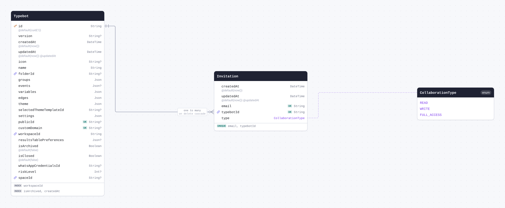

| Field       | Type                                           | Constraints                             | Default              | Description |
| ----------- | ---------------------------------------------- | --------------------------------------- | -------------------- | ----------- |
| `createdAt` | `DateTime`                                     | NOT NULL                                | `now()`              |             |
| `updatedAt` | `DateTime`                                     | NOT NULL                                | `now()` `@updatedAt` |             |
| `email`     | `String`                                       | NOT NULL                                |                      |             |
| `typebotId` | `String`                                       | NOT NULL → [Typebot.id](#model-Typebot) |                      |             |
| `type`      | [`CollaborationType`](#enum-CollaborationType) | NOT NULL                                |                      |             |

#### Indexes

- `@@unique([email, typebotId])`

#### References

- `typebotId` → [Typebot.id](#model-Typebot) (many-to-one, on delete Cascade)

#### Definition

```sql
CREATE TABLE "Invitation" (
    "createdAt" TIMESTAMP(3) NOT NULL DEFAULT CURRENT_TIMESTAMP,
    "updatedAt" TIMESTAMP(3) NOT NULL DEFAULT CURRENT_TIMESTAMP,
    "email" TEXT NOT NULL,
    "typebotId" TEXT NOT NULL,
    "type" "CollaborationType" NOT NULL
);

CREATE UNIQUE INDEX "Invitation_email_typebotId_key" ON "Invitation"("email", "typebotId");

ALTER TABLE "Invitation" ADD CONSTRAINT "Invitation_typebotId_fkey" FOREIGN KEY ("typebotId") REFERENCES "Typebot"("id") ON DELETE CASCADE ON UPDATE CASCADE;
```

<details>
<summary>Queries and their SQL</summary>

**findMany**: Every row

```ts
await prisma.invitation.findMany();
```

```sql
SELECT
  "public"."Invitation"."email",
  "public"."Invitation"."typebotId",
  "public"."Invitation"."createdAt",
  "public"."Invitation"."updatedAt",
  "public"."Invitation"."type"::text
FROM
  "public"."Invitation"
WHERE
  1 = 1
OFFSET
  $1
-- params: ["0"]
```

**count**: How many rows there are

```ts
await prisma.invitation.count();
```

```sql
SELECT
  COUNT(*) AS "_count$_all"
FROM
  (
    SELECT
      "public"."Invitation"."email",
      "public"."Invitation"."typebotId"
    FROM
      "public"."Invitation"
    WHERE
      1 = 1
    OFFSET
      $1
  ) AS "sub"
-- params: ["0"]
```

**findMany**: Every row with its relations

```ts
await prisma.invitation.findMany({ include: { typebot: true } });
```

```sql
SELECT
  "public"."Invitation"."email",
  "public"."Invitation"."typebotId",
  "public"."Invitation"."createdAt",
  "public"."Invitation"."updatedAt",
  "public"."Invitation"."type"::text
FROM
  "public"."Invitation"
WHERE
  1 = 1
OFFSET
  $1
-- params: ["0"]

SELECT
  "public"."Typebot"."id",
  "public"."Typebot"."version",
  "public"."Typebot"."createdAt",
  "public"."Typebot"."updatedAt",
  "public"."Typebot"."icon",
  "public"."Typebot"."name",
  "public"."Typebot"."folderId",
  "public"."Typebot"."groups",
  "public"."Typebot"."events",
  "public"."Typebot"."variables",
  "public"."Typebot"."edges",
  "public"."Typebot"."theme",
  "public"."Typebot"."selectedThemeTemplateId",
  "public"."Typebot"."settings",
  "public"."Typebot"."publicId",
  "public"."Typebot"."customDomain",
  "public"."Typebot"."workspaceId",
  "public"."Typebot"."resultsTablePreferences",
  "public"."Typebot"."isArchived",
  "public"."Typebot"."isClosed",
  "public"."Typebot"."whatsAppCredentialsId",
  "public"."Typebot"."riskLevel",
  "public"."Typebot"."spaceId"
FROM
  "public"."Typebot"
WHERE
  "public"."Typebot"."id" IN ($1)
OFFSET
  $2
-- params: ["<typebotId of the rows above>","0"]
```

**findUnique**: One row by what is unique to it

```ts
await prisma.invitation.findUnique({
  where: { email_typebotId: { email: "example", typebotId: "example" } },
});
```

```sql
SELECT
  "public"."Invitation"."email",
  "public"."Invitation"."typebotId",
  "public"."Invitation"."createdAt",
  "public"."Invitation"."updatedAt",
  "public"."Invitation"."type"::text
FROM
  "public"."Invitation"
WHERE
  (
    (
      "public"."Invitation"."email" = $1
      AND "public"."Invitation"."typebotId" = $2
    )
    AND 1 = 1
  )
LIMIT
  $3
OFFSET
  $4
-- params: ["example","example","1","0"]
```

**create**: Create a row

```ts
await prisma.invitation.create({ data: { email: "example", typebotId: "example", type: "READ" } });
```

```sql
INSERT INTO
  "public"."Invitation" (
    "createdAt",
    "updatedAt",
    "email",
    "typebotId",
    "type"
  )
VALUES
  (
    $1,
    $2,
    $3,
    $4,
    CAST($5::text AS "public"."CollaborationType")
  )
RETURNING
  "public"."Invitation"."email",
  "public"."Invitation"."typebotId",
  "public"."Invitation"."createdAt",
  "public"."Invitation"."updatedAt",
  "public"."Invitation"."type"::text
-- params: ["<now()>","<now()>","example","example","READ"]
```

**update**: Update a row

```ts
await prisma.invitation.update({
  where: { email_typebotId: { email: "example", typebotId: "example" } },
  data: { createdAt: new Date("2026-01-01T00:00:00.000Z") },
});
```

```sql
UPDATE "public"."Invitation"
SET
  "createdAt" = $1,
  "updatedAt" = $2
WHERE
  (
    (
      "public"."Invitation"."email" = $3
      AND "public"."Invitation"."typebotId" = $4
    )
    AND 1 = 1
  )
RETURNING
  "public"."Invitation"."email",
  "public"."Invitation"."typebotId",
  "public"."Invitation"."createdAt",
  "public"."Invitation"."updatedAt",
  "public"."Invitation"."type"::text
-- params: ["2026-01-01T00:00:00.000Z",{"prisma__type":"generatorCall","prisma__value":{"name":"now","args":[],"returnType":{"type":"DateTime"}}},"example","example"]
```

**delete**: Delete a row

```ts
await prisma.invitation.delete({
  where: { email_typebotId: { email: "example", typebotId: "example" } },
});
```

```sql
DELETE FROM "public"."Invitation"
WHERE
  (
    (
      "public"."Invitation"."email" = $1
      AND "public"."Invitation"."typebotId" = $2
    )
    AND 1 = 1
  )
RETURNING
  "public"."Invitation"."email",
  "public"."Invitation"."typebotId",
  "public"."Invitation"."createdAt",
  "public"."Invitation"."updatedAt",
  "public"."Invitation"."type"::text
-- params: ["example","example"]
```

</details>

<a id="model-CollaboratorsOnTypebots"></a>

### CollaboratorsOnTypebots

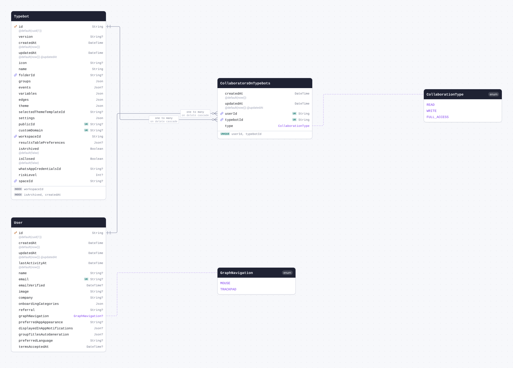

| Field       | Type                                           | Constraints                             | Default              | Description |
| ----------- | ---------------------------------------------- | --------------------------------------- | -------------------- | ----------- |
| `createdAt` | `DateTime`                                     | NOT NULL                                | `now()`              |             |
| `updatedAt` | `DateTime`                                     | NOT NULL                                | `now()` `@updatedAt` |             |
| `userId`    | `String`                                       | NOT NULL → [User.id](#model-User)       |                      |             |
| `typebotId` | `String`                                       | NOT NULL → [Typebot.id](#model-Typebot) |                      |             |
| `type`      | [`CollaborationType`](#enum-CollaborationType) | NOT NULL                                |                      |             |

#### Indexes

- `@@unique([userId, typebotId])`

#### References

- `typebotId` → [Typebot.id](#model-Typebot) (many-to-one, on delete Cascade)
- `userId` → [User.id](#model-User) (many-to-one, on delete Cascade)

#### Definition

```sql
CREATE TABLE "CollaboratorsOnTypebots" (
    "createdAt" TIMESTAMP(3) NOT NULL DEFAULT CURRENT_TIMESTAMP,
    "updatedAt" TIMESTAMP(3) NOT NULL DEFAULT CURRENT_TIMESTAMP,
    "userId" TEXT NOT NULL,
    "typebotId" TEXT NOT NULL,
    "type" "CollaborationType" NOT NULL
);

CREATE UNIQUE INDEX "CollaboratorsOnTypebots_userId_typebotId_key" ON "CollaboratorsOnTypebots"("userId", "typebotId");

ALTER TABLE "CollaboratorsOnTypebots" ADD CONSTRAINT "CollaboratorsOnTypebots_typebotId_fkey" FOREIGN KEY ("typebotId") REFERENCES "Typebot"("id") ON DELETE CASCADE ON UPDATE CASCADE;

ALTER TABLE "CollaboratorsOnTypebots" ADD CONSTRAINT "CollaboratorsOnTypebots_userId_fkey" FOREIGN KEY ("userId") REFERENCES "User"("id") ON DELETE CASCADE ON UPDATE CASCADE;
```

<details>
<summary>Queries and their SQL</summary>

**findMany**: Every row

```ts
await prisma.collaboratorsOnTypebots.findMany();
```

```sql
SELECT
  "public"."CollaboratorsOnTypebots"."userId",
  "public"."CollaboratorsOnTypebots"."typebotId",
  "public"."CollaboratorsOnTypebots"."createdAt",
  "public"."CollaboratorsOnTypebots"."updatedAt",
  "public"."CollaboratorsOnTypebots"."type"::text
FROM
  "public"."CollaboratorsOnTypebots"
WHERE
  1 = 1
OFFSET
  $1
-- params: ["0"]
```

**count**: How many rows there are

```ts
await prisma.collaboratorsOnTypebots.count();
```

```sql
SELECT
  COUNT(*) AS "_count$_all"
FROM
  (
    SELECT
      "public"."CollaboratorsOnTypebots"."userId",
      "public"."CollaboratorsOnTypebots"."typebotId"
    FROM
      "public"."CollaboratorsOnTypebots"
    WHERE
      1 = 1
    OFFSET
      $1
  ) AS "sub"
-- params: ["0"]
```

**findMany**: Every row with its relations

```ts
await prisma.collaboratorsOnTypebots.findMany({ include: { typebot: true, user: true } });
```

```sql
SELECT
  "public"."CollaboratorsOnTypebots"."userId",
  "public"."CollaboratorsOnTypebots"."typebotId",
  "public"."CollaboratorsOnTypebots"."createdAt",
  "public"."CollaboratorsOnTypebots"."updatedAt",
  "public"."CollaboratorsOnTypebots"."type"::text
FROM
  "public"."CollaboratorsOnTypebots"
WHERE
  1 = 1
OFFSET
  $1
-- params: ["0"]

SELECT
  "public"."Typebot"."id",
  "public"."Typebot"."version",
  "public"."Typebot"."createdAt",
  "public"."Typebot"."updatedAt",
  "public"."Typebot"."icon",
  "public"."Typebot"."name",
  "public"."Typebot"."folderId",
  "public"."Typebot"."groups",
  "public"."Typebot"."events",
  "public"."Typebot"."variables",
  "public"."Typebot"."edges",
  "public"."Typebot"."theme",
  "public"."Typebot"."selectedThemeTemplateId",
  "public"."Typebot"."settings",
  "public"."Typebot"."publicId",
  "public"."Typebot"."customDomain",
  "public"."Typebot"."workspaceId",
  "public"."Typebot"."resultsTablePreferences",
  "public"."Typebot"."isArchived",
  "public"."Typebot"."isClosed",
  "public"."Typebot"."whatsAppCredentialsId",
  "public"."Typebot"."riskLevel",
  "public"."Typebot"."spaceId"
FROM
  "public"."Typebot"
WHERE
  "public"."Typebot"."id" IN ($1)
OFFSET
  $2
-- params: ["<typebotId of the rows above>","0"]

SELECT
  "public"."User"."id",
  "public"."User"."createdAt",
  "public"."User"."updatedAt",
  "public"."User"."lastActivityAt",
  "public"."User"."name",
  "public"."User"."email",
  "public"."User"."emailVerified",
  "public"."User"."image",
  "public"."User"."company",
  "public"."User"."onboardingCategories",
  "public"."User"."referral",
  "public"."User"."graphNavigation"::text,
  "public"."User"."preferredAppAppearance",
  "public"."User"."displayedInAppNotifications",
  "public"."User"."groupTitlesAutoGeneration",
  "public"."User"."preferredLanguage",
  "public"."User"."termsAcceptedAt"
FROM
  "public"."User"
WHERE
  "public"."User"."id" IN ($1)
OFFSET
  $2
-- params: ["<userId of the rows above>","0"]
```

**findUnique**: One row by what is unique to it

```ts
await prisma.collaboratorsOnTypebots.findUnique({
  where: { userId_typebotId: { userId: "example", typebotId: "example" } },
});
```

```sql
SELECT
  "public"."CollaboratorsOnTypebots"."userId",
  "public"."CollaboratorsOnTypebots"."typebotId",
  "public"."CollaboratorsOnTypebots"."createdAt",
  "public"."CollaboratorsOnTypebots"."updatedAt",
  "public"."CollaboratorsOnTypebots"."type"::text
FROM
  "public"."CollaboratorsOnTypebots"
WHERE
  (
    (
      "public"."CollaboratorsOnTypebots"."userId" = $1
      AND "public"."CollaboratorsOnTypebots"."typebotId" = $2
    )
    AND 1 = 1
  )
LIMIT
  $3
OFFSET
  $4
-- params: ["example","example","1","0"]
```

**create**: Create a row

```ts
await prisma.collaboratorsOnTypebots.create({
  data: { userId: "example", typebotId: "example", type: "READ" },
});
```

```sql
INSERT INTO
  "public"."CollaboratorsOnTypebots" (
    "createdAt",
    "updatedAt",
    "userId",
    "typebotId",
    "type"
  )
VALUES
  (
    $1,
    $2,
    $3,
    $4,
    CAST($5::text AS "public"."CollaborationType")
  )
RETURNING
  "public"."CollaboratorsOnTypebots"."userId",
  "public"."CollaboratorsOnTypebots"."typebotId",
  "public"."CollaboratorsOnTypebots"."createdAt",
  "public"."CollaboratorsOnTypebots"."updatedAt",
  "public"."CollaboratorsOnTypebots"."type"::text
-- params: ["<now()>","<now()>","example","example","READ"]
```

**update**: Update a row

```ts
await prisma.collaboratorsOnTypebots.update({
  where: { userId_typebotId: { userId: "example", typebotId: "example" } },
  data: { createdAt: new Date("2026-01-01T00:00:00.000Z") },
});
```

```sql
UPDATE "public"."CollaboratorsOnTypebots"
SET
  "createdAt" = $1,
  "updatedAt" = $2
WHERE
  (
    (
      "public"."CollaboratorsOnTypebots"."userId" = $3
      AND "public"."CollaboratorsOnTypebots"."typebotId" = $4
    )
    AND 1 = 1
  )
RETURNING
  "public"."CollaboratorsOnTypebots"."userId",
  "public"."CollaboratorsOnTypebots"."typebotId",
  "public"."CollaboratorsOnTypebots"."createdAt",
  "public"."CollaboratorsOnTypebots"."updatedAt",
  "public"."CollaboratorsOnTypebots"."type"::text
-- params: ["2026-01-01T00:00:00.000Z",{"prisma__type":"generatorCall","prisma__value":{"name":"now","args":[],"returnType":{"type":"DateTime"}}},"example","example"]
```

**delete**: Delete a row

```ts
await prisma.collaboratorsOnTypebots.delete({
  where: { userId_typebotId: { userId: "example", typebotId: "example" } },
});
```

```sql
DELETE FROM "public"."CollaboratorsOnTypebots"
WHERE
  (
    (
      "public"."CollaboratorsOnTypebots"."userId" = $1
      AND "public"."CollaboratorsOnTypebots"."typebotId" = $2
    )
    AND 1 = 1
  )
RETURNING
  "public"."CollaboratorsOnTypebots"."userId",
  "public"."CollaboratorsOnTypebots"."typebotId",
  "public"."CollaboratorsOnTypebots"."createdAt",
  "public"."CollaboratorsOnTypebots"."updatedAt",
  "public"."CollaboratorsOnTypebots"."type"::text
-- params: ["example","example"]
```

</details>

<a id="model-PublicTypebot"></a>

### PublicTypebot

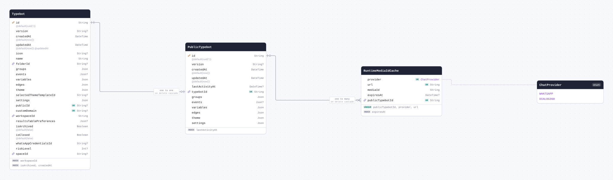

| Field            | Type       | Constraints                                    | Default   | Description |
| ---------------- | ---------- | ---------------------------------------------- | --------- | ----------- |
| `id`             | `String`   | PK NOT NULL                                    | `cuid(1)` |             |
| `version`        | `String`   | NULL                                           |           |             |
| `createdAt`      | `DateTime` | NOT NULL                                       | `now()`   |             |
| `updatedAt`      | `DateTime` | NOT NULL                                       | `now()`   |             |
| `lastActivityAt` | `DateTime` | NULL                                           |           |             |
| `typebotId`      | `String`   | UNIQUE NOT NULL → [Typebot.id](#model-Typebot) |           |             |
| `groups`         | `Json`     | NOT NULL                                       |           |             |
| `events`         | `Json`     | NULL                                           |           |             |
| `variables`      | `Json`     | NOT NULL                                       |           |             |
| `edges`          | `Json`     | NOT NULL                                       |           |             |
| `theme`          | `Json`     | NOT NULL                                       |           |             |
| `settings`       | `Json`     | NOT NULL                                       |           |             |

#### Indexes

- `@@index([lastActivityAt])`

#### References

- `typebotId` → [Typebot.id](#model-Typebot) (one-to-one, on delete Cascade)

#### Referenced by

- `id` ← [RuntimeMediaIdCache.publicTypebotId](#model-RuntimeMediaIdCache) (one-to-many, on delete Cascade)

#### Definition

```sql
CREATE TABLE "PublicTypebot" (
    "id" TEXT NOT NULL,
    "version" TEXT,
    "createdAt" TIMESTAMP(3) NOT NULL DEFAULT CURRENT_TIMESTAMP,
    "updatedAt" TIMESTAMP(3) NOT NULL DEFAULT CURRENT_TIMESTAMP,
    "lastActivityAt" TIMESTAMP(3),
    "typebotId" TEXT NOT NULL,
    "groups" JSONB NOT NULL,
    "events" JSONB,
    "variables" JSONB NOT NULL,
    "edges" JSONB NOT NULL,
    "theme" JSONB NOT NULL,
    "settings" JSONB NOT NULL,

    CONSTRAINT "PublicTypebot_pkey" PRIMARY KEY ("id")
);

CREATE UNIQUE INDEX "PublicTypebot_typebotId_key" ON "PublicTypebot"("typebotId");

CREATE INDEX "PublicTypebot_lastActivityAt_idx" ON "PublicTypebot"("lastActivityAt");

ALTER TABLE "PublicTypebot" ADD CONSTRAINT "PublicTypebot_typebotId_fkey" FOREIGN KEY ("typebotId") REFERENCES "Typebot"("id") ON DELETE CASCADE ON UPDATE CASCADE;
```

<details>
<summary>Queries and their SQL</summary>

**findMany**: Every row

```ts
await prisma.publicTypebot.findMany();
```

```sql
SELECT
  "public"."PublicTypebot"."id",
  "public"."PublicTypebot"."version",
  "public"."PublicTypebot"."createdAt",
  "public"."PublicTypebot"."updatedAt",
  "public"."PublicTypebot"."lastActivityAt",
  "public"."PublicTypebot"."typebotId",
  "public"."PublicTypebot"."groups",
  "public"."PublicTypebot"."events",
  "public"."PublicTypebot"."variables",
  "public"."PublicTypebot"."edges",
  "public"."PublicTypebot"."theme",
  "public"."PublicTypebot"."settings"
FROM
  "public"."PublicTypebot"
WHERE
  1 = 1
OFFSET
  $1
-- params: ["0"]
```

**count**: How many rows there are

```ts
await prisma.publicTypebot.count();
```

```sql
SELECT
  COUNT(*) AS "_count$_all"
FROM
  (
    SELECT
      "public"."PublicTypebot"."id"
    FROM
      "public"."PublicTypebot"
    WHERE
      1 = 1
    OFFSET
      $1
  ) AS "sub"
-- params: ["0"]
```

**findMany**: Every row with its relations

```ts
await prisma.publicTypebot.findMany({ include: { typebot: true, mediaIdsCache: true } });
```

```sql
SELECT
  "public"."PublicTypebot"."id",
  "public"."PublicTypebot"."version",
  "public"."PublicTypebot"."createdAt",
  "public"."PublicTypebot"."updatedAt",
  "public"."PublicTypebot"."lastActivityAt",
  "public"."PublicTypebot"."typebotId",
  "public"."PublicTypebot"."groups",
  "public"."PublicTypebot"."events",
  "public"."PublicTypebot"."variables",
  "public"."PublicTypebot"."edges",
  "public"."PublicTypebot"."theme",
  "public"."PublicTypebot"."settings"
FROM
  "public"."PublicTypebot"
WHERE
  1 = 1
OFFSET
  $1
-- params: ["0"]

SELECT
  "public"."Typebot"."id",
  "public"."Typebot"."version",
  "public"."Typebot"."createdAt",
  "public"."Typebot"."updatedAt",
  "public"."Typebot"."icon",
  "public"."Typebot"."name",
  "public"."Typebot"."folderId",
  "public"."Typebot"."groups",
  "public"."Typebot"."events",
  "public"."Typebot"."variables",
  "public"."Typebot"."edges",
  "public"."Typebot"."theme",
  "public"."Typebot"."selectedThemeTemplateId",
  "public"."Typebot"."settings",
  "public"."Typebot"."publicId",
  "public"."Typebot"."customDomain",
  "public"."Typebot"."workspaceId",
  "public"."Typebot"."resultsTablePreferences",
  "public"."Typebot"."isArchived",
  "public"."Typebot"."isClosed",
  "public"."Typebot"."whatsAppCredentialsId",
  "public"."Typebot"."riskLevel",
  "public"."Typebot"."spaceId"
FROM
  "public"."Typebot"
WHERE
  "public"."Typebot"."id" IN ($1)
OFFSET
  $2
-- params: ["<typebotId of the rows above>","0"]

SELECT
  "public"."RuntimeMediaIdCache"."publicTypebotId",
  "public"."RuntimeMediaIdCache"."provider"::text,
  "public"."RuntimeMediaIdCache"."url",
  "public"."RuntimeMediaIdCache"."mediaId",
  "public"."RuntimeMediaIdCache"."expiresAt"
FROM
  "public"."RuntimeMediaIdCache"
WHERE
  "public"."RuntimeMediaIdCache"."publicTypebotId" IN ($1)
OFFSET
  $2
-- params: ["<id of the rows above>","0"]
```

**findUnique**: One row by what is unique to it

```ts
await prisma.publicTypebot.findUnique({ where: { id: "example" } });
```

```sql
SELECT
  "public"."PublicTypebot"."id",
  "public"."PublicTypebot"."version",
  "public"."PublicTypebot"."createdAt",
  "public"."PublicTypebot"."updatedAt",
  "public"."PublicTypebot"."lastActivityAt",
  "public"."PublicTypebot"."typebotId",
  "public"."PublicTypebot"."groups",
  "public"."PublicTypebot"."events",
  "public"."PublicTypebot"."variables",
  "public"."PublicTypebot"."edges",
  "public"."PublicTypebot"."theme",
  "public"."PublicTypebot"."settings"
FROM
  "public"."PublicTypebot"
WHERE
  (
    "public"."PublicTypebot"."id" = $1
    AND 1 = 1
  )
LIMIT
  $2
OFFSET
  $3
-- params: ["example","1","0"]
```

**create**: Create a row

```ts
await prisma.publicTypebot.create({
  data: { typebotId: "example", groups: {}, variables: {}, edges: {}, theme: {}, settings: {} },
});
```

```sql
INSERT INTO
  "public"."PublicTypebot" (
    "id",
    "createdAt",
    "updatedAt",
    "typebotId",
    "groups",
    "variables",
    "edges",
    "theme",
    "settings"
  )
VALUES
  ($1, $2, $3, $4, $5, $6, $7, $8, $9)
RETURNING
  "public"."PublicTypebot"."id",
  "public"."PublicTypebot"."version",
  "public"."PublicTypebot"."createdAt",
  "public"."PublicTypebot"."updatedAt",
  "public"."PublicTypebot"."lastActivityAt",
  "public"."PublicTypebot"."typebotId",
  "public"."PublicTypebot"."groups",
  "public"."PublicTypebot"."events",
  "public"."PublicTypebot"."variables",
  "public"."PublicTypebot"."edges",
  "public"."PublicTypebot"."theme",
  "public"."PublicTypebot"."settings"
-- params: ["<cuid(1)>","<now()>","<now()>","example","{}","{}","{}","{}","{}"]
```

**update**: Update a row

```ts
await prisma.publicTypebot.update({ where: { id: "example" }, data: { version: "example" } });
```

```sql
UPDATE "public"."PublicTypebot"
SET
  "version" = $1
WHERE
  (
    "public"."PublicTypebot"."id" = $2
    AND 1 = 1
  )
RETURNING
  "public"."PublicTypebot"."id",
  "public"."PublicTypebot"."version",
  "public"."PublicTypebot"."createdAt",
  "public"."PublicTypebot"."updatedAt",
  "public"."PublicTypebot"."lastActivityAt",
  "public"."PublicTypebot"."typebotId",
  "public"."PublicTypebot"."groups",
  "public"."PublicTypebot"."events",
  "public"."PublicTypebot"."variables",
  "public"."PublicTypebot"."edges",
  "public"."PublicTypebot"."theme",
  "public"."PublicTypebot"."settings"
-- params: ["example","example"]
```

**delete**: Delete a row

```ts
await prisma.publicTypebot.delete({ where: { id: "example" } });
```

```sql
DELETE FROM "public"."PublicTypebot"
WHERE
  (
    "public"."PublicTypebot"."id" = $1
    AND 1 = 1
  )
RETURNING
  "public"."PublicTypebot"."id",
  "public"."PublicTypebot"."version",
  "public"."PublicTypebot"."createdAt",
  "public"."PublicTypebot"."updatedAt",
  "public"."PublicTypebot"."lastActivityAt",
  "public"."PublicTypebot"."typebotId",
  "public"."PublicTypebot"."groups",
  "public"."PublicTypebot"."events",
  "public"."PublicTypebot"."variables",
  "public"."PublicTypebot"."edges",
  "public"."PublicTypebot"."theme",
  "public"."PublicTypebot"."settings"
-- params: ["example"]
```

</details>

<a id="model-RuntimeMediaIdCache"></a>

### RuntimeMediaIdCache

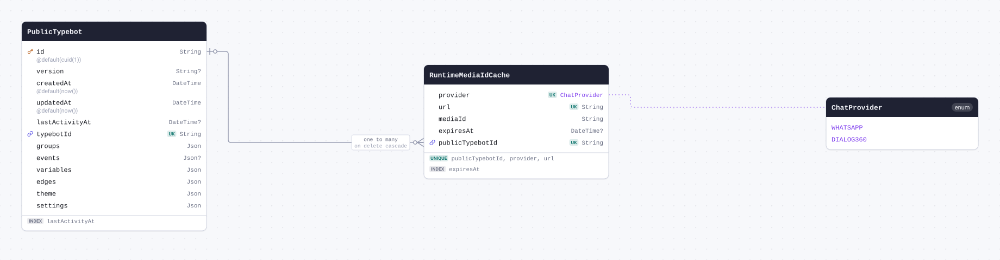

| Field             | Type                                 | Constraints                                         | Default | Description |
| ----------------- | ------------------------------------ | --------------------------------------------------- | ------- | ----------- |
| `provider`        | [`ChatProvider`](#enum-ChatProvider) | NOT NULL                                            |         |             |
| `url`             | `String`                             | NOT NULL                                            |         |             |
| `mediaId`         | `String`                             | NOT NULL                                            |         |             |
| `expiresAt`       | `DateTime`                           | NULL                                                |         |             |
| `publicTypebotId` | `String`                             | NOT NULL → [PublicTypebot.id](#model-PublicTypebot) |         |             |

#### Indexes

- `@@index([expiresAt])`
- `@@unique([publicTypebotId, provider, url])`

#### References

- `publicTypebotId` → [PublicTypebot.id](#model-PublicTypebot) (many-to-one, on delete Cascade)

#### Definition

```sql
CREATE TABLE "RuntimeMediaIdCache" (
    "provider" "ChatProvider" NOT NULL,
    "url" TEXT NOT NULL,
    "mediaId" TEXT NOT NULL,
    "expiresAt" TIMESTAMP(3),
    "publicTypebotId" TEXT NOT NULL
);

CREATE INDEX "RuntimeMediaIdCache_expiresAt_idx" ON "RuntimeMediaIdCache"("expiresAt");

CREATE UNIQUE INDEX "RuntimeMediaIdCache_publicTypebotId_provider_url_key" ON "RuntimeMediaIdCache"("publicTypebotId", "provider", "url");

ALTER TABLE "RuntimeMediaIdCache" ADD CONSTRAINT "RuntimeMediaIdCache_publicTypebotId_fkey" FOREIGN KEY ("publicTypebotId") REFERENCES "PublicTypebot"("id") ON DELETE CASCADE ON UPDATE CASCADE;
```

<details>
<summary>Queries and their SQL</summary>

**findMany**: Every row

```ts
await prisma.runtimeMediaIdCache.findMany();
```

```sql
SELECT
  "public"."RuntimeMediaIdCache"."publicTypebotId",
  "public"."RuntimeMediaIdCache"."provider"::text,
  "public"."RuntimeMediaIdCache"."url",
  "public"."RuntimeMediaIdCache"."mediaId",
  "public"."RuntimeMediaIdCache"."expiresAt"
FROM
  "public"."RuntimeMediaIdCache"
WHERE
  1 = 1
OFFSET
  $1
-- params: ["0"]
```

**count**: How many rows there are

```ts
await prisma.runtimeMediaIdCache.count();
```

```sql
SELECT
  COUNT(*) AS "_count$_all"
FROM
  (
    SELECT
      "public"."RuntimeMediaIdCache"."publicTypebotId",
      "public"."RuntimeMediaIdCache"."provider",
      "public"."RuntimeMediaIdCache"."url"
    FROM
      "public"."RuntimeMediaIdCache"
    WHERE
      1 = 1
    OFFSET
      $1
  ) AS "sub"
-- params: ["0"]
```

**findMany**: Every row with its relations

```ts
await prisma.runtimeMediaIdCache.findMany({ include: { publicTypebot: true } });
```

```sql
SELECT
  "public"."RuntimeMediaIdCache"."publicTypebotId",
  "public"."RuntimeMediaIdCache"."provider"::text,
  "public"."RuntimeMediaIdCache"."url",
  "public"."RuntimeMediaIdCache"."mediaId",
  "public"."RuntimeMediaIdCache"."expiresAt"
FROM
  "public"."RuntimeMediaIdCache"
WHERE
  1 = 1
OFFSET
  $1
-- params: ["0"]

SELECT
  "public"."PublicTypebot"."id",
  "public"."PublicTypebot"."version",
  "public"."PublicTypebot"."createdAt",
  "public"."PublicTypebot"."updatedAt",
  "public"."PublicTypebot"."lastActivityAt",
  "public"."PublicTypebot"."typebotId",
  "public"."PublicTypebot"."groups",
  "public"."PublicTypebot"."events",
  "public"."PublicTypebot"."variables",
  "public"."PublicTypebot"."edges",
  "public"."PublicTypebot"."theme",
  "public"."PublicTypebot"."settings"
FROM
  "public"."PublicTypebot"
WHERE
  "public"."PublicTypebot"."id" IN ($1)
OFFSET
  $2
-- params: ["<publicTypebotId of the rows above>","0"]
```

**findUnique**: One row by what is unique to it

```ts
await prisma.runtimeMediaIdCache.findUnique({
  where: {
    publicTypebotId_provider_url: {
      publicTypebotId: "example",
      provider: "WHATSAPP",
      url: "example",
    },
  },
});
```

```sql
SELECT
  "public"."RuntimeMediaIdCache"."publicTypebotId",
  "public"."RuntimeMediaIdCache"."provider"::text,
  "public"."RuntimeMediaIdCache"."url",
  "public"."RuntimeMediaIdCache"."mediaId",
  "public"."RuntimeMediaIdCache"."expiresAt"
FROM
  "public"."RuntimeMediaIdCache"
WHERE
  (
    (
      "public"."RuntimeMediaIdCache"."publicTypebotId" = $1
      AND "public"."RuntimeMediaIdCache"."provider" = CAST($2::text AS "public"."ChatProvider")
      AND "public"."RuntimeMediaIdCache"."url" = $3
    )
    AND 1 = 1
  )
LIMIT
  $4
OFFSET
  $5
-- params: ["example","WHATSAPP","example","1","0"]
```

**create**: Create a row

```ts
await prisma.runtimeMediaIdCache.create({
  data: { provider: "WHATSAPP", url: "example", mediaId: "example", publicTypebotId: "example" },
});
```

```sql
INSERT INTO
  "public"."RuntimeMediaIdCache" ("provider", "url", "mediaId", "publicTypebotId")
VALUES
  (
    CAST($1::text AS "public"."ChatProvider"),
    $2,
    $3,
    $4
  )
RETURNING
  "public"."RuntimeMediaIdCache"."publicTypebotId",
  "public"."RuntimeMediaIdCache"."provider"::text,
  "public"."RuntimeMediaIdCache"."url",
  "public"."RuntimeMediaIdCache"."mediaId",
  "public"."RuntimeMediaIdCache"."expiresAt"
-- params: ["WHATSAPP","example","example","example"]
```

**update**: Update a row

```ts
await prisma.runtimeMediaIdCache.update({
  where: {
    publicTypebotId_provider_url: {
      publicTypebotId: "example",
      provider: "WHATSAPP",
      url: "example",
    },
  },
  data: { mediaId: "example" },
});
```

```sql
UPDATE "public"."RuntimeMediaIdCache"
SET
  "mediaId" = $1
WHERE
  (
    (
      "public"."RuntimeMediaIdCache"."publicTypebotId" = $2
      AND "public"."RuntimeMediaIdCache"."provider" = CAST($3::text AS "public"."ChatProvider")
      AND "public"."RuntimeMediaIdCache"."url" = $4
    )
    AND 1 = 1
  )
RETURNING
  "public"."RuntimeMediaIdCache"."publicTypebotId",
  "public"."RuntimeMediaIdCache"."provider"::text,
  "public"."RuntimeMediaIdCache"."url",
  "public"."RuntimeMediaIdCache"."mediaId",
  "public"."RuntimeMediaIdCache"."expiresAt"
-- params: ["example","example","WHATSAPP","example"]
```

**delete**: Delete a row

```ts
await prisma.runtimeMediaIdCache.delete({
  where: {
    publicTypebotId_provider_url: {
      publicTypebotId: "example",
      provider: "WHATSAPP",
      url: "example",
    },
  },
});
```

```sql
DELETE FROM "public"."RuntimeMediaIdCache"
WHERE
  (
    (
      "public"."RuntimeMediaIdCache"."publicTypebotId" = $1
      AND "public"."RuntimeMediaIdCache"."provider" = CAST($2::text AS "public"."ChatProvider")
      AND "public"."RuntimeMediaIdCache"."url" = $3
    )
    AND 1 = 1
  )
RETURNING
  "public"."RuntimeMediaIdCache"."publicTypebotId",
  "public"."RuntimeMediaIdCache"."provider"::text,
  "public"."RuntimeMediaIdCache"."url",
  "public"."RuntimeMediaIdCache"."mediaId",
  "public"."RuntimeMediaIdCache"."expiresAt"
-- params: ["example","WHATSAPP","example"]
```

</details>

<a id="model-Result"></a>

### Result

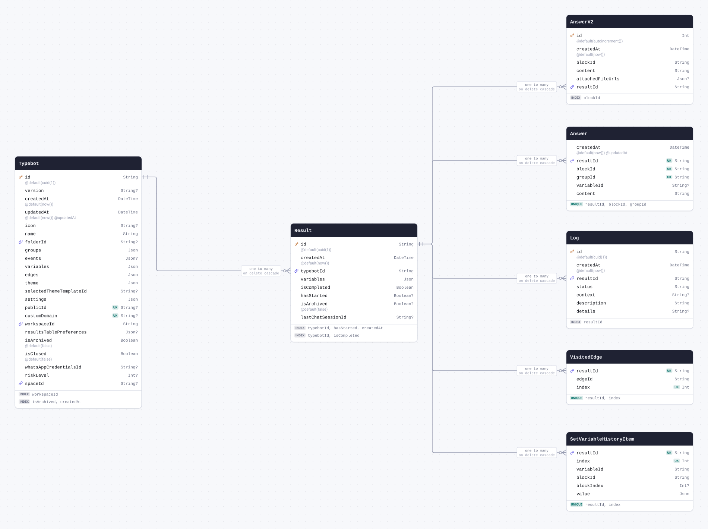

| Field               | Type       | Constraints                             | Default   | Description |
| ------------------- | ---------- | --------------------------------------- | --------- | ----------- |
| `id`                | `String`   | PK NOT NULL                             | `cuid(1)` |             |
| `createdAt`         | `DateTime` | NOT NULL                                | `now()`   |             |
| `typebotId`         | `String`   | NOT NULL → [Typebot.id](#model-Typebot) |           |             |
| `variables`         | `Json`     | NOT NULL                                |           |             |
| `isCompleted`       | `Boolean`  | NOT NULL                                |           |             |
| `hasStarted`        | `Boolean`  | NULL                                    |           |             |
| `isArchived`        | `Boolean`  | NULL                                    | `false`   |             |
| `lastChatSessionId` | `String`   | NULL                                    |           |             |

#### Indexes

- `@@index([typebotId, hasStarted, createdAt])`
- `@@index([typebotId, isCompleted])`

#### References

- `typebotId` → [Typebot.id](#model-Typebot) (many-to-one, on delete Cascade)

#### Referenced by

- `id` ← [SetVariableHistoryItem.resultId](#model-SetVariableHistoryItem) (one-to-many, on delete Cascade)
- `id` ← [VisitedEdge.resultId](#model-VisitedEdge) (one-to-many, on delete Cascade)
- `id` ← [Log.resultId](#model-Log) (one-to-many, on delete Cascade)
- `id` ← [Answer.resultId](#model-Answer) (one-to-many, on delete Cascade)
- `id` ← [AnswerV2.resultId](#model-AnswerV2) (one-to-many, on delete Cascade)

#### Definition

```sql
CREATE TABLE "Result" (
    "id" TEXT NOT NULL,
    "createdAt" TIMESTAMP(3) NOT NULL DEFAULT CURRENT_TIMESTAMP,
    "typebotId" TEXT NOT NULL,
    "variables" JSONB NOT NULL,
    "isCompleted" BOOLEAN NOT NULL,
    "hasStarted" BOOLEAN,
    "isArchived" BOOLEAN DEFAULT false,
    "lastChatSessionId" TEXT,

    CONSTRAINT "Result_pkey" PRIMARY KEY ("id")
);

CREATE INDEX "Result_typebotId_hasStarted_createdAt_idx" ON "Result"("typebotId", "hasStarted", "createdAt" DESC);

CREATE INDEX "Result_typebotId_isCompleted_idx" ON "Result"("typebotId", "isCompleted");

ALTER TABLE "Result" ADD CONSTRAINT "Result_typebotId_fkey" FOREIGN KEY ("typebotId") REFERENCES "Typebot"("id") ON DELETE CASCADE ON UPDATE CASCADE;
```

<details>
<summary>Queries and their SQL</summary>

**findMany**: Every row

```ts
await prisma.result.findMany();
```

```sql
SELECT
  "public"."Result"."id",
  "public"."Result"."createdAt",
  "public"."Result"."typebotId",
  "public"."Result"."variables",
  "public"."Result"."isCompleted",
  "public"."Result"."hasStarted",
  "public"."Result"."isArchived",
  "public"."Result"."lastChatSessionId"
FROM
  "public"."Result"
WHERE
  1 = 1
OFFSET
  $1
-- params: ["0"]
```

**count**: How many rows there are

```ts
await prisma.result.count();
```

```sql
SELECT
  COUNT(*) AS "_count$_all"
FROM
  (
    SELECT
      "public"."Result"."id"
    FROM
      "public"."Result"
    WHERE
      1 = 1
    OFFSET
      $1
  ) AS "sub"
-- params: ["0"]
```

**findMany**: Every row with its relations

```ts
await prisma.result.findMany({
  include: {
    typebot: true,
    answers: true,
    answersV2: true,
    logs: true,
    edges: true,
    setVariableHistory: true,
  },
});
```

```sql
SELECT
  "public"."Result"."id",
  "public"."Result"."createdAt",
  "public"."Result"."typebotId",
  "public"."Result"."variables",
  "public"."Result"."isCompleted",
  "public"."Result"."hasStarted",
  "public"."Result"."isArchived",
  "public"."Result"."lastChatSessionId"
FROM
  "public"."Result"
WHERE
  1 = 1
OFFSET
  $1
-- params: ["0"]

SELECT
  "public"."Typebot"."id",
  "public"."Typebot"."version",
  "public"."Typebot"."createdAt",
  "public"."Typebot"."updatedAt",
  "public"."Typebot"."icon",
  "public"."Typebot"."name",
  "public"."Typebot"."folderId",
  "public"."Typebot"."groups",
  "public"."Typebot"."events",
  "public"."Typebot"."variables",
  "public"."Typebot"."edges",
  "public"."Typebot"."theme",
  "public"."Typebot"."selectedThemeTemplateId",
  "public"."Typebot"."settings",
  "public"."Typebot"."publicId",
  "public"."Typebot"."customDomain",
  "public"."Typebot"."workspaceId",
  "public"."Typebot"."resultsTablePreferences",
  "public"."Typebot"."isArchived",
  "public"."Typebot"."isClosed",
  "public"."Typebot"."whatsAppCredentialsId",
  "public"."Typebot"."riskLevel",
  "public"."Typebot"."spaceId"
FROM
  "public"."Typebot"
WHERE
  "public"."Typebot"."id" IN ($1)
OFFSET
  $2
-- params: ["<typebotId of the rows above>","0"]

SELECT
  "public"."Answer"."resultId",
  "public"."Answer"."blockId",
  "public"."Answer"."groupId",
  "public"."Answer"."createdAt",
  "public"."Answer"."variableId",
  "public"."Answer"."content"
FROM
  "public"."Answer"
WHERE
  "public"."Answer"."resultId" IN ($1)
OFFSET
  $2
-- params: ["<id of the rows above>","0"]

SELECT
  "public"."AnswerV2"."id",
  "public"."AnswerV2"."createdAt",
  "public"."AnswerV2"."blockId",
  "public"."AnswerV2"."content",
  "public"."AnswerV2"."attachedFileUrls",
  "public"."AnswerV2"."resultId"
FROM
  "public"."AnswerV2"
WHERE
  "public"."AnswerV2"."resultId" IN ($1)
OFFSET
  $2
-- params: ["<id of the rows above>","0"]

SELECT
  "public"."Log"."id",
  "public"."Log"."createdAt",
  "public"."Log"."resultId",
  "public"."Log"."status",
  "public"."Log"."context",
  "public"."Log"."description",
  "public"."Log"."details"
FROM
  "public"."Log"
WHERE
  "public"."Log"."resultId" IN ($1)
OFFSET
  $2
-- params: ["<id of the rows above>","0"]

SELECT
  "public"."VisitedEdge"."resultId",
  "public"."VisitedEdge"."index",
  "public"."VisitedEdge"."edgeId"
FROM
  "public"."VisitedEdge"
WHERE
  "public"."VisitedEdge"."resultId" IN ($1)
OFFSET
  $2
-- params: ["<id of the rows above>","0"]

SELECT
  "public"."SetVariableHistoryItem"."resultId",
  "public"."SetVariableHistoryItem"."index",
  "public"."SetVariableHistoryItem"."variableId",
  "public"."SetVariableHistoryItem"."blockId",
  "public"."SetVariableHistoryItem"."blockIndex",
  "public"."SetVariableHistoryItem"."value"
FROM
  "public"."SetVariableHistoryItem"
WHERE
  "public"."SetVariableHistoryItem"."resultId" IN ($1)
OFFSET
  $2
-- params: ["<id of the rows above>","0"]
```

**findUnique**: One row by what is unique to it

```ts
await prisma.result.findUnique({ where: { id: "example" } });
```

```sql
SELECT
  "public"."Result"."id",
  "public"."Result"."createdAt",
  "public"."Result"."typebotId",
  "public"."Result"."variables",
  "public"."Result"."isCompleted",
  "public"."Result"."hasStarted",
  "public"."Result"."isArchived",
  "public"."Result"."lastChatSessionId"
FROM
  "public"."Result"
WHERE
  (
    "public"."Result"."id" = $1
    AND 1 = 1
  )
LIMIT
  $2
OFFSET
  $3
-- params: ["example","1","0"]
```

**create**: Create a row

```ts
await prisma.result.create({ data: { typebotId: "example", variables: {}, isCompleted: true } });
```

```sql
INSERT INTO
  "public"."Result" (
    "id",
    "createdAt",
    "typebotId",
    "variables",
    "isCompleted",
    "isArchived"
  )
VALUES
  ($1, $2, $3, $4, $5, $6)
RETURNING
  "public"."Result"."id",
  "public"."Result"."createdAt",
  "public"."Result"."typebotId",
  "public"."Result"."variables",
  "public"."Result"."isCompleted",
  "public"."Result"."hasStarted",
  "public"."Result"."isArchived",
  "public"."Result"."lastChatSessionId"
-- params: ["<cuid(1)>","<now()>","example","{}",true,false]
```

**update**: Update a row

```ts
await prisma.result.update({
  where: { id: "example" },
  data: { createdAt: new Date("2026-01-01T00:00:00.000Z") },
});
```

```sql
UPDATE "public"."Result"
SET
  "createdAt" = $1
WHERE
  (
    "public"."Result"."id" = $2
    AND 1 = 1
  )
RETURNING
  "public"."Result"."id",
  "public"."Result"."createdAt",
  "public"."Result"."typebotId",
  "public"."Result"."variables",
  "public"."Result"."isCompleted",
  "public"."Result"."hasStarted",
  "public"."Result"."isArchived",
  "public"."Result"."lastChatSessionId"
-- params: ["2026-01-01T00:00:00.000Z","example"]
```

**delete**: Delete a row

```ts
await prisma.result.delete({ where: { id: "example" } });
```

```sql
DELETE FROM "public"."Result"
WHERE
  (
    "public"."Result"."id" = $1
    AND 1 = 1
  )
RETURNING
  "public"."Result"."id",
  "public"."Result"."createdAt",
  "public"."Result"."typebotId",
  "public"."Result"."variables",
  "public"."Result"."isCompleted",
  "public"."Result"."hasStarted",
  "public"."Result"."isArchived",
  "public"."Result"."lastChatSessionId"
-- params: ["example"]
```

</details>

<a id="model-SetVariableHistoryItem"></a>

### SetVariableHistoryItem

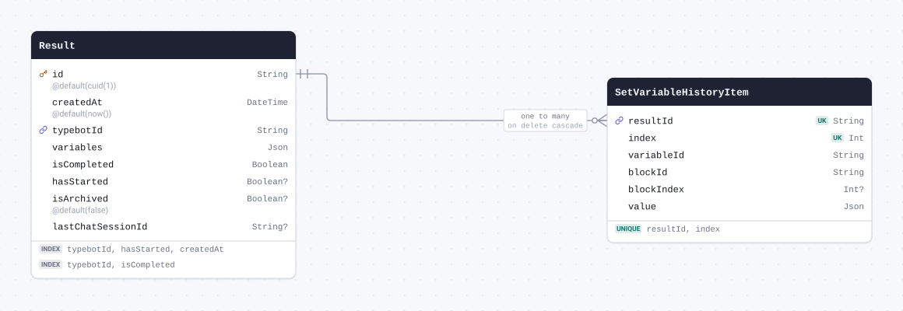

| Field        | Type     | Constraints                           | Default | Description |
| ------------ | -------- | ------------------------------------- | ------- | ----------- |
| `resultId`   | `String` | NOT NULL → [Result.id](#model-Result) |         |             |
| `index`      | `Int`    | NOT NULL                              |         |             |
| `variableId` | `String` | NOT NULL                              |         |             |
| `blockId`    | `String` | NOT NULL                              |         |             |
| `blockIndex` | `Int`    | NULL                                  |         |             |
| `value`      | `Json`   | NOT NULL                              |         |             |

#### Indexes

- `@@unique([resultId, index])`

#### References

- `resultId` → [Result.id](#model-Result) (many-to-one, on delete Cascade)

#### Definition

```sql
CREATE TABLE "SetVariableHistoryItem" (
    "resultId" TEXT NOT NULL,
    "index" INTEGER NOT NULL,
    "variableId" TEXT NOT NULL,
    "blockId" TEXT NOT NULL,
    "blockIndex" INTEGER,
    "value" JSONB NOT NULL
);

CREATE UNIQUE INDEX "SetVariableHistoryItem_resultId_index_key" ON "SetVariableHistoryItem"("resultId", "index");

ALTER TABLE "SetVariableHistoryItem" ADD CONSTRAINT "SetVariableHistoryItem_resultId_fkey" FOREIGN KEY ("resultId") REFERENCES "Result"("id") ON DELETE CASCADE ON UPDATE CASCADE;
```

<details>
<summary>Queries and their SQL</summary>

**findMany**: Every row

```ts
await prisma.setVariableHistoryItem.findMany();
```

```sql
SELECT
  "public"."SetVariableHistoryItem"."resultId",
  "public"."SetVariableHistoryItem"."index",
  "public"."SetVariableHistoryItem"."variableId",
  "public"."SetVariableHistoryItem"."blockId",
  "public"."SetVariableHistoryItem"."blockIndex",
  "public"."SetVariableHistoryItem"."value"
FROM
  "public"."SetVariableHistoryItem"
WHERE
  1 = 1
OFFSET
  $1
-- params: ["0"]
```

**count**: How many rows there are

```ts
await prisma.setVariableHistoryItem.count();
```

```sql
SELECT
  COUNT(*) AS "_count$_all"
FROM
  (
    SELECT
      "public"."SetVariableHistoryItem"."resultId",
      "public"."SetVariableHistoryItem"."index"
    FROM
      "public"."SetVariableHistoryItem"
    WHERE
      1 = 1
    OFFSET
      $1
  ) AS "sub"
-- params: ["0"]
```

**findMany**: Every row with its relations

```ts
await prisma.setVariableHistoryItem.findMany({ include: { result: true } });
```

```sql
SELECT
  "public"."SetVariableHistoryItem"."resultId",
  "public"."SetVariableHistoryItem"."index",
  "public"."SetVariableHistoryItem"."variableId",
  "public"."SetVariableHistoryItem"."blockId",
  "public"."SetVariableHistoryItem"."blockIndex",
  "public"."SetVariableHistoryItem"."value"
FROM
  "public"."SetVariableHistoryItem"
WHERE
  1 = 1
OFFSET
  $1
-- params: ["0"]

SELECT
  "public"."Result"."id",
  "public"."Result"."createdAt",
  "public"."Result"."typebotId",
  "public"."Result"."variables",
  "public"."Result"."isCompleted",
  "public"."Result"."hasStarted",
  "public"."Result"."isArchived",
  "public"."Result"."lastChatSessionId"
FROM
  "public"."Result"
WHERE
  "public"."Result"."id" IN ($1)
OFFSET
  $2
-- params: ["<resultId of the rows above>","0"]
```

**findUnique**: One row by what is unique to it

```ts
await prisma.setVariableHistoryItem.findUnique({
  where: { resultId_index: { resultId: "example", index: 1 } },
});
```

```sql
SELECT
  "public"."SetVariableHistoryItem"."resultId",
  "public"."SetVariableHistoryItem"."index",
  "public"."SetVariableHistoryItem"."variableId",
  "public"."SetVariableHistoryItem"."blockId",
  "public"."SetVariableHistoryItem"."blockIndex",
  "public"."SetVariableHistoryItem"."value"
FROM
  "public"."SetVariableHistoryItem"
WHERE
  (
    (
      "public"."SetVariableHistoryItem"."resultId" = $1
      AND "public"."SetVariableHistoryItem"."index" = $2
    )
    AND 1 = 1
  )
LIMIT
  $3
OFFSET
  $4
-- params: ["example","1","1","0"]
```

**create**: Create a row

```ts
await prisma.setVariableHistoryItem.create({
  data: { resultId: "example", index: 1, variableId: "example", blockId: "example", value: {} },
});
```

```sql
INSERT INTO
  "public"."SetVariableHistoryItem" (
    "resultId",
    "index",
    "variableId",
    "blockId",
    "value"
  )
VALUES
  ($1, $2, $3, $4, $5)
RETURNING
  "public"."SetVariableHistoryItem"."resultId",
  "public"."SetVariableHistoryItem"."index",
  "public"."SetVariableHistoryItem"."variableId",
  "public"."SetVariableHistoryItem"."blockId",
  "public"."SetVariableHistoryItem"."blockIndex",
  "public"."SetVariableHistoryItem"."value"
-- params: ["example","1","example","example","{}"]
```

**update**: Update a row

```ts
await prisma.setVariableHistoryItem.update({
  where: { resultId_index: { resultId: "example", index: 1 } },
  data: { variableId: "example" },
});
```

```sql
UPDATE "public"."SetVariableHistoryItem"
SET
  "variableId" = $1
WHERE
  (
    (
      "public"."SetVariableHistoryItem"."resultId" = $2
      AND "public"."SetVariableHistoryItem"."index" = $3
    )
    AND 1 = 1
  )
RETURNING
  "public"."SetVariableHistoryItem"."resultId",
  "public"."SetVariableHistoryItem"."index",
  "public"."SetVariableHistoryItem"."variableId",
  "public"."SetVariableHistoryItem"."blockId",
  "public"."SetVariableHistoryItem"."blockIndex",
  "public"."SetVariableHistoryItem"."value"
-- params: ["example","example","1"]
```

**delete**: Delete a row

```ts
await prisma.setVariableHistoryItem.delete({
  where: { resultId_index: { resultId: "example", index: 1 } },
});
```

```sql
DELETE FROM "public"."SetVariableHistoryItem"
WHERE
  (
    (
      "public"."SetVariableHistoryItem"."resultId" = $1
      AND "public"."SetVariableHistoryItem"."index" = $2
    )
    AND 1 = 1
  )
RETURNING
  "public"."SetVariableHistoryItem"."resultId",
  "public"."SetVariableHistoryItem"."index",
  "public"."SetVariableHistoryItem"."variableId",
  "public"."SetVariableHistoryItem"."blockId",
  "public"."SetVariableHistoryItem"."blockIndex",
  "public"."SetVariableHistoryItem"."value"
-- params: ["example","1"]
```

</details>

<a id="model-VisitedEdge"></a>

### VisitedEdge

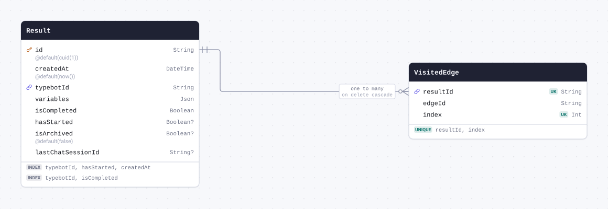

| Field      | Type     | Constraints                           | Default | Description |
| ---------- | -------- | ------------------------------------- | ------- | ----------- |
| `resultId` | `String` | NOT NULL → [Result.id](#model-Result) |         |             |
| `edgeId`   | `String` | NOT NULL                              |         |             |
| `index`    | `Int`    | NOT NULL                              |         |             |

#### Indexes

- `@@unique([resultId, index])`

#### References

- `resultId` → [Result.id](#model-Result) (many-to-one, on delete Cascade)

#### Definition

```sql
CREATE TABLE "VisitedEdge" (
    "resultId" TEXT NOT NULL,
    "edgeId" TEXT NOT NULL,
    "index" INTEGER NOT NULL
);

CREATE UNIQUE INDEX "VisitedEdge_resultId_index_key" ON "VisitedEdge"("resultId", "index");

ALTER TABLE "VisitedEdge" ADD CONSTRAINT "VisitedEdge_resultId_fkey" FOREIGN KEY ("resultId") REFERENCES "Result"("id") ON DELETE CASCADE ON UPDATE CASCADE;
```

<details>
<summary>Queries and their SQL</summary>

**findMany**: Every row

```ts
await prisma.visitedEdge.findMany();
```

```sql
SELECT
  "public"."VisitedEdge"."resultId",
  "public"."VisitedEdge"."index",
  "public"."VisitedEdge"."edgeId"
FROM
  "public"."VisitedEdge"
WHERE
  1 = 1
OFFSET
  $1
-- params: ["0"]
```

**count**: How many rows there are

```ts
await prisma.visitedEdge.count();
```

```sql
SELECT
  COUNT(*) AS "_count$_all"
FROM
  (
    SELECT
      "public"."VisitedEdge"."resultId",
      "public"."VisitedEdge"."index"
    FROM
      "public"."VisitedEdge"
    WHERE
      1 = 1
    OFFSET
      $1
  ) AS "sub"
-- params: ["0"]
```

**findMany**: Every row with its relations

```ts
await prisma.visitedEdge.findMany({ include: { result: true } });
```

```sql
SELECT
  "public"."VisitedEdge"."resultId",
  "public"."VisitedEdge"."index",
  "public"."VisitedEdge"."edgeId"
FROM
  "public"."VisitedEdge"
WHERE
  1 = 1
OFFSET
  $1
-- params: ["0"]

SELECT
  "public"."Result"."id",
  "public"."Result"."createdAt",
  "public"."Result"."typebotId",
  "public"."Result"."variables",
  "public"."Result"."isCompleted",
  "public"."Result"."hasStarted",
  "public"."Result"."isArchived",
  "public"."Result"."lastChatSessionId"
FROM
  "public"."Result"
WHERE
  "public"."Result"."id" IN ($1)
OFFSET
  $2
-- params: ["<resultId of the rows above>","0"]
```

**findUnique**: One row by what is unique to it

```ts
await prisma.visitedEdge.findUnique({
  where: { resultId_index: { resultId: "example", index: 1 } },
});
```

```sql
SELECT
  "public"."VisitedEdge"."resultId",
  "public"."VisitedEdge"."index",
  "public"."VisitedEdge"."edgeId"
FROM
  "public"."VisitedEdge"
WHERE
  (
    (
      "public"."VisitedEdge"."resultId" = $1
      AND "public"."VisitedEdge"."index" = $2
    )
    AND 1 = 1
  )
LIMIT
  $3
OFFSET
  $4
-- params: ["example","1","1","0"]
```

**create**: Create a row

```ts
await prisma.visitedEdge.create({ data: { resultId: "example", edgeId: "example", index: 1 } });
```

```sql
INSERT INTO
  "public"."VisitedEdge" ("resultId", "edgeId", "index")
VALUES
  ($1, $2, $3)
RETURNING
  "public"."VisitedEdge"."resultId",
  "public"."VisitedEdge"."index",
  "public"."VisitedEdge"."edgeId"
-- params: ["example","example","1"]
```

**update**: Update a row

```ts
await prisma.visitedEdge.update({
  where: { resultId_index: { resultId: "example", index: 1 } },
  data: { edgeId: "example" },
});
```

```sql
UPDATE "public"."VisitedEdge"
SET
  "edgeId" = $1
WHERE
  (
    (
      "public"."VisitedEdge"."resultId" = $2
      AND "public"."VisitedEdge"."index" = $3
    )
    AND 1 = 1
  )
RETURNING
  "public"."VisitedEdge"."resultId",
  "public"."VisitedEdge"."index",
  "public"."VisitedEdge"."edgeId"
-- params: ["example","example","1"]
```

**delete**: Delete a row

```ts
await prisma.visitedEdge.delete({ where: { resultId_index: { resultId: "example", index: 1 } } });
```

```sql
DELETE FROM "public"."VisitedEdge"
WHERE
  (
    (
      "public"."VisitedEdge"."resultId" = $1
      AND "public"."VisitedEdge"."index" = $2
    )
    AND 1 = 1
  )
RETURNING
  "public"."VisitedEdge"."resultId",
  "public"."VisitedEdge"."index",
  "public"."VisitedEdge"."edgeId"
-- params: ["example","1"]
```

</details>

<a id="model-Log"></a>

### Log

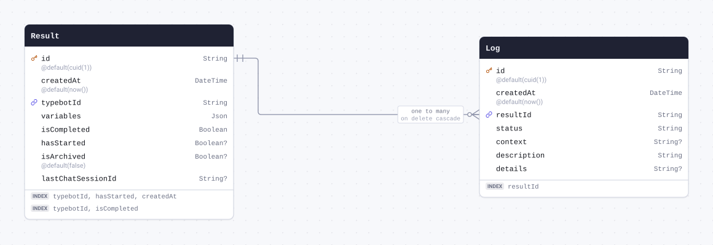

| Field         | Type       | Constraints                           | Default   | Description |
| ------------- | ---------- | ------------------------------------- | --------- | ----------- |
| `id`          | `String`   | PK NOT NULL                           | `cuid(1)` |             |
| `createdAt`   | `DateTime` | NOT NULL                              | `now()`   |             |
| `resultId`    | `String`   | NOT NULL → [Result.id](#model-Result) |           |             |
| `status`      | `String`   | NOT NULL                              |           |             |
| `context`     | `String`   | NULL                                  |           |             |
| `description` | `String`   | NOT NULL                              |           |             |
| `details`     | `String`   | NULL                                  |           |             |

#### Indexes

- `@@index([resultId])`

#### References

- `resultId` → [Result.id](#model-Result) (many-to-one, on delete Cascade)

#### Definition

```sql
CREATE TABLE "Log" (
    "id" TEXT NOT NULL,
    "createdAt" TIMESTAMP(3) NOT NULL DEFAULT CURRENT_TIMESTAMP,
    "resultId" TEXT NOT NULL,
    "status" TEXT NOT NULL,
    "context" TEXT,
    "description" TEXT NOT NULL,
    "details" TEXT,

    CONSTRAINT "Log_pkey" PRIMARY KEY ("id")
);

CREATE INDEX "Log_resultId_idx" ON "Log"("resultId");

ALTER TABLE "Log" ADD CONSTRAINT "Log_resultId_fkey" FOREIGN KEY ("resultId") REFERENCES "Result"("id") ON DELETE CASCADE ON UPDATE CASCADE;
```

<details>
<summary>Queries and their SQL</summary>

**findMany**: Every row

```ts
await prisma.log.findMany();
```

```sql
SELECT
  "public"."Log"."id",
  "public"."Log"."createdAt",
  "public"."Log"."resultId",
  "public"."Log"."status",
  "public"."Log"."context",
  "public"."Log"."description",
  "public"."Log"."details"
FROM
  "public"."Log"
WHERE
  1 = 1
OFFSET
  $1
-- params: ["0"]
```

**count**: How many rows there are

```ts
await prisma.log.count();
```

```sql
SELECT
  COUNT(*) AS "_count$_all"
FROM
  (
    SELECT
      "public"."Log"."id"
    FROM
      "public"."Log"
    WHERE
      1 = 1
    OFFSET
      $1
  ) AS "sub"
-- params: ["0"]
```

**findMany**: Every row with its relations

```ts
await prisma.log.findMany({ include: { result: true } });
```

```sql
SELECT
  "public"."Log"."id",
  "public"."Log"."createdAt",
  "public"."Log"."resultId",
  "public"."Log"."status",
  "public"."Log"."context",
  "public"."Log"."description",
  "public"."Log"."details"
FROM
  "public"."Log"
WHERE
  1 = 1
OFFSET
  $1
-- params: ["0"]

SELECT
  "public"."Result"."id",
  "public"."Result"."createdAt",
  "public"."Result"."typebotId",
  "public"."Result"."variables",
  "public"."Result"."isCompleted",
  "public"."Result"."hasStarted",
  "public"."Result"."isArchived",
  "public"."Result"."lastChatSessionId"
FROM
  "public"."Result"
WHERE
  "public"."Result"."id" IN ($1)
OFFSET
  $2
-- params: ["<resultId of the rows above>","0"]
```

**findUnique**: One row by what is unique to it

```ts
await prisma.log.findUnique({ where: { id: "example" } });
```

```sql
SELECT
  "public"."Log"."id",
  "public"."Log"."createdAt",
  "public"."Log"."resultId",
  "public"."Log"."status",
  "public"."Log"."context",
  "public"."Log"."description",
  "public"."Log"."details"
FROM
  "public"."Log"
WHERE
  (
    "public"."Log"."id" = $1
    AND 1 = 1
  )
LIMIT
  $2
OFFSET
  $3
-- params: ["example","1","0"]
```

**create**: Create a row

```ts
await prisma.log.create({
  data: { resultId: "example", status: "example", description: "example" },
});
```

```sql
INSERT INTO
  "public"."Log" (
    "id",
    "createdAt",
    "resultId",
    "status",
    "description"
  )
VALUES
  ($1, $2, $3, $4, $5)
RETURNING
  "public"."Log"."id",
  "public"."Log"."createdAt",
  "public"."Log"."resultId",
  "public"."Log"."status",
  "public"."Log"."context",
  "public"."Log"."description",
  "public"."Log"."details"
-- params: ["<cuid(1)>","<now()>","example","example","example"]
```

**update**: Update a row

```ts
await prisma.log.update({
  where: { id: "example" },
  data: { createdAt: new Date("2026-01-01T00:00:00.000Z") },
});
```

```sql
UPDATE "public"."Log"
SET
  "createdAt" = $1
WHERE
  (
    "public"."Log"."id" = $2
    AND 1 = 1
  )
RETURNING
  "public"."Log"."id",
  "public"."Log"."createdAt",
  "public"."Log"."resultId",
  "public"."Log"."status",
  "public"."Log"."context",
  "public"."Log"."description",
  "public"."Log"."details"
-- params: ["2026-01-01T00:00:00.000Z","example"]
```

**delete**: Delete a row

```ts
await prisma.log.delete({ where: { id: "example" } });
```

```sql
DELETE FROM "public"."Log"
WHERE
  (
    "public"."Log"."id" = $1
    AND 1 = 1
  )
RETURNING
  "public"."Log"."id",
  "public"."Log"."createdAt",
  "public"."Log"."resultId",
  "public"."Log"."status",
  "public"."Log"."context",
  "public"."Log"."description",
  "public"."Log"."details"
-- params: ["example"]
```

</details>

<a id="model-Answer"></a>

### Answer

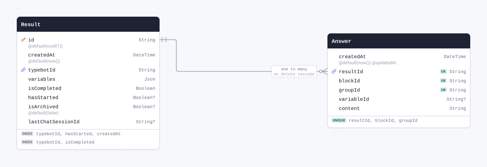

| Field        | Type       | Constraints                           | Default              | Description |
| ------------ | ---------- | ------------------------------------- | -------------------- | ----------- |
| `createdAt`  | `DateTime` | NOT NULL                              | `now()` `@updatedAt` |             |
| `resultId`   | `String`   | NOT NULL → [Result.id](#model-Result) |                      |             |
| `blockId`    | `String`   | NOT NULL                              |                      |             |
| `groupId`    | `String`   | NOT NULL                              |                      |             |
| `variableId` | `String`   | NULL                                  |                      |             |
| `content`    | `String`   | NOT NULL                              |                      |             |

#### Indexes

- `@@unique([resultId, blockId, groupId])`

#### References

- `resultId` → [Result.id](#model-Result) (many-to-one, on delete Cascade)

#### Definition

```sql
CREATE TABLE "Answer" (
    "createdAt" TIMESTAMP(3) NOT NULL DEFAULT CURRENT_TIMESTAMP,
    "resultId" TEXT NOT NULL,
    "blockId" TEXT NOT NULL,
    "groupId" TEXT NOT NULL,
    "variableId" TEXT,
    "content" TEXT NOT NULL
);

CREATE UNIQUE INDEX "Answer_resultId_blockId_groupId_key" ON "Answer"("resultId", "blockId", "groupId");

ALTER TABLE "Answer" ADD CONSTRAINT "Answer_resultId_fkey" FOREIGN KEY ("resultId") REFERENCES "Result"("id") ON DELETE CASCADE ON UPDATE CASCADE;
```

<details>
<summary>Queries and their SQL</summary>

**findMany**: Every row

```ts
await prisma.answer.findMany();
```

```sql
SELECT
  "public"."Answer"."resultId",
  "public"."Answer"."blockId",
  "public"."Answer"."groupId",
  "public"."Answer"."createdAt",
  "public"."Answer"."variableId",
  "public"."Answer"."content"
FROM
  "public"."Answer"
WHERE
  1 = 1
OFFSET
  $1
-- params: ["0"]
```

**count**: How many rows there are

```ts
await prisma.answer.count();
```

```sql
SELECT
  COUNT(*) AS "_count$_all"
FROM
  (
    SELECT
      "public"."Answer"."resultId",
      "public"."Answer"."blockId",
      "public"."Answer"."groupId"
    FROM
      "public"."Answer"
    WHERE
      1 = 1
    OFFSET
      $1
  ) AS "sub"
-- params: ["0"]
```

**findMany**: Every row with its relations

```ts
await prisma.answer.findMany({ include: { result: true } });
```

```sql
SELECT
  "public"."Answer"."resultId",
  "public"."Answer"."blockId",
  "public"."Answer"."groupId",
  "public"."Answer"."createdAt",
  "public"."Answer"."variableId",
  "public"."Answer"."content"
FROM
  "public"."Answer"
WHERE
  1 = 1
OFFSET
  $1
-- params: ["0"]

SELECT
  "public"."Result"."id",
  "public"."Result"."createdAt",
  "public"."Result"."typebotId",
  "public"."Result"."variables",
  "public"."Result"."isCompleted",
  "public"."Result"."hasStarted",
  "public"."Result"."isArchived",
  "public"."Result"."lastChatSessionId"
FROM
  "public"."Result"
WHERE
  "public"."Result"."id" IN ($1)
OFFSET
  $2
-- params: ["<resultId of the rows above>","0"]
```

**findUnique**: One row by what is unique to it

```ts
await prisma.answer.findUnique({
  where: {
    resultId_blockId_groupId: { resultId: "example", blockId: "example", groupId: "example" },
  },
});
```

```sql
SELECT
  "public"."Answer"."resultId",
  "public"."Answer"."blockId",
  "public"."Answer"."groupId",
  "public"."Answer"."createdAt",
  "public"."Answer"."variableId",
  "public"."Answer"."content"
FROM
  "public"."Answer"
WHERE
  (
    (
      "public"."Answer"."resultId" = $1
      AND "public"."Answer"."blockId" = $2
      AND "public"."Answer"."groupId" = $3
    )
    AND 1 = 1
  )
LIMIT
  $4
OFFSET
  $5
-- params: ["example","example","example","1","0"]
```

**create**: Create a row

```ts
await prisma.answer.create({
  data: { resultId: "example", blockId: "example", groupId: "example", content: "example" },
});
```

```sql
INSERT INTO
  "public"."Answer" (
    "createdAt",
    "resultId",
    "blockId",
    "groupId",
    "content"
  )
VALUES
  ($1, $2, $3, $4, $5)
RETURNING
  "public"."Answer"."resultId",
  "public"."Answer"."blockId",
  "public"."Answer"."groupId",
  "public"."Answer"."createdAt",
  "public"."Answer"."variableId",
  "public"."Answer"."content"
-- params: ["<now()>","example","example","example","example"]
```

**update**: Update a row

```ts
await prisma.answer.update({
  where: {
    resultId_blockId_groupId: { resultId: "example", blockId: "example", groupId: "example" },
  },
  data: { variableId: "example" },
});
```

```sql
UPDATE "public"."Answer"
SET
  "variableId" = $1,
  "createdAt" = $2
WHERE
  (
    (
      "public"."Answer"."resultId" = $3
      AND "public"."Answer"."blockId" = $4
      AND "public"."Answer"."groupId" = $5
    )
    AND 1 = 1
  )
RETURNING
  "public"."Answer"."resultId",
  "public"."Answer"."blockId",
  "public"."Answer"."groupId",
  "public"."Answer"."createdAt",
  "public"."Answer"."variableId",
  "public"."Answer"."content"
-- params: ["example",{"prisma__type":"generatorCall","prisma__value":{"name":"now","args":[],"returnType":{"type":"DateTime"}}},"example","example","example"]
```

**delete**: Delete a row

```ts
await prisma.answer.delete({
  where: {
    resultId_blockId_groupId: { resultId: "example", blockId: "example", groupId: "example" },
  },
});
```

```sql
DELETE FROM "public"."Answer"
WHERE
  (
    (
      "public"."Answer"."resultId" = $1
      AND "public"."Answer"."blockId" = $2
      AND "public"."Answer"."groupId" = $3
    )
    AND 1 = 1
  )
RETURNING
  "public"."Answer"."resultId",
  "public"."Answer"."blockId",
  "public"."Answer"."groupId",
  "public"."Answer"."createdAt",
  "public"."Answer"."variableId",
  "public"."Answer"."content"
-- params: ["example","example","example"]
```

</details>

<a id="model-AnswerV2"></a>

### AnswerV2

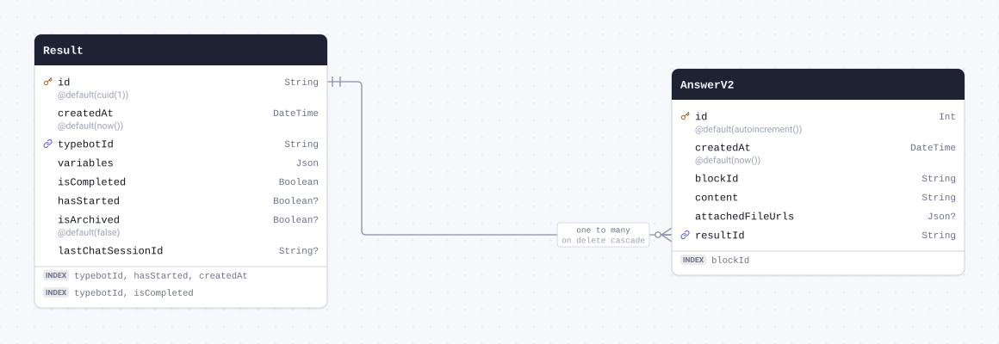

| Field              | Type       | Constraints                           | Default           | Description |
| ------------------ | ---------- | ------------------------------------- | ----------------- | ----------- |
| `id`               | `Int`      | PK NOT NULL                           | `autoincrement()` |             |
| `createdAt`        | `DateTime` | NOT NULL                              | `now()`           |             |
| `blockId`          | `String`   | NOT NULL                              |                   |             |
| `content`          | `String`   | NOT NULL                              |                   |             |
| `attachedFileUrls` | `Json`     | NULL                                  |                   |             |
| `resultId`         | `String`   | NOT NULL → [Result.id](#model-Result) |                   |             |

#### Indexes

- `@@index([blockId])`

#### References

- `resultId` → [Result.id](#model-Result) (many-to-one, on delete Cascade)

#### Definition

```sql
CREATE TABLE "AnswerV2" (
    "id" SERIAL NOT NULL,
    "createdAt" TIMESTAMP(3) NOT NULL DEFAULT CURRENT_TIMESTAMP,
    "blockId" TEXT NOT NULL,
    "content" TEXT NOT NULL,
    "attachedFileUrls" JSONB,
    "resultId" TEXT NOT NULL,

    CONSTRAINT "AnswerV2_pkey" PRIMARY KEY ("id")
);

CREATE INDEX "AnswerV2_blockId_idx" ON "AnswerV2"("blockId");

ALTER TABLE "AnswerV2" ADD CONSTRAINT "AnswerV2_resultId_fkey" FOREIGN KEY ("resultId") REFERENCES "Result"("id") ON DELETE CASCADE ON UPDATE CASCADE;
```

<details>
<summary>Queries and their SQL</summary>

**findMany**: Every row

```ts
await prisma.answerV2.findMany();
```

```sql
SELECT
  "public"."AnswerV2"."id",
  "public"."AnswerV2"."createdAt",
  "public"."AnswerV2"."blockId",
  "public"."AnswerV2"."content",
  "public"."AnswerV2"."attachedFileUrls",
  "public"."AnswerV2"."resultId"
FROM
  "public"."AnswerV2"
WHERE
  1 = 1
OFFSET
  $1
-- params: ["0"]
```

**count**: How many rows there are

```ts
await prisma.answerV2.count();
```

```sql
SELECT
  COUNT(*) AS "_count$_all"
FROM
  (
    SELECT
      "public"."AnswerV2"."id"
    FROM
      "public"."AnswerV2"
    WHERE
      1 = 1
    OFFSET
      $1
  ) AS "sub"
-- params: ["0"]
```

**findMany**: Every row with its relations

```ts
await prisma.answerV2.findMany({ include: { result: true } });
```

```sql
SELECT
  "public"."AnswerV2"."id",
  "public"."AnswerV2"."createdAt",
  "public"."AnswerV2"."blockId",
  "public"."AnswerV2"."content",
  "public"."AnswerV2"."attachedFileUrls",
  "public"."AnswerV2"."resultId"
FROM
  "public"."AnswerV2"
WHERE
  1 = 1
OFFSET
  $1
-- params: ["0"]

SELECT
  "public"."Result"."id",
  "public"."Result"."createdAt",
  "public"."Result"."typebotId",
  "public"."Result"."variables",
  "public"."Result"."isCompleted",
  "public"."Result"."hasStarted",
  "public"."Result"."isArchived",
  "public"."Result"."lastChatSessionId"
FROM
  "public"."Result"
WHERE
  "public"."Result"."id" IN ($1)
OFFSET
  $2
-- params: ["<resultId of the rows above>","0"]
```

**findUnique**: One row by what is unique to it

```ts
await prisma.answerV2.findUnique({ where: { id: 1 } });
```

```sql
SELECT
  "public"."AnswerV2"."id",
  "public"."AnswerV2"."createdAt",
  "public"."AnswerV2"."blockId",
  "public"."AnswerV2"."content",
  "public"."AnswerV2"."attachedFileUrls",
  "public"."AnswerV2"."resultId"
FROM
  "public"."AnswerV2"
WHERE
  (
    "public"."AnswerV2"."id" = $1
    AND 1 = 1
  )
LIMIT
  $2
OFFSET
  $3
-- params: ["1","1","0"]
```

**create**: Create a row

```ts
await prisma.answerV2.create({
  data: { blockId: "example", content: "example", resultId: "example" },
});
```

```sql
INSERT INTO
  "public"."AnswerV2" ("createdAt", "blockId", "content", "resultId")
VALUES
  ($1, $2, $3, $4)
RETURNING
  "public"."AnswerV2"."id",
  "public"."AnswerV2"."createdAt",
  "public"."AnswerV2"."blockId",
  "public"."AnswerV2"."content",
  "public"."AnswerV2"."attachedFileUrls",
  "public"."AnswerV2"."resultId"
-- params: ["<now()>","example","example","example"]
```

**update**: Update a row

```ts
await prisma.answerV2.update({
  where: { id: 1 },
  data: { createdAt: new Date("2026-01-01T00:00:00.000Z") },
});
```

```sql
UPDATE "public"."AnswerV2"
SET
  "createdAt" = $1
WHERE
  (
    "public"."AnswerV2"."id" = $2
    AND 1 = 1
  )
RETURNING
  "public"."AnswerV2"."id",
  "public"."AnswerV2"."createdAt",
  "public"."AnswerV2"."blockId",
  "public"."AnswerV2"."content",
  "public"."AnswerV2"."attachedFileUrls",
  "public"."AnswerV2"."resultId"
-- params: ["2026-01-01T00:00:00.000Z","1"]
```

**delete**: Delete a row

```ts
await prisma.answerV2.delete({ where: { id: 1 } });
```

```sql
DELETE FROM "public"."AnswerV2"
WHERE
  (
    "public"."AnswerV2"."id" = $1
    AND 1 = 1
  )
RETURNING
  "public"."AnswerV2"."id",
  "public"."AnswerV2"."createdAt",
  "public"."AnswerV2"."blockId",
  "public"."AnswerV2"."content",
  "public"."AnswerV2"."attachedFileUrls",
  "public"."AnswerV2"."resultId"
-- params: ["1"]
```

</details>

<a id="model-Coupon"></a>

### Coupon

| Field                    | Type       | Constraints | Default | Description |
| ------------------------ | ---------- | ----------- | ------- | ----------- |
| `userPropertiesToUpdate` | `Json`     | NOT NULL    |         |             |
| `code`                   | `String`   | PK NOT NULL |         |             |
| `dateRedeemed`           | `DateTime` | NULL        |         |             |

#### Definition

```sql
CREATE TABLE "Coupon" (
    "userPropertiesToUpdate" JSONB NOT NULL,
    "code" TEXT NOT NULL,
    "dateRedeemed" TIMESTAMP(3),

    CONSTRAINT "Coupon_pkey" PRIMARY KEY ("code")
);

CREATE UNIQUE INDEX "Coupon_code_key" ON "Coupon"("code");
```

<details>
<summary>Queries and their SQL</summary>

**findMany**: Every row

```ts
await prisma.coupon.findMany();
```

```sql
SELECT
  "public"."Coupon"."code",
  "public"."Coupon"."userPropertiesToUpdate",
  "public"."Coupon"."dateRedeemed"
FROM
  "public"."Coupon"
WHERE
  1 = 1
OFFSET
  $1
-- params: ["0"]
```

**count**: How many rows there are

```ts
await prisma.coupon.count();
```

```sql
SELECT
  COUNT(*) AS "_count$_all"
FROM
  (
    SELECT
      "public"."Coupon"."code"
    FROM
      "public"."Coupon"
    WHERE
      1 = 1
    OFFSET
      $1
  ) AS "sub"
-- params: ["0"]
```

**findUnique**: One row by what is unique to it

```ts
await prisma.coupon.findUnique({ where: { code: "example" } });
```

```sql
SELECT
  "public"."Coupon"."code",
  "public"."Coupon"."userPropertiesToUpdate",
  "public"."Coupon"."dateRedeemed"
FROM
  "public"."Coupon"
WHERE
  (
    "public"."Coupon"."code" = $1
    AND 1 = 1
  )
LIMIT
  $2
OFFSET
  $3
-- params: ["example","1","0"]
```

**create**: Create a row

```ts
await prisma.coupon.create({ data: { userPropertiesToUpdate: {}, code: "example" } });
```

```sql
INSERT INTO
  "public"."Coupon" ("userPropertiesToUpdate", "code")
VALUES
  ($1, $2)
RETURNING
  "public"."Coupon"."code",
  "public"."Coupon"."userPropertiesToUpdate",
  "public"."Coupon"."dateRedeemed"
-- params: ["{}","example"]
```

**update**: Update a row

```ts
await prisma.coupon.update({ where: { code: "example" }, data: { userPropertiesToUpdate: {} } });
```

```sql
UPDATE "public"."Coupon"
SET
  "userPropertiesToUpdate" = $1
WHERE
  (
    "public"."Coupon"."code" = $2
    AND 1 = 1
  )
RETURNING
  "public"."Coupon"."code",
  "public"."Coupon"."userPropertiesToUpdate",
  "public"."Coupon"."dateRedeemed"
-- params: ["{}","example"]
```

**delete**: Delete a row

```ts
await prisma.coupon.delete({ where: { code: "example" } });
```

```sql
DELETE FROM "public"."Coupon"
WHERE
  (
    "public"."Coupon"."code" = $1
    AND 1 = 1
  )
RETURNING
  "public"."Coupon"."code",
  "public"."Coupon"."userPropertiesToUpdate",
  "public"."Coupon"."dateRedeemed"
-- params: ["example"]
```

</details>

<a id="model-Webhook"></a>

### Webhook

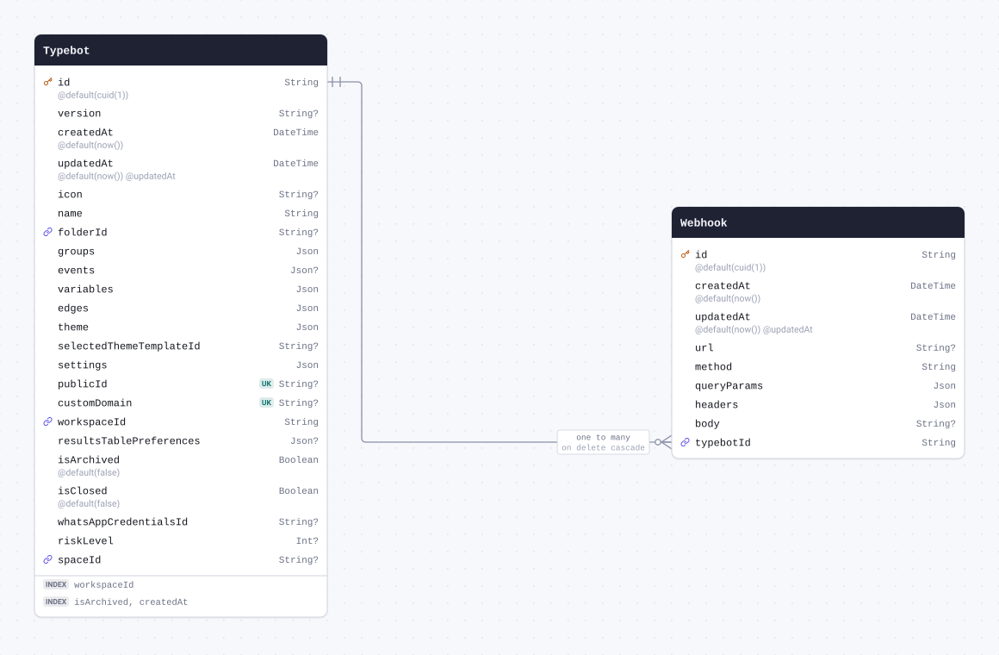

| Field         | Type       | Constraints                             | Default              | Description |
| ------------- | ---------- | --------------------------------------- | -------------------- | ----------- |
| `id`          | `String`   | PK NOT NULL                             | `cuid(1)`            |             |
| `createdAt`   | `DateTime` | NOT NULL                                | `now()`              |             |
| `updatedAt`   | `DateTime` | NOT NULL                                | `now()` `@updatedAt` |             |
| `url`         | `String`   | NULL                                    |                      |             |
| `method`      | `String`   | NOT NULL                                |                      |             |
| `queryParams` | `Json`     | NOT NULL                                |                      |             |
| `headers`     | `Json`     | NOT NULL                                |                      |             |
| `body`        | `String`   | NULL                                    |                      |             |
| `typebotId`   | `String`   | NOT NULL → [Typebot.id](#model-Typebot) |                      |             |

#### References

- `typebotId` → [Typebot.id](#model-Typebot) (many-to-one, on delete Cascade)

#### Definition

```sql
CREATE TABLE "Webhook" (
    "id" TEXT NOT NULL,
    "createdAt" TIMESTAMP(3) NOT NULL DEFAULT CURRENT_TIMESTAMP,
    "updatedAt" TIMESTAMP(3) NOT NULL DEFAULT CURRENT_TIMESTAMP,
    "url" TEXT,
    "method" TEXT NOT NULL,
    "queryParams" JSONB NOT NULL,
    "headers" JSONB NOT NULL,
    "body" TEXT,
    "typebotId" TEXT NOT NULL,

    CONSTRAINT "Webhook_pkey" PRIMARY KEY ("id")
);

ALTER TABLE "Webhook" ADD CONSTRAINT "Webhook_typebotId_fkey" FOREIGN KEY ("typebotId") REFERENCES "Typebot"("id") ON DELETE CASCADE ON UPDATE CASCADE;
```

<details>
<summary>Queries and their SQL</summary>

**findMany**: Every row

```ts
await prisma.webhook.findMany();
```

```sql
SELECT
  "public"."Webhook"."id",
  "public"."Webhook"."createdAt",
  "public"."Webhook"."updatedAt",
  "public"."Webhook"."url",
  "public"."Webhook"."method",
  "public"."Webhook"."queryParams",
  "public"."Webhook"."headers",
  "public"."Webhook"."body",
  "public"."Webhook"."typebotId"
FROM
  "public"."Webhook"
WHERE
  1 = 1
OFFSET
  $1
-- params: ["0"]
```

**count**: How many rows there are

```ts
await prisma.webhook.count();
```

```sql
SELECT
  COUNT(*) AS "_count$_all"
FROM
  (
    SELECT
      "public"."Webhook"."id"
    FROM
      "public"."Webhook"
    WHERE
      1 = 1
    OFFSET
      $1
  ) AS "sub"
-- params: ["0"]
```

**findMany**: Every row with its relations

```ts
await prisma.webhook.findMany({ include: { typebot: true } });
```

```sql
SELECT
  "public"."Webhook"."id",
  "public"."Webhook"."createdAt",
  "public"."Webhook"."updatedAt",
  "public"."Webhook"."url",
  "public"."Webhook"."method",
  "public"."Webhook"."queryParams",
  "public"."Webhook"."headers",
  "public"."Webhook"."body",
  "public"."Webhook"."typebotId"
FROM
  "public"."Webhook"
WHERE
  1 = 1
OFFSET
  $1
-- params: ["0"]

SELECT
  "public"."Typebot"."id",
  "public"."Typebot"."version",
  "public"."Typebot"."createdAt",
  "public"."Typebot"."updatedAt",
  "public"."Typebot"."icon",
  "public"."Typebot"."name",
  "public"."Typebot"."folderId",
  "public"."Typebot"."groups",
  "public"."Typebot"."events",
  "public"."Typebot"."variables",
  "public"."Typebot"."edges",
  "public"."Typebot"."theme",
  "public"."Typebot"."selectedThemeTemplateId",
  "public"."Typebot"."settings",
  "public"."Typebot"."publicId",
  "public"."Typebot"."customDomain",
  "public"."Typebot"."workspaceId",
  "public"."Typebot"."resultsTablePreferences",
  "public"."Typebot"."isArchived",
  "public"."Typebot"."isClosed",
  "public"."Typebot"."whatsAppCredentialsId",
  "public"."Typebot"."riskLevel",
  "public"."Typebot"."spaceId"
FROM
  "public"."Typebot"
WHERE
  "public"."Typebot"."id" IN ($1)
OFFSET
  $2
-- params: ["<typebotId of the rows above>","0"]
```

**findUnique**: One row by what is unique to it

```ts
await prisma.webhook.findUnique({ where: { id: "example" } });
```

```sql
SELECT
  "public"."Webhook"."id",
  "public"."Webhook"."createdAt",
  "public"."Webhook"."updatedAt",
  "public"."Webhook"."url",
  "public"."Webhook"."method",
  "public"."Webhook"."queryParams",
  "public"."Webhook"."headers",
  "public"."Webhook"."body",
  "public"."Webhook"."typebotId"
FROM
  "public"."Webhook"
WHERE
  (
    "public"."Webhook"."id" = $1
    AND 1 = 1
  )
LIMIT
  $2
OFFSET
  $3
-- params: ["example","1","0"]
```

**create**: Create a row

```ts
await prisma.webhook.create({
  data: { method: "example", queryParams: {}, headers: {}, typebotId: "example" },
});
```

```sql
INSERT INTO
  "public"."Webhook" (
    "id",
    "createdAt",
    "updatedAt",
    "method",
    "queryParams",
    "headers",
    "typebotId"
  )
VALUES
  ($1, $2, $3, $4, $5, $6, $7)
RETURNING
  "public"."Webhook"."id",
  "public"."Webhook"."createdAt",
  "public"."Webhook"."updatedAt",
  "public"."Webhook"."url",
  "public"."Webhook"."method",
  "public"."Webhook"."queryParams",
  "public"."Webhook"."headers",
  "public"."Webhook"."body",
  "public"."Webhook"."typebotId"
-- params: ["<cuid(1)>","<now()>","<now()>","example","{}","{}","example"]
```

**update**: Update a row

```ts
await prisma.webhook.update({
  where: { id: "example" },
  data: { createdAt: new Date("2026-01-01T00:00:00.000Z") },
});
```

```sql
UPDATE "public"."Webhook"
SET
  "createdAt" = $1,
  "updatedAt" = $2
WHERE
  (
    "public"."Webhook"."id" = $3
    AND 1 = 1
  )
RETURNING
  "public"."Webhook"."id",
  "public"."Webhook"."createdAt",
  "public"."Webhook"."updatedAt",
  "public"."Webhook"."url",
  "public"."Webhook"."method",
  "public"."Webhook"."queryParams",
  "public"."Webhook"."headers",
  "public"."Webhook"."body",
  "public"."Webhook"."typebotId"
-- params: ["2026-01-01T00:00:00.000Z",{"prisma__type":"generatorCall","prisma__value":{"name":"now","args":[],"returnType":{"type":"DateTime"}}},"example"]
```

**delete**: Delete a row

```ts
await prisma.webhook.delete({ where: { id: "example" } });
```

```sql
DELETE FROM "public"."Webhook"
WHERE
  (
    "public"."Webhook"."id" = $1
    AND 1 = 1
  )
RETURNING
  "public"."Webhook"."id",
  "public"."Webhook"."createdAt",
  "public"."Webhook"."updatedAt",
  "public"."Webhook"."url",
  "public"."Webhook"."method",
  "public"."Webhook"."queryParams",
  "public"."Webhook"."headers",
  "public"."Webhook"."body",
  "public"."Webhook"."typebotId"
-- params: ["example"]
```

</details>

<a id="model-ClaimableCustomPlan"></a>

### ClaimableCustomPlan

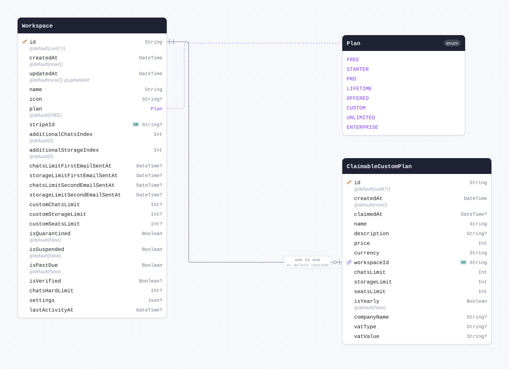

| Field          | Type       | Constraints                                        | Default   | Description |
| -------------- | ---------- | -------------------------------------------------- | --------- | ----------- |
| `id`           | `String`   | PK NOT NULL                                        | `cuid(1)` |             |
| `createdAt`    | `DateTime` | NOT NULL                                           | `now()`   |             |
| `claimedAt`    | `DateTime` | NULL                                               |           |             |
| `name`         | `String`   | NOT NULL                                           |           |             |
| `description`  | `String`   | NULL                                               |           |             |
| `price`        | `Int`      | NOT NULL                                           |           |             |
| `currency`     | `String`   | NOT NULL                                           |           |             |
| `workspaceId`  | `String`   | UNIQUE NOT NULL → [Workspace.id](#model-Workspace) |           |             |
| `chatsLimit`   | `Int`      | NOT NULL                                           |           |             |
| `storageLimit` | `Int`      | NOT NULL                                           |           |             |
| `seatsLimit`   | `Int`      | NOT NULL                                           |           |             |
| `isYearly`     | `Boolean`  | NOT NULL                                           | `false`   |             |
| `companyName`  | `String`   | NULL                                               |           |             |
| `vatType`      | `String`   | NULL                                               |           |             |
| `vatValue`     | `String`   | NULL                                               |           |             |

#### References

- `workspaceId` → [Workspace.id](#model-Workspace) (one-to-one, on delete Cascade)

#### Definition

```sql
CREATE TABLE "ClaimableCustomPlan" (
    "id" TEXT NOT NULL,
    "createdAt" TIMESTAMP(3) NOT NULL DEFAULT CURRENT_TIMESTAMP,
    "claimedAt" TIMESTAMP(3),
    "name" TEXT NOT NULL,
    "description" TEXT,
    "price" INTEGER NOT NULL,
    "currency" TEXT NOT NULL,
    "workspaceId" TEXT NOT NULL,
    "chatsLimit" INTEGER NOT NULL,
    "storageLimit" INTEGER NOT NULL,
    "seatsLimit" INTEGER NOT NULL,
    "isYearly" BOOLEAN NOT NULL DEFAULT false,
    "companyName" TEXT,
    "vatType" TEXT,
    "vatValue" TEXT,

    CONSTRAINT "ClaimableCustomPlan_pkey" PRIMARY KEY ("id")
);

CREATE UNIQUE INDEX "ClaimableCustomPlan_workspaceId_key" ON "ClaimableCustomPlan"("workspaceId");

ALTER TABLE "ClaimableCustomPlan" ADD CONSTRAINT "ClaimableCustomPlan_workspaceId_fkey" FOREIGN KEY ("workspaceId") REFERENCES "Workspace"("id") ON DELETE CASCADE ON UPDATE CASCADE;
```

<details>
<summary>Queries and their SQL</summary>

**findMany**: Every row

```ts
await prisma.claimableCustomPlan.findMany();
```

```sql
SELECT
  "public"."ClaimableCustomPlan"."id",
  "public"."ClaimableCustomPlan"."createdAt",
  "public"."ClaimableCustomPlan"."claimedAt",
  "public"."ClaimableCustomPlan"."name",
  "public"."ClaimableCustomPlan"."description",
  "public"."ClaimableCustomPlan"."price",
  "public"."ClaimableCustomPlan"."currency",
  "public"."ClaimableCustomPlan"."workspaceId",
  "public"."ClaimableCustomPlan"."chatsLimit",
  "public"."ClaimableCustomPlan"."storageLimit",
  "public"."ClaimableCustomPlan"."seatsLimit",
  "public"."ClaimableCustomPlan"."isYearly",
  "public"."ClaimableCustomPlan"."companyName",
  "public"."ClaimableCustomPlan"."vatType",
  "public"."ClaimableCustomPlan"."vatValue"
FROM
  "public"."ClaimableCustomPlan"
WHERE
  1 = 1
OFFSET
  $1
-- params: ["0"]
```

**count**: How many rows there are

```ts
await prisma.claimableCustomPlan.count();
```

```sql
SELECT
  COUNT(*) AS "_count$_all"
FROM
  (
    SELECT
      "public"."ClaimableCustomPlan"."id"
    FROM
      "public"."ClaimableCustomPlan"
    WHERE
      1 = 1
    OFFSET
      $1
  ) AS "sub"
-- params: ["0"]
```

**findMany**: Every row with its relations

```ts
await prisma.claimableCustomPlan.findMany({ include: { workspace: true } });
```

```sql
SELECT
  "public"."ClaimableCustomPlan"."id",
  "public"."ClaimableCustomPlan"."createdAt",
  "public"."ClaimableCustomPlan"."claimedAt",
  "public"."ClaimableCustomPlan"."name",
  "public"."ClaimableCustomPlan"."description",
  "public"."ClaimableCustomPlan"."price",
  "public"."ClaimableCustomPlan"."currency",
  "public"."ClaimableCustomPlan"."workspaceId",
  "public"."ClaimableCustomPlan"."chatsLimit",
  "public"."ClaimableCustomPlan"."storageLimit",
  "public"."ClaimableCustomPlan"."seatsLimit",
  "public"."ClaimableCustomPlan"."isYearly",
  "public"."ClaimableCustomPlan"."companyName",
  "public"."ClaimableCustomPlan"."vatType",
  "public"."ClaimableCustomPlan"."vatValue"
FROM
  "public"."ClaimableCustomPlan"
WHERE
  1 = 1
OFFSET
  $1
-- params: ["0"]

SELECT
  "public"."Workspace"."id",
  "public"."Workspace"."createdAt",
  "public"."Workspace"."updatedAt",
  "public"."Workspace"."name",
  "public"."Workspace"."icon",
  "public"."Workspace"."plan"::text,
  "public"."Workspace"."stripeId",
  "public"."Workspace"."additionalChatsIndex",
  "public"."Workspace"."additionalStorageIndex",
  "public"."Workspace"."chatsLimitFirstEmailSentAt",
  "public"."Workspace"."storageLimitFirstEmailSentAt",
  "public"."Workspace"."chatsLimitSecondEmailSentAt",
  "public"."Workspace"."storageLimitSecondEmailSentAt",
  "public"."Workspace"."customChatsLimit",
  "public"."Workspace"."customStorageLimit",
  "public"."Workspace"."customSeatsLimit",
  "public"."Workspace"."isQuarantined",
  "public"."Workspace"."isSuspended",
  "public"."Workspace"."isPastDue",
  "public"."Workspace"."isVerified",
  "public"."Workspace"."chatsHardLimit",
  "public"."Workspace"."settings",
  "public"."Workspace"."lastActivityAt"
FROM
  "public"."Workspace"
WHERE
  "public"."Workspace"."id" IN ($1)
OFFSET
  $2
-- params: ["<workspaceId of the rows above>","0"]
```

**findUnique**: One row by what is unique to it

```ts
await prisma.claimableCustomPlan.findUnique({ where: { id: "example" } });
```

```sql
SELECT
  "public"."ClaimableCustomPlan"."id",
  "public"."ClaimableCustomPlan"."createdAt",
  "public"."ClaimableCustomPlan"."claimedAt",
  "public"."ClaimableCustomPlan"."name",
  "public"."ClaimableCustomPlan"."description",
  "public"."ClaimableCustomPlan"."price",
  "public"."ClaimableCustomPlan"."currency",
  "public"."ClaimableCustomPlan"."workspaceId",
  "public"."ClaimableCustomPlan"."chatsLimit",
  "public"."ClaimableCustomPlan"."storageLimit",
  "public"."ClaimableCustomPlan"."seatsLimit",
  "public"."ClaimableCustomPlan"."isYearly",
  "public"."ClaimableCustomPlan"."companyName",
  "public"."ClaimableCustomPlan"."vatType",
  "public"."ClaimableCustomPlan"."vatValue"
FROM
  "public"."ClaimableCustomPlan"
WHERE
  (
    "public"."ClaimableCustomPlan"."id" = $1
    AND 1 = 1
  )
LIMIT
  $2
OFFSET
  $3
-- params: ["example","1","0"]
```

**create**: Create a row

```ts
await prisma.claimableCustomPlan.create({
  data: {
    name: "example",
    price: 1,
    currency: "example",
    workspaceId: "example",
    chatsLimit: 1,
    storageLimit: 1,
    seatsLimit: 1,
  },
});
```

```sql
INSERT INTO
  "public"."ClaimableCustomPlan" (
    "id",
    "createdAt",
    "name",
    "price",
    "currency",
    "workspaceId",
    "chatsLimit",
    "storageLimit",
    "seatsLimit",
    "isYearly"
  )
VALUES
  ($1, $2, $3, $4, $5, $6, $7, $8, $9, $10)
RETURNING
  "public"."ClaimableCustomPlan"."id",
  "public"."ClaimableCustomPlan"."createdAt",
  "public"."ClaimableCustomPlan"."claimedAt",
  "public"."ClaimableCustomPlan"."name",
  "public"."ClaimableCustomPlan"."description",
  "public"."ClaimableCustomPlan"."price",
  "public"."ClaimableCustomPlan"."currency",
  "public"."ClaimableCustomPlan"."workspaceId",
  "public"."ClaimableCustomPlan"."chatsLimit",
  "public"."ClaimableCustomPlan"."storageLimit",
  "public"."ClaimableCustomPlan"."seatsLimit",
  "public"."ClaimableCustomPlan"."isYearly",
  "public"."ClaimableCustomPlan"."companyName",
  "public"."ClaimableCustomPlan"."vatType",
  "public"."ClaimableCustomPlan"."vatValue"
-- params: ["<cuid(1)>","<now()>","example","1","example","example","1","1","1",false]
```

**update**: Update a row

```ts
await prisma.claimableCustomPlan.update({
  where: { id: "example" },
  data: { createdAt: new Date("2026-01-01T00:00:00.000Z") },
});
```

```sql
UPDATE "public"."ClaimableCustomPlan"
SET
  "createdAt" = $1
WHERE
  (
    "public"."ClaimableCustomPlan"."id" = $2
    AND 1 = 1
  )
RETURNING
  "public"."ClaimableCustomPlan"."id",
  "public"."ClaimableCustomPlan"."createdAt",
  "public"."ClaimableCustomPlan"."claimedAt",
  "public"."ClaimableCustomPlan"."name",
  "public"."ClaimableCustomPlan"."description",
  "public"."ClaimableCustomPlan"."price",
  "public"."ClaimableCustomPlan"."currency",
  "public"."ClaimableCustomPlan"."workspaceId",
  "public"."ClaimableCustomPlan"."chatsLimit",
  "public"."ClaimableCustomPlan"."storageLimit",
  "public"."ClaimableCustomPlan"."seatsLimit",
  "public"."ClaimableCustomPlan"."isYearly",
  "public"."ClaimableCustomPlan"."companyName",
  "public"."ClaimableCustomPlan"."vatType",
  "public"."ClaimableCustomPlan"."vatValue"
-- params: ["2026-01-01T00:00:00.000Z","example"]
```

**delete**: Delete a row

```ts
await prisma.claimableCustomPlan.delete({ where: { id: "example" } });
```

```sql
DELETE FROM "public"."ClaimableCustomPlan"
WHERE
  (
    "public"."ClaimableCustomPlan"."id" = $1
    AND 1 = 1
  )
RETURNING
  "public"."ClaimableCustomPlan"."id",
  "public"."ClaimableCustomPlan"."createdAt",
  "public"."ClaimableCustomPlan"."claimedAt",
  "public"."ClaimableCustomPlan"."name",
  "public"."ClaimableCustomPlan"."description",
  "public"."ClaimableCustomPlan"."price",
  "public"."ClaimableCustomPlan"."currency",
  "public"."ClaimableCustomPlan"."workspaceId",
  "public"."ClaimableCustomPlan"."chatsLimit",
  "public"."ClaimableCustomPlan"."storageLimit",
  "public"."ClaimableCustomPlan"."seatsLimit",
  "public"."ClaimableCustomPlan"."isYearly",
  "public"."ClaimableCustomPlan"."companyName",
  "public"."ClaimableCustomPlan"."vatType",
  "public"."ClaimableCustomPlan"."vatValue"
-- params: ["example"]
```

</details>

<a id="model-ChatSession"></a>

### ChatSession

| Field        | Type       | Constraints | Default              | Description |
| ------------ | ---------- | ----------- | -------------------- | ----------- |
| `id`         | `String`   | PK NOT NULL | `cuid(1)`            |             |
| `createdAt`  | `DateTime` | NOT NULL    | `now()`              |             |
| `updatedAt`  | `DateTime` | NOT NULL    | `now()` `@updatedAt` |             |
| `state`      | `Json`     | NOT NULL    |                      |             |
| `isReplying` | `Boolean`  | NULL        |                      |             |

#### Definition

```sql
CREATE TABLE "ChatSession" (
    "id" TEXT NOT NULL,
    "createdAt" TIMESTAMP(3) NOT NULL DEFAULT CURRENT_TIMESTAMP,
    "updatedAt" TIMESTAMP(3) NOT NULL DEFAULT CURRENT_TIMESTAMP,
    "state" JSONB NOT NULL,
    "isReplying" BOOLEAN,

    CONSTRAINT "ChatSession_pkey" PRIMARY KEY ("id")
);
```

<details>
<summary>Queries and their SQL</summary>

**findMany**: Every row

```ts
await prisma.chatSession.findMany();
```

```sql
SELECT
  "public"."ChatSession"."id",
  "public"."ChatSession"."createdAt",
  "public"."ChatSession"."updatedAt",
  "public"."ChatSession"."state",
  "public"."ChatSession"."isReplying"
FROM
  "public"."ChatSession"
WHERE
  1 = 1
OFFSET
  $1
-- params: ["0"]
```

**count**: How many rows there are

```ts
await prisma.chatSession.count();
```

```sql
SELECT
  COUNT(*) AS "_count$_all"
FROM
  (
    SELECT
      "public"."ChatSession"."id"
    FROM
      "public"."ChatSession"
    WHERE
      1 = 1
    OFFSET
      $1
  ) AS "sub"
-- params: ["0"]
```

**findUnique**: One row by what is unique to it

```ts
await prisma.chatSession.findUnique({ where: { id: "example" } });
```

```sql
SELECT
  "public"."ChatSession"."id",
  "public"."ChatSession"."createdAt",
  "public"."ChatSession"."updatedAt",
  "public"."ChatSession"."state",
  "public"."ChatSession"."isReplying"
FROM
  "public"."ChatSession"
WHERE
  (
    "public"."ChatSession"."id" = $1
    AND 1 = 1
  )
LIMIT
  $2
OFFSET
  $3
-- params: ["example","1","0"]
```

**create**: Create a row

```ts
await prisma.chatSession.create({ data: { state: {} } });
```

```sql
INSERT INTO
  "public"."ChatSession" ("id", "createdAt", "updatedAt", "state")
VALUES
  ($1, $2, $3, $4)
RETURNING
  "public"."ChatSession"."id",
  "public"."ChatSession"."createdAt",
  "public"."ChatSession"."updatedAt",
  "public"."ChatSession"."state",
  "public"."ChatSession"."isReplying"
-- params: ["<cuid(1)>","<now()>","<now()>","{}"]
```

**update**: Update a row

```ts
await prisma.chatSession.update({
  where: { id: "example" },
  data: { createdAt: new Date("2026-01-01T00:00:00.000Z") },
});
```

```sql
UPDATE "public"."ChatSession"
SET
  "createdAt" = $1,
  "updatedAt" = $2
WHERE
  (
    "public"."ChatSession"."id" = $3
    AND 1 = 1
  )
RETURNING
  "public"."ChatSession"."id",
  "public"."ChatSession"."createdAt",
  "public"."ChatSession"."updatedAt",
  "public"."ChatSession"."state",
  "public"."ChatSession"."isReplying"
-- params: ["2026-01-01T00:00:00.000Z",{"prisma__type":"generatorCall","prisma__value":{"name":"now","args":[],"returnType":{"type":"DateTime"}}},"example"]
```

**delete**: Delete a row

```ts
await prisma.chatSession.delete({ where: { id: "example" } });
```

```sql
DELETE FROM "public"."ChatSession"
WHERE
  (
    "public"."ChatSession"."id" = $1
    AND 1 = 1
  )
RETURNING
  "public"."ChatSession"."id",
  "public"."ChatSession"."createdAt",
  "public"."ChatSession"."updatedAt",
  "public"."ChatSession"."state",
  "public"."ChatSession"."isReplying"
-- params: ["example"]
```

</details>

<a id="model-ThemeTemplate"></a>

### ThemeTemplate

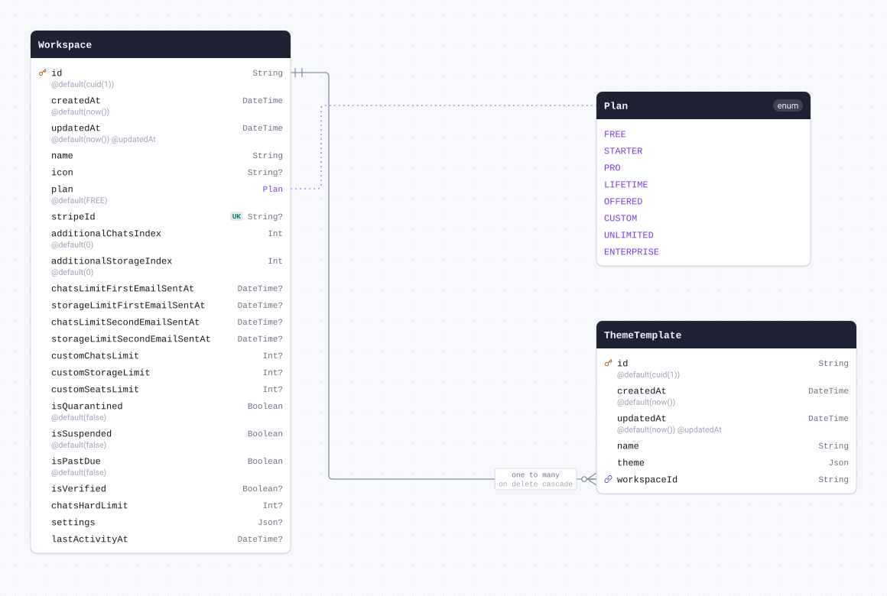

| Field         | Type       | Constraints                                 | Default              | Description |
| ------------- | ---------- | ------------------------------------------- | -------------------- | ----------- |
| `id`          | `String`   | PK NOT NULL                                 | `cuid(1)`            |             |
| `createdAt`   | `DateTime` | NOT NULL                                    | `now()`              |             |
| `updatedAt`   | `DateTime` | NOT NULL                                    | `now()` `@updatedAt` |             |
| `name`        | `String`   | NOT NULL                                    |                      |             |
| `theme`       | `Json`     | NOT NULL                                    |                      |             |
| `workspaceId` | `String`   | NOT NULL → [Workspace.id](#model-Workspace) |                      |             |

#### References

- `workspaceId` → [Workspace.id](#model-Workspace) (many-to-one, on delete Cascade)

#### Definition

```sql
CREATE TABLE "ThemeTemplate" (
    "id" TEXT NOT NULL,
    "createdAt" TIMESTAMP(3) NOT NULL DEFAULT CURRENT_TIMESTAMP,
    "updatedAt" TIMESTAMP(3) NOT NULL DEFAULT CURRENT_TIMESTAMP,
    "name" TEXT NOT NULL,
    "theme" JSONB NOT NULL,
    "workspaceId" TEXT NOT NULL,

    CONSTRAINT "ThemeTemplate_pkey" PRIMARY KEY ("id")
);

ALTER TABLE "ThemeTemplate" ADD CONSTRAINT "ThemeTemplate_workspaceId_fkey" FOREIGN KEY ("workspaceId") REFERENCES "Workspace"("id") ON DELETE CASCADE ON UPDATE CASCADE;
```

<details>
<summary>Queries and their SQL</summary>

**findMany**: Every row

```ts
await prisma.themeTemplate.findMany();
```

```sql
SELECT
  "public"."ThemeTemplate"."id",
  "public"."ThemeTemplate"."createdAt",
  "public"."ThemeTemplate"."updatedAt",
  "public"."ThemeTemplate"."name",
  "public"."ThemeTemplate"."theme",
  "public"."ThemeTemplate"."workspaceId"
FROM
  "public"."ThemeTemplate"
WHERE
  1 = 1
OFFSET
  $1
-- params: ["0"]
```

**count**: How many rows there are

```ts
await prisma.themeTemplate.count();
```

```sql
SELECT
  COUNT(*) AS "_count$_all"
FROM
  (
    SELECT
      "public"."ThemeTemplate"."id"
    FROM
      "public"."ThemeTemplate"
    WHERE
      1 = 1
    OFFSET
      $1
  ) AS "sub"
-- params: ["0"]
```

**findMany**: Every row with its relations

```ts
await prisma.themeTemplate.findMany({ include: { workspace: true } });
```

```sql
SELECT
  "public"."ThemeTemplate"."id",
  "public"."ThemeTemplate"."createdAt",
  "public"."ThemeTemplate"."updatedAt",
  "public"."ThemeTemplate"."name",
  "public"."ThemeTemplate"."theme",
  "public"."ThemeTemplate"."workspaceId"
FROM
  "public"."ThemeTemplate"
WHERE
  1 = 1
OFFSET
  $1
-- params: ["0"]

SELECT
  "public"."Workspace"."id",
  "public"."Workspace"."createdAt",
  "public"."Workspace"."updatedAt",
  "public"."Workspace"."name",
  "public"."Workspace"."icon",
  "public"."Workspace"."plan"::text,
  "public"."Workspace"."stripeId",
  "public"."Workspace"."additionalChatsIndex",
  "public"."Workspace"."additionalStorageIndex",
  "public"."Workspace"."chatsLimitFirstEmailSentAt",
  "public"."Workspace"."storageLimitFirstEmailSentAt",
  "public"."Workspace"."chatsLimitSecondEmailSentAt",
  "public"."Workspace"."storageLimitSecondEmailSentAt",
  "public"."Workspace"."customChatsLimit",
  "public"."Workspace"."customStorageLimit",
  "public"."Workspace"."customSeatsLimit",
  "public"."Workspace"."isQuarantined",
  "public"."Workspace"."isSuspended",
  "public"."Workspace"."isPastDue",
  "public"."Workspace"."isVerified",
  "public"."Workspace"."chatsHardLimit",
  "public"."Workspace"."settings",
  "public"."Workspace"."lastActivityAt"
FROM
  "public"."Workspace"
WHERE
  "public"."Workspace"."id" IN ($1)
OFFSET
  $2
-- params: ["<workspaceId of the rows above>","0"]
```

**findUnique**: One row by what is unique to it

```ts
await prisma.themeTemplate.findUnique({ where: { id: "example" } });
```

```sql
SELECT
  "public"."ThemeTemplate"."id",
  "public"."ThemeTemplate"."createdAt",
  "public"."ThemeTemplate"."updatedAt",
  "public"."ThemeTemplate"."name",
  "public"."ThemeTemplate"."theme",
  "public"."ThemeTemplate"."workspaceId"
FROM
  "public"."ThemeTemplate"
WHERE
  (
    "public"."ThemeTemplate"."id" = $1
    AND 1 = 1
  )
LIMIT
  $2
OFFSET
  $3
-- params: ["example","1","0"]
```

**create**: Create a row

```ts
await prisma.themeTemplate.create({ data: { name: "example", theme: {}, workspaceId: "example" } });
```

```sql
INSERT INTO
  "public"."ThemeTemplate" (
    "id",
    "createdAt",
    "updatedAt",
    "name",
    "theme",
    "workspaceId"
  )
VALUES
  ($1, $2, $3, $4, $5, $6)
RETURNING
  "public"."ThemeTemplate"."id",
  "public"."ThemeTemplate"."createdAt",
  "public"."ThemeTemplate"."updatedAt",
  "public"."ThemeTemplate"."name",
  "public"."ThemeTemplate"."theme",
  "public"."ThemeTemplate"."workspaceId"
-- params: ["<cuid(1)>","<now()>","<now()>","example","{}","example"]
```

**update**: Update a row

```ts
await prisma.themeTemplate.update({
  where: { id: "example" },
  data: { createdAt: new Date("2026-01-01T00:00:00.000Z") },
});
```

```sql
UPDATE "public"."ThemeTemplate"
SET
  "createdAt" = $1,
  "updatedAt" = $2
WHERE
  (
    "public"."ThemeTemplate"."id" = $3
    AND 1 = 1
  )
RETURNING
  "public"."ThemeTemplate"."id",
  "public"."ThemeTemplate"."createdAt",
  "public"."ThemeTemplate"."updatedAt",
  "public"."ThemeTemplate"."name",
  "public"."ThemeTemplate"."theme",
  "public"."ThemeTemplate"."workspaceId"
-- params: ["2026-01-01T00:00:00.000Z",{"prisma__type":"generatorCall","prisma__value":{"name":"now","args":[],"returnType":{"type":"DateTime"}}},"example"]
```

**delete**: Delete a row

```ts
await prisma.themeTemplate.delete({ where: { id: "example" } });
```

```sql
DELETE FROM "public"."ThemeTemplate"
WHERE
  (
    "public"."ThemeTemplate"."id" = $1
    AND 1 = 1
  )
RETURNING
  "public"."ThemeTemplate"."id",
  "public"."ThemeTemplate"."createdAt",
  "public"."ThemeTemplate"."updatedAt",
  "public"."ThemeTemplate"."name",
  "public"."ThemeTemplate"."theme",
  "public"."ThemeTemplate"."workspaceId"
-- params: ["example"]
```

</details>

<a id="model-BannedIp"></a>

### BannedIp

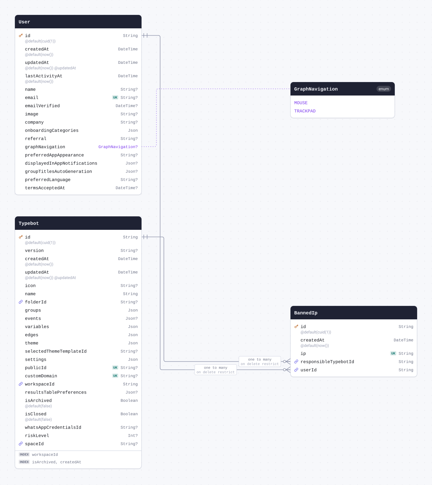

| Field                  | Type       | Constraints                             | Default   | Description |
| ---------------------- | ---------- | --------------------------------------- | --------- | ----------- |
| `id`                   | `String`   | PK NOT NULL                             | `cuid(1)` |             |
| `createdAt`            | `DateTime` | NOT NULL                                | `now()`   |             |
| `ip`                   | `String`   | UNIQUE NOT NULL                         |           |             |
| `responsibleTypebotId` | `String`   | NOT NULL → [Typebot.id](#model-Typebot) |           |             |
| `userId`               | `String`   | NOT NULL → [User.id](#model-User)       |           |             |

#### References

- `responsibleTypebotId` → [Typebot.id](#model-Typebot) (many-to-one, on delete Restrict)
- `userId` → [User.id](#model-User) (many-to-one, on delete Restrict)

#### Definition

```sql
CREATE TABLE "BannedIp" (
    "id" TEXT NOT NULL,
    "createdAt" TIMESTAMP(3) NOT NULL DEFAULT CURRENT_TIMESTAMP,
    "ip" TEXT NOT NULL,
    "responsibleTypebotId" TEXT NOT NULL,
    "userId" TEXT NOT NULL,

    CONSTRAINT "BannedIp_pkey" PRIMARY KEY ("id")
);

CREATE UNIQUE INDEX "BannedIp_ip_key" ON "BannedIp"("ip");

ALTER TABLE "BannedIp" ADD CONSTRAINT "BannedIp_responsibleTypebotId_fkey" FOREIGN KEY ("responsibleTypebotId") REFERENCES "Typebot"("id") ON DELETE RESTRICT ON UPDATE CASCADE;

ALTER TABLE "BannedIp" ADD CONSTRAINT "BannedIp_userId_fkey" FOREIGN KEY ("userId") REFERENCES "User"("id") ON DELETE RESTRICT ON UPDATE CASCADE;
```

<details>
<summary>Queries and their SQL</summary>

**findMany**: Every row

```ts
await prisma.bannedIp.findMany();
```

```sql
SELECT
  "public"."BannedIp"."id",
  "public"."BannedIp"."createdAt",
  "public"."BannedIp"."ip",
  "public"."BannedIp"."responsibleTypebotId",
  "public"."BannedIp"."userId"
FROM
  "public"."BannedIp"
WHERE
  1 = 1
OFFSET
  $1
-- params: ["0"]
```

**count**: How many rows there are

```ts
await prisma.bannedIp.count();
```

```sql
SELECT
  COUNT(*) AS "_count$_all"
FROM
  (
    SELECT
      "public"."BannedIp"."id"
    FROM
      "public"."BannedIp"
    WHERE
      1 = 1
    OFFSET
      $1
  ) AS "sub"
-- params: ["0"]
```

**findMany**: Every row with its relations

```ts
await prisma.bannedIp.findMany({ include: { responsibleTypebot: true, user: true } });
```

```sql
SELECT
  "public"."BannedIp"."id",
  "public"."BannedIp"."createdAt",
  "public"."BannedIp"."ip",
  "public"."BannedIp"."responsibleTypebotId",
  "public"."BannedIp"."userId"
FROM
  "public"."BannedIp"
WHERE
  1 = 1
OFFSET
  $1
-- params: ["0"]

SELECT
  "public"."Typebot"."id",
  "public"."Typebot"."version",
  "public"."Typebot"."createdAt",
  "public"."Typebot"."updatedAt",
  "public"."Typebot"."icon",
  "public"."Typebot"."name",
  "public"."Typebot"."folderId",
  "public"."Typebot"."groups",
  "public"."Typebot"."events",
  "public"."Typebot"."variables",
  "public"."Typebot"."edges",
  "public"."Typebot"."theme",
  "public"."Typebot"."selectedThemeTemplateId",
  "public"."Typebot"."settings",
  "public"."Typebot"."publicId",
  "public"."Typebot"."customDomain",
  "public"."Typebot"."workspaceId",
  "public"."Typebot"."resultsTablePreferences",
  "public"."Typebot"."isArchived",
  "public"."Typebot"."isClosed",
  "public"."Typebot"."whatsAppCredentialsId",
  "public"."Typebot"."riskLevel",
  "public"."Typebot"."spaceId"
FROM
  "public"."Typebot"
WHERE
  "public"."Typebot"."id" IN ($1)
OFFSET
  $2
-- params: ["<responsibleTypebotId of the rows above>","0"]

SELECT
  "public"."User"."id",
  "public"."User"."createdAt",
  "public"."User"."updatedAt",
  "public"."User"."lastActivityAt",
  "public"."User"."name",
  "public"."User"."email",
  "public"."User"."emailVerified",
  "public"."User"."image",
  "public"."User"."company",
  "public"."User"."onboardingCategories",
  "public"."User"."referral",
  "public"."User"."graphNavigation"::text,
  "public"."User"."preferredAppAppearance",
  "public"."User"."displayedInAppNotifications",
  "public"."User"."groupTitlesAutoGeneration",
  "public"."User"."preferredLanguage",
  "public"."User"."termsAcceptedAt"
FROM
  "public"."User"
WHERE
  "public"."User"."id" IN ($1)
OFFSET
  $2
-- params: ["<userId of the rows above>","0"]
```

**findUnique**: One row by what is unique to it

```ts
await prisma.bannedIp.findUnique({ where: { id: "example" } });
```

```sql
SELECT
  "public"."BannedIp"."id",
  "public"."BannedIp"."createdAt",
  "public"."BannedIp"."ip",
  "public"."BannedIp"."responsibleTypebotId",
  "public"."BannedIp"."userId"
FROM
  "public"."BannedIp"
WHERE
  (
    "public"."BannedIp"."id" = $1
    AND 1 = 1
  )
LIMIT
  $2
OFFSET
  $3
-- params: ["example","1","0"]
```

**create**: Create a row

```ts
await prisma.bannedIp.create({
  data: { ip: "example", responsibleTypebotId: "example", userId: "example" },
});
```

```sql
INSERT INTO
  "public"."BannedIp" (
    "id",
    "createdAt",
    "ip",
    "responsibleTypebotId",
    "userId"
  )
VALUES
  ($1, $2, $3, $4, $5)
RETURNING
  "public"."BannedIp"."id",
  "public"."BannedIp"."createdAt",
  "public"."BannedIp"."ip",
  "public"."BannedIp"."responsibleTypebotId",
  "public"."BannedIp"."userId"
-- params: ["<cuid(1)>","<now()>","example","example","example"]
```

**update**: Update a row

```ts
await prisma.bannedIp.update({
  where: { id: "example" },
  data: { createdAt: new Date("2026-01-01T00:00:00.000Z") },
});
```

```sql
UPDATE "public"."BannedIp"
SET
  "createdAt" = $1
WHERE
  (
    "public"."BannedIp"."id" = $2
    AND 1 = 1
  )
RETURNING
  "public"."BannedIp"."id",
  "public"."BannedIp"."createdAt",
  "public"."BannedIp"."ip",
  "public"."BannedIp"."responsibleTypebotId",
  "public"."BannedIp"."userId"
-- params: ["2026-01-01T00:00:00.000Z","example"]
```

**delete**: Delete a row

```ts
await prisma.bannedIp.delete({ where: { id: "example" } });
```

```sql
DELETE FROM "public"."BannedIp"
WHERE
  (
    "public"."BannedIp"."id" = $1
    AND 1 = 1
  )
RETURNING
  "public"."BannedIp"."id",
  "public"."BannedIp"."createdAt",
  "public"."BannedIp"."ip",
  "public"."BannedIp"."responsibleTypebotId",
  "public"."BannedIp"."userId"
-- params: ["example"]
```

</details>

<a id="model-SuppressedEmail"></a>

### SuppressedEmail

| Field                         | Type       | Constraints     | Default              | Description |
| ----------------------------- | ---------- | --------------- | -------------------- | ----------- |
| `id`                          | `String`   | PK NOT NULL     | `cuid(1)`            |             |
| `createdAt`                   | `DateTime` | NOT NULL        | `now()`              |             |
| `updatedAt`                   | `DateTime` | NOT NULL        | `now()` `@updatedAt` |             |
| `email`                       | `String`   | UNIQUE NOT NULL |                      |             |
| `transientGeneralBounceCount` | `Int`      | NOT NULL        | `0`                  |             |
| `suppressedAt`                | `DateTime` | NULL            |                      |             |
| `lastWebhookId`               | `String`   | NULL            |                      |             |

#### Definition

```sql
CREATE TABLE "SuppressedEmail" (
    "id" TEXT NOT NULL,
    "createdAt" TIMESTAMP(3) NOT NULL DEFAULT CURRENT_TIMESTAMP,
    "updatedAt" TIMESTAMP(3) NOT NULL DEFAULT CURRENT_TIMESTAMP,
    "email" TEXT NOT NULL,
    "transientGeneralBounceCount" INTEGER NOT NULL DEFAULT 0,
    "suppressedAt" TIMESTAMP(3),
    "lastWebhookId" TEXT,

    CONSTRAINT "SuppressedEmail_pkey" PRIMARY KEY ("id")
);

CREATE UNIQUE INDEX "SuppressedEmail_email_key" ON "SuppressedEmail"("email");
```

<details>
<summary>Queries and their SQL</summary>

**findMany**: Every row

```ts
await prisma.suppressedEmail.findMany();
```

```sql
SELECT
  "public"."SuppressedEmail"."id",
  "public"."SuppressedEmail"."createdAt",
  "public"."SuppressedEmail"."updatedAt",
  "public"."SuppressedEmail"."email",
  "public"."SuppressedEmail"."transientGeneralBounceCount",
  "public"."SuppressedEmail"."suppressedAt",
  "public"."SuppressedEmail"."lastWebhookId"
FROM
  "public"."SuppressedEmail"
WHERE
  1 = 1
OFFSET
  $1
-- params: ["0"]
```

**count**: How many rows there are

```ts
await prisma.suppressedEmail.count();
```

```sql
SELECT
  COUNT(*) AS "_count$_all"
FROM
  (
    SELECT
      "public"."SuppressedEmail"."id"
    FROM
      "public"."SuppressedEmail"
    WHERE
      1 = 1
    OFFSET
      $1
  ) AS "sub"
-- params: ["0"]
```

**findUnique**: One row by what is unique to it

```ts
await prisma.suppressedEmail.findUnique({ where: { id: "example" } });
```

```sql
SELECT
  "public"."SuppressedEmail"."id",
  "public"."SuppressedEmail"."createdAt",
  "public"."SuppressedEmail"."updatedAt",
  "public"."SuppressedEmail"."email",
  "public"."SuppressedEmail"."transientGeneralBounceCount",
  "public"."SuppressedEmail"."suppressedAt",
  "public"."SuppressedEmail"."lastWebhookId"
FROM
  "public"."SuppressedEmail"
WHERE
  (
    "public"."SuppressedEmail"."id" = $1
    AND 1 = 1
  )
LIMIT
  $2
OFFSET
  $3
-- params: ["example","1","0"]
```

**create**: Create a row

```ts
await prisma.suppressedEmail.create({ data: { email: "example" } });
```

```sql
INSERT INTO
  "public"."SuppressedEmail" (
    "id",
    "createdAt",
    "updatedAt",
    "email",
    "transientGeneralBounceCount"
  )
VALUES
  ($1, $2, $3, $4, $5)
RETURNING
  "public"."SuppressedEmail"."id",
  "public"."SuppressedEmail"."createdAt",
  "public"."SuppressedEmail"."updatedAt",
  "public"."SuppressedEmail"."email",
  "public"."SuppressedEmail"."transientGeneralBounceCount",
  "public"."SuppressedEmail"."suppressedAt",
  "public"."SuppressedEmail"."lastWebhookId"
-- params: ["<cuid(1)>","<now()>","<now()>","example","0"]
```

**update**: Update a row

```ts
await prisma.suppressedEmail.update({
  where: { id: "example" },
  data: { createdAt: new Date("2026-01-01T00:00:00.000Z") },
});
```

```sql
UPDATE "public"."SuppressedEmail"
SET
  "createdAt" = $1,
  "updatedAt" = $2
WHERE
  (
    "public"."SuppressedEmail"."id" = $3
    AND 1 = 1
  )
RETURNING
  "public"."SuppressedEmail"."id",
  "public"."SuppressedEmail"."createdAt",
  "public"."SuppressedEmail"."updatedAt",
  "public"."SuppressedEmail"."email",
  "public"."SuppressedEmail"."transientGeneralBounceCount",
  "public"."SuppressedEmail"."suppressedAt",
  "public"."SuppressedEmail"."lastWebhookId"
-- params: ["2026-01-01T00:00:00.000Z",{"prisma__type":"generatorCall","prisma__value":{"name":"now","args":[],"returnType":{"type":"DateTime"}}},"example"]
```

**delete**: Delete a row

```ts
await prisma.suppressedEmail.delete({ where: { id: "example" } });
```

```sql
DELETE FROM "public"."SuppressedEmail"
WHERE
  (
    "public"."SuppressedEmail"."id" = $1
    AND 1 = 1
  )
RETURNING
  "public"."SuppressedEmail"."id",
  "public"."SuppressedEmail"."createdAt",
  "public"."SuppressedEmail"."updatedAt",
  "public"."SuppressedEmail"."email",
  "public"."SuppressedEmail"."transientGeneralBounceCount",
  "public"."SuppressedEmail"."suppressedAt",
  "public"."SuppressedEmail"."lastWebhookId"
-- params: ["example"]
```

</details>

## Enums

<a id="enum-ChatProvider"></a>

### ChatProvider

- `WHATSAPP`
- `DIALOG360`

#### Definition

```sql
CREATE TYPE "ChatProvider" AS ENUM ('WHATSAPP', 'DIALOG360');
```

<a id="enum-WorkspaceRole"></a>

### WorkspaceRole

- `ADMIN`
- `MEMBER`
- `GUEST`

#### Definition

```sql
CREATE TYPE "WorkspaceRole" AS ENUM ('ADMIN', 'MEMBER', 'GUEST');
```

<a id="enum-GraphNavigation"></a>

### GraphNavigation

- `MOUSE`
- `TRACKPAD`

#### Definition

```sql
CREATE TYPE "GraphNavigation" AS ENUM ('MOUSE', 'TRACKPAD');
```

<a id="enum-Plan"></a>

### Plan

- `FREE`
- `STARTER`
- `PRO`
- `LIFETIME`
- `OFFERED`
- `CUSTOM`
- `UNLIMITED`
- `ENTERPRISE`

#### Definition

```sql
CREATE TYPE "Plan" AS ENUM ('FREE', 'STARTER', 'PRO', 'LIFETIME', 'OFFERED', 'CUSTOM', 'UNLIMITED', 'ENTERPRISE');
```

<a id="enum-CollaborationType"></a>

### CollaborationType

- `READ`
- `WRITE`
- `FULL_ACCESS`

#### Definition

```sql
CREATE TYPE "CollaborationType" AS ENUM ('READ', 'WRITE', 'FULL_ACCESS');
```
