# Schema docs

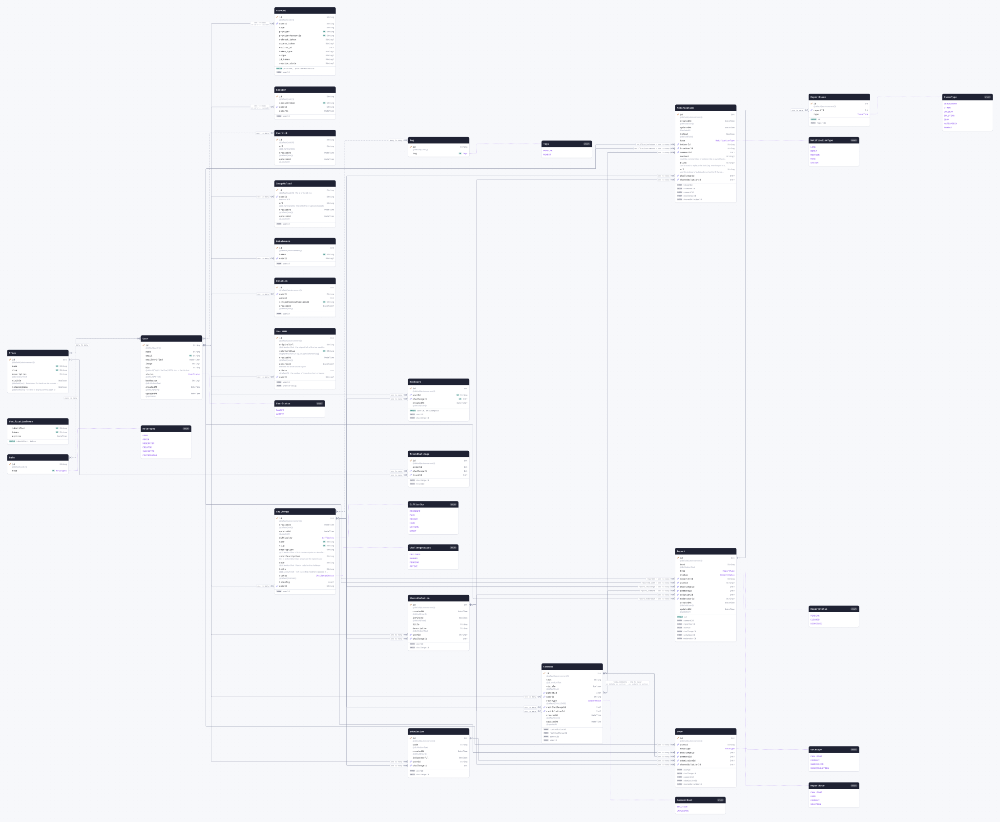

<details>
<summary>The whole schema as SQL</summary>

```sql
CREATE TABLE `Account` (
    `id` VARCHAR(191) NOT NULL,
    `userId` VARCHAR(191) NOT NULL,
    `type` VARCHAR(191) NOT NULL,
    `provider` VARCHAR(191) NOT NULL,
    `providerAccountId` VARCHAR(191) NOT NULL,
    `refresh_token` VARCHAR(191) NULL,
    `access_token` VARCHAR(191) NULL,
    `expires_at` INTEGER NULL,
    `token_type` VARCHAR(191) NULL,
    `scope` VARCHAR(191) NULL,
    `id_token` VARCHAR(191) NULL,
    `session_state` VARCHAR(191) NULL,

    INDEX `Account_userId_idx`(`userId`),
    UNIQUE INDEX `Account_provider_providerAccountId_key`(`provider`, `providerAccountId`),
    PRIMARY KEY (`id`)
) DEFAULT CHARACTER SET utf8mb4 COLLATE utf8mb4_unicode_ci;

CREATE TABLE `Session` (
    `id` VARCHAR(191) NOT NULL,
    `sessionToken` VARCHAR(191) NOT NULL,
    `userId` VARCHAR(191) NOT NULL,
    `expires` DATETIME(3) NOT NULL,

    UNIQUE INDEX `Session_sessionToken_key`(`sessionToken`),
    INDEX `Session_userId_idx`(`userId`),
    PRIMARY KEY (`id`)
) DEFAULT CHARACTER SET utf8mb4 COLLATE utf8mb4_unicode_ci;

CREATE TABLE `Role` (
    `id` VARCHAR(191) NOT NULL,
    `role` ENUM('USER', 'ADMIN', 'MODERATOR', 'CREATOR', 'SUPPORTER', 'CONTRIBUTOR') NOT NULL,

    UNIQUE INDEX `Role_role_key`(`role`),
    PRIMARY KEY (`id`)
) DEFAULT CHARACTER SET utf8mb4 COLLATE utf8mb4_unicode_ci;

CREATE TABLE `UserLink` (
    `id` VARCHAR(191) NOT NULL,
    `url` VARCHAR(256) NOT NULL,
    `createdAt` DATETIME(3) NOT NULL DEFAULT CURRENT_TIMESTAMP(3),
    `updatedAt` DATETIME(3) NOT NULL,

    PRIMARY KEY (`id`)
) DEFAULT CHARACTER SET utf8mb4 COLLATE utf8mb4_unicode_ci;

CREATE TABLE `User` (
    `id` VARCHAR(191) NOT NULL,
    `name` VARCHAR(191) NOT NULL,
    `email` VARCHAR(191) NOT NULL,
    `emailVerified` DATETIME(3) NULL,
    `image` VARCHAR(191) NULL,
    `bio` VARCHAR(1000) NOT NULL DEFAULT '',
    `status` ENUM('BANNED', 'ACTIVE') NOT NULL DEFAULT 'ACTIVE',
    `banReason` MEDIUMTEXT NULL,
    `createdAt` DATETIME(3) NOT NULL DEFAULT CURRENT_TIMESTAMP(3),
    `updatedAt` DATETIME(3) NOT NULL,

    UNIQUE INDEX `User_email_key`(`email`),
    PRIMARY KEY (`id`)
) DEFAULT CHARACTER SET utf8mb4 COLLATE utf8mb4_unicode_ci;

CREATE TABLE `VerificationToken` (
    `identifier` VARCHAR(191) NOT NULL,
    `token` VARCHAR(191) NOT NULL,
    `expires` DATETIME(3) NOT NULL,

    UNIQUE INDEX `VerificationToken_token_key`(`token`),
    UNIQUE INDEX `VerificationToken_identifier_token_key`(`identifier`, `token`)
) DEFAULT CHARACTER SET utf8mb4 COLLATE utf8mb4_unicode_ci;

CREATE TABLE `Tag` (
    `id` VARCHAR(191) NOT NULL,
    `tag` ENUM('POPULAR', 'NEWEST') NOT NULL,

    UNIQUE INDEX `Tag_tag_key`(`tag`),
    PRIMARY KEY (`id`)
) DEFAULT CHARACTER SET utf8mb4 COLLATE utf8mb4_unicode_ci;

CREATE TABLE `Challenge` (
    `id` INTEGER NOT NULL AUTO_INCREMENT,
    `createdAt` DATETIME(3) NOT NULL DEFAULT CURRENT_TIMESTAMP(3),
    `updatedAt` DATETIME(3) NOT NULL,
    `difficulty` ENUM('BEGINNER', 'EASY', 'MEDIUM', 'HARD', 'EXTREME', 'EVENT') NOT NULL,
    `name` VARCHAR(191) NOT NULL,
    `slug` VARCHAR(191) NOT NULL,
    `description` MEDIUMTEXT NOT NULL,
    `shortDescription` VARCHAR(191) NOT NULL,
    `code` MEDIUMTEXT NOT NULL,
    `tests` MEDIUMTEXT NOT NULL,
    `status` ENUM('DECLINED', 'BANNED', 'PENDING', 'ACTIVE') NOT NULL DEFAULT 'PENDING',
    `tsconfig` JSON NULL,
    `userId` VARCHAR(191) NOT NULL,

    UNIQUE INDEX `Challenge_name_key`(`name`),
    UNIQUE INDEX `Challenge_slug_key`(`slug`),
    INDEX `Challenge_userId_idx`(`userId`),
    PRIMARY KEY (`id`)
) DEFAULT CHARACTER SET utf8mb4 COLLATE utf8mb4_unicode_ci;

CREATE TABLE `Vote` (
    `id` INTEGER NOT NULL AUTO_INCREMENT,
    `userId` VARCHAR(191) NOT NULL,
    `rootType` ENUM('CHALLENGE', 'COMMENT', 'SUBMISSION', 'SHAREDSOLUTION') NOT NULL,
    `challengeId` INTEGER NULL,
    `commentId` INTEGER NULL,
    `submissionId` INTEGER NULL,
    `sharedSolutionId` INTEGER NULL,

    INDEX `Vote_userId_idx`(`userId`),
    INDEX `Vote_challengeId_idx`(`challengeId`),
    INDEX `Vote_commentId_idx`(`commentId`),
    INDEX `Vote_submissionId_idx`(`submissionId`),
    INDEX `Vote_sharedSolutionId_idx`(`sharedSolutionId`),
    PRIMARY KEY (`id`)
) DEFAULT CHARACTER SET utf8mb4 COLLATE utf8mb4_unicode_ci;

CREATE TABLE `SharedSolution` (
    `id` INTEGER NOT NULL AUTO_INCREMENT,
    `createdAt` DATETIME(3) NOT NULL DEFAULT CURRENT_TIMESTAMP(3),
    `isPinned` BOOLEAN NOT NULL DEFAULT false,
    `title` VARCHAR(191) NOT NULL,
    `description` MEDIUMTEXT NOT NULL,
    `userId` VARCHAR(191) NULL,
    `challengeId` INTEGER NULL,

    INDEX `SharedSolution_userId_idx`(`userId`),
    INDEX `SharedSolution_challengeId_idx`(`challengeId`),
    PRIMARY KEY (`id`)
) DEFAULT CHARACTER SET utf8mb4 COLLATE utf8mb4_unicode_ci;

CREATE TABLE `Submission` (
    `id` INTEGER NOT NULL AUTO_INCREMENT,
    `code` MEDIUMTEXT NOT NULL,
    `createdAt` DATETIME(3) NOT NULL DEFAULT CURRENT_TIMESTAMP(3),
    `isSuccessful` BOOLEAN NOT NULL,
    `userId` VARCHAR(191) NOT NULL,
    `challengeId` INTEGER NOT NULL,

    INDEX `Submission_userId_idx`(`userId`),
    INDEX `Submission_challengeId_idx`(`challengeId`),
    PRIMARY KEY (`id`)
) DEFAULT CHARACTER SET utf8mb4 COLLATE utf8mb4_unicode_ci;

CREATE TABLE `Bookmark` (
    `id` INTEGER NOT NULL AUTO_INCREMENT,
    `userId` VARCHAR(191) NOT NULL,
    `challengeId` INTEGER NULL,
    `createdAt` DATETIME(3) NULL DEFAULT CURRENT_TIMESTAMP(3),

    INDEX `Bookmark_userId_idx`(`userId`),
    INDEX `Bookmark_challengeId_idx`(`challengeId`),
    UNIQUE INDEX `Bookmark_userId_challengeId_key`(`userId`, `challengeId`),
    PRIMARY KEY (`id`)
) DEFAULT CHARACTER SET utf8mb4 COLLATE utf8mb4_unicode_ci;

CREATE TABLE `ReportIssue` (
    `id` INTEGER NOT NULL AUTO_INCREMENT,
    `reportId` INTEGER NOT NULL,
    `type` ENUM('DEROGATORY', 'OTHER', 'UNCLEAR', 'BULLYING', 'SPAM', 'HATESPEECH', 'THREAT') NOT NULL,

    INDEX `ReportIssue_reportId_idx`(`reportId`),
    UNIQUE INDEX `ReportIssue_id_key`(`id`),
    PRIMARY KEY (`id`)
) DEFAULT CHARACTER SET utf8mb4 COLLATE utf8mb4_unicode_ci;

CREATE TABLE `Report` (
    `id` INTEGER NOT NULL AUTO_INCREMENT,
    `text` MEDIUMTEXT NOT NULL,
    `type` ENUM('CHALLENGE', 'USER', 'COMMENT', 'SOLUTION') NOT NULL,
    `status` ENUM('PENDING', 'CLEARED', 'DISMISSED') NOT NULL,
    `reporterId` VARCHAR(191) NOT NULL,
    `userId` VARCHAR(191) NULL,
    `challengeId` INTEGER NULL,
    `commentId` INTEGER NULL,
    `solutionId` INTEGER NULL,
    `moderatorId` VARCHAR(191) NULL,
    `createdAt` DATETIME(3) NOT NULL DEFAULT CURRENT_TIMESTAMP(3),
    `updatedAt` DATETIME(3) NOT NULL,

    INDEX `Report_commentId_idx`(`commentId`),
    INDEX `Report_reporterId_idx`(`reporterId`),
    INDEX `Report_userId_idx`(`userId`),
    INDEX `Report_challengeId_idx`(`challengeId`),
    INDEX `Report_solutionId_idx`(`solutionId`),
    INDEX `Report_moderatorId_idx`(`moderatorId`),
    UNIQUE INDEX `Report_id_key`(`id`),
    PRIMARY KEY (`id`)
) DEFAULT CHARACTER SET utf8mb4 COLLATE utf8mb4_unicode_ci;

CREATE TABLE `Comment` (
    `id` INTEGER NOT NULL AUTO_INCREMENT,
    `text` MEDIUMTEXT NOT NULL,
    `visible` BOOLEAN NOT NULL DEFAULT true,
    `parentId` INTEGER NULL,
    `userId` VARCHAR(191) NOT NULL,
    `rootType` ENUM('SOLUTION', 'CHALLENGE') NOT NULL DEFAULT 'CHALLENGE',
    `rootChallengeId` INTEGER NULL,
    `rootSolutionId` INTEGER NULL,
    `createdAt` DATETIME(3) NOT NULL DEFAULT CURRENT_TIMESTAMP(3),
    `updatedAt` DATETIME(3) NOT NULL,

    INDEX `Comment_rootSolutionId_idx`(`rootSolutionId`),
    INDEX `Comment_rootChallengeId_idx`(`rootChallengeId`),
    INDEX `Comment_parentId_idx`(`parentId`),
    INDEX `Comment_userId_idx`(`userId`),
    PRIMARY KEY (`id`)
) DEFAULT CHARACTER SET utf8mb4 COLLATE utf8mb4_unicode_ci;

CREATE TABLE `ImageUpload` (
    `id` VARCHAR(191) NOT NULL,
    `userId` VARCHAR(191) NOT NULL,
    `url` VARCHAR(256) NOT NULL,
    `createdAt` DATETIME(3) NOT NULL DEFAULT CURRENT_TIMESTAMP(3),
    `updatedAt` DATETIME(3) NOT NULL,

    INDEX `ImageUpload_userId_idx`(`userId`),
    PRIMARY KEY (`id`)
) DEFAULT CHARACTER SET utf8mb4 COLLATE utf8mb4_unicode_ci;

CREATE TABLE `TrackChallenge` (
    `id` INTEGER NOT NULL AUTO_INCREMENT,
    `orderId` INTEGER NOT NULL,
    `challengeId` INTEGER NOT NULL,
    `trackId` INTEGER NULL,

    INDEX `TrackChallenge_challengeId_idx`(`challengeId`),
    INDEX `TrackChallenge_trackId_idx`(`trackId`),
    PRIMARY KEY (`id`)
) DEFAULT CHARACTER SET utf8mb4 COLLATE utf8mb4_unicode_ci;

CREATE TABLE `Track` (
    `id` INTEGER NOT NULL AUTO_INCREMENT,
    `name` VARCHAR(191) NOT NULL,
    `slug` VARCHAR(191) NOT NULL,
    `description` MEDIUMTEXT NOT NULL,
    `visible` BOOLEAN NOT NULL DEFAULT true,
    `isComingSoon` BOOLEAN NOT NULL DEFAULT false,

    UNIQUE INDEX `Track_name_key`(`name`),
    UNIQUE INDEX `Track_slug_key`(`slug`),
    PRIMARY KEY (`id`)
) DEFAULT CHARACTER SET utf8mb4 COLLATE utf8mb4_unicode_ci;

CREATE TABLE `BetaTokens` (
    `id` INTEGER NOT NULL AUTO_INCREMENT,
    `token` VARCHAR(191) NOT NULL,
    `userId` VARCHAR(191) NULL,

    UNIQUE INDEX `BetaTokens_token_key`(`token`),
    INDEX `BetaTokens_userId_idx`(`userId`),
    PRIMARY KEY (`id`)
) DEFAULT CHARACTER SET utf8mb4 COLLATE utf8mb4_unicode_ci;

CREATE TABLE `Donation` (
    `id` INTEGER NOT NULL AUTO_INCREMENT,
    `userId` VARCHAR(191) NOT NULL,
    `amount` INTEGER NOT NULL,
    `stripeCheckoutSessionId` VARCHAR(191) NOT NULL,
    `createdAt` DATETIME(3) NULL DEFAULT CURRENT_TIMESTAMP(3),

    UNIQUE INDEX `Donation_stripeCheckoutSessionId_key`(`stripeCheckoutSessionId`),
    INDEX `Donation_userId_idx`(`userId`),
    PRIMARY KEY (`id`)
) DEFAULT CHARACTER SET utf8mb4 COLLATE utf8mb4_unicode_ci;

CREATE TABLE `Notification` (
    `id` INTEGER NOT NULL AUTO_INCREMENT,
    `createdAt` DATETIME(3) NOT NULL DEFAULT CURRENT_TIMESTAMP(3),
    `updatedAt` DATETIME(3) NOT NULL,
    `isRead` BOOLEAN NOT NULL DEFAULT false,
    `type` ENUM('LIKE', 'REPLY', 'MENTION', 'MISC', 'SYSTEM') NOT NULL,
    `toUserId` VARCHAR(191) NOT NULL,
    `fromUserId` VARCHAR(191) NOT NULL,
    `commentId` INTEGER NULL,
    `content` VARCHAR(191) NULL,
    `blurb` VARCHAR(191) NULL,
    `url` VARCHAR(191) NOT NULL,
    `challengeId` INTEGER NULL,
    `sharedSolutionId` INTEGER NULL,

    INDEX `Notification_toUserId_idx`(`toUserId`),
    INDEX `Notification_fromUserId_idx`(`fromUserId`),
    INDEX `Notification_commentId_idx`(`commentId`),
    INDEX `Notification_challengeId_idx`(`challengeId`),
    INDEX `Notification_sharedSolutionId_idx`(`sharedSolutionId`),
    PRIMARY KEY (`id`)
) DEFAULT CHARACTER SET utf8mb4 COLLATE utf8mb4_unicode_ci;

CREATE TABLE `ShortURL` (
    `id` INTEGER NOT NULL AUTO_INCREMENT,
    `originalUrl` MEDIUMTEXT NOT NULL,
    `shortUrlSlug` VARCHAR(191) NOT NULL,
    `createdAt` DATETIME(3) NOT NULL DEFAULT CURRENT_TIMESTAMP(3),
    `expiresAt` DATETIME(3) NULL,
    `clicks` INTEGER NOT NULL DEFAULT 0,
    `userId` VARCHAR(191) NULL,

    UNIQUE INDEX `ShortURL_shortUrlSlug_key`(`shortUrlSlug`),
    INDEX `ShortURL_userId_idx`(`userId`),
    INDEX `ShortURL_shortUrlSlug_idx`(`shortUrlSlug`),
    PRIMARY KEY (`id`)
) DEFAULT CHARACTER SET utf8mb4 COLLATE utf8mb4_unicode_ci;

CREATE TABLE `_RoleToUser` (
    `A` VARCHAR(191) NOT NULL,
    `B` VARCHAR(191) NOT NULL,

    UNIQUE INDEX `_RoleToUser_AB_unique`(`A`, `B`),
    INDEX `_RoleToUser_B_index`(`B`)
) DEFAULT CHARACTER SET utf8mb4 COLLATE utf8mb4_unicode_ci;

CREATE TABLE `_UserToUserLink` (
    `A` VARCHAR(191) NOT NULL,
    `B` VARCHAR(191) NOT NULL,

    UNIQUE INDEX `_UserToUserLink_AB_unique`(`A`, `B`),
    INDEX `_UserToUserLink_B_index`(`B`)
) DEFAULT CHARACTER SET utf8mb4 COLLATE utf8mb4_unicode_ci;

CREATE TABLE `_ChallengeToTag` (
    `A` INTEGER NOT NULL,
    `B` VARCHAR(191) NOT NULL,

    UNIQUE INDEX `_ChallengeToTag_AB_unique`(`A`, `B`),
    INDEX `_ChallengeToTag_B_index`(`B`)
) DEFAULT CHARACTER SET utf8mb4 COLLATE utf8mb4_unicode_ci;

CREATE TABLE `_TrackToUser` (
    `A` INTEGER NOT NULL,
    `B` VARCHAR(191) NOT NULL,

    UNIQUE INDEX `_TrackToUser_AB_unique`(`A`, `B`),
    INDEX `_TrackToUser_B_index`(`B`)
) DEFAULT CHARACTER SET utf8mb4 COLLATE utf8mb4_unicode_ci;
```

</details>

## Contents

| Model                                         | Table               | Description                                                              |
| --------------------------------------------- | ------------------- | ------------------------------------------------------------------------ |
| [Account](#model-Account)                     | `Account`           |                                                                          |
| [Session](#model-Session)                     | `Session`           |                                                                          |
| [Role](#model-Role)                           | `Role`              |                                                                          |
| [UserLink](#model-UserLink)                   | `UserLink`          | This is a table that contains all the user links they can add to profile |
| [User](#model-User)                           | `User`              |                                                                          |
| [VerificationToken](#model-VerificationToken) | `VerificationToken` |                                                                          |
| [Tag](#model-Tag)                             | `Tag`               |                                                                          |
| [Challenge](#model-Challenge)                 | `Challenge`         |                                                                          |
| [Vote](#model-Vote)                           | `Vote`              |                                                                          |
| [SharedSolution](#model-SharedSolution)       | `SharedSolution`    | This is a public solution created by a user for a challenge              |
| [Submission](#model-Submission)               | `Submission`        | Every attempt a user makes to a challenge is stored here                 |
| [Bookmark](#model-Bookmark)                   | `Bookmark`          |                                                                          |
| [ReportIssue](#model-ReportIssue)             | `ReportIssue`       |                                                                          |
| [Report](#model-Report)                       | `Report`            |                                                                          |
| [Comment](#model-Comment)                     | `Comment`           |                                                                          |
| [ImageUpload](#model-ImageUpload)             | `ImageUpload`       |                                                                          |
| [TrackChallenge](#model-TrackChallenge)       | `TrackChallenge`    |                                                                          |
| [Track](#model-Track)                         | `Track`             |                                                                          |
| [BetaTokens](#model-BetaTokens)               | `BetaTokens`        |                                                                          |
| [Donation](#model-Donation)                   | `Donation`          |                                                                          |
| [Notification](#model-Notification)           | `Notification`      |                                                                          |
| [ShortURL](#model-ShortURL)                   | `ShortURL`          |                                                                          |

| Enum                                       | Name in the database | Description |
| ------------------------------------------ | -------------------- | ----------- |
| [NotificationType](#enum-NotificationType) | `NotificationType`   |             |
| [Tags](#enum-Tags)                         | `Tags`               |             |
| [Difficulty](#enum-Difficulty)             | `Difficulty`         |             |
| [RoleTypes](#enum-RoleTypes)               | `RoleTypes`          |             |
| [UserStatus](#enum-UserStatus)             | `UserStatus`         |             |
| [ReportStatus](#enum-ReportStatus)         | `ReportStatus`       |             |
| [ChallengeStatus](#enum-ChallengeStatus)   | `ChallengeStatus`    |             |
| [VoteType](#enum-VoteType)                 | `VoteType`           |             |
| [ReportType](#enum-ReportType)             | `ReportType`         |             |
| [IssueType](#enum-IssueType)               | `IssueType`          |             |
| [CommentRoot](#enum-CommentRoot)           | `CommentRoot`        |             |

## Models

<a id="model-Account"></a>

### Account

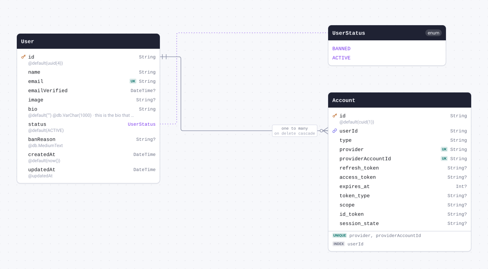

| Field               | Type     | Constraints                       | Default   | Description |
| ------------------- | -------- | --------------------------------- | --------- | ----------- |
| `id`                | `String` | PK NOT NULL                       | `cuid(1)` |             |
| `userId`            | `String` | NOT NULL → [User.id](#model-User) |           |             |
| `type`              | `String` | NOT NULL                          |           |             |
| `provider`          | `String` | NOT NULL                          |           |             |
| `providerAccountId` | `String` | NOT NULL                          |           |             |
| `refresh_token`     | `String` | NULL                              |           |             |
| `access_token`      | `String` | NULL                              |           |             |
| `expires_at`        | `Int`    | NULL                              |           |             |
| `token_type`        | `String` | NULL                              |           |             |
| `scope`             | `String` | NULL                              |           |             |
| `id_token`          | `String` | NULL                              |           |             |
| `session_state`     | `String` | NULL                              |           |             |

#### Indexes

- `@@index([userId])`
- `@@unique([provider, providerAccountId])`

#### References

- `userId` → [User.id](#model-User) (many-to-one, on delete Cascade)

#### Definition

```sql
CREATE TABLE `Account` (
    `id` VARCHAR(191) NOT NULL,
    `userId` VARCHAR(191) NOT NULL,
    `type` VARCHAR(191) NOT NULL,
    `provider` VARCHAR(191) NOT NULL,
    `providerAccountId` VARCHAR(191) NOT NULL,
    `refresh_token` VARCHAR(191) NULL,
    `access_token` VARCHAR(191) NULL,
    `expires_at` INTEGER NULL,
    `token_type` VARCHAR(191) NULL,
    `scope` VARCHAR(191) NULL,
    `id_token` VARCHAR(191) NULL,
    `session_state` VARCHAR(191) NULL,

    INDEX `Account_userId_idx`(`userId`),
    UNIQUE INDEX `Account_provider_providerAccountId_key`(`provider`, `providerAccountId`),
    PRIMARY KEY (`id`)
) DEFAULT CHARACTER SET utf8mb4 COLLATE utf8mb4_unicode_ci;
```

<details>
<summary>Queries and their SQL</summary>

**findMany**: Every row

```ts
await prisma.account.findMany();
```

```sql
SELECT
  `Account`.`id`,
  `Account`.`userId`,
  `Account`.`type`,
  `Account`.`provider`,
  `Account`.`providerAccountId`,
  `Account`.`refresh_token`,
  `Account`.`access_token`,
  `Account`.`expires_at`,
  `Account`.`token_type`,
  `Account`.`scope`,
  `Account`.`id_token`,
  `Account`.`session_state`
FROM
  `Account`
WHERE
  1 = 1
```

**count**: How many rows there are

```ts
await prisma.account.count();
```

```sql
SELECT
  COUNT(*) AS `_count$_all`
FROM
  (
    SELECT
      `Account`.`id`
    FROM
      `Account`
    WHERE
      1 = 1
  ) AS `sub`
```

**findMany**: Every row with its relations

```ts
await prisma.account.findMany({ include: { user: true } });
```

```sql
SELECT
  `Account`.`id`,
  `Account`.`userId`,
  `Account`.`type`,
  `Account`.`provider`,
  `Account`.`providerAccountId`,
  `Account`.`refresh_token`,
  `Account`.`access_token`,
  `Account`.`expires_at`,
  `Account`.`token_type`,
  `Account`.`scope`,
  `Account`.`id_token`,
  `Account`.`session_state`
FROM
  `Account`
WHERE
  1 = 1

SELECT
  `User`.`id`,
  `User`.`name`,
  `User`.`email`,
  `User`.`emailVerified`,
  `User`.`image`,
  `User`.`bio`,
  `User`.`status`,
  `User`.`banReason`,
  `User`.`createdAt`,
  `User`.`updatedAt`
FROM
  `User`
WHERE
  `User`.`id` IN (?)
-- params: ["<userId of the rows above>"]
```

**findUnique**: One row by what is unique to it

```ts
await prisma.account.findUnique({ where: { id: "example" } });
```

```sql
SELECT
  `Account`.`id`,
  `Account`.`userId`,
  `Account`.`type`,
  `Account`.`provider`,
  `Account`.`providerAccountId`,
  `Account`.`refresh_token`,
  `Account`.`access_token`,
  `Account`.`expires_at`,
  `Account`.`token_type`,
  `Account`.`scope`,
  `Account`.`id_token`,
  `Account`.`session_state`
FROM
  `Account`
WHERE
  (
    `Account`.`id` = ?
    AND 1 = 1
  )
LIMIT
  ?
OFFSET
  ?
-- params: ["example","1","0"]
```

**create**: Create a row

```ts
await prisma.account.create({
  data: { userId: "example", type: "example", provider: "example", providerAccountId: "example" },
});
```

```sql
INSERT INTO
  `Account` (
    `id`,
    `userId`,
    `type`,
    `provider`,
    `providerAccountId`
  )
VALUES
  (?, ?, ?, ?, ?)
-- params: ["<cuid(1)>","example","example","example","example"]

SELECT
  `Account`.`id`,
  `Account`.`userId`,
  `Account`.`type`,
  `Account`.`provider`,
  `Account`.`providerAccountId`,
  `Account`.`refresh_token`,
  `Account`.`access_token`,
  `Account`.`expires_at`,
  `Account`.`token_type`,
  `Account`.`scope`,
  `Account`.`id_token`,
  `Account`.`session_state`
FROM
  `Account`
WHERE
  `Account`.`id` = ?
LIMIT
  ?
OFFSET
  ?
-- params: ["<id of the rows above>","1","0"]
```

**update**: Update a row

```ts
await prisma.account.update({ where: { id: "example" }, data: { type: "example" } });
```

```sql
SELECT
  `Account`.`id`
FROM
  `Account`
WHERE
  (
    `Account`.`id` = ?
    AND 1 = 1
  )
LIMIT
  ?
OFFSET
  ?
-- params: ["example","1","0"]

UPDATE `Account`
SET
  `type` = ?
WHERE
  (
    `Account`.`id` IN (?)
    AND (
      `Account`.`id` = ?
      AND 1 = 1
    )
  )
-- params: ["example","<id of the rows above>","example"]

SELECT
  `Account`.`id`,
  `Account`.`userId`,
  `Account`.`type`,
  `Account`.`provider`,
  `Account`.`providerAccountId`,
  `Account`.`refresh_token`,
  `Account`.`access_token`,
  `Account`.`expires_at`,
  `Account`.`token_type`,
  `Account`.`scope`,
  `Account`.`id_token`,
  `Account`.`session_state`
FROM
  `Account`
WHERE
  `Account`.`id` = ?
LIMIT
  ?
OFFSET
  ?
-- params: ["<id of the rows above>","1","0"]
```

**delete**: Delete a row

```ts
await prisma.account.delete({ where: { id: "example" } });
```

```sql
SELECT
  `Account`.`id`,
  `Account`.`userId`,
  `Account`.`type`,
  `Account`.`provider`,
  `Account`.`providerAccountId`,
  `Account`.`refresh_token`,
  `Account`.`access_token`,
  `Account`.`expires_at`,
  `Account`.`token_type`,
  `Account`.`scope`,
  `Account`.`id_token`,
  `Account`.`session_state`
FROM
  `Account`
WHERE
  (
    `Account`.`id` = ?
    AND 1 = 1
  )
LIMIT
  ?
OFFSET
  ?
-- params: ["example","1","0"]

DELETE FROM `Account`
WHERE
  (
    `Account`.`id` = ?
    AND 1 = 1
  )
-- params: ["example"]
```

</details>

<a id="model-Session"></a>

### Session

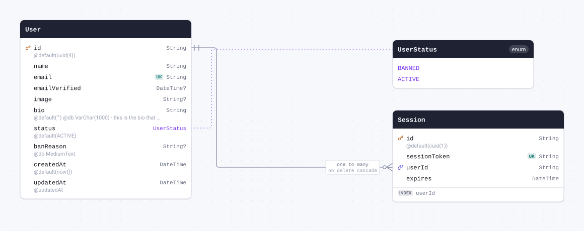

| Field          | Type       | Constraints                       | Default   | Description |
| -------------- | ---------- | --------------------------------- | --------- | ----------- |
| `id`           | `String`   | PK NOT NULL                       | `cuid(1)` |             |
| `sessionToken` | `String`   | UNIQUE NOT NULL                   |           |             |
| `userId`       | `String`   | NOT NULL → [User.id](#model-User) |           |             |
| `expires`      | `DateTime` | NOT NULL                          |           |             |

#### Indexes

- `@@index([userId])`

#### References

- `userId` → [User.id](#model-User) (many-to-one, on delete Cascade)

#### Definition

```sql
CREATE TABLE `Session` (
    `id` VARCHAR(191) NOT NULL,
    `sessionToken` VARCHAR(191) NOT NULL,
    `userId` VARCHAR(191) NOT NULL,
    `expires` DATETIME(3) NOT NULL,

    UNIQUE INDEX `Session_sessionToken_key`(`sessionToken`),
    INDEX `Session_userId_idx`(`userId`),
    PRIMARY KEY (`id`)
) DEFAULT CHARACTER SET utf8mb4 COLLATE utf8mb4_unicode_ci;
```

<details>
<summary>Queries and their SQL</summary>

**findMany**: Every row

```ts
await prisma.session.findMany();
```

```sql
SELECT
  `Session`.`id`,
  `Session`.`sessionToken`,
  `Session`.`userId`,
  `Session`.`expires`
FROM
  `Session`
WHERE
  1 = 1
```

**count**: How many rows there are

```ts
await prisma.session.count();
```

```sql
SELECT
  COUNT(*) AS `_count$_all`
FROM
  (
    SELECT
      `Session`.`id`
    FROM
      `Session`
    WHERE
      1 = 1
  ) AS `sub`
```

**findMany**: Every row with its relations

```ts
await prisma.session.findMany({ include: { user: true } });
```

```sql
SELECT
  `Session`.`id`,
  `Session`.`sessionToken`,
  `Session`.`userId`,
  `Session`.`expires`
FROM
  `Session`
WHERE
  1 = 1

SELECT
  `User`.`id`,
  `User`.`name`,
  `User`.`email`,
  `User`.`emailVerified`,
  `User`.`image`,
  `User`.`bio`,
  `User`.`status`,
  `User`.`banReason`,
  `User`.`createdAt`,
  `User`.`updatedAt`
FROM
  `User`
WHERE
  `User`.`id` IN (?)
-- params: ["<userId of the rows above>"]
```

**findUnique**: One row by what is unique to it

```ts
await prisma.session.findUnique({ where: { id: "example" } });
```

```sql
SELECT
  `Session`.`id`,
  `Session`.`sessionToken`,
  `Session`.`userId`,
  `Session`.`expires`
FROM
  `Session`
WHERE
  (
    `Session`.`id` = ?
    AND 1 = 1
  )
LIMIT
  ?
OFFSET
  ?
-- params: ["example","1","0"]
```

**create**: Create a row

```ts
await prisma.session.create({
  data: {
    sessionToken: "example",
    userId: "example",
    expires: new Date("2026-01-01T00:00:00.000Z"),
  },
});
```

```sql
INSERT INTO
  `Session` (`id`, `sessionToken`, `userId`, `expires`)
VALUES
  (?, ?, ?, ?)
-- params: ["<cuid(1)>","example","example","2026-01-01T00:00:00.000Z"]

SELECT
  `Session`.`id`,
  `Session`.`sessionToken`,
  `Session`.`userId`,
  `Session`.`expires`
FROM
  `Session`
WHERE
  `Session`.`id` = ?
LIMIT
  ?
OFFSET
  ?
-- params: ["<id of the rows above>","1","0"]
```

**update**: Update a row

```ts
await prisma.session.update({ where: { id: "example" }, data: { sessionToken: "example" } });
```

```sql
SELECT
  `Session`.`id`
FROM
  `Session`
WHERE
  (
    `Session`.`id` = ?
    AND 1 = 1
  )
LIMIT
  ?
OFFSET
  ?
-- params: ["example","1","0"]

UPDATE `Session`
SET
  `sessionToken` = ?
WHERE
  (
    `Session`.`id` IN (?)
    AND (
      `Session`.`id` = ?
      AND 1 = 1
    )
  )
-- params: ["example","<id of the rows above>","example"]

SELECT
  `Session`.`id`,
  `Session`.`sessionToken`,
  `Session`.`userId`,
  `Session`.`expires`
FROM
  `Session`
WHERE
  `Session`.`id` = ?
LIMIT
  ?
OFFSET
  ?
-- params: ["<id of the rows above>","1","0"]
```

**delete**: Delete a row

```ts
await prisma.session.delete({ where: { id: "example" } });
```

```sql
SELECT
  `Session`.`id`,
  `Session`.`sessionToken`,
  `Session`.`userId`,
  `Session`.`expires`
FROM
  `Session`
WHERE
  (
    `Session`.`id` = ?
    AND 1 = 1
  )
LIMIT
  ?
OFFSET
  ?
-- params: ["example","1","0"]

DELETE FROM `Session`
WHERE
  (
    `Session`.`id` = ?
    AND 1 = 1
  )
-- params: ["example"]
```

</details>

<a id="model-Role"></a>

### Role

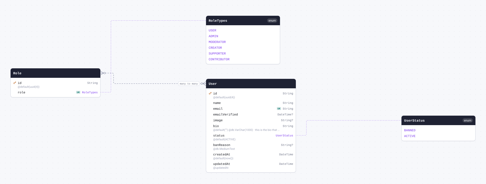

| Field  | Type                           | Constraints     | Default   | Description |
| ------ | ------------------------------ | --------------- | --------- | ----------- |
| `id`   | `String`                       | PK NOT NULL     | `uuid(4)` |             |
| `role` | [`RoleTypes`](#enum-RoleTypes) | UNIQUE NOT NULL |           |             |

#### Many to many

- `user` ↔ [User.roles](#model-User) through `_RoleToUser`

#### Definition

```sql
CREATE TABLE `Role` (
    `id` VARCHAR(191) NOT NULL,
    `role` ENUM('USER', 'ADMIN', 'MODERATOR', 'CREATOR', 'SUPPORTER', 'CONTRIBUTOR') NOT NULL,

    UNIQUE INDEX `Role_role_key`(`role`),
    PRIMARY KEY (`id`)
) DEFAULT CHARACTER SET utf8mb4 COLLATE utf8mb4_unicode_ci;
```

<details>
<summary>Queries and their SQL</summary>

**findMany**: Every row

```ts
await prisma.role.findMany();
```

```sql
SELECT
  `Role`.`id`,
  `Role`.`role`
FROM
  `Role`
WHERE
  1 = 1
```

**count**: How many rows there are

```ts
await prisma.role.count();
```

```sql
SELECT
  COUNT(*) AS `_count$_all`
FROM
  (
    SELECT
      `Role`.`id`
    FROM
      `Role`
    WHERE
      1 = 1
  ) AS `sub`
```

**findMany**: Every row with its relations

```ts
await prisma.role.findMany({ include: { user: true } });
```

```sql
SELECT
  `Role`.`id`,
  `Role`.`role`
FROM
  `Role`
WHERE
  1 = 1

SELECT
  `User`.`id`,
  `User`.`name`,
  `User`.`email`,
  `User`.`emailVerified`,
  `User`.`image`,
  `User`.`bio`,
  `User`.`status`,
  `User`.`banReason`,
  `User`.`createdAt`,
  `User`.`updatedAt`,
  `t0`.`A` AS `RoleToUser@Role`
FROM
  `User`
  INNER JOIN `_RoleToUser` AS `t0` ON `t0`.`B` = `User`.`id`
WHERE
  (
    1 = 1
    AND `t0`.`A` IN (?)
  )
-- params: ["<id of the rows above>"]
```

**findUnique**: One row by what is unique to it

```ts
await prisma.role.findUnique({ where: { id: "example" } });
```

```sql
SELECT
  `Role`.`id`,
  `Role`.`role`
FROM
  `Role`
WHERE
  (
    `Role`.`id` = ?
    AND 1 = 1
  )
LIMIT
  ?
OFFSET
  ?
-- params: ["example","1","0"]
```

**create**: Create a row

```ts
await prisma.role.create({ data: { role: "USER" } });
```

```sql
INSERT INTO
  `Role` (`id`, `role`)
VALUES
  (?, ?)
-- params: ["<uuid(4)>","USER"]

SELECT
  `Role`.`id`,
  `Role`.`role`
FROM
  `Role`
WHERE
  `Role`.`id` = ?
LIMIT
  ?
OFFSET
  ?
-- params: ["<id of the rows above>","1","0"]
```

**update**: Update a row

```ts
await prisma.role.update({ where: { id: "example" }, data: { role: "USER" } });
```

```sql
SELECT
  `Role`.`id`
FROM
  `Role`
WHERE
  (
    `Role`.`id` = ?
    AND 1 = 1
  )
LIMIT
  ?
OFFSET
  ?
-- params: ["example","1","0"]

UPDATE `Role`
SET
  `role` = ?
WHERE
  (
    `Role`.`id` IN (?)
    AND (
      `Role`.`id` = ?
      AND 1 = 1
    )
  )
-- params: ["USER","<id of the rows above>","example"]

SELECT
  `Role`.`id`,
  `Role`.`role`
FROM
  `Role`
WHERE
  `Role`.`id` = ?
LIMIT
  ?
OFFSET
  ?
-- params: ["<id of the rows above>","1","0"]
```

**delete**: Delete a row

```ts
await prisma.role.delete({ where: { id: "example" } });
```

```sql
SELECT
  `Role`.`id`,
  `Role`.`role`
FROM
  `Role`
WHERE
  (
    `Role`.`id` = ?
    AND 1 = 1
  )
LIMIT
  ?
OFFSET
  ?
-- params: ["example","1","0"]

DELETE FROM `Role`
WHERE
  (
    `Role`.`id` = ?
    AND 1 = 1
  )
-- params: ["example"]
```

</details>

<a id="model-UserLink"></a>

### UserLink

This is a table that contains all the user links they can add to profile

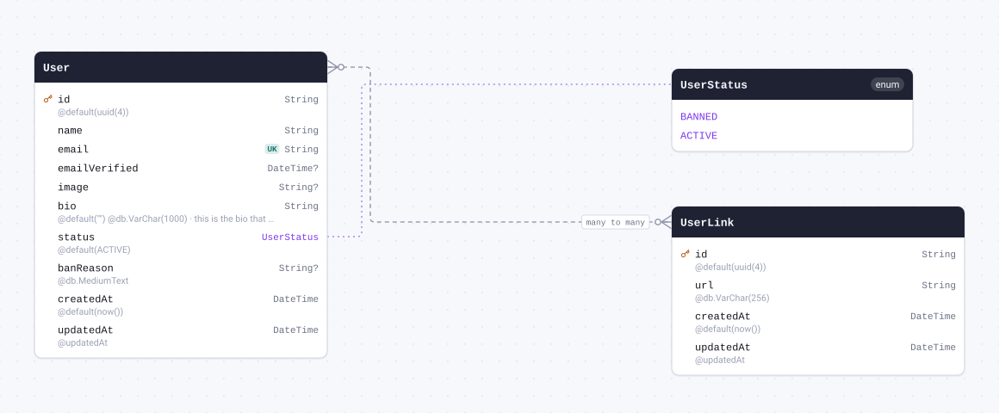

| Field       | Type                        | Constraints | Default      | Description |
| ----------- | --------------------------- | ----------- | ------------ | ----------- |
| `id`        | `String`                    | PK NOT NULL | `uuid(4)`    |             |
| `url`       | `String` `@db.VarChar(256)` | NOT NULL    |              |             |
| `createdAt` | `DateTime`                  | NOT NULL    | `now()`      |             |
| `updatedAt` | `DateTime`                  | NOT NULL    | `@updatedAt` |             |

#### Many to many

- `user` ↔ [User.userLinks](#model-User) through `_UserToUserLink`

#### Definition

```sql
CREATE TABLE `UserLink` (
    `id` VARCHAR(191) NOT NULL,
    `url` VARCHAR(256) NOT NULL,
    `createdAt` DATETIME(3) NOT NULL DEFAULT CURRENT_TIMESTAMP(3),
    `updatedAt` DATETIME(3) NOT NULL,

    PRIMARY KEY (`id`)
) DEFAULT CHARACTER SET utf8mb4 COLLATE utf8mb4_unicode_ci;
```

<details>
<summary>Queries and their SQL</summary>

**findMany**: Every row

```ts
await prisma.userLink.findMany();
```

```sql
SELECT
  `UserLink`.`id`,
  `UserLink`.`url`,
  `UserLink`.`createdAt`,
  `UserLink`.`updatedAt`
FROM
  `UserLink`
WHERE
  1 = 1
```

**count**: How many rows there are

```ts
await prisma.userLink.count();
```

```sql
SELECT
  COUNT(*) AS `_count$_all`
FROM
  (
    SELECT
      `UserLink`.`id`
    FROM
      `UserLink`
    WHERE
      1 = 1
  ) AS `sub`
```

**findMany**: Every row with its relations

```ts
await prisma.userLink.findMany({ include: { user: true } });
```

```sql
SELECT
  `UserLink`.`id`,
  `UserLink`.`url`,
  `UserLink`.`createdAt`,
  `UserLink`.`updatedAt`
FROM
  `UserLink`
WHERE
  1 = 1

SELECT
  `User`.`id`,
  `User`.`name`,
  `User`.`email`,
  `User`.`emailVerified`,
  `User`.`image`,
  `User`.`bio`,
  `User`.`status`,
  `User`.`banReason`,
  `User`.`createdAt`,
  `User`.`updatedAt`,
  `t0`.`B` AS `UserToUserLink@UserLink`
FROM
  `User`
  INNER JOIN `_UserToUserLink` AS `t0` ON `t0`.`A` = `User`.`id`
WHERE
  (
    1 = 1
    AND `t0`.`B` IN (?)
  )
-- params: ["<id of the rows above>"]
```

**findUnique**: One row by what is unique to it

```ts
await prisma.userLink.findUnique({ where: { id: "example" } });
```

```sql
SELECT
  `UserLink`.`id`,
  `UserLink`.`url`,
  `UserLink`.`createdAt`,
  `UserLink`.`updatedAt`
FROM
  `UserLink`
WHERE
  (
    `UserLink`.`id` = ?
    AND 1 = 1
  )
LIMIT
  ?
OFFSET
  ?
-- params: ["example","1","0"]
```

**create**: Create a row

```ts
await prisma.userLink.create({ data: { url: "example" } });
```

```sql
INSERT INTO
  `UserLink` (`id`, `url`, `createdAt`, `updatedAt`)
VALUES
  (?, ?, ?, ?)
-- params: ["<uuid(4)>","example","<now()>","<now()>"]

SELECT
  `UserLink`.`id`,
  `UserLink`.`url`,
  `UserLink`.`createdAt`,
  `UserLink`.`updatedAt`
FROM
  `UserLink`
WHERE
  `UserLink`.`id` = ?
LIMIT
  ?
OFFSET
  ?
-- params: ["<id of the rows above>","1","0"]
```

**update**: Update a row

```ts
await prisma.userLink.update({ where: { id: "example" }, data: { url: "example" } });
```

```sql
SELECT
  `UserLink`.`id`
FROM
  `UserLink`
WHERE
  (
    `UserLink`.`id` = ?
    AND 1 = 1
  )
LIMIT
  ?
OFFSET
  ?
-- params: ["example","1","0"]

UPDATE `UserLink`
SET
  `url` = ?,
  `updatedAt` = ?
WHERE
  (
    `UserLink`.`id` IN (?)
    AND (
      `UserLink`.`id` = ?
      AND 1 = 1
    )
  )
-- params: ["example",{"prisma__type":"generatorCall","prisma__value":{"name":"now","args":[],"returnType":{"type":"DateTime"}}},"<id of the rows above>","example"]

SELECT
  `UserLink`.`id`,
  `UserLink`.`url`,
  `UserLink`.`createdAt`,
  `UserLink`.`updatedAt`
FROM
  `UserLink`
WHERE
  `UserLink`.`id` = ?
LIMIT
  ?
OFFSET
  ?
-- params: ["<id of the rows above>","1","0"]
```

**delete**: Delete a row

```ts
await prisma.userLink.delete({ where: { id: "example" } });
```

```sql
SELECT
  `UserLink`.`id`,
  `UserLink`.`url`,
  `UserLink`.`createdAt`,
  `UserLink`.`updatedAt`
FROM
  `UserLink`
WHERE
  (
    `UserLink`.`id` = ?
    AND 1 = 1
  )
LIMIT
  ?
OFFSET
  ?
-- params: ["example","1","0"]

DELETE FROM `UserLink`
WHERE
  (
    `UserLink`.`id` = ?
    AND 1 = 1
  )
-- params: ["example"]
```

</details>

<a id="model-User"></a>

### User

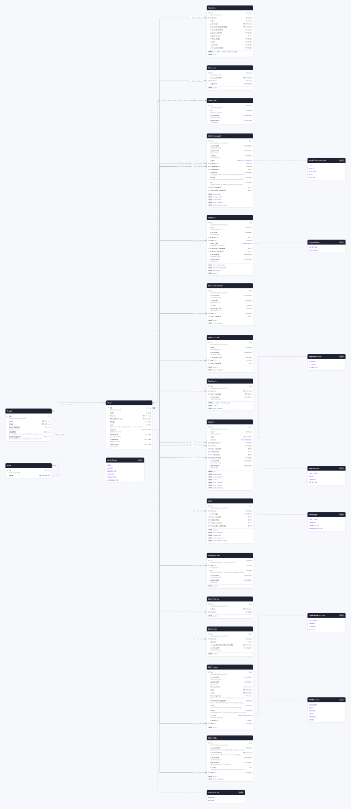

| Field           | Type                             | Constraints     | Default      | Description                                       |
| --------------- | -------------------------------- | --------------- | ------------ | ------------------------------------------------- |
| `id`            | `String`                         | PK NOT NULL     | `uuid(4)`    |                                                   |
| `name`          | `String`                         | NOT NULL        |              |                                                   |
| `email`         | `String`                         | UNIQUE NOT NULL |              |                                                   |
| `emailVerified` | `DateTime`                       | NULL            |              |                                                   |
| `image`         | `String`                         | NULL            |              |                                                   |
| `bio`           | `String` `@db.VarChar(1000)`     | NOT NULL        | `""`         | this is the bio that shows up on the profile page |
| `status`        | [`UserStatus`](#enum-UserStatus) | NOT NULL        | `ACTIVE`     |                                                   |
| `banReason`     | `String` `@db.MediumText`        | NULL            |              |                                                   |
| `createdAt`     | `DateTime`                       | NOT NULL        | `now()`      |                                                   |
| `updatedAt`     | `DateTime`                       | NOT NULL        | `@updatedAt` |                                                   |

#### Referenced by

- `id` ← [Account.userId](#model-Account) (one-to-many, on delete Cascade)
- `id` ← [Session.userId](#model-Session) (one-to-many, on delete Cascade)
- `id` ← [Challenge.userId](#model-Challenge) (one-to-many)
- `id` ← [Vote.userId](#model-Vote) (one-to-many)
- `id` ← [SharedSolution.userId](#model-SharedSolution) (one-to-many)
- `id` ← [Submission.userId](#model-Submission) (one-to-many)
- `id` ← [Bookmark.userId](#model-Bookmark) (one-to-many)
- `id` ← [Report.reporterId](#model-Report) (one-to-many)
- `id` ← [Report.userId](#model-Report) (one-to-many)
- `id` ← [Report.moderatorId](#model-Report) (one-to-many)
- `id` ← [Comment.userId](#model-Comment) (one-to-many)
- `id` ← [ImageUpload.userId](#model-ImageUpload) (one-to-many)
- `id` ← [BetaTokens.userId](#model-BetaTokens) (one-to-many)
- `id` ← [Donation.userId](#model-Donation) (one-to-many)
- `id` ← [Notification.toUserId](#model-Notification) (one-to-many)
- `id` ← [Notification.fromUserId](#model-Notification) (one-to-many)
- `id` ← [ShortURL.userId](#model-ShortURL) (one-to-many)

#### Many to many

- `roles` ↔ [Role.user](#model-Role) through `_RoleToUser`
- `userLinks` ↔ [UserLink.user](#model-UserLink) through `_UserToUserLink`
- `tracks` ↔ [Track.enrolledUsers](#model-Track) through `_TrackToUser`

#### Definition

```sql
CREATE TABLE `User` (
    `id` VARCHAR(191) NOT NULL,
    `name` VARCHAR(191) NOT NULL,
    `email` VARCHAR(191) NOT NULL,
    `emailVerified` DATETIME(3) NULL,
    `image` VARCHAR(191) NULL,
    `bio` VARCHAR(1000) NOT NULL DEFAULT '',
    `status` ENUM('BANNED', 'ACTIVE') NOT NULL DEFAULT 'ACTIVE',
    `banReason` MEDIUMTEXT NULL,
    `createdAt` DATETIME(3) NOT NULL DEFAULT CURRENT_TIMESTAMP(3),
    `updatedAt` DATETIME(3) NOT NULL,

    UNIQUE INDEX `User_email_key`(`email`),
    PRIMARY KEY (`id`)
) DEFAULT CHARACTER SET utf8mb4 COLLATE utf8mb4_unicode_ci;
```

<details>
<summary>Queries and their SQL</summary>

**findMany**: Every row

```ts
await prisma.user.findMany();
```

```sql
SELECT
  `User`.`id`,
  `User`.`name`,
  `User`.`email`,
  `User`.`emailVerified`,
  `User`.`image`,
  `User`.`bio`,
  `User`.`status`,
  `User`.`banReason`,
  `User`.`createdAt`,
  `User`.`updatedAt`
FROM
  `User`
WHERE
  1 = 1
```

**count**: How many rows there are

```ts
await prisma.user.count();
```

```sql
SELECT
  COUNT(*) AS `_count$_all`
FROM
  (
    SELECT
      `User`.`id`
    FROM
      `User`
    WHERE
      1 = 1
  ) AS `sub`
```

**findMany**: Every row with its relations

```ts
await prisma.user.findMany({
  include: {
    roles: true,
    userLinks: true,
    accounts: true,
    sessions: true,
    challenge: true,
    vote: true,
    submission: true,
    bookmark: true,
    sharedSolution: true,
    comment: true,
    reports: true,
    reportsAbout: true,
    moderated: true,
    imageUpload: true,
    tracks: true,
    BetaTokens: true,
    donations: true,
    shortUrls: true,
    toUserNotification: true,
    fromUserNotification: true,
  },
});
```

```sql
SELECT
  `User`.`id`,
  `User`.`name`,
  `User`.`email`,
  `User`.`emailVerified`,
  `User`.`image`,
  `User`.`bio`,
  `User`.`status`,
  `User`.`banReason`,
  `User`.`createdAt`,
  `User`.`updatedAt`
FROM
  `User`
WHERE
  1 = 1

SELECT
  `Role`.`id`,
  `Role`.`role`,
  `t0`.`B` AS `RoleToUser@User`
FROM
  `Role`
  INNER JOIN `_RoleToUser` AS `t0` ON `t0`.`A` = `Role`.`id`
WHERE
  (
    1 = 1
    AND `t0`.`B` IN (?)
  )
-- params: ["<id of the rows above>"]

SELECT
  `UserLink`.`id`,
  `UserLink`.`url`,
  `UserLink`.`createdAt`,
  `UserLink`.`updatedAt`,
  `t1`.`A` AS `UserToUserLink@User`
FROM
  `UserLink`
  INNER JOIN `_UserToUserLink` AS `t1` ON `t1`.`B` = `UserLink`.`id`
WHERE
  (
    1 = 1
    AND `t1`.`A` IN (?)
  )
-- params: ["<id of the rows above>"]

SELECT
  `Account`.`id`,
  `Account`.`userId`,
  `Account`.`type`,
  `Account`.`provider`,
  `Account`.`providerAccountId`,
  `Account`.`refresh_token`,
  `Account`.`access_token`,
  `Account`.`expires_at`,
  `Account`.`token_type`,
  `Account`.`scope`,
  `Account`.`id_token`,
  `Account`.`session_state`
FROM
  `Account`
WHERE
  `Account`.`userId` IN (?)
-- params: ["<id of the rows above>"]

SELECT
  `Session`.`id`,
  `Session`.`sessionToken`,
  `Session`.`userId`,
  `Session`.`expires`
FROM
  `Session`
WHERE
  `Session`.`userId` IN (?)
-- params: ["<id of the rows above>"]

SELECT
  `Challenge`.`id`,
  `Challenge`.`createdAt`,
  `Challenge`.`updatedAt`,
  `Challenge`.`difficulty`,
  `Challenge`.`name`,
  `Challenge`.`slug`,
  `Challenge`.`description`,
  `Challenge`.`shortDescription`,
  `Challenge`.`code`,
  `Challenge`.`tests`,
  `Challenge`.`status`,
  `Challenge`.`tsconfig`,
  `Challenge`.`userId`
FROM
  `Challenge`
WHERE
  `Challenge`.`userId` IN (?)
-- params: ["<id of the rows above>"]

SELECT
  `Vote`.`id`,
  `Vote`.`userId`,
  `Vote`.`rootType`,
  `Vote`.`challengeId`,
  `Vote`.`commentId`,
  `Vote`.`submissionId`,
  `Vote`.`sharedSolutionId`
FROM
  `Vote`
WHERE
  `Vote`.`userId` IN (?)
-- params: ["<id of the rows above>"]

SELECT
  `Submission`.`id`,
  `Submission`.`code`,
  `Submission`.`createdAt`,
  `Submission`.`isSuccessful`,
  `Submission`.`userId`,
  `Submission`.`challengeId`
FROM
  `Submission`
WHERE
  `Submission`.`userId` IN (?)
-- params: ["<id of the rows above>"]

SELECT
  `Bookmark`.`id`,
  `Bookmark`.`userId`,
  `Bookmark`.`challengeId`,
  `Bookmark`.`createdAt`
FROM
  `Bookmark`
WHERE
  `Bookmark`.`userId` IN (?)
-- params: ["<id of the rows above>"]

SELECT
  `SharedSolution`.`id`,
  `SharedSolution`.`createdAt`,
  `SharedSolution`.`isPinned`,
  `SharedSolution`.`title`,
  `SharedSolution`.`description`,
  `SharedSolution`.`userId`,
  `SharedSolution`.`challengeId`
FROM
  `SharedSolution`
WHERE
  `SharedSolution`.`userId` IN (?)
-- params: ["<id of the rows above>"]

SELECT
  `Comment`.`id`,
  `Comment`.`text`,
  `Comment`.`visible`,
  `Comment`.`parentId`,
  `Comment`.`userId`,
  `Comment`.`rootType`,
  `Comment`.`rootChallengeId`,
  `Comment`.`rootSolutionId`,
  `Comment`.`createdAt`,
  `Comment`.`updatedAt`
FROM
  `Comment`
WHERE
  `Comment`.`userId` IN (?)
-- params: ["<id of the rows above>"]

SELECT
  `Report`.`id`,
  `Report`.`text`,
  `Report`.`type`,
  `Report`.`status`,
  `Report`.`reporterId`,
  `Report`.`userId`,
  `Report`.`challengeId`,
  `Report`.`commentId`,
  `Report`.`solutionId`,
  `Report`.`moderatorId`,
  `Report`.`createdAt`,
  `Report`.`updatedAt`
FROM
  `Report`
WHERE
  `Report`.`reporterId` IN (?)
-- params: ["<id of the rows above>"]

SELECT
  `Report`.`id`,
  `Report`.`text`,
  `Report`.`type`,
  `Report`.`status`,
  `Report`.`reporterId`,
  `Report`.`userId`,
  `Report`.`challengeId`,
  `Report`.`commentId`,
  `Report`.`solutionId`,
  `Report`.`moderatorId`,
  `Report`.`createdAt`,
  `Report`.`updatedAt`
FROM
  `Report`
WHERE
  `Report`.`userId` IN (?)
-- params: ["<id of the rows above>"]

SELECT
  `Report`.`id`,
  `Report`.`text`,
  `Report`.`type`,
  `Report`.`status`,
  `Report`.`reporterId`,
  `Report`.`userId`,
  `Report`.`challengeId`,
  `Report`.`commentId`,
  `Report`.`solutionId`,
  `Report`.`moderatorId`,
  `Report`.`createdAt`,
  `Report`.`updatedAt`
FROM
  `Report`
WHERE
  `Report`.`moderatorId` IN (?)
-- params: ["<id of the rows above>"]

SELECT
  `ImageUpload`.`id`,
  `ImageUpload`.`userId`,
  `ImageUpload`.`url`,
  `ImageUpload`.`createdAt`,
  `ImageUpload`.`updatedAt`
FROM
  `ImageUpload`
WHERE
  `ImageUpload`.`userId` IN (?)
-- params: ["<id of the rows above>"]

SELECT
  `Track`.`id`,
  `Track`.`name`,
  `Track`.`slug`,
  `Track`.`description`,
  `Track`.`visible`,
  `Track`.`isComingSoon`,
  `t2`.`B` AS `TrackToUser@User`
FROM
  `Track`
  INNER JOIN `_TrackToUser` AS `t2` ON `t2`.`A` = `Track`.`id`
WHERE
  (
    1 = 1
    AND `t2`.`B` IN (?)
  )
-- params: ["<id of the rows above>"]

SELECT
  `BetaTokens`.`id`,
  `BetaTokens`.`token`,
  `BetaTokens`.`userId`
FROM
  `BetaTokens`
WHERE
  `BetaTokens`.`userId` IN (?)
-- params: ["<id of the rows above>"]

SELECT
  `Donation`.`id`,
  `Donation`.`userId`,
  `Donation`.`amount`,
  `Donation`.`stripeCheckoutSessionId`,
  `Donation`.`createdAt`
FROM
  `Donation`
WHERE
  `Donation`.`userId` IN (?)
-- params: ["<id of the rows above>"]

SELECT
  `ShortURL`.`id`,
  `ShortURL`.`originalUrl`,
  `ShortURL`.`shortUrlSlug`,
  `ShortURL`.`createdAt`,
  `ShortURL`.`expiresAt`,
  `ShortURL`.`clicks`,
  `ShortURL`.`userId`
FROM
  `ShortURL`
WHERE
  `ShortURL`.`userId` IN (?)
-- params: ["<id of the rows above>"]

SELECT
  `Notification`.`id`,
  `Notification`.`createdAt`,
  `Notification`.`updatedAt`,
  `Notification`.`isRead`,
  `Notification`.`type`,
  `Notification`.`toUserId`,
  `Notification`.`fromUserId`,
  `Notification`.`commentId`,
  `Notification`.`content`,
  `Notification`.`blurb`,
  `Notification`.`url`,
  `Notification`.`challengeId`,
  `Notification`.`sharedSolutionId`
FROM
  `Notification`
WHERE
  `Notification`.`toUserId` IN (?)
-- params: ["<id of the rows above>"]

SELECT
  `Notification`.`id`,
  `Notification`.`createdAt`,
  `Notification`.`updatedAt`,
  `Notification`.`isRead`,
  `Notification`.`type`,
  `Notification`.`toUserId`,
  `Notification`.`fromUserId`,
  `Notification`.`commentId`,
  `Notification`.`content`,
  `Notification`.`blurb`,
  `Notification`.`url`,
  `Notification`.`challengeId`,
  `Notification`.`sharedSolutionId`
FROM
  `Notification`
WHERE
  `Notification`.`fromUserId` IN (?)
-- params: ["<id of the rows above>"]
```

**findUnique**: One row by what is unique to it

```ts
await prisma.user.findUnique({ where: { id: "example" } });
```

```sql
SELECT
  `User`.`id`,
  `User`.`name`,
  `User`.`email`,
  `User`.`emailVerified`,
  `User`.`image`,
  `User`.`bio`,
  `User`.`status`,
  `User`.`banReason`,
  `User`.`createdAt`,
  `User`.`updatedAt`
FROM
  `User`
WHERE
  (
    `User`.`id` = ?
    AND 1 = 1
  )
LIMIT
  ?
OFFSET
  ?
-- params: ["example","1","0"]
```

**create**: Create a row

```ts
await prisma.user.create({ data: { name: "example", email: "example" } });
```

```sql
INSERT INTO
  `User` (
    `id`,
    `name`,
    `email`,
    `bio`,
    `status`,
    `createdAt`,
    `updatedAt`
  )
VALUES
  (?, ?, ?, ?, ?, ?, ?)
-- params: ["<uuid(4)>","example","example","","ACTIVE","<now()>","<now()>"]

SELECT
  `User`.`id`,
  `User`.`name`,
  `User`.`email`,
  `User`.`emailVerified`,
  `User`.`image`,
  `User`.`bio`,
  `User`.`status`,
  `User`.`banReason`,
  `User`.`createdAt`,
  `User`.`updatedAt`
FROM
  `User`
WHERE
  `User`.`id` = ?
LIMIT
  ?
OFFSET
  ?
-- params: ["<id of the rows above>","1","0"]
```

**update**: Update a row

```ts
await prisma.user.update({ where: { id: "example" }, data: { name: "example" } });
```

```sql
SELECT
  `User`.`id`
FROM
  `User`
WHERE
  (
    `User`.`id` = ?
    AND 1 = 1
  )
LIMIT
  ?
OFFSET
  ?
-- params: ["example","1","0"]

UPDATE `User`
SET
  `name` = ?,
  `updatedAt` = ?
WHERE
  (
    `User`.`id` IN (?)
    AND (
      `User`.`id` = ?
      AND 1 = 1
    )
  )
-- params: ["example",{"prisma__type":"generatorCall","prisma__value":{"name":"now","args":[],"returnType":{"type":"DateTime"}}},"<id of the rows above>","example"]

SELECT
  `User`.`id`,
  `User`.`name`,
  `User`.`email`,
  `User`.`emailVerified`,
  `User`.`image`,
  `User`.`bio`,
  `User`.`status`,
  `User`.`banReason`,
  `User`.`createdAt`,
  `User`.`updatedAt`
FROM
  `User`
WHERE
  `User`.`id` = ?
LIMIT
  ?
OFFSET
  ?
-- params: ["<id of the rows above>","1","0"]
```

**delete**: Delete a row

```ts
await prisma.user.delete({ where: { id: "example" } });
```

```sql
SELECT
  `User`.`id`,
  `User`.`name`,
  `User`.`email`,
  `User`.`emailVerified`,
  `User`.`image`,
  `User`.`bio`,
  `User`.`status`,
  `User`.`banReason`,
  `User`.`createdAt`,
  `User`.`updatedAt`
FROM
  `User`
WHERE
  (
    `User`.`id` = ?
    AND 1 = 1
  )
LIMIT
  ?
OFFSET
  ?
-- params: ["example","1","0"]

SELECT
  `Account`.`id`,
  `Account`.`userId`
FROM
  `Account`
WHERE
  (
    1 = 1
    AND `Account`.`userId` IN (?)
  )
-- params: ["<id of the rows above>"]

DELETE FROM `Account`
WHERE
  (
    `Account`.`id` IN (?)
    AND 1 = 1
  )
-- params: ["<id of the rows above>"]

SELECT
  `Session`.`id`,
  `Session`.`userId`
FROM
  `Session`
WHERE
  (
    1 = 1
    AND `Session`.`userId` IN (?)
  )
-- params: ["<id of the rows above>"]

DELETE FROM `Session`
WHERE
  (
    `Session`.`id` IN (?)
    AND 1 = 1
  )
-- params: ["<id of the rows above>"]

SELECT
  `Challenge`.`id`,
  `Challenge`.`userId`
FROM
  `Challenge`
WHERE
  (
    1 = 1
    AND `Challenge`.`userId` IN (?)
  )
-- params: ["<id of the rows above>"]

SELECT
  `Vote`.`id`,
  `Vote`.`userId`
FROM
  `Vote`
WHERE
  (
    1 = 1
    AND `Vote`.`userId` IN (?)
  )
-- params: ["<id of the rows above>"]

SELECT
  `SharedSolution`.`id`,
  `SharedSolution`.`userId`
FROM
  `SharedSolution`
WHERE
  (
    1 = 1
    AND `SharedSolution`.`userId` IN (?)
  )
-- params: ["<id of the rows above>"]

UPDATE `SharedSolution`
SET
  `userId` = ?
WHERE
  (
    `SharedSolution`.`id` IN (?)
    AND 1 = 1
  )
-- params: [null,"<id of the rows above>"]

SELECT
  `Submission`.`id`,
  `Submission`.`userId`
FROM
  `Submission`
WHERE
  (
    1 = 1
    AND `Submission`.`userId` IN (?)
  )
-- params: ["<id of the rows above>"]

SELECT
  `Bookmark`.`id`,
  `Bookmark`.`userId`
FROM
  `Bookmark`
WHERE
  (
    1 = 1
    AND `Bookmark`.`userId` IN (?)
  )
-- params: ["<id of the rows above>"]

SELECT
  `Report`.`id`,
  `Report`.`reporterId`
FROM
  `Report`
WHERE
  (
    1 = 1
    AND `Report`.`reporterId` IN (?)
  )
-- params: ["<id of the rows above>"]

SELECT
  `Report`.`id`,
  `Report`.`userId`
FROM
  `Report`
WHERE
  (
    1 = 1
    AND `Report`.`userId` IN (?)
  )
-- params: ["<id of the rows above>"]

UPDATE `Report`
SET
  `userId` = ?
WHERE
  (
    `Report`.`id` IN (?)
    AND 1 = 1
  )
-- params: [null,"<id of the rows above>"]

SELECT
  `Report`.`id`,
  `Report`.`moderatorId`
FROM
  `Report`
WHERE
  (
    1 = 1
    AND `Report`.`moderatorId` IN (?)
  )
-- params: ["<id of the rows above>"]

UPDATE `Report`
SET
  `moderatorId` = ?
WHERE
  (
    `Report`.`id` IN (?)
    AND 1 = 1
  )
-- params: [null,"<id of the rows above>"]

SELECT
  `Comment`.`id`,
  `Comment`.`userId`
FROM
  `Comment`
WHERE
  (
    1 = 1
    AND `Comment`.`userId` IN (?)
  )
-- params: ["<id of the rows above>"]

SELECT
  `ImageUpload`.`id`,
  `ImageUpload`.`userId`
FROM
  `ImageUpload`
WHERE
  (
    1 = 1
    AND `ImageUpload`.`userId` IN (?)
  )
-- params: ["<id of the rows above>"]

SELECT
  `BetaTokens`.`id`,
  `BetaTokens`.`userId`
FROM
  `BetaTokens`
WHERE
  (
    1 = 1
    AND `BetaTokens`.`userId` IN (?)
  )
-- params: ["<id of the rows above>"]

UPDATE `BetaTokens`
SET
  `userId` = ?
WHERE
  (
    `BetaTokens`.`id` IN (?)
    AND 1 = 1
  )
-- params: [null,"<id of the rows above>"]

SELECT
  `Donation`.`id`,
  `Donation`.`userId`
FROM
  `Donation`
WHERE
  (
    1 = 1
    AND `Donation`.`userId` IN (?)
  )
-- params: ["<id of the rows above>"]

SELECT
  `Notification`.`id`,
  `Notification`.`toUserId`
FROM
  `Notification`
WHERE
  (
    1 = 1
    AND `Notification`.`toUserId` IN (?)
  )
-- params: ["<id of the rows above>"]

SELECT
  `Notification`.`id`,
  `Notification`.`fromUserId`
FROM
  `Notification`
WHERE
  (
    1 = 1
    AND `Notification`.`fromUserId` IN (?)
  )
-- params: ["<id of the rows above>"]

SELECT
  `ShortURL`.`id`,
  `ShortURL`.`userId`
FROM
  `ShortURL`
WHERE
  (
    1 = 1
    AND `ShortURL`.`userId` IN (?)
  )
-- params: ["<id of the rows above>"]

UPDATE `ShortURL`
SET
  `userId` = ?
WHERE
  (
    `ShortURL`.`id` IN (?)
    AND 1 = 1
  )
-- params: [null,"<id of the rows above>"]

DELETE FROM `User`
WHERE
  (
    `User`.`id` = ?
    AND 1 = 1
  )
-- params: ["example"]
```

</details>

<a id="model-VerificationToken"></a>

### VerificationToken

| Field        | Type       | Constraints     | Default | Description |
| ------------ | ---------- | --------------- | ------- | ----------- |
| `identifier` | `String`   | NOT NULL        |         |             |
| `token`      | `String`   | UNIQUE NOT NULL |         |             |
| `expires`    | `DateTime` | NOT NULL        |         |             |

#### Indexes

- `@@unique([identifier, token])`

#### Definition

```sql
CREATE TABLE `VerificationToken` (
    `identifier` VARCHAR(191) NOT NULL,
    `token` VARCHAR(191) NOT NULL,
    `expires` DATETIME(3) NOT NULL,

    UNIQUE INDEX `VerificationToken_token_key`(`token`),
    UNIQUE INDEX `VerificationToken_identifier_token_key`(`identifier`, `token`)
) DEFAULT CHARACTER SET utf8mb4 COLLATE utf8mb4_unicode_ci;
```

<details>
<summary>Queries and their SQL</summary>

**findMany**: Every row

```ts
await prisma.verificationToken.findMany();
```

```sql
SELECT
  `VerificationToken`.`token`,
  `VerificationToken`.`identifier`,
  `VerificationToken`.`expires`
FROM
  `VerificationToken`
WHERE
  1 = 1
```

**count**: How many rows there are

```ts
await prisma.verificationToken.count();
```

```sql
SELECT
  COUNT(*) AS `_count$_all`
FROM
  (
    SELECT
      `VerificationToken`.`token`
    FROM
      `VerificationToken`
    WHERE
      1 = 1
  ) AS `sub`
```

**findUnique**: One row by what is unique to it

```ts
await prisma.verificationToken.findUnique({ where: { token: "example" } });
```

```sql
SELECT
  `VerificationToken`.`token`,
  `VerificationToken`.`identifier`,
  `VerificationToken`.`expires`
FROM
  `VerificationToken`
WHERE
  (
    `VerificationToken`.`token` = ?
    AND 1 = 1
  )
LIMIT
  ?
OFFSET
  ?
-- params: ["example","1","0"]
```

**create**: Create a row

```ts
await prisma.verificationToken.create({
  data: { identifier: "example", token: "example", expires: new Date("2026-01-01T00:00:00.000Z") },
});
```

```sql
INSERT INTO
  `VerificationToken` (`identifier`, `token`, `expires`)
VALUES
  (?, ?, ?)
-- params: ["example","example","2026-01-01T00:00:00.000Z"]

SELECT
  `VerificationToken`.`token`,
  `VerificationToken`.`identifier`,
  `VerificationToken`.`expires`
FROM
  `VerificationToken`
WHERE
  `VerificationToken`.`token` = ?
LIMIT
  ?
OFFSET
  ?
-- params: ["<token of the rows above>","1","0"]
```

**update**: Update a row

```ts
await prisma.verificationToken.update({
  where: { token: "example" },
  data: { identifier: "example" },
});
```

```sql
SELECT
  `VerificationToken`.`token`
FROM
  `VerificationToken`
WHERE
  (
    `VerificationToken`.`token` = ?
    AND 1 = 1
  )
LIMIT
  ?
OFFSET
  ?
-- params: ["example","1","0"]

UPDATE `VerificationToken`
SET
  `identifier` = ?
WHERE
  (
    `VerificationToken`.`token` IN (?)
    AND (
      `VerificationToken`.`token` = ?
      AND 1 = 1
    )
  )
-- params: ["example","<token of the rows above>","example"]

SELECT
  `VerificationToken`.`token`,
  `VerificationToken`.`identifier`,
  `VerificationToken`.`expires`
FROM
  `VerificationToken`
WHERE
  `VerificationToken`.`token` = ?
LIMIT
  ?
OFFSET
  ?
-- params: ["<token of the rows above>","1","0"]
```

**delete**: Delete a row

```ts
await prisma.verificationToken.delete({ where: { token: "example" } });
```

```sql
SELECT
  `VerificationToken`.`token`,
  `VerificationToken`.`identifier`,
  `VerificationToken`.`expires`
FROM
  `VerificationToken`
WHERE
  (
    `VerificationToken`.`token` = ?
    AND 1 = 1
  )
LIMIT
  ?
OFFSET
  ?
-- params: ["example","1","0"]

DELETE FROM `VerificationToken`
WHERE
  (
    `VerificationToken`.`token` = ?
    AND 1 = 1
  )
-- params: ["example"]
```

</details>

<a id="model-Tag"></a>

### Tag

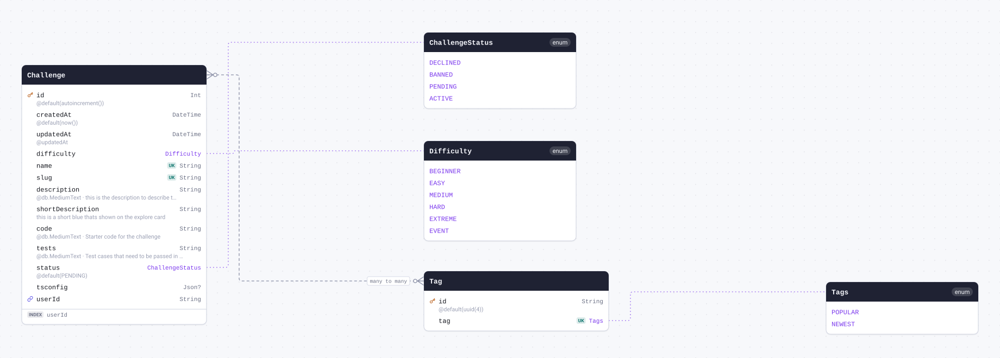

| Field | Type                 | Constraints     | Default   | Description |
| ----- | -------------------- | --------------- | --------- | ----------- |
| `id`  | `String`             | PK NOT NULL     | `uuid(4)` |             |
| `tag` | [`Tags`](#enum-Tags) | UNIQUE NOT NULL |           |             |

#### Many to many

- `challenges` ↔ [Challenge.tags](#model-Challenge) through `_ChallengeToTag`

#### Definition

```sql
CREATE TABLE `Tag` (
    `id` VARCHAR(191) NOT NULL,
    `tag` ENUM('POPULAR', 'NEWEST') NOT NULL,

    UNIQUE INDEX `Tag_tag_key`(`tag`),
    PRIMARY KEY (`id`)
) DEFAULT CHARACTER SET utf8mb4 COLLATE utf8mb4_unicode_ci;
```

<details>
<summary>Queries and their SQL</summary>

**findMany**: Every row

```ts
await prisma.tag.findMany();
```

```sql
SELECT
  `Tag`.`id`,
  `Tag`.`tag`
FROM
  `Tag`
WHERE
  1 = 1
```

**count**: How many rows there are

```ts
await prisma.tag.count();
```

```sql
SELECT
  COUNT(*) AS `_count$_all`
FROM
  (
    SELECT
      `Tag`.`id`
    FROM
      `Tag`
    WHERE
      1 = 1
  ) AS `sub`
```

**findMany**: Every row with its relations

```ts
await prisma.tag.findMany({ include: { challenges: true } });
```

```sql
SELECT
  `Tag`.`id`,
  `Tag`.`tag`
FROM
  `Tag`
WHERE
  1 = 1

SELECT
  `Challenge`.`id`,
  `Challenge`.`createdAt`,
  `Challenge`.`updatedAt`,
  `Challenge`.`difficulty`,
  `Challenge`.`name`,
  `Challenge`.`slug`,
  `Challenge`.`description`,
  `Challenge`.`shortDescription`,
  `Challenge`.`code`,
  `Challenge`.`tests`,
  `Challenge`.`status`,
  `Challenge`.`tsconfig`,
  `Challenge`.`userId`,
  `t0`.`B` AS `ChallengeToTag@Tag`
FROM
  `Challenge`
  INNER JOIN `_ChallengeToTag` AS `t0` ON `t0`.`A` = `Challenge`.`id`
WHERE
  (
    1 = 1
    AND `t0`.`B` IN (?)
  )
-- params: ["<id of the rows above>"]
```

**findUnique**: One row by what is unique to it

```ts
await prisma.tag.findUnique({ where: { id: "example" } });
```

```sql
SELECT
  `Tag`.`id`,
  `Tag`.`tag`
FROM
  `Tag`
WHERE
  (
    `Tag`.`id` = ?
    AND 1 = 1
  )
LIMIT
  ?
OFFSET
  ?
-- params: ["example","1","0"]
```

**create**: Create a row

```ts
await prisma.tag.create({ data: { tag: "POPULAR" } });
```

```sql
INSERT INTO
  `Tag` (`id`, `tag`)
VALUES
  (?, ?)
-- params: ["<uuid(4)>","POPULAR"]

SELECT
  `Tag`.`id`,
  `Tag`.`tag`
FROM
  `Tag`
WHERE
  `Tag`.`id` = ?
LIMIT
  ?
OFFSET
  ?
-- params: ["<id of the rows above>","1","0"]
```

**update**: Update a row

```ts
await prisma.tag.update({ where: { id: "example" }, data: { tag: "POPULAR" } });
```

```sql
SELECT
  `Tag`.`id`
FROM
  `Tag`
WHERE
  (
    `Tag`.`id` = ?
    AND 1 = 1
  )
LIMIT
  ?
OFFSET
  ?
-- params: ["example","1","0"]

UPDATE `Tag`
SET
  `tag` = ?
WHERE
  (
    `Tag`.`id` IN (?)
    AND (
      `Tag`.`id` = ?
      AND 1 = 1
    )
  )
-- params: ["POPULAR","<id of the rows above>","example"]

SELECT
  `Tag`.`id`,
  `Tag`.`tag`
FROM
  `Tag`
WHERE
  `Tag`.`id` = ?
LIMIT
  ?
OFFSET
  ?
-- params: ["<id of the rows above>","1","0"]
```

**delete**: Delete a row

```ts
await prisma.tag.delete({ where: { id: "example" } });
```

```sql
SELECT
  `Tag`.`id`,
  `Tag`.`tag`
FROM
  `Tag`
WHERE
  (
    `Tag`.`id` = ?
    AND 1 = 1
  )
LIMIT
  ?
OFFSET
  ?
-- params: ["example","1","0"]

DELETE FROM `Tag`
WHERE
  (
    `Tag`.`id` = ?
    AND 1 = 1
  )
-- params: ["example"]
```

</details>

<a id="model-Challenge"></a>

### Challenge

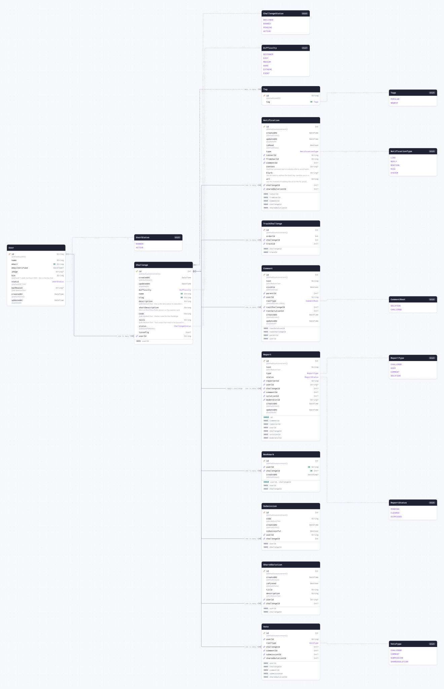

| Field              | Type                                       | Constraints                       | Default           | Description                                                                 |
| ------------------ | ------------------------------------------ | --------------------------------- | ----------------- | --------------------------------------------------------------------------- |
| `id`               | `Int`                                      | PK NOT NULL                       | `autoincrement()` |                                                                             |
| `createdAt`        | `DateTime`                                 | NOT NULL                          | `now()`           |                                                                             |
| `updatedAt`        | `DateTime`                                 | NOT NULL                          | `@updatedAt`      |                                                                             |
| `difficulty`       | [`Difficulty`](#enum-Difficulty)           | NOT NULL                          |                   |                                                                             |
| `name`             | `String`                                   | UNIQUE NOT NULL                   |                   |                                                                             |
| `slug`             | `String`                                   | UNIQUE NOT NULL                   |                   |                                                                             |
| `description`      | `String` `@db.MediumText`                  | NOT NULL                          |                   | this is the description to describe the challenge on description panel      |
| `shortDescription` | `String`                                   | NOT NULL                          |                   | this is a short blue thats shown on the explore card                        |
| `code`             | `String` `@db.MediumText`                  | NOT NULL                          |                   | Starter code for the challenge                                              |
| `tests`            | `String` `@db.MediumText`                  | NOT NULL                          |                   | Test cases that need to be passed in order have the submission be accepted. |
| `status`           | [`ChallengeStatus`](#enum-ChallengeStatus) | NOT NULL                          | `PENDING`         |                                                                             |
| `tsconfig`         | `Json`                                     | NULL                              |                   |                                                                             |
| `userId`           | `String`                                   | NOT NULL → [User.id](#model-User) |                   |                                                                             |

#### Indexes

- `@@index([userId])`

#### References

- `userId` → [User.id](#model-User) (many-to-one)

#### Referenced by

- `id` ← [Vote.challengeId](#model-Vote) (one-to-many)
- `id` ← [SharedSolution.challengeId](#model-SharedSolution) (one-to-many)
- `id` ← [Submission.challengeId](#model-Submission) (one-to-many)
- `id` ← [Bookmark.challengeId](#model-Bookmark) (one-to-many)
- `id` ← [Report.challengeId](#model-Report) (one-to-many)
- `id` ← [Comment.rootChallengeId](#model-Comment) (one-to-many)
- `id` ← [TrackChallenge.challengeId](#model-TrackChallenge) (one-to-many)
- `id` ← [Notification.challengeId](#model-Notification) (one-to-many)

#### Many to many

- `tags` ↔ [Tag.challenges](#model-Tag) through `_ChallengeToTag`

#### Definition

```sql
CREATE TABLE `Challenge` (
    `id` INTEGER NOT NULL AUTO_INCREMENT,
    `createdAt` DATETIME(3) NOT NULL DEFAULT CURRENT_TIMESTAMP(3),
    `updatedAt` DATETIME(3) NOT NULL,
    `difficulty` ENUM('BEGINNER', 'EASY', 'MEDIUM', 'HARD', 'EXTREME', 'EVENT') NOT NULL,
    `name` VARCHAR(191) NOT NULL,
    `slug` VARCHAR(191) NOT NULL,
    `description` MEDIUMTEXT NOT NULL,
    `shortDescription` VARCHAR(191) NOT NULL,
    `code` MEDIUMTEXT NOT NULL,
    `tests` MEDIUMTEXT NOT NULL,
    `status` ENUM('DECLINED', 'BANNED', 'PENDING', 'ACTIVE') NOT NULL DEFAULT 'PENDING',
    `tsconfig` JSON NULL,
    `userId` VARCHAR(191) NOT NULL,

    UNIQUE INDEX `Challenge_name_key`(`name`),
    UNIQUE INDEX `Challenge_slug_key`(`slug`),
    INDEX `Challenge_userId_idx`(`userId`),
    PRIMARY KEY (`id`)
) DEFAULT CHARACTER SET utf8mb4 COLLATE utf8mb4_unicode_ci;
```

<details>
<summary>Queries and their SQL</summary>

**findMany**: Every row

```ts
await prisma.challenge.findMany();
```

```sql
SELECT
  `Challenge`.`id`,
  `Challenge`.`createdAt`,
  `Challenge`.`updatedAt`,
  `Challenge`.`difficulty`,
  `Challenge`.`name`,
  `Challenge`.`slug`,
  `Challenge`.`description`,
  `Challenge`.`shortDescription`,
  `Challenge`.`code`,
  `Challenge`.`tests`,
  `Challenge`.`status`,
  `Challenge`.`tsconfig`,
  `Challenge`.`userId`
FROM
  `Challenge`
WHERE
  1 = 1
```

**count**: How many rows there are

```ts
await prisma.challenge.count();
```

```sql
SELECT
  COUNT(*) AS `_count$_all`
FROM
  (
    SELECT
      `Challenge`.`id`
    FROM
      `Challenge`
    WHERE
      1 = 1
  ) AS `sub`
```

**findMany**: Every row with its relations

```ts
await prisma.challenge.findMany({
  include: {
    user: true,
    tags: true,
    vote: true,
    submission: true,
    comment: true,
    bookmark: true,
    sharedSolution: true,
    Report: true,
    TrackChallenge: true,
    Notification: true,
  },
});
```

```sql
SELECT
  `Challenge`.`id`,
  `Challenge`.`createdAt`,
  `Challenge`.`updatedAt`,
  `Challenge`.`difficulty`,
  `Challenge`.`name`,
  `Challenge`.`slug`,
  `Challenge`.`description`,
  `Challenge`.`shortDescription`,
  `Challenge`.`code`,
  `Challenge`.`tests`,
  `Challenge`.`status`,
  `Challenge`.`tsconfig`,
  `Challenge`.`userId`
FROM
  `Challenge`
WHERE
  1 = 1

SELECT
  `User`.`id`,
  `User`.`name`,
  `User`.`email`,
  `User`.`emailVerified`,
  `User`.`image`,
  `User`.`bio`,
  `User`.`status`,
  `User`.`banReason`,
  `User`.`createdAt`,
  `User`.`updatedAt`
FROM
  `User`
WHERE
  `User`.`id` IN (?)
-- params: ["<userId of the rows above>"]

SELECT
  `Tag`.`id`,
  `Tag`.`tag`,
  `t0`.`A` AS `ChallengeToTag@Challenge`
FROM
  `Tag`
  INNER JOIN `_ChallengeToTag` AS `t0` ON `t0`.`B` = `Tag`.`id`
WHERE
  (
    1 = 1
    AND `t0`.`A` IN (?)
  )
-- params: ["<id of the rows above>"]

SELECT
  `Vote`.`id`,
  `Vote`.`userId`,
  `Vote`.`rootType`,
  `Vote`.`challengeId`,
  `Vote`.`commentId`,
  `Vote`.`submissionId`,
  `Vote`.`sharedSolutionId`
FROM
  `Vote`
WHERE
  `Vote`.`challengeId` IN (?)
-- params: ["<id of the rows above>"]

SELECT
  `Submission`.`id`,
  `Submission`.`code`,
  `Submission`.`createdAt`,
  `Submission`.`isSuccessful`,
  `Submission`.`userId`,
  `Submission`.`challengeId`
FROM
  `Submission`
WHERE
  `Submission`.`challengeId` IN (?)
-- params: ["<id of the rows above>"]

SELECT
  `Comment`.`id`,
  `Comment`.`text`,
  `Comment`.`visible`,
  `Comment`.`parentId`,
  `Comment`.`userId`,
  `Comment`.`rootType`,
  `Comment`.`rootChallengeId`,
  `Comment`.`rootSolutionId`,
  `Comment`.`createdAt`,
  `Comment`.`updatedAt`
FROM
  `Comment`
WHERE
  `Comment`.`rootChallengeId` IN (?)
-- params: ["<id of the rows above>"]

SELECT
  `Bookmark`.`id`,
  `Bookmark`.`userId`,
  `Bookmark`.`challengeId`,
  `Bookmark`.`createdAt`
FROM
  `Bookmark`
WHERE
  `Bookmark`.`challengeId` IN (?)
-- params: ["<id of the rows above>"]

SELECT
  `SharedSolution`.`id`,
  `SharedSolution`.`createdAt`,
  `SharedSolution`.`isPinned`,
  `SharedSolution`.`title`,
  `SharedSolution`.`description`,
  `SharedSolution`.`userId`,
  `SharedSolution`.`challengeId`
FROM
  `SharedSolution`
WHERE
  `SharedSolution`.`challengeId` IN (?)
-- params: ["<id of the rows above>"]

SELECT
  `Report`.`id`,
  `Report`.`text`,
  `Report`.`type`,
  `Report`.`status`,
  `Report`.`reporterId`,
  `Report`.`userId`,
  `Report`.`challengeId`,
  `Report`.`commentId`,
  `Report`.`solutionId`,
  `Report`.`moderatorId`,
  `Report`.`createdAt`,
  `Report`.`updatedAt`
FROM
  `Report`
WHERE
  `Report`.`challengeId` IN (?)
-- params: ["<id of the rows above>"]

SELECT
  `TrackChallenge`.`id`,
  `TrackChallenge`.`orderId`,
  `TrackChallenge`.`challengeId`,
  `TrackChallenge`.`trackId`
FROM
  `TrackChallenge`
WHERE
  `TrackChallenge`.`challengeId` IN (?)
-- params: ["<id of the rows above>"]

SELECT
  `Notification`.`id`,
  `Notification`.`createdAt`,
  `Notification`.`updatedAt`,
  `Notification`.`isRead`,
  `Notification`.`type`,
  `Notification`.`toUserId`,
  `Notification`.`fromUserId`,
  `Notification`.`commentId`,
  `Notification`.`content`,
  `Notification`.`blurb`,
  `Notification`.`url`,
  `Notification`.`challengeId`,
  `Notification`.`sharedSolutionId`
FROM
  `Notification`
WHERE
  `Notification`.`challengeId` IN (?)
-- params: ["<id of the rows above>"]
```

**findUnique**: One row by what is unique to it

```ts
await prisma.challenge.findUnique({ where: { id: 1 } });
```

```sql
SELECT
  `Challenge`.`id`,
  `Challenge`.`createdAt`,
  `Challenge`.`updatedAt`,
  `Challenge`.`difficulty`,
  `Challenge`.`name`,
  `Challenge`.`slug`,
  `Challenge`.`description`,
  `Challenge`.`shortDescription`,
  `Challenge`.`code`,
  `Challenge`.`tests`,
  `Challenge`.`status`,
  `Challenge`.`tsconfig`,
  `Challenge`.`userId`
FROM
  `Challenge`
WHERE
  (
    `Challenge`.`id` = ?
    AND 1 = 1
  )
LIMIT
  ?
OFFSET
  ?
-- params: ["1","1","0"]
```

**create**: Create a row

```ts
await prisma.challenge.create({
  data: {
    difficulty: "BEGINNER",
    name: "example",
    slug: "example",
    description: "example",
    shortDescription: "example",
    code: "example",
    tests: "example",
    userId: "example",
  },
});
```

```sql
INSERT INTO
  `Challenge` (
    `createdAt`,
    `updatedAt`,
    `difficulty`,
    `name`,
    `slug`,
    `description`,
    `shortDescription`,
    `code`,
    `tests`,
    `status`,
    `userId`
  )
VALUES
  (?, ?, ?, ?, ?, ?, ?, ?, ?, ?, ?)
-- params: ["<now()>","<now()>","BEGINNER","example","example","example","example","example","example","PENDING","example"]

SELECT
  `Challenge`.`id`,
  `Challenge`.`createdAt`,
  `Challenge`.`updatedAt`,
  `Challenge`.`difficulty`,
  `Challenge`.`name`,
  `Challenge`.`slug`,
  `Challenge`.`description`,
  `Challenge`.`shortDescription`,
  `Challenge`.`code`,
  `Challenge`.`tests`,
  `Challenge`.`status`,
  `Challenge`.`tsconfig`,
  `Challenge`.`userId`
FROM
  `Challenge`
WHERE
  `Challenge`.`id` = ?
LIMIT
  ?
OFFSET
  ?
-- params: ["<id of the rows above>","1","0"]
```

**update**: Update a row

```ts
await prisma.challenge.update({
  where: { id: 1 },
  data: { createdAt: new Date("2026-01-01T00:00:00.000Z") },
});
```

```sql
SELECT
  `Challenge`.`id`
FROM
  `Challenge`
WHERE
  (
    `Challenge`.`id` = ?
    AND 1 = 1
  )
LIMIT
  ?
OFFSET
  ?
-- params: ["1","1","0"]

UPDATE `Challenge`
SET
  `createdAt` = ?,
  `updatedAt` = ?
WHERE
  (
    `Challenge`.`id` IN (?)
    AND (
      `Challenge`.`id` = ?
      AND 1 = 1
    )
  )
-- params: ["2026-01-01T00:00:00.000Z",{"prisma__type":"generatorCall","prisma__value":{"name":"now","args":[],"returnType":{"type":"DateTime"}}},"<id of the rows above>","1"]

SELECT
  `Challenge`.`id`,
  `Challenge`.`createdAt`,
  `Challenge`.`updatedAt`,
  `Challenge`.`difficulty`,
  `Challenge`.`name`,
  `Challenge`.`slug`,
  `Challenge`.`description`,
  `Challenge`.`shortDescription`,
  `Challenge`.`code`,
  `Challenge`.`tests`,
  `Challenge`.`status`,
  `Challenge`.`tsconfig`,
  `Challenge`.`userId`
FROM
  `Challenge`
WHERE
  `Challenge`.`id` = ?
LIMIT
  ?
OFFSET
  ?
-- params: ["<id of the rows above>","1","0"]
```

**delete**: Delete a row

```ts
await prisma.challenge.delete({ where: { id: 1 } });
```

```sql
SELECT
  `Challenge`.`id`,
  `Challenge`.`createdAt`,
  `Challenge`.`updatedAt`,
  `Challenge`.`difficulty`,
  `Challenge`.`name`,
  `Challenge`.`slug`,
  `Challenge`.`description`,
  `Challenge`.`shortDescription`,
  `Challenge`.`code`,
  `Challenge`.`tests`,
  `Challenge`.`status`,
  `Challenge`.`tsconfig`,
  `Challenge`.`userId`
FROM
  `Challenge`
WHERE
  (
    `Challenge`.`id` = ?
    AND 1 = 1
  )
LIMIT
  ?
OFFSET
  ?
-- params: ["1","1","0"]

SELECT
  `Vote`.`id`,
  `Vote`.`challengeId`
FROM
  `Vote`
WHERE
  (
    1 = 1
    AND `Vote`.`challengeId` IN (?)
  )
-- params: ["<id of the rows above>"]

UPDATE `Vote`
SET
  `challengeId` = ?
WHERE
  (
    `Vote`.`id` IN (?)
    AND 1 = 1
  )
-- params: [null,"<id of the rows above>"]

SELECT
  `SharedSolution`.`id`,
  `SharedSolution`.`challengeId`
FROM
  `SharedSolution`
WHERE
  (
    1 = 1
    AND `SharedSolution`.`challengeId` IN (?)
  )
-- params: ["<id of the rows above>"]

UPDATE `SharedSolution`
SET
  `challengeId` = ?
WHERE
  (
    `SharedSolution`.`id` IN (?)
    AND 1 = 1
  )
-- params: [null,"<id of the rows above>"]

SELECT
  `Submission`.`id`,
  `Submission`.`challengeId`
FROM
  `Submission`
WHERE
  (
    1 = 1
    AND `Submission`.`challengeId` IN (?)
  )
-- params: ["<id of the rows above>"]

SELECT
  `Bookmark`.`id`,
  `Bookmark`.`challengeId`
FROM
  `Bookmark`
WHERE
  (
    1 = 1
    AND `Bookmark`.`challengeId` IN (?)
  )
-- params: ["<id of the rows above>"]

UPDATE `Bookmark`
SET
  `challengeId` = ?
WHERE
  (
    `Bookmark`.`id` IN (?)
    AND 1 = 1
  )
-- params: [null,"<id of the rows above>"]

SELECT
  `Report`.`id`,
  `Report`.`challengeId`
FROM
  `Report`
WHERE
  (
    1 = 1
    AND `Report`.`challengeId` IN (?)
  )
-- params: ["<id of the rows above>"]

UPDATE `Report`
SET
  `challengeId` = ?
WHERE
  (
    `Report`.`id` IN (?)
    AND 1 = 1
  )
-- params: [null,"<id of the rows above>"]

SELECT
  `Comment`.`id`,
  `Comment`.`rootChallengeId`
FROM
  `Comment`
WHERE
  (
    1 = 1
    AND `Comment`.`rootChallengeId` IN (?)
  )
-- params: ["<id of the rows above>"]

UPDATE `Comment`
SET
  `rootChallengeId` = ?
WHERE
  (
    `Comment`.`id` IN (?)
    AND 1 = 1
  )
-- params: [null,"<id of the rows above>"]

SELECT
  `TrackChallenge`.`id`,
  `TrackChallenge`.`challengeId`
FROM
  `TrackChallenge`
WHERE
  (
    1 = 1
    AND `TrackChallenge`.`challengeId` IN (?)
  )
-- params: ["<id of the rows above>"]

SELECT
  `Notification`.`id`,
  `Notification`.`challengeId`
FROM
  `Notification`
WHERE
  (
    1 = 1
    AND `Notification`.`challengeId` IN (?)
  )
-- params: ["<id of the rows above>"]

UPDATE `Notification`
SET
  `challengeId` = ?
WHERE
  (
    `Notification`.`id` IN (?)
    AND 1 = 1
  )
-- params: [null,"<id of the rows above>"]

DELETE FROM `Challenge`
WHERE
  (
    `Challenge`.`id` = ?
    AND 1 = 1
  )
-- params: ["1"]
```

</details>

<a id="model-Vote"></a>

### Vote

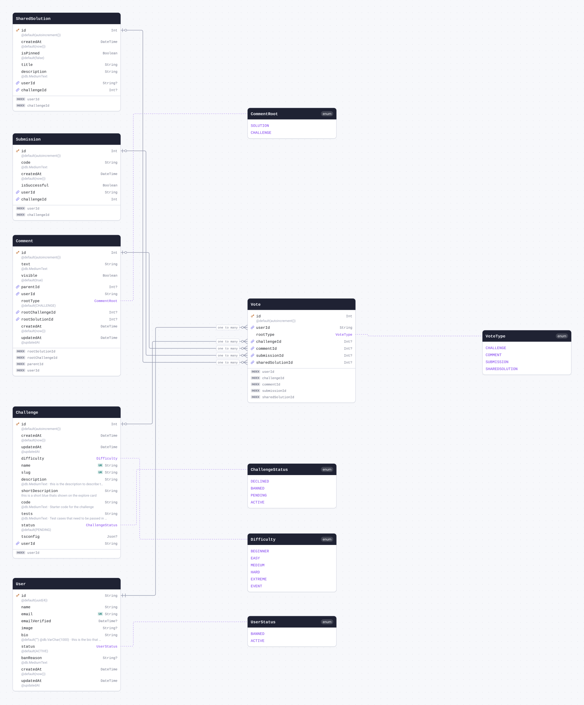

| Field              | Type                         | Constraints                                       | Default           | Description |
| ------------------ | ---------------------------- | ------------------------------------------------- | ----------------- | ----------- |
| `id`               | `Int`                        | PK NOT NULL                                       | `autoincrement()` |             |
| `userId`           | `String`                     | NOT NULL → [User.id](#model-User)                 |                   |             |
| `rootType`         | [`VoteType`](#enum-VoteType) | NOT NULL                                          |                   |             |
| `challengeId`      | `Int`                        | NULL → [Challenge.id](#model-Challenge)           |                   |             |
| `commentId`        | `Int`                        | NULL → [Comment.id](#model-Comment)               |                   |             |
| `submissionId`     | `Int`                        | NULL → [Submission.id](#model-Submission)         |                   |             |
| `sharedSolutionId` | `Int`                        | NULL → [SharedSolution.id](#model-SharedSolution) |                   |             |

#### Indexes

- `@@index([userId])`
- `@@index([challengeId])`
- `@@index([commentId])`
- `@@index([submissionId])`
- `@@index([sharedSolutionId])`

#### References

- `userId` → [User.id](#model-User) (many-to-one)
- `challengeId` → [Challenge.id](#model-Challenge) (many-to-one)
- `commentId` → [Comment.id](#model-Comment) (many-to-one)
- `submissionId` → [Submission.id](#model-Submission) (many-to-one)
- `sharedSolutionId` → [SharedSolution.id](#model-SharedSolution) (many-to-one)

#### Definition

```sql
CREATE TABLE `Vote` (
    `id` INTEGER NOT NULL AUTO_INCREMENT,
    `userId` VARCHAR(191) NOT NULL,
    `rootType` ENUM('CHALLENGE', 'COMMENT', 'SUBMISSION', 'SHAREDSOLUTION') NOT NULL,
    `challengeId` INTEGER NULL,
    `commentId` INTEGER NULL,
    `submissionId` INTEGER NULL,
    `sharedSolutionId` INTEGER NULL,

    INDEX `Vote_userId_idx`(`userId`),
    INDEX `Vote_challengeId_idx`(`challengeId`),
    INDEX `Vote_commentId_idx`(`commentId`),
    INDEX `Vote_submissionId_idx`(`submissionId`),
    INDEX `Vote_sharedSolutionId_idx`(`sharedSolutionId`),
    PRIMARY KEY (`id`)
) DEFAULT CHARACTER SET utf8mb4 COLLATE utf8mb4_unicode_ci;
```

<details>
<summary>Queries and their SQL</summary>

**findMany**: Every row

```ts
await prisma.vote.findMany();
```

```sql
SELECT
  `Vote`.`id`,
  `Vote`.`userId`,
  `Vote`.`rootType`,
  `Vote`.`challengeId`,
  `Vote`.`commentId`,
  `Vote`.`submissionId`,
  `Vote`.`sharedSolutionId`
FROM
  `Vote`
WHERE
  1 = 1
```

**count**: How many rows there are

```ts
await prisma.vote.count();
```

```sql
SELECT
  COUNT(*) AS `_count$_all`
FROM
  (
    SELECT
      `Vote`.`id`
    FROM
      `Vote`
    WHERE
      1 = 1
  ) AS `sub`
```

**findMany**: Every row with its relations

```ts
await prisma.vote.findMany({
  include: { user: true, challenge: true, comment: true, submission: true, sharedSolution: true },
});
```

```sql
SELECT
  `Vote`.`id`,
  `Vote`.`userId`,
  `Vote`.`rootType`,
  `Vote`.`challengeId`,
  `Vote`.`commentId`,
  `Vote`.`submissionId`,
  `Vote`.`sharedSolutionId`
FROM
  `Vote`
WHERE
  1 = 1

SELECT
  `User`.`id`,
  `User`.`name`,
  `User`.`email`,
  `User`.`emailVerified`,
  `User`.`image`,
  `User`.`bio`,
  `User`.`status`,
  `User`.`banReason`,
  `User`.`createdAt`,
  `User`.`updatedAt`
FROM
  `User`
WHERE
  `User`.`id` IN (?)
-- params: ["<userId of the rows above>"]

SELECT
  `Challenge`.`id`,
  `Challenge`.`createdAt`,
  `Challenge`.`updatedAt`,
  `Challenge`.`difficulty`,
  `Challenge`.`name`,
  `Challenge`.`slug`,
  `Challenge`.`description`,
  `Challenge`.`shortDescription`,
  `Challenge`.`code`,
  `Challenge`.`tests`,
  `Challenge`.`status`,
  `Challenge`.`tsconfig`,
  `Challenge`.`userId`
FROM
  `Challenge`
WHERE
  `Challenge`.`id` IN (?)
-- params: ["<challengeId of the rows above>"]

SELECT
  `Comment`.`id`,
  `Comment`.`text`,
  `Comment`.`visible`,
  `Comment`.`parentId`,
  `Comment`.`userId`,
  `Comment`.`rootType`,
  `Comment`.`rootChallengeId`,
  `Comment`.`rootSolutionId`,
  `Comment`.`createdAt`,
  `Comment`.`updatedAt`
FROM
  `Comment`
WHERE
  `Comment`.`id` IN (?)
-- params: ["<commentId of the rows above>"]

SELECT
  `Submission`.`id`,
  `Submission`.`code`,
  `Submission`.`createdAt`,
  `Submission`.`isSuccessful`,
  `Submission`.`userId`,
  `Submission`.`challengeId`
FROM
  `Submission`
WHERE
  `Submission`.`id` IN (?)
-- params: ["<submissionId of the rows above>"]

SELECT
  `SharedSolution`.`id`,
  `SharedSolution`.`createdAt`,
  `SharedSolution`.`isPinned`,
  `SharedSolution`.`title`,
  `SharedSolution`.`description`,
  `SharedSolution`.`userId`,
  `SharedSolution`.`challengeId`
FROM
  `SharedSolution`
WHERE
  `SharedSolution`.`id` IN (?)
-- params: ["<sharedSolutionId of the rows above>"]
```

**findUnique**: One row by what is unique to it

```ts
await prisma.vote.findUnique({ where: { id: 1 } });
```

```sql
SELECT
  `Vote`.`id`,
  `Vote`.`userId`,
  `Vote`.`rootType`,
  `Vote`.`challengeId`,
  `Vote`.`commentId`,
  `Vote`.`submissionId`,
  `Vote`.`sharedSolutionId`
FROM
  `Vote`
WHERE
  (
    `Vote`.`id` = ?
    AND 1 = 1
  )
LIMIT
  ?
OFFSET
  ?
-- params: ["1","1","0"]
```

**create**: Create a row

```ts
await prisma.vote.create({ data: { userId: "example", rootType: "CHALLENGE" } });
```

```sql
INSERT INTO
  `Vote` (`userId`, `rootType`)
VALUES
  (?, ?)
-- params: ["example","CHALLENGE"]

SELECT
  `Vote`.`id`,
  `Vote`.`userId`,
  `Vote`.`rootType`,
  `Vote`.`challengeId`,
  `Vote`.`commentId`,
  `Vote`.`submissionId`,
  `Vote`.`sharedSolutionId`
FROM
  `Vote`
WHERE
  `Vote`.`id` = ?
LIMIT
  ?
OFFSET
  ?
-- params: ["<id of the rows above>","1","0"]
```

**update**: Update a row

```ts
await prisma.vote.update({ where: { id: 1 }, data: { rootType: "CHALLENGE" } });
```

```sql
SELECT
  `Vote`.`id`
FROM
  `Vote`
WHERE
  (
    `Vote`.`id` = ?
    AND 1 = 1
  )
LIMIT
  ?
OFFSET
  ?
-- params: ["1","1","0"]

UPDATE `Vote`
SET
  `rootType` = ?
WHERE
  (
    `Vote`.`id` IN (?)
    AND (
      `Vote`.`id` = ?
      AND 1 = 1
    )
  )
-- params: ["CHALLENGE","<id of the rows above>","1"]

SELECT
  `Vote`.`id`,
  `Vote`.`userId`,
  `Vote`.`rootType`,
  `Vote`.`challengeId`,
  `Vote`.`commentId`,
  `Vote`.`submissionId`,
  `Vote`.`sharedSolutionId`
FROM
  `Vote`
WHERE
  `Vote`.`id` = ?
LIMIT
  ?
OFFSET
  ?
-- params: ["<id of the rows above>","1","0"]
```

**delete**: Delete a row

```ts
await prisma.vote.delete({ where: { id: 1 } });
```

```sql
SELECT
  `Vote`.`id`,
  `Vote`.`userId`,
  `Vote`.`rootType`,
  `Vote`.`challengeId`,
  `Vote`.`commentId`,
  `Vote`.`submissionId`,
  `Vote`.`sharedSolutionId`
FROM
  `Vote`
WHERE
  (
    `Vote`.`id` = ?
    AND 1 = 1
  )
LIMIT
  ?
OFFSET
  ?
-- params: ["1","1","0"]

DELETE FROM `Vote`
WHERE
  (
    `Vote`.`id` = ?
    AND 1 = 1
  )
-- params: ["1"]
```

</details>

<a id="model-SharedSolution"></a>

### SharedSolution

This is a public solution created by a user for a challenge

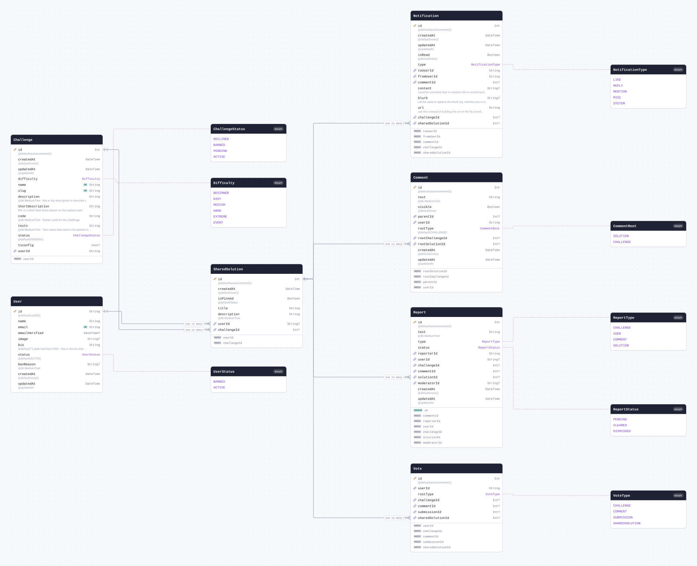

| Field         | Type                      | Constraints                             | Default           | Description |
| ------------- | ------------------------- | --------------------------------------- | ----------------- | ----------- |
| `id`          | `Int`                     | PK NOT NULL                             | `autoincrement()` |             |
| `createdAt`   | `DateTime`                | NOT NULL                                | `now()`           |             |
| `isPinned`    | `Boolean`                 | NOT NULL                                | `false`           |             |
| `title`       | `String`                  | NOT NULL                                |                   |             |
| `description` | `String` `@db.MediumText` | NOT NULL                                |                   |             |
| `userId`      | `String`                  | NULL → [User.id](#model-User)           |                   |             |
| `challengeId` | `Int`                     | NULL → [Challenge.id](#model-Challenge) |                   |             |

#### Indexes

- `@@index([userId])`
- `@@index([challengeId])`

#### References

- `userId` → [User.id](#model-User) (many-to-one)
- `challengeId` → [Challenge.id](#model-Challenge) (many-to-one)

#### Referenced by

- `id` ← [Vote.sharedSolutionId](#model-Vote) (one-to-many)
- `id` ← [Report.solutionId](#model-Report) (one-to-many)
- `id` ← [Comment.rootSolutionId](#model-Comment) (one-to-many)
- `id` ← [Notification.sharedSolutionId](#model-Notification) (one-to-many)

#### Definition

```sql
CREATE TABLE `SharedSolution` (
    `id` INTEGER NOT NULL AUTO_INCREMENT,
    `createdAt` DATETIME(3) NOT NULL DEFAULT CURRENT_TIMESTAMP(3),
    `isPinned` BOOLEAN NOT NULL DEFAULT false,
    `title` VARCHAR(191) NOT NULL,
    `description` MEDIUMTEXT NOT NULL,
    `userId` VARCHAR(191) NULL,
    `challengeId` INTEGER NULL,

    INDEX `SharedSolution_userId_idx`(`userId`),
    INDEX `SharedSolution_challengeId_idx`(`challengeId`),
    PRIMARY KEY (`id`)
) DEFAULT CHARACTER SET utf8mb4 COLLATE utf8mb4_unicode_ci;
```

<details>
<summary>Queries and their SQL</summary>

**findMany**: Every row

```ts
await prisma.sharedSolution.findMany();
```

```sql
SELECT
  `SharedSolution`.`id`,
  `SharedSolution`.`createdAt`,
  `SharedSolution`.`isPinned`,
  `SharedSolution`.`title`,
  `SharedSolution`.`description`,
  `SharedSolution`.`userId`,
  `SharedSolution`.`challengeId`
FROM
  `SharedSolution`
WHERE
  1 = 1
```

**count**: How many rows there are

```ts
await prisma.sharedSolution.count();
```

```sql
SELECT
  COUNT(*) AS `_count$_all`
FROM
  (
    SELECT
      `SharedSolution`.`id`
    FROM
      `SharedSolution`
    WHERE
      1 = 1
  ) AS `sub`
```

**findMany**: Every row with its relations

```ts
await prisma.sharedSolution.findMany({
  include: {
    vote: true,
    user: true,
    challenge: true,
    solutionComment: true,
    Report: true,
    Notification: true,
  },
});
```

```sql
SELECT
  `SharedSolution`.`id`,
  `SharedSolution`.`createdAt`,
  `SharedSolution`.`isPinned`,
  `SharedSolution`.`title`,
  `SharedSolution`.`description`,
  `SharedSolution`.`userId`,
  `SharedSolution`.`challengeId`
FROM
  `SharedSolution`
WHERE
  1 = 1

SELECT
  `Vote`.`id`,
  `Vote`.`userId`,
  `Vote`.`rootType`,
  `Vote`.`challengeId`,
  `Vote`.`commentId`,
  `Vote`.`submissionId`,
  `Vote`.`sharedSolutionId`
FROM
  `Vote`
WHERE
  `Vote`.`sharedSolutionId` IN (?)
-- params: ["<id of the rows above>"]

SELECT
  `User`.`id`,
  `User`.`name`,
  `User`.`email`,
  `User`.`emailVerified`,
  `User`.`image`,
  `User`.`bio`,
  `User`.`status`,
  `User`.`banReason`,
  `User`.`createdAt`,
  `User`.`updatedAt`
FROM
  `User`
WHERE
  `User`.`id` IN (?)
-- params: ["<userId of the rows above>"]

SELECT
  `Challenge`.`id`,
  `Challenge`.`createdAt`,
  `Challenge`.`updatedAt`,
  `Challenge`.`difficulty`,
  `Challenge`.`name`,
  `Challenge`.`slug`,
  `Challenge`.`description`,
  `Challenge`.`shortDescription`,
  `Challenge`.`code`,
  `Challenge`.`tests`,
  `Challenge`.`status`,
  `Challenge`.`tsconfig`,
  `Challenge`.`userId`
FROM
  `Challenge`
WHERE
  `Challenge`.`id` IN (?)
-- params: ["<challengeId of the rows above>"]

SELECT
  `Comment`.`id`,
  `Comment`.`text`,
  `Comment`.`visible`,
  `Comment`.`parentId`,
  `Comment`.`userId`,
  `Comment`.`rootType`,
  `Comment`.`rootChallengeId`,
  `Comment`.`rootSolutionId`,
  `Comment`.`createdAt`,
  `Comment`.`updatedAt`
FROM
  `Comment`
WHERE
  `Comment`.`rootSolutionId` IN (?)
-- params: ["<id of the rows above>"]

SELECT
  `Report`.`id`,
  `Report`.`text`,
  `Report`.`type`,
  `Report`.`status`,
  `Report`.`reporterId`,
  `Report`.`userId`,
  `Report`.`challengeId`,
  `Report`.`commentId`,
  `Report`.`solutionId`,
  `Report`.`moderatorId`,
  `Report`.`createdAt`,
  `Report`.`updatedAt`
FROM
  `Report`
WHERE
  `Report`.`solutionId` IN (?)
-- params: ["<id of the rows above>"]

SELECT
  `Notification`.`id`,
  `Notification`.`createdAt`,
  `Notification`.`updatedAt`,
  `Notification`.`isRead`,
  `Notification`.`type`,
  `Notification`.`toUserId`,
  `Notification`.`fromUserId`,
  `Notification`.`commentId`,
  `Notification`.`content`,
  `Notification`.`blurb`,
  `Notification`.`url`,
  `Notification`.`challengeId`,
  `Notification`.`sharedSolutionId`
FROM
  `Notification`
WHERE
  `Notification`.`sharedSolutionId` IN (?)
-- params: ["<id of the rows above>"]
```

**findUnique**: One row by what is unique to it

```ts
await prisma.sharedSolution.findUnique({ where: { id: 1 } });
```

```sql
SELECT
  `SharedSolution`.`id`,
  `SharedSolution`.`createdAt`,
  `SharedSolution`.`isPinned`,
  `SharedSolution`.`title`,
  `SharedSolution`.`description`,
  `SharedSolution`.`userId`,
  `SharedSolution`.`challengeId`
FROM
  `SharedSolution`
WHERE
  (
    `SharedSolution`.`id` = ?
    AND 1 = 1
  )
LIMIT
  ?
OFFSET
  ?
-- params: ["1","1","0"]
```

**create**: Create a row

```ts
await prisma.sharedSolution.create({ data: { title: "example", description: "example" } });
```

```sql
INSERT INTO
  `SharedSolution` (`createdAt`, `isPinned`, `title`, `description`)
VALUES
  (?, ?, ?, ?)
-- params: ["<now()>",false,"example","example"]

SELECT
  `SharedSolution`.`id`,
  `SharedSolution`.`createdAt`,
  `SharedSolution`.`isPinned`,
  `SharedSolution`.`title`,
  `SharedSolution`.`description`,
  `SharedSolution`.`userId`,
  `SharedSolution`.`challengeId`
FROM
  `SharedSolution`
WHERE
  `SharedSolution`.`id` = ?
LIMIT
  ?
OFFSET
  ?
-- params: ["<id of the rows above>","1","0"]
```

**update**: Update a row

```ts
await prisma.sharedSolution.update({
  where: { id: 1 },
  data: { createdAt: new Date("2026-01-01T00:00:00.000Z") },
});
```

```sql
SELECT
  `SharedSolution`.`id`
FROM
  `SharedSolution`
WHERE
  (
    `SharedSolution`.`id` = ?
    AND 1 = 1
  )
LIMIT
  ?
OFFSET
  ?
-- params: ["1","1","0"]

UPDATE `SharedSolution`
SET
  `createdAt` = ?
WHERE
  (
    `SharedSolution`.`id` IN (?)
    AND (
      `SharedSolution`.`id` = ?
      AND 1 = 1
    )
  )
-- params: ["2026-01-01T00:00:00.000Z","<id of the rows above>","1"]

SELECT
  `SharedSolution`.`id`,
  `SharedSolution`.`createdAt`,
  `SharedSolution`.`isPinned`,
  `SharedSolution`.`title`,
  `SharedSolution`.`description`,
  `SharedSolution`.`userId`,
  `SharedSolution`.`challengeId`
FROM
  `SharedSolution`
WHERE
  `SharedSolution`.`id` = ?
LIMIT
  ?
OFFSET
  ?
-- params: ["<id of the rows above>","1","0"]
```

**delete**: Delete a row

```ts
await prisma.sharedSolution.delete({ where: { id: 1 } });
```

```sql
SELECT
  `SharedSolution`.`id`,
  `SharedSolution`.`createdAt`,
  `SharedSolution`.`isPinned`,
  `SharedSolution`.`title`,
  `SharedSolution`.`description`,
  `SharedSolution`.`userId`,
  `SharedSolution`.`challengeId`
FROM
  `SharedSolution`
WHERE
  (
    `SharedSolution`.`id` = ?
    AND 1 = 1
  )
LIMIT
  ?
OFFSET
  ?
-- params: ["1","1","0"]

SELECT
  `Vote`.`id`,
  `Vote`.`sharedSolutionId`
FROM
  `Vote`
WHERE
  (
    1 = 1
    AND `Vote`.`sharedSolutionId` IN (?)
  )
-- params: ["<id of the rows above>"]

UPDATE `Vote`
SET
  `sharedSolutionId` = ?
WHERE
  (
    `Vote`.`id` IN (?)
    AND 1 = 1
  )
-- params: [null,"<id of the rows above>"]

SELECT
  `Report`.`id`,
  `Report`.`solutionId`
FROM
  `Report`
WHERE
  (
    1 = 1
    AND `Report`.`solutionId` IN (?)
  )
-- params: ["<id of the rows above>"]

UPDATE `Report`
SET
  `solutionId` = ?
WHERE
  (
    `Report`.`id` IN (?)
    AND 1 = 1
  )
-- params: [null,"<id of the rows above>"]

SELECT
  `Comment`.`id`,
  `Comment`.`rootSolutionId`
FROM
  `Comment`
WHERE
  (
    1 = 1
    AND `Comment`.`rootSolutionId` IN (?)
  )
-- params: ["<id of the rows above>"]

UPDATE `Comment`
SET
  `rootSolutionId` = ?
WHERE
  (
    `Comment`.`id` IN (?)
    AND 1 = 1
  )
-- params: [null,"<id of the rows above>"]

SELECT
  `Notification`.`id`,
  `Notification`.`sharedSolutionId`
FROM
  `Notification`
WHERE
  (
    1 = 1
    AND `Notification`.`sharedSolutionId` IN (?)
  )
-- params: ["<id of the rows above>"]

UPDATE `Notification`
SET
  `sharedSolutionId` = ?
WHERE
  (
    `Notification`.`id` IN (?)
    AND 1 = 1
  )
-- params: [null,"<id of the rows above>"]

DELETE FROM `SharedSolution`
WHERE
  (
    `SharedSolution`.`id` = ?
    AND 1 = 1
  )
-- params: ["1"]
```

</details>

<a id="model-Submission"></a>

### Submission

Every attempt a user makes to a challenge is stored here

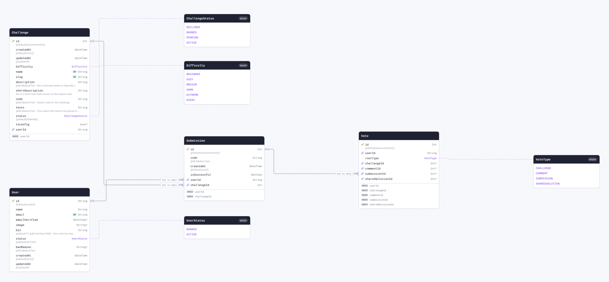

| Field          | Type                      | Constraints                                 | Default           | Description |
| -------------- | ------------------------- | ------------------------------------------- | ----------------- | ----------- |
| `id`           | `Int`                     | PK NOT NULL                                 | `autoincrement()` |             |
| `code`         | `String` `@db.MediumText` | NOT NULL                                    |                   |             |
| `createdAt`    | `DateTime`                | NOT NULL                                    | `now()`           |             |
| `isSuccessful` | `Boolean`                 | NOT NULL                                    |                   |             |
| `userId`       | `String`                  | NOT NULL → [User.id](#model-User)           |                   |             |
| `challengeId`  | `Int`                     | NOT NULL → [Challenge.id](#model-Challenge) |                   |             |

#### Indexes

- `@@index([userId])`
- `@@index([challengeId])`

#### References

- `userId` → [User.id](#model-User) (many-to-one)
- `challengeId` → [Challenge.id](#model-Challenge) (many-to-one)

#### Referenced by

- `id` ← [Vote.submissionId](#model-Vote) (one-to-many)

#### Definition

```sql
CREATE TABLE `Submission` (
    `id` INTEGER NOT NULL AUTO_INCREMENT,
    `code` MEDIUMTEXT NOT NULL,
    `createdAt` DATETIME(3) NOT NULL DEFAULT CURRENT_TIMESTAMP(3),
    `isSuccessful` BOOLEAN NOT NULL,
    `userId` VARCHAR(191) NOT NULL,
    `challengeId` INTEGER NOT NULL,

    INDEX `Submission_userId_idx`(`userId`),
    INDEX `Submission_challengeId_idx`(`challengeId`),
    PRIMARY KEY (`id`)
) DEFAULT CHARACTER SET utf8mb4 COLLATE utf8mb4_unicode_ci;
```

<details>
<summary>Queries and their SQL</summary>

**findMany**: Every row

```ts
await prisma.submission.findMany();
```

```sql
SELECT
  `Submission`.`id`,
  `Submission`.`code`,
  `Submission`.`createdAt`,
  `Submission`.`isSuccessful`,
  `Submission`.`userId`,
  `Submission`.`challengeId`
FROM
  `Submission`
WHERE
  1 = 1
```

**count**: How many rows there are

```ts
await prisma.submission.count();
```

```sql
SELECT
  COUNT(*) AS `_count$_all`
FROM
  (
    SELECT
      `Submission`.`id`
    FROM
      `Submission`
    WHERE
      1 = 1
  ) AS `sub`
```

**findMany**: Every row with its relations

```ts
await prisma.submission.findMany({ include: { user: true, challenge: true, vote: true } });
```

```sql
SELECT
  `Submission`.`id`,
  `Submission`.`code`,
  `Submission`.`createdAt`,
  `Submission`.`isSuccessful`,
  `Submission`.`userId`,
  `Submission`.`challengeId`
FROM
  `Submission`
WHERE
  1 = 1

SELECT
  `User`.`id`,
  `User`.`name`,
  `User`.`email`,
  `User`.`emailVerified`,
  `User`.`image`,
  `User`.`bio`,
  `User`.`status`,
  `User`.`banReason`,
  `User`.`createdAt`,
  `User`.`updatedAt`
FROM
  `User`
WHERE
  `User`.`id` IN (?)
-- params: ["<userId of the rows above>"]

SELECT
  `Challenge`.`id`,
  `Challenge`.`createdAt`,
  `Challenge`.`updatedAt`,
  `Challenge`.`difficulty`,
  `Challenge`.`name`,
  `Challenge`.`slug`,
  `Challenge`.`description`,
  `Challenge`.`shortDescription`,
  `Challenge`.`code`,
  `Challenge`.`tests`,
  `Challenge`.`status`,
  `Challenge`.`tsconfig`,
  `Challenge`.`userId`
FROM
  `Challenge`
WHERE
  `Challenge`.`id` IN (?)
-- params: ["<challengeId of the rows above>"]

SELECT
  `Vote`.`id`,
  `Vote`.`userId`,
  `Vote`.`rootType`,
  `Vote`.`challengeId`,
  `Vote`.`commentId`,
  `Vote`.`submissionId`,
  `Vote`.`sharedSolutionId`
FROM
  `Vote`
WHERE
  `Vote`.`submissionId` IN (?)
-- params: ["<id of the rows above>"]
```

**findUnique**: One row by what is unique to it

```ts
await prisma.submission.findUnique({ where: { id: 1 } });
```

```sql
SELECT
  `Submission`.`id`,
  `Submission`.`code`,
  `Submission`.`createdAt`,
  `Submission`.`isSuccessful`,
  `Submission`.`userId`,
  `Submission`.`challengeId`
FROM
  `Submission`
WHERE
  (
    `Submission`.`id` = ?
    AND 1 = 1
  )
LIMIT
  ?
OFFSET
  ?
-- params: ["1","1","0"]
```

**create**: Create a row

```ts
await prisma.submission.create({
  data: { code: "example", isSuccessful: true, userId: "example", challengeId: 1 },
});
```

```sql
INSERT INTO
  `Submission` (
    `code`,
    `createdAt`,
    `isSuccessful`,
    `userId`,
    `challengeId`
  )
VALUES
  (?, ?, ?, ?, ?)
-- params: ["example","<now()>",true,"example","1"]

SELECT
  `Submission`.`id`,
  `Submission`.`code`,
  `Submission`.`createdAt`,
  `Submission`.`isSuccessful`,
  `Submission`.`userId`,
  `Submission`.`challengeId`
FROM
  `Submission`
WHERE
  `Submission`.`id` = ?
LIMIT
  ?
OFFSET
  ?
-- params: ["<id of the rows above>","1","0"]
```

**update**: Update a row

```ts
await prisma.submission.update({ where: { id: 1 }, data: { code: "example" } });
```

```sql
SELECT
  `Submission`.`id`
FROM
  `Submission`
WHERE
  (
    `Submission`.`id` = ?
    AND 1 = 1
  )
LIMIT
  ?
OFFSET
  ?
-- params: ["1","1","0"]

UPDATE `Submission`
SET
  `code` = ?
WHERE
  (
    `Submission`.`id` IN (?)
    AND (
      `Submission`.`id` = ?
      AND 1 = 1
    )
  )
-- params: ["example","<id of the rows above>","1"]

SELECT
  `Submission`.`id`,
  `Submission`.`code`,
  `Submission`.`createdAt`,
  `Submission`.`isSuccessful`,
  `Submission`.`userId`,
  `Submission`.`challengeId`
FROM
  `Submission`
WHERE
  `Submission`.`id` = ?
LIMIT
  ?
OFFSET
  ?
-- params: ["<id of the rows above>","1","0"]
```

**delete**: Delete a row

```ts
await prisma.submission.delete({ where: { id: 1 } });
```

```sql
SELECT
  `Submission`.`id`,
  `Submission`.`code`,
  `Submission`.`createdAt`,
  `Submission`.`isSuccessful`,
  `Submission`.`userId`,
  `Submission`.`challengeId`
FROM
  `Submission`
WHERE
  (
    `Submission`.`id` = ?
    AND 1 = 1
  )
LIMIT
  ?
OFFSET
  ?
-- params: ["1","1","0"]

SELECT
  `Vote`.`id`,
  `Vote`.`submissionId`
FROM
  `Vote`
WHERE
  (
    1 = 1
    AND `Vote`.`submissionId` IN (?)
  )
-- params: ["<id of the rows above>"]

UPDATE `Vote`
SET
  `submissionId` = ?
WHERE
  (
    `Vote`.`id` IN (?)
    AND 1 = 1
  )
-- params: [null,"<id of the rows above>"]

DELETE FROM `Submission`
WHERE
  (
    `Submission`.`id` = ?
    AND 1 = 1
  )
-- params: ["1"]
```

</details>

<a id="model-Bookmark"></a>

### Bookmark

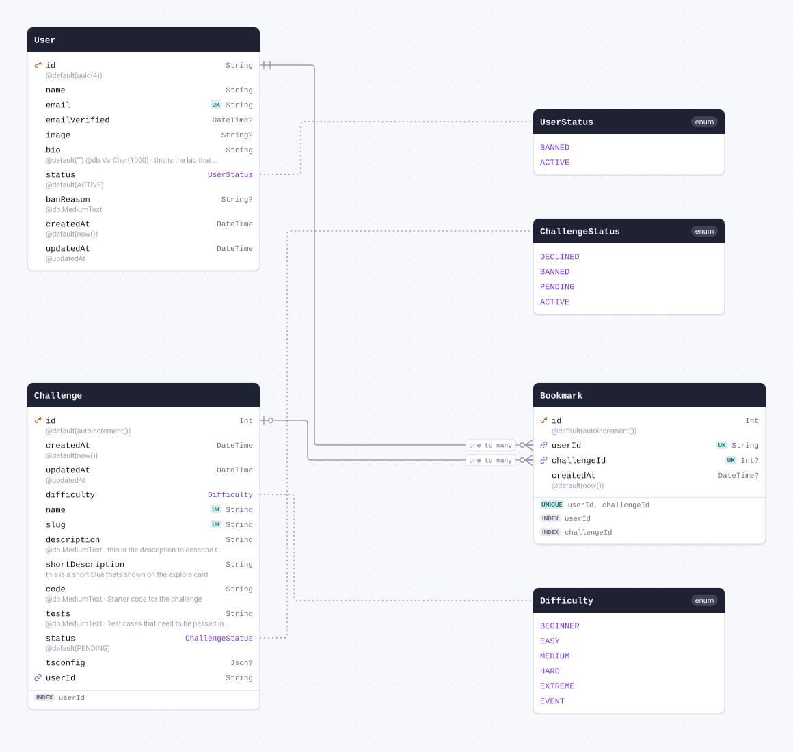

| Field         | Type       | Constraints                             | Default           | Description |
| ------------- | ---------- | --------------------------------------- | ----------------- | ----------- |
| `id`          | `Int`      | PK NOT NULL                             | `autoincrement()` |             |
| `userId`      | `String`   | NOT NULL → [User.id](#model-User)       |                   |             |
| `challengeId` | `Int`      | NULL → [Challenge.id](#model-Challenge) |                   |             |
| `createdAt`   | `DateTime` | NULL                                    | `now()`           |             |

#### Indexes

- `@@index([userId])`
- `@@index([challengeId])`
- `@@unique([userId, challengeId])`

#### References

- `userId` → [User.id](#model-User) (many-to-one)
- `challengeId` → [Challenge.id](#model-Challenge) (many-to-one)

#### Definition

```sql
CREATE TABLE `Bookmark` (
    `id` INTEGER NOT NULL AUTO_INCREMENT,
    `userId` VARCHAR(191) NOT NULL,
    `challengeId` INTEGER NULL,
    `createdAt` DATETIME(3) NULL DEFAULT CURRENT_TIMESTAMP(3),

    INDEX `Bookmark_userId_idx`(`userId`),
    INDEX `Bookmark_challengeId_idx`(`challengeId`),
    UNIQUE INDEX `Bookmark_userId_challengeId_key`(`userId`, `challengeId`),
    PRIMARY KEY (`id`)
) DEFAULT CHARACTER SET utf8mb4 COLLATE utf8mb4_unicode_ci;
```

<details>
<summary>Queries and their SQL</summary>

**findMany**: Every row

```ts
await prisma.bookmark.findMany();
```

```sql
SELECT
  `Bookmark`.`id`,
  `Bookmark`.`userId`,
  `Bookmark`.`challengeId`,
  `Bookmark`.`createdAt`
FROM
  `Bookmark`
WHERE
  1 = 1
```

**count**: How many rows there are

```ts
await prisma.bookmark.count();
```

```sql
SELECT
  COUNT(*) AS `_count$_all`
FROM
  (
    SELECT
      `Bookmark`.`id`
    FROM
      `Bookmark`
    WHERE
      1 = 1
  ) AS `sub`
```

**findMany**: Every row with its relations

```ts
await prisma.bookmark.findMany({ include: { user: true, challenge: true } });
```

```sql
SELECT
  `Bookmark`.`id`,
  `Bookmark`.`userId`,
  `Bookmark`.`challengeId`,
  `Bookmark`.`createdAt`
FROM
  `Bookmark`
WHERE
  1 = 1

SELECT
  `User`.`id`,
  `User`.`name`,
  `User`.`email`,
  `User`.`emailVerified`,
  `User`.`image`,
  `User`.`bio`,
  `User`.`status`,
  `User`.`banReason`,
  `User`.`createdAt`,
  `User`.`updatedAt`
FROM
  `User`
WHERE
  `User`.`id` IN (?)
-- params: ["<userId of the rows above>"]

SELECT
  `Challenge`.`id`,
  `Challenge`.`createdAt`,
  `Challenge`.`updatedAt`,
  `Challenge`.`difficulty`,
  `Challenge`.`name`,
  `Challenge`.`slug`,
  `Challenge`.`description`,
  `Challenge`.`shortDescription`,
  `Challenge`.`code`,
  `Challenge`.`tests`,
  `Challenge`.`status`,
  `Challenge`.`tsconfig`,
  `Challenge`.`userId`
FROM
  `Challenge`
WHERE
  `Challenge`.`id` IN (?)
-- params: ["<challengeId of the rows above>"]
```

**findUnique**: One row by what is unique to it

```ts
await prisma.bookmark.findUnique({ where: { id: 1 } });
```

```sql
SELECT
  `Bookmark`.`id`,
  `Bookmark`.`userId`,
  `Bookmark`.`challengeId`,
  `Bookmark`.`createdAt`
FROM
  `Bookmark`
WHERE
  (
    `Bookmark`.`id` = ?
    AND 1 = 1
  )
LIMIT
  ?
OFFSET
  ?
-- params: ["1","1","0"]
```

**create**: Create a row

```ts
await prisma.bookmark.create({ data: { userId: "example" } });
```

```sql
INSERT INTO
  `Bookmark` (`userId`, `createdAt`)
VALUES
  (?, ?)
-- params: ["example","<now()>"]

SELECT
  `Bookmark`.`id`,
  `Bookmark`.`userId`,
  `Bookmark`.`challengeId`,
  `Bookmark`.`createdAt`
FROM
  `Bookmark`
WHERE
  `Bookmark`.`id` = ?
LIMIT
  ?
OFFSET
  ?
-- params: ["<id of the rows above>","1","0"]
```

**update**: Update a row

```ts
await prisma.bookmark.update({
  where: { id: 1 },
  data: { createdAt: new Date("2026-01-01T00:00:00.000Z") },
});
```

```sql
SELECT
  `Bookmark`.`id`
FROM
  `Bookmark`
WHERE
  (
    `Bookmark`.`id` = ?
    AND 1 = 1
  )
LIMIT
  ?
OFFSET
  ?
-- params: ["1","1","0"]

UPDATE `Bookmark`
SET
  `createdAt` = ?
WHERE
  (
    `Bookmark`.`id` IN (?)
    AND (
      `Bookmark`.`id` = ?
      AND 1 = 1
    )
  )
-- params: ["2026-01-01T00:00:00.000Z","<id of the rows above>","1"]

SELECT
  `Bookmark`.`id`,
  `Bookmark`.`userId`,
  `Bookmark`.`challengeId`,
  `Bookmark`.`createdAt`
FROM
  `Bookmark`
WHERE
  `Bookmark`.`id` = ?
LIMIT
  ?
OFFSET
  ?
-- params: ["<id of the rows above>","1","0"]
```

**delete**: Delete a row

```ts
await prisma.bookmark.delete({ where: { id: 1 } });
```

```sql
SELECT
  `Bookmark`.`id`,
  `Bookmark`.`userId`,
  `Bookmark`.`challengeId`,
  `Bookmark`.`createdAt`
FROM
  `Bookmark`
WHERE
  (
    `Bookmark`.`id` = ?
    AND 1 = 1
  )
LIMIT
  ?
OFFSET
  ?
-- params: ["1","1","0"]

DELETE FROM `Bookmark`
WHERE
  (
    `Bookmark`.`id` = ?
    AND 1 = 1
  )
-- params: ["1"]
```

</details>

<a id="model-ReportIssue"></a>

### ReportIssue

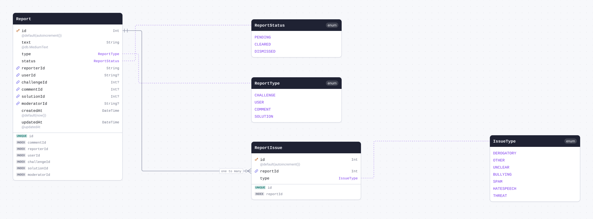

| Field      | Type                           | Constraints                           | Default           | Description |
| ---------- | ------------------------------ | ------------------------------------- | ----------------- | ----------- |
| `id`       | `Int`                          | PK NOT NULL                           | `autoincrement()` |             |
| `reportId` | `Int`                          | NOT NULL → [Report.id](#model-Report) |                   |             |
| `type`     | [`IssueType`](#enum-IssueType) | NOT NULL                              |                   |             |

#### Indexes

- `@@index([reportId])`
- `@@unique([id])`

#### References

- `reportId` → [Report.id](#model-Report) (many-to-one)

#### Definition

```sql
CREATE TABLE `ReportIssue` (
    `id` INTEGER NOT NULL AUTO_INCREMENT,
    `reportId` INTEGER NOT NULL,
    `type` ENUM('DEROGATORY', 'OTHER', 'UNCLEAR', 'BULLYING', 'SPAM', 'HATESPEECH', 'THREAT') NOT NULL,

    INDEX `ReportIssue_reportId_idx`(`reportId`),
    UNIQUE INDEX `ReportIssue_id_key`(`id`),
    PRIMARY KEY (`id`)
) DEFAULT CHARACTER SET utf8mb4 COLLATE utf8mb4_unicode_ci;
```

<details>
<summary>Queries and their SQL</summary>

**findMany**: Every row

```ts
await prisma.reportIssue.findMany();
```

```sql
SELECT
  `ReportIssue`.`id`,
  `ReportIssue`.`reportId`,
  `ReportIssue`.`type`
FROM
  `ReportIssue`
WHERE
  1 = 1
```

**count**: How many rows there are

```ts
await prisma.reportIssue.count();
```

```sql
SELECT
  COUNT(*) AS `_count$_all`
FROM
  (
    SELECT
      `ReportIssue`.`id`
    FROM
      `ReportIssue`
    WHERE
      1 = 1
  ) AS `sub`
```

**findMany**: Every row with its relations

```ts
await prisma.reportIssue.findMany({ include: { report: true } });
```

```sql
SELECT
  `ReportIssue`.`id`,
  `ReportIssue`.`reportId`,
  `ReportIssue`.`type`
FROM
  `ReportIssue`
WHERE
  1 = 1

SELECT
  `Report`.`id`,
  `Report`.`text`,
  `Report`.`type`,
  `Report`.`status`,
  `Report`.`reporterId`,
  `Report`.`userId`,
  `Report`.`challengeId`,
  `Report`.`commentId`,
  `Report`.`solutionId`,
  `Report`.`moderatorId`,
  `Report`.`createdAt`,
  `Report`.`updatedAt`
FROM
  `Report`
WHERE
  `Report`.`id` IN (?)
-- params: ["<reportId of the rows above>"]
```

**findUnique**: One row by what is unique to it

```ts
await prisma.reportIssue.findUnique({ where: { id: 1 } });
```

```sql
SELECT
  `ReportIssue`.`id`,
  `ReportIssue`.`reportId`,
  `ReportIssue`.`type`
FROM
  `ReportIssue`
WHERE
  (
    `ReportIssue`.`id` = ?
    AND 1 = 1
  )
LIMIT
  ?
OFFSET
  ?
-- params: ["1","1","0"]
```

**create**: Create a row

```ts
await prisma.reportIssue.create({ data: { reportId: 1, type: "DEROGATORY" } });
```

```sql
INSERT INTO
  `ReportIssue` (`reportId`, `type`)
VALUES
  (?, ?)
-- params: ["1","DEROGATORY"]

SELECT
  `ReportIssue`.`id`,
  `ReportIssue`.`reportId`,
  `ReportIssue`.`type`
FROM
  `ReportIssue`
WHERE
  `ReportIssue`.`id` = ?
LIMIT
  ?
OFFSET
  ?
-- params: ["<id of the rows above>","1","0"]
```

**update**: Update a row

```ts
await prisma.reportIssue.update({ where: { id: 1 }, data: { type: "DEROGATORY" } });
```

```sql
SELECT
  `ReportIssue`.`id`
FROM
  `ReportIssue`
WHERE
  (
    `ReportIssue`.`id` = ?
    AND 1 = 1
  )
LIMIT
  ?
OFFSET
  ?
-- params: ["1","1","0"]

UPDATE `ReportIssue`
SET
  `type` = ?
WHERE
  (
    `ReportIssue`.`id` IN (?)
    AND (
      `ReportIssue`.`id` = ?
      AND 1 = 1
    )
  )
-- params: ["DEROGATORY","<id of the rows above>","1"]

SELECT
  `ReportIssue`.`id`,
  `ReportIssue`.`reportId`,
  `ReportIssue`.`type`
FROM
  `ReportIssue`
WHERE
  `ReportIssue`.`id` = ?
LIMIT
  ?
OFFSET
  ?
-- params: ["<id of the rows above>","1","0"]
```

**delete**: Delete a row

```ts
await prisma.reportIssue.delete({ where: { id: 1 } });
```

```sql
SELECT
  `ReportIssue`.`id`,
  `ReportIssue`.`reportId`,
  `ReportIssue`.`type`
FROM
  `ReportIssue`
WHERE
  (
    `ReportIssue`.`id` = ?
    AND 1 = 1
  )
LIMIT
  ?
OFFSET
  ?
-- params: ["1","1","0"]

DELETE FROM `ReportIssue`
WHERE
  (
    `ReportIssue`.`id` = ?
    AND 1 = 1
  )
-- params: ["1"]
```

</details>

<a id="model-Report"></a>

### Report

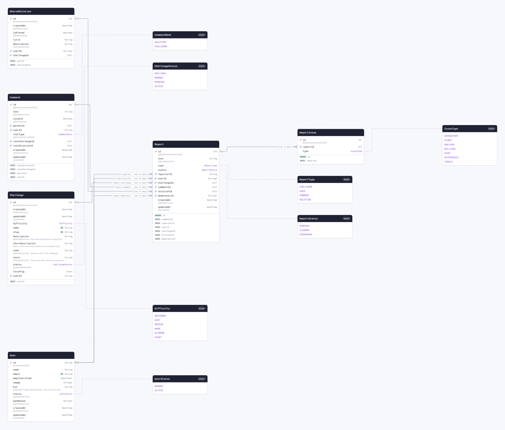

| Field         | Type                                 | Constraints                                       | Default           | Description |
| ------------- | ------------------------------------ | ------------------------------------------------- | ----------------- | ----------- |
| `id`          | `Int`                                | PK NOT NULL                                       | `autoincrement()` |             |
| `text`        | `String` `@db.MediumText`            | NOT NULL                                          |                   |             |
| `type`        | [`ReportType`](#enum-ReportType)     | NOT NULL                                          |                   |             |
| `status`      | [`ReportStatus`](#enum-ReportStatus) | NOT NULL                                          |                   |             |
| `reporterId`  | `String`                             | NOT NULL → [User.id](#model-User)                 |                   |             |
| `userId`      | `String`                             | NULL → [User.id](#model-User)                     |                   |             |
| `challengeId` | `Int`                                | NULL → [Challenge.id](#model-Challenge)           |                   |             |
| `commentId`   | `Int`                                | NULL → [Comment.id](#model-Comment)               |                   |             |
| `solutionId`  | `Int`                                | NULL → [SharedSolution.id](#model-SharedSolution) |                   |             |
| `moderatorId` | `String`                             | NULL → [User.id](#model-User)                     |                   |             |
| `createdAt`   | `DateTime`                           | NOT NULL                                          | `now()`           |             |
| `updatedAt`   | `DateTime`                           | NOT NULL                                          | `@updatedAt`      |             |

#### Indexes

- `@@index([commentId])`
- `@@index([reporterId])`
- `@@index([userId])`
- `@@index([challengeId])`
- `@@index([solutionId])`
- `@@index([moderatorId])`
- `@@unique([id])`

#### References

- `reporterId` → [User.id](#model-User) (many-to-one)
- `userId` → [User.id](#model-User) (many-to-one)
- `challengeId` → [Challenge.id](#model-Challenge) (many-to-one)
- `commentId` → [Comment.id](#model-Comment) (many-to-one)
- `solutionId` → [SharedSolution.id](#model-SharedSolution) (many-to-one)
- `moderatorId` → [User.id](#model-User) (many-to-one)

#### Referenced by

- `id` ← [ReportIssue.reportId](#model-ReportIssue) (one-to-many)

#### Definition

```sql
CREATE TABLE `Report` (
    `id` INTEGER NOT NULL AUTO_INCREMENT,
    `text` MEDIUMTEXT NOT NULL,
    `type` ENUM('CHALLENGE', 'USER', 'COMMENT', 'SOLUTION') NOT NULL,
    `status` ENUM('PENDING', 'CLEARED', 'DISMISSED') NOT NULL,
    `reporterId` VARCHAR(191) NOT NULL,
    `userId` VARCHAR(191) NULL,
    `challengeId` INTEGER NULL,
    `commentId` INTEGER NULL,
    `solutionId` INTEGER NULL,
    `moderatorId` VARCHAR(191) NULL,
    `createdAt` DATETIME(3) NOT NULL DEFAULT CURRENT_TIMESTAMP(3),
    `updatedAt` DATETIME(3) NOT NULL,

    INDEX `Report_commentId_idx`(`commentId`),
    INDEX `Report_reporterId_idx`(`reporterId`),
    INDEX `Report_userId_idx`(`userId`),
    INDEX `Report_challengeId_idx`(`challengeId`),
    INDEX `Report_solutionId_idx`(`solutionId`),
    INDEX `Report_moderatorId_idx`(`moderatorId`),
    UNIQUE INDEX `Report_id_key`(`id`),
    PRIMARY KEY (`id`)
) DEFAULT CHARACTER SET utf8mb4 COLLATE utf8mb4_unicode_ci;
```

<details>
<summary>Queries and their SQL</summary>

**findMany**: Every row

```ts
await prisma.report.findMany();
```

```sql
SELECT
  `Report`.`id`,
  `Report`.`text`,
  `Report`.`type`,
  `Report`.`status`,
  `Report`.`reporterId`,
  `Report`.`userId`,
  `Report`.`challengeId`,
  `Report`.`commentId`,
  `Report`.`solutionId`,
  `Report`.`moderatorId`,
  `Report`.`createdAt`,
  `Report`.`updatedAt`
FROM
  `Report`
WHERE
  1 = 1
```

**count**: How many rows there are

```ts
await prisma.report.count();
```

```sql
SELECT
  COUNT(*) AS `_count$_all`
FROM
  (
    SELECT
      `Report`.`id`
    FROM
      `Report`
    WHERE
      1 = 1
  ) AS `sub`
```

**findMany**: Every row with its relations

```ts
await prisma.report.findMany({
  include: {
    issues: true,
    reporter: true,
    user: true,
    challenge: true,
    comment: true,
    solution: true,
    moderator: true,
  },
});
```

```sql
SELECT
  `Report`.`id`,
  `Report`.`text`,
  `Report`.`type`,
  `Report`.`status`,
  `Report`.`reporterId`,
  `Report`.`userId`,
  `Report`.`challengeId`,
  `Report`.`commentId`,
  `Report`.`solutionId`,
  `Report`.`moderatorId`,
  `Report`.`createdAt`,
  `Report`.`updatedAt`
FROM
  `Report`
WHERE
  1 = 1

SELECT
  `ReportIssue`.`id`,
  `ReportIssue`.`reportId`,
  `ReportIssue`.`type`
FROM
  `ReportIssue`
WHERE
  `ReportIssue`.`reportId` IN (?)
-- params: ["<id of the rows above>"]

SELECT
  `User`.`id`,
  `User`.`name`,
  `User`.`email`,
  `User`.`emailVerified`,
  `User`.`image`,
  `User`.`bio`,
  `User`.`status`,
  `User`.`banReason`,
  `User`.`createdAt`,
  `User`.`updatedAt`
FROM
  `User`
WHERE
  `User`.`id` IN (?)
-- params: ["<reporterId of the rows above>"]

SELECT
  `User`.`id`,
  `User`.`name`,
  `User`.`email`,
  `User`.`emailVerified`,
  `User`.`image`,
  `User`.`bio`,
  `User`.`status`,
  `User`.`banReason`,
  `User`.`createdAt`,
  `User`.`updatedAt`
FROM
  `User`
WHERE
  `User`.`id` IN (?)
-- params: ["<userId of the rows above>"]

SELECT
  `Challenge`.`id`,
  `Challenge`.`createdAt`,
  `Challenge`.`updatedAt`,
  `Challenge`.`difficulty`,
  `Challenge`.`name`,
  `Challenge`.`slug`,
  `Challenge`.`description`,
  `Challenge`.`shortDescription`,
  `Challenge`.`code`,
  `Challenge`.`tests`,
  `Challenge`.`status`,
  `Challenge`.`tsconfig`,
  `Challenge`.`userId`
FROM
  `Challenge`
WHERE
  `Challenge`.`id` IN (?)
-- params: ["<challengeId of the rows above>"]

SELECT
  `Comment`.`id`,
  `Comment`.`text`,
  `Comment`.`visible`,
  `Comment`.`parentId`,
  `Comment`.`userId`,
  `Comment`.`rootType`,
  `Comment`.`rootChallengeId`,
  `Comment`.`rootSolutionId`,
  `Comment`.`createdAt`,
  `Comment`.`updatedAt`
FROM
  `Comment`
WHERE
  `Comment`.`id` IN (?)
-- params: ["<commentId of the rows above>"]

SELECT
  `SharedSolution`.`id`,
  `SharedSolution`.`createdAt`,
  `SharedSolution`.`isPinned`,
  `SharedSolution`.`title`,
  `SharedSolution`.`description`,
  `SharedSolution`.`userId`,
  `SharedSolution`.`challengeId`
FROM
  `SharedSolution`
WHERE
  `SharedSolution`.`id` IN (?)
-- params: ["<solutionId of the rows above>"]

SELECT
  `User`.`id`,
  `User`.`name`,
  `User`.`email`,
  `User`.`emailVerified`,
  `User`.`image`,
  `User`.`bio`,
  `User`.`status`,
  `User`.`banReason`,
  `User`.`createdAt`,
  `User`.`updatedAt`
FROM
  `User`
WHERE
  `User`.`id` IN (?)
-- params: ["<moderatorId of the rows above>"]
```

**findUnique**: One row by what is unique to it

```ts
await prisma.report.findUnique({ where: { id: 1 } });
```

```sql
SELECT
  `Report`.`id`,
  `Report`.`text`,
  `Report`.`type`,
  `Report`.`status`,
  `Report`.`reporterId`,
  `Report`.`userId`,
  `Report`.`challengeId`,
  `Report`.`commentId`,
  `Report`.`solutionId`,
  `Report`.`moderatorId`,
  `Report`.`createdAt`,
  `Report`.`updatedAt`
FROM
  `Report`
WHERE
  (
    `Report`.`id` = ?
    AND 1 = 1
  )
LIMIT
  ?
OFFSET
  ?
-- params: ["1","1","0"]
```

**create**: Create a row

```ts
await prisma.report.create({
  data: { text: "example", type: "CHALLENGE", status: "PENDING", reporterId: "example" },
});
```

```sql
INSERT INTO
  `Report` (
    `text`,
    `type`,
    `status`,
    `reporterId`,
    `createdAt`,
    `updatedAt`
  )
VALUES
  (?, ?, ?, ?, ?, ?)
-- params: ["example","CHALLENGE","PENDING","example","<now()>","<now()>"]

SELECT
  `Report`.`id`,
  `Report`.`text`,
  `Report`.`type`,
  `Report`.`status`,
  `Report`.`reporterId`,
  `Report`.`userId`,
  `Report`.`challengeId`,
  `Report`.`commentId`,
  `Report`.`solutionId`,
  `Report`.`moderatorId`,
  `Report`.`createdAt`,
  `Report`.`updatedAt`
FROM
  `Report`
WHERE
  `Report`.`id` = ?
LIMIT
  ?
OFFSET
  ?
-- params: ["<id of the rows above>","1","0"]
```

**update**: Update a row

```ts
await prisma.report.update({ where: { id: 1 }, data: { text: "example" } });
```

```sql
SELECT
  `Report`.`id`
FROM
  `Report`
WHERE
  (
    `Report`.`id` = ?
    AND 1 = 1
  )
LIMIT
  ?
OFFSET
  ?
-- params: ["1","1","0"]

UPDATE `Report`
SET
  `text` = ?,
  `updatedAt` = ?
WHERE
  (
    `Report`.`id` IN (?)
    AND (
      `Report`.`id` = ?
      AND 1 = 1
    )
  )
-- params: ["example",{"prisma__type":"generatorCall","prisma__value":{"name":"now","args":[],"returnType":{"type":"DateTime"}}},"<id of the rows above>","1"]

SELECT
  `Report`.`id`,
  `Report`.`text`,
  `Report`.`type`,
  `Report`.`status`,
  `Report`.`reporterId`,
  `Report`.`userId`,
  `Report`.`challengeId`,
  `Report`.`commentId`,
  `Report`.`solutionId`,
  `Report`.`moderatorId`,
  `Report`.`createdAt`,
  `Report`.`updatedAt`
FROM
  `Report`
WHERE
  `Report`.`id` = ?
LIMIT
  ?
OFFSET
  ?
-- params: ["<id of the rows above>","1","0"]
```

**delete**: Delete a row

```ts
await prisma.report.delete({ where: { id: 1 } });
```

```sql
SELECT
  `Report`.`id`,
  `Report`.`text`,
  `Report`.`type`,
  `Report`.`status`,
  `Report`.`reporterId`,
  `Report`.`userId`,
  `Report`.`challengeId`,
  `Report`.`commentId`,
  `Report`.`solutionId`,
  `Report`.`moderatorId`,
  `Report`.`createdAt`,
  `Report`.`updatedAt`
FROM
  `Report`
WHERE
  (
    `Report`.`id` = ?
    AND 1 = 1
  )
LIMIT
  ?
OFFSET
  ?
-- params: ["1","1","0"]

SELECT
  `ReportIssue`.`id`,
  `ReportIssue`.`reportId`
FROM
  `ReportIssue`
WHERE
  (
    1 = 1
    AND `ReportIssue`.`reportId` IN (?)
  )
-- params: ["<id of the rows above>"]

DELETE FROM `Report`
WHERE
  (
    `Report`.`id` = ?
    AND 1 = 1
  )
-- params: ["1"]
```

</details>

<a id="model-Comment"></a>

### Comment

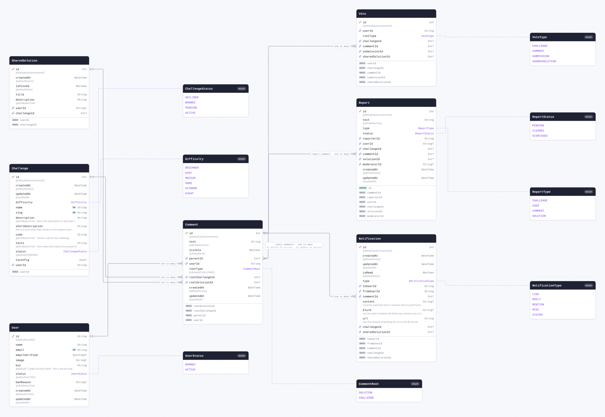

| Field             | Type                               | Constraints                                       | Default           | Description |
| ----------------- | ---------------------------------- | ------------------------------------------------- | ----------------- | ----------- |
| `id`              | `Int`                              | PK NOT NULL                                       | `autoincrement()` |             |
| `text`            | `String` `@db.MediumText`          | NOT NULL                                          |                   |             |
| `visible`         | `Boolean`                          | NOT NULL                                          | `true`            |             |
| `parentId`        | `Int`                              | NULL → [Comment.id](#model-Comment)               |                   |             |
| `userId`          | `String`                           | NOT NULL → [User.id](#model-User)                 |                   |             |
| `rootType`        | [`CommentRoot`](#enum-CommentRoot) | NOT NULL                                          | `CHALLENGE`       |             |
| `rootChallengeId` | `Int`                              | NULL → [Challenge.id](#model-Challenge)           |                   |             |
| `rootSolutionId`  | `Int`                              | NULL → [SharedSolution.id](#model-SharedSolution) |                   |             |
| `createdAt`       | `DateTime`                         | NOT NULL                                          | `now()`           |             |
| `updatedAt`       | `DateTime`                         | NOT NULL                                          | `@updatedAt`      |             |

#### Indexes

- `@@index([rootSolutionId])`
- `@@index([rootChallengeId])`
- `@@index([parentId])`
- `@@index([userId])`

#### References

- `parentId` → [Comment.id](#model-Comment) (many-to-one, on delete NoAction, on update NoAction)
- `userId` → [User.id](#model-User) (many-to-one)
- `rootChallengeId` → [Challenge.id](#model-Challenge) (many-to-one)
- `rootSolutionId` → [SharedSolution.id](#model-SharedSolution) (many-to-one)

#### Referenced by

- `id` ← [Vote.commentId](#model-Vote) (one-to-many)
- `id` ← [Report.commentId](#model-Report) (one-to-many)
- `id` ← [Comment.parentId](#model-Comment) (one-to-many, on delete NoAction, on update NoAction)
- `id` ← [Notification.commentId](#model-Notification) (one-to-many)

#### Definition

```sql
CREATE TABLE `Comment` (
    `id` INTEGER NOT NULL AUTO_INCREMENT,
    `text` MEDIUMTEXT NOT NULL,
    `visible` BOOLEAN NOT NULL DEFAULT true,
    `parentId` INTEGER NULL,
    `userId` VARCHAR(191) NOT NULL,
    `rootType` ENUM('SOLUTION', 'CHALLENGE') NOT NULL DEFAULT 'CHALLENGE',
    `rootChallengeId` INTEGER NULL,
    `rootSolutionId` INTEGER NULL,
    `createdAt` DATETIME(3) NOT NULL DEFAULT CURRENT_TIMESTAMP(3),
    `updatedAt` DATETIME(3) NOT NULL,

    INDEX `Comment_rootSolutionId_idx`(`rootSolutionId`),
    INDEX `Comment_rootChallengeId_idx`(`rootChallengeId`),
    INDEX `Comment_parentId_idx`(`parentId`),
    INDEX `Comment_userId_idx`(`userId`),
    PRIMARY KEY (`id`)
) DEFAULT CHARACTER SET utf8mb4 COLLATE utf8mb4_unicode_ci;
```

<details>
<summary>Queries and their SQL</summary>

**findMany**: Every row

```ts
await prisma.comment.findMany();
```

```sql
SELECT
  `Comment`.`id`,
  `Comment`.`text`,
  `Comment`.`visible`,
  `Comment`.`parentId`,
  `Comment`.`userId`,
  `Comment`.`rootType`,
  `Comment`.`rootChallengeId`,
  `Comment`.`rootSolutionId`,
  `Comment`.`createdAt`,
  `Comment`.`updatedAt`
FROM
  `Comment`
WHERE
  1 = 1
```

**count**: How many rows there are

```ts
await prisma.comment.count();
```

```sql
SELECT
  COUNT(*) AS `_count$_all`
FROM
  (
    SELECT
      `Comment`.`id`
    FROM
      `Comment`
    WHERE
      1 = 1
  ) AS `sub`
```

**findMany**: Every row with its relations

```ts
await prisma.comment.findMany({
  include: {
    parentComment: true,
    replies: true,
    user: true,
    rootChallenge: true,
    rootSolution: true,
    Report: true,
    vote: true,
    Notification: true,
  },
});
```

```sql
SELECT
  `Comment`.`id`,
  `Comment`.`text`,
  `Comment`.`visible`,
  `Comment`.`parentId`,
  `Comment`.`userId`,
  `Comment`.`rootType`,
  `Comment`.`rootChallengeId`,
  `Comment`.`rootSolutionId`,
  `Comment`.`createdAt`,
  `Comment`.`updatedAt`
FROM
  `Comment`
WHERE
  1 = 1

SELECT
  `Comment`.`id`,
  `Comment`.`text`,
  `Comment`.`visible`,
  `Comment`.`parentId`,
  `Comment`.`userId`,
  `Comment`.`rootType`,
  `Comment`.`rootChallengeId`,
  `Comment`.`rootSolutionId`,
  `Comment`.`createdAt`,
  `Comment`.`updatedAt`
FROM
  `Comment`
WHERE
  `Comment`.`id` IN (?)
-- params: ["<parentId of the rows above>"]

SELECT
  `Comment`.`id`,
  `Comment`.`text`,
  `Comment`.`visible`,
  `Comment`.`parentId`,
  `Comment`.`userId`,
  `Comment`.`rootType`,
  `Comment`.`rootChallengeId`,
  `Comment`.`rootSolutionId`,
  `Comment`.`createdAt`,
  `Comment`.`updatedAt`
FROM
  `Comment`
WHERE
  `Comment`.`parentId` IN (?)
-- params: ["<id of the rows above>"]

SELECT
  `User`.`id`,
  `User`.`name`,
  `User`.`email`,
  `User`.`emailVerified`,
  `User`.`image`,
  `User`.`bio`,
  `User`.`status`,
  `User`.`banReason`,
  `User`.`createdAt`,
  `User`.`updatedAt`
FROM
  `User`
WHERE
  `User`.`id` IN (?)
-- params: ["<userId of the rows above>"]

SELECT
  `Challenge`.`id`,
  `Challenge`.`createdAt`,
  `Challenge`.`updatedAt`,
  `Challenge`.`difficulty`,
  `Challenge`.`name`,
  `Challenge`.`slug`,
  `Challenge`.`description`,
  `Challenge`.`shortDescription`,
  `Challenge`.`code`,
  `Challenge`.`tests`,
  `Challenge`.`status`,
  `Challenge`.`tsconfig`,
  `Challenge`.`userId`
FROM
  `Challenge`
WHERE
  `Challenge`.`id` IN (?)
-- params: ["<rootChallengeId of the rows above>"]

SELECT
  `SharedSolution`.`id`,
  `SharedSolution`.`createdAt`,
  `SharedSolution`.`isPinned`,
  `SharedSolution`.`title`,
  `SharedSolution`.`description`,
  `SharedSolution`.`userId`,
  `SharedSolution`.`challengeId`
FROM
  `SharedSolution`
WHERE
  `SharedSolution`.`id` IN (?)
-- params: ["<rootSolutionId of the rows above>"]

SELECT
  `Report`.`id`,
  `Report`.`text`,
  `Report`.`type`,
  `Report`.`status`,
  `Report`.`reporterId`,
  `Report`.`userId`,
  `Report`.`challengeId`,
  `Report`.`commentId`,
  `Report`.`solutionId`,
  `Report`.`moderatorId`,
  `Report`.`createdAt`,
  `Report`.`updatedAt`
FROM
  `Report`
WHERE
  `Report`.`commentId` IN (?)
-- params: ["<id of the rows above>"]

SELECT
  `Vote`.`id`,
  `Vote`.`userId`,
  `Vote`.`rootType`,
  `Vote`.`challengeId`,
  `Vote`.`commentId`,
  `Vote`.`submissionId`,
  `Vote`.`sharedSolutionId`
FROM
  `Vote`
WHERE
  `Vote`.`commentId` IN (?)
-- params: ["<id of the rows above>"]

SELECT
  `Notification`.`id`,
  `Notification`.`createdAt`,
  `Notification`.`updatedAt`,
  `Notification`.`isRead`,
  `Notification`.`type`,
  `Notification`.`toUserId`,
  `Notification`.`fromUserId`,
  `Notification`.`commentId`,
  `Notification`.`content`,
  `Notification`.`blurb`,
  `Notification`.`url`,
  `Notification`.`challengeId`,
  `Notification`.`sharedSolutionId`
FROM
  `Notification`
WHERE
  `Notification`.`commentId` IN (?)
-- params: ["<id of the rows above>"]
```

**findUnique**: One row by what is unique to it

```ts
await prisma.comment.findUnique({ where: { id: 1 } });
```

```sql
SELECT
  `Comment`.`id`,
  `Comment`.`text`,
  `Comment`.`visible`,
  `Comment`.`parentId`,
  `Comment`.`userId`,
  `Comment`.`rootType`,
  `Comment`.`rootChallengeId`,
  `Comment`.`rootSolutionId`,
  `Comment`.`createdAt`,
  `Comment`.`updatedAt`
FROM
  `Comment`
WHERE
  (
    `Comment`.`id` = ?
    AND 1 = 1
  )
LIMIT
  ?
OFFSET
  ?
-- params: ["1","1","0"]
```

**create**: Create a row

```ts
await prisma.comment.create({ data: { text: "example", userId: "example" } });
```

```sql
INSERT INTO
  `Comment` (
    `text`,
    `visible`,
    `userId`,
    `rootType`,
    `createdAt`,
    `updatedAt`
  )
VALUES
  (?, ?, ?, ?, ?, ?)
-- params: ["example",true,"example","CHALLENGE","<now()>","<now()>"]

SELECT
  `Comment`.`id`,
  `Comment`.`text`,
  `Comment`.`visible`,
  `Comment`.`parentId`,
  `Comment`.`userId`,
  `Comment`.`rootType`,
  `Comment`.`rootChallengeId`,
  `Comment`.`rootSolutionId`,
  `Comment`.`createdAt`,
  `Comment`.`updatedAt`
FROM
  `Comment`
WHERE
  `Comment`.`id` = ?
LIMIT
  ?
OFFSET
  ?
-- params: ["<id of the rows above>","1","0"]
```

**update**: Update a row

```ts
await prisma.comment.update({ where: { id: 1 }, data: { text: "example" } });
```

```sql
SELECT
  `Comment`.`id`
FROM
  `Comment`
WHERE
  (
    `Comment`.`id` = ?
    AND 1 = 1
  )
LIMIT
  ?
OFFSET
  ?
-- params: ["1","1","0"]

SELECT
  `Comment`.`id`,
  `Comment`.`parentId`
FROM
  `Comment`
WHERE
  (
    1 = 1
    AND `Comment`.`parentId` IN (?)
  )
-- params: ["<id of the rows above>"]

UPDATE `Comment`
SET
  `text` = ?,
  `updatedAt` = ?
WHERE
  (
    `Comment`.`id` IN (?)
    AND (
      `Comment`.`id` = ?
      AND 1 = 1
    )
  )
-- params: ["example",{"prisma__type":"generatorCall","prisma__value":{"name":"now","args":[],"returnType":{"type":"DateTime"}}},"<id of the rows above>","1"]

SELECT
  `Comment`.`id`,
  `Comment`.`text`,
  `Comment`.`visible`,
  `Comment`.`parentId`,
  `Comment`.`userId`,
  `Comment`.`rootType`,
  `Comment`.`rootChallengeId`,
  `Comment`.`rootSolutionId`,
  `Comment`.`createdAt`,
  `Comment`.`updatedAt`
FROM
  `Comment`
WHERE
  `Comment`.`id` = ?
LIMIT
  ?
OFFSET
  ?
-- params: ["<id of the rows above>","1","0"]
```

**delete**: Delete a row

```ts
await prisma.comment.delete({ where: { id: 1 } });
```

```sql
SELECT
  `Comment`.`id`,
  `Comment`.`text`,
  `Comment`.`visible`,
  `Comment`.`parentId`,
  `Comment`.`userId`,
  `Comment`.`rootType`,
  `Comment`.`rootChallengeId`,
  `Comment`.`rootSolutionId`,
  `Comment`.`createdAt`,
  `Comment`.`updatedAt`
FROM
  `Comment`
WHERE
  (
    `Comment`.`id` = ?
    AND 1 = 1
  )
LIMIT
  ?
OFFSET
  ?
-- params: ["1","1","0"]

SELECT
  `Vote`.`id`,
  `Vote`.`commentId`
FROM
  `Vote`
WHERE
  (
    1 = 1
    AND `Vote`.`commentId` IN (?)
  )
-- params: ["<id of the rows above>"]

UPDATE `Vote`
SET
  `commentId` = ?
WHERE
  (
    `Vote`.`id` IN (?)
    AND 1 = 1
  )
-- params: [null,"<id of the rows above>"]

SELECT
  `Report`.`id`,
  `Report`.`commentId`
FROM
  `Report`
WHERE
  (
    1 = 1
    AND `Report`.`commentId` IN (?)
  )
-- params: ["<id of the rows above>"]

UPDATE `Report`
SET
  `commentId` = ?
WHERE
  (
    `Report`.`id` IN (?)
    AND 1 = 1
  )
-- params: [null,"<id of the rows above>"]

SELECT
  `Comment`.`id`,
  `Comment`.`parentId`
FROM
  `Comment`
WHERE
  (
    1 = 1
    AND `Comment`.`parentId` IN (?)
  )
-- params: ["<id of the rows above>"]

SELECT
  `Notification`.`id`,
  `Notification`.`commentId`
FROM
  `Notification`
WHERE
  (
    1 = 1
    AND `Notification`.`commentId` IN (?)
  )
-- params: ["<id of the rows above>"]

UPDATE `Notification`
SET
  `commentId` = ?
WHERE
  (
    `Notification`.`id` IN (?)
    AND 1 = 1
  )
-- params: [null,"<id of the rows above>"]

DELETE FROM `Comment`
WHERE
  (
    `Comment`.`id` = ?
    AND 1 = 1
  )
-- params: ["1"]
```

</details>

<a id="model-ImageUpload"></a>

### ImageUpload

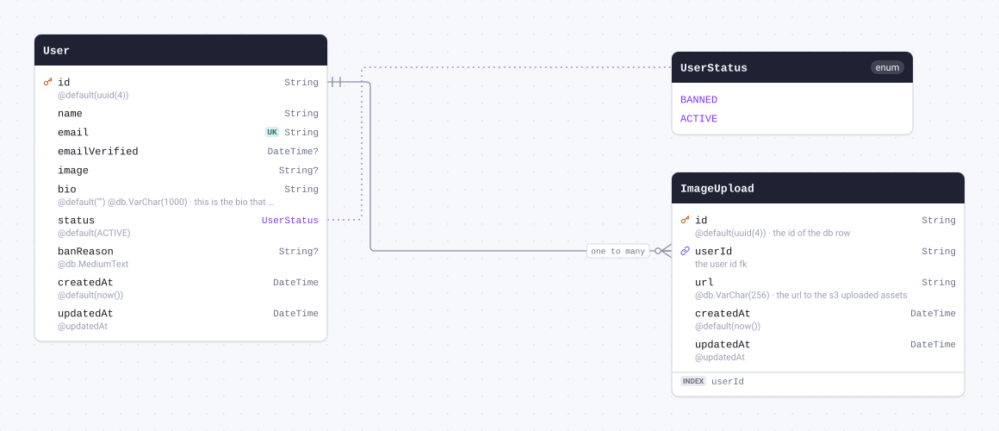

| Field       | Type                        | Constraints                       | Default      | Description                       |
| ----------- | --------------------------- | --------------------------------- | ------------ | --------------------------------- |
| `id`        | `String`                    | PK NOT NULL                       | `uuid(4)`    | the id of the db row              |
| `userId`    | `String`                    | NOT NULL → [User.id](#model-User) |              | the user id fk                    |
| `url`       | `String` `@db.VarChar(256)` | NOT NULL                          |              | the url to the s3 uploaded assets |
| `createdAt` | `DateTime`                  | NOT NULL                          | `now()`      |                                   |
| `updatedAt` | `DateTime`                  | NOT NULL                          | `@updatedAt` |                                   |

#### Indexes

- `@@index([userId])`

#### References

- `userId` → [User.id](#model-User) (many-to-one)

#### Definition

```sql
CREATE TABLE `ImageUpload` (
    `id` VARCHAR(191) NOT NULL,
    `userId` VARCHAR(191) NOT NULL,
    `url` VARCHAR(256) NOT NULL,
    `createdAt` DATETIME(3) NOT NULL DEFAULT CURRENT_TIMESTAMP(3),
    `updatedAt` DATETIME(3) NOT NULL,

    INDEX `ImageUpload_userId_idx`(`userId`),
    PRIMARY KEY (`id`)
) DEFAULT CHARACTER SET utf8mb4 COLLATE utf8mb4_unicode_ci;
```

<details>
<summary>Queries and their SQL</summary>

**findMany**: Every row

```ts
await prisma.imageUpload.findMany();
```

```sql
SELECT
  `ImageUpload`.`id`,
  `ImageUpload`.`userId`,
  `ImageUpload`.`url`,
  `ImageUpload`.`createdAt`,
  `ImageUpload`.`updatedAt`
FROM
  `ImageUpload`
WHERE
  1 = 1
```

**count**: How many rows there are

```ts
await prisma.imageUpload.count();
```

```sql
SELECT
  COUNT(*) AS `_count$_all`
FROM
  (
    SELECT
      `ImageUpload`.`id`
    FROM
      `ImageUpload`
    WHERE
      1 = 1
  ) AS `sub`
```

**findMany**: Every row with its relations

```ts
await prisma.imageUpload.findMany({ include: { user: true } });
```

```sql
SELECT
  `ImageUpload`.`id`,
  `ImageUpload`.`userId`,
  `ImageUpload`.`url`,
  `ImageUpload`.`createdAt`,
  `ImageUpload`.`updatedAt`
FROM
  `ImageUpload`
WHERE
  1 = 1

SELECT
  `User`.`id`,
  `User`.`name`,
  `User`.`email`,
  `User`.`emailVerified`,
  `User`.`image`,
  `User`.`bio`,
  `User`.`status`,
  `User`.`banReason`,
  `User`.`createdAt`,
  `User`.`updatedAt`
FROM
  `User`
WHERE
  `User`.`id` IN (?)
-- params: ["<userId of the rows above>"]
```

**findUnique**: One row by what is unique to it

```ts
await prisma.imageUpload.findUnique({ where: { id: "example" } });
```

```sql
SELECT
  `ImageUpload`.`id`,
  `ImageUpload`.`userId`,
  `ImageUpload`.`url`,
  `ImageUpload`.`createdAt`,
  `ImageUpload`.`updatedAt`
FROM
  `ImageUpload`
WHERE
  (
    `ImageUpload`.`id` = ?
    AND 1 = 1
  )
LIMIT
  ?
OFFSET
  ?
-- params: ["example","1","0"]
```

**create**: Create a row

```ts
await prisma.imageUpload.create({ data: { userId: "example", url: "example" } });
```

```sql
INSERT INTO
  `ImageUpload` (`id`, `userId`, `url`, `createdAt`, `updatedAt`)
VALUES
  (?, ?, ?, ?, ?)
-- params: ["<uuid(4)>","example","example","<now()>","<now()>"]

SELECT
  `ImageUpload`.`id`,
  `ImageUpload`.`userId`,
  `ImageUpload`.`url`,
  `ImageUpload`.`createdAt`,
  `ImageUpload`.`updatedAt`
FROM
  `ImageUpload`
WHERE
  `ImageUpload`.`id` = ?
LIMIT
  ?
OFFSET
  ?
-- params: ["<id of the rows above>","1","0"]
```

**update**: Update a row

```ts
await prisma.imageUpload.update({ where: { id: "example" }, data: { url: "example" } });
```

```sql
SELECT
  `ImageUpload`.`id`
FROM
  `ImageUpload`
WHERE
  (
    `ImageUpload`.`id` = ?
    AND 1 = 1
  )
LIMIT
  ?
OFFSET
  ?
-- params: ["example","1","0"]

UPDATE `ImageUpload`
SET
  `url` = ?,
  `updatedAt` = ?
WHERE
  (
    `ImageUpload`.`id` IN (?)
    AND (
      `ImageUpload`.`id` = ?
      AND 1 = 1
    )
  )
-- params: ["example",{"prisma__type":"generatorCall","prisma__value":{"name":"now","args":[],"returnType":{"type":"DateTime"}}},"<id of the rows above>","example"]

SELECT
  `ImageUpload`.`id`,
  `ImageUpload`.`userId`,
  `ImageUpload`.`url`,
  `ImageUpload`.`createdAt`,
  `ImageUpload`.`updatedAt`
FROM
  `ImageUpload`
WHERE
  `ImageUpload`.`id` = ?
LIMIT
  ?
OFFSET
  ?
-- params: ["<id of the rows above>","1","0"]
```

**delete**: Delete a row

```ts
await prisma.imageUpload.delete({ where: { id: "example" } });
```

```sql
SELECT
  `ImageUpload`.`id`,
  `ImageUpload`.`userId`,
  `ImageUpload`.`url`,
  `ImageUpload`.`createdAt`,
  `ImageUpload`.`updatedAt`
FROM
  `ImageUpload`
WHERE
  (
    `ImageUpload`.`id` = ?
    AND 1 = 1
  )
LIMIT
  ?
OFFSET
  ?
-- params: ["example","1","0"]

DELETE FROM `ImageUpload`
WHERE
  (
    `ImageUpload`.`id` = ?
    AND 1 = 1
  )
-- params: ["example"]
```

</details>

<a id="model-TrackChallenge"></a>

### TrackChallenge

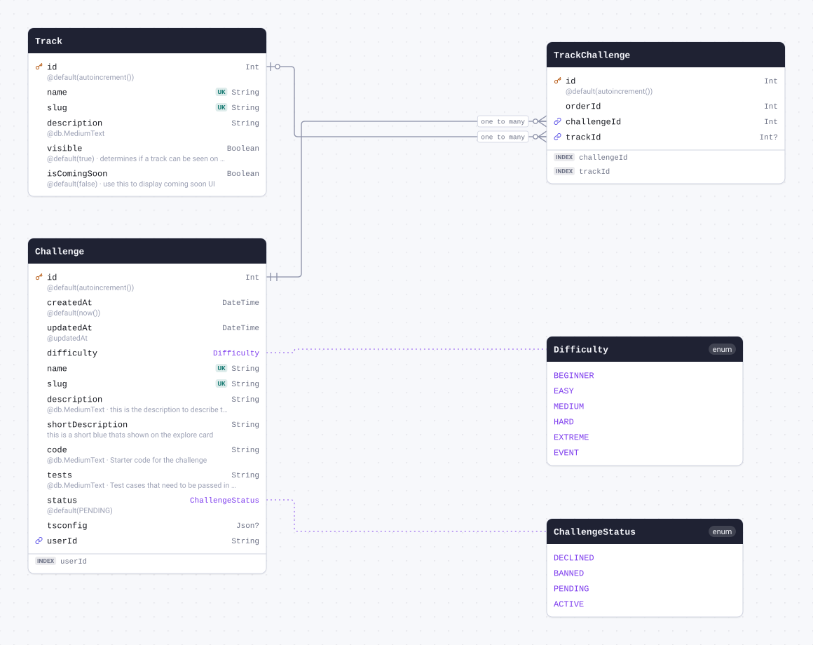

| Field         | Type  | Constraints                                 | Default           | Description |
| ------------- | ----- | ------------------------------------------- | ----------------- | ----------- |
| `id`          | `Int` | PK NOT NULL                                 | `autoincrement()` |             |
| `orderId`     | `Int` | NOT NULL                                    |                   |             |
| `challengeId` | `Int` | NOT NULL → [Challenge.id](#model-Challenge) |                   |             |
| `trackId`     | `Int` | NULL → [Track.id](#model-Track)             |                   |             |

#### Indexes

- `@@index([challengeId])`
- `@@index([trackId])`

#### References

- `challengeId` → [Challenge.id](#model-Challenge) (many-to-one)
- `trackId` → [Track.id](#model-Track) (many-to-one)

#### Definition

```sql
CREATE TABLE `TrackChallenge` (
    `id` INTEGER NOT NULL AUTO_INCREMENT,
    `orderId` INTEGER NOT NULL,
    `challengeId` INTEGER NOT NULL,
    `trackId` INTEGER NULL,

    INDEX `TrackChallenge_challengeId_idx`(`challengeId`),
    INDEX `TrackChallenge_trackId_idx`(`trackId`),
    PRIMARY KEY (`id`)
) DEFAULT CHARACTER SET utf8mb4 COLLATE utf8mb4_unicode_ci;
```

<details>
<summary>Queries and their SQL</summary>

**findMany**: Every row

```ts
await prisma.trackChallenge.findMany();
```

```sql
SELECT
  `TrackChallenge`.`id`,
  `TrackChallenge`.`orderId`,
  `TrackChallenge`.`challengeId`,
  `TrackChallenge`.`trackId`
FROM
  `TrackChallenge`
WHERE
  1 = 1
```

**count**: How many rows there are

```ts
await prisma.trackChallenge.count();
```

```sql
SELECT
  COUNT(*) AS `_count$_all`
FROM
  (
    SELECT
      `TrackChallenge`.`id`
    FROM
      `TrackChallenge`
    WHERE
      1 = 1
  ) AS `sub`
```

**findMany**: Every row with its relations

```ts
await prisma.trackChallenge.findMany({ include: { challenge: true, track: true } });
```

```sql
SELECT
  `TrackChallenge`.`id`,
  `TrackChallenge`.`orderId`,
  `TrackChallenge`.`challengeId`,
  `TrackChallenge`.`trackId`
FROM
  `TrackChallenge`
WHERE
  1 = 1

SELECT
  `Challenge`.`id`,
  `Challenge`.`createdAt`,
  `Challenge`.`updatedAt`,
  `Challenge`.`difficulty`,
  `Challenge`.`name`,
  `Challenge`.`slug`,
  `Challenge`.`description`,
  `Challenge`.`shortDescription`,
  `Challenge`.`code`,
  `Challenge`.`tests`,
  `Challenge`.`status`,
  `Challenge`.`tsconfig`,
  `Challenge`.`userId`
FROM
  `Challenge`
WHERE
  `Challenge`.`id` IN (?)
-- params: ["<challengeId of the rows above>"]

SELECT
  `Track`.`id`,
  `Track`.`name`,
  `Track`.`slug`,
  `Track`.`description`,
  `Track`.`visible`,
  `Track`.`isComingSoon`
FROM
  `Track`
WHERE
  `Track`.`id` IN (?)
-- params: ["<trackId of the rows above>"]
```

**findUnique**: One row by what is unique to it

```ts
await prisma.trackChallenge.findUnique({ where: { id: 1 } });
```

```sql
SELECT
  `TrackChallenge`.`id`,
  `TrackChallenge`.`orderId`,
  `TrackChallenge`.`challengeId`,
  `TrackChallenge`.`trackId`
FROM
  `TrackChallenge`
WHERE
  (
    `TrackChallenge`.`id` = ?
    AND 1 = 1
  )
LIMIT
  ?
OFFSET
  ?
-- params: ["1","1","0"]
```

**create**: Create a row

```ts
await prisma.trackChallenge.create({ data: { orderId: 1, challengeId: 1 } });
```

```sql
INSERT INTO
  `TrackChallenge` (`orderId`, `challengeId`)
VALUES
  (?, ?)
-- params: ["1","1"]

SELECT
  `TrackChallenge`.`id`,
  `TrackChallenge`.`orderId`,
  `TrackChallenge`.`challengeId`,
  `TrackChallenge`.`trackId`
FROM
  `TrackChallenge`
WHERE
  `TrackChallenge`.`id` = ?
LIMIT
  ?
OFFSET
  ?
-- params: ["<id of the rows above>","1","0"]
```

**update**: Update a row

```ts
await prisma.trackChallenge.update({ where: { id: 1 }, data: { orderId: 1 } });
```

```sql
SELECT
  `TrackChallenge`.`id`
FROM
  `TrackChallenge`
WHERE
  (
    `TrackChallenge`.`id` = ?
    AND 1 = 1
  )
LIMIT
  ?
OFFSET
  ?
-- params: ["1","1","0"]

UPDATE `TrackChallenge`
SET
  `orderId` = ?
WHERE
  (
    `TrackChallenge`.`id` IN (?)
    AND (
      `TrackChallenge`.`id` = ?
      AND 1 = 1
    )
  )
-- params: ["1","<id of the rows above>","1"]

SELECT
  `TrackChallenge`.`id`,
  `TrackChallenge`.`orderId`,
  `TrackChallenge`.`challengeId`,
  `TrackChallenge`.`trackId`
FROM
  `TrackChallenge`
WHERE
  `TrackChallenge`.`id` = ?
LIMIT
  ?
OFFSET
  ?
-- params: ["<id of the rows above>","1","0"]
```

**delete**: Delete a row

```ts
await prisma.trackChallenge.delete({ where: { id: 1 } });
```

```sql
SELECT
  `TrackChallenge`.`id`,
  `TrackChallenge`.`orderId`,
  `TrackChallenge`.`challengeId`,
  `TrackChallenge`.`trackId`
FROM
  `TrackChallenge`
WHERE
  (
    `TrackChallenge`.`id` = ?
    AND 1 = 1
  )
LIMIT
  ?
OFFSET
  ?
-- params: ["1","1","0"]

DELETE FROM `TrackChallenge`
WHERE
  (
    `TrackChallenge`.`id` = ?
    AND 1 = 1
  )
-- params: ["1"]
```

</details>

<a id="model-Track"></a>

### Track

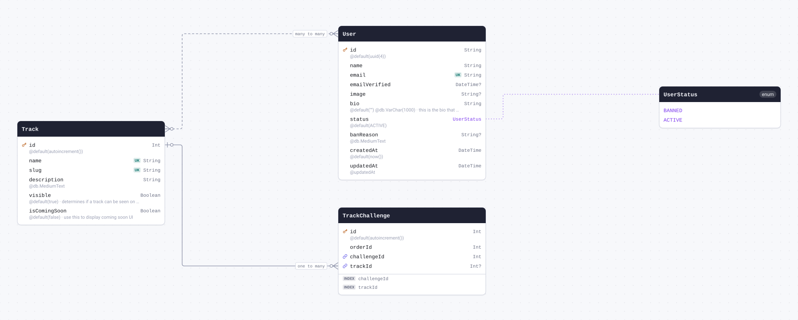

| Field          | Type                      | Constraints     | Default           | Description                                      |
| -------------- | ------------------------- | --------------- | ----------------- | ------------------------------------------------ |
| `id`           | `Int`                     | PK NOT NULL     | `autoincrement()` |                                                  |
| `name`         | `String`                  | UNIQUE NOT NULL |                   |                                                  |
| `slug`         | `String`                  | UNIQUE NOT NULL |                   |                                                  |
| `description`  | `String` `@db.MediumText` | NOT NULL        |                   |                                                  |
| `visible`      | `Boolean`                 | NOT NULL        | `true`            | determines if a track can be seen on tracks page |
| `isComingSoon` | `Boolean`                 | NOT NULL        | `false`           | use this to display coming soon UI               |

#### Referenced by

- `id` ← [TrackChallenge.trackId](#model-TrackChallenge) (one-to-many)

#### Many to many

- `enrolledUsers` ↔ [User.tracks](#model-User) through `_TrackToUser`

#### Definition

```sql
CREATE TABLE `Track` (
    `id` INTEGER NOT NULL AUTO_INCREMENT,
    `name` VARCHAR(191) NOT NULL,
    `slug` VARCHAR(191) NOT NULL,
    `description` MEDIUMTEXT NOT NULL,
    `visible` BOOLEAN NOT NULL DEFAULT true,
    `isComingSoon` BOOLEAN NOT NULL DEFAULT false,

    UNIQUE INDEX `Track_name_key`(`name`),
    UNIQUE INDEX `Track_slug_key`(`slug`),
    PRIMARY KEY (`id`)
) DEFAULT CHARACTER SET utf8mb4 COLLATE utf8mb4_unicode_ci;
```

<details>
<summary>Queries and their SQL</summary>

**findMany**: Every row

```ts
await prisma.track.findMany();
```

```sql
SELECT
  `Track`.`id`,
  `Track`.`name`,
  `Track`.`slug`,
  `Track`.`description`,
  `Track`.`visible`,
  `Track`.`isComingSoon`
FROM
  `Track`
WHERE
  1 = 1
```

**count**: How many rows there are

```ts
await prisma.track.count();
```

```sql
SELECT
  COUNT(*) AS `_count$_all`
FROM
  (
    SELECT
      `Track`.`id`
    FROM
      `Track`
    WHERE
      1 = 1
  ) AS `sub`
```

**findMany**: Every row with its relations

```ts
await prisma.track.findMany({ include: { trackChallenges: true, enrolledUsers: true } });
```

```sql
SELECT
  `Track`.`id`,
  `Track`.`name`,
  `Track`.`slug`,
  `Track`.`description`,
  `Track`.`visible`,
  `Track`.`isComingSoon`
FROM
  `Track`
WHERE
  1 = 1

SELECT
  `TrackChallenge`.`id`,
  `TrackChallenge`.`orderId`,
  `TrackChallenge`.`challengeId`,
  `TrackChallenge`.`trackId`
FROM
  `TrackChallenge`
WHERE
  `TrackChallenge`.`trackId` IN (?)
-- params: ["<id of the rows above>"]

SELECT
  `User`.`id`,
  `User`.`name`,
  `User`.`email`,
  `User`.`emailVerified`,
  `User`.`image`,
  `User`.`bio`,
  `User`.`status`,
  `User`.`banReason`,
  `User`.`createdAt`,
  `User`.`updatedAt`,
  `t0`.`A` AS `TrackToUser@Track`
FROM
  `User`
  INNER JOIN `_TrackToUser` AS `t0` ON `t0`.`B` = `User`.`id`
WHERE
  (
    1 = 1
    AND `t0`.`A` IN (?)
  )
-- params: ["<id of the rows above>"]
```

**findUnique**: One row by what is unique to it

```ts
await prisma.track.findUnique({ where: { id: 1 } });
```

```sql
SELECT
  `Track`.`id`,
  `Track`.`name`,
  `Track`.`slug`,
  `Track`.`description`,
  `Track`.`visible`,
  `Track`.`isComingSoon`
FROM
  `Track`
WHERE
  (
    `Track`.`id` = ?
    AND 1 = 1
  )
LIMIT
  ?
OFFSET
  ?
-- params: ["1","1","0"]
```

**create**: Create a row

```ts
await prisma.track.create({ data: { name: "example", slug: "example", description: "example" } });
```

```sql
INSERT INTO
  `Track` (
    `name`,
    `slug`,
    `description`,
    `visible`,
    `isComingSoon`
  )
VALUES
  (?, ?, ?, ?, ?)
-- params: ["example","example","example",true,false]

SELECT
  `Track`.`id`,
  `Track`.`name`,
  `Track`.`slug`,
  `Track`.`description`,
  `Track`.`visible`,
  `Track`.`isComingSoon`
FROM
  `Track`
WHERE
  `Track`.`id` = ?
LIMIT
  ?
OFFSET
  ?
-- params: ["<id of the rows above>","1","0"]
```

**update**: Update a row

```ts
await prisma.track.update({ where: { id: 1 }, data: { name: "example" } });
```

```sql
SELECT
  `Track`.`id`
FROM
  `Track`
WHERE
  (
    `Track`.`id` = ?
    AND 1 = 1
  )
LIMIT
  ?
OFFSET
  ?
-- params: ["1","1","0"]

UPDATE `Track`
SET
  `name` = ?
WHERE
  (
    `Track`.`id` IN (?)
    AND (
      `Track`.`id` = ?
      AND 1 = 1
    )
  )
-- params: ["example","<id of the rows above>","1"]

SELECT
  `Track`.`id`,
  `Track`.`name`,
  `Track`.`slug`,
  `Track`.`description`,
  `Track`.`visible`,
  `Track`.`isComingSoon`
FROM
  `Track`
WHERE
  `Track`.`id` = ?
LIMIT
  ?
OFFSET
  ?
-- params: ["<id of the rows above>","1","0"]
```

**delete**: Delete a row

```ts
await prisma.track.delete({ where: { id: 1 } });
```

```sql
SELECT
  `Track`.`id`,
  `Track`.`name`,
  `Track`.`slug`,
  `Track`.`description`,
  `Track`.`visible`,
  `Track`.`isComingSoon`
FROM
  `Track`
WHERE
  (
    `Track`.`id` = ?
    AND 1 = 1
  )
LIMIT
  ?
OFFSET
  ?
-- params: ["1","1","0"]

SELECT
  `TrackChallenge`.`id`,
  `TrackChallenge`.`trackId`
FROM
  `TrackChallenge`
WHERE
  (
    1 = 1
    AND `TrackChallenge`.`trackId` IN (?)
  )
-- params: ["<id of the rows above>"]

UPDATE `TrackChallenge`
SET
  `trackId` = ?
WHERE
  (
    `TrackChallenge`.`id` IN (?)
    AND 1 = 1
  )
-- params: [null,"<id of the rows above>"]

DELETE FROM `Track`
WHERE
  (
    `Track`.`id` = ?
    AND 1 = 1
  )
-- params: ["1"]
```

</details>

<a id="model-BetaTokens"></a>

### BetaTokens

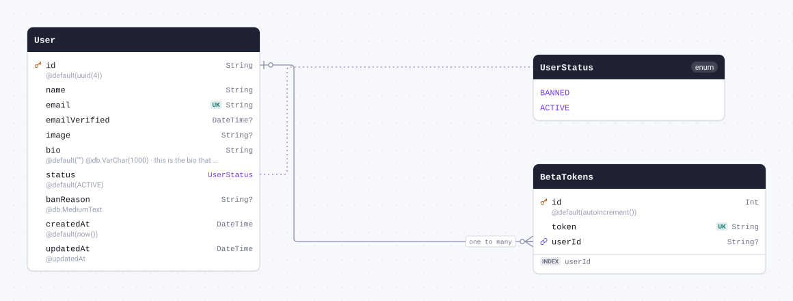

| Field    | Type     | Constraints                   | Default           | Description |
| -------- | -------- | ----------------------------- | ----------------- | ----------- |
| `id`     | `Int`    | PK NOT NULL                   | `autoincrement()` |             |
| `token`  | `String` | UNIQUE NOT NULL               |                   |             |
| `userId` | `String` | NULL → [User.id](#model-User) |                   |             |

#### Indexes

- `@@index([userId])`

#### References

- `userId` → [User.id](#model-User) (many-to-one)

#### Definition

```sql
CREATE TABLE `BetaTokens` (
    `id` INTEGER NOT NULL AUTO_INCREMENT,
    `token` VARCHAR(191) NOT NULL,
    `userId` VARCHAR(191) NULL,

    UNIQUE INDEX `BetaTokens_token_key`(`token`),
    INDEX `BetaTokens_userId_idx`(`userId`),
    PRIMARY KEY (`id`)
) DEFAULT CHARACTER SET utf8mb4 COLLATE utf8mb4_unicode_ci;
```

<details>
<summary>Queries and their SQL</summary>

**findMany**: Every row

```ts
await prisma.betaTokens.findMany();
```

```sql
SELECT
  `BetaTokens`.`id`,
  `BetaTokens`.`token`,
  `BetaTokens`.`userId`
FROM
  `BetaTokens`
WHERE
  1 = 1
```

**count**: How many rows there are

```ts
await prisma.betaTokens.count();
```

```sql
SELECT
  COUNT(*) AS `_count$_all`
FROM
  (
    SELECT
      `BetaTokens`.`id`
    FROM
      `BetaTokens`
    WHERE
      1 = 1
  ) AS `sub`
```

**findMany**: Every row with its relations

```ts
await prisma.betaTokens.findMany({ include: { user: true } });
```

```sql
SELECT
  `BetaTokens`.`id`,
  `BetaTokens`.`token`,
  `BetaTokens`.`userId`
FROM
  `BetaTokens`
WHERE
  1 = 1

SELECT
  `User`.`id`,
  `User`.`name`,
  `User`.`email`,
  `User`.`emailVerified`,
  `User`.`image`,
  `User`.`bio`,
  `User`.`status`,
  `User`.`banReason`,
  `User`.`createdAt`,
  `User`.`updatedAt`
FROM
  `User`
WHERE
  `User`.`id` IN (?)
-- params: ["<userId of the rows above>"]
```

**findUnique**: One row by what is unique to it

```ts
await prisma.betaTokens.findUnique({ where: { id: 1 } });
```

```sql
SELECT
  `BetaTokens`.`id`,
  `BetaTokens`.`token`,
  `BetaTokens`.`userId`
FROM
  `BetaTokens`
WHERE
  (
    `BetaTokens`.`id` = ?
    AND 1 = 1
  )
LIMIT
  ?
OFFSET
  ?
-- params: ["1","1","0"]
```

**create**: Create a row

```ts
await prisma.betaTokens.create({ data: { token: "example" } });
```

```sql
INSERT INTO
  `BetaTokens` (`token`)
VALUES
  (?)
-- params: ["example"]

SELECT
  `BetaTokens`.`id`,
  `BetaTokens`.`token`,
  `BetaTokens`.`userId`
FROM
  `BetaTokens`
WHERE
  `BetaTokens`.`id` = ?
LIMIT
  ?
OFFSET
  ?
-- params: ["<id of the rows above>","1","0"]
```

**update**: Update a row

```ts
await prisma.betaTokens.update({ where: { id: 1 }, data: { token: "example" } });
```

```sql
SELECT
  `BetaTokens`.`id`
FROM
  `BetaTokens`
WHERE
  (
    `BetaTokens`.`id` = ?
    AND 1 = 1
  )
LIMIT
  ?
OFFSET
  ?
-- params: ["1","1","0"]

UPDATE `BetaTokens`
SET
  `token` = ?
WHERE
  (
    `BetaTokens`.`id` IN (?)
    AND (
      `BetaTokens`.`id` = ?
      AND 1 = 1
    )
  )
-- params: ["example","<id of the rows above>","1"]

SELECT
  `BetaTokens`.`id`,
  `BetaTokens`.`token`,
  `BetaTokens`.`userId`
FROM
  `BetaTokens`
WHERE
  `BetaTokens`.`id` = ?
LIMIT
  ?
OFFSET
  ?
-- params: ["<id of the rows above>","1","0"]
```

**delete**: Delete a row

```ts
await prisma.betaTokens.delete({ where: { id: 1 } });
```

```sql
SELECT
  `BetaTokens`.`id`,
  `BetaTokens`.`token`,
  `BetaTokens`.`userId`
FROM
  `BetaTokens`
WHERE
  (
    `BetaTokens`.`id` = ?
    AND 1 = 1
  )
LIMIT
  ?
OFFSET
  ?
-- params: ["1","1","0"]

DELETE FROM `BetaTokens`
WHERE
  (
    `BetaTokens`.`id` = ?
    AND 1 = 1
  )
-- params: ["1"]
```

</details>

<a id="model-Donation"></a>

### Donation

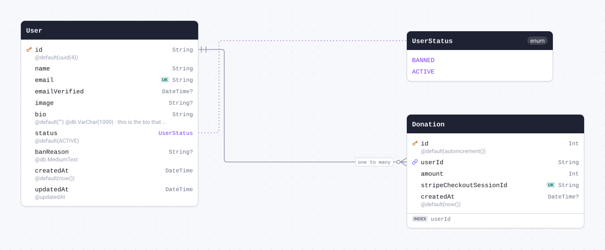

| Field                     | Type       | Constraints                       | Default           | Description |
| ------------------------- | ---------- | --------------------------------- | ----------------- | ----------- |
| `id`                      | `Int`      | PK NOT NULL                       | `autoincrement()` |             |
| `userId`                  | `String`   | NOT NULL → [User.id](#model-User) |                   |             |
| `amount`                  | `Int`      | NOT NULL                          |                   |             |
| `stripeCheckoutSessionId` | `String`   | UNIQUE NOT NULL                   |                   |             |
| `createdAt`               | `DateTime` | NULL                              | `now()`           |             |

#### Indexes

- `@@index([userId])`

#### References

- `userId` → [User.id](#model-User) (many-to-one)

#### Definition

```sql
CREATE TABLE `Donation` (
    `id` INTEGER NOT NULL AUTO_INCREMENT,
    `userId` VARCHAR(191) NOT NULL,
    `amount` INTEGER NOT NULL,
    `stripeCheckoutSessionId` VARCHAR(191) NOT NULL,
    `createdAt` DATETIME(3) NULL DEFAULT CURRENT_TIMESTAMP(3),

    UNIQUE INDEX `Donation_stripeCheckoutSessionId_key`(`stripeCheckoutSessionId`),
    INDEX `Donation_userId_idx`(`userId`),
    PRIMARY KEY (`id`)
) DEFAULT CHARACTER SET utf8mb4 COLLATE utf8mb4_unicode_ci;
```

<details>
<summary>Queries and their SQL</summary>

**findMany**: Every row

```ts
await prisma.donation.findMany();
```

```sql
SELECT
  `Donation`.`id`,
  `Donation`.`userId`,
  `Donation`.`amount`,
  `Donation`.`stripeCheckoutSessionId`,
  `Donation`.`createdAt`
FROM
  `Donation`
WHERE
  1 = 1
```

**count**: How many rows there are

```ts
await prisma.donation.count();
```

```sql
SELECT
  COUNT(*) AS `_count$_all`
FROM
  (
    SELECT
      `Donation`.`id`
    FROM
      `Donation`
    WHERE
      1 = 1
  ) AS `sub`
```

**findMany**: Every row with its relations

```ts
await prisma.donation.findMany({ include: { user: true } });
```

```sql
SELECT
  `Donation`.`id`,
  `Donation`.`userId`,
  `Donation`.`amount`,
  `Donation`.`stripeCheckoutSessionId`,
  `Donation`.`createdAt`
FROM
  `Donation`
WHERE
  1 = 1

SELECT
  `User`.`id`,
  `User`.`name`,
  `User`.`email`,
  `User`.`emailVerified`,
  `User`.`image`,
  `User`.`bio`,
  `User`.`status`,
  `User`.`banReason`,
  `User`.`createdAt`,
  `User`.`updatedAt`
FROM
  `User`
WHERE
  `User`.`id` IN (?)
-- params: ["<userId of the rows above>"]
```

**findUnique**: One row by what is unique to it

```ts
await prisma.donation.findUnique({ where: { id: 1 } });
```

```sql
SELECT
  `Donation`.`id`,
  `Donation`.`userId`,
  `Donation`.`amount`,
  `Donation`.`stripeCheckoutSessionId`,
  `Donation`.`createdAt`
FROM
  `Donation`
WHERE
  (
    `Donation`.`id` = ?
    AND 1 = 1
  )
LIMIT
  ?
OFFSET
  ?
-- params: ["1","1","0"]
```

**create**: Create a row

```ts
await prisma.donation.create({
  data: { userId: "example", amount: 1, stripeCheckoutSessionId: "example" },
});
```

```sql
INSERT INTO
  `Donation` (
    `userId`,
    `amount`,
    `stripeCheckoutSessionId`,
    `createdAt`
  )
VALUES
  (?, ?, ?, ?)
-- params: ["example","1","example","<now()>"]

SELECT
  `Donation`.`id`,
  `Donation`.`userId`,
  `Donation`.`amount`,
  `Donation`.`stripeCheckoutSessionId`,
  `Donation`.`createdAt`
FROM
  `Donation`
WHERE
  `Donation`.`id` = ?
LIMIT
  ?
OFFSET
  ?
-- params: ["<id of the rows above>","1","0"]
```

**update**: Update a row

```ts
await prisma.donation.update({ where: { id: 1 }, data: { amount: 1 } });
```

```sql
SELECT
  `Donation`.`id`
FROM
  `Donation`
WHERE
  (
    `Donation`.`id` = ?
    AND 1 = 1
  )
LIMIT
  ?
OFFSET
  ?
-- params: ["1","1","0"]

UPDATE `Donation`
SET
  `amount` = ?
WHERE
  (
    `Donation`.`id` IN (?)
    AND (
      `Donation`.`id` = ?
      AND 1 = 1
    )
  )
-- params: ["1","<id of the rows above>","1"]

SELECT
  `Donation`.`id`,
  `Donation`.`userId`,
  `Donation`.`amount`,
  `Donation`.`stripeCheckoutSessionId`,
  `Donation`.`createdAt`
FROM
  `Donation`
WHERE
  `Donation`.`id` = ?
LIMIT
  ?
OFFSET
  ?
-- params: ["<id of the rows above>","1","0"]
```

**delete**: Delete a row

```ts
await prisma.donation.delete({ where: { id: 1 } });
```

```sql
SELECT
  `Donation`.`id`,
  `Donation`.`userId`,
  `Donation`.`amount`,
  `Donation`.`stripeCheckoutSessionId`,
  `Donation`.`createdAt`
FROM
  `Donation`
WHERE
  (
    `Donation`.`id` = ?
    AND 1 = 1
  )
LIMIT
  ?
OFFSET
  ?
-- params: ["1","1","0"]

DELETE FROM `Donation`
WHERE
  (
    `Donation`.`id` = ?
    AND 1 = 1
  )
-- params: ["1"]
```

</details>

<a id="model-Notification"></a>

### Notification

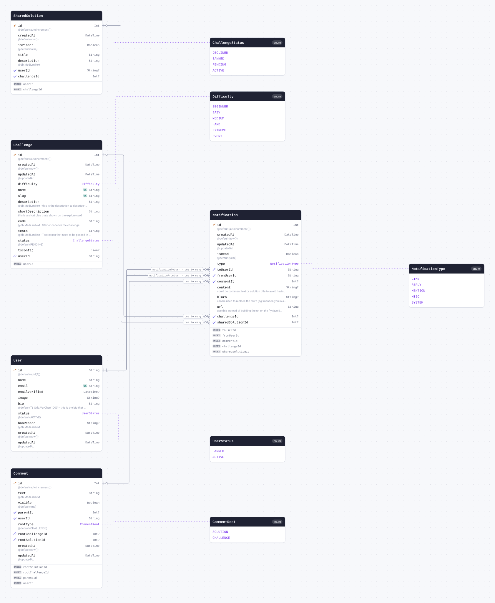

| Field              | Type                                         | Constraints                                       | Default           | Description                                                                                             |
| ------------------ | -------------------------------------------- | ------------------------------------------------- | ----------------- | ------------------------------------------------------------------------------------------------------- |
| `id`               | `Int`                                        | PK NOT NULL                                       | `autoincrement()` |                                                                                                         |
| `createdAt`        | `DateTime`                                   | NOT NULL                                          | `now()`           |                                                                                                         |
| `updatedAt`        | `DateTime`                                   | NOT NULL                                          | `@updatedAt`      |                                                                                                         |
| `isRead`           | `Boolean`                                    | NOT NULL                                          | `false`           |                                                                                                         |
| `type`             | [`NotificationType`](#enum-NotificationType) | NOT NULL                                          |                   |                                                                                                         |
| `toUserId`         | `String`                                     | NOT NULL → [User.id](#model-User)                 |                   |                                                                                                         |
| `fromUserId`       | `String`                                     | NOT NULL → [User.id](#model-User)                 |                   |                                                                                                         |
| `commentId`        | `Int`                                        | NULL → [Comment.id](#model-Comment)               |                   |                                                                                                         |
| `content`          | `String`                                     | NULL                                              |                   | could be comment text or solution title to avoid having to join to grab this data                       |
| `blurb`            | `String`                                     | NULL                                              |                   | can be used to replace the blurb (eg: mention you in a comment)                                         |
| `url`              | `String`                                     | NOT NULL                                          |                   | use this instead of building the url on the fly (avoids a lot of joins and perf hits to build a string) |
| `challengeId`      | `Int`                                        | NULL → [Challenge.id](#model-Challenge)           |                   |                                                                                                         |
| `sharedSolutionId` | `Int`                                        | NULL → [SharedSolution.id](#model-SharedSolution) |                   |                                                                                                         |

#### Indexes

- `@@index([toUserId])`
- `@@index([fromUserId])`
- `@@index([commentId])`
- `@@index([challengeId])`
- `@@index([sharedSolutionId])`

#### References

- `toUserId` → [User.id](#model-User) (many-to-one)
- `fromUserId` → [User.id](#model-User) (many-to-one)
- `commentId` → [Comment.id](#model-Comment) (many-to-one)
- `challengeId` → [Challenge.id](#model-Challenge) (many-to-one)
- `sharedSolutionId` → [SharedSolution.id](#model-SharedSolution) (many-to-one)

#### Definition

```sql
CREATE TABLE `Notification` (
    `id` INTEGER NOT NULL AUTO_INCREMENT,
    `createdAt` DATETIME(3) NOT NULL DEFAULT CURRENT_TIMESTAMP(3),
    `updatedAt` DATETIME(3) NOT NULL,
    `isRead` BOOLEAN NOT NULL DEFAULT false,
    `type` ENUM('LIKE', 'REPLY', 'MENTION', 'MISC', 'SYSTEM') NOT NULL,
    `toUserId` VARCHAR(191) NOT NULL,
    `fromUserId` VARCHAR(191) NOT NULL,
    `commentId` INTEGER NULL,
    `content` VARCHAR(191) NULL,
    `blurb` VARCHAR(191) NULL,
    `url` VARCHAR(191) NOT NULL,
    `challengeId` INTEGER NULL,
    `sharedSolutionId` INTEGER NULL,

    INDEX `Notification_toUserId_idx`(`toUserId`),
    INDEX `Notification_fromUserId_idx`(`fromUserId`),
    INDEX `Notification_commentId_idx`(`commentId`),
    INDEX `Notification_challengeId_idx`(`challengeId`),
    INDEX `Notification_sharedSolutionId_idx`(`sharedSolutionId`),
    PRIMARY KEY (`id`)
) DEFAULT CHARACTER SET utf8mb4 COLLATE utf8mb4_unicode_ci;
```

<details>
<summary>Queries and their SQL</summary>

**findMany**: Every row

```ts
await prisma.notification.findMany();
```

```sql
SELECT
  `Notification`.`id`,
  `Notification`.`createdAt`,
  `Notification`.`updatedAt`,
  `Notification`.`isRead`,
  `Notification`.`type`,
  `Notification`.`toUserId`,
  `Notification`.`fromUserId`,
  `Notification`.`commentId`,
  `Notification`.`content`,
  `Notification`.`blurb`,
  `Notification`.`url`,
  `Notification`.`challengeId`,
  `Notification`.`sharedSolutionId`
FROM
  `Notification`
WHERE
  1 = 1
```

**count**: How many rows there are

```ts
await prisma.notification.count();
```

```sql
SELECT
  COUNT(*) AS `_count$_all`
FROM
  (
    SELECT
      `Notification`.`id`
    FROM
      `Notification`
    WHERE
      1 = 1
  ) AS `sub`
```

**findMany**: Every row with its relations

```ts
await prisma.notification.findMany({
  include: { toUser: true, fromUser: true, comment: true, Challenge: true, SharedSolution: true },
});
```

```sql
SELECT
  `Notification`.`id`,
  `Notification`.`createdAt`,
  `Notification`.`updatedAt`,
  `Notification`.`isRead`,
  `Notification`.`type`,
  `Notification`.`toUserId`,
  `Notification`.`fromUserId`,
  `Notification`.`commentId`,
  `Notification`.`content`,
  `Notification`.`blurb`,
  `Notification`.`url`,
  `Notification`.`challengeId`,
  `Notification`.`sharedSolutionId`
FROM
  `Notification`
WHERE
  1 = 1

SELECT
  `User`.`id`,
  `User`.`name`,
  `User`.`email`,
  `User`.`emailVerified`,
  `User`.`image`,
  `User`.`bio`,
  `User`.`status`,
  `User`.`banReason`,
  `User`.`createdAt`,
  `User`.`updatedAt`
FROM
  `User`
WHERE
  `User`.`id` IN (?)
-- params: ["<toUserId of the rows above>"]

SELECT
  `User`.`id`,
  `User`.`name`,
  `User`.`email`,
  `User`.`emailVerified`,
  `User`.`image`,
  `User`.`bio`,
  `User`.`status`,
  `User`.`banReason`,
  `User`.`createdAt`,
  `User`.`updatedAt`
FROM
  `User`
WHERE
  `User`.`id` IN (?)
-- params: ["<fromUserId of the rows above>"]

SELECT
  `Comment`.`id`,
  `Comment`.`text`,
  `Comment`.`visible`,
  `Comment`.`parentId`,
  `Comment`.`userId`,
  `Comment`.`rootType`,
  `Comment`.`rootChallengeId`,
  `Comment`.`rootSolutionId`,
  `Comment`.`createdAt`,
  `Comment`.`updatedAt`
FROM
  `Comment`
WHERE
  `Comment`.`id` IN (?)
-- params: ["<commentId of the rows above>"]

SELECT
  `Challenge`.`id`,
  `Challenge`.`createdAt`,
  `Challenge`.`updatedAt`,
  `Challenge`.`difficulty`,
  `Challenge`.`name`,
  `Challenge`.`slug`,
  `Challenge`.`description`,
  `Challenge`.`shortDescription`,
  `Challenge`.`code`,
  `Challenge`.`tests`,
  `Challenge`.`status`,
  `Challenge`.`tsconfig`,
  `Challenge`.`userId`
FROM
  `Challenge`
WHERE
  `Challenge`.`id` IN (?)
-- params: ["<challengeId of the rows above>"]

SELECT
  `SharedSolution`.`id`,
  `SharedSolution`.`createdAt`,
  `SharedSolution`.`isPinned`,
  `SharedSolution`.`title`,
  `SharedSolution`.`description`,
  `SharedSolution`.`userId`,
  `SharedSolution`.`challengeId`
FROM
  `SharedSolution`
WHERE
  `SharedSolution`.`id` IN (?)
-- params: ["<sharedSolutionId of the rows above>"]
```

**findUnique**: One row by what is unique to it

```ts
await prisma.notification.findUnique({ where: { id: 1 } });
```

```sql
SELECT
  `Notification`.`id`,
  `Notification`.`createdAt`,
  `Notification`.`updatedAt`,
  `Notification`.`isRead`,
  `Notification`.`type`,
  `Notification`.`toUserId`,
  `Notification`.`fromUserId`,
  `Notification`.`commentId`,
  `Notification`.`content`,
  `Notification`.`blurb`,
  `Notification`.`url`,
  `Notification`.`challengeId`,
  `Notification`.`sharedSolutionId`
FROM
  `Notification`
WHERE
  (
    `Notification`.`id` = ?
    AND 1 = 1
  )
LIMIT
  ?
OFFSET
  ?
-- params: ["1","1","0"]
```

**create**: Create a row

```ts
await prisma.notification.create({
  data: { type: "LIKE", toUserId: "example", fromUserId: "example", url: "example" },
});
```

```sql
INSERT INTO
  `Notification` (
    `createdAt`,
    `updatedAt`,
    `isRead`,
    `type`,
    `toUserId`,
    `fromUserId`,
    `url`
  )
VALUES
  (?, ?, ?, ?, ?, ?, ?)
-- params: ["<now()>","<now()>",false,"LIKE","example","example","example"]

SELECT
  `Notification`.`id`,
  `Notification`.`createdAt`,
  `Notification`.`updatedAt`,
  `Notification`.`isRead`,
  `Notification`.`type`,
  `Notification`.`toUserId`,
  `Notification`.`fromUserId`,
  `Notification`.`commentId`,
  `Notification`.`content`,
  `Notification`.`blurb`,
  `Notification`.`url`,
  `Notification`.`challengeId`,
  `Notification`.`sharedSolutionId`
FROM
  `Notification`
WHERE
  `Notification`.`id` = ?
LIMIT
  ?
OFFSET
  ?
-- params: ["<id of the rows above>","1","0"]
```

**update**: Update a row

```ts
await prisma.notification.update({
  where: { id: 1 },
  data: { createdAt: new Date("2026-01-01T00:00:00.000Z") },
});
```

```sql
SELECT
  `Notification`.`id`
FROM
  `Notification`
WHERE
  (
    `Notification`.`id` = ?
    AND 1 = 1
  )
LIMIT
  ?
OFFSET
  ?
-- params: ["1","1","0"]

UPDATE `Notification`
SET
  `createdAt` = ?,
  `updatedAt` = ?
WHERE
  (
    `Notification`.`id` IN (?)
    AND (
      `Notification`.`id` = ?
      AND 1 = 1
    )
  )
-- params: ["2026-01-01T00:00:00.000Z",{"prisma__type":"generatorCall","prisma__value":{"name":"now","args":[],"returnType":{"type":"DateTime"}}},"<id of the rows above>","1"]

SELECT
  `Notification`.`id`,
  `Notification`.`createdAt`,
  `Notification`.`updatedAt`,
  `Notification`.`isRead`,
  `Notification`.`type`,
  `Notification`.`toUserId`,
  `Notification`.`fromUserId`,
  `Notification`.`commentId`,
  `Notification`.`content`,
  `Notification`.`blurb`,
  `Notification`.`url`,
  `Notification`.`challengeId`,
  `Notification`.`sharedSolutionId`
FROM
  `Notification`
WHERE
  `Notification`.`id` = ?
LIMIT
  ?
OFFSET
  ?
-- params: ["<id of the rows above>","1","0"]
```

**delete**: Delete a row

```ts
await prisma.notification.delete({ where: { id: 1 } });
```

```sql
SELECT
  `Notification`.`id`,
  `Notification`.`createdAt`,
  `Notification`.`updatedAt`,
  `Notification`.`isRead`,
  `Notification`.`type`,
  `Notification`.`toUserId`,
  `Notification`.`fromUserId`,
  `Notification`.`commentId`,
  `Notification`.`content`,
  `Notification`.`blurb`,
  `Notification`.`url`,
  `Notification`.`challengeId`,
  `Notification`.`sharedSolutionId`
FROM
  `Notification`
WHERE
  (
    `Notification`.`id` = ?
    AND 1 = 1
  )
LIMIT
  ?
OFFSET
  ?
-- params: ["1","1","0"]

DELETE FROM `Notification`
WHERE
  (
    `Notification`.`id` = ?
    AND 1 = 1
  )
-- params: ["1"]
```

</details>

<a id="model-ShortURL"></a>

### ShortURL

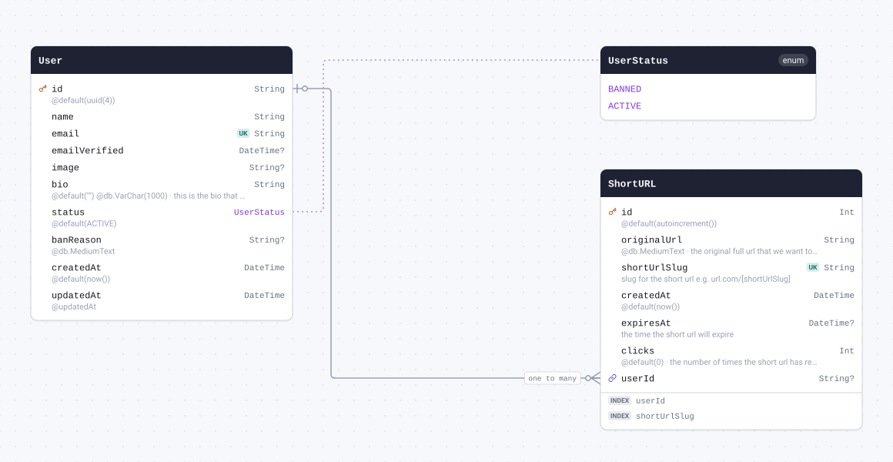

| Field          | Type                      | Constraints                   | Default           | Description                                                            |
| -------------- | ------------------------- | ----------------------------- | ----------------- | ---------------------------------------------------------------------- |
| `id`           | `Int`                     | PK NOT NULL                   | `autoincrement()` |                                                                        |
| `originalUrl`  | `String` `@db.MediumText` | NOT NULL                      |                   | the original full url that we want to shorten e.g. https://www.url.com |
| `shortUrlSlug` | `String`                  | UNIQUE NOT NULL               |                   | slug for the short url e.g. url.com/[shortUrlSlug]                     |
| `createdAt`    | `DateTime`                | NOT NULL                      | `now()`           |                                                                        |
| `expiresAt`    | `DateTime`                | NULL                          |                   | the time the short url will expire                                     |
| `clicks`       | `Int`                     | NOT NULL                      | `0`               | the number of times the short url has redirected to the original url   |
| `userId`       | `String`                  | NULL → [User.id](#model-User) |                   |                                                                        |

#### Indexes

- `@@index([userId])`
- `@@index([shortUrlSlug])`

#### References

- `userId` → [User.id](#model-User) (many-to-one)

#### Definition

```sql
CREATE TABLE `ShortURL` (
    `id` INTEGER NOT NULL AUTO_INCREMENT,
    `originalUrl` MEDIUMTEXT NOT NULL,
    `shortUrlSlug` VARCHAR(191) NOT NULL,
    `createdAt` DATETIME(3) NOT NULL DEFAULT CURRENT_TIMESTAMP(3),
    `expiresAt` DATETIME(3) NULL,
    `clicks` INTEGER NOT NULL DEFAULT 0,
    `userId` VARCHAR(191) NULL,

    UNIQUE INDEX `ShortURL_shortUrlSlug_key`(`shortUrlSlug`),
    INDEX `ShortURL_userId_idx`(`userId`),
    INDEX `ShortURL_shortUrlSlug_idx`(`shortUrlSlug`),
    PRIMARY KEY (`id`)
) DEFAULT CHARACTER SET utf8mb4 COLLATE utf8mb4_unicode_ci;
```

<details>
<summary>Queries and their SQL</summary>

**findMany**: Every row

```ts
await prisma.shortURL.findMany();
```

```sql
SELECT
  `ShortURL`.`id`,
  `ShortURL`.`originalUrl`,
  `ShortURL`.`shortUrlSlug`,
  `ShortURL`.`createdAt`,
  `ShortURL`.`expiresAt`,
  `ShortURL`.`clicks`,
  `ShortURL`.`userId`
FROM
  `ShortURL`
WHERE
  1 = 1
```

**count**: How many rows there are

```ts
await prisma.shortURL.count();
```

```sql
SELECT
  COUNT(*) AS `_count$_all`
FROM
  (
    SELECT
      `ShortURL`.`id`
    FROM
      `ShortURL`
    WHERE
      1 = 1
  ) AS `sub`
```

**findMany**: Every row with its relations

```ts
await prisma.shortURL.findMany({ include: { user: true } });
```

```sql
SELECT
  `ShortURL`.`id`,
  `ShortURL`.`originalUrl`,
  `ShortURL`.`shortUrlSlug`,
  `ShortURL`.`createdAt`,
  `ShortURL`.`expiresAt`,
  `ShortURL`.`clicks`,
  `ShortURL`.`userId`
FROM
  `ShortURL`
WHERE
  1 = 1

SELECT
  `User`.`id`,
  `User`.`name`,
  `User`.`email`,
  `User`.`emailVerified`,
  `User`.`image`,
  `User`.`bio`,
  `User`.`status`,
  `User`.`banReason`,
  `User`.`createdAt`,
  `User`.`updatedAt`
FROM
  `User`
WHERE
  `User`.`id` IN (?)
-- params: ["<userId of the rows above>"]
```

**findUnique**: One row by what is unique to it

```ts
await prisma.shortURL.findUnique({ where: { id: 1 } });
```

```sql
SELECT
  `ShortURL`.`id`,
  `ShortURL`.`originalUrl`,
  `ShortURL`.`shortUrlSlug`,
  `ShortURL`.`createdAt`,
  `ShortURL`.`expiresAt`,
  `ShortURL`.`clicks`,
  `ShortURL`.`userId`
FROM
  `ShortURL`
WHERE
  (
    `ShortURL`.`id` = ?
    AND 1 = 1
  )
LIMIT
  ?
OFFSET
  ?
-- params: ["1","1","0"]
```

**create**: Create a row

```ts
await prisma.shortURL.create({ data: { originalUrl: "example", shortUrlSlug: "example" } });
```

```sql
INSERT INTO
  `ShortURL` (
    `originalUrl`,
    `shortUrlSlug`,
    `createdAt`,
    `clicks`
  )
VALUES
  (?, ?, ?, ?)
-- params: ["example","example","<now()>","0"]

SELECT
  `ShortURL`.`id`,
  `ShortURL`.`originalUrl`,
  `ShortURL`.`shortUrlSlug`,
  `ShortURL`.`createdAt`,
  `ShortURL`.`expiresAt`,
  `ShortURL`.`clicks`,
  `ShortURL`.`userId`
FROM
  `ShortURL`
WHERE
  `ShortURL`.`id` = ?
LIMIT
  ?
OFFSET
  ?
-- params: ["<id of the rows above>","1","0"]
```

**update**: Update a row

```ts
await prisma.shortURL.update({ where: { id: 1 }, data: { originalUrl: "example" } });
```

```sql
SELECT
  `ShortURL`.`id`
FROM
  `ShortURL`
WHERE
  (
    `ShortURL`.`id` = ?
    AND 1 = 1
  )
LIMIT
  ?
OFFSET
  ?
-- params: ["1","1","0"]

UPDATE `ShortURL`
SET
  `originalUrl` = ?
WHERE
  (
    `ShortURL`.`id` IN (?)
    AND (
      `ShortURL`.`id` = ?
      AND 1 = 1
    )
  )
-- params: ["example","<id of the rows above>","1"]

SELECT
  `ShortURL`.`id`,
  `ShortURL`.`originalUrl`,
  `ShortURL`.`shortUrlSlug`,
  `ShortURL`.`createdAt`,
  `ShortURL`.`expiresAt`,
  `ShortURL`.`clicks`,
  `ShortURL`.`userId`
FROM
  `ShortURL`
WHERE
  `ShortURL`.`id` = ?
LIMIT
  ?
OFFSET
  ?
-- params: ["<id of the rows above>","1","0"]
```

**delete**: Delete a row

```ts
await prisma.shortURL.delete({ where: { id: 1 } });
```

```sql
SELECT
  `ShortURL`.`id`,
  `ShortURL`.`originalUrl`,
  `ShortURL`.`shortUrlSlug`,
  `ShortURL`.`createdAt`,
  `ShortURL`.`expiresAt`,
  `ShortURL`.`clicks`,
  `ShortURL`.`userId`
FROM
  `ShortURL`
WHERE
  (
    `ShortURL`.`id` = ?
    AND 1 = 1
  )
LIMIT
  ?
OFFSET
  ?
-- params: ["1","1","0"]

DELETE FROM `ShortURL`
WHERE
  (
    `ShortURL`.`id` = ?
    AND 1 = 1
  )
-- params: ["1"]
```

</details>

## Enums

<a id="enum-NotificationType"></a>

### NotificationType

- `LIKE`
- `REPLY`
- `MENTION`
- `MISC`
- `SYSTEM`

<a id="enum-Tags"></a>

### Tags

- `POPULAR`
- `NEWEST`

<a id="enum-Difficulty"></a>

### Difficulty

- `BEGINNER`
- `EASY`
- `MEDIUM`
- `HARD`
- `EXTREME`
- `EVENT`

<a id="enum-RoleTypes"></a>

### RoleTypes

- `USER`
- `ADMIN`
- `MODERATOR`
- `CREATOR`
- `SUPPORTER`
- `CONTRIBUTOR`

<a id="enum-UserStatus"></a>

### UserStatus

- `BANNED`
- `ACTIVE`

<a id="enum-ReportStatus"></a>

### ReportStatus

- `PENDING`
- `CLEARED`
- `DISMISSED`

<a id="enum-ChallengeStatus"></a>

### ChallengeStatus

- `DECLINED`
- `BANNED`
- `PENDING`
- `ACTIVE`

<a id="enum-VoteType"></a>

### VoteType

- `CHALLENGE`
- `COMMENT`
- `SUBMISSION`
- `SHAREDSOLUTION`

<a id="enum-ReportType"></a>

### ReportType

- `CHALLENGE`
- `USER`
- `COMMENT`
- `SOLUTION`

<a id="enum-IssueType"></a>

### IssueType

- `DEROGATORY`
- `OTHER`
- `UNCLEAR`
- `BULLYING`
- `SPAM`
- `HATESPEECH`
- `THREAT`

<a id="enum-CommentRoot"></a>

### CommentRoot

- `SOLUTION`
- `CHALLENGE`
