# Schema docs

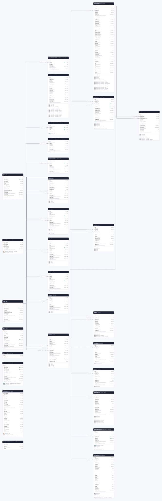

<details>
<summary>The whole schema as SQL</summary>

```sql
CREATE SCHEMA IF NOT EXISTS "public";

CREATE TABLE "user" (
    "user_id" UUID NOT NULL,
    "username" VARCHAR(255) NOT NULL,
    "password" VARCHAR(60) NOT NULL,
    "role" VARCHAR(50) NOT NULL,
    "logo_url" VARCHAR(2183),
    "display_name" VARCHAR(255),
    "two_factor_required" BOOLEAN NOT NULL DEFAULT false,
    "created_at" TIMESTAMPTZ(6) DEFAULT CURRENT_TIMESTAMP,
    "updated_at" TIMESTAMPTZ(6),
    "deleted_at" TIMESTAMPTZ(6),

    CONSTRAINT "user_pkey" PRIMARY KEY ("user_id")
);

CREATE TABLE "api_key" (
    "api_key_id" UUID NOT NULL,
    "user_id" UUID NOT NULL,
    "name" VARCHAR(255) NOT NULL,
    "key_hash" VARCHAR(128) NOT NULL,
    "key_prefix" VARCHAR(20) NOT NULL,
    "last_used_at" TIMESTAMPTZ(6),
    "created_at" TIMESTAMPTZ(6) DEFAULT CURRENT_TIMESTAMP,

    CONSTRAINT "api_key_pkey" PRIMARY KEY ("api_key_id")
);

CREATE TABLE "session" (
    "session_id" UUID NOT NULL,
    "website_id" UUID NOT NULL,
    "browser" VARCHAR(20),
    "os" VARCHAR(20),
    "device" VARCHAR(20),
    "screen" VARCHAR(11),
    "language" VARCHAR(35),
    "country" CHAR(2),
    "region" VARCHAR(20),
    "city" VARCHAR(50),
    "distinct_id" VARCHAR(50),
    "created_at" TIMESTAMPTZ(6) DEFAULT CURRENT_TIMESTAMP,

    CONSTRAINT "session_pkey" PRIMARY KEY ("session_id")
);

CREATE TABLE "session_link" (
    "website_id" UUID NOT NULL,
    "session_id" UUID NOT NULL,
    "distinct_id" VARCHAR(50) NOT NULL,
    "created_at" TIMESTAMPTZ(6) DEFAULT CURRENT_TIMESTAMP,

    CONSTRAINT "session_link_pkey" PRIMARY KEY ("website_id","distinct_id","session_id")
);

CREATE TABLE "website" (
    "website_id" UUID NOT NULL,
    "name" VARCHAR(100) NOT NULL,
    "domain" VARCHAR(500),
    "reset_at" TIMESTAMPTZ(6),
    "user_id" UUID,
    "team_id" UUID,
    "created_by" UUID,
    "created_at" TIMESTAMPTZ(6) DEFAULT CURRENT_TIMESTAMP,
    "updated_at" TIMESTAMPTZ(6),
    "deleted_at" TIMESTAMPTZ(6),
    "recorder_enabled" BOOLEAN NOT NULL DEFAULT false,
    "replay_config" JSONB,

    CONSTRAINT "website_pkey" PRIMARY KEY ("website_id")
);

CREATE TABLE "website_event" (
    "event_id" UUID NOT NULL,
    "website_id" UUID NOT NULL,
    "session_id" UUID NOT NULL,
    "visit_id" UUID NOT NULL,
    "created_at" TIMESTAMPTZ(6) DEFAULT CURRENT_TIMESTAMP,
    "url_path" VARCHAR(500) NOT NULL,
    "url_query" VARCHAR(500),
    "utm_source" VARCHAR(255),
    "utm_medium" VARCHAR(255),
    "utm_campaign" VARCHAR(255),
    "utm_content" VARCHAR(255),
    "utm_term" VARCHAR(255),
    "referrer_path" VARCHAR(500),
    "referrer_query" VARCHAR(500),
    "referrer_domain" VARCHAR(500),
    "page_title" VARCHAR(500),
    "gclid" VARCHAR(255),
    "fbclid" VARCHAR(255),
    "msclkid" VARCHAR(255),
    "ttclid" VARCHAR(255),
    "li_fat_id" VARCHAR(255),
    "twclid" VARCHAR(255),
    "event_type" INTEGER NOT NULL DEFAULT 1,
    "event_name" VARCHAR(50),
    "tag" VARCHAR(50),
    "hostname" VARCHAR(100),
    "lcp" DECIMAL(10,1),
    "inp" DECIMAL(10,1),
    "cls" DECIMAL(10,4),
    "fcp" DECIMAL(10,1),
    "ttfb" DECIMAL(10,1),

    CONSTRAINT "website_event_pkey" PRIMARY KEY ("event_id")
);

CREATE TABLE "event_data" (
    "event_data_id" UUID NOT NULL,
    "website_id" UUID NOT NULL,
    "website_event_id" UUID NOT NULL,
    "data_key" VARCHAR(500) NOT NULL,
    "string_value" VARCHAR(500),
    "number_value" DECIMAL(19,4),
    "date_value" TIMESTAMPTZ(6),
    "data_type" INTEGER NOT NULL,
    "created_at" TIMESTAMPTZ(6) DEFAULT CURRENT_TIMESTAMP,

    CONSTRAINT "event_data_pkey" PRIMARY KEY ("event_data_id")
);

CREATE TABLE "session_data" (
    "session_data_id" UUID NOT NULL,
    "website_id" UUID NOT NULL,
    "session_id" UUID NOT NULL,
    "data_key" VARCHAR(500) NOT NULL,
    "string_value" VARCHAR(500),
    "number_value" DECIMAL(19,4),
    "date_value" TIMESTAMPTZ(6),
    "data_type" INTEGER NOT NULL,
    "distinct_id" VARCHAR(50),
    "created_at" TIMESTAMPTZ(6) DEFAULT CURRENT_TIMESTAMP,

    CONSTRAINT "session_data_pkey" PRIMARY KEY ("session_data_id")
);

CREATE TABLE "team" (
    "team_id" UUID NOT NULL,
    "name" VARCHAR(50) NOT NULL,
    "access_code" VARCHAR(50),
    "logo_url" VARCHAR(2183),
    "two_factor_required" BOOLEAN NOT NULL DEFAULT false,
    "created_at" TIMESTAMPTZ(6) DEFAULT CURRENT_TIMESTAMP,
    "updated_at" TIMESTAMPTZ(6),
    "deleted_at" TIMESTAMPTZ(6),

    CONSTRAINT "team_pkey" PRIMARY KEY ("team_id")
);

CREATE TABLE "team_user" (
    "team_user_id" UUID NOT NULL,
    "team_id" UUID NOT NULL,
    "user_id" UUID NOT NULL,
    "role" VARCHAR(50) NOT NULL,
    "created_at" TIMESTAMPTZ(6) DEFAULT CURRENT_TIMESTAMP,
    "updated_at" TIMESTAMPTZ(6),

    CONSTRAINT "team_user_pkey" PRIMARY KEY ("team_user_id")
);

CREATE TABLE "report" (
    "report_id" UUID NOT NULL,
    "user_id" UUID NOT NULL,
    "website_id" UUID NOT NULL,
    "type" VARCHAR(50) NOT NULL,
    "name" VARCHAR(200) NOT NULL,
    "description" VARCHAR(500) NOT NULL,
    "parameters" JSONB NOT NULL,
    "created_at" TIMESTAMPTZ(6) DEFAULT CURRENT_TIMESTAMP,
    "updated_at" TIMESTAMPTZ(6),

    CONSTRAINT "report_pkey" PRIMARY KEY ("report_id")
);

CREATE TABLE "annotation" (
    "annotation_id" UUID NOT NULL,
    "website_id" UUID NOT NULL,
    "user_id" UUID,
    "date" TIMESTAMPTZ(6) NOT NULL,
    "all_day" BOOLEAN NOT NULL DEFAULT true,
    "note" VARCHAR(500) NOT NULL,
    "created_at" TIMESTAMPTZ(6) DEFAULT CURRENT_TIMESTAMP,
    "updated_at" TIMESTAMPTZ(6),

    CONSTRAINT "annotation_pkey" PRIMARY KEY ("annotation_id")
);

CREATE TABLE "segment" (
    "segment_id" UUID NOT NULL,
    "website_id" UUID NOT NULL,
    "type" VARCHAR(50) NOT NULL,
    "name" VARCHAR(200) NOT NULL,
    "parameters" JSONB NOT NULL,
    "created_at" TIMESTAMPTZ(6) DEFAULT CURRENT_TIMESTAMP,
    "updated_at" TIMESTAMPTZ(6),

    CONSTRAINT "segment_pkey" PRIMARY KEY ("segment_id")
);

CREATE TABLE "revenue" (
    "revenue_id" UUID NOT NULL,
    "website_id" UUID NOT NULL,
    "session_id" UUID NOT NULL,
    "event_id" UUID NOT NULL,
    "event_name" VARCHAR(50) NOT NULL,
    "currency" VARCHAR(10) NOT NULL,
    "revenue" DECIMAL(19,4),
    "created_at" TIMESTAMPTZ(6) DEFAULT CURRENT_TIMESTAMP,

    CONSTRAINT "revenue_pkey" PRIMARY KEY ("revenue_id")
);

CREATE TABLE "link" (
    "link_id" UUID NOT NULL,
    "name" VARCHAR(100) NOT NULL,
    "url" VARCHAR(500) NOT NULL,
    "slug" VARCHAR(100) NOT NULL,
    "user_id" UUID,
    "team_id" UUID,
    "created_at" TIMESTAMPTZ(6) DEFAULT CURRENT_TIMESTAMP,
    "updated_at" TIMESTAMPTZ(6),
    "deleted_at" TIMESTAMPTZ(6),

    CONSTRAINT "link_pkey" PRIMARY KEY ("link_id")
);

CREATE TABLE "pixel" (
    "pixel_id" UUID NOT NULL,
    "name" VARCHAR(100) NOT NULL,
    "slug" VARCHAR(100) NOT NULL,
    "user_id" UUID,
    "team_id" UUID,
    "created_at" TIMESTAMPTZ(6) DEFAULT CURRENT_TIMESTAMP,
    "updated_at" TIMESTAMPTZ(6),
    "deleted_at" TIMESTAMPTZ(6),

    CONSTRAINT "pixel_pkey" PRIMARY KEY ("pixel_id")
);

CREATE TABLE "board" (
    "board_id" UUID NOT NULL,
    "type" VARCHAR(50) NOT NULL,
    "name" VARCHAR(200) NOT NULL,
    "description" VARCHAR(500) NOT NULL,
    "parameters" JSONB NOT NULL,
    "user_id" UUID,
    "team_id" UUID,
    "created_at" TIMESTAMPTZ(6) DEFAULT CURRENT_TIMESTAMP,
    "updated_at" TIMESTAMPTZ(6),

    CONSTRAINT "board_pkey" PRIMARY KEY ("board_id")
);

CREATE TABLE "share" (
    "share_id" UUID NOT NULL,
    "entity_id" UUID NOT NULL,
    "name" VARCHAR(200) NOT NULL,
    "share_type" INTEGER NOT NULL,
    "slug" VARCHAR(100) NOT NULL,
    "parameters" JSONB NOT NULL,
    "created_at" TIMESTAMPTZ(6) DEFAULT CURRENT_TIMESTAMP,
    "updated_at" TIMESTAMPTZ(6),

    CONSTRAINT "share_pkey" PRIMARY KEY ("share_id")
);

CREATE TABLE "session_replay" (
    "replay_id" UUID NOT NULL,
    "website_id" UUID NOT NULL,
    "session_id" UUID NOT NULL,
    "visit_id" UUID NOT NULL,
    "chunk_index" INTEGER NOT NULL,
    "events" BYTEA NOT NULL,
    "event_count" INTEGER NOT NULL,
    "started_at" TIMESTAMPTZ(6) NOT NULL,
    "ended_at" TIMESTAMPTZ(6) NOT NULL,
    "created_at" TIMESTAMPTZ(6) DEFAULT CURRENT_TIMESTAMP,

    CONSTRAINT "session_replay_pkey" PRIMARY KEY ("replay_id")
);

CREATE TABLE "session_replay_saved" (
    "saved_replay_id" UUID NOT NULL,
    "name" VARCHAR(100) NOT NULL,
    "website_id" UUID NOT NULL,
    "visit_id" UUID NOT NULL,
    "created_at" TIMESTAMPTZ(6) DEFAULT CURRENT_TIMESTAMP,
    "updated_at" TIMESTAMPTZ(6),

    CONSTRAINT "session_replay_saved_pkey" PRIMARY KEY ("saved_replay_id")
);

CREATE TABLE "heatmap_event" (
    "heatmap_event_id" UUID NOT NULL,
    "website_id" UUID NOT NULL,
    "session_id" UUID NOT NULL,
    "visit_id" UUID NOT NULL,
    "url_path" VARCHAR(500) NOT NULL,
    "event_type" INTEGER NOT NULL,
    "x" INTEGER,
    "y" INTEGER,
    "page_x" INTEGER,
    "page_y" INTEGER,
    "page_w" INTEGER,
    "viewport_w" INTEGER,
    "viewport_h" INTEGER,
    "page_h" INTEGER,
    "scroll_pct" INTEGER,
    "created_at" TIMESTAMPTZ(6) NOT NULL DEFAULT CURRENT_TIMESTAMP,

    CONSTRAINT "heatmap_event_pkey" PRIMARY KEY ("heatmap_event_id")
);

CREATE TABLE "two_factor_auth" (
    "id" TEXT NOT NULL,
    "user_id" UUID NOT NULL,
    "secret" TEXT NOT NULL,
    "is_enabled" BOOLEAN NOT NULL DEFAULT false,
    "created_at" TIMESTAMPTZ(6) NOT NULL DEFAULT CURRENT_TIMESTAMP,
    "updated_at" TIMESTAMPTZ(6) NOT NULL,

    CONSTRAINT "two_factor_auth_pkey" PRIMARY KEY ("id")
);

CREATE TABLE "two_factor_backup_code" (
    "id" TEXT NOT NULL,
    "user_id" UUID NOT NULL,
    "code_hash" TEXT NOT NULL,
    "used" BOOLEAN NOT NULL DEFAULT false,
    "created_at" TIMESTAMPTZ(6) NOT NULL DEFAULT CURRENT_TIMESTAMP,

    CONSTRAINT "two_factor_backup_code_pkey" PRIMARY KEY ("id")
);

CREATE TABLE "two_factor_otp_used" (
    "id" TEXT NOT NULL,
    "user_id" UUID NOT NULL,
    "otp" TEXT NOT NULL,
    "expires_at" TIMESTAMPTZ(6) NOT NULL,

    CONSTRAINT "two_factor_otp_used_pkey" PRIMARY KEY ("id")
);

CREATE TABLE "two_factor_rate_limit" (
    "id" TEXT NOT NULL,
    "user_id" UUID NOT NULL,
    "attempts" INTEGER NOT NULL DEFAULT 0,
    "locked_until" TIMESTAMPTZ(6),
    "updated_at" TIMESTAMPTZ(6) NOT NULL,

    CONSTRAINT "two_factor_rate_limit_pkey" PRIMARY KEY ("id")
);

CREATE TABLE "app_setting" (
    "key" TEXT NOT NULL,
    "value" TEXT NOT NULL,

    CONSTRAINT "app_setting_pkey" PRIMARY KEY ("key")
);

CREATE TABLE "error_issue" (
    "issue_id" UUID NOT NULL,
    "website_id" UUID NOT NULL,
    "fingerprint" VARCHAR(64) NOT NULL,
    "grouping_version" INTEGER NOT NULL DEFAULT 1,
    "title" VARCHAR(2200) NOT NULL,
    "status" VARCHAR(20) NOT NULL DEFAULT 'unresolved',
    "resolved_at" TIMESTAMPTZ(6),
    "created_at" TIMESTAMPTZ(6) NOT NULL DEFAULT CURRENT_TIMESTAMP,

    CONSTRAINT "error_issue_pkey" PRIMARY KEY ("issue_id")
);

CREATE TABLE "error_event" (
    "website_id" UUID NOT NULL,
    "event_id" UUID NOT NULL,
    "issue_id" UUID NOT NULL,
    "session_id" UUID NOT NULL,
    "visit_id" UUID NOT NULL,
    "created_at" TIMESTAMPTZ(6) NOT NULL,
    "received_at" TIMESTAMPTZ(6) NOT NULL DEFAULT CURRENT_TIMESTAMP,
    "name" VARCHAR(200) NOT NULL,
    "message" VARCHAR(2000) NOT NULL,
    "stack" TEXT NOT NULL,
    "frames" JSONB NOT NULL,
    "tags" JSONB NOT NULL,
    "handled" BOOLEAN NOT NULL,
    "url_path" VARCHAR(500) NOT NULL,
    "release" VARCHAR(100) NOT NULL,
    "environment" VARCHAR(50) NOT NULL,
    "browser" VARCHAR(50) NOT NULL,
    "os" VARCHAR(50) NOT NULL,
    "device" VARCHAR(50) NOT NULL,

    CONSTRAINT "error_event_pkey" PRIMARY KEY ("website_id","event_id")
);

CREATE TABLE "error_rate_limit" (
    "website_id" UUID NOT NULL,
    "bucket" TIMESTAMPTZ(6) NOT NULL,
    "count" INTEGER NOT NULL,

    CONSTRAINT "error_rate_limit_pkey" PRIMARY KEY ("website_id")
);

CREATE UNIQUE INDEX "user_username_key" ON "user"("username");

CREATE UNIQUE INDEX "api_key_key_hash_key" ON "api_key"("key_hash");

CREATE INDEX "api_key_user_id_idx" ON "api_key"("user_id");

CREATE INDEX "session_created_at_idx" ON "session"("created_at");

CREATE INDEX "session_website_id_idx" ON "session"("website_id");

CREATE INDEX "session_website_id_created_at_idx" ON "session"("website_id", "created_at");

CREATE INDEX "session_website_id_created_at_browser_idx" ON "session"("website_id", "created_at", "browser");

CREATE INDEX "session_website_id_created_at_os_idx" ON "session"("website_id", "created_at", "os");

CREATE INDEX "session_website_id_created_at_device_idx" ON "session"("website_id", "created_at", "device");

CREATE INDEX "session_website_id_created_at_screen_idx" ON "session"("website_id", "created_at", "screen");

CREATE INDEX "session_website_id_created_at_language_idx" ON "session"("website_id", "created_at", "language");

CREATE INDEX "session_website_id_created_at_country_idx" ON "session"("website_id", "created_at", "country");

CREATE INDEX "session_website_id_created_at_region_idx" ON "session"("website_id", "created_at", "region");

CREATE INDEX "session_website_id_created_at_city_idx" ON "session"("website_id", "created_at", "city");

CREATE INDEX "session_link_website_id_session_id_idx" ON "session_link"("website_id", "session_id");

CREATE INDEX "website_user_id_idx" ON "website"("user_id");

CREATE INDEX "website_team_id_idx" ON "website"("team_id");

CREATE INDEX "website_created_at_idx" ON "website"("created_at");

CREATE INDEX "website_created_by_idx" ON "website"("created_by");

CREATE INDEX "website_event_created_at_idx" ON "website_event"("created_at");

CREATE INDEX "website_event_session_id_idx" ON "website_event"("session_id");

CREATE INDEX "website_event_visit_id_idx" ON "website_event"("visit_id");

CREATE INDEX "website_event_website_id_idx" ON "website_event"("website_id");

CREATE INDEX "website_event_website_id_created_at_idx" ON "website_event"("website_id", "created_at");

CREATE INDEX "website_event_website_id_created_at_url_path_idx" ON "website_event"("website_id", "created_at", "url_path");

CREATE INDEX "website_event_website_id_created_at_url_query_idx" ON "website_event"("website_id", "created_at", "url_query");

CREATE INDEX "website_event_website_id_created_at_referrer_domain_idx" ON "website_event"("website_id", "created_at", "referrer_domain");

CREATE INDEX "website_event_website_id_created_at_page_title_idx" ON "website_event"("website_id", "created_at", "page_title");

CREATE INDEX "website_event_website_id_created_at_event_name_idx" ON "website_event"("website_id", "created_at", "event_name");

CREATE INDEX "website_event_website_id_created_at_tag_idx" ON "website_event"("website_id", "created_at", "tag");

CREATE INDEX "website_event_website_id_session_id_created_at_idx" ON "website_event"("website_id", "session_id", "created_at");

CREATE INDEX "website_event_website_id_visit_id_created_at_idx" ON "website_event"("website_id", "visit_id", "created_at");

CREATE INDEX "website_event_website_id_created_at_hostname_idx" ON "website_event"("website_id", "created_at", "hostname");

CREATE INDEX "event_data_created_at_idx" ON "event_data"("created_at");

CREATE INDEX "event_data_website_id_idx" ON "event_data"("website_id");

CREATE INDEX "event_data_website_event_id_idx" ON "event_data"("website_event_id");

CREATE INDEX "event_data_website_id_created_at_idx" ON "event_data"("website_id", "created_at");

CREATE INDEX "event_data_website_id_created_at_data_key_idx" ON "event_data"("website_id", "created_at", "data_key");

CREATE INDEX "session_data_created_at_idx" ON "session_data"("created_at");

CREATE INDEX "session_data_website_id_idx" ON "session_data"("website_id");

CREATE INDEX "session_data_session_id_idx" ON "session_data"("session_id");

CREATE INDEX "session_data_session_id_created_at_idx" ON "session_data"("session_id", "created_at");

CREATE INDEX "session_data_website_id_created_at_data_key_idx" ON "session_data"("website_id", "created_at", "data_key");

CREATE UNIQUE INDEX "session_data_session_id_data_key_key" ON "session_data"("session_id", "data_key");

CREATE UNIQUE INDEX "team_access_code_key" ON "team"("access_code");

CREATE INDEX "team_access_code_idx" ON "team"("access_code");

CREATE INDEX "team_user_team_id_idx" ON "team_user"("team_id");

CREATE INDEX "team_user_user_id_idx" ON "team_user"("user_id");

CREATE INDEX "report_user_id_idx" ON "report"("user_id");

CREATE INDEX "report_website_id_idx" ON "report"("website_id");

CREATE INDEX "report_type_idx" ON "report"("type");

CREATE INDEX "report_name_idx" ON "report"("name");

CREATE INDEX "annotation_website_id_date_idx" ON "annotation"("website_id", "date");

CREATE INDEX "segment_website_id_idx" ON "segment"("website_id");

CREATE INDEX "revenue_website_id_idx" ON "revenue"("website_id");

CREATE INDEX "revenue_session_id_idx" ON "revenue"("session_id");

CREATE INDEX "revenue_website_id_created_at_idx" ON "revenue"("website_id", "created_at");

CREATE INDEX "revenue_website_id_session_id_created_at_idx" ON "revenue"("website_id", "session_id", "created_at");

CREATE UNIQUE INDEX "link_slug_key" ON "link"("slug");

CREATE INDEX "link_slug_idx" ON "link"("slug");

CREATE INDEX "link_user_id_idx" ON "link"("user_id");

CREATE INDEX "link_team_id_idx" ON "link"("team_id");

CREATE INDEX "link_created_at_idx" ON "link"("created_at");

CREATE UNIQUE INDEX "pixel_slug_key" ON "pixel"("slug");

CREATE INDEX "pixel_slug_idx" ON "pixel"("slug");

CREATE INDEX "pixel_user_id_idx" ON "pixel"("user_id");

CREATE INDEX "pixel_team_id_idx" ON "pixel"("team_id");

CREATE INDEX "pixel_created_at_idx" ON "pixel"("created_at");

CREATE INDEX "board_user_id_idx" ON "board"("user_id");

CREATE INDEX "board_team_id_idx" ON "board"("team_id");

CREATE INDEX "board_created_at_idx" ON "board"("created_at");

CREATE UNIQUE INDEX "share_slug_key" ON "share"("slug");

CREATE INDEX "share_entity_id_idx" ON "share"("entity_id");

CREATE INDEX "session_replay_website_id_idx" ON "session_replay"("website_id");

CREATE INDEX "session_replay_session_id_idx" ON "session_replay"("session_id");

CREATE INDEX "session_replay_visit_id_idx" ON "session_replay"("visit_id");

CREATE INDEX "session_replay_website_id_session_id_idx" ON "session_replay"("website_id", "session_id");

CREATE INDEX "session_replay_website_id_visit_id_idx" ON "session_replay"("website_id", "visit_id");

CREATE INDEX "session_replay_website_id_created_at_idx" ON "session_replay"("website_id", "created_at");

CREATE INDEX "session_replay_session_id_chunk_index_idx" ON "session_replay"("session_id", "chunk_index");

CREATE INDEX "session_replay_saved_website_id_idx" ON "session_replay_saved"("website_id");

CREATE INDEX "session_replay_saved_visit_id_idx" ON "session_replay_saved"("visit_id");

CREATE INDEX "session_replay_saved_website_id_created_at_idx" ON "session_replay_saved"("website_id", "created_at");

CREATE UNIQUE INDEX "session_replay_saved_website_id_visit_id_key" ON "session_replay_saved"("website_id", "visit_id");

CREATE INDEX "heatmap_event_website_id_idx" ON "heatmap_event"("website_id");

CREATE INDEX "heatmap_event_visit_id_idx" ON "heatmap_event"("visit_id");

CREATE INDEX "heatmap_event_website_id_created_at_idx" ON "heatmap_event"("website_id", "created_at");

CREATE INDEX "heatmap_event_website_id_url_path_event_type_created_at_idx" ON "heatmap_event"("website_id", "url_path", "event_type", "created_at");

CREATE UNIQUE INDEX "two_factor_auth_user_id_key" ON "two_factor_auth"("user_id");

CREATE INDEX "two_factor_backup_code_user_id_idx" ON "two_factor_backup_code"("user_id");

CREATE UNIQUE INDEX "two_factor_otp_used_user_id_otp_key" ON "two_factor_otp_used"("user_id", "otp");

CREATE UNIQUE INDEX "two_factor_rate_limit_user_id_key" ON "two_factor_rate_limit"("user_id");

CREATE INDEX "error_issue_website_id_status_idx" ON "error_issue"("website_id", "status");

CREATE UNIQUE INDEX "error_issue_website_id_grouping_version_fingerprint_key" ON "error_issue"("website_id", "grouping_version", "fingerprint");

CREATE INDEX "error_event_website_id_created_at_idx" ON "error_event"("website_id", "created_at");

CREATE INDEX "error_event_website_id_issue_id_created_at_idx" ON "error_event"("website_id", "issue_id", "created_at");
```

</details>

## Contents

| Model                                             | Table                    | Description |
| ------------------------------------------------- | ------------------------ | ----------- |
| [User](#model-User)                               | `user`                   |             |
| [ApiKey](#model-ApiKey)                           | `api_key`                |             |
| [Session](#model-Session)                         | `session`                |             |
| [SessionLink](#model-SessionLink)                 | `session_link`           |             |
| [Website](#model-Website)                         | `website`                |             |
| [WebsiteEvent](#model-WebsiteEvent)               | `website_event`          |             |
| [EventData](#model-EventData)                     | `event_data`             |             |
| [SessionData](#model-SessionData)                 | `session_data`           |             |
| [Team](#model-Team)                               | `team`                   |             |
| [TeamUser](#model-TeamUser)                       | `team_user`              |             |
| [Report](#model-Report)                           | `report`                 |             |
| [Annotation](#model-Annotation)                   | `annotation`             |             |
| [Segment](#model-Segment)                         | `segment`                |             |
| [Revenue](#model-Revenue)                         | `revenue`                |             |
| [Link](#model-Link)                               | `link`                   |             |
| [Pixel](#model-Pixel)                             | `pixel`                  |             |
| [Board](#model-Board)                             | `board`                  |             |
| [Share](#model-Share)                             | `share`                  |             |
| [SessionReplay](#model-SessionReplay)             | `session_replay`         |             |
| [SessionReplaySaved](#model-SessionReplaySaved)   | `session_replay_saved`   |             |
| [HeatmapEvent](#model-HeatmapEvent)               | `heatmap_event`          |             |
| [TwoFactorAuth](#model-TwoFactorAuth)             | `two_factor_auth`        |             |
| [TwoFactorBackupCode](#model-TwoFactorBackupCode) | `two_factor_backup_code` |             |
| [TwoFactorOtpUsed](#model-TwoFactorOtpUsed)       | `two_factor_otp_used`    |             |
| [TwoFactorRateLimit](#model-TwoFactorRateLimit)   | `two_factor_rate_limit`  |             |
| [AppSetting](#model-AppSetting)                   | `app_setting`            |             |
| [ErrorIssue](#model-ErrorIssue)                   | `error_issue`            |             |
| [ErrorEvent](#model-ErrorEvent)                   | `error_event`            |             |
| [ErrorRateLimit](#model-ErrorRateLimit)           | `error_rate_limit`       |             |

## Models

<a id="model-User"></a>

### User

Table `user`.

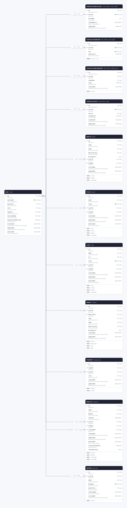

| Field                                       | Type                            | Constraints     | Default      | Description |
| ------------------------------------------- | ------------------------------- | --------------- | ------------ | ----------- |
| `id` (`user_id`)                            | `String` `@db.Uuid`             | PK NOT NULL     |              |             |
| `username`                                  | `String` `@db.VarChar(255)`     | UNIQUE NOT NULL |              |             |
| `password`                                  | `String` `@db.VarChar(60)`      | NOT NULL        |              |             |
| `role` (`role`)                             | `String` `@db.VarChar(50)`      | NOT NULL        |              |             |
| `logoUrl` (`logo_url`)                      | `String` `@db.VarChar(2183)`    | NULL            |              |             |
| `displayName` (`display_name`)              | `String` `@db.VarChar(255)`     | NULL            |              |             |
| `twoFactorRequired` (`two_factor_required`) | `Boolean`                       | NOT NULL        | `false`      |             |
| `createdAt` (`created_at`)                  | `DateTime` `@db.Timestamptz(6)` | NULL            | `now()`      |             |
| `updatedAt` (`updated_at`)                  | `DateTime` `@db.Timestamptz(6)` | NULL            | `@updatedAt` |             |
| `deletedAt` (`deleted_at`)                  | `DateTime` `@db.Timestamptz(6)` | NULL            |              |             |

#### Referenced by

- `id` ← [ApiKey.userId](#model-ApiKey) (one-to-many, on delete Cascade)
- `id` ← [Website.userId](#model-Website) (one-to-many)
- `id` ← [Website.createdBy](#model-Website) (one-to-many)
- `id` ← [TeamUser.userId](#model-TeamUser) (one-to-many)
- `id` ← [Report.userId](#model-Report) (one-to-many)
- `id` ← [Link.userId](#model-Link) (one-to-many)
- `id` ← [Pixel.userId](#model-Pixel) (one-to-many)
- `id` ← [Board.userId](#model-Board) (one-to-many)
- `id` ← [TwoFactorAuth.userId](#model-TwoFactorAuth) (one-to-one, on delete Cascade)
- `id` ← [TwoFactorBackupCode.userId](#model-TwoFactorBackupCode) (one-to-many, on delete Cascade)
- `id` ← [TwoFactorOtpUsed.userId](#model-TwoFactorOtpUsed) (one-to-many, on delete Cascade)
- `id` ← [TwoFactorRateLimit.userId](#model-TwoFactorRateLimit) (one-to-one, on delete Cascade)

#### Definition

```sql
CREATE TABLE "user" (
    "user_id" UUID NOT NULL,
    "username" VARCHAR(255) NOT NULL,
    "password" VARCHAR(60) NOT NULL,
    "role" VARCHAR(50) NOT NULL,
    "logo_url" VARCHAR(2183),
    "display_name" VARCHAR(255),
    "two_factor_required" BOOLEAN NOT NULL DEFAULT false,
    "created_at" TIMESTAMPTZ(6) DEFAULT CURRENT_TIMESTAMP,
    "updated_at" TIMESTAMPTZ(6),
    "deleted_at" TIMESTAMPTZ(6),

    CONSTRAINT "user_pkey" PRIMARY KEY ("user_id")
);

CREATE UNIQUE INDEX "user_username_key" ON "user"("username");
```

<details>
<summary>Queries and their SQL</summary>

**findMany**: Every row

```ts
await prisma.user.findMany();
```

```sql
SELECT
  "public"."user"."user_id",
  "public"."user"."username",
  "public"."user"."password",
  "public"."user"."role",
  "public"."user"."logo_url",
  "public"."user"."display_name",
  "public"."user"."two_factor_required",
  "public"."user"."created_at",
  "public"."user"."updated_at",
  "public"."user"."deleted_at"
FROM
  "public"."user"
WHERE
  1 = 1
OFFSET
  $1
-- params: ["0"]
```

**count**: How many rows there are

```ts
await prisma.user.count();
```

```sql
SELECT
  COUNT(*) AS "_count$_all"
FROM
  (
    SELECT
      "public"."user"."user_id"
    FROM
      "public"."user"
    WHERE
      1 = 1
    OFFSET
      $1
  ) AS "sub"
-- params: ["0"]
```

**findMany**: Every row with its relations

```ts
await prisma.user.findMany({
  include: {
    websites: true,
    createdBy: true,
    links: true,
    pixels: true,
    teams: true,
    reports: true,
    boards: true,
    twoFactorAuth: true,
    twoFactorBackupCodes: true,
    twoFactorOtpUseds: true,
    twoFactorRateLimit: true,
    apiKeys: true,
  },
});
```

```sql
SELECT
  "public"."user"."user_id",
  "public"."user"."username",
  "public"."user"."password",
  "public"."user"."role",
  "public"."user"."logo_url",
  "public"."user"."display_name",
  "public"."user"."two_factor_required",
  "public"."user"."created_at",
  "public"."user"."updated_at",
  "public"."user"."deleted_at"
FROM
  "public"."user"
WHERE
  1 = 1
OFFSET
  $1
-- params: ["0"]

SELECT
  "public"."website"."website_id",
  "public"."website"."name",
  "public"."website"."domain",
  "public"."website"."reset_at",
  "public"."website"."user_id",
  "public"."website"."team_id",
  "public"."website"."created_by",
  "public"."website"."created_at",
  "public"."website"."updated_at",
  "public"."website"."deleted_at",
  "public"."website"."recorder_enabled",
  "public"."website"."replay_config"
FROM
  "public"."website"
WHERE
  "public"."website"."user_id" IN ($1)
OFFSET
  $2
-- params: ["<id of the rows above>","0"]

SELECT
  "public"."website"."website_id",
  "public"."website"."name",
  "public"."website"."domain",
  "public"."website"."reset_at",
  "public"."website"."user_id",
  "public"."website"."team_id",
  "public"."website"."created_by",
  "public"."website"."created_at",
  "public"."website"."updated_at",
  "public"."website"."deleted_at",
  "public"."website"."recorder_enabled",
  "public"."website"."replay_config"
FROM
  "public"."website"
WHERE
  "public"."website"."created_by" IN ($1)
OFFSET
  $2
-- params: ["<id of the rows above>","0"]

SELECT
  "public"."link"."link_id",
  "public"."link"."name",
  "public"."link"."url",
  "public"."link"."slug",
  "public"."link"."user_id",
  "public"."link"."team_id",
  "public"."link"."created_at",
  "public"."link"."updated_at",
  "public"."link"."deleted_at"
FROM
  "public"."link"
WHERE
  "public"."link"."user_id" IN ($1)
OFFSET
  $2
-- params: ["<id of the rows above>","0"]

SELECT
  "public"."pixel"."pixel_id",
  "public"."pixel"."name",
  "public"."pixel"."slug",
  "public"."pixel"."user_id",
  "public"."pixel"."team_id",
  "public"."pixel"."created_at",
  "public"."pixel"."updated_at",
  "public"."pixel"."deleted_at"
FROM
  "public"."pixel"
WHERE
  "public"."pixel"."user_id" IN ($1)
OFFSET
  $2
-- params: ["<id of the rows above>","0"]

SELECT
  "public"."team_user"."team_user_id",
  "public"."team_user"."team_id",
  "public"."team_user"."user_id",
  "public"."team_user"."role",
  "public"."team_user"."created_at",
  "public"."team_user"."updated_at"
FROM
  "public"."team_user"
WHERE
  "public"."team_user"."user_id" IN ($1)
OFFSET
  $2
-- params: ["<id of the rows above>","0"]

SELECT
  "public"."report"."report_id",
  "public"."report"."user_id",
  "public"."report"."website_id",
  "public"."report"."type",
  "public"."report"."name",
  "public"."report"."description",
  "public"."report"."parameters",
  "public"."report"."created_at",
  "public"."report"."updated_at"
FROM
  "public"."report"
WHERE
  "public"."report"."user_id" IN ($1)
OFFSET
  $2
-- params: ["<id of the rows above>","0"]

SELECT
  "public"."board"."board_id",
  "public"."board"."type",
  "public"."board"."name",
  "public"."board"."description",
  "public"."board"."parameters",
  "public"."board"."user_id",
  "public"."board"."team_id",
  "public"."board"."created_at",
  "public"."board"."updated_at"
FROM
  "public"."board"
WHERE
  "public"."board"."user_id" IN ($1)
OFFSET
  $2
-- params: ["<id of the rows above>","0"]

SELECT
  "public"."two_factor_auth"."id",
  "public"."two_factor_auth"."user_id",
  "public"."two_factor_auth"."secret",
  "public"."two_factor_auth"."is_enabled",
  "public"."two_factor_auth"."created_at",
  "public"."two_factor_auth"."updated_at"
FROM
  "public"."two_factor_auth"
WHERE
  "public"."two_factor_auth"."user_id" IN ($1)
OFFSET
  $2
-- params: ["<id of the rows above>","0"]

SELECT
  "public"."two_factor_backup_code"."id",
  "public"."two_factor_backup_code"."user_id",
  "public"."two_factor_backup_code"."code_hash",
  "public"."two_factor_backup_code"."used",
  "public"."two_factor_backup_code"."created_at"
FROM
  "public"."two_factor_backup_code"
WHERE
  "public"."two_factor_backup_code"."user_id" IN ($1)
OFFSET
  $2
-- params: ["<id of the rows above>","0"]

SELECT
  "public"."two_factor_otp_used"."id",
  "public"."two_factor_otp_used"."user_id",
  "public"."two_factor_otp_used"."otp",
  "public"."two_factor_otp_used"."expires_at"
FROM
  "public"."two_factor_otp_used"
WHERE
  "public"."two_factor_otp_used"."user_id" IN ($1)
OFFSET
  $2
-- params: ["<id of the rows above>","0"]

SELECT
  "public"."two_factor_rate_limit"."id",
  "public"."two_factor_rate_limit"."user_id",
  "public"."two_factor_rate_limit"."attempts",
  "public"."two_factor_rate_limit"."locked_until",
  "public"."two_factor_rate_limit"."updated_at"
FROM
  "public"."two_factor_rate_limit"
WHERE
  "public"."two_factor_rate_limit"."user_id" IN ($1)
OFFSET
  $2
-- params: ["<id of the rows above>","0"]

SELECT
  "public"."api_key"."api_key_id",
  "public"."api_key"."user_id",
  "public"."api_key"."name",
  "public"."api_key"."key_hash",
  "public"."api_key"."key_prefix",
  "public"."api_key"."last_used_at",
  "public"."api_key"."created_at"
FROM
  "public"."api_key"
WHERE
  "public"."api_key"."user_id" IN ($1)
OFFSET
  $2
-- params: ["<id of the rows above>","0"]
```

**findUnique**: One row by what is unique to it

```ts
await prisma.user.findUnique({ where: { id: "example" } });
```

```sql
SELECT
  "public"."user"."user_id",
  "public"."user"."username",
  "public"."user"."password",
  "public"."user"."role",
  "public"."user"."logo_url",
  "public"."user"."display_name",
  "public"."user"."two_factor_required",
  "public"."user"."created_at",
  "public"."user"."updated_at",
  "public"."user"."deleted_at"
FROM
  "public"."user"
WHERE
  (
    "public"."user"."user_id" = $1
    AND 1 = 1
  )
LIMIT
  $2
OFFSET
  $3
-- params: ["example","1","0"]
```

**create**: Create a row

```ts
await prisma.user.create({
  data: { id: "example", username: "example", password: "example", role: "example" },
});
```

```sql
INSERT INTO
  "public"."user" (
    "user_id",
    "username",
    "password",
    "role",
    "two_factor_required",
    "created_at",
    "updated_at"
  )
VALUES
  ($1, $2, $3, $4, $5, $6, $7)
RETURNING
  "public"."user"."user_id",
  "public"."user"."username",
  "public"."user"."password",
  "public"."user"."role",
  "public"."user"."logo_url",
  "public"."user"."display_name",
  "public"."user"."two_factor_required",
  "public"."user"."created_at",
  "public"."user"."updated_at",
  "public"."user"."deleted_at"
-- params: ["example","example","example","example",false,"<now()>","<now()>"]
```

**update**: Update a row

```ts
await prisma.user.update({ where: { id: "example" }, data: { username: "example" } });
```

```sql
SELECT
  "public"."user"."user_id"
FROM
  "public"."user"
WHERE
  (
    "public"."user"."user_id" = $1
    AND 1 = 1
  )
LIMIT
  $2
OFFSET
  $3
-- params: ["example","1","0"]

UPDATE "public"."user"
SET
  "username" = $1,
  "updated_at" = $2
WHERE
  (
    "public"."user"."user_id" IN ($3)
    AND (
      "public"."user"."user_id" = $4
      AND 1 = 1
    )
  )
RETURNING
  "public"."user"."user_id",
  "public"."user"."username",
  "public"."user"."password",
  "public"."user"."role",
  "public"."user"."logo_url",
  "public"."user"."display_name",
  "public"."user"."two_factor_required",
  "public"."user"."created_at",
  "public"."user"."updated_at",
  "public"."user"."deleted_at"
-- params: ["example",{"prisma__type":"generatorCall","prisma__value":{"name":"now","args":[],"returnType":{"type":"DateTime"}}},"<id of the rows above>","example"]
```

**delete**: Delete a row

```ts
await prisma.user.delete({ where: { id: "example" } });
```

```sql
DELETE FROM "public"."user"
WHERE
  (
    "public"."user"."user_id" = $1
    AND 1 = 1
  )
RETURNING
  "public"."user"."user_id",
  "public"."user"."username",
  "public"."user"."password",
  "public"."user"."role",
  "public"."user"."logo_url",
  "public"."user"."display_name",
  "public"."user"."two_factor_required",
  "public"."user"."created_at",
  "public"."user"."updated_at",
  "public"."user"."deleted_at"
-- params: ["example"]

SELECT
  "public"."api_key"."api_key_id",
  "public"."api_key"."user_id"
FROM
  "public"."api_key"
WHERE
  (
    1 = 1
    AND "public"."api_key"."user_id" IN ($1)
  )
OFFSET
  $2
-- params: ["<id of the rows above>","0"]

DELETE FROM "public"."api_key"
WHERE
  (
    "public"."api_key"."api_key_id" IN ($1)
    AND 1 = 1
  )
-- params: ["<id of the rows above>"]

SELECT
  "public"."website"."website_id",
  "public"."website"."user_id"
FROM
  "public"."website"
WHERE
  (
    1 = 1
    AND "public"."website"."user_id" IN ($1)
  )
OFFSET
  $2
-- params: ["<id of the rows above>","0"]

UPDATE "public"."website"
SET
  "user_id" = $1
WHERE
  (
    "public"."website"."website_id" IN ($2)
    AND 1 = 1
  )
-- params: [null,"<id of the rows above>"]

SELECT
  "public"."website"."website_id",
  "public"."website"."created_by"
FROM
  "public"."website"
WHERE
  (
    1 = 1
    AND "public"."website"."created_by" IN ($1)
  )
OFFSET
  $2
-- params: ["<id of the rows above>","0"]

UPDATE "public"."website"
SET
  "created_by" = $1
WHERE
  (
    "public"."website"."website_id" IN ($2)
    AND 1 = 1
  )
-- params: [null,"<id of the rows above>"]

SELECT
  "public"."team_user"."team_user_id",
  "public"."team_user"."user_id"
FROM
  "public"."team_user"
WHERE
  (
    1 = 1
    AND "public"."team_user"."user_id" IN ($1)
  )
OFFSET
  $2
-- params: ["<id of the rows above>","0"]

SELECT
  "public"."report"."report_id",
  "public"."report"."user_id"
FROM
  "public"."report"
WHERE
  (
    1 = 1
    AND "public"."report"."user_id" IN ($1)
  )
OFFSET
  $2
-- params: ["<id of the rows above>","0"]

SELECT
  "public"."link"."link_id",
  "public"."link"."user_id"
FROM
  "public"."link"
WHERE
  (
    1 = 1
    AND "public"."link"."user_id" IN ($1)
  )
OFFSET
  $2
-- params: ["<id of the rows above>","0"]

UPDATE "public"."link"
SET
  "user_id" = $1
WHERE
  (
    "public"."link"."link_id" IN ($2)
    AND 1 = 1
  )
-- params: [null,"<id of the rows above>"]

SELECT
  "public"."pixel"."pixel_id",
  "public"."pixel"."user_id"
FROM
  "public"."pixel"
WHERE
  (
    1 = 1
    AND "public"."pixel"."user_id" IN ($1)
  )
OFFSET
  $2
-- params: ["<id of the rows above>","0"]

UPDATE "public"."pixel"
SET
  "user_id" = $1
WHERE
  (
    "public"."pixel"."pixel_id" IN ($2)
    AND 1 = 1
  )
-- params: [null,"<id of the rows above>"]

SELECT
  "public"."board"."board_id",
  "public"."board"."user_id"
FROM
  "public"."board"
WHERE
  (
    1 = 1
    AND "public"."board"."user_id" IN ($1)
  )
OFFSET
  $2
-- params: ["<id of the rows above>","0"]

UPDATE "public"."board"
SET
  "user_id" = $1
WHERE
  (
    "public"."board"."board_id" IN ($2)
    AND 1 = 1
  )
-- params: [null,"<id of the rows above>"]

SELECT
  "public"."two_factor_auth"."id",
  "public"."two_factor_auth"."user_id"
FROM
  "public"."two_factor_auth"
WHERE
  (
    1 = 1
    AND "public"."two_factor_auth"."user_id" IN ($1)
  )
OFFSET
  $2
-- params: ["<id of the rows above>","0"]

DELETE FROM "public"."two_factor_auth"
WHERE
  (
    "public"."two_factor_auth"."id" IN ($1)
    AND 1 = 1
  )
-- params: ["<id of the rows above>"]

SELECT
  "public"."two_factor_backup_code"."id",
  "public"."two_factor_backup_code"."user_id"
FROM
  "public"."two_factor_backup_code"
WHERE
  (
    1 = 1
    AND "public"."two_factor_backup_code"."user_id" IN ($1)
  )
OFFSET
  $2
-- params: ["<id of the rows above>","0"]

DELETE FROM "public"."two_factor_backup_code"
WHERE
  (
    "public"."two_factor_backup_code"."id" IN ($1)
    AND 1 = 1
  )
-- params: ["<id of the rows above>"]

SELECT
  "public"."two_factor_otp_used"."id",
  "public"."two_factor_otp_used"."user_id"
FROM
  "public"."two_factor_otp_used"
WHERE
  (
    1 = 1
    AND "public"."two_factor_otp_used"."user_id" IN ($1)
  )
OFFSET
  $2
-- params: ["<id of the rows above>","0"]

DELETE FROM "public"."two_factor_otp_used"
WHERE
  (
    "public"."two_factor_otp_used"."id" IN ($1)
    AND 1 = 1
  )
-- params: ["<id of the rows above>"]

SELECT
  "public"."two_factor_rate_limit"."id",
  "public"."two_factor_rate_limit"."user_id"
FROM
  "public"."two_factor_rate_limit"
WHERE
  (
    1 = 1
    AND "public"."two_factor_rate_limit"."user_id" IN ($1)
  )
OFFSET
  $2
-- params: ["<id of the rows above>","0"]

DELETE FROM "public"."two_factor_rate_limit"
WHERE
  (
    "public"."two_factor_rate_limit"."id" IN ($1)
    AND 1 = 1
  )
-- params: ["<id of the rows above>"]
```

</details>

<a id="model-ApiKey"></a>

### ApiKey

Table `api_key`.

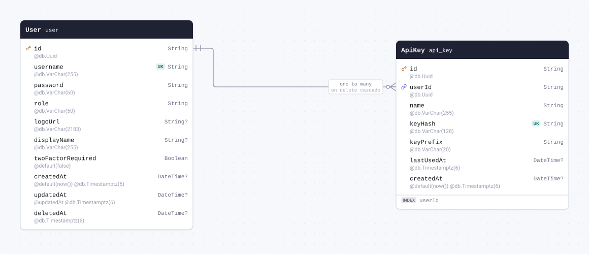

| Field                         | Type                            | Constraints                       | Default | Description |
| ----------------------------- | ------------------------------- | --------------------------------- | ------- | ----------- |
| `id` (`api_key_id`)           | `String` `@db.Uuid`             | PK NOT NULL                       |         |             |
| `userId` (`user_id`)          | `String` `@db.Uuid`             | NOT NULL → [User.id](#model-User) |         |             |
| `name`                        | `String` `@db.VarChar(255)`     | NOT NULL                          |         |             |
| `keyHash` (`key_hash`)        | `String` `@db.VarChar(128)`     | UNIQUE NOT NULL                   |         |             |
| `keyPrefix` (`key_prefix`)    | `String` `@db.VarChar(20)`      | NOT NULL                          |         |             |
| `lastUsedAt` (`last_used_at`) | `DateTime` `@db.Timestamptz(6)` | NULL                              |         |             |
| `createdAt` (`created_at`)    | `DateTime` `@db.Timestamptz(6)` | NULL                              | `now()` |             |

#### Indexes

- `@@index([userId])`

#### References

- `userId` → [User.id](#model-User) (many-to-one, on delete Cascade)

#### Definition

```sql
CREATE TABLE "api_key" (
    "api_key_id" UUID NOT NULL,
    "user_id" UUID NOT NULL,
    "name" VARCHAR(255) NOT NULL,
    "key_hash" VARCHAR(128) NOT NULL,
    "key_prefix" VARCHAR(20) NOT NULL,
    "last_used_at" TIMESTAMPTZ(6),
    "created_at" TIMESTAMPTZ(6) DEFAULT CURRENT_TIMESTAMP,

    CONSTRAINT "api_key_pkey" PRIMARY KEY ("api_key_id")
);

CREATE UNIQUE INDEX "api_key_key_hash_key" ON "api_key"("key_hash");

CREATE INDEX "api_key_user_id_idx" ON "api_key"("user_id");
```

<details>
<summary>Queries and their SQL</summary>

**findMany**: Every row

```ts
await prisma.apiKey.findMany();
```

```sql
SELECT
  "public"."api_key"."api_key_id",
  "public"."api_key"."user_id",
  "public"."api_key"."name",
  "public"."api_key"."key_hash",
  "public"."api_key"."key_prefix",
  "public"."api_key"."last_used_at",
  "public"."api_key"."created_at"
FROM
  "public"."api_key"
WHERE
  1 = 1
OFFSET
  $1
-- params: ["0"]
```

**count**: How many rows there are

```ts
await prisma.apiKey.count();
```

```sql
SELECT
  COUNT(*) AS "_count$_all"
FROM
  (
    SELECT
      "public"."api_key"."api_key_id"
    FROM
      "public"."api_key"
    WHERE
      1 = 1
    OFFSET
      $1
  ) AS "sub"
-- params: ["0"]
```

**findMany**: Every row with its relations

```ts
await prisma.apiKey.findMany({ include: { user: true } });
```

```sql
SELECT
  "public"."api_key"."api_key_id",
  "public"."api_key"."user_id",
  "public"."api_key"."name",
  "public"."api_key"."key_hash",
  "public"."api_key"."key_prefix",
  "public"."api_key"."last_used_at",
  "public"."api_key"."created_at"
FROM
  "public"."api_key"
WHERE
  1 = 1
OFFSET
  $1
-- params: ["0"]

SELECT
  "public"."user"."user_id",
  "public"."user"."username",
  "public"."user"."password",
  "public"."user"."role",
  "public"."user"."logo_url",
  "public"."user"."display_name",
  "public"."user"."two_factor_required",
  "public"."user"."created_at",
  "public"."user"."updated_at",
  "public"."user"."deleted_at"
FROM
  "public"."user"
WHERE
  "public"."user"."user_id" IN ($1)
OFFSET
  $2
-- params: ["<userId of the rows above>","0"]
```

**findUnique**: One row by what is unique to it

```ts
await prisma.apiKey.findUnique({ where: { id: "example" } });
```

```sql
SELECT
  "public"."api_key"."api_key_id",
  "public"."api_key"."user_id",
  "public"."api_key"."name",
  "public"."api_key"."key_hash",
  "public"."api_key"."key_prefix",
  "public"."api_key"."last_used_at",
  "public"."api_key"."created_at"
FROM
  "public"."api_key"
WHERE
  (
    "public"."api_key"."api_key_id" = $1
    AND 1 = 1
  )
LIMIT
  $2
OFFSET
  $3
-- params: ["example","1","0"]
```

**create**: Create a row

```ts
await prisma.apiKey.create({
  data: {
    id: "example",
    userId: "example",
    name: "example",
    keyHash: "example",
    keyPrefix: "example",
  },
});
```

```sql
INSERT INTO
  "public"."api_key" (
    "api_key_id",
    "user_id",
    "name",
    "key_hash",
    "key_prefix",
    "created_at"
  )
VALUES
  ($1, $2, $3, $4, $5, $6)
RETURNING
  "public"."api_key"."api_key_id",
  "public"."api_key"."user_id",
  "public"."api_key"."name",
  "public"."api_key"."key_hash",
  "public"."api_key"."key_prefix",
  "public"."api_key"."last_used_at",
  "public"."api_key"."created_at"
-- params: ["example","example","example","example","example","<now()>"]
```

**update**: Update a row

```ts
await prisma.apiKey.update({ where: { id: "example" }, data: { name: "example" } });
```

```sql
SELECT
  "public"."api_key"."api_key_id"
FROM
  "public"."api_key"
WHERE
  (
    "public"."api_key"."api_key_id" = $1
    AND 1 = 1
  )
LIMIT
  $2
OFFSET
  $3
-- params: ["example","1","0"]

UPDATE "public"."api_key"
SET
  "name" = $1
WHERE
  (
    "public"."api_key"."api_key_id" IN ($2)
    AND (
      "public"."api_key"."api_key_id" = $3
      AND 1 = 1
    )
  )
RETURNING
  "public"."api_key"."api_key_id",
  "public"."api_key"."user_id",
  "public"."api_key"."name",
  "public"."api_key"."key_hash",
  "public"."api_key"."key_prefix",
  "public"."api_key"."last_used_at",
  "public"."api_key"."created_at"
-- params: ["example","<id of the rows above>","example"]
```

**delete**: Delete a row

```ts
await prisma.apiKey.delete({ where: { id: "example" } });
```

```sql
DELETE FROM "public"."api_key"
WHERE
  (
    "public"."api_key"."api_key_id" = $1
    AND 1 = 1
  )
RETURNING
  "public"."api_key"."api_key_id",
  "public"."api_key"."user_id",
  "public"."api_key"."name",
  "public"."api_key"."key_hash",
  "public"."api_key"."key_prefix",
  "public"."api_key"."last_used_at",
  "public"."api_key"."created_at"
-- params: ["example"]
```

</details>

<a id="model-Session"></a>

### Session

Table `session`.

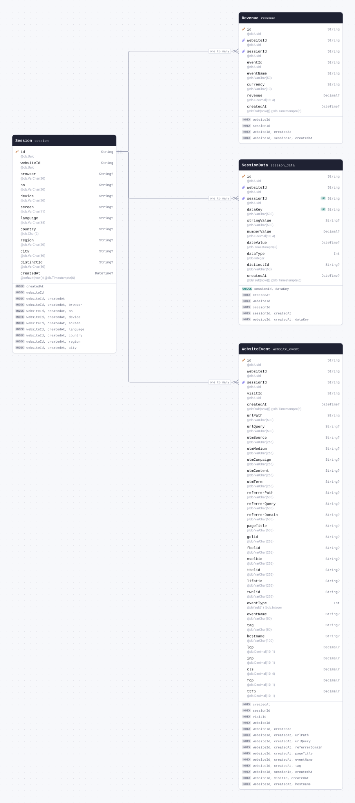

| Field                        | Type                            | Constraints | Default | Description |
| ---------------------------- | ------------------------------- | ----------- | ------- | ----------- |
| `id` (`session_id`)          | `String` `@db.Uuid`             | PK NOT NULL |         |             |
| `websiteId` (`website_id`)   | `String` `@db.Uuid`             | NOT NULL    |         |             |
| `browser`                    | `String` `@db.VarChar(20)`      | NULL        |         |             |
| `os`                         | `String` `@db.VarChar(20)`      | NULL        |         |             |
| `device`                     | `String` `@db.VarChar(20)`      | NULL        |         |             |
| `screen`                     | `String` `@db.VarChar(11)`      | NULL        |         |             |
| `language`                   | `String` `@db.VarChar(35)`      | NULL        |         |             |
| `country`                    | `String` `@db.Char(2)`          | NULL        |         |             |
| `region`                     | `String` `@db.VarChar(20)`      | NULL        |         |             |
| `city`                       | `String` `@db.VarChar(50)`      | NULL        |         |             |
| `distinctId` (`distinct_id`) | `String` `@db.VarChar(50)`      | NULL        |         |             |
| `createdAt` (`created_at`)   | `DateTime` `@db.Timestamptz(6)` | NULL        | `now()` |             |

#### Indexes

- `@@index([createdAt])`
- `@@index([websiteId])`
- `@@index([websiteId, createdAt])`
- `@@index([websiteId, createdAt, browser])`
- `@@index([websiteId, createdAt, os])`
- `@@index([websiteId, createdAt, device])`
- `@@index([websiteId, createdAt, screen])`
- `@@index([websiteId, createdAt, language])`
- `@@index([websiteId, createdAt, country])`
- `@@index([websiteId, createdAt, region])`
- `@@index([websiteId, createdAt, city])`

#### Referenced by

- `id` ← [WebsiteEvent.sessionId](#model-WebsiteEvent) (one-to-many)
- `id` ← [SessionData.sessionId](#model-SessionData) (one-to-many)
- `id` ← [Revenue.sessionId](#model-Revenue) (one-to-many)

#### Definition

```sql
CREATE TABLE "session" (
    "session_id" UUID NOT NULL,
    "website_id" UUID NOT NULL,
    "browser" VARCHAR(20),
    "os" VARCHAR(20),
    "device" VARCHAR(20),
    "screen" VARCHAR(11),
    "language" VARCHAR(35),
    "country" CHAR(2),
    "region" VARCHAR(20),
    "city" VARCHAR(50),
    "distinct_id" VARCHAR(50),
    "created_at" TIMESTAMPTZ(6) DEFAULT CURRENT_TIMESTAMP,

    CONSTRAINT "session_pkey" PRIMARY KEY ("session_id")
);

CREATE INDEX "session_created_at_idx" ON "session"("created_at");

CREATE INDEX "session_website_id_idx" ON "session"("website_id");

CREATE INDEX "session_website_id_created_at_idx" ON "session"("website_id", "created_at");

CREATE INDEX "session_website_id_created_at_browser_idx" ON "session"("website_id", "created_at", "browser");

CREATE INDEX "session_website_id_created_at_os_idx" ON "session"("website_id", "created_at", "os");

CREATE INDEX "session_website_id_created_at_device_idx" ON "session"("website_id", "created_at", "device");

CREATE INDEX "session_website_id_created_at_screen_idx" ON "session"("website_id", "created_at", "screen");

CREATE INDEX "session_website_id_created_at_language_idx" ON "session"("website_id", "created_at", "language");

CREATE INDEX "session_website_id_created_at_country_idx" ON "session"("website_id", "created_at", "country");

CREATE INDEX "session_website_id_created_at_region_idx" ON "session"("website_id", "created_at", "region");

CREATE INDEX "session_website_id_created_at_city_idx" ON "session"("website_id", "created_at", "city");
```

<details>
<summary>Queries and their SQL</summary>

**findMany**: Every row

```ts
await prisma.session.findMany();
```

```sql
SELECT
  "public"."session"."session_id",
  "public"."session"."website_id",
  "public"."session"."browser",
  "public"."session"."os",
  "public"."session"."device",
  "public"."session"."screen",
  "public"."session"."language",
  "public"."session"."country",
  "public"."session"."region",
  "public"."session"."city",
  "public"."session"."distinct_id",
  "public"."session"."created_at"
FROM
  "public"."session"
WHERE
  1 = 1
OFFSET
  $1
-- params: ["0"]
```

**count**: How many rows there are

```ts
await prisma.session.count();
```

```sql
SELECT
  COUNT(*) AS "_count$_all"
FROM
  (
    SELECT
      "public"."session"."session_id"
    FROM
      "public"."session"
    WHERE
      1 = 1
    OFFSET
      $1
  ) AS "sub"
-- params: ["0"]
```

**findMany**: Every row with its relations

```ts
await prisma.session.findMany({
  include: { websiteEvents: true, sessionData: true, revenue: true },
});
```

```sql
SELECT
  "public"."session"."session_id",
  "public"."session"."website_id",
  "public"."session"."browser",
  "public"."session"."os",
  "public"."session"."device",
  "public"."session"."screen",
  "public"."session"."language",
  "public"."session"."country",
  "public"."session"."region",
  "public"."session"."city",
  "public"."session"."distinct_id",
  "public"."session"."created_at"
FROM
  "public"."session"
WHERE
  1 = 1
OFFSET
  $1
-- params: ["0"]

SELECT
  "public"."website_event"."event_id",
  "public"."website_event"."website_id",
  "public"."website_event"."session_id",
  "public"."website_event"."visit_id",
  "public"."website_event"."created_at",
  "public"."website_event"."url_path",
  "public"."website_event"."url_query",
  "public"."website_event"."utm_source",
  "public"."website_event"."utm_medium",
  "public"."website_event"."utm_campaign",
  "public"."website_event"."utm_content",
  "public"."website_event"."utm_term",
  "public"."website_event"."referrer_path",
  "public"."website_event"."referrer_query",
  "public"."website_event"."referrer_domain",
  "public"."website_event"."page_title",
  "public"."website_event"."gclid",
  "public"."website_event"."fbclid",
  "public"."website_event"."msclkid",
  "public"."website_event"."ttclid",
  "public"."website_event"."li_fat_id",
  "public"."website_event"."twclid",
  "public"."website_event"."event_type",
  "public"."website_event"."event_name",
  "public"."website_event"."tag",
  "public"."website_event"."hostname",
  "public"."website_event"."lcp",
  "public"."website_event"."inp",
  "public"."website_event"."cls",
  "public"."website_event"."fcp",
  "public"."website_event"."ttfb"
FROM
  "public"."website_event"
WHERE
  "public"."website_event"."session_id" IN ($1)
OFFSET
  $2
-- params: ["<id of the rows above>","0"]

SELECT
  "public"."session_data"."session_data_id",
  "public"."session_data"."website_id",
  "public"."session_data"."session_id",
  "public"."session_data"."data_key",
  "public"."session_data"."string_value",
  "public"."session_data"."number_value",
  "public"."session_data"."date_value",
  "public"."session_data"."data_type",
  "public"."session_data"."distinct_id",
  "public"."session_data"."created_at"
FROM
  "public"."session_data"
WHERE
  "public"."session_data"."session_id" IN ($1)
OFFSET
  $2
-- params: ["<id of the rows above>","0"]

SELECT
  "public"."revenue"."revenue_id",
  "public"."revenue"."website_id",
  "public"."revenue"."session_id",
  "public"."revenue"."event_id",
  "public"."revenue"."event_name",
  "public"."revenue"."currency",
  "public"."revenue"."revenue",
  "public"."revenue"."created_at"
FROM
  "public"."revenue"
WHERE
  "public"."revenue"."session_id" IN ($1)
OFFSET
  $2
-- params: ["<id of the rows above>","0"]
```

**findUnique**: One row by what is unique to it

```ts
await prisma.session.findUnique({ where: { id: "example" } });
```

```sql
SELECT
  "public"."session"."session_id",
  "public"."session"."website_id",
  "public"."session"."browser",
  "public"."session"."os",
  "public"."session"."device",
  "public"."session"."screen",
  "public"."session"."language",
  "public"."session"."country",
  "public"."session"."region",
  "public"."session"."city",
  "public"."session"."distinct_id",
  "public"."session"."created_at"
FROM
  "public"."session"
WHERE
  (
    "public"."session"."session_id" = $1
    AND 1 = 1
  )
LIMIT
  $2
OFFSET
  $3
-- params: ["example","1","0"]
```

**create**: Create a row

```ts
await prisma.session.create({ data: { id: "example", websiteId: "example" } });
```

```sql
INSERT INTO
  "public"."session" ("session_id", "website_id", "created_at")
VALUES
  ($1, $2, $3)
RETURNING
  "public"."session"."session_id",
  "public"."session"."website_id",
  "public"."session"."browser",
  "public"."session"."os",
  "public"."session"."device",
  "public"."session"."screen",
  "public"."session"."language",
  "public"."session"."country",
  "public"."session"."region",
  "public"."session"."city",
  "public"."session"."distinct_id",
  "public"."session"."created_at"
-- params: ["example","example","<now()>"]
```

**update**: Update a row

```ts
await prisma.session.update({ where: { id: "example" }, data: { websiteId: "example" } });
```

```sql
SELECT
  "public"."session"."session_id"
FROM
  "public"."session"
WHERE
  (
    "public"."session"."session_id" = $1
    AND 1 = 1
  )
LIMIT
  $2
OFFSET
  $3
-- params: ["example","1","0"]

UPDATE "public"."session"
SET
  "website_id" = $1
WHERE
  (
    "public"."session"."session_id" IN ($2)
    AND (
      "public"."session"."session_id" = $3
      AND 1 = 1
    )
  )
RETURNING
  "public"."session"."session_id",
  "public"."session"."website_id",
  "public"."session"."browser",
  "public"."session"."os",
  "public"."session"."device",
  "public"."session"."screen",
  "public"."session"."language",
  "public"."session"."country",
  "public"."session"."region",
  "public"."session"."city",
  "public"."session"."distinct_id",
  "public"."session"."created_at"
-- params: ["example","<id of the rows above>","example"]
```

**delete**: Delete a row

```ts
await prisma.session.delete({ where: { id: "example" } });
```

```sql
DELETE FROM "public"."session"
WHERE
  (
    "public"."session"."session_id" = $1
    AND 1 = 1
  )
RETURNING
  "public"."session"."session_id",
  "public"."session"."website_id",
  "public"."session"."browser",
  "public"."session"."os",
  "public"."session"."device",
  "public"."session"."screen",
  "public"."session"."language",
  "public"."session"."country",
  "public"."session"."region",
  "public"."session"."city",
  "public"."session"."distinct_id",
  "public"."session"."created_at"
-- params: ["example"]

SELECT
  "public"."website_event"."event_id",
  "public"."website_event"."session_id"
FROM
  "public"."website_event"
WHERE
  (
    1 = 1
    AND "public"."website_event"."session_id" IN ($1)
  )
OFFSET
  $2
-- params: ["<id of the rows above>","0"]

SELECT
  "public"."session_data"."session_data_id",
  "public"."session_data"."session_id"
FROM
  "public"."session_data"
WHERE
  (
    1 = 1
    AND "public"."session_data"."session_id" IN ($1)
  )
OFFSET
  $2
-- params: ["<id of the rows above>","0"]

SELECT
  "public"."revenue"."revenue_id",
  "public"."revenue"."session_id"
FROM
  "public"."revenue"
WHERE
  (
    1 = 1
    AND "public"."revenue"."session_id" IN ($1)
  )
OFFSET
  $2
-- params: ["<id of the rows above>","0"]
```

</details>

<a id="model-SessionLink"></a>

### SessionLink

Table `session_link`.

| Field                        | Type                            | Constraints | Default | Description |
| ---------------------------- | ------------------------------- | ----------- | ------- | ----------- |
| `websiteId` (`website_id`)   | `String` `@db.Uuid`             | PK NOT NULL |         |             |
| `sessionId` (`session_id`)   | `String` `@db.Uuid`             | PK NOT NULL |         |             |
| `distinctId` (`distinct_id`) | `String` `@db.VarChar(50)`      | PK NOT NULL |         |             |
| `createdAt` (`created_at`)   | `DateTime` `@db.Timestamptz(6)` | NULL        | `now()` |             |

#### Indexes

- `@@id([websiteId, distinctId, sessionId])`
- `@@index([websiteId, sessionId])`

#### Definition

```sql
CREATE TABLE "session_link" (
    "website_id" UUID NOT NULL,
    "session_id" UUID NOT NULL,
    "distinct_id" VARCHAR(50) NOT NULL,
    "created_at" TIMESTAMPTZ(6) DEFAULT CURRENT_TIMESTAMP,

    CONSTRAINT "session_link_pkey" PRIMARY KEY ("website_id","distinct_id","session_id")
);

CREATE INDEX "session_link_website_id_session_id_idx" ON "session_link"("website_id", "session_id");
```

<details>
<summary>Queries and their SQL</summary>

**findMany**: Every row

```ts
await prisma.sessionLink.findMany();
```

```sql
SELECT
  "public"."session_link"."website_id",
  "public"."session_link"."distinct_id",
  "public"."session_link"."session_id",
  "public"."session_link"."created_at"
FROM
  "public"."session_link"
WHERE
  1 = 1
OFFSET
  $1
-- params: ["0"]
```

**count**: How many rows there are

```ts
await prisma.sessionLink.count();
```

```sql
SELECT
  COUNT(*) AS "_count$_all"
FROM
  (
    SELECT
      "public"."session_link"."website_id",
      "public"."session_link"."distinct_id",
      "public"."session_link"."session_id"
    FROM
      "public"."session_link"
    WHERE
      1 = 1
    OFFSET
      $1
  ) AS "sub"
-- params: ["0"]
```

**findUnique**: One row by what is unique to it

```ts
await prisma.sessionLink.findUnique({
  where: {
    websiteId_distinctId_sessionId: {
      websiteId: "example",
      distinctId: "example",
      sessionId: "example",
    },
  },
});
```

```sql
SELECT
  "public"."session_link"."website_id",
  "public"."session_link"."distinct_id",
  "public"."session_link"."session_id",
  "public"."session_link"."created_at"
FROM
  "public"."session_link"
WHERE
  (
    (
      "public"."session_link"."website_id" = $1
      AND "public"."session_link"."distinct_id" = $2
      AND "public"."session_link"."session_id" = $3
    )
    AND 1 = 1
  )
LIMIT
  $4
OFFSET
  $5
-- params: ["example","example","example","1","0"]
```

**create**: Create a row

```ts
await prisma.sessionLink.create({
  data: { websiteId: "example", sessionId: "example", distinctId: "example" },
});
```

```sql
INSERT INTO
  "public"."session_link" (
    "website_id",
    "session_id",
    "distinct_id",
    "created_at"
  )
VALUES
  ($1, $2, $3, $4)
RETURNING
  "public"."session_link"."website_id",
  "public"."session_link"."distinct_id",
  "public"."session_link"."session_id",
  "public"."session_link"."created_at"
-- params: ["example","example","example","<now()>"]
```

**update**: Update a row

```ts
await prisma.sessionLink.update({
  where: {
    websiteId_distinctId_sessionId: {
      websiteId: "example",
      distinctId: "example",
      sessionId: "example",
    },
  },
  data: { createdAt: new Date("2026-01-01T00:00:00.000Z") },
});
```

```sql
SELECT
  "public"."session_link"."website_id",
  "public"."session_link"."distinct_id",
  "public"."session_link"."session_id"
FROM
  "public"."session_link"
WHERE
  (
    (
      "public"."session_link"."website_id" = $1
      AND "public"."session_link"."distinct_id" = $2
      AND "public"."session_link"."session_id" = $3
    )
    AND 1 = 1
  )
LIMIT
  $4
OFFSET
  $5
-- params: ["example","example","example","1","0"]

UPDATE "public"."session_link"
SET
  "created_at" = $1
WHERE
  (
    (
      "public"."session_link"."website_id" IN ($2)
      AND "public"."session_link"."distinct_id" IN ($3)
      AND "public"."session_link"."session_id" IN ($4)
    )
    AND (
      (
        "public"."session_link"."website_id" = $5
        AND "public"."session_link"."distinct_id" = $6
        AND "public"."session_link"."session_id" = $7
      )
      AND 1 = 1
    )
  )
RETURNING
  "public"."session_link"."website_id",
  "public"."session_link"."distinct_id",
  "public"."session_link"."session_id",
  "public"."session_link"."created_at"
-- params: ["2026-01-01T00:00:00.000Z","<websiteId of the rows above>","<distinctId of the rows above>","<sessionId of the rows above>","example","example","example"]
```

**delete**: Delete a row

```ts
await prisma.sessionLink.delete({
  where: {
    websiteId_distinctId_sessionId: {
      websiteId: "example",
      distinctId: "example",
      sessionId: "example",
    },
  },
});
```

```sql
DELETE FROM "public"."session_link"
WHERE
  (
    (
      "public"."session_link"."website_id" = $1
      AND "public"."session_link"."distinct_id" = $2
      AND "public"."session_link"."session_id" = $3
    )
    AND 1 = 1
  )
RETURNING
  "public"."session_link"."website_id",
  "public"."session_link"."distinct_id",
  "public"."session_link"."session_id",
  "public"."session_link"."created_at"
-- params: ["example","example","example"]
```

</details>

<a id="model-Website"></a>

### Website

Table `website`.

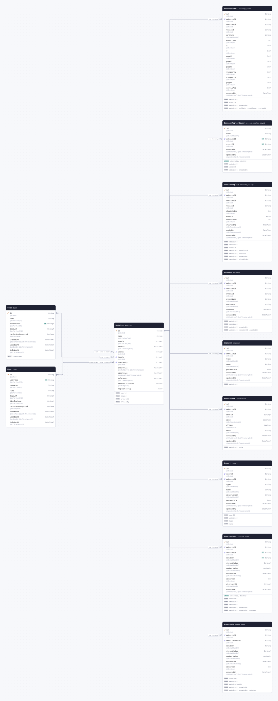

| Field                                  | Type                            | Constraints                   | Default      | Description |
| -------------------------------------- | ------------------------------- | ----------------------------- | ------------ | ----------- |
| `id` (`website_id`)                    | `String` `@db.Uuid`             | PK NOT NULL                   |              |             |
| `name`                                 | `String` `@db.VarChar(100)`     | NOT NULL                      |              |             |
| `domain`                               | `String` `@db.VarChar(500)`     | NULL                          |              |             |
| `resetAt` (`reset_at`)                 | `DateTime` `@db.Timestamptz(6)` | NULL                          |              |             |
| `userId` (`user_id`)                   | `String` `@db.Uuid`             | NULL → [User.id](#model-User) |              |             |
| `teamId` (`team_id`)                   | `String` `@db.Uuid`             | NULL → [Team.id](#model-Team) |              |             |
| `createdBy` (`created_by`)             | `String` `@db.Uuid`             | NULL → [User.id](#model-User) |              |             |
| `createdAt` (`created_at`)             | `DateTime` `@db.Timestamptz(6)` | NULL                          | `now()`      |             |
| `updatedAt` (`updated_at`)             | `DateTime` `@db.Timestamptz(6)` | NULL                          | `@updatedAt` |             |
| `deletedAt` (`deleted_at`)             | `DateTime` `@db.Timestamptz(6)` | NULL                          |              |             |
| `recorderEnabled` (`recorder_enabled`) | `Boolean`                       | NOT NULL                      | `false`      |             |
| `replayConfig` (`replay_config`)       | `Json`                          | NULL                          |              |             |

#### Indexes

- `@@index([userId])`
- `@@index([teamId])`
- `@@index([createdAt])`
- `@@index([createdBy])`

#### References

- `userId` → [User.id](#model-User) (many-to-one)
- `createdBy` → [User.id](#model-User) (many-to-one)
- `teamId` → [Team.id](#model-Team) (many-to-one)

#### Referenced by

- `id` ← [EventData.websiteId](#model-EventData) (one-to-many)
- `id` ← [SessionData.websiteId](#model-SessionData) (one-to-many)
- `id` ← [Report.websiteId](#model-Report) (one-to-many)
- `id` ← [Annotation.websiteId](#model-Annotation) (one-to-many)
- `id` ← [Segment.websiteId](#model-Segment) (one-to-many)
- `id` ← [Revenue.websiteId](#model-Revenue) (one-to-many)
- `id` ← [SessionReplay.websiteId](#model-SessionReplay) (one-to-many)
- `id` ← [SessionReplaySaved.websiteId](#model-SessionReplaySaved) (one-to-many)
- `id` ← [HeatmapEvent.websiteId](#model-HeatmapEvent) (one-to-many)

#### Definition

```sql
CREATE TABLE "website" (
    "website_id" UUID NOT NULL,
    "name" VARCHAR(100) NOT NULL,
    "domain" VARCHAR(500),
    "reset_at" TIMESTAMPTZ(6),
    "user_id" UUID,
    "team_id" UUID,
    "created_by" UUID,
    "created_at" TIMESTAMPTZ(6) DEFAULT CURRENT_TIMESTAMP,
    "updated_at" TIMESTAMPTZ(6),
    "deleted_at" TIMESTAMPTZ(6),
    "recorder_enabled" BOOLEAN NOT NULL DEFAULT false,
    "replay_config" JSONB,

    CONSTRAINT "website_pkey" PRIMARY KEY ("website_id")
);

CREATE INDEX "website_user_id_idx" ON "website"("user_id");

CREATE INDEX "website_team_id_idx" ON "website"("team_id");

CREATE INDEX "website_created_at_idx" ON "website"("created_at");

CREATE INDEX "website_created_by_idx" ON "website"("created_by");
```

<details>
<summary>Queries and their SQL</summary>

**findMany**: Every row

```ts
await prisma.website.findMany();
```

```sql
SELECT
  "public"."website"."website_id",
  "public"."website"."name",
  "public"."website"."domain",
  "public"."website"."reset_at",
  "public"."website"."user_id",
  "public"."website"."team_id",
  "public"."website"."created_by",
  "public"."website"."created_at",
  "public"."website"."updated_at",
  "public"."website"."deleted_at",
  "public"."website"."recorder_enabled",
  "public"."website"."replay_config"
FROM
  "public"."website"
WHERE
  1 = 1
OFFSET
  $1
-- params: ["0"]
```

**count**: How many rows there are

```ts
await prisma.website.count();
```

```sql
SELECT
  COUNT(*) AS "_count$_all"
FROM
  (
    SELECT
      "public"."website"."website_id"
    FROM
      "public"."website"
    WHERE
      1 = 1
    OFFSET
      $1
  ) AS "sub"
-- params: ["0"]
```

**findMany**: Every row with its relations

```ts
await prisma.website.findMany({
  include: {
    user: true,
    createUser: true,
    team: true,
    annotations: true,
    eventData: true,
    reports: true,
    revenue: true,
    segments: true,
    sessionData: true,
    sessionReplays: true,
    sessionReplaysSaved: true,
    heatmapEvents: true,
  },
});
```

```sql
SELECT
  "public"."website"."website_id",
  "public"."website"."name",
  "public"."website"."domain",
  "public"."website"."reset_at",
  "public"."website"."user_id",
  "public"."website"."team_id",
  "public"."website"."created_by",
  "public"."website"."created_at",
  "public"."website"."updated_at",
  "public"."website"."deleted_at",
  "public"."website"."recorder_enabled",
  "public"."website"."replay_config"
FROM
  "public"."website"
WHERE
  1 = 1
OFFSET
  $1
-- params: ["0"]

SELECT
  "public"."user"."user_id",
  "public"."user"."username",
  "public"."user"."password",
  "public"."user"."role",
  "public"."user"."logo_url",
  "public"."user"."display_name",
  "public"."user"."two_factor_required",
  "public"."user"."created_at",
  "public"."user"."updated_at",
  "public"."user"."deleted_at"
FROM
  "public"."user"
WHERE
  "public"."user"."user_id" IN ($1)
OFFSET
  $2
-- params: ["<userId of the rows above>","0"]

SELECT
  "public"."user"."user_id",
  "public"."user"."username",
  "public"."user"."password",
  "public"."user"."role",
  "public"."user"."logo_url",
  "public"."user"."display_name",
  "public"."user"."two_factor_required",
  "public"."user"."created_at",
  "public"."user"."updated_at",
  "public"."user"."deleted_at"
FROM
  "public"."user"
WHERE
  "public"."user"."user_id" IN ($1)
OFFSET
  $2
-- params: ["<createdBy of the rows above>","0"]

SELECT
  "public"."team"."team_id",
  "public"."team"."name",
  "public"."team"."access_code",
  "public"."team"."logo_url",
  "public"."team"."two_factor_required",
  "public"."team"."created_at",
  "public"."team"."updated_at",
  "public"."team"."deleted_at"
FROM
  "public"."team"
WHERE
  "public"."team"."team_id" IN ($1)
OFFSET
  $2
-- params: ["<teamId of the rows above>","0"]

SELECT
  "public"."annotation"."annotation_id",
  "public"."annotation"."website_id",
  "public"."annotation"."user_id",
  "public"."annotation"."date",
  "public"."annotation"."all_day",
  "public"."annotation"."note",
  "public"."annotation"."created_at",
  "public"."annotation"."updated_at"
FROM
  "public"."annotation"
WHERE
  "public"."annotation"."website_id" IN ($1)
OFFSET
  $2
-- params: ["<id of the rows above>","0"]

SELECT
  "public"."event_data"."event_data_id",
  "public"."event_data"."website_id",
  "public"."event_data"."website_event_id",
  "public"."event_data"."data_key",
  "public"."event_data"."string_value",
  "public"."event_data"."number_value",
  "public"."event_data"."date_value",
  "public"."event_data"."data_type",
  "public"."event_data"."created_at"
FROM
  "public"."event_data"
WHERE
  "public"."event_data"."website_id" IN ($1)
OFFSET
  $2
-- params: ["<id of the rows above>","0"]

SELECT
  "public"."report"."report_id",
  "public"."report"."user_id",
  "public"."report"."website_id",
  "public"."report"."type",
  "public"."report"."name",
  "public"."report"."description",
  "public"."report"."parameters",
  "public"."report"."created_at",
  "public"."report"."updated_at"
FROM
  "public"."report"
WHERE
  "public"."report"."website_id" IN ($1)
OFFSET
  $2
-- params: ["<id of the rows above>","0"]

SELECT
  "public"."revenue"."revenue_id",
  "public"."revenue"."website_id",
  "public"."revenue"."session_id",
  "public"."revenue"."event_id",
  "public"."revenue"."event_name",
  "public"."revenue"."currency",
  "public"."revenue"."revenue",
  "public"."revenue"."created_at"
FROM
  "public"."revenue"
WHERE
  "public"."revenue"."website_id" IN ($1)
OFFSET
  $2
-- params: ["<id of the rows above>","0"]

SELECT
  "public"."segment"."segment_id",
  "public"."segment"."website_id",
  "public"."segment"."type",
  "public"."segment"."name",
  "public"."segment"."parameters",
  "public"."segment"."created_at",
  "public"."segment"."updated_at"
FROM
  "public"."segment"
WHERE
  "public"."segment"."website_id" IN ($1)
OFFSET
  $2
-- params: ["<id of the rows above>","0"]

SELECT
  "public"."session_data"."session_data_id",
  "public"."session_data"."website_id",
  "public"."session_data"."session_id",
  "public"."session_data"."data_key",
  "public"."session_data"."string_value",
  "public"."session_data"."number_value",
  "public"."session_data"."date_value",
  "public"."session_data"."data_type",
  "public"."session_data"."distinct_id",
  "public"."session_data"."created_at"
FROM
  "public"."session_data"
WHERE
  "public"."session_data"."website_id" IN ($1)
OFFSET
  $2
-- params: ["<id of the rows above>","0"]

SELECT
  "public"."session_replay"."replay_id",
  "public"."session_replay"."website_id",
  "public"."session_replay"."session_id",
  "public"."session_replay"."visit_id",
  "public"."session_replay"."chunk_index",
  "public"."session_replay"."events",
  "public"."session_replay"."event_count",
  "public"."session_replay"."started_at",
  "public"."session_replay"."ended_at",
  "public"."session_replay"."created_at"
FROM
  "public"."session_replay"
WHERE
  "public"."session_replay"."website_id" IN ($1)
OFFSET
  $2
-- params: ["<id of the rows above>","0"]

SELECT
  "public"."session_replay_saved"."saved_replay_id",
  "public"."session_replay_saved"."name",
  "public"."session_replay_saved"."website_id",
  "public"."session_replay_saved"."visit_id",
  "public"."session_replay_saved"."created_at",
  "public"."session_replay_saved"."updated_at"
FROM
  "public"."session_replay_saved"
WHERE
  "public"."session_replay_saved"."website_id" IN ($1)
OFFSET
  $2
-- params: ["<id of the rows above>","0"]

SELECT
  "public"."heatmap_event"."heatmap_event_id",
  "public"."heatmap_event"."website_id",
  "public"."heatmap_event"."session_id",
  "public"."heatmap_event"."visit_id",
  "public"."heatmap_event"."url_path",
  "public"."heatmap_event"."event_type",
  "public"."heatmap_event"."x",
  "public"."heatmap_event"."y",
  "public"."heatmap_event"."page_x",
  "public"."heatmap_event"."page_y",
  "public"."heatmap_event"."page_w",
  "public"."heatmap_event"."viewport_w",
  "public"."heatmap_event"."viewport_h",
  "public"."heatmap_event"."page_h",
  "public"."heatmap_event"."scroll_pct",
  "public"."heatmap_event"."created_at"
FROM
  "public"."heatmap_event"
WHERE
  "public"."heatmap_event"."website_id" IN ($1)
OFFSET
  $2
-- params: ["<id of the rows above>","0"]
```

**findUnique**: One row by what is unique to it

```ts
await prisma.website.findUnique({ where: { id: "example" } });
```

```sql
SELECT
  "public"."website"."website_id",
  "public"."website"."name",
  "public"."website"."domain",
  "public"."website"."reset_at",
  "public"."website"."user_id",
  "public"."website"."team_id",
  "public"."website"."created_by",
  "public"."website"."created_at",
  "public"."website"."updated_at",
  "public"."website"."deleted_at",
  "public"."website"."recorder_enabled",
  "public"."website"."replay_config"
FROM
  "public"."website"
WHERE
  (
    "public"."website"."website_id" = $1
    AND 1 = 1
  )
LIMIT
  $2
OFFSET
  $3
-- params: ["example","1","0"]
```

**create**: Create a row

```ts
await prisma.website.create({ data: { id: "example", name: "example" } });
```

```sql
INSERT INTO
  "public"."website" (
    "website_id",
    "name",
    "created_at",
    "updated_at",
    "recorder_enabled"
  )
VALUES
  ($1, $2, $3, $4, $5)
RETURNING
  "public"."website"."website_id",
  "public"."website"."name",
  "public"."website"."domain",
  "public"."website"."reset_at",
  "public"."website"."user_id",
  "public"."website"."team_id",
  "public"."website"."created_by",
  "public"."website"."created_at",
  "public"."website"."updated_at",
  "public"."website"."deleted_at",
  "public"."website"."recorder_enabled",
  "public"."website"."replay_config"
-- params: ["example","example","<now()>","<now()>",false]
```

**update**: Update a row

```ts
await prisma.website.update({ where: { id: "example" }, data: { name: "example" } });
```

```sql
SELECT
  "public"."website"."website_id"
FROM
  "public"."website"
WHERE
  (
    "public"."website"."website_id" = $1
    AND 1 = 1
  )
LIMIT
  $2
OFFSET
  $3
-- params: ["example","1","0"]

UPDATE "public"."website"
SET
  "name" = $1,
  "updated_at" = $2
WHERE
  (
    "public"."website"."website_id" IN ($3)
    AND (
      "public"."website"."website_id" = $4
      AND 1 = 1
    )
  )
RETURNING
  "public"."website"."website_id",
  "public"."website"."name",
  "public"."website"."domain",
  "public"."website"."reset_at",
  "public"."website"."user_id",
  "public"."website"."team_id",
  "public"."website"."created_by",
  "public"."website"."created_at",
  "public"."website"."updated_at",
  "public"."website"."deleted_at",
  "public"."website"."recorder_enabled",
  "public"."website"."replay_config"
-- params: ["example",{"prisma__type":"generatorCall","prisma__value":{"name":"now","args":[],"returnType":{"type":"DateTime"}}},"<id of the rows above>","example"]
```

**delete**: Delete a row

```ts
await prisma.website.delete({ where: { id: "example" } });
```

```sql
DELETE FROM "public"."website"
WHERE
  (
    "public"."website"."website_id" = $1
    AND 1 = 1
  )
RETURNING
  "public"."website"."website_id",
  "public"."website"."name",
  "public"."website"."domain",
  "public"."website"."reset_at",
  "public"."website"."user_id",
  "public"."website"."team_id",
  "public"."website"."created_by",
  "public"."website"."created_at",
  "public"."website"."updated_at",
  "public"."website"."deleted_at",
  "public"."website"."recorder_enabled",
  "public"."website"."replay_config"
-- params: ["example"]

SELECT
  "public"."event_data"."event_data_id",
  "public"."event_data"."website_id"
FROM
  "public"."event_data"
WHERE
  (
    1 = 1
    AND "public"."event_data"."website_id" IN ($1)
  )
OFFSET
  $2
-- params: ["<id of the rows above>","0"]

SELECT
  "public"."session_data"."session_data_id",
  "public"."session_data"."website_id"
FROM
  "public"."session_data"
WHERE
  (
    1 = 1
    AND "public"."session_data"."website_id" IN ($1)
  )
OFFSET
  $2
-- params: ["<id of the rows above>","0"]

SELECT
  "public"."report"."report_id",
  "public"."report"."website_id"
FROM
  "public"."report"
WHERE
  (
    1 = 1
    AND "public"."report"."website_id" IN ($1)
  )
OFFSET
  $2
-- params: ["<id of the rows above>","0"]

SELECT
  "public"."annotation"."annotation_id",
  "public"."annotation"."website_id"
FROM
  "public"."annotation"
WHERE
  (
    1 = 1
    AND "public"."annotation"."website_id" IN ($1)
  )
OFFSET
  $2
-- params: ["<id of the rows above>","0"]

SELECT
  "public"."segment"."segment_id",
  "public"."segment"."website_id"
FROM
  "public"."segment"
WHERE
  (
    1 = 1
    AND "public"."segment"."website_id" IN ($1)
  )
OFFSET
  $2
-- params: ["<id of the rows above>","0"]

SELECT
  "public"."revenue"."revenue_id",
  "public"."revenue"."website_id"
FROM
  "public"."revenue"
WHERE
  (
    1 = 1
    AND "public"."revenue"."website_id" IN ($1)
  )
OFFSET
  $2
-- params: ["<id of the rows above>","0"]

SELECT
  "public"."session_replay"."replay_id",
  "public"."session_replay"."website_id"
FROM
  "public"."session_replay"
WHERE
  (
    1 = 1
    AND "public"."session_replay"."website_id" IN ($1)
  )
OFFSET
  $2
-- params: ["<id of the rows above>","0"]

SELECT
  "public"."session_replay_saved"."saved_replay_id",
  "public"."session_replay_saved"."website_id"
FROM
  "public"."session_replay_saved"
WHERE
  (
    1 = 1
    AND "public"."session_replay_saved"."website_id" IN ($1)
  )
OFFSET
  $2
-- params: ["<id of the rows above>","0"]

SELECT
  "public"."heatmap_event"."heatmap_event_id",
  "public"."heatmap_event"."website_id"
FROM
  "public"."heatmap_event"
WHERE
  (
    1 = 1
    AND "public"."heatmap_event"."website_id" IN ($1)
  )
OFFSET
  $2
-- params: ["<id of the rows above>","0"]
```

</details>

<a id="model-WebsiteEvent"></a>

### WebsiteEvent

Table `website_event`.

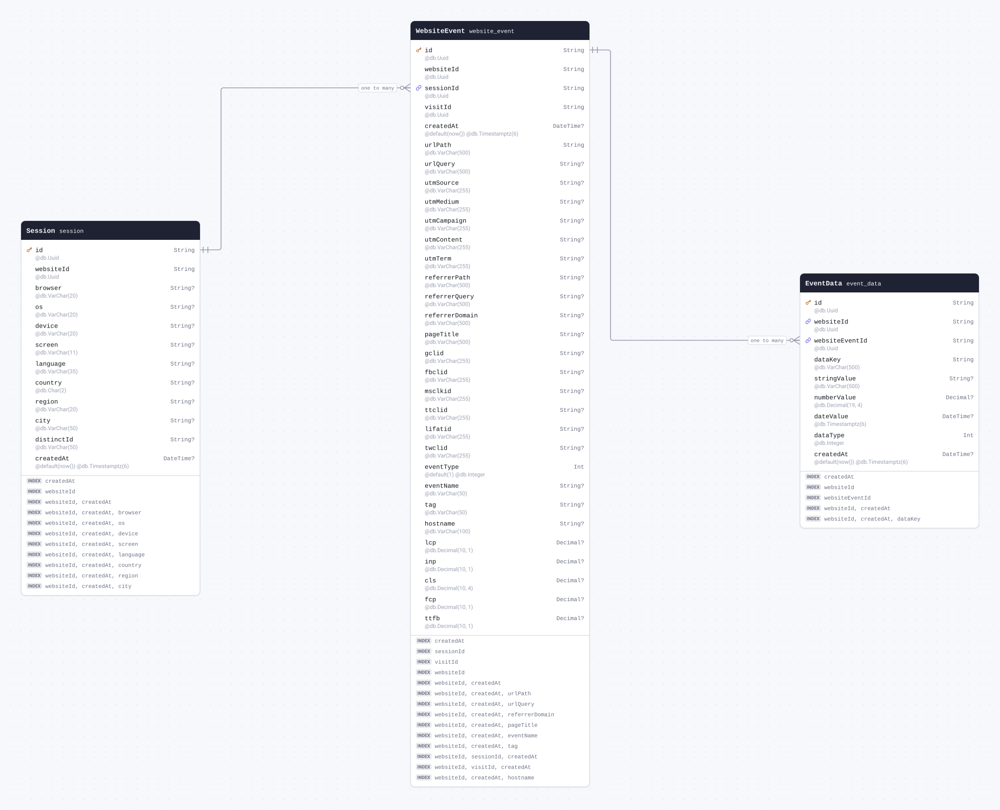

| Field                                | Type                            | Constraints                             | Default | Description |
| ------------------------------------ | ------------------------------- | --------------------------------------- | ------- | ----------- |
| `id` (`event_id`)                    | `String` `@db.Uuid`             | PK NOT NULL                             |         |             |
| `websiteId` (`website_id`)           | `String` `@db.Uuid`             | NOT NULL                                |         |             |
| `sessionId` (`session_id`)           | `String` `@db.Uuid`             | NOT NULL → [Session.id](#model-Session) |         |             |
| `visitId` (`visit_id`)               | `String` `@db.Uuid`             | NOT NULL                                |         |             |
| `createdAt` (`created_at`)           | `DateTime` `@db.Timestamptz(6)` | NULL                                    | `now()` |             |
| `urlPath` (`url_path`)               | `String` `@db.VarChar(500)`     | NOT NULL                                |         |             |
| `urlQuery` (`url_query`)             | `String` `@db.VarChar(500)`     | NULL                                    |         |             |
| `utmSource` (`utm_source`)           | `String` `@db.VarChar(255)`     | NULL                                    |         |             |
| `utmMedium` (`utm_medium`)           | `String` `@db.VarChar(255)`     | NULL                                    |         |             |
| `utmCampaign` (`utm_campaign`)       | `String` `@db.VarChar(255)`     | NULL                                    |         |             |
| `utmContent` (`utm_content`)         | `String` `@db.VarChar(255)`     | NULL                                    |         |             |
| `utmTerm` (`utm_term`)               | `String` `@db.VarChar(255)`     | NULL                                    |         |             |
| `referrerPath` (`referrer_path`)     | `String` `@db.VarChar(500)`     | NULL                                    |         |             |
| `referrerQuery` (`referrer_query`)   | `String` `@db.VarChar(500)`     | NULL                                    |         |             |
| `referrerDomain` (`referrer_domain`) | `String` `@db.VarChar(500)`     | NULL                                    |         |             |
| `pageTitle` (`page_title`)           | `String` `@db.VarChar(500)`     | NULL                                    |         |             |
| `gclid`                              | `String` `@db.VarChar(255)`     | NULL                                    |         |             |
| `fbclid`                             | `String` `@db.VarChar(255)`     | NULL                                    |         |             |
| `msclkid`                            | `String` `@db.VarChar(255)`     | NULL                                    |         |             |
| `ttclid`                             | `String` `@db.VarChar(255)`     | NULL                                    |         |             |
| `lifatid` (`li_fat_id`)              | `String` `@db.VarChar(255)`     | NULL                                    |         |             |
| `twclid`                             | `String` `@db.VarChar(255)`     | NULL                                    |         |             |
| `eventType` (`event_type`)           | `Int` `@db.Integer`             | NOT NULL                                | `1`     |             |
| `eventName` (`event_name`)           | `String` `@db.VarChar(50)`      | NULL                                    |         |             |
| `tag`                                | `String` `@db.VarChar(50)`      | NULL                                    |         |             |
| `hostname`                           | `String` `@db.VarChar(100)`     | NULL                                    |         |             |
| `lcp`                                | `Decimal` `@db.Decimal(10, 1)`  | NULL                                    |         |             |
| `inp`                                | `Decimal` `@db.Decimal(10, 1)`  | NULL                                    |         |             |
| `cls`                                | `Decimal` `@db.Decimal(10, 4)`  | NULL                                    |         |             |
| `fcp`                                | `Decimal` `@db.Decimal(10, 1)`  | NULL                                    |         |             |
| `ttfb`                               | `Decimal` `@db.Decimal(10, 1)`  | NULL                                    |         |             |

#### Indexes

- `@@index([createdAt])`
- `@@index([sessionId])`
- `@@index([visitId])`
- `@@index([websiteId])`
- `@@index([websiteId, createdAt])`
- `@@index([websiteId, createdAt, urlPath])`
- `@@index([websiteId, createdAt, urlQuery])`
- `@@index([websiteId, createdAt, referrerDomain])`
- `@@index([websiteId, createdAt, pageTitle])`
- `@@index([websiteId, createdAt, eventName])`
- `@@index([websiteId, createdAt, tag])`
- `@@index([websiteId, sessionId, createdAt])`
- `@@index([websiteId, visitId, createdAt])`
- `@@index([websiteId, createdAt, hostname])`

#### References

- `sessionId` → [Session.id](#model-Session) (many-to-one)

#### Referenced by

- `id` ← [EventData.websiteEventId](#model-EventData) (one-to-many)

#### Definition

```sql
CREATE TABLE "website_event" (
    "event_id" UUID NOT NULL,
    "website_id" UUID NOT NULL,
    "session_id" UUID NOT NULL,
    "visit_id" UUID NOT NULL,
    "created_at" TIMESTAMPTZ(6) DEFAULT CURRENT_TIMESTAMP,
    "url_path" VARCHAR(500) NOT NULL,
    "url_query" VARCHAR(500),
    "utm_source" VARCHAR(255),
    "utm_medium" VARCHAR(255),
    "utm_campaign" VARCHAR(255),
    "utm_content" VARCHAR(255),
    "utm_term" VARCHAR(255),
    "referrer_path" VARCHAR(500),
    "referrer_query" VARCHAR(500),
    "referrer_domain" VARCHAR(500),
    "page_title" VARCHAR(500),
    "gclid" VARCHAR(255),
    "fbclid" VARCHAR(255),
    "msclkid" VARCHAR(255),
    "ttclid" VARCHAR(255),
    "li_fat_id" VARCHAR(255),
    "twclid" VARCHAR(255),
    "event_type" INTEGER NOT NULL DEFAULT 1,
    "event_name" VARCHAR(50),
    "tag" VARCHAR(50),
    "hostname" VARCHAR(100),
    "lcp" DECIMAL(10,1),
    "inp" DECIMAL(10,1),
    "cls" DECIMAL(10,4),
    "fcp" DECIMAL(10,1),
    "ttfb" DECIMAL(10,1),

    CONSTRAINT "website_event_pkey" PRIMARY KEY ("event_id")
);

CREATE INDEX "website_event_created_at_idx" ON "website_event"("created_at");

CREATE INDEX "website_event_session_id_idx" ON "website_event"("session_id");

CREATE INDEX "website_event_visit_id_idx" ON "website_event"("visit_id");

CREATE INDEX "website_event_website_id_idx" ON "website_event"("website_id");

CREATE INDEX "website_event_website_id_created_at_idx" ON "website_event"("website_id", "created_at");

CREATE INDEX "website_event_website_id_created_at_url_path_idx" ON "website_event"("website_id", "created_at", "url_path");

CREATE INDEX "website_event_website_id_created_at_url_query_idx" ON "website_event"("website_id", "created_at", "url_query");

CREATE INDEX "website_event_website_id_created_at_referrer_domain_idx" ON "website_event"("website_id", "created_at", "referrer_domain");

CREATE INDEX "website_event_website_id_created_at_page_title_idx" ON "website_event"("website_id", "created_at", "page_title");

CREATE INDEX "website_event_website_id_created_at_event_name_idx" ON "website_event"("website_id", "created_at", "event_name");

CREATE INDEX "website_event_website_id_created_at_tag_idx" ON "website_event"("website_id", "created_at", "tag");

CREATE INDEX "website_event_website_id_session_id_created_at_idx" ON "website_event"("website_id", "session_id", "created_at");

CREATE INDEX "website_event_website_id_visit_id_created_at_idx" ON "website_event"("website_id", "visit_id", "created_at");

CREATE INDEX "website_event_website_id_created_at_hostname_idx" ON "website_event"("website_id", "created_at", "hostname");
```

<details>
<summary>Queries and their SQL</summary>

**findMany**: Every row

```ts
await prisma.websiteEvent.findMany();
```

```sql
SELECT
  "public"."website_event"."event_id",
  "public"."website_event"."website_id",
  "public"."website_event"."session_id",
  "public"."website_event"."visit_id",
  "public"."website_event"."created_at",
  "public"."website_event"."url_path",
  "public"."website_event"."url_query",
  "public"."website_event"."utm_source",
  "public"."website_event"."utm_medium",
  "public"."website_event"."utm_campaign",
  "public"."website_event"."utm_content",
  "public"."website_event"."utm_term",
  "public"."website_event"."referrer_path",
  "public"."website_event"."referrer_query",
  "public"."website_event"."referrer_domain",
  "public"."website_event"."page_title",
  "public"."website_event"."gclid",
  "public"."website_event"."fbclid",
  "public"."website_event"."msclkid",
  "public"."website_event"."ttclid",
  "public"."website_event"."li_fat_id",
  "public"."website_event"."twclid",
  "public"."website_event"."event_type",
  "public"."website_event"."event_name",
  "public"."website_event"."tag",
  "public"."website_event"."hostname",
  "public"."website_event"."lcp",
  "public"."website_event"."inp",
  "public"."website_event"."cls",
  "public"."website_event"."fcp",
  "public"."website_event"."ttfb"
FROM
  "public"."website_event"
WHERE
  1 = 1
OFFSET
  $1
-- params: ["0"]
```

**count**: How many rows there are

```ts
await prisma.websiteEvent.count();
```

```sql
SELECT
  COUNT(*) AS "_count$_all"
FROM
  (
    SELECT
      "public"."website_event"."event_id"
    FROM
      "public"."website_event"
    WHERE
      1 = 1
    OFFSET
      $1
  ) AS "sub"
-- params: ["0"]
```

**findMany**: Every row with its relations

```ts
await prisma.websiteEvent.findMany({ include: { eventData: true, session: true } });
```

```sql
SELECT
  "public"."website_event"."event_id",
  "public"."website_event"."website_id",
  "public"."website_event"."session_id",
  "public"."website_event"."visit_id",
  "public"."website_event"."created_at",
  "public"."website_event"."url_path",
  "public"."website_event"."url_query",
  "public"."website_event"."utm_source",
  "public"."website_event"."utm_medium",
  "public"."website_event"."utm_campaign",
  "public"."website_event"."utm_content",
  "public"."website_event"."utm_term",
  "public"."website_event"."referrer_path",
  "public"."website_event"."referrer_query",
  "public"."website_event"."referrer_domain",
  "public"."website_event"."page_title",
  "public"."website_event"."gclid",
  "public"."website_event"."fbclid",
  "public"."website_event"."msclkid",
  "public"."website_event"."ttclid",
  "public"."website_event"."li_fat_id",
  "public"."website_event"."twclid",
  "public"."website_event"."event_type",
  "public"."website_event"."event_name",
  "public"."website_event"."tag",
  "public"."website_event"."hostname",
  "public"."website_event"."lcp",
  "public"."website_event"."inp",
  "public"."website_event"."cls",
  "public"."website_event"."fcp",
  "public"."website_event"."ttfb"
FROM
  "public"."website_event"
WHERE
  1 = 1
OFFSET
  $1
-- params: ["0"]

SELECT
  "public"."event_data"."event_data_id",
  "public"."event_data"."website_id",
  "public"."event_data"."website_event_id",
  "public"."event_data"."data_key",
  "public"."event_data"."string_value",
  "public"."event_data"."number_value",
  "public"."event_data"."date_value",
  "public"."event_data"."data_type",
  "public"."event_data"."created_at"
FROM
  "public"."event_data"
WHERE
  "public"."event_data"."website_event_id" IN ($1)
OFFSET
  $2
-- params: ["<id of the rows above>","0"]

SELECT
  "public"."session"."session_id",
  "public"."session"."website_id",
  "public"."session"."browser",
  "public"."session"."os",
  "public"."session"."device",
  "public"."session"."screen",
  "public"."session"."language",
  "public"."session"."country",
  "public"."session"."region",
  "public"."session"."city",
  "public"."session"."distinct_id",
  "public"."session"."created_at"
FROM
  "public"."session"
WHERE
  "public"."session"."session_id" IN ($1)
OFFSET
  $2
-- params: ["<sessionId of the rows above>","0"]
```

**findUnique**: One row by what is unique to it

```ts
await prisma.websiteEvent.findUnique({ where: { id: "example" } });
```

```sql
SELECT
  "public"."website_event"."event_id",
  "public"."website_event"."website_id",
  "public"."website_event"."session_id",
  "public"."website_event"."visit_id",
  "public"."website_event"."created_at",
  "public"."website_event"."url_path",
  "public"."website_event"."url_query",
  "public"."website_event"."utm_source",
  "public"."website_event"."utm_medium",
  "public"."website_event"."utm_campaign",
  "public"."website_event"."utm_content",
  "public"."website_event"."utm_term",
  "public"."website_event"."referrer_path",
  "public"."website_event"."referrer_query",
  "public"."website_event"."referrer_domain",
  "public"."website_event"."page_title",
  "public"."website_event"."gclid",
  "public"."website_event"."fbclid",
  "public"."website_event"."msclkid",
  "public"."website_event"."ttclid",
  "public"."website_event"."li_fat_id",
  "public"."website_event"."twclid",
  "public"."website_event"."event_type",
  "public"."website_event"."event_name",
  "public"."website_event"."tag",
  "public"."website_event"."hostname",
  "public"."website_event"."lcp",
  "public"."website_event"."inp",
  "public"."website_event"."cls",
  "public"."website_event"."fcp",
  "public"."website_event"."ttfb"
FROM
  "public"."website_event"
WHERE
  (
    "public"."website_event"."event_id" = $1
    AND 1 = 1
  )
LIMIT
  $2
OFFSET
  $3
-- params: ["example","1","0"]
```

**create**: Create a row

```ts
await prisma.websiteEvent.create({
  data: {
    id: "example",
    websiteId: "example",
    sessionId: "example",
    visitId: "example",
    urlPath: "example",
  },
});
```

```sql
INSERT INTO
  "public"."website_event" (
    "event_id",
    "website_id",
    "session_id",
    "visit_id",
    "created_at",
    "url_path",
    "event_type"
  )
VALUES
  ($1, $2, $3, $4, $5, $6, $7)
RETURNING
  "public"."website_event"."event_id",
  "public"."website_event"."website_id",
  "public"."website_event"."session_id",
  "public"."website_event"."visit_id",
  "public"."website_event"."created_at",
  "public"."website_event"."url_path",
  "public"."website_event"."url_query",
  "public"."website_event"."utm_source",
  "public"."website_event"."utm_medium",
  "public"."website_event"."utm_campaign",
  "public"."website_event"."utm_content",
  "public"."website_event"."utm_term",
  "public"."website_event"."referrer_path",
  "public"."website_event"."referrer_query",
  "public"."website_event"."referrer_domain",
  "public"."website_event"."page_title",
  "public"."website_event"."gclid",
  "public"."website_event"."fbclid",
  "public"."website_event"."msclkid",
  "public"."website_event"."ttclid",
  "public"."website_event"."li_fat_id",
  "public"."website_event"."twclid",
  "public"."website_event"."event_type",
  "public"."website_event"."event_name",
  "public"."website_event"."tag",
  "public"."website_event"."hostname",
  "public"."website_event"."lcp",
  "public"."website_event"."inp",
  "public"."website_event"."cls",
  "public"."website_event"."fcp",
  "public"."website_event"."ttfb"
-- params: ["example","example","example","example","<now()>","example","1"]
```

**update**: Update a row

```ts
await prisma.websiteEvent.update({ where: { id: "example" }, data: { websiteId: "example" } });
```

```sql
SELECT
  "public"."website_event"."event_id"
FROM
  "public"."website_event"
WHERE
  (
    "public"."website_event"."event_id" = $1
    AND 1 = 1
  )
LIMIT
  $2
OFFSET
  $3
-- params: ["example","1","0"]

UPDATE "public"."website_event"
SET
  "website_id" = $1
WHERE
  (
    "public"."website_event"."event_id" IN ($2)
    AND (
      "public"."website_event"."event_id" = $3
      AND 1 = 1
    )
  )
RETURNING
  "public"."website_event"."event_id",
  "public"."website_event"."website_id",
  "public"."website_event"."session_id",
  "public"."website_event"."visit_id",
  "public"."website_event"."created_at",
  "public"."website_event"."url_path",
  "public"."website_event"."url_query",
  "public"."website_event"."utm_source",
  "public"."website_event"."utm_medium",
  "public"."website_event"."utm_campaign",
  "public"."website_event"."utm_content",
  "public"."website_event"."utm_term",
  "public"."website_event"."referrer_path",
  "public"."website_event"."referrer_query",
  "public"."website_event"."referrer_domain",
  "public"."website_event"."page_title",
  "public"."website_event"."gclid",
  "public"."website_event"."fbclid",
  "public"."website_event"."msclkid",
  "public"."website_event"."ttclid",
  "public"."website_event"."li_fat_id",
  "public"."website_event"."twclid",
  "public"."website_event"."event_type",
  "public"."website_event"."event_name",
  "public"."website_event"."tag",
  "public"."website_event"."hostname",
  "public"."website_event"."lcp",
  "public"."website_event"."inp",
  "public"."website_event"."cls",
  "public"."website_event"."fcp",
  "public"."website_event"."ttfb"
-- params: ["example","<id of the rows above>","example"]
```

**delete**: Delete a row

```ts
await prisma.websiteEvent.delete({ where: { id: "example" } });
```

```sql
DELETE FROM "public"."website_event"
WHERE
  (
    "public"."website_event"."event_id" = $1
    AND 1 = 1
  )
RETURNING
  "public"."website_event"."event_id",
  "public"."website_event"."website_id",
  "public"."website_event"."session_id",
  "public"."website_event"."visit_id",
  "public"."website_event"."created_at",
  "public"."website_event"."url_path",
  "public"."website_event"."url_query",
  "public"."website_event"."utm_source",
  "public"."website_event"."utm_medium",
  "public"."website_event"."utm_campaign",
  "public"."website_event"."utm_content",
  "public"."website_event"."utm_term",
  "public"."website_event"."referrer_path",
  "public"."website_event"."referrer_query",
  "public"."website_event"."referrer_domain",
  "public"."website_event"."page_title",
  "public"."website_event"."gclid",
  "public"."website_event"."fbclid",
  "public"."website_event"."msclkid",
  "public"."website_event"."ttclid",
  "public"."website_event"."li_fat_id",
  "public"."website_event"."twclid",
  "public"."website_event"."event_type",
  "public"."website_event"."event_name",
  "public"."website_event"."tag",
  "public"."website_event"."hostname",
  "public"."website_event"."lcp",
  "public"."website_event"."inp",
  "public"."website_event"."cls",
  "public"."website_event"."fcp",
  "public"."website_event"."ttfb"
-- params: ["example"]

SELECT
  "public"."event_data"."event_data_id",
  "public"."event_data"."website_event_id"
FROM
  "public"."event_data"
WHERE
  (
    1 = 1
    AND "public"."event_data"."website_event_id" IN ($1)
  )
OFFSET
  $2
-- params: ["<id of the rows above>","0"]
```

</details>

<a id="model-EventData"></a>

### EventData

Table `event_data`.

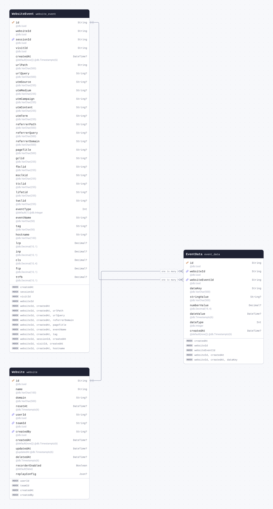

| Field                                 | Type                            | Constraints                                       | Default | Description |
| ------------------------------------- | ------------------------------- | ------------------------------------------------- | ------- | ----------- |
| `id` (`event_data_id`)                | `String` `@db.Uuid`             | PK NOT NULL                                       |         |             |
| `websiteId` (`website_id`)            | `String` `@db.Uuid`             | NOT NULL → [Website.id](#model-Website)           |         |             |
| `websiteEventId` (`website_event_id`) | `String` `@db.Uuid`             | NOT NULL → [WebsiteEvent.id](#model-WebsiteEvent) |         |             |
| `dataKey` (`data_key`)                | `String` `@db.VarChar(500)`     | NOT NULL                                          |         |             |
| `stringValue` (`string_value`)        | `String` `@db.VarChar(500)`     | NULL                                              |         |             |
| `numberValue` (`number_value`)        | `Decimal` `@db.Decimal(19, 4)`  | NULL                                              |         |             |
| `dateValue` (`date_value`)            | `DateTime` `@db.Timestamptz(6)` | NULL                                              |         |             |
| `dataType` (`data_type`)              | `Int` `@db.Integer`             | NOT NULL                                          |         |             |
| `createdAt` (`created_at`)            | `DateTime` `@db.Timestamptz(6)` | NULL                                              | `now()` |             |

#### Indexes

- `@@index([createdAt])`
- `@@index([websiteId])`
- `@@index([websiteEventId])`
- `@@index([websiteId, createdAt])`
- `@@index([websiteId, createdAt, dataKey])`

#### References

- `websiteId` → [Website.id](#model-Website) (many-to-one)
- `websiteEventId` → [WebsiteEvent.id](#model-WebsiteEvent) (many-to-one)

#### Definition

```sql
CREATE TABLE "event_data" (
    "event_data_id" UUID NOT NULL,
    "website_id" UUID NOT NULL,
    "website_event_id" UUID NOT NULL,
    "data_key" VARCHAR(500) NOT NULL,
    "string_value" VARCHAR(500),
    "number_value" DECIMAL(19,4),
    "date_value" TIMESTAMPTZ(6),
    "data_type" INTEGER NOT NULL,
    "created_at" TIMESTAMPTZ(6) DEFAULT CURRENT_TIMESTAMP,

    CONSTRAINT "event_data_pkey" PRIMARY KEY ("event_data_id")
);

CREATE INDEX "event_data_created_at_idx" ON "event_data"("created_at");

CREATE INDEX "event_data_website_id_idx" ON "event_data"("website_id");

CREATE INDEX "event_data_website_event_id_idx" ON "event_data"("website_event_id");

CREATE INDEX "event_data_website_id_created_at_idx" ON "event_data"("website_id", "created_at");

CREATE INDEX "event_data_website_id_created_at_data_key_idx" ON "event_data"("website_id", "created_at", "data_key");
```

<details>
<summary>Queries and their SQL</summary>

**findMany**: Every row

```ts
await prisma.eventData.findMany();
```

```sql
SELECT
  "public"."event_data"."event_data_id",
  "public"."event_data"."website_id",
  "public"."event_data"."website_event_id",
  "public"."event_data"."data_key",
  "public"."event_data"."string_value",
  "public"."event_data"."number_value",
  "public"."event_data"."date_value",
  "public"."event_data"."data_type",
  "public"."event_data"."created_at"
FROM
  "public"."event_data"
WHERE
  1 = 1
OFFSET
  $1
-- params: ["0"]
```

**count**: How many rows there are

```ts
await prisma.eventData.count();
```

```sql
SELECT
  COUNT(*) AS "_count$_all"
FROM
  (
    SELECT
      "public"."event_data"."event_data_id"
    FROM
      "public"."event_data"
    WHERE
      1 = 1
    OFFSET
      $1
  ) AS "sub"
-- params: ["0"]
```

**findMany**: Every row with its relations

```ts
await prisma.eventData.findMany({ include: { website: true, websiteEvent: true } });
```

```sql
SELECT
  "public"."event_data"."event_data_id",
  "public"."event_data"."website_id",
  "public"."event_data"."website_event_id",
  "public"."event_data"."data_key",
  "public"."event_data"."string_value",
  "public"."event_data"."number_value",
  "public"."event_data"."date_value",
  "public"."event_data"."data_type",
  "public"."event_data"."created_at"
FROM
  "public"."event_data"
WHERE
  1 = 1
OFFSET
  $1
-- params: ["0"]

SELECT
  "public"."website"."website_id",
  "public"."website"."name",
  "public"."website"."domain",
  "public"."website"."reset_at",
  "public"."website"."user_id",
  "public"."website"."team_id",
  "public"."website"."created_by",
  "public"."website"."created_at",
  "public"."website"."updated_at",
  "public"."website"."deleted_at",
  "public"."website"."recorder_enabled",
  "public"."website"."replay_config"
FROM
  "public"."website"
WHERE
  "public"."website"."website_id" IN ($1)
OFFSET
  $2
-- params: ["<websiteId of the rows above>","0"]

SELECT
  "public"."website_event"."event_id",
  "public"."website_event"."website_id",
  "public"."website_event"."session_id",
  "public"."website_event"."visit_id",
  "public"."website_event"."created_at",
  "public"."website_event"."url_path",
  "public"."website_event"."url_query",
  "public"."website_event"."utm_source",
  "public"."website_event"."utm_medium",
  "public"."website_event"."utm_campaign",
  "public"."website_event"."utm_content",
  "public"."website_event"."utm_term",
  "public"."website_event"."referrer_path",
  "public"."website_event"."referrer_query",
  "public"."website_event"."referrer_domain",
  "public"."website_event"."page_title",
  "public"."website_event"."gclid",
  "public"."website_event"."fbclid",
  "public"."website_event"."msclkid",
  "public"."website_event"."ttclid",
  "public"."website_event"."li_fat_id",
  "public"."website_event"."twclid",
  "public"."website_event"."event_type",
  "public"."website_event"."event_name",
  "public"."website_event"."tag",
  "public"."website_event"."hostname",
  "public"."website_event"."lcp",
  "public"."website_event"."inp",
  "public"."website_event"."cls",
  "public"."website_event"."fcp",
  "public"."website_event"."ttfb"
FROM
  "public"."website_event"
WHERE
  "public"."website_event"."event_id" IN ($1)
OFFSET
  $2
-- params: ["<websiteEventId of the rows above>","0"]
```

**findUnique**: One row by what is unique to it

```ts
await prisma.eventData.findUnique({ where: { id: "example" } });
```

```sql
SELECT
  "public"."event_data"."event_data_id",
  "public"."event_data"."website_id",
  "public"."event_data"."website_event_id",
  "public"."event_data"."data_key",
  "public"."event_data"."string_value",
  "public"."event_data"."number_value",
  "public"."event_data"."date_value",
  "public"."event_data"."data_type",
  "public"."event_data"."created_at"
FROM
  "public"."event_data"
WHERE
  (
    "public"."event_data"."event_data_id" = $1
    AND 1 = 1
  )
LIMIT
  $2
OFFSET
  $3
-- params: ["example","1","0"]
```

**create**: Create a row

```ts
await prisma.eventData.create({
  data: {
    id: "example",
    websiteId: "example",
    websiteEventId: "example",
    dataKey: "example",
    dataType: 1,
  },
});
```

```sql
INSERT INTO
  "public"."event_data" (
    "event_data_id",
    "website_id",
    "website_event_id",
    "data_key",
    "data_type",
    "created_at"
  )
VALUES
  ($1, $2, $3, $4, $5, $6)
RETURNING
  "public"."event_data"."event_data_id",
  "public"."event_data"."website_id",
  "public"."event_data"."website_event_id",
  "public"."event_data"."data_key",
  "public"."event_data"."string_value",
  "public"."event_data"."number_value",
  "public"."event_data"."date_value",
  "public"."event_data"."data_type",
  "public"."event_data"."created_at"
-- params: ["example","example","example","example","1","<now()>"]
```

**update**: Update a row

```ts
await prisma.eventData.update({ where: { id: "example" }, data: { dataKey: "example" } });
```

```sql
SELECT
  "public"."event_data"."event_data_id"
FROM
  "public"."event_data"
WHERE
  (
    "public"."event_data"."event_data_id" = $1
    AND 1 = 1
  )
LIMIT
  $2
OFFSET
  $3
-- params: ["example","1","0"]

UPDATE "public"."event_data"
SET
  "data_key" = $1
WHERE
  (
    "public"."event_data"."event_data_id" IN ($2)
    AND (
      "public"."event_data"."event_data_id" = $3
      AND 1 = 1
    )
  )
RETURNING
  "public"."event_data"."event_data_id",
  "public"."event_data"."website_id",
  "public"."event_data"."website_event_id",
  "public"."event_data"."data_key",
  "public"."event_data"."string_value",
  "public"."event_data"."number_value",
  "public"."event_data"."date_value",
  "public"."event_data"."data_type",
  "public"."event_data"."created_at"
-- params: ["example","<id of the rows above>","example"]
```

**delete**: Delete a row

```ts
await prisma.eventData.delete({ where: { id: "example" } });
```

```sql
DELETE FROM "public"."event_data"
WHERE
  (
    "public"."event_data"."event_data_id" = $1
    AND 1 = 1
  )
RETURNING
  "public"."event_data"."event_data_id",
  "public"."event_data"."website_id",
  "public"."event_data"."website_event_id",
  "public"."event_data"."data_key",
  "public"."event_data"."string_value",
  "public"."event_data"."number_value",
  "public"."event_data"."date_value",
  "public"."event_data"."data_type",
  "public"."event_data"."created_at"
-- params: ["example"]
```

</details>

<a id="model-SessionData"></a>

### SessionData

Table `session_data`.

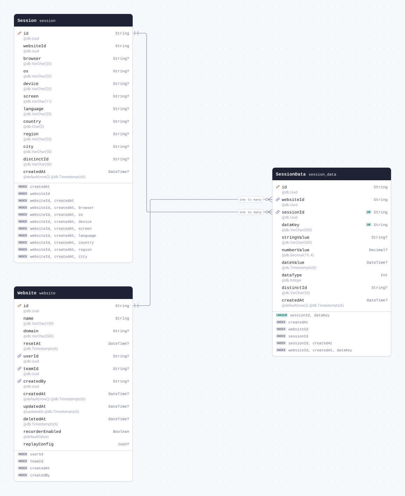

| Field                          | Type                            | Constraints                             | Default | Description |
| ------------------------------ | ------------------------------- | --------------------------------------- | ------- | ----------- |
| `id` (`session_data_id`)       | `String` `@db.Uuid`             | PK NOT NULL                             |         |             |
| `websiteId` (`website_id`)     | `String` `@db.Uuid`             | NOT NULL → [Website.id](#model-Website) |         |             |
| `sessionId` (`session_id`)     | `String` `@db.Uuid`             | NOT NULL → [Session.id](#model-Session) |         |             |
| `dataKey` (`data_key`)         | `String` `@db.VarChar(500)`     | NOT NULL                                |         |             |
| `stringValue` (`string_value`) | `String` `@db.VarChar(500)`     | NULL                                    |         |             |
| `numberValue` (`number_value`) | `Decimal` `@db.Decimal(19, 4)`  | NULL                                    |         |             |
| `dateValue` (`date_value`)     | `DateTime` `@db.Timestamptz(6)` | NULL                                    |         |             |
| `dataType` (`data_type`)       | `Int` `@db.Integer`             | NOT NULL                                |         |             |
| `distinctId` (`distinct_id`)   | `String` `@db.VarChar(50)`      | NULL                                    |         |             |
| `createdAt` (`created_at`)     | `DateTime` `@db.Timestamptz(6)` | NULL                                    | `now()` |             |

#### Indexes

- `@@index([createdAt])`
- `@@index([websiteId])`
- `@@index([sessionId])`
- `@@index([sessionId, createdAt])`
- `@@index([websiteId, createdAt, dataKey])`
- `@@unique([sessionId, dataKey])`

#### References

- `websiteId` → [Website.id](#model-Website) (many-to-one)
- `sessionId` → [Session.id](#model-Session) (many-to-one)

#### Definition

```sql
CREATE TABLE "session_data" (
    "session_data_id" UUID NOT NULL,
    "website_id" UUID NOT NULL,
    "session_id" UUID NOT NULL,
    "data_key" VARCHAR(500) NOT NULL,
    "string_value" VARCHAR(500),
    "number_value" DECIMAL(19,4),
    "date_value" TIMESTAMPTZ(6),
    "data_type" INTEGER NOT NULL,
    "distinct_id" VARCHAR(50),
    "created_at" TIMESTAMPTZ(6) DEFAULT CURRENT_TIMESTAMP,

    CONSTRAINT "session_data_pkey" PRIMARY KEY ("session_data_id")
);

CREATE INDEX "session_data_created_at_idx" ON "session_data"("created_at");

CREATE INDEX "session_data_website_id_idx" ON "session_data"("website_id");

CREATE INDEX "session_data_session_id_idx" ON "session_data"("session_id");

CREATE INDEX "session_data_session_id_created_at_idx" ON "session_data"("session_id", "created_at");

CREATE INDEX "session_data_website_id_created_at_data_key_idx" ON "session_data"("website_id", "created_at", "data_key");

CREATE UNIQUE INDEX "session_data_session_id_data_key_key" ON "session_data"("session_id", "data_key");
```

<details>
<summary>Queries and their SQL</summary>

**findMany**: Every row

```ts
await prisma.sessionData.findMany();
```

```sql
SELECT
  "public"."session_data"."session_data_id",
  "public"."session_data"."website_id",
  "public"."session_data"."session_id",
  "public"."session_data"."data_key",
  "public"."session_data"."string_value",
  "public"."session_data"."number_value",
  "public"."session_data"."date_value",
  "public"."session_data"."data_type",
  "public"."session_data"."distinct_id",
  "public"."session_data"."created_at"
FROM
  "public"."session_data"
WHERE
  1 = 1
OFFSET
  $1
-- params: ["0"]
```

**count**: How many rows there are

```ts
await prisma.sessionData.count();
```

```sql
SELECT
  COUNT(*) AS "_count$_all"
FROM
  (
    SELECT
      "public"."session_data"."session_data_id"
    FROM
      "public"."session_data"
    WHERE
      1 = 1
    OFFSET
      $1
  ) AS "sub"
-- params: ["0"]
```

**findMany**: Every row with its relations

```ts
await prisma.sessionData.findMany({ include: { website: true, session: true } });
```

```sql
SELECT
  "public"."session_data"."session_data_id",
  "public"."session_data"."website_id",
  "public"."session_data"."session_id",
  "public"."session_data"."data_key",
  "public"."session_data"."string_value",
  "public"."session_data"."number_value",
  "public"."session_data"."date_value",
  "public"."session_data"."data_type",
  "public"."session_data"."distinct_id",
  "public"."session_data"."created_at"
FROM
  "public"."session_data"
WHERE
  1 = 1
OFFSET
  $1
-- params: ["0"]

SELECT
  "public"."website"."website_id",
  "public"."website"."name",
  "public"."website"."domain",
  "public"."website"."reset_at",
  "public"."website"."user_id",
  "public"."website"."team_id",
  "public"."website"."created_by",
  "public"."website"."created_at",
  "public"."website"."updated_at",
  "public"."website"."deleted_at",
  "public"."website"."recorder_enabled",
  "public"."website"."replay_config"
FROM
  "public"."website"
WHERE
  "public"."website"."website_id" IN ($1)
OFFSET
  $2
-- params: ["<websiteId of the rows above>","0"]

SELECT
  "public"."session"."session_id",
  "public"."session"."website_id",
  "public"."session"."browser",
  "public"."session"."os",
  "public"."session"."device",
  "public"."session"."screen",
  "public"."session"."language",
  "public"."session"."country",
  "public"."session"."region",
  "public"."session"."city",
  "public"."session"."distinct_id",
  "public"."session"."created_at"
FROM
  "public"."session"
WHERE
  "public"."session"."session_id" IN ($1)
OFFSET
  $2
-- params: ["<sessionId of the rows above>","0"]
```

**findUnique**: One row by what is unique to it

```ts
await prisma.sessionData.findUnique({ where: { id: "example" } });
```

```sql
SELECT
  "public"."session_data"."session_data_id",
  "public"."session_data"."website_id",
  "public"."session_data"."session_id",
  "public"."session_data"."data_key",
  "public"."session_data"."string_value",
  "public"."session_data"."number_value",
  "public"."session_data"."date_value",
  "public"."session_data"."data_type",
  "public"."session_data"."distinct_id",
  "public"."session_data"."created_at"
FROM
  "public"."session_data"
WHERE
  (
    "public"."session_data"."session_data_id" = $1
    AND 1 = 1
  )
LIMIT
  $2
OFFSET
  $3
-- params: ["example","1","0"]
```

**create**: Create a row

```ts
await prisma.sessionData.create({
  data: {
    id: "example",
    websiteId: "example",
    sessionId: "example",
    dataKey: "example",
    dataType: 1,
  },
});
```

```sql
INSERT INTO
  "public"."session_data" (
    "session_data_id",
    "website_id",
    "session_id",
    "data_key",
    "data_type",
    "created_at"
  )
VALUES
  ($1, $2, $3, $4, $5, $6)
RETURNING
  "public"."session_data"."session_data_id",
  "public"."session_data"."website_id",
  "public"."session_data"."session_id",
  "public"."session_data"."data_key",
  "public"."session_data"."string_value",
  "public"."session_data"."number_value",
  "public"."session_data"."date_value",
  "public"."session_data"."data_type",
  "public"."session_data"."distinct_id",
  "public"."session_data"."created_at"
-- params: ["example","example","example","example","1","<now()>"]
```

**update**: Update a row

```ts
await prisma.sessionData.update({ where: { id: "example" }, data: { dataKey: "example" } });
```

```sql
SELECT
  "public"."session_data"."session_data_id"
FROM
  "public"."session_data"
WHERE
  (
    "public"."session_data"."session_data_id" = $1
    AND 1 = 1
  )
LIMIT
  $2
OFFSET
  $3
-- params: ["example","1","0"]

UPDATE "public"."session_data"
SET
  "data_key" = $1
WHERE
  (
    "public"."session_data"."session_data_id" IN ($2)
    AND (
      "public"."session_data"."session_data_id" = $3
      AND 1 = 1
    )
  )
RETURNING
  "public"."session_data"."session_data_id",
  "public"."session_data"."website_id",
  "public"."session_data"."session_id",
  "public"."session_data"."data_key",
  "public"."session_data"."string_value",
  "public"."session_data"."number_value",
  "public"."session_data"."date_value",
  "public"."session_data"."data_type",
  "public"."session_data"."distinct_id",
  "public"."session_data"."created_at"
-- params: ["example","<id of the rows above>","example"]
```

**delete**: Delete a row

```ts
await prisma.sessionData.delete({ where: { id: "example" } });
```

```sql
DELETE FROM "public"."session_data"
WHERE
  (
    "public"."session_data"."session_data_id" = $1
    AND 1 = 1
  )
RETURNING
  "public"."session_data"."session_data_id",
  "public"."session_data"."website_id",
  "public"."session_data"."session_id",
  "public"."session_data"."data_key",
  "public"."session_data"."string_value",
  "public"."session_data"."number_value",
  "public"."session_data"."date_value",
  "public"."session_data"."data_type",
  "public"."session_data"."distinct_id",
  "public"."session_data"."created_at"
-- params: ["example"]
```

</details>

<a id="model-Team"></a>

### Team

Table `team`.

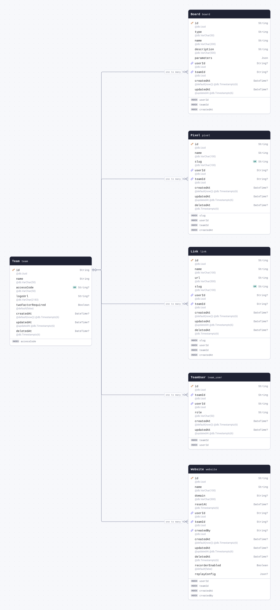

| Field                                       | Type                            | Constraints | Default      | Description |
| ------------------------------------------- | ------------------------------- | ----------- | ------------ | ----------- |
| `id` (`team_id`)                            | `String` `@db.Uuid`             | PK NOT NULL |              |             |
| `name`                                      | `String` `@db.VarChar(50)`      | NOT NULL    |              |             |
| `accessCode` (`access_code`)                | `String` `@db.VarChar(50)`      | UNIQUE NULL |              |             |
| `logoUrl` (`logo_url`)                      | `String` `@db.VarChar(2183)`    | NULL        |              |             |
| `twoFactorRequired` (`two_factor_required`) | `Boolean`                       | NOT NULL    | `false`      |             |
| `createdAt` (`created_at`)                  | `DateTime` `@db.Timestamptz(6)` | NULL        | `now()`      |             |
| `updatedAt` (`updated_at`)                  | `DateTime` `@db.Timestamptz(6)` | NULL        | `@updatedAt` |             |
| `deletedAt` (`deleted_at`)                  | `DateTime` `@db.Timestamptz(6)` | NULL        |              |             |

#### Indexes

- `@@index([accessCode])`

#### Referenced by

- `id` ← [Website.teamId](#model-Website) (one-to-many)
- `id` ← [TeamUser.teamId](#model-TeamUser) (one-to-many)
- `id` ← [Link.teamId](#model-Link) (one-to-many)
- `id` ← [Pixel.teamId](#model-Pixel) (one-to-many)
- `id` ← [Board.teamId](#model-Board) (one-to-many)

#### Definition

```sql
CREATE TABLE "team" (
    "team_id" UUID NOT NULL,
    "name" VARCHAR(50) NOT NULL,
    "access_code" VARCHAR(50),
    "logo_url" VARCHAR(2183),
    "two_factor_required" BOOLEAN NOT NULL DEFAULT false,
    "created_at" TIMESTAMPTZ(6) DEFAULT CURRENT_TIMESTAMP,
    "updated_at" TIMESTAMPTZ(6),
    "deleted_at" TIMESTAMPTZ(6),

    CONSTRAINT "team_pkey" PRIMARY KEY ("team_id")
);

CREATE UNIQUE INDEX "team_access_code_key" ON "team"("access_code");

CREATE INDEX "team_access_code_idx" ON "team"("access_code");
```

<details>
<summary>Queries and their SQL</summary>

**findMany**: Every row

```ts
await prisma.team.findMany();
```

```sql
SELECT
  "public"."team"."team_id",
  "public"."team"."name",
  "public"."team"."access_code",
  "public"."team"."logo_url",
  "public"."team"."two_factor_required",
  "public"."team"."created_at",
  "public"."team"."updated_at",
  "public"."team"."deleted_at"
FROM
  "public"."team"
WHERE
  1 = 1
OFFSET
  $1
-- params: ["0"]
```

**count**: How many rows there are

```ts
await prisma.team.count();
```

```sql
SELECT
  COUNT(*) AS "_count$_all"
FROM
  (
    SELECT
      "public"."team"."team_id"
    FROM
      "public"."team"
    WHERE
      1 = 1
    OFFSET
      $1
  ) AS "sub"
-- params: ["0"]
```

**findMany**: Every row with its relations

```ts
await prisma.team.findMany({
  include: { websites: true, members: true, links: true, pixels: true, boards: true },
});
```

```sql
SELECT
  "public"."team"."team_id",
  "public"."team"."name",
  "public"."team"."access_code",
  "public"."team"."logo_url",
  "public"."team"."two_factor_required",
  "public"."team"."created_at",
  "public"."team"."updated_at",
  "public"."team"."deleted_at"
FROM
  "public"."team"
WHERE
  1 = 1
OFFSET
  $1
-- params: ["0"]

SELECT
  "public"."website"."website_id",
  "public"."website"."name",
  "public"."website"."domain",
  "public"."website"."reset_at",
  "public"."website"."user_id",
  "public"."website"."team_id",
  "public"."website"."created_by",
  "public"."website"."created_at",
  "public"."website"."updated_at",
  "public"."website"."deleted_at",
  "public"."website"."recorder_enabled",
  "public"."website"."replay_config"
FROM
  "public"."website"
WHERE
  "public"."website"."team_id" IN ($1)
OFFSET
  $2
-- params: ["<id of the rows above>","0"]

SELECT
  "public"."team_user"."team_user_id",
  "public"."team_user"."team_id",
  "public"."team_user"."user_id",
  "public"."team_user"."role",
  "public"."team_user"."created_at",
  "public"."team_user"."updated_at"
FROM
  "public"."team_user"
WHERE
  "public"."team_user"."team_id" IN ($1)
OFFSET
  $2
-- params: ["<id of the rows above>","0"]

SELECT
  "public"."link"."link_id",
  "public"."link"."name",
  "public"."link"."url",
  "public"."link"."slug",
  "public"."link"."user_id",
  "public"."link"."team_id",
  "public"."link"."created_at",
  "public"."link"."updated_at",
  "public"."link"."deleted_at"
FROM
  "public"."link"
WHERE
  "public"."link"."team_id" IN ($1)
OFFSET
  $2
-- params: ["<id of the rows above>","0"]

SELECT
  "public"."pixel"."pixel_id",
  "public"."pixel"."name",
  "public"."pixel"."slug",
  "public"."pixel"."user_id",
  "public"."pixel"."team_id",
  "public"."pixel"."created_at",
  "public"."pixel"."updated_at",
  "public"."pixel"."deleted_at"
FROM
  "public"."pixel"
WHERE
  "public"."pixel"."team_id" IN ($1)
OFFSET
  $2
-- params: ["<id of the rows above>","0"]

SELECT
  "public"."board"."board_id",
  "public"."board"."type",
  "public"."board"."name",
  "public"."board"."description",
  "public"."board"."parameters",
  "public"."board"."user_id",
  "public"."board"."team_id",
  "public"."board"."created_at",
  "public"."board"."updated_at"
FROM
  "public"."board"
WHERE
  "public"."board"."team_id" IN ($1)
OFFSET
  $2
-- params: ["<id of the rows above>","0"]
```

**findUnique**: One row by what is unique to it

```ts
await prisma.team.findUnique({ where: { id: "example" } });
```

```sql
SELECT
  "public"."team"."team_id",
  "public"."team"."name",
  "public"."team"."access_code",
  "public"."team"."logo_url",
  "public"."team"."two_factor_required",
  "public"."team"."created_at",
  "public"."team"."updated_at",
  "public"."team"."deleted_at"
FROM
  "public"."team"
WHERE
  (
    "public"."team"."team_id" = $1
    AND 1 = 1
  )
LIMIT
  $2
OFFSET
  $3
-- params: ["example","1","0"]
```

**create**: Create a row

```ts
await prisma.team.create({ data: { id: "example", name: "example" } });
```

```sql
INSERT INTO
  "public"."team" (
    "team_id",
    "name",
    "two_factor_required",
    "created_at",
    "updated_at"
  )
VALUES
  ($1, $2, $3, $4, $5)
RETURNING
  "public"."team"."team_id",
  "public"."team"."name",
  "public"."team"."access_code",
  "public"."team"."logo_url",
  "public"."team"."two_factor_required",
  "public"."team"."created_at",
  "public"."team"."updated_at",
  "public"."team"."deleted_at"
-- params: ["example","example",false,"<now()>","<now()>"]
```

**update**: Update a row

```ts
await prisma.team.update({ where: { id: "example" }, data: { name: "example" } });
```

```sql
SELECT
  "public"."team"."team_id"
FROM
  "public"."team"
WHERE
  (
    "public"."team"."team_id" = $1
    AND 1 = 1
  )
LIMIT
  $2
OFFSET
  $3
-- params: ["example","1","0"]

UPDATE "public"."team"
SET
  "name" = $1,
  "updated_at" = $2
WHERE
  (
    "public"."team"."team_id" IN ($3)
    AND (
      "public"."team"."team_id" = $4
      AND 1 = 1
    )
  )
RETURNING
  "public"."team"."team_id",
  "public"."team"."name",
  "public"."team"."access_code",
  "public"."team"."logo_url",
  "public"."team"."two_factor_required",
  "public"."team"."created_at",
  "public"."team"."updated_at",
  "public"."team"."deleted_at"
-- params: ["example",{"prisma__type":"generatorCall","prisma__value":{"name":"now","args":[],"returnType":{"type":"DateTime"}}},"<id of the rows above>","example"]
```

**delete**: Delete a row

```ts
await prisma.team.delete({ where: { id: "example" } });
```

```sql
DELETE FROM "public"."team"
WHERE
  (
    "public"."team"."team_id" = $1
    AND 1 = 1
  )
RETURNING
  "public"."team"."team_id",
  "public"."team"."name",
  "public"."team"."access_code",
  "public"."team"."logo_url",
  "public"."team"."two_factor_required",
  "public"."team"."created_at",
  "public"."team"."updated_at",
  "public"."team"."deleted_at"
-- params: ["example"]

SELECT
  "public"."website"."website_id",
  "public"."website"."team_id"
FROM
  "public"."website"
WHERE
  (
    1 = 1
    AND "public"."website"."team_id" IN ($1)
  )
OFFSET
  $2
-- params: ["<id of the rows above>","0"]

UPDATE "public"."website"
SET
  "team_id" = $1
WHERE
  (
    "public"."website"."website_id" IN ($2)
    AND 1 = 1
  )
-- params: [null,"<id of the rows above>"]

SELECT
  "public"."team_user"."team_user_id",
  "public"."team_user"."team_id"
FROM
  "public"."team_user"
WHERE
  (
    1 = 1
    AND "public"."team_user"."team_id" IN ($1)
  )
OFFSET
  $2
-- params: ["<id of the rows above>","0"]

SELECT
  "public"."link"."link_id",
  "public"."link"."team_id"
FROM
  "public"."link"
WHERE
  (
    1 = 1
    AND "public"."link"."team_id" IN ($1)
  )
OFFSET
  $2
-- params: ["<id of the rows above>","0"]

UPDATE "public"."link"
SET
  "team_id" = $1
WHERE
  (
    "public"."link"."link_id" IN ($2)
    AND 1 = 1
  )
-- params: [null,"<id of the rows above>"]

SELECT
  "public"."pixel"."pixel_id",
  "public"."pixel"."team_id"
FROM
  "public"."pixel"
WHERE
  (
    1 = 1
    AND "public"."pixel"."team_id" IN ($1)
  )
OFFSET
  $2
-- params: ["<id of the rows above>","0"]

UPDATE "public"."pixel"
SET
  "team_id" = $1
WHERE
  (
    "public"."pixel"."pixel_id" IN ($2)
    AND 1 = 1
  )
-- params: [null,"<id of the rows above>"]

SELECT
  "public"."board"."board_id",
  "public"."board"."team_id"
FROM
  "public"."board"
WHERE
  (
    1 = 1
    AND "public"."board"."team_id" IN ($1)
  )
OFFSET
  $2
-- params: ["<id of the rows above>","0"]

UPDATE "public"."board"
SET
  "team_id" = $1
WHERE
  (
    "public"."board"."board_id" IN ($2)
    AND 1 = 1
  )
-- params: [null,"<id of the rows above>"]
```

</details>

<a id="model-TeamUser"></a>

### TeamUser

Table `team_user`.

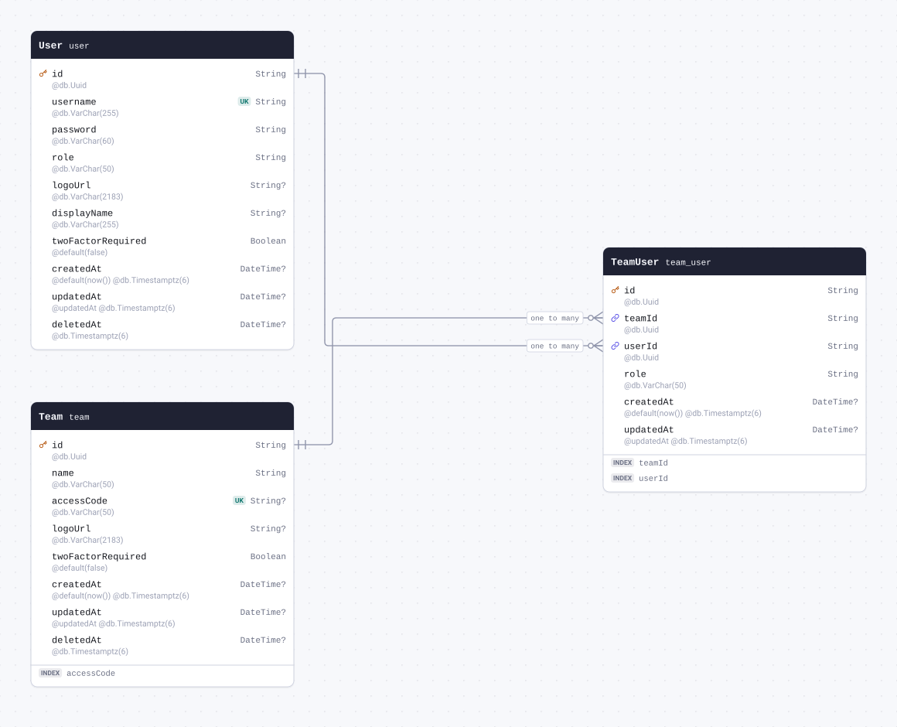

| Field                      | Type                            | Constraints                       | Default      | Description |
| -------------------------- | ------------------------------- | --------------------------------- | ------------ | ----------- |
| `id` (`team_user_id`)      | `String` `@db.Uuid`             | PK NOT NULL                       |              |             |
| `teamId` (`team_id`)       | `String` `@db.Uuid`             | NOT NULL → [Team.id](#model-Team) |              |             |
| `userId` (`user_id`)       | `String` `@db.Uuid`             | NOT NULL → [User.id](#model-User) |              |             |
| `role`                     | `String` `@db.VarChar(50)`      | NOT NULL                          |              |             |
| `createdAt` (`created_at`) | `DateTime` `@db.Timestamptz(6)` | NULL                              | `now()`      |             |
| `updatedAt` (`updated_at`) | `DateTime` `@db.Timestamptz(6)` | NULL                              | `@updatedAt` |             |

#### Indexes

- `@@index([teamId])`
- `@@index([userId])`

#### References

- `teamId` → [Team.id](#model-Team) (many-to-one)
- `userId` → [User.id](#model-User) (many-to-one)

#### Definition

```sql
CREATE TABLE "team_user" (
    "team_user_id" UUID NOT NULL,
    "team_id" UUID NOT NULL,
    "user_id" UUID NOT NULL,
    "role" VARCHAR(50) NOT NULL,
    "created_at" TIMESTAMPTZ(6) DEFAULT CURRENT_TIMESTAMP,
    "updated_at" TIMESTAMPTZ(6),

    CONSTRAINT "team_user_pkey" PRIMARY KEY ("team_user_id")
);

CREATE INDEX "team_user_team_id_idx" ON "team_user"("team_id");

CREATE INDEX "team_user_user_id_idx" ON "team_user"("user_id");
```

<details>
<summary>Queries and their SQL</summary>

**findMany**: Every row

```ts
await prisma.teamUser.findMany();
```

```sql
SELECT
  "public"."team_user"."team_user_id",
  "public"."team_user"."team_id",
  "public"."team_user"."user_id",
  "public"."team_user"."role",
  "public"."team_user"."created_at",
  "public"."team_user"."updated_at"
FROM
  "public"."team_user"
WHERE
  1 = 1
OFFSET
  $1
-- params: ["0"]
```

**count**: How many rows there are

```ts
await prisma.teamUser.count();
```

```sql
SELECT
  COUNT(*) AS "_count$_all"
FROM
  (
    SELECT
      "public"."team_user"."team_user_id"
    FROM
      "public"."team_user"
    WHERE
      1 = 1
    OFFSET
      $1
  ) AS "sub"
-- params: ["0"]
```

**findMany**: Every row with its relations

```ts
await prisma.teamUser.findMany({ include: { team: true, user: true } });
```

```sql
SELECT
  "public"."team_user"."team_user_id",
  "public"."team_user"."team_id",
  "public"."team_user"."user_id",
  "public"."team_user"."role",
  "public"."team_user"."created_at",
  "public"."team_user"."updated_at"
FROM
  "public"."team_user"
WHERE
  1 = 1
OFFSET
  $1
-- params: ["0"]

SELECT
  "public"."team"."team_id",
  "public"."team"."name",
  "public"."team"."access_code",
  "public"."team"."logo_url",
  "public"."team"."two_factor_required",
  "public"."team"."created_at",
  "public"."team"."updated_at",
  "public"."team"."deleted_at"
FROM
  "public"."team"
WHERE
  "public"."team"."team_id" IN ($1)
OFFSET
  $2
-- params: ["<teamId of the rows above>","0"]

SELECT
  "public"."user"."user_id",
  "public"."user"."username",
  "public"."user"."password",
  "public"."user"."role",
  "public"."user"."logo_url",
  "public"."user"."display_name",
  "public"."user"."two_factor_required",
  "public"."user"."created_at",
  "public"."user"."updated_at",
  "public"."user"."deleted_at"
FROM
  "public"."user"
WHERE
  "public"."user"."user_id" IN ($1)
OFFSET
  $2
-- params: ["<userId of the rows above>","0"]
```

**findUnique**: One row by what is unique to it

```ts
await prisma.teamUser.findUnique({ where: { id: "example" } });
```

```sql
SELECT
  "public"."team_user"."team_user_id",
  "public"."team_user"."team_id",
  "public"."team_user"."user_id",
  "public"."team_user"."role",
  "public"."team_user"."created_at",
  "public"."team_user"."updated_at"
FROM
  "public"."team_user"
WHERE
  (
    "public"."team_user"."team_user_id" = $1
    AND 1 = 1
  )
LIMIT
  $2
OFFSET
  $3
-- params: ["example","1","0"]
```

**create**: Create a row

```ts
await prisma.teamUser.create({
  data: { id: "example", teamId: "example", userId: "example", role: "example" },
});
```

```sql
INSERT INTO
  "public"."team_user" (
    "team_user_id",
    "team_id",
    "user_id",
    "role",
    "created_at",
    "updated_at"
  )
VALUES
  ($1, $2, $3, $4, $5, $6)
RETURNING
  "public"."team_user"."team_user_id",
  "public"."team_user"."team_id",
  "public"."team_user"."user_id",
  "public"."team_user"."role",
  "public"."team_user"."created_at",
  "public"."team_user"."updated_at"
-- params: ["example","example","example","example","<now()>","<now()>"]
```

**update**: Update a row

```ts
await prisma.teamUser.update({ where: { id: "example" }, data: { role: "example" } });
```

```sql
SELECT
  "public"."team_user"."team_user_id"
FROM
  "public"."team_user"
WHERE
  (
    "public"."team_user"."team_user_id" = $1
    AND 1 = 1
  )
LIMIT
  $2
OFFSET
  $3
-- params: ["example","1","0"]

UPDATE "public"."team_user"
SET
  "role" = $1,
  "updated_at" = $2
WHERE
  (
    "public"."team_user"."team_user_id" IN ($3)
    AND (
      "public"."team_user"."team_user_id" = $4
      AND 1 = 1
    )
  )
RETURNING
  "public"."team_user"."team_user_id",
  "public"."team_user"."team_id",
  "public"."team_user"."user_id",
  "public"."team_user"."role",
  "public"."team_user"."created_at",
  "public"."team_user"."updated_at"
-- params: ["example",{"prisma__type":"generatorCall","prisma__value":{"name":"now","args":[],"returnType":{"type":"DateTime"}}},"<id of the rows above>","example"]
```

**delete**: Delete a row

```ts
await prisma.teamUser.delete({ where: { id: "example" } });
```

```sql
DELETE FROM "public"."team_user"
WHERE
  (
    "public"."team_user"."team_user_id" = $1
    AND 1 = 1
  )
RETURNING
  "public"."team_user"."team_user_id",
  "public"."team_user"."team_id",
  "public"."team_user"."user_id",
  "public"."team_user"."role",
  "public"."team_user"."created_at",
  "public"."team_user"."updated_at"
-- params: ["example"]
```

</details>

<a id="model-Report"></a>

### Report

Table `report`.

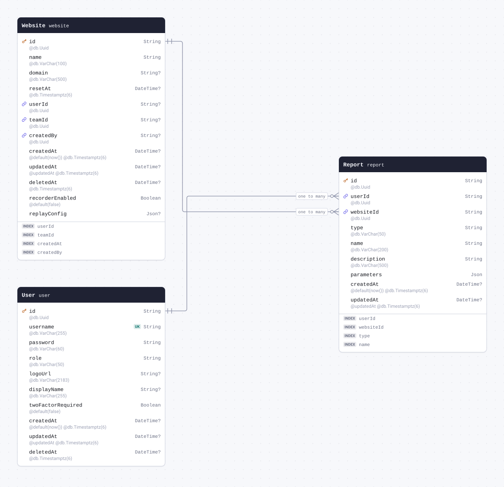

| Field                      | Type                            | Constraints                             | Default      | Description |
| -------------------------- | ------------------------------- | --------------------------------------- | ------------ | ----------- |
| `id` (`report_id`)         | `String` `@db.Uuid`             | PK NOT NULL                             |              |             |
| `userId` (`user_id`)       | `String` `@db.Uuid`             | NOT NULL → [User.id](#model-User)       |              |             |
| `websiteId` (`website_id`) | `String` `@db.Uuid`             | NOT NULL → [Website.id](#model-Website) |              |             |
| `type`                     | `String` `@db.VarChar(50)`      | NOT NULL                                |              |             |
| `name`                     | `String` `@db.VarChar(200)`     | NOT NULL                                |              |             |
| `description`              | `String` `@db.VarChar(500)`     | NOT NULL                                |              |             |
| `parameters`               | `Json`                          | NOT NULL                                |              |             |
| `createdAt` (`created_at`) | `DateTime` `@db.Timestamptz(6)` | NULL                                    | `now()`      |             |
| `updatedAt` (`updated_at`) | `DateTime` `@db.Timestamptz(6)` | NULL                                    | `@updatedAt` |             |

#### Indexes

- `@@index([userId])`
- `@@index([websiteId])`
- `@@index([type])`
- `@@index([name])`

#### References

- `userId` → [User.id](#model-User) (many-to-one)
- `websiteId` → [Website.id](#model-Website) (many-to-one)

#### Definition

```sql
CREATE TABLE "report" (
    "report_id" UUID NOT NULL,
    "user_id" UUID NOT NULL,
    "website_id" UUID NOT NULL,
    "type" VARCHAR(50) NOT NULL,
    "name" VARCHAR(200) NOT NULL,
    "description" VARCHAR(500) NOT NULL,
    "parameters" JSONB NOT NULL,
    "created_at" TIMESTAMPTZ(6) DEFAULT CURRENT_TIMESTAMP,
    "updated_at" TIMESTAMPTZ(6),

    CONSTRAINT "report_pkey" PRIMARY KEY ("report_id")
);

CREATE INDEX "report_user_id_idx" ON "report"("user_id");

CREATE INDEX "report_website_id_idx" ON "report"("website_id");

CREATE INDEX "report_type_idx" ON "report"("type");

CREATE INDEX "report_name_idx" ON "report"("name");
```

<details>
<summary>Queries and their SQL</summary>

**findMany**: Every row

```ts
await prisma.report.findMany();
```

```sql
SELECT
  "public"."report"."report_id",
  "public"."report"."user_id",
  "public"."report"."website_id",
  "public"."report"."type",
  "public"."report"."name",
  "public"."report"."description",
  "public"."report"."parameters",
  "public"."report"."created_at",
  "public"."report"."updated_at"
FROM
  "public"."report"
WHERE
  1 = 1
OFFSET
  $1
-- params: ["0"]
```

**count**: How many rows there are

```ts
await prisma.report.count();
```

```sql
SELECT
  COUNT(*) AS "_count$_all"
FROM
  (
    SELECT
      "public"."report"."report_id"
    FROM
      "public"."report"
    WHERE
      1 = 1
    OFFSET
      $1
  ) AS "sub"
-- params: ["0"]
```

**findMany**: Every row with its relations

```ts
await prisma.report.findMany({ include: { user: true, website: true } });
```

```sql
SELECT
  "public"."report"."report_id",
  "public"."report"."user_id",
  "public"."report"."website_id",
  "public"."report"."type",
  "public"."report"."name",
  "public"."report"."description",
  "public"."report"."parameters",
  "public"."report"."created_at",
  "public"."report"."updated_at"
FROM
  "public"."report"
WHERE
  1 = 1
OFFSET
  $1
-- params: ["0"]

SELECT
  "public"."user"."user_id",
  "public"."user"."username",
  "public"."user"."password",
  "public"."user"."role",
  "public"."user"."logo_url",
  "public"."user"."display_name",
  "public"."user"."two_factor_required",
  "public"."user"."created_at",
  "public"."user"."updated_at",
  "public"."user"."deleted_at"
FROM
  "public"."user"
WHERE
  "public"."user"."user_id" IN ($1)
OFFSET
  $2
-- params: ["<userId of the rows above>","0"]

SELECT
  "public"."website"."website_id",
  "public"."website"."name",
  "public"."website"."domain",
  "public"."website"."reset_at",
  "public"."website"."user_id",
  "public"."website"."team_id",
  "public"."website"."created_by",
  "public"."website"."created_at",
  "public"."website"."updated_at",
  "public"."website"."deleted_at",
  "public"."website"."recorder_enabled",
  "public"."website"."replay_config"
FROM
  "public"."website"
WHERE
  "public"."website"."website_id" IN ($1)
OFFSET
  $2
-- params: ["<websiteId of the rows above>","0"]
```

**findUnique**: One row by what is unique to it

```ts
await prisma.report.findUnique({ where: { id: "example" } });
```

```sql
SELECT
  "public"."report"."report_id",
  "public"."report"."user_id",
  "public"."report"."website_id",
  "public"."report"."type",
  "public"."report"."name",
  "public"."report"."description",
  "public"."report"."parameters",
  "public"."report"."created_at",
  "public"."report"."updated_at"
FROM
  "public"."report"
WHERE
  (
    "public"."report"."report_id" = $1
    AND 1 = 1
  )
LIMIT
  $2
OFFSET
  $3
-- params: ["example","1","0"]
```

**create**: Create a row

```ts
await prisma.report.create({
  data: {
    id: "example",
    userId: "example",
    websiteId: "example",
    type: "example",
    name: "example",
    description: "example",
    parameters: {},
  },
});
```

```sql
INSERT INTO
  "public"."report" (
    "report_id",
    "user_id",
    "website_id",
    "type",
    "name",
    "description",
    "parameters",
    "created_at",
    "updated_at"
  )
VALUES
  ($1, $2, $3, $4, $5, $6, $7, $8, $9)
RETURNING
  "public"."report"."report_id",
  "public"."report"."user_id",
  "public"."report"."website_id",
  "public"."report"."type",
  "public"."report"."name",
  "public"."report"."description",
  "public"."report"."parameters",
  "public"."report"."created_at",
  "public"."report"."updated_at"
-- params: ["example","example","example","example","example","example","{}","<now()>","<now()>"]
```

**update**: Update a row

```ts
await prisma.report.update({ where: { id: "example" }, data: { type: "example" } });
```

```sql
SELECT
  "public"."report"."report_id"
FROM
  "public"."report"
WHERE
  (
    "public"."report"."report_id" = $1
    AND 1 = 1
  )
LIMIT
  $2
OFFSET
  $3
-- params: ["example","1","0"]

UPDATE "public"."report"
SET
  "type" = $1,
  "updated_at" = $2
WHERE
  (
    "public"."report"."report_id" IN ($3)
    AND (
      "public"."report"."report_id" = $4
      AND 1 = 1
    )
  )
RETURNING
  "public"."report"."report_id",
  "public"."report"."user_id",
  "public"."report"."website_id",
  "public"."report"."type",
  "public"."report"."name",
  "public"."report"."description",
  "public"."report"."parameters",
  "public"."report"."created_at",
  "public"."report"."updated_at"
-- params: ["example",{"prisma__type":"generatorCall","prisma__value":{"name":"now","args":[],"returnType":{"type":"DateTime"}}},"<id of the rows above>","example"]
```

**delete**: Delete a row

```ts
await prisma.report.delete({ where: { id: "example" } });
```

```sql
DELETE FROM "public"."report"
WHERE
  (
    "public"."report"."report_id" = $1
    AND 1 = 1
  )
RETURNING
  "public"."report"."report_id",
  "public"."report"."user_id",
  "public"."report"."website_id",
  "public"."report"."type",
  "public"."report"."name",
  "public"."report"."description",
  "public"."report"."parameters",
  "public"."report"."created_at",
  "public"."report"."updated_at"
-- params: ["example"]
```

</details>

<a id="model-Annotation"></a>

### Annotation

Table `annotation`.

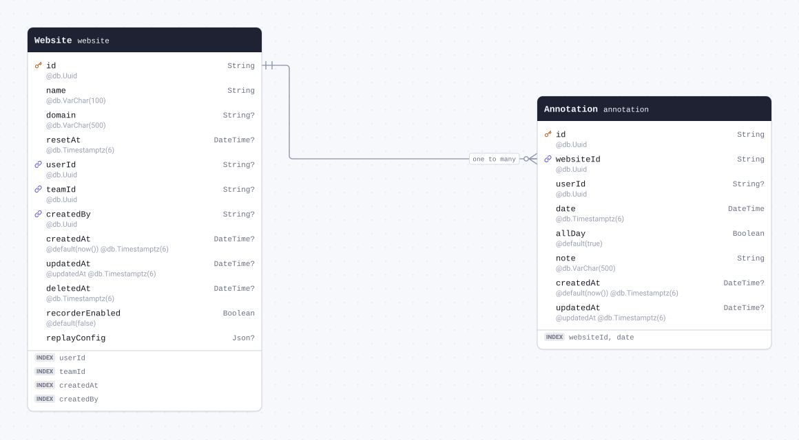

| Field                      | Type                            | Constraints                             | Default      | Description |
| -------------------------- | ------------------------------- | --------------------------------------- | ------------ | ----------- |
| `id` (`annotation_id`)     | `String` `@db.Uuid`             | PK NOT NULL                             |              |             |
| `websiteId` (`website_id`) | `String` `@db.Uuid`             | NOT NULL → [Website.id](#model-Website) |              |             |
| `userId` (`user_id`)       | `String` `@db.Uuid`             | NULL                                    |              |             |
| `date`                     | `DateTime` `@db.Timestamptz(6)` | NOT NULL                                |              |             |
| `allDay` (`all_day`)       | `Boolean`                       | NOT NULL                                | `true`       |             |
| `note`                     | `String` `@db.VarChar(500)`     | NOT NULL                                |              |             |
| `createdAt` (`created_at`) | `DateTime` `@db.Timestamptz(6)` | NULL                                    | `now()`      |             |
| `updatedAt` (`updated_at`) | `DateTime` `@db.Timestamptz(6)` | NULL                                    | `@updatedAt` |             |

#### Indexes

- `@@index([websiteId, date])`

#### References

- `websiteId` → [Website.id](#model-Website) (many-to-one)

#### Definition

```sql
CREATE TABLE "annotation" (
    "annotation_id" UUID NOT NULL,
    "website_id" UUID NOT NULL,
    "user_id" UUID,
    "date" TIMESTAMPTZ(6) NOT NULL,
    "all_day" BOOLEAN NOT NULL DEFAULT true,
    "note" VARCHAR(500) NOT NULL,
    "created_at" TIMESTAMPTZ(6) DEFAULT CURRENT_TIMESTAMP,
    "updated_at" TIMESTAMPTZ(6),

    CONSTRAINT "annotation_pkey" PRIMARY KEY ("annotation_id")
);

CREATE INDEX "annotation_website_id_date_idx" ON "annotation"("website_id", "date");
```

<details>
<summary>Queries and their SQL</summary>

**findMany**: Every row

```ts
await prisma.annotation.findMany();
```

```sql
SELECT
  "public"."annotation"."annotation_id",
  "public"."annotation"."website_id",
  "public"."annotation"."user_id",
  "public"."annotation"."date",
  "public"."annotation"."all_day",
  "public"."annotation"."note",
  "public"."annotation"."created_at",
  "public"."annotation"."updated_at"
FROM
  "public"."annotation"
WHERE
  1 = 1
OFFSET
  $1
-- params: ["0"]
```

**count**: How many rows there are

```ts
await prisma.annotation.count();
```

```sql
SELECT
  COUNT(*) AS "_count$_all"
FROM
  (
    SELECT
      "public"."annotation"."annotation_id"
    FROM
      "public"."annotation"
    WHERE
      1 = 1
    OFFSET
      $1
  ) AS "sub"
-- params: ["0"]
```

**findMany**: Every row with its relations

```ts
await prisma.annotation.findMany({ include: { website: true } });
```

```sql
SELECT
  "public"."annotation"."annotation_id",
  "public"."annotation"."website_id",
  "public"."annotation"."user_id",
  "public"."annotation"."date",
  "public"."annotation"."all_day",
  "public"."annotation"."note",
  "public"."annotation"."created_at",
  "public"."annotation"."updated_at"
FROM
  "public"."annotation"
WHERE
  1 = 1
OFFSET
  $1
-- params: ["0"]

SELECT
  "public"."website"."website_id",
  "public"."website"."name",
  "public"."website"."domain",
  "public"."website"."reset_at",
  "public"."website"."user_id",
  "public"."website"."team_id",
  "public"."website"."created_by",
  "public"."website"."created_at",
  "public"."website"."updated_at",
  "public"."website"."deleted_at",
  "public"."website"."recorder_enabled",
  "public"."website"."replay_config"
FROM
  "public"."website"
WHERE
  "public"."website"."website_id" IN ($1)
OFFSET
  $2
-- params: ["<websiteId of the rows above>","0"]
```

**findUnique**: One row by what is unique to it

```ts
await prisma.annotation.findUnique({ where: { id: "example" } });
```

```sql
SELECT
  "public"."annotation"."annotation_id",
  "public"."annotation"."website_id",
  "public"."annotation"."user_id",
  "public"."annotation"."date",
  "public"."annotation"."all_day",
  "public"."annotation"."note",
  "public"."annotation"."created_at",
  "public"."annotation"."updated_at"
FROM
  "public"."annotation"
WHERE
  (
    "public"."annotation"."annotation_id" = $1
    AND 1 = 1
  )
LIMIT
  $2
OFFSET
  $3
-- params: ["example","1","0"]
```

**create**: Create a row

```ts
await prisma.annotation.create({
  data: {
    id: "example",
    websiteId: "example",
    date: new Date("2026-01-01T00:00:00.000Z"),
    note: "example",
  },
});
```

```sql
INSERT INTO
  "public"."annotation" (
    "annotation_id",
    "website_id",
    "date",
    "all_day",
    "note",
    "created_at",
    "updated_at"
  )
VALUES
  ($1, $2, $3, $4, $5, $6, $7)
RETURNING
  "public"."annotation"."annotation_id",
  "public"."annotation"."website_id",
  "public"."annotation"."user_id",
  "public"."annotation"."date",
  "public"."annotation"."all_day",
  "public"."annotation"."note",
  "public"."annotation"."created_at",
  "public"."annotation"."updated_at"
-- params: ["example","example","2026-01-01T00:00:00.000Z",true,"example","<now()>","<now()>"]
```

**update**: Update a row

```ts
await prisma.annotation.update({ where: { id: "example" }, data: { userId: "example" } });
```

```sql
SELECT
  "public"."annotation"."annotation_id"
FROM
  "public"."annotation"
WHERE
  (
    "public"."annotation"."annotation_id" = $1
    AND 1 = 1
  )
LIMIT
  $2
OFFSET
  $3
-- params: ["example","1","0"]

UPDATE "public"."annotation"
SET
  "user_id" = $1,
  "updated_at" = $2
WHERE
  (
    "public"."annotation"."annotation_id" IN ($3)
    AND (
      "public"."annotation"."annotation_id" = $4
      AND 1 = 1
    )
  )
RETURNING
  "public"."annotation"."annotation_id",
  "public"."annotation"."website_id",
  "public"."annotation"."user_id",
  "public"."annotation"."date",
  "public"."annotation"."all_day",
  "public"."annotation"."note",
  "public"."annotation"."created_at",
  "public"."annotation"."updated_at"
-- params: ["example",{"prisma__type":"generatorCall","prisma__value":{"name":"now","args":[],"returnType":{"type":"DateTime"}}},"<id of the rows above>","example"]
```

**delete**: Delete a row

```ts
await prisma.annotation.delete({ where: { id: "example" } });
```

```sql
DELETE FROM "public"."annotation"
WHERE
  (
    "public"."annotation"."annotation_id" = $1
    AND 1 = 1
  )
RETURNING
  "public"."annotation"."annotation_id",
  "public"."annotation"."website_id",
  "public"."annotation"."user_id",
  "public"."annotation"."date",
  "public"."annotation"."all_day",
  "public"."annotation"."note",
  "public"."annotation"."created_at",
  "public"."annotation"."updated_at"
-- params: ["example"]
```

</details>

<a id="model-Segment"></a>

### Segment

Table `segment`.

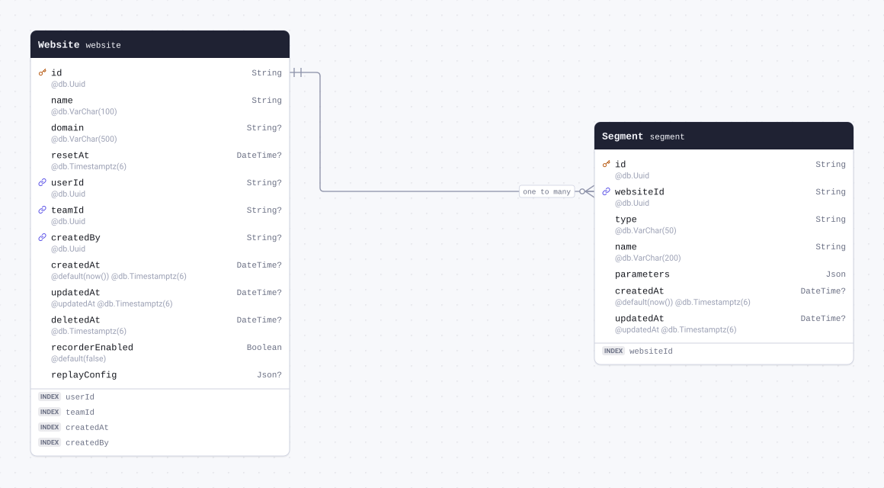

| Field                      | Type                            | Constraints                             | Default      | Description |
| -------------------------- | ------------------------------- | --------------------------------------- | ------------ | ----------- |
| `id` (`segment_id`)        | `String` `@db.Uuid`             | PK NOT NULL                             |              |             |
| `websiteId` (`website_id`) | `String` `@db.Uuid`             | NOT NULL → [Website.id](#model-Website) |              |             |
| `type`                     | `String` `@db.VarChar(50)`      | NOT NULL                                |              |             |
| `name`                     | `String` `@db.VarChar(200)`     | NOT NULL                                |              |             |
| `parameters`               | `Json`                          | NOT NULL                                |              |             |
| `createdAt` (`created_at`) | `DateTime` `@db.Timestamptz(6)` | NULL                                    | `now()`      |             |
| `updatedAt` (`updated_at`) | `DateTime` `@db.Timestamptz(6)` | NULL                                    | `@updatedAt` |             |

#### Indexes

- `@@index([websiteId])`

#### References

- `websiteId` → [Website.id](#model-Website) (many-to-one)

#### Definition

```sql
CREATE TABLE "segment" (
    "segment_id" UUID NOT NULL,
    "website_id" UUID NOT NULL,
    "type" VARCHAR(50) NOT NULL,
    "name" VARCHAR(200) NOT NULL,
    "parameters" JSONB NOT NULL,
    "created_at" TIMESTAMPTZ(6) DEFAULT CURRENT_TIMESTAMP,
    "updated_at" TIMESTAMPTZ(6),

    CONSTRAINT "segment_pkey" PRIMARY KEY ("segment_id")
);

CREATE INDEX "segment_website_id_idx" ON "segment"("website_id");
```

<details>
<summary>Queries and their SQL</summary>

**findMany**: Every row

```ts
await prisma.segment.findMany();
```

```sql
SELECT
  "public"."segment"."segment_id",
  "public"."segment"."website_id",
  "public"."segment"."type",
  "public"."segment"."name",
  "public"."segment"."parameters",
  "public"."segment"."created_at",
  "public"."segment"."updated_at"
FROM
  "public"."segment"
WHERE
  1 = 1
OFFSET
  $1
-- params: ["0"]
```

**count**: How many rows there are

```ts
await prisma.segment.count();
```

```sql
SELECT
  COUNT(*) AS "_count$_all"
FROM
  (
    SELECT
      "public"."segment"."segment_id"
    FROM
      "public"."segment"
    WHERE
      1 = 1
    OFFSET
      $1
  ) AS "sub"
-- params: ["0"]
```

**findMany**: Every row with its relations

```ts
await prisma.segment.findMany({ include: { website: true } });
```

```sql
SELECT
  "public"."segment"."segment_id",
  "public"."segment"."website_id",
  "public"."segment"."type",
  "public"."segment"."name",
  "public"."segment"."parameters",
  "public"."segment"."created_at",
  "public"."segment"."updated_at"
FROM
  "public"."segment"
WHERE
  1 = 1
OFFSET
  $1
-- params: ["0"]

SELECT
  "public"."website"."website_id",
  "public"."website"."name",
  "public"."website"."domain",
  "public"."website"."reset_at",
  "public"."website"."user_id",
  "public"."website"."team_id",
  "public"."website"."created_by",
  "public"."website"."created_at",
  "public"."website"."updated_at",
  "public"."website"."deleted_at",
  "public"."website"."recorder_enabled",
  "public"."website"."replay_config"
FROM
  "public"."website"
WHERE
  "public"."website"."website_id" IN ($1)
OFFSET
  $2
-- params: ["<websiteId of the rows above>","0"]
```

**findUnique**: One row by what is unique to it

```ts
await prisma.segment.findUnique({ where: { id: "example" } });
```

```sql
SELECT
  "public"."segment"."segment_id",
  "public"."segment"."website_id",
  "public"."segment"."type",
  "public"."segment"."name",
  "public"."segment"."parameters",
  "public"."segment"."created_at",
  "public"."segment"."updated_at"
FROM
  "public"."segment"
WHERE
  (
    "public"."segment"."segment_id" = $1
    AND 1 = 1
  )
LIMIT
  $2
OFFSET
  $3
-- params: ["example","1","0"]
```

**create**: Create a row

```ts
await prisma.segment.create({
  data: { id: "example", websiteId: "example", type: "example", name: "example", parameters: {} },
});
```

```sql
INSERT INTO
  "public"."segment" (
    "segment_id",
    "website_id",
    "type",
    "name",
    "parameters",
    "created_at",
    "updated_at"
  )
VALUES
  ($1, $2, $3, $4, $5, $6, $7)
RETURNING
  "public"."segment"."segment_id",
  "public"."segment"."website_id",
  "public"."segment"."type",
  "public"."segment"."name",
  "public"."segment"."parameters",
  "public"."segment"."created_at",
  "public"."segment"."updated_at"
-- params: ["example","example","example","example","{}","<now()>","<now()>"]
```

**update**: Update a row

```ts
await prisma.segment.update({ where: { id: "example" }, data: { type: "example" } });
```

```sql
SELECT
  "public"."segment"."segment_id"
FROM
  "public"."segment"
WHERE
  (
    "public"."segment"."segment_id" = $1
    AND 1 = 1
  )
LIMIT
  $2
OFFSET
  $3
-- params: ["example","1","0"]

UPDATE "public"."segment"
SET
  "type" = $1,
  "updated_at" = $2
WHERE
  (
    "public"."segment"."segment_id" IN ($3)
    AND (
      "public"."segment"."segment_id" = $4
      AND 1 = 1
    )
  )
RETURNING
  "public"."segment"."segment_id",
  "public"."segment"."website_id",
  "public"."segment"."type",
  "public"."segment"."name",
  "public"."segment"."parameters",
  "public"."segment"."created_at",
  "public"."segment"."updated_at"
-- params: ["example",{"prisma__type":"generatorCall","prisma__value":{"name":"now","args":[],"returnType":{"type":"DateTime"}}},"<id of the rows above>","example"]
```

**delete**: Delete a row

```ts
await prisma.segment.delete({ where: { id: "example" } });
```

```sql
DELETE FROM "public"."segment"
WHERE
  (
    "public"."segment"."segment_id" = $1
    AND 1 = 1
  )
RETURNING
  "public"."segment"."segment_id",
  "public"."segment"."website_id",
  "public"."segment"."type",
  "public"."segment"."name",
  "public"."segment"."parameters",
  "public"."segment"."created_at",
  "public"."segment"."updated_at"
-- params: ["example"]
```

</details>

<a id="model-Revenue"></a>

### Revenue

Table `revenue`.

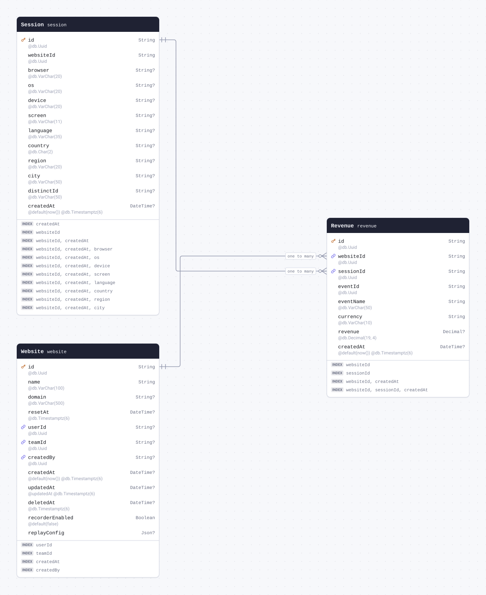

| Field                      | Type                            | Constraints                             | Default | Description |
| -------------------------- | ------------------------------- | --------------------------------------- | ------- | ----------- |
| `id` (`revenue_id`)        | `String` `@db.Uuid`             | PK NOT NULL                             |         |             |
| `websiteId` (`website_id`) | `String` `@db.Uuid`             | NOT NULL → [Website.id](#model-Website) |         |             |
| `sessionId` (`session_id`) | `String` `@db.Uuid`             | NOT NULL → [Session.id](#model-Session) |         |             |
| `eventId` (`event_id`)     | `String` `@db.Uuid`             | NOT NULL                                |         |             |
| `eventName` (`event_name`) | `String` `@db.VarChar(50)`      | NOT NULL                                |         |             |
| `currency`                 | `String` `@db.VarChar(10)`      | NOT NULL                                |         |             |
| `revenue`                  | `Decimal` `@db.Decimal(19, 4)`  | NULL                                    |         |             |
| `createdAt` (`created_at`) | `DateTime` `@db.Timestamptz(6)` | NULL                                    | `now()` |             |

#### Indexes

- `@@index([websiteId])`
- `@@index([sessionId])`
- `@@index([websiteId, createdAt])`
- `@@index([websiteId, sessionId, createdAt])`

#### References

- `websiteId` → [Website.id](#model-Website) (many-to-one)
- `sessionId` → [Session.id](#model-Session) (many-to-one)

#### Definition

```sql
CREATE TABLE "revenue" (
    "revenue_id" UUID NOT NULL,
    "website_id" UUID NOT NULL,
    "session_id" UUID NOT NULL,
    "event_id" UUID NOT NULL,
    "event_name" VARCHAR(50) NOT NULL,
    "currency" VARCHAR(10) NOT NULL,
    "revenue" DECIMAL(19,4),
    "created_at" TIMESTAMPTZ(6) DEFAULT CURRENT_TIMESTAMP,

    CONSTRAINT "revenue_pkey" PRIMARY KEY ("revenue_id")
);

CREATE INDEX "revenue_website_id_idx" ON "revenue"("website_id");

CREATE INDEX "revenue_session_id_idx" ON "revenue"("session_id");

CREATE INDEX "revenue_website_id_created_at_idx" ON "revenue"("website_id", "created_at");

CREATE INDEX "revenue_website_id_session_id_created_at_idx" ON "revenue"("website_id", "session_id", "created_at");
```

<details>
<summary>Queries and their SQL</summary>

**findMany**: Every row

```ts
await prisma.revenue.findMany();
```

```sql
SELECT
  "public"."revenue"."revenue_id",
  "public"."revenue"."website_id",
  "public"."revenue"."session_id",
  "public"."revenue"."event_id",
  "public"."revenue"."event_name",
  "public"."revenue"."currency",
  "public"."revenue"."revenue",
  "public"."revenue"."created_at"
FROM
  "public"."revenue"
WHERE
  1 = 1
OFFSET
  $1
-- params: ["0"]
```

**count**: How many rows there are

```ts
await prisma.revenue.count();
```

```sql
SELECT
  COUNT(*) AS "_count$_all"
FROM
  (
    SELECT
      "public"."revenue"."revenue_id"
    FROM
      "public"."revenue"
    WHERE
      1 = 1
    OFFSET
      $1
  ) AS "sub"
-- params: ["0"]
```

**findMany**: Every row with its relations

```ts
await prisma.revenue.findMany({ include: { website: true, session: true } });
```

```sql
SELECT
  "public"."revenue"."revenue_id",
  "public"."revenue"."website_id",
  "public"."revenue"."session_id",
  "public"."revenue"."event_id",
  "public"."revenue"."event_name",
  "public"."revenue"."currency",
  "public"."revenue"."revenue",
  "public"."revenue"."created_at"
FROM
  "public"."revenue"
WHERE
  1 = 1
OFFSET
  $1
-- params: ["0"]

SELECT
  "public"."website"."website_id",
  "public"."website"."name",
  "public"."website"."domain",
  "public"."website"."reset_at",
  "public"."website"."user_id",
  "public"."website"."team_id",
  "public"."website"."created_by",
  "public"."website"."created_at",
  "public"."website"."updated_at",
  "public"."website"."deleted_at",
  "public"."website"."recorder_enabled",
  "public"."website"."replay_config"
FROM
  "public"."website"
WHERE
  "public"."website"."website_id" IN ($1)
OFFSET
  $2
-- params: ["<websiteId of the rows above>","0"]

SELECT
  "public"."session"."session_id",
  "public"."session"."website_id",
  "public"."session"."browser",
  "public"."session"."os",
  "public"."session"."device",
  "public"."session"."screen",
  "public"."session"."language",
  "public"."session"."country",
  "public"."session"."region",
  "public"."session"."city",
  "public"."session"."distinct_id",
  "public"."session"."created_at"
FROM
  "public"."session"
WHERE
  "public"."session"."session_id" IN ($1)
OFFSET
  $2
-- params: ["<sessionId of the rows above>","0"]
```

**findUnique**: One row by what is unique to it

```ts
await prisma.revenue.findUnique({ where: { id: "example" } });
```

```sql
SELECT
  "public"."revenue"."revenue_id",
  "public"."revenue"."website_id",
  "public"."revenue"."session_id",
  "public"."revenue"."event_id",
  "public"."revenue"."event_name",
  "public"."revenue"."currency",
  "public"."revenue"."revenue",
  "public"."revenue"."created_at"
FROM
  "public"."revenue"
WHERE
  (
    "public"."revenue"."revenue_id" = $1
    AND 1 = 1
  )
LIMIT
  $2
OFFSET
  $3
-- params: ["example","1","0"]
```

**create**: Create a row

```ts
await prisma.revenue.create({
  data: {
    id: "example",
    websiteId: "example",
    sessionId: "example",
    eventId: "example",
    eventName: "example",
    currency: "example",
  },
});
```

```sql
INSERT INTO
  "public"."revenue" (
    "revenue_id",
    "website_id",
    "session_id",
    "event_id",
    "event_name",
    "currency",
    "created_at"
  )
VALUES
  ($1, $2, $3, $4, $5, $6, $7)
RETURNING
  "public"."revenue"."revenue_id",
  "public"."revenue"."website_id",
  "public"."revenue"."session_id",
  "public"."revenue"."event_id",
  "public"."revenue"."event_name",
  "public"."revenue"."currency",
  "public"."revenue"."revenue",
  "public"."revenue"."created_at"
-- params: ["example","example","example","example","example","example","<now()>"]
```

**update**: Update a row

```ts
await prisma.revenue.update({ where: { id: "example" }, data: { eventId: "example" } });
```

```sql
SELECT
  "public"."revenue"."revenue_id"
FROM
  "public"."revenue"
WHERE
  (
    "public"."revenue"."revenue_id" = $1
    AND 1 = 1
  )
LIMIT
  $2
OFFSET
  $3
-- params: ["example","1","0"]

UPDATE "public"."revenue"
SET
  "event_id" = $1
WHERE
  (
    "public"."revenue"."revenue_id" IN ($2)
    AND (
      "public"."revenue"."revenue_id" = $3
      AND 1 = 1
    )
  )
RETURNING
  "public"."revenue"."revenue_id",
  "public"."revenue"."website_id",
  "public"."revenue"."session_id",
  "public"."revenue"."event_id",
  "public"."revenue"."event_name",
  "public"."revenue"."currency",
  "public"."revenue"."revenue",
  "public"."revenue"."created_at"
-- params: ["example","<id of the rows above>","example"]
```

**delete**: Delete a row

```ts
await prisma.revenue.delete({ where: { id: "example" } });
```

```sql
DELETE FROM "public"."revenue"
WHERE
  (
    "public"."revenue"."revenue_id" = $1
    AND 1 = 1
  )
RETURNING
  "public"."revenue"."revenue_id",
  "public"."revenue"."website_id",
  "public"."revenue"."session_id",
  "public"."revenue"."event_id",
  "public"."revenue"."event_name",
  "public"."revenue"."currency",
  "public"."revenue"."revenue",
  "public"."revenue"."created_at"
-- params: ["example"]
```

</details>

<a id="model-Link"></a>

### Link

Table `link`.

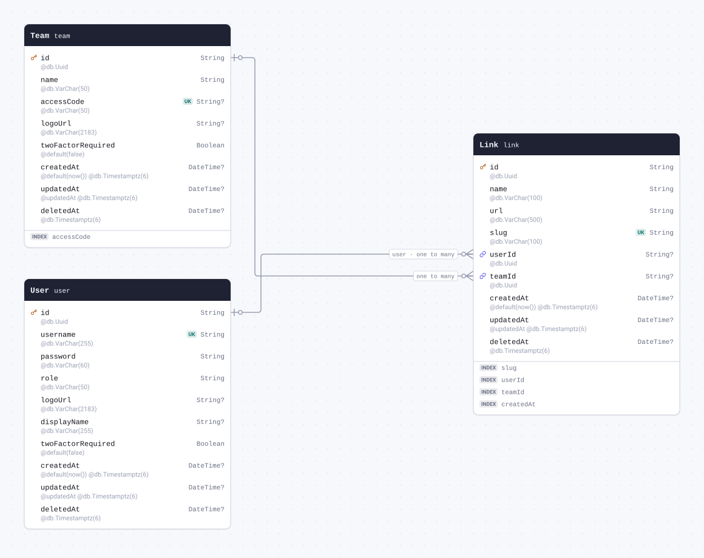

| Field                      | Type                            | Constraints                   | Default      | Description |
| -------------------------- | ------------------------------- | ----------------------------- | ------------ | ----------- |
| `id` (`link_id`)           | `String` `@db.Uuid`             | PK NOT NULL                   |              |             |
| `name`                     | `String` `@db.VarChar(100)`     | NOT NULL                      |              |             |
| `url`                      | `String` `@db.VarChar(500)`     | NOT NULL                      |              |             |
| `slug`                     | `String` `@db.VarChar(100)`     | UNIQUE NOT NULL               |              |             |
| `userId` (`user_id`)       | `String` `@db.Uuid`             | NULL → [User.id](#model-User) |              |             |
| `teamId` (`team_id`)       | `String` `@db.Uuid`             | NULL → [Team.id](#model-Team) |              |             |
| `createdAt` (`created_at`) | `DateTime` `@db.Timestamptz(6)` | NULL                          | `now()`      |             |
| `updatedAt` (`updated_at`) | `DateTime` `@db.Timestamptz(6)` | NULL                          | `@updatedAt` |             |
| `deletedAt` (`deleted_at`) | `DateTime` `@db.Timestamptz(6)` | NULL                          |              |             |

#### Indexes

- `@@index([slug])`
- `@@index([userId])`
- `@@index([teamId])`
- `@@index([createdAt])`

#### References

- `userId` → [User.id](#model-User) (many-to-one)
- `teamId` → [Team.id](#model-Team) (many-to-one)

#### Definition

```sql
CREATE TABLE "link" (
    "link_id" UUID NOT NULL,
    "name" VARCHAR(100) NOT NULL,
    "url" VARCHAR(500) NOT NULL,
    "slug" VARCHAR(100) NOT NULL,
    "user_id" UUID,
    "team_id" UUID,
    "created_at" TIMESTAMPTZ(6) DEFAULT CURRENT_TIMESTAMP,
    "updated_at" TIMESTAMPTZ(6),
    "deleted_at" TIMESTAMPTZ(6),

    CONSTRAINT "link_pkey" PRIMARY KEY ("link_id")
);

CREATE UNIQUE INDEX "link_slug_key" ON "link"("slug");

CREATE INDEX "link_slug_idx" ON "link"("slug");

CREATE INDEX "link_user_id_idx" ON "link"("user_id");

CREATE INDEX "link_team_id_idx" ON "link"("team_id");

CREATE INDEX "link_created_at_idx" ON "link"("created_at");
```

<details>
<summary>Queries and their SQL</summary>

**findMany**: Every row

```ts
await prisma.link.findMany();
```

```sql
SELECT
  "public"."link"."link_id",
  "public"."link"."name",
  "public"."link"."url",
  "public"."link"."slug",
  "public"."link"."user_id",
  "public"."link"."team_id",
  "public"."link"."created_at",
  "public"."link"."updated_at",
  "public"."link"."deleted_at"
FROM
  "public"."link"
WHERE
  1 = 1
OFFSET
  $1
-- params: ["0"]
```

**count**: How many rows there are

```ts
await prisma.link.count();
```

```sql
SELECT
  COUNT(*) AS "_count$_all"
FROM
  (
    SELECT
      "public"."link"."link_id"
    FROM
      "public"."link"
    WHERE
      1 = 1
    OFFSET
      $1
  ) AS "sub"
-- params: ["0"]
```

**findMany**: Every row with its relations

```ts
await prisma.link.findMany({ include: { user: true, team: true } });
```

```sql
SELECT
  "public"."link"."link_id",
  "public"."link"."name",
  "public"."link"."url",
  "public"."link"."slug",
  "public"."link"."user_id",
  "public"."link"."team_id",
  "public"."link"."created_at",
  "public"."link"."updated_at",
  "public"."link"."deleted_at"
FROM
  "public"."link"
WHERE
  1 = 1
OFFSET
  $1
-- params: ["0"]

SELECT
  "public"."user"."user_id",
  "public"."user"."username",
  "public"."user"."password",
  "public"."user"."role",
  "public"."user"."logo_url",
  "public"."user"."display_name",
  "public"."user"."two_factor_required",
  "public"."user"."created_at",
  "public"."user"."updated_at",
  "public"."user"."deleted_at"
FROM
  "public"."user"
WHERE
  "public"."user"."user_id" IN ($1)
OFFSET
  $2
-- params: ["<userId of the rows above>","0"]

SELECT
  "public"."team"."team_id",
  "public"."team"."name",
  "public"."team"."access_code",
  "public"."team"."logo_url",
  "public"."team"."two_factor_required",
  "public"."team"."created_at",
  "public"."team"."updated_at",
  "public"."team"."deleted_at"
FROM
  "public"."team"
WHERE
  "public"."team"."team_id" IN ($1)
OFFSET
  $2
-- params: ["<teamId of the rows above>","0"]
```

**findUnique**: One row by what is unique to it

```ts
await prisma.link.findUnique({ where: { id: "example" } });
```

```sql
SELECT
  "public"."link"."link_id",
  "public"."link"."name",
  "public"."link"."url",
  "public"."link"."slug",
  "public"."link"."user_id",
  "public"."link"."team_id",
  "public"."link"."created_at",
  "public"."link"."updated_at",
  "public"."link"."deleted_at"
FROM
  "public"."link"
WHERE
  (
    "public"."link"."link_id" = $1
    AND 1 = 1
  )
LIMIT
  $2
OFFSET
  $3
-- params: ["example","1","0"]
```

**create**: Create a row

```ts
await prisma.link.create({
  data: { id: "example", name: "example", url: "example", slug: "example" },
});
```

```sql
INSERT INTO
  "public"."link" (
    "link_id",
    "name",
    "url",
    "slug",
    "created_at",
    "updated_at"
  )
VALUES
  ($1, $2, $3, $4, $5, $6)
RETURNING
  "public"."link"."link_id",
  "public"."link"."name",
  "public"."link"."url",
  "public"."link"."slug",
  "public"."link"."user_id",
  "public"."link"."team_id",
  "public"."link"."created_at",
  "public"."link"."updated_at",
  "public"."link"."deleted_at"
-- params: ["example","example","example","example","<now()>","<now()>"]
```

**update**: Update a row

```ts
await prisma.link.update({ where: { id: "example" }, data: { name: "example" } });
```

```sql
SELECT
  "public"."link"."link_id"
FROM
  "public"."link"
WHERE
  (
    "public"."link"."link_id" = $1
    AND 1 = 1
  )
LIMIT
  $2
OFFSET
  $3
-- params: ["example","1","0"]

UPDATE "public"."link"
SET
  "name" = $1,
  "updated_at" = $2
WHERE
  (
    "public"."link"."link_id" IN ($3)
    AND (
      "public"."link"."link_id" = $4
      AND 1 = 1
    )
  )
RETURNING
  "public"."link"."link_id",
  "public"."link"."name",
  "public"."link"."url",
  "public"."link"."slug",
  "public"."link"."user_id",
  "public"."link"."team_id",
  "public"."link"."created_at",
  "public"."link"."updated_at",
  "public"."link"."deleted_at"
-- params: ["example",{"prisma__type":"generatorCall","prisma__value":{"name":"now","args":[],"returnType":{"type":"DateTime"}}},"<id of the rows above>","example"]
```

**delete**: Delete a row

```ts
await prisma.link.delete({ where: { id: "example" } });
```

```sql
DELETE FROM "public"."link"
WHERE
  (
    "public"."link"."link_id" = $1
    AND 1 = 1
  )
RETURNING
  "public"."link"."link_id",
  "public"."link"."name",
  "public"."link"."url",
  "public"."link"."slug",
  "public"."link"."user_id",
  "public"."link"."team_id",
  "public"."link"."created_at",
  "public"."link"."updated_at",
  "public"."link"."deleted_at"
-- params: ["example"]
```

</details>

<a id="model-Pixel"></a>

### Pixel

Table `pixel`.

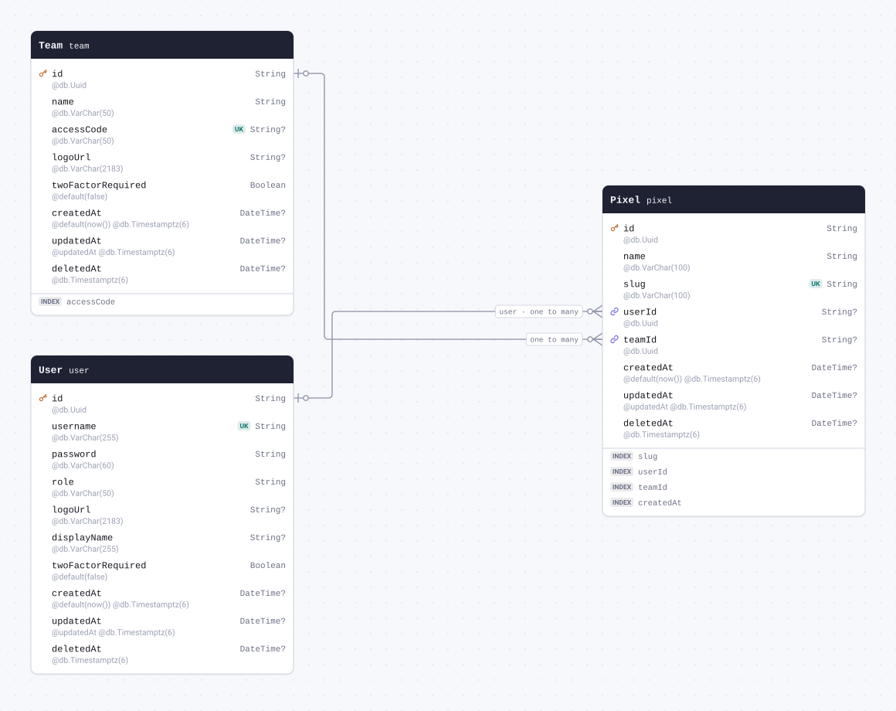

| Field                      | Type                            | Constraints                   | Default      | Description |
| -------------------------- | ------------------------------- | ----------------------------- | ------------ | ----------- |
| `id` (`pixel_id`)          | `String` `@db.Uuid`             | PK NOT NULL                   |              |             |
| `name`                     | `String` `@db.VarChar(100)`     | NOT NULL                      |              |             |
| `slug`                     | `String` `@db.VarChar(100)`     | UNIQUE NOT NULL               |              |             |
| `userId` (`user_id`)       | `String` `@db.Uuid`             | NULL → [User.id](#model-User) |              |             |
| `teamId` (`team_id`)       | `String` `@db.Uuid`             | NULL → [Team.id](#model-Team) |              |             |
| `createdAt` (`created_at`) | `DateTime` `@db.Timestamptz(6)` | NULL                          | `now()`      |             |
| `updatedAt` (`updated_at`) | `DateTime` `@db.Timestamptz(6)` | NULL                          | `@updatedAt` |             |
| `deletedAt` (`deleted_at`) | `DateTime` `@db.Timestamptz(6)` | NULL                          |              |             |

#### Indexes

- `@@index([slug])`
- `@@index([userId])`
- `@@index([teamId])`
- `@@index([createdAt])`

#### References

- `userId` → [User.id](#model-User) (many-to-one)
- `teamId` → [Team.id](#model-Team) (many-to-one)

#### Definition

```sql
CREATE TABLE "pixel" (
    "pixel_id" UUID NOT NULL,
    "name" VARCHAR(100) NOT NULL,
    "slug" VARCHAR(100) NOT NULL,
    "user_id" UUID,
    "team_id" UUID,
    "created_at" TIMESTAMPTZ(6) DEFAULT CURRENT_TIMESTAMP,
    "updated_at" TIMESTAMPTZ(6),
    "deleted_at" TIMESTAMPTZ(6),

    CONSTRAINT "pixel_pkey" PRIMARY KEY ("pixel_id")
);

CREATE UNIQUE INDEX "pixel_slug_key" ON "pixel"("slug");

CREATE INDEX "pixel_slug_idx" ON "pixel"("slug");

CREATE INDEX "pixel_user_id_idx" ON "pixel"("user_id");

CREATE INDEX "pixel_team_id_idx" ON "pixel"("team_id");

CREATE INDEX "pixel_created_at_idx" ON "pixel"("created_at");
```

<details>
<summary>Queries and their SQL</summary>

**findMany**: Every row

```ts
await prisma.pixel.findMany();
```

```sql
SELECT
  "public"."pixel"."pixel_id",
  "public"."pixel"."name",
  "public"."pixel"."slug",
  "public"."pixel"."user_id",
  "public"."pixel"."team_id",
  "public"."pixel"."created_at",
  "public"."pixel"."updated_at",
  "public"."pixel"."deleted_at"
FROM
  "public"."pixel"
WHERE
  1 = 1
OFFSET
  $1
-- params: ["0"]
```

**count**: How many rows there are

```ts
await prisma.pixel.count();
```

```sql
SELECT
  COUNT(*) AS "_count$_all"
FROM
  (
    SELECT
      "public"."pixel"."pixel_id"
    FROM
      "public"."pixel"
    WHERE
      1 = 1
    OFFSET
      $1
  ) AS "sub"
-- params: ["0"]
```

**findMany**: Every row with its relations

```ts
await prisma.pixel.findMany({ include: { user: true, team: true } });
```

```sql
SELECT
  "public"."pixel"."pixel_id",
  "public"."pixel"."name",
  "public"."pixel"."slug",
  "public"."pixel"."user_id",
  "public"."pixel"."team_id",
  "public"."pixel"."created_at",
  "public"."pixel"."updated_at",
  "public"."pixel"."deleted_at"
FROM
  "public"."pixel"
WHERE
  1 = 1
OFFSET
  $1
-- params: ["0"]

SELECT
  "public"."user"."user_id",
  "public"."user"."username",
  "public"."user"."password",
  "public"."user"."role",
  "public"."user"."logo_url",
  "public"."user"."display_name",
  "public"."user"."two_factor_required",
  "public"."user"."created_at",
  "public"."user"."updated_at",
  "public"."user"."deleted_at"
FROM
  "public"."user"
WHERE
  "public"."user"."user_id" IN ($1)
OFFSET
  $2
-- params: ["<userId of the rows above>","0"]

SELECT
  "public"."team"."team_id",
  "public"."team"."name",
  "public"."team"."access_code",
  "public"."team"."logo_url",
  "public"."team"."two_factor_required",
  "public"."team"."created_at",
  "public"."team"."updated_at",
  "public"."team"."deleted_at"
FROM
  "public"."team"
WHERE
  "public"."team"."team_id" IN ($1)
OFFSET
  $2
-- params: ["<teamId of the rows above>","0"]
```

**findUnique**: One row by what is unique to it

```ts
await prisma.pixel.findUnique({ where: { id: "example" } });
```

```sql
SELECT
  "public"."pixel"."pixel_id",
  "public"."pixel"."name",
  "public"."pixel"."slug",
  "public"."pixel"."user_id",
  "public"."pixel"."team_id",
  "public"."pixel"."created_at",
  "public"."pixel"."updated_at",
  "public"."pixel"."deleted_at"
FROM
  "public"."pixel"
WHERE
  (
    "public"."pixel"."pixel_id" = $1
    AND 1 = 1
  )
LIMIT
  $2
OFFSET
  $3
-- params: ["example","1","0"]
```

**create**: Create a row

```ts
await prisma.pixel.create({ data: { id: "example", name: "example", slug: "example" } });
```

```sql
INSERT INTO
  "public"."pixel" (
    "pixel_id",
    "name",
    "slug",
    "created_at",
    "updated_at"
  )
VALUES
  ($1, $2, $3, $4, $5)
RETURNING
  "public"."pixel"."pixel_id",
  "public"."pixel"."name",
  "public"."pixel"."slug",
  "public"."pixel"."user_id",
  "public"."pixel"."team_id",
  "public"."pixel"."created_at",
  "public"."pixel"."updated_at",
  "public"."pixel"."deleted_at"
-- params: ["example","example","example","<now()>","<now()>"]
```

**update**: Update a row

```ts
await prisma.pixel.update({ where: { id: "example" }, data: { name: "example" } });
```

```sql
SELECT
  "public"."pixel"."pixel_id"
FROM
  "public"."pixel"
WHERE
  (
    "public"."pixel"."pixel_id" = $1
    AND 1 = 1
  )
LIMIT
  $2
OFFSET
  $3
-- params: ["example","1","0"]

UPDATE "public"."pixel"
SET
  "name" = $1,
  "updated_at" = $2
WHERE
  (
    "public"."pixel"."pixel_id" IN ($3)
    AND (
      "public"."pixel"."pixel_id" = $4
      AND 1 = 1
    )
  )
RETURNING
  "public"."pixel"."pixel_id",
  "public"."pixel"."name",
  "public"."pixel"."slug",
  "public"."pixel"."user_id",
  "public"."pixel"."team_id",
  "public"."pixel"."created_at",
  "public"."pixel"."updated_at",
  "public"."pixel"."deleted_at"
-- params: ["example",{"prisma__type":"generatorCall","prisma__value":{"name":"now","args":[],"returnType":{"type":"DateTime"}}},"<id of the rows above>","example"]
```

**delete**: Delete a row

```ts
await prisma.pixel.delete({ where: { id: "example" } });
```

```sql
DELETE FROM "public"."pixel"
WHERE
  (
    "public"."pixel"."pixel_id" = $1
    AND 1 = 1
  )
RETURNING
  "public"."pixel"."pixel_id",
  "public"."pixel"."name",
  "public"."pixel"."slug",
  "public"."pixel"."user_id",
  "public"."pixel"."team_id",
  "public"."pixel"."created_at",
  "public"."pixel"."updated_at",
  "public"."pixel"."deleted_at"
-- params: ["example"]
```

</details>

<a id="model-Board"></a>

### Board

Table `board`.

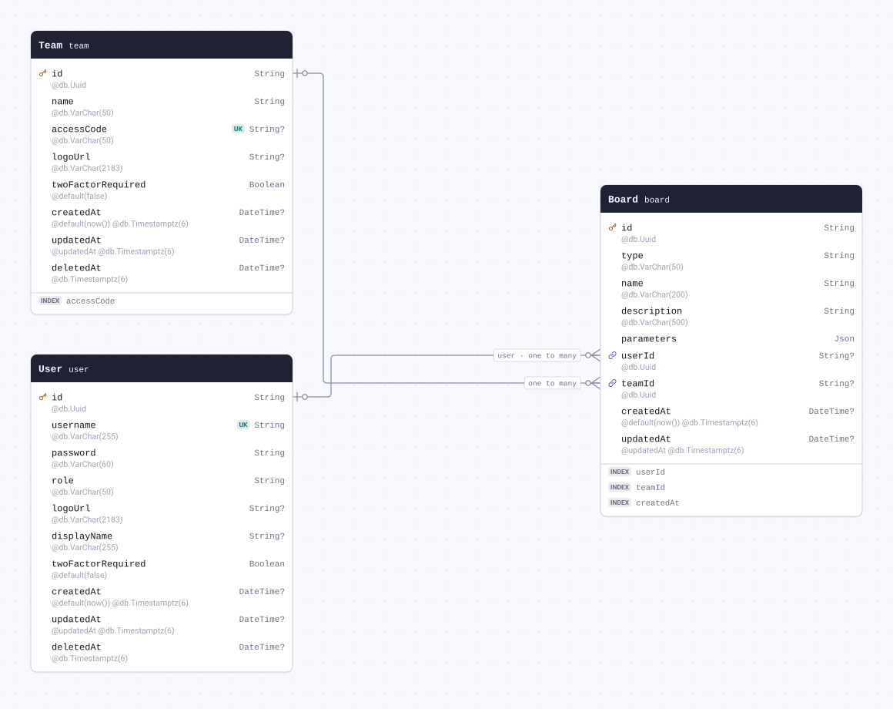

| Field                      | Type                            | Constraints                   | Default      | Description |
| -------------------------- | ------------------------------- | ----------------------------- | ------------ | ----------- |
| `id` (`board_id`)          | `String` `@db.Uuid`             | PK NOT NULL                   |              |             |
| `type`                     | `String` `@db.VarChar(50)`      | NOT NULL                      |              |             |
| `name`                     | `String` `@db.VarChar(200)`     | NOT NULL                      |              |             |
| `description`              | `String` `@db.VarChar(500)`     | NOT NULL                      |              |             |
| `parameters`               | `Json`                          | NOT NULL                      |              |             |
| `userId` (`user_id`)       | `String` `@db.Uuid`             | NULL → [User.id](#model-User) |              |             |
| `teamId` (`team_id`)       | `String` `@db.Uuid`             | NULL → [Team.id](#model-Team) |              |             |
| `createdAt` (`created_at`) | `DateTime` `@db.Timestamptz(6)` | NULL                          | `now()`      |             |
| `updatedAt` (`updated_at`) | `DateTime` `@db.Timestamptz(6)` | NULL                          | `@updatedAt` |             |

#### Indexes

- `@@index([userId])`
- `@@index([teamId])`
- `@@index([createdAt])`

#### References

- `userId` → [User.id](#model-User) (many-to-one)
- `teamId` → [Team.id](#model-Team) (many-to-one)

#### Definition

```sql
CREATE TABLE "board" (
    "board_id" UUID NOT NULL,
    "type" VARCHAR(50) NOT NULL,
    "name" VARCHAR(200) NOT NULL,
    "description" VARCHAR(500) NOT NULL,
    "parameters" JSONB NOT NULL,
    "user_id" UUID,
    "team_id" UUID,
    "created_at" TIMESTAMPTZ(6) DEFAULT CURRENT_TIMESTAMP,
    "updated_at" TIMESTAMPTZ(6),

    CONSTRAINT "board_pkey" PRIMARY KEY ("board_id")
);

CREATE INDEX "board_user_id_idx" ON "board"("user_id");

CREATE INDEX "board_team_id_idx" ON "board"("team_id");

CREATE INDEX "board_created_at_idx" ON "board"("created_at");
```

<details>
<summary>Queries and their SQL</summary>

**findMany**: Every row

```ts
await prisma.board.findMany();
```

```sql
SELECT
  "public"."board"."board_id",
  "public"."board"."type",
  "public"."board"."name",
  "public"."board"."description",
  "public"."board"."parameters",
  "public"."board"."user_id",
  "public"."board"."team_id",
  "public"."board"."created_at",
  "public"."board"."updated_at"
FROM
  "public"."board"
WHERE
  1 = 1
OFFSET
  $1
-- params: ["0"]
```

**count**: How many rows there are

```ts
await prisma.board.count();
```

```sql
SELECT
  COUNT(*) AS "_count$_all"
FROM
  (
    SELECT
      "public"."board"."board_id"
    FROM
      "public"."board"
    WHERE
      1 = 1
    OFFSET
      $1
  ) AS "sub"
-- params: ["0"]
```

**findMany**: Every row with its relations

```ts
await prisma.board.findMany({ include: { user: true, team: true } });
```

```sql
SELECT
  "public"."board"."board_id",
  "public"."board"."type",
  "public"."board"."name",
  "public"."board"."description",
  "public"."board"."parameters",
  "public"."board"."user_id",
  "public"."board"."team_id",
  "public"."board"."created_at",
  "public"."board"."updated_at"
FROM
  "public"."board"
WHERE
  1 = 1
OFFSET
  $1
-- params: ["0"]

SELECT
  "public"."user"."user_id",
  "public"."user"."username",
  "public"."user"."password",
  "public"."user"."role",
  "public"."user"."logo_url",
  "public"."user"."display_name",
  "public"."user"."two_factor_required",
  "public"."user"."created_at",
  "public"."user"."updated_at",
  "public"."user"."deleted_at"
FROM
  "public"."user"
WHERE
  "public"."user"."user_id" IN ($1)
OFFSET
  $2
-- params: ["<userId of the rows above>","0"]

SELECT
  "public"."team"."team_id",
  "public"."team"."name",
  "public"."team"."access_code",
  "public"."team"."logo_url",
  "public"."team"."two_factor_required",
  "public"."team"."created_at",
  "public"."team"."updated_at",
  "public"."team"."deleted_at"
FROM
  "public"."team"
WHERE
  "public"."team"."team_id" IN ($1)
OFFSET
  $2
-- params: ["<teamId of the rows above>","0"]
```

**findUnique**: One row by what is unique to it

```ts
await prisma.board.findUnique({ where: { id: "example" } });
```

```sql
SELECT
  "public"."board"."board_id",
  "public"."board"."type",
  "public"."board"."name",
  "public"."board"."description",
  "public"."board"."parameters",
  "public"."board"."user_id",
  "public"."board"."team_id",
  "public"."board"."created_at",
  "public"."board"."updated_at"
FROM
  "public"."board"
WHERE
  (
    "public"."board"."board_id" = $1
    AND 1 = 1
  )
LIMIT
  $2
OFFSET
  $3
-- params: ["example","1","0"]
```

**create**: Create a row

```ts
await prisma.board.create({
  data: { id: "example", type: "example", name: "example", description: "example", parameters: {} },
});
```

```sql
INSERT INTO
  "public"."board" (
    "board_id",
    "type",
    "name",
    "description",
    "parameters",
    "created_at",
    "updated_at"
  )
VALUES
  ($1, $2, $3, $4, $5, $6, $7)
RETURNING
  "public"."board"."board_id",
  "public"."board"."type",
  "public"."board"."name",
  "public"."board"."description",
  "public"."board"."parameters",
  "public"."board"."user_id",
  "public"."board"."team_id",
  "public"."board"."created_at",
  "public"."board"."updated_at"
-- params: ["example","example","example","example","{}","<now()>","<now()>"]
```

**update**: Update a row

```ts
await prisma.board.update({ where: { id: "example" }, data: { type: "example" } });
```

```sql
SELECT
  "public"."board"."board_id"
FROM
  "public"."board"
WHERE
  (
    "public"."board"."board_id" = $1
    AND 1 = 1
  )
LIMIT
  $2
OFFSET
  $3
-- params: ["example","1","0"]

UPDATE "public"."board"
SET
  "type" = $1,
  "updated_at" = $2
WHERE
  (
    "public"."board"."board_id" IN ($3)
    AND (
      "public"."board"."board_id" = $4
      AND 1 = 1
    )
  )
RETURNING
  "public"."board"."board_id",
  "public"."board"."type",
  "public"."board"."name",
  "public"."board"."description",
  "public"."board"."parameters",
  "public"."board"."user_id",
  "public"."board"."team_id",
  "public"."board"."created_at",
  "public"."board"."updated_at"
-- params: ["example",{"prisma__type":"generatorCall","prisma__value":{"name":"now","args":[],"returnType":{"type":"DateTime"}}},"<id of the rows above>","example"]
```

**delete**: Delete a row

```ts
await prisma.board.delete({ where: { id: "example" } });
```

```sql
DELETE FROM "public"."board"
WHERE
  (
    "public"."board"."board_id" = $1
    AND 1 = 1
  )
RETURNING
  "public"."board"."board_id",
  "public"."board"."type",
  "public"."board"."name",
  "public"."board"."description",
  "public"."board"."parameters",
  "public"."board"."user_id",
  "public"."board"."team_id",
  "public"."board"."created_at",
  "public"."board"."updated_at"
-- params: ["example"]
```

</details>

<a id="model-Share"></a>

### Share

Table `share`.

| Field                      | Type                            | Constraints     | Default      | Description |
| -------------------------- | ------------------------------- | --------------- | ------------ | ----------- |
| `id` (`share_id`)          | `String` `@db.Uuid`             | PK NOT NULL     |              |             |
| `entityId` (`entity_id`)   | `String` `@db.Uuid`             | NOT NULL        |              |             |
| `name`                     | `String` `@db.VarChar(200)`     | NOT NULL        |              |             |
| `shareType` (`share_type`) | `Int` `@db.Integer`             | NOT NULL        |              |             |
| `slug`                     | `String` `@db.VarChar(100)`     | UNIQUE NOT NULL |              |             |
| `parameters`               | `Json`                          | NOT NULL        |              |             |
| `createdAt` (`created_at`) | `DateTime` `@db.Timestamptz(6)` | NULL            | `now()`      |             |
| `updatedAt` (`updated_at`) | `DateTime` `@db.Timestamptz(6)` | NULL            | `@updatedAt` |             |

#### Indexes

- `@@index([entityId])`

#### Definition

```sql
CREATE TABLE "share" (
    "share_id" UUID NOT NULL,
    "entity_id" UUID NOT NULL,
    "name" VARCHAR(200) NOT NULL,
    "share_type" INTEGER NOT NULL,
    "slug" VARCHAR(100) NOT NULL,
    "parameters" JSONB NOT NULL,
    "created_at" TIMESTAMPTZ(6) DEFAULT CURRENT_TIMESTAMP,
    "updated_at" TIMESTAMPTZ(6),

    CONSTRAINT "share_pkey" PRIMARY KEY ("share_id")
);

CREATE UNIQUE INDEX "share_slug_key" ON "share"("slug");

CREATE INDEX "share_entity_id_idx" ON "share"("entity_id");
```

<details>
<summary>Queries and their SQL</summary>

**findMany**: Every row

```ts
await prisma.share.findMany();
```

```sql
SELECT
  "public"."share"."share_id",
  "public"."share"."entity_id",
  "public"."share"."name",
  "public"."share"."share_type",
  "public"."share"."slug",
  "public"."share"."parameters",
  "public"."share"."created_at",
  "public"."share"."updated_at"
FROM
  "public"."share"
WHERE
  1 = 1
OFFSET
  $1
-- params: ["0"]
```

**count**: How many rows there are

```ts
await prisma.share.count();
```

```sql
SELECT
  COUNT(*) AS "_count$_all"
FROM
  (
    SELECT
      "public"."share"."share_id"
    FROM
      "public"."share"
    WHERE
      1 = 1
    OFFSET
      $1
  ) AS "sub"
-- params: ["0"]
```

**findUnique**: One row by what is unique to it

```ts
await prisma.share.findUnique({ where: { id: "example" } });
```

```sql
SELECT
  "public"."share"."share_id",
  "public"."share"."entity_id",
  "public"."share"."name",
  "public"."share"."share_type",
  "public"."share"."slug",
  "public"."share"."parameters",
  "public"."share"."created_at",
  "public"."share"."updated_at"
FROM
  "public"."share"
WHERE
  (
    "public"."share"."share_id" = $1
    AND 1 = 1
  )
LIMIT
  $2
OFFSET
  $3
-- params: ["example","1","0"]
```

**create**: Create a row

```ts
await prisma.share.create({
  data: {
    id: "example",
    entityId: "example",
    name: "example",
    shareType: 1,
    slug: "example",
    parameters: {},
  },
});
```

```sql
INSERT INTO
  "public"."share" (
    "share_id",
    "entity_id",
    "name",
    "share_type",
    "slug",
    "parameters",
    "created_at",
    "updated_at"
  )
VALUES
  ($1, $2, $3, $4, $5, $6, $7, $8)
RETURNING
  "public"."share"."share_id",
  "public"."share"."entity_id",
  "public"."share"."name",
  "public"."share"."share_type",
  "public"."share"."slug",
  "public"."share"."parameters",
  "public"."share"."created_at",
  "public"."share"."updated_at"
-- params: ["example","example","example","1","example","{}","<now()>","<now()>"]
```

**update**: Update a row

```ts
await prisma.share.update({ where: { id: "example" }, data: { entityId: "example" } });
```

```sql
SELECT
  "public"."share"."share_id"
FROM
  "public"."share"
WHERE
  (
    "public"."share"."share_id" = $1
    AND 1 = 1
  )
LIMIT
  $2
OFFSET
  $3
-- params: ["example","1","0"]

UPDATE "public"."share"
SET
  "entity_id" = $1,
  "updated_at" = $2
WHERE
  (
    "public"."share"."share_id" IN ($3)
    AND (
      "public"."share"."share_id" = $4
      AND 1 = 1
    )
  )
RETURNING
  "public"."share"."share_id",
  "public"."share"."entity_id",
  "public"."share"."name",
  "public"."share"."share_type",
  "public"."share"."slug",
  "public"."share"."parameters",
  "public"."share"."created_at",
  "public"."share"."updated_at"
-- params: ["example",{"prisma__type":"generatorCall","prisma__value":{"name":"now","args":[],"returnType":{"type":"DateTime"}}},"<id of the rows above>","example"]
```

**delete**: Delete a row

```ts
await prisma.share.delete({ where: { id: "example" } });
```

```sql
DELETE FROM "public"."share"
WHERE
  (
    "public"."share"."share_id" = $1
    AND 1 = 1
  )
RETURNING
  "public"."share"."share_id",
  "public"."share"."entity_id",
  "public"."share"."name",
  "public"."share"."share_type",
  "public"."share"."slug",
  "public"."share"."parameters",
  "public"."share"."created_at",
  "public"."share"."updated_at"
-- params: ["example"]
```

</details>

<a id="model-SessionReplay"></a>

### SessionReplay

Table `session_replay`.

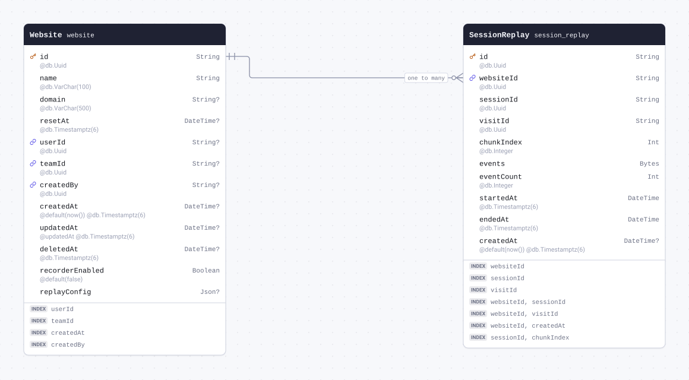

| Field                        | Type                            | Constraints                             | Default | Description |
| ---------------------------- | ------------------------------- | --------------------------------------- | ------- | ----------- |
| `id` (`replay_id`)           | `String` `@db.Uuid`             | PK NOT NULL                             |         |             |
| `websiteId` (`website_id`)   | `String` `@db.Uuid`             | NOT NULL → [Website.id](#model-Website) |         |             |
| `sessionId` (`session_id`)   | `String` `@db.Uuid`             | NOT NULL                                |         |             |
| `visitId` (`visit_id`)       | `String` `@db.Uuid`             | NOT NULL                                |         |             |
| `chunkIndex` (`chunk_index`) | `Int` `@db.Integer`             | NOT NULL                                |         |             |
| `events` (`events`)          | `Bytes`                         | NOT NULL                                |         |             |
| `eventCount` (`event_count`) | `Int` `@db.Integer`             | NOT NULL                                |         |             |
| `startedAt` (`started_at`)   | `DateTime` `@db.Timestamptz(6)` | NOT NULL                                |         |             |
| `endedAt` (`ended_at`)       | `DateTime` `@db.Timestamptz(6)` | NOT NULL                                |         |             |
| `createdAt` (`created_at`)   | `DateTime` `@db.Timestamptz(6)` | NULL                                    | `now()` |             |

#### Indexes

- `@@index([websiteId])`
- `@@index([sessionId])`
- `@@index([visitId])`
- `@@index([websiteId, sessionId])`
- `@@index([websiteId, visitId])`
- `@@index([websiteId, createdAt])`
- `@@index([sessionId, chunkIndex])`

#### References

- `websiteId` → [Website.id](#model-Website) (many-to-one)

#### Definition

```sql
CREATE TABLE "session_replay" (
    "replay_id" UUID NOT NULL,
    "website_id" UUID NOT NULL,
    "session_id" UUID NOT NULL,
    "visit_id" UUID NOT NULL,
    "chunk_index" INTEGER NOT NULL,
    "events" BYTEA NOT NULL,
    "event_count" INTEGER NOT NULL,
    "started_at" TIMESTAMPTZ(6) NOT NULL,
    "ended_at" TIMESTAMPTZ(6) NOT NULL,
    "created_at" TIMESTAMPTZ(6) DEFAULT CURRENT_TIMESTAMP,

    CONSTRAINT "session_replay_pkey" PRIMARY KEY ("replay_id")
);

CREATE INDEX "session_replay_website_id_idx" ON "session_replay"("website_id");

CREATE INDEX "session_replay_session_id_idx" ON "session_replay"("session_id");

CREATE INDEX "session_replay_visit_id_idx" ON "session_replay"("visit_id");

CREATE INDEX "session_replay_website_id_session_id_idx" ON "session_replay"("website_id", "session_id");

CREATE INDEX "session_replay_website_id_visit_id_idx" ON "session_replay"("website_id", "visit_id");

CREATE INDEX "session_replay_website_id_created_at_idx" ON "session_replay"("website_id", "created_at");

CREATE INDEX "session_replay_session_id_chunk_index_idx" ON "session_replay"("session_id", "chunk_index");
```

<details>
<summary>Queries and their SQL</summary>

**findMany**: Every row

```ts
await prisma.sessionReplay.findMany();
```

```sql
SELECT
  "public"."session_replay"."replay_id",
  "public"."session_replay"."website_id",
  "public"."session_replay"."session_id",
  "public"."session_replay"."visit_id",
  "public"."session_replay"."chunk_index",
  "public"."session_replay"."events",
  "public"."session_replay"."event_count",
  "public"."session_replay"."started_at",
  "public"."session_replay"."ended_at",
  "public"."session_replay"."created_at"
FROM
  "public"."session_replay"
WHERE
  1 = 1
OFFSET
  $1
-- params: ["0"]
```

**count**: How many rows there are

```ts
await prisma.sessionReplay.count();
```

```sql
SELECT
  COUNT(*) AS "_count$_all"
FROM
  (
    SELECT
      "public"."session_replay"."replay_id"
    FROM
      "public"."session_replay"
    WHERE
      1 = 1
    OFFSET
      $1
  ) AS "sub"
-- params: ["0"]
```

**findMany**: Every row with its relations

```ts
await prisma.sessionReplay.findMany({ include: { website: true } });
```

```sql
SELECT
  "public"."session_replay"."replay_id",
  "public"."session_replay"."website_id",
  "public"."session_replay"."session_id",
  "public"."session_replay"."visit_id",
  "public"."session_replay"."chunk_index",
  "public"."session_replay"."events",
  "public"."session_replay"."event_count",
  "public"."session_replay"."started_at",
  "public"."session_replay"."ended_at",
  "public"."session_replay"."created_at"
FROM
  "public"."session_replay"
WHERE
  1 = 1
OFFSET
  $1
-- params: ["0"]

SELECT
  "public"."website"."website_id",
  "public"."website"."name",
  "public"."website"."domain",
  "public"."website"."reset_at",
  "public"."website"."user_id",
  "public"."website"."team_id",
  "public"."website"."created_by",
  "public"."website"."created_at",
  "public"."website"."updated_at",
  "public"."website"."deleted_at",
  "public"."website"."recorder_enabled",
  "public"."website"."replay_config"
FROM
  "public"."website"
WHERE
  "public"."website"."website_id" IN ($1)
OFFSET
  $2
-- params: ["<websiteId of the rows above>","0"]
```

**findUnique**: One row by what is unique to it

```ts
await prisma.sessionReplay.findUnique({ where: { id: "example" } });
```

```sql
SELECT
  "public"."session_replay"."replay_id",
  "public"."session_replay"."website_id",
  "public"."session_replay"."session_id",
  "public"."session_replay"."visit_id",
  "public"."session_replay"."chunk_index",
  "public"."session_replay"."events",
  "public"."session_replay"."event_count",
  "public"."session_replay"."started_at",
  "public"."session_replay"."ended_at",
  "public"."session_replay"."created_at"
FROM
  "public"."session_replay"
WHERE
  (
    "public"."session_replay"."replay_id" = $1
    AND 1 = 1
  )
LIMIT
  $2
OFFSET
  $3
-- params: ["example","1","0"]
```

**create**: Create a row

```ts
await prisma.sessionReplay.create({
  data: {
    id: "example",
    websiteId: "example",
    sessionId: "example",
    visitId: "example",
    chunkIndex: 1,
    events: Uint8Array.from([1, 2, 3]),
    eventCount: 1,
    startedAt: new Date("2026-01-01T00:00:00.000Z"),
    endedAt: new Date("2026-01-01T00:00:00.000Z"),
  },
});
```

```sql
INSERT INTO
  "public"."session_replay" (
    "replay_id",
    "website_id",
    "session_id",
    "visit_id",
    "chunk_index",
    "events",
    "event_count",
    "started_at",
    "ended_at",
    "created_at"
  )
VALUES
  ($1, $2, $3, $4, $5, $6, $7, $8, $9, $10)
RETURNING
  "public"."session_replay"."replay_id",
  "public"."session_replay"."website_id",
  "public"."session_replay"."session_id",
  "public"."session_replay"."visit_id",
  "public"."session_replay"."chunk_index",
  "public"."session_replay"."events",
  "public"."session_replay"."event_count",
  "public"."session_replay"."started_at",
  "public"."session_replay"."ended_at",
  "public"."session_replay"."created_at"
-- params: ["example","example","example","example","1","AQID","1","2026-01-01T00:00:00.000Z","2026-01-01T00:00:00.000Z","<now()>"]
```

**update**: Update a row

```ts
await prisma.sessionReplay.update({ where: { id: "example" }, data: { sessionId: "example" } });
```

```sql
SELECT
  "public"."session_replay"."replay_id"
FROM
  "public"."session_replay"
WHERE
  (
    "public"."session_replay"."replay_id" = $1
    AND 1 = 1
  )
LIMIT
  $2
OFFSET
  $3
-- params: ["example","1","0"]

UPDATE "public"."session_replay"
SET
  "session_id" = $1
WHERE
  (
    "public"."session_replay"."replay_id" IN ($2)
    AND (
      "public"."session_replay"."replay_id" = $3
      AND 1 = 1
    )
  )
RETURNING
  "public"."session_replay"."replay_id",
  "public"."session_replay"."website_id",
  "public"."session_replay"."session_id",
  "public"."session_replay"."visit_id",
  "public"."session_replay"."chunk_index",
  "public"."session_replay"."events",
  "public"."session_replay"."event_count",
  "public"."session_replay"."started_at",
  "public"."session_replay"."ended_at",
  "public"."session_replay"."created_at"
-- params: ["example","<id of the rows above>","example"]
```

**delete**: Delete a row

```ts
await prisma.sessionReplay.delete({ where: { id: "example" } });
```

```sql
DELETE FROM "public"."session_replay"
WHERE
  (
    "public"."session_replay"."replay_id" = $1
    AND 1 = 1
  )
RETURNING
  "public"."session_replay"."replay_id",
  "public"."session_replay"."website_id",
  "public"."session_replay"."session_id",
  "public"."session_replay"."visit_id",
  "public"."session_replay"."chunk_index",
  "public"."session_replay"."events",
  "public"."session_replay"."event_count",
  "public"."session_replay"."started_at",
  "public"."session_replay"."ended_at",
  "public"."session_replay"."created_at"
-- params: ["example"]
```

</details>

<a id="model-SessionReplaySaved"></a>

### SessionReplaySaved

Table `session_replay_saved`.

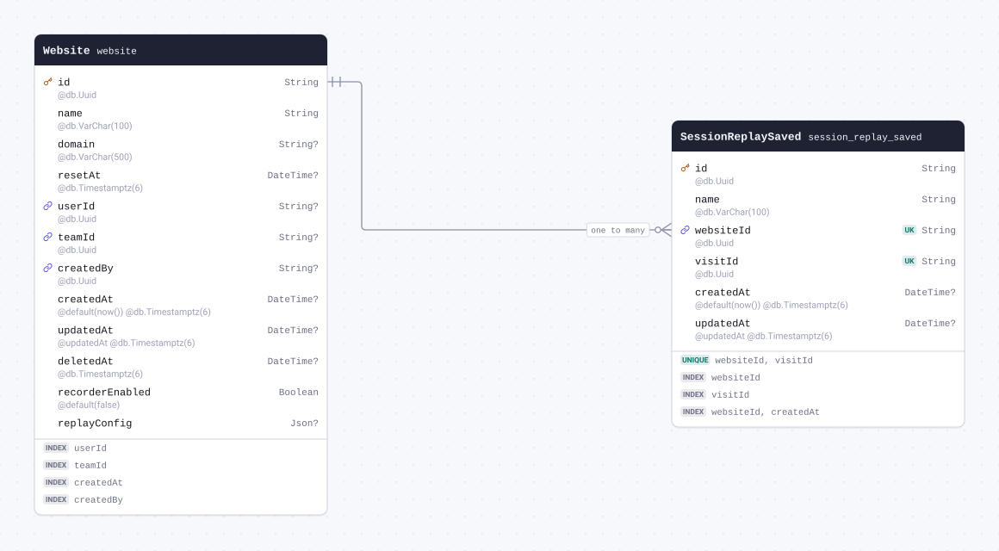

| Field                      | Type                            | Constraints                             | Default      | Description |
| -------------------------- | ------------------------------- | --------------------------------------- | ------------ | ----------- |
| `id` (`saved_replay_id`)   | `String` `@db.Uuid`             | PK NOT NULL                             |              |             |
| `name`                     | `String` `@db.VarChar(100)`     | NOT NULL                                |              |             |
| `websiteId` (`website_id`) | `String` `@db.Uuid`             | NOT NULL → [Website.id](#model-Website) |              |             |
| `visitId` (`visit_id`)     | `String` `@db.Uuid`             | NOT NULL                                |              |             |
| `createdAt` (`created_at`) | `DateTime` `@db.Timestamptz(6)` | NULL                                    | `now()`      |             |
| `updatedAt` (`updated_at`) | `DateTime` `@db.Timestamptz(6)` | NULL                                    | `@updatedAt` |             |

#### Indexes

- `@@index([websiteId])`
- `@@index([visitId])`
- `@@index([websiteId, createdAt])`
- `@@unique([websiteId, visitId])`

#### References

- `websiteId` → [Website.id](#model-Website) (many-to-one)

#### Definition

```sql
CREATE TABLE "session_replay_saved" (
    "saved_replay_id" UUID NOT NULL,
    "name" VARCHAR(100) NOT NULL,
    "website_id" UUID NOT NULL,
    "visit_id" UUID NOT NULL,
    "created_at" TIMESTAMPTZ(6) DEFAULT CURRENT_TIMESTAMP,
    "updated_at" TIMESTAMPTZ(6),

    CONSTRAINT "session_replay_saved_pkey" PRIMARY KEY ("saved_replay_id")
);

CREATE INDEX "session_replay_saved_website_id_idx" ON "session_replay_saved"("website_id");

CREATE INDEX "session_replay_saved_visit_id_idx" ON "session_replay_saved"("visit_id");

CREATE INDEX "session_replay_saved_website_id_created_at_idx" ON "session_replay_saved"("website_id", "created_at");

CREATE UNIQUE INDEX "session_replay_saved_website_id_visit_id_key" ON "session_replay_saved"("website_id", "visit_id");
```

<details>
<summary>Queries and their SQL</summary>

**findMany**: Every row

```ts
await prisma.sessionReplaySaved.findMany();
```

```sql
SELECT
  "public"."session_replay_saved"."saved_replay_id",
  "public"."session_replay_saved"."name",
  "public"."session_replay_saved"."website_id",
  "public"."session_replay_saved"."visit_id",
  "public"."session_replay_saved"."created_at",
  "public"."session_replay_saved"."updated_at"
FROM
  "public"."session_replay_saved"
WHERE
  1 = 1
OFFSET
  $1
-- params: ["0"]
```

**count**: How many rows there are

```ts
await prisma.sessionReplaySaved.count();
```

```sql
SELECT
  COUNT(*) AS "_count$_all"
FROM
  (
    SELECT
      "public"."session_replay_saved"."saved_replay_id"
    FROM
      "public"."session_replay_saved"
    WHERE
      1 = 1
    OFFSET
      $1
  ) AS "sub"
-- params: ["0"]
```

**findMany**: Every row with its relations

```ts
await prisma.sessionReplaySaved.findMany({ include: { website: true } });
```

```sql
SELECT
  "public"."session_replay_saved"."saved_replay_id",
  "public"."session_replay_saved"."name",
  "public"."session_replay_saved"."website_id",
  "public"."session_replay_saved"."visit_id",
  "public"."session_replay_saved"."created_at",
  "public"."session_replay_saved"."updated_at"
FROM
  "public"."session_replay_saved"
WHERE
  1 = 1
OFFSET
  $1
-- params: ["0"]

SELECT
  "public"."website"."website_id",
  "public"."website"."name",
  "public"."website"."domain",
  "public"."website"."reset_at",
  "public"."website"."user_id",
  "public"."website"."team_id",
  "public"."website"."created_by",
  "public"."website"."created_at",
  "public"."website"."updated_at",
  "public"."website"."deleted_at",
  "public"."website"."recorder_enabled",
  "public"."website"."replay_config"
FROM
  "public"."website"
WHERE
  "public"."website"."website_id" IN ($1)
OFFSET
  $2
-- params: ["<websiteId of the rows above>","0"]
```

**findUnique**: One row by what is unique to it

```ts
await prisma.sessionReplaySaved.findUnique({ where: { id: "example" } });
```

```sql
SELECT
  "public"."session_replay_saved"."saved_replay_id",
  "public"."session_replay_saved"."name",
  "public"."session_replay_saved"."website_id",
  "public"."session_replay_saved"."visit_id",
  "public"."session_replay_saved"."created_at",
  "public"."session_replay_saved"."updated_at"
FROM
  "public"."session_replay_saved"
WHERE
  (
    "public"."session_replay_saved"."saved_replay_id" = $1
    AND 1 = 1
  )
LIMIT
  $2
OFFSET
  $3
-- params: ["example","1","0"]
```

**create**: Create a row

```ts
await prisma.sessionReplaySaved.create({
  data: { id: "example", name: "example", websiteId: "example", visitId: "example" },
});
```

```sql
INSERT INTO
  "public"."session_replay_saved" (
    "saved_replay_id",
    "name",
    "website_id",
    "visit_id",
    "created_at",
    "updated_at"
  )
VALUES
  ($1, $2, $3, $4, $5, $6)
RETURNING
  "public"."session_replay_saved"."saved_replay_id",
  "public"."session_replay_saved"."name",
  "public"."session_replay_saved"."website_id",
  "public"."session_replay_saved"."visit_id",
  "public"."session_replay_saved"."created_at",
  "public"."session_replay_saved"."updated_at"
-- params: ["example","example","example","example","<now()>","<now()>"]
```

**update**: Update a row

```ts
await prisma.sessionReplaySaved.update({ where: { id: "example" }, data: { name: "example" } });
```

```sql
SELECT
  "public"."session_replay_saved"."saved_replay_id"
FROM
  "public"."session_replay_saved"
WHERE
  (
    "public"."session_replay_saved"."saved_replay_id" = $1
    AND 1 = 1
  )
LIMIT
  $2
OFFSET
  $3
-- params: ["example","1","0"]

UPDATE "public"."session_replay_saved"
SET
  "name" = $1,
  "updated_at" = $2
WHERE
  (
    "public"."session_replay_saved"."saved_replay_id" IN ($3)
    AND (
      "public"."session_replay_saved"."saved_replay_id" = $4
      AND 1 = 1
    )
  )
RETURNING
  "public"."session_replay_saved"."saved_replay_id",
  "public"."session_replay_saved"."name",
  "public"."session_replay_saved"."website_id",
  "public"."session_replay_saved"."visit_id",
  "public"."session_replay_saved"."created_at",
  "public"."session_replay_saved"."updated_at"
-- params: ["example",{"prisma__type":"generatorCall","prisma__value":{"name":"now","args":[],"returnType":{"type":"DateTime"}}},"<id of the rows above>","example"]
```

**delete**: Delete a row

```ts
await prisma.sessionReplaySaved.delete({ where: { id: "example" } });
```

```sql
DELETE FROM "public"."session_replay_saved"
WHERE
  (
    "public"."session_replay_saved"."saved_replay_id" = $1
    AND 1 = 1
  )
RETURNING
  "public"."session_replay_saved"."saved_replay_id",
  "public"."session_replay_saved"."name",
  "public"."session_replay_saved"."website_id",
  "public"."session_replay_saved"."visit_id",
  "public"."session_replay_saved"."created_at",
  "public"."session_replay_saved"."updated_at"
-- params: ["example"]
```

</details>

<a id="model-HeatmapEvent"></a>

### HeatmapEvent

Table `heatmap_event`.

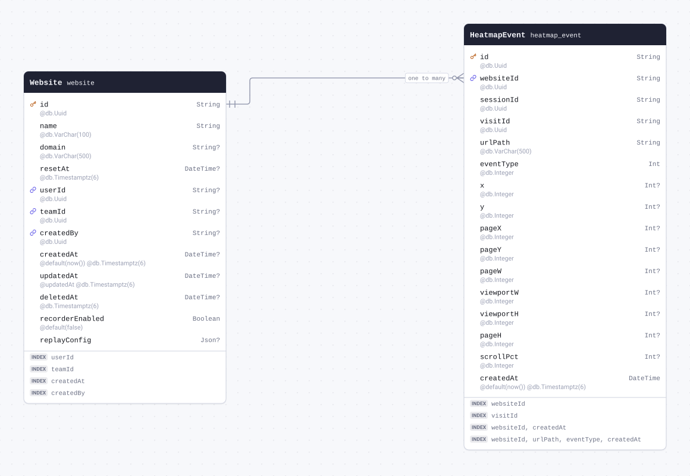

| Field                      | Type                            | Constraints                             | Default | Description |
| -------------------------- | ------------------------------- | --------------------------------------- | ------- | ----------- |
| `id` (`heatmap_event_id`)  | `String` `@db.Uuid`             | PK NOT NULL                             |         |             |
| `websiteId` (`website_id`) | `String` `@db.Uuid`             | NOT NULL → [Website.id](#model-Website) |         |             |
| `sessionId` (`session_id`) | `String` `@db.Uuid`             | NOT NULL                                |         |             |
| `visitId` (`visit_id`)     | `String` `@db.Uuid`             | NOT NULL                                |         |             |
| `urlPath` (`url_path`)     | `String` `@db.VarChar(500)`     | NOT NULL                                |         |             |
| `eventType` (`event_type`) | `Int` `@db.Integer`             | NOT NULL                                |         |             |
| `x`                        | `Int` `@db.Integer`             | NULL                                    |         |             |
| `y`                        | `Int` `@db.Integer`             | NULL                                    |         |             |
| `pageX` (`page_x`)         | `Int` `@db.Integer`             | NULL                                    |         |             |
| `pageY` (`page_y`)         | `Int` `@db.Integer`             | NULL                                    |         |             |
| `pageW` (`page_w`)         | `Int` `@db.Integer`             | NULL                                    |         |             |
| `viewportW` (`viewport_w`) | `Int` `@db.Integer`             | NULL                                    |         |             |
| `viewportH` (`viewport_h`) | `Int` `@db.Integer`             | NULL                                    |         |             |
| `pageH` (`page_h`)         | `Int` `@db.Integer`             | NULL                                    |         |             |
| `scrollPct` (`scroll_pct`) | `Int` `@db.Integer`             | NULL                                    |         |             |
| `createdAt` (`created_at`) | `DateTime` `@db.Timestamptz(6)` | NOT NULL                                | `now()` |             |

#### Indexes

- `@@index([websiteId])`
- `@@index([visitId])`
- `@@index([websiteId, createdAt])`
- `@@index([websiteId, urlPath, eventType, createdAt])`

#### References

- `websiteId` → [Website.id](#model-Website) (many-to-one)

#### Definition

```sql
CREATE TABLE "heatmap_event" (
    "heatmap_event_id" UUID NOT NULL,
    "website_id" UUID NOT NULL,
    "session_id" UUID NOT NULL,
    "visit_id" UUID NOT NULL,
    "url_path" VARCHAR(500) NOT NULL,
    "event_type" INTEGER NOT NULL,
    "x" INTEGER,
    "y" INTEGER,
    "page_x" INTEGER,
    "page_y" INTEGER,
    "page_w" INTEGER,
    "viewport_w" INTEGER,
    "viewport_h" INTEGER,
    "page_h" INTEGER,
    "scroll_pct" INTEGER,
    "created_at" TIMESTAMPTZ(6) NOT NULL DEFAULT CURRENT_TIMESTAMP,

    CONSTRAINT "heatmap_event_pkey" PRIMARY KEY ("heatmap_event_id")
);

CREATE INDEX "heatmap_event_website_id_idx" ON "heatmap_event"("website_id");

CREATE INDEX "heatmap_event_visit_id_idx" ON "heatmap_event"("visit_id");

CREATE INDEX "heatmap_event_website_id_created_at_idx" ON "heatmap_event"("website_id", "created_at");

CREATE INDEX "heatmap_event_website_id_url_path_event_type_created_at_idx" ON "heatmap_event"("website_id", "url_path", "event_type", "created_at");
```

<details>
<summary>Queries and their SQL</summary>

**findMany**: Every row

```ts
await prisma.heatmapEvent.findMany();
```

```sql
SELECT
  "public"."heatmap_event"."heatmap_event_id",
  "public"."heatmap_event"."website_id",
  "public"."heatmap_event"."session_id",
  "public"."heatmap_event"."visit_id",
  "public"."heatmap_event"."url_path",
  "public"."heatmap_event"."event_type",
  "public"."heatmap_event"."x",
  "public"."heatmap_event"."y",
  "public"."heatmap_event"."page_x",
  "public"."heatmap_event"."page_y",
  "public"."heatmap_event"."page_w",
  "public"."heatmap_event"."viewport_w",
  "public"."heatmap_event"."viewport_h",
  "public"."heatmap_event"."page_h",
  "public"."heatmap_event"."scroll_pct",
  "public"."heatmap_event"."created_at"
FROM
  "public"."heatmap_event"
WHERE
  1 = 1
OFFSET
  $1
-- params: ["0"]
```

**count**: How many rows there are

```ts
await prisma.heatmapEvent.count();
```

```sql
SELECT
  COUNT(*) AS "_count$_all"
FROM
  (
    SELECT
      "public"."heatmap_event"."heatmap_event_id"
    FROM
      "public"."heatmap_event"
    WHERE
      1 = 1
    OFFSET
      $1
  ) AS "sub"
-- params: ["0"]
```

**findMany**: Every row with its relations

```ts
await prisma.heatmapEvent.findMany({ include: { website: true } });
```

```sql
SELECT
  "public"."heatmap_event"."heatmap_event_id",
  "public"."heatmap_event"."website_id",
  "public"."heatmap_event"."session_id",
  "public"."heatmap_event"."visit_id",
  "public"."heatmap_event"."url_path",
  "public"."heatmap_event"."event_type",
  "public"."heatmap_event"."x",
  "public"."heatmap_event"."y",
  "public"."heatmap_event"."page_x",
  "public"."heatmap_event"."page_y",
  "public"."heatmap_event"."page_w",
  "public"."heatmap_event"."viewport_w",
  "public"."heatmap_event"."viewport_h",
  "public"."heatmap_event"."page_h",
  "public"."heatmap_event"."scroll_pct",
  "public"."heatmap_event"."created_at"
FROM
  "public"."heatmap_event"
WHERE
  1 = 1
OFFSET
  $1
-- params: ["0"]

SELECT
  "public"."website"."website_id",
  "public"."website"."name",
  "public"."website"."domain",
  "public"."website"."reset_at",
  "public"."website"."user_id",
  "public"."website"."team_id",
  "public"."website"."created_by",
  "public"."website"."created_at",
  "public"."website"."updated_at",
  "public"."website"."deleted_at",
  "public"."website"."recorder_enabled",
  "public"."website"."replay_config"
FROM
  "public"."website"
WHERE
  "public"."website"."website_id" IN ($1)
OFFSET
  $2
-- params: ["<websiteId of the rows above>","0"]
```

**findUnique**: One row by what is unique to it

```ts
await prisma.heatmapEvent.findUnique({ where: { id: "example" } });
```

```sql
SELECT
  "public"."heatmap_event"."heatmap_event_id",
  "public"."heatmap_event"."website_id",
  "public"."heatmap_event"."session_id",
  "public"."heatmap_event"."visit_id",
  "public"."heatmap_event"."url_path",
  "public"."heatmap_event"."event_type",
  "public"."heatmap_event"."x",
  "public"."heatmap_event"."y",
  "public"."heatmap_event"."page_x",
  "public"."heatmap_event"."page_y",
  "public"."heatmap_event"."page_w",
  "public"."heatmap_event"."viewport_w",
  "public"."heatmap_event"."viewport_h",
  "public"."heatmap_event"."page_h",
  "public"."heatmap_event"."scroll_pct",
  "public"."heatmap_event"."created_at"
FROM
  "public"."heatmap_event"
WHERE
  (
    "public"."heatmap_event"."heatmap_event_id" = $1
    AND 1 = 1
  )
LIMIT
  $2
OFFSET
  $3
-- params: ["example","1","0"]
```

**create**: Create a row

```ts
await prisma.heatmapEvent.create({
  data: {
    id: "example",
    websiteId: "example",
    sessionId: "example",
    visitId: "example",
    urlPath: "example",
    eventType: 1,
  },
});
```

```sql
INSERT INTO
  "public"."heatmap_event" (
    "heatmap_event_id",
    "website_id",
    "session_id",
    "visit_id",
    "url_path",
    "event_type",
    "created_at"
  )
VALUES
  ($1, $2, $3, $4, $5, $6, $7)
RETURNING
  "public"."heatmap_event"."heatmap_event_id",
  "public"."heatmap_event"."website_id",
  "public"."heatmap_event"."session_id",
  "public"."heatmap_event"."visit_id",
  "public"."heatmap_event"."url_path",
  "public"."heatmap_event"."event_type",
  "public"."heatmap_event"."x",
  "public"."heatmap_event"."y",
  "public"."heatmap_event"."page_x",
  "public"."heatmap_event"."page_y",
  "public"."heatmap_event"."page_w",
  "public"."heatmap_event"."viewport_w",
  "public"."heatmap_event"."viewport_h",
  "public"."heatmap_event"."page_h",
  "public"."heatmap_event"."scroll_pct",
  "public"."heatmap_event"."created_at"
-- params: ["example","example","example","example","example","1","<now()>"]
```

**update**: Update a row

```ts
await prisma.heatmapEvent.update({ where: { id: "example" }, data: { sessionId: "example" } });
```

```sql
SELECT
  "public"."heatmap_event"."heatmap_event_id"
FROM
  "public"."heatmap_event"
WHERE
  (
    "public"."heatmap_event"."heatmap_event_id" = $1
    AND 1 = 1
  )
LIMIT
  $2
OFFSET
  $3
-- params: ["example","1","0"]

UPDATE "public"."heatmap_event"
SET
  "session_id" = $1
WHERE
  (
    "public"."heatmap_event"."heatmap_event_id" IN ($2)
    AND (
      "public"."heatmap_event"."heatmap_event_id" = $3
      AND 1 = 1
    )
  )
RETURNING
  "public"."heatmap_event"."heatmap_event_id",
  "public"."heatmap_event"."website_id",
  "public"."heatmap_event"."session_id",
  "public"."heatmap_event"."visit_id",
  "public"."heatmap_event"."url_path",
  "public"."heatmap_event"."event_type",
  "public"."heatmap_event"."x",
  "public"."heatmap_event"."y",
  "public"."heatmap_event"."page_x",
  "public"."heatmap_event"."page_y",
  "public"."heatmap_event"."page_w",
  "public"."heatmap_event"."viewport_w",
  "public"."heatmap_event"."viewport_h",
  "public"."heatmap_event"."page_h",
  "public"."heatmap_event"."scroll_pct",
  "public"."heatmap_event"."created_at"
-- params: ["example","<id of the rows above>","example"]
```

**delete**: Delete a row

```ts
await prisma.heatmapEvent.delete({ where: { id: "example" } });
```

```sql
DELETE FROM "public"."heatmap_event"
WHERE
  (
    "public"."heatmap_event"."heatmap_event_id" = $1
    AND 1 = 1
  )
RETURNING
  "public"."heatmap_event"."heatmap_event_id",
  "public"."heatmap_event"."website_id",
  "public"."heatmap_event"."session_id",
  "public"."heatmap_event"."visit_id",
  "public"."heatmap_event"."url_path",
  "public"."heatmap_event"."event_type",
  "public"."heatmap_event"."x",
  "public"."heatmap_event"."y",
  "public"."heatmap_event"."page_x",
  "public"."heatmap_event"."page_y",
  "public"."heatmap_event"."page_w",
  "public"."heatmap_event"."viewport_w",
  "public"."heatmap_event"."viewport_h",
  "public"."heatmap_event"."page_h",
  "public"."heatmap_event"."scroll_pct",
  "public"."heatmap_event"."created_at"
-- params: ["example"]
```

</details>

<a id="model-TwoFactorAuth"></a>

### TwoFactorAuth

Table `two_factor_auth`.

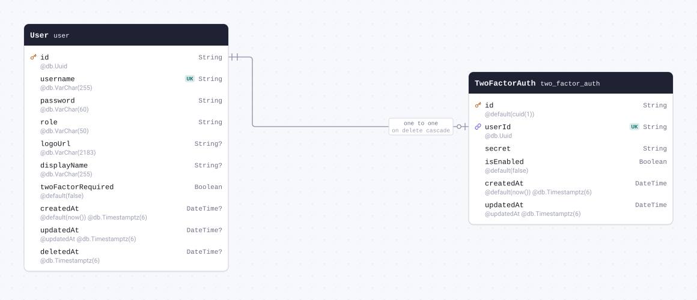

| Field                      | Type                            | Constraints                              | Default      | Description |
| -------------------------- | ------------------------------- | ---------------------------------------- | ------------ | ----------- |
| `id`                       | `String`                        | PK NOT NULL                              | `cuid(1)`    |             |
| `userId` (`user_id`)       | `String` `@db.Uuid`             | UNIQUE NOT NULL → [User.id](#model-User) |              |             |
| `secret`                   | `String`                        | NOT NULL                                 |              |             |
| `isEnabled` (`is_enabled`) | `Boolean`                       | NOT NULL                                 | `false`      |             |
| `createdAt` (`created_at`) | `DateTime` `@db.Timestamptz(6)` | NOT NULL                                 | `now()`      |             |
| `updatedAt` (`updated_at`) | `DateTime` `@db.Timestamptz(6)` | NOT NULL                                 | `@updatedAt` |             |

#### References

- `userId` → [User.id](#model-User) (one-to-one, on delete Cascade)

#### Definition

```sql
CREATE TABLE "two_factor_auth" (
    "id" TEXT NOT NULL,
    "user_id" UUID NOT NULL,
    "secret" TEXT NOT NULL,
    "is_enabled" BOOLEAN NOT NULL DEFAULT false,
    "created_at" TIMESTAMPTZ(6) NOT NULL DEFAULT CURRENT_TIMESTAMP,
    "updated_at" TIMESTAMPTZ(6) NOT NULL,

    CONSTRAINT "two_factor_auth_pkey" PRIMARY KEY ("id")
);

CREATE UNIQUE INDEX "two_factor_auth_user_id_key" ON "two_factor_auth"("user_id");
```

<details>
<summary>Queries and their SQL</summary>

**findMany**: Every row

```ts
await prisma.twoFactorAuth.findMany();
```

```sql
SELECT
  "public"."two_factor_auth"."id",
  "public"."two_factor_auth"."user_id",
  "public"."two_factor_auth"."secret",
  "public"."two_factor_auth"."is_enabled",
  "public"."two_factor_auth"."created_at",
  "public"."two_factor_auth"."updated_at"
FROM
  "public"."two_factor_auth"
WHERE
  1 = 1
OFFSET
  $1
-- params: ["0"]
```

**count**: How many rows there are

```ts
await prisma.twoFactorAuth.count();
```

```sql
SELECT
  COUNT(*) AS "_count$_all"
FROM
  (
    SELECT
      "public"."two_factor_auth"."id"
    FROM
      "public"."two_factor_auth"
    WHERE
      1 = 1
    OFFSET
      $1
  ) AS "sub"
-- params: ["0"]
```

**findMany**: Every row with its relations

```ts
await prisma.twoFactorAuth.findMany({ include: { user: true } });
```

```sql
SELECT
  "public"."two_factor_auth"."id",
  "public"."two_factor_auth"."user_id",
  "public"."two_factor_auth"."secret",
  "public"."two_factor_auth"."is_enabled",
  "public"."two_factor_auth"."created_at",
  "public"."two_factor_auth"."updated_at"
FROM
  "public"."two_factor_auth"
WHERE
  1 = 1
OFFSET
  $1
-- params: ["0"]

SELECT
  "public"."user"."user_id",
  "public"."user"."username",
  "public"."user"."password",
  "public"."user"."role",
  "public"."user"."logo_url",
  "public"."user"."display_name",
  "public"."user"."two_factor_required",
  "public"."user"."created_at",
  "public"."user"."updated_at",
  "public"."user"."deleted_at"
FROM
  "public"."user"
WHERE
  "public"."user"."user_id" IN ($1)
OFFSET
  $2
-- params: ["<userId of the rows above>","0"]
```

**findUnique**: One row by what is unique to it

```ts
await prisma.twoFactorAuth.findUnique({ where: { id: "example" } });
```

```sql
SELECT
  "public"."two_factor_auth"."id",
  "public"."two_factor_auth"."user_id",
  "public"."two_factor_auth"."secret",
  "public"."two_factor_auth"."is_enabled",
  "public"."two_factor_auth"."created_at",
  "public"."two_factor_auth"."updated_at"
FROM
  "public"."two_factor_auth"
WHERE
  (
    "public"."two_factor_auth"."id" = $1
    AND 1 = 1
  )
LIMIT
  $2
OFFSET
  $3
-- params: ["example","1","0"]
```

**create**: Create a row

```ts
await prisma.twoFactorAuth.create({ data: { userId: "example", secret: "example" } });
```

```sql
INSERT INTO
  "public"."two_factor_auth" (
    "id",
    "user_id",
    "secret",
    "is_enabled",
    "created_at",
    "updated_at"
  )
VALUES
  ($1, $2, $3, $4, $5, $6)
RETURNING
  "public"."two_factor_auth"."id",
  "public"."two_factor_auth"."user_id",
  "public"."two_factor_auth"."secret",
  "public"."two_factor_auth"."is_enabled",
  "public"."two_factor_auth"."created_at",
  "public"."two_factor_auth"."updated_at"
-- params: ["<cuid(1)>","example","example",false,"<now()>","<now()>"]
```

**update**: Update a row

```ts
await prisma.twoFactorAuth.update({ where: { id: "example" }, data: { secret: "example" } });
```

```sql
SELECT
  "public"."two_factor_auth"."id"
FROM
  "public"."two_factor_auth"
WHERE
  (
    "public"."two_factor_auth"."id" = $1
    AND 1 = 1
  )
LIMIT
  $2
OFFSET
  $3
-- params: ["example","1","0"]

UPDATE "public"."two_factor_auth"
SET
  "secret" = $1,
  "updated_at" = $2
WHERE
  (
    "public"."two_factor_auth"."id" IN ($3)
    AND (
      "public"."two_factor_auth"."id" = $4
      AND 1 = 1
    )
  )
RETURNING
  "public"."two_factor_auth"."id",
  "public"."two_factor_auth"."user_id",
  "public"."two_factor_auth"."secret",
  "public"."two_factor_auth"."is_enabled",
  "public"."two_factor_auth"."created_at",
  "public"."two_factor_auth"."updated_at"
-- params: ["example",{"prisma__type":"generatorCall","prisma__value":{"name":"now","args":[],"returnType":{"type":"DateTime"}}},"<id of the rows above>","example"]
```

**delete**: Delete a row

```ts
await prisma.twoFactorAuth.delete({ where: { id: "example" } });
```

```sql
DELETE FROM "public"."two_factor_auth"
WHERE
  (
    "public"."two_factor_auth"."id" = $1
    AND 1 = 1
  )
RETURNING
  "public"."two_factor_auth"."id",
  "public"."two_factor_auth"."user_id",
  "public"."two_factor_auth"."secret",
  "public"."two_factor_auth"."is_enabled",
  "public"."two_factor_auth"."created_at",
  "public"."two_factor_auth"."updated_at"
-- params: ["example"]
```

</details>

<a id="model-TwoFactorBackupCode"></a>

### TwoFactorBackupCode

Table `two_factor_backup_code`.


| Field                      | Type                            | Constraints                       | Default   | Description |
| -------------------------- | ------------------------------- | --------------------------------- | --------- | ----------- |
| `id`                       | `String`                        | PK NOT NULL                       | `cuid(1)` |             |
| `userId` (`user_id`)       | `String` `@db.Uuid`             | NOT NULL → [User.id](#model-User) |           |             |
| `codeHash` (`code_hash`)   | `String`                        | NOT NULL                          |           |             |
| `used`                     | `Boolean`                       | NOT NULL                          | `false`   |             |
| `createdAt` (`created_at`) | `DateTime` `@db.Timestamptz(6)` | NOT NULL                          | `now()`   |             |

#### Indexes

- `@@index([userId])`

#### References

- `userId` → [User.id](#model-User) (many-to-one, on delete Cascade)

#### Definition

```sql
CREATE TABLE "two_factor_backup_code" (
    "id" TEXT NOT NULL,
    "user_id" UUID NOT NULL,
    "code_hash" TEXT NOT NULL,
    "used" BOOLEAN NOT NULL DEFAULT false,
    "created_at" TIMESTAMPTZ(6) NOT NULL DEFAULT CURRENT_TIMESTAMP,

    CONSTRAINT "two_factor_backup_code_pkey" PRIMARY KEY ("id")
);

CREATE INDEX "two_factor_backup_code_user_id_idx" ON "two_factor_backup_code"("user_id");
```

<details>
<summary>Queries and their SQL</summary>

**findMany**: Every row

```ts
await prisma.twoFactorBackupCode.findMany();
```

```sql
SELECT
  "public"."two_factor_backup_code"."id",
  "public"."two_factor_backup_code"."user_id",
  "public"."two_factor_backup_code"."code_hash",
  "public"."two_factor_backup_code"."used",
  "public"."two_factor_backup_code"."created_at"
FROM
  "public"."two_factor_backup_code"
WHERE
  1 = 1
OFFSET
  $1
-- params: ["0"]
```

**count**: How many rows there are

```ts
await prisma.twoFactorBackupCode.count();
```

```sql
SELECT
  COUNT(*) AS "_count$_all"
FROM
  (
    SELECT
      "public"."two_factor_backup_code"."id"
    FROM
      "public"."two_factor_backup_code"
    WHERE
      1 = 1
    OFFSET
      $1
  ) AS "sub"
-- params: ["0"]
```

**findMany**: Every row with its relations

```ts
await prisma.twoFactorBackupCode.findMany({ include: { user: true } });
```

```sql
SELECT
  "public"."two_factor_backup_code"."id",
  "public"."two_factor_backup_code"."user_id",
  "public"."two_factor_backup_code"."code_hash",
  "public"."two_factor_backup_code"."used",
  "public"."two_factor_backup_code"."created_at"
FROM
  "public"."two_factor_backup_code"
WHERE
  1 = 1
OFFSET
  $1
-- params: ["0"]

SELECT
  "public"."user"."user_id",
  "public"."user"."username",
  "public"."user"."password",
  "public"."user"."role",
  "public"."user"."logo_url",
  "public"."user"."display_name",
  "public"."user"."two_factor_required",
  "public"."user"."created_at",
  "public"."user"."updated_at",
  "public"."user"."deleted_at"
FROM
  "public"."user"
WHERE
  "public"."user"."user_id" IN ($1)
OFFSET
  $2
-- params: ["<userId of the rows above>","0"]
```

**findUnique**: One row by what is unique to it

```ts
await prisma.twoFactorBackupCode.findUnique({ where: { id: "example" } });
```

```sql
SELECT
  "public"."two_factor_backup_code"."id",
  "public"."two_factor_backup_code"."user_id",
  "public"."two_factor_backup_code"."code_hash",
  "public"."two_factor_backup_code"."used",
  "public"."two_factor_backup_code"."created_at"
FROM
  "public"."two_factor_backup_code"
WHERE
  (
    "public"."two_factor_backup_code"."id" = $1
    AND 1 = 1
  )
LIMIT
  $2
OFFSET
  $3
-- params: ["example","1","0"]
```

**create**: Create a row

```ts
await prisma.twoFactorBackupCode.create({ data: { userId: "example", codeHash: "example" } });
```

```sql
INSERT INTO
  "public"."two_factor_backup_code" (
    "id",
    "user_id",
    "code_hash",
    "used",
    "created_at"
  )
VALUES
  ($1, $2, $3, $4, $5)
RETURNING
  "public"."two_factor_backup_code"."id",
  "public"."two_factor_backup_code"."user_id",
  "public"."two_factor_backup_code"."code_hash",
  "public"."two_factor_backup_code"."used",
  "public"."two_factor_backup_code"."created_at"
-- params: ["<cuid(1)>","example","example",false,"<now()>"]
```

**update**: Update a row

```ts
await prisma.twoFactorBackupCode.update({
  where: { id: "example" },
  data: { codeHash: "example" },
});
```

```sql
SELECT
  "public"."two_factor_backup_code"."id"
FROM
  "public"."two_factor_backup_code"
WHERE
  (
    "public"."two_factor_backup_code"."id" = $1
    AND 1 = 1
  )
LIMIT
  $2
OFFSET
  $3
-- params: ["example","1","0"]

UPDATE "public"."two_factor_backup_code"
SET
  "code_hash" = $1
WHERE
  (
    "public"."two_factor_backup_code"."id" IN ($2)
    AND (
      "public"."two_factor_backup_code"."id" = $3
      AND 1 = 1
    )
  )
RETURNING
  "public"."two_factor_backup_code"."id",
  "public"."two_factor_backup_code"."user_id",
  "public"."two_factor_backup_code"."code_hash",
  "public"."two_factor_backup_code"."used",
  "public"."two_factor_backup_code"."created_at"
-- params: ["example","<id of the rows above>","example"]
```

**delete**: Delete a row

```ts
await prisma.twoFactorBackupCode.delete({ where: { id: "example" } });
```

```sql
DELETE FROM "public"."two_factor_backup_code"
WHERE
  (
    "public"."two_factor_backup_code"."id" = $1
    AND 1 = 1
  )
RETURNING
  "public"."two_factor_backup_code"."id",
  "public"."two_factor_backup_code"."user_id",
  "public"."two_factor_backup_code"."code_hash",
  "public"."two_factor_backup_code"."used",
  "public"."two_factor_backup_code"."created_at"
-- params: ["example"]
```

</details>

<a id="model-TwoFactorOtpUsed"></a>

### TwoFactorOtpUsed

Table `two_factor_otp_used`.

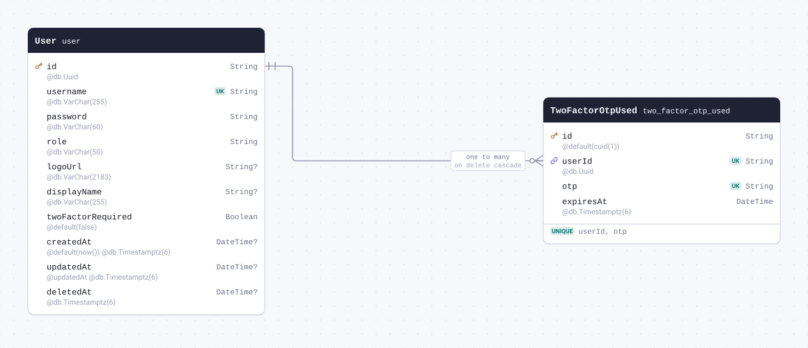

| Field                      | Type                            | Constraints                       | Default   | Description |
| -------------------------- | ------------------------------- | --------------------------------- | --------- | ----------- |
| `id`                       | `String`                        | PK NOT NULL                       | `cuid(1)` |             |
| `userId` (`user_id`)       | `String` `@db.Uuid`             | NOT NULL → [User.id](#model-User) |           |             |
| `otp`                      | `String`                        | NOT NULL                          |           |             |
| `expiresAt` (`expires_at`) | `DateTime` `@db.Timestamptz(6)` | NOT NULL                          |           |             |

#### Indexes

- `@@unique([userId, otp])`

#### References

- `userId` → [User.id](#model-User) (many-to-one, on delete Cascade)

#### Definition

```sql
CREATE TABLE "two_factor_otp_used" (
    "id" TEXT NOT NULL,
    "user_id" UUID NOT NULL,
    "otp" TEXT NOT NULL,
    "expires_at" TIMESTAMPTZ(6) NOT NULL,

    CONSTRAINT "two_factor_otp_used_pkey" PRIMARY KEY ("id")
);

CREATE UNIQUE INDEX "two_factor_otp_used_user_id_otp_key" ON "two_factor_otp_used"("user_id", "otp");
```

<details>
<summary>Queries and their SQL</summary>

**findMany**: Every row

```ts
await prisma.twoFactorOtpUsed.findMany();
```

```sql
SELECT
  "public"."two_factor_otp_used"."id",
  "public"."two_factor_otp_used"."user_id",
  "public"."two_factor_otp_used"."otp",
  "public"."two_factor_otp_used"."expires_at"
FROM
  "public"."two_factor_otp_used"
WHERE
  1 = 1
OFFSET
  $1
-- params: ["0"]
```

**count**: How many rows there are

```ts
await prisma.twoFactorOtpUsed.count();
```

```sql
SELECT
  COUNT(*) AS "_count$_all"
FROM
  (
    SELECT
      "public"."two_factor_otp_used"."id"
    FROM
      "public"."two_factor_otp_used"
    WHERE
      1 = 1
    OFFSET
      $1
  ) AS "sub"
-- params: ["0"]
```

**findMany**: Every row with its relations

```ts
await prisma.twoFactorOtpUsed.findMany({ include: { user: true } });
```

```sql
SELECT
  "public"."two_factor_otp_used"."id",
  "public"."two_factor_otp_used"."user_id",
  "public"."two_factor_otp_used"."otp",
  "public"."two_factor_otp_used"."expires_at"
FROM
  "public"."two_factor_otp_used"
WHERE
  1 = 1
OFFSET
  $1
-- params: ["0"]

SELECT
  "public"."user"."user_id",
  "public"."user"."username",
  "public"."user"."password",
  "public"."user"."role",
  "public"."user"."logo_url",
  "public"."user"."display_name",
  "public"."user"."two_factor_required",
  "public"."user"."created_at",
  "public"."user"."updated_at",
  "public"."user"."deleted_at"
FROM
  "public"."user"
WHERE
  "public"."user"."user_id" IN ($1)
OFFSET
  $2
-- params: ["<userId of the rows above>","0"]
```

**findUnique**: One row by what is unique to it

```ts
await prisma.twoFactorOtpUsed.findUnique({ where: { id: "example" } });
```

```sql
SELECT
  "public"."two_factor_otp_used"."id",
  "public"."two_factor_otp_used"."user_id",
  "public"."two_factor_otp_used"."otp",
  "public"."two_factor_otp_used"."expires_at"
FROM
  "public"."two_factor_otp_used"
WHERE
  (
    "public"."two_factor_otp_used"."id" = $1
    AND 1 = 1
  )
LIMIT
  $2
OFFSET
  $3
-- params: ["example","1","0"]
```

**create**: Create a row

```ts
await prisma.twoFactorOtpUsed.create({
  data: { userId: "example", otp: "example", expiresAt: new Date("2026-01-01T00:00:00.000Z") },
});
```

```sql
INSERT INTO
  "public"."two_factor_otp_used" ("id", "user_id", "otp", "expires_at")
VALUES
  ($1, $2, $3, $4)
RETURNING
  "public"."two_factor_otp_used"."id",
  "public"."two_factor_otp_used"."user_id",
  "public"."two_factor_otp_used"."otp",
  "public"."two_factor_otp_used"."expires_at"
-- params: ["<cuid(1)>","example","example","2026-01-01T00:00:00.000Z"]
```

**update**: Update a row

```ts
await prisma.twoFactorOtpUsed.update({ where: { id: "example" }, data: { otp: "example" } });
```

```sql
SELECT
  "public"."two_factor_otp_used"."id"
FROM
  "public"."two_factor_otp_used"
WHERE
  (
    "public"."two_factor_otp_used"."id" = $1
    AND 1 = 1
  )
LIMIT
  $2
OFFSET
  $3
-- params: ["example","1","0"]

UPDATE "public"."two_factor_otp_used"
SET
  "otp" = $1
WHERE
  (
    "public"."two_factor_otp_used"."id" IN ($2)
    AND (
      "public"."two_factor_otp_used"."id" = $3
      AND 1 = 1
    )
  )
RETURNING
  "public"."two_factor_otp_used"."id",
  "public"."two_factor_otp_used"."user_id",
  "public"."two_factor_otp_used"."otp",
  "public"."two_factor_otp_used"."expires_at"
-- params: ["example","<id of the rows above>","example"]
```

**delete**: Delete a row

```ts
await prisma.twoFactorOtpUsed.delete({ where: { id: "example" } });
```

```sql
DELETE FROM "public"."two_factor_otp_used"
WHERE
  (
    "public"."two_factor_otp_used"."id" = $1
    AND 1 = 1
  )
RETURNING
  "public"."two_factor_otp_used"."id",
  "public"."two_factor_otp_used"."user_id",
  "public"."two_factor_otp_used"."otp",
  "public"."two_factor_otp_used"."expires_at"
-- params: ["example"]
```

</details>

<a id="model-TwoFactorRateLimit"></a>

### TwoFactorRateLimit

Table `two_factor_rate_limit`.

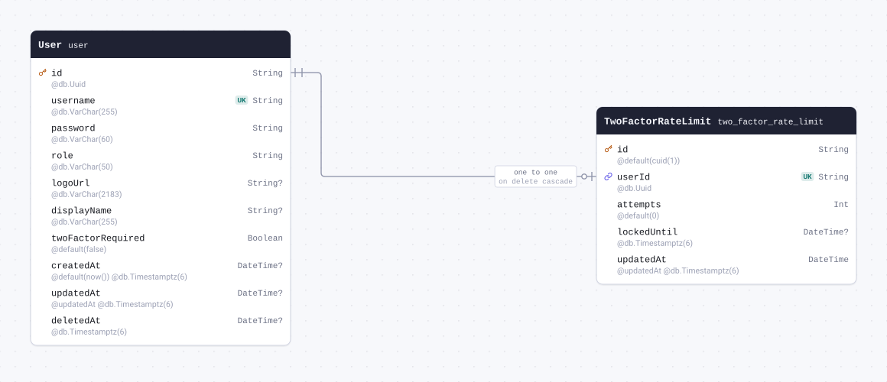

| Field                          | Type                            | Constraints                              | Default      | Description |
| ------------------------------ | ------------------------------- | ---------------------------------------- | ------------ | ----------- |
| `id`                           | `String`                        | PK NOT NULL                              | `cuid(1)`    |             |
| `userId` (`user_id`)           | `String` `@db.Uuid`             | UNIQUE NOT NULL → [User.id](#model-User) |              |             |
| `attempts`                     | `Int`                           | NOT NULL                                 | `0`          |             |
| `lockedUntil` (`locked_until`) | `DateTime` `@db.Timestamptz(6)` | NULL                                     |              |             |
| `updatedAt` (`updated_at`)     | `DateTime` `@db.Timestamptz(6)` | NOT NULL                                 | `@updatedAt` |             |

#### References

- `userId` → [User.id](#model-User) (one-to-one, on delete Cascade)

#### Definition

```sql
CREATE TABLE "two_factor_rate_limit" (
    "id" TEXT NOT NULL,
    "user_id" UUID NOT NULL,
    "attempts" INTEGER NOT NULL DEFAULT 0,
    "locked_until" TIMESTAMPTZ(6),
    "updated_at" TIMESTAMPTZ(6) NOT NULL,

    CONSTRAINT "two_factor_rate_limit_pkey" PRIMARY KEY ("id")
);

CREATE UNIQUE INDEX "two_factor_rate_limit_user_id_key" ON "two_factor_rate_limit"("user_id");
```

<details>
<summary>Queries and their SQL</summary>

**findMany**: Every row

```ts
await prisma.twoFactorRateLimit.findMany();
```

```sql
SELECT
  "public"."two_factor_rate_limit"."id",
  "public"."two_factor_rate_limit"."user_id",
  "public"."two_factor_rate_limit"."attempts",
  "public"."two_factor_rate_limit"."locked_until",
  "public"."two_factor_rate_limit"."updated_at"
FROM
  "public"."two_factor_rate_limit"
WHERE
  1 = 1
OFFSET
  $1
-- params: ["0"]
```

**count**: How many rows there are

```ts
await prisma.twoFactorRateLimit.count();
```

```sql
SELECT
  COUNT(*) AS "_count$_all"
FROM
  (
    SELECT
      "public"."two_factor_rate_limit"."id"
    FROM
      "public"."two_factor_rate_limit"
    WHERE
      1 = 1
    OFFSET
      $1
  ) AS "sub"
-- params: ["0"]
```

**findMany**: Every row with its relations

```ts
await prisma.twoFactorRateLimit.findMany({ include: { user: true } });
```

```sql
SELECT
  "public"."two_factor_rate_limit"."id",
  "public"."two_factor_rate_limit"."user_id",
  "public"."two_factor_rate_limit"."attempts",
  "public"."two_factor_rate_limit"."locked_until",
  "public"."two_factor_rate_limit"."updated_at"
FROM
  "public"."two_factor_rate_limit"
WHERE
  1 = 1
OFFSET
  $1
-- params: ["0"]

SELECT
  "public"."user"."user_id",
  "public"."user"."username",
  "public"."user"."password",
  "public"."user"."role",
  "public"."user"."logo_url",
  "public"."user"."display_name",
  "public"."user"."two_factor_required",
  "public"."user"."created_at",
  "public"."user"."updated_at",
  "public"."user"."deleted_at"
FROM
  "public"."user"
WHERE
  "public"."user"."user_id" IN ($1)
OFFSET
  $2
-- params: ["<userId of the rows above>","0"]
```

**findUnique**: One row by what is unique to it

```ts
await prisma.twoFactorRateLimit.findUnique({ where: { id: "example" } });
```

```sql
SELECT
  "public"."two_factor_rate_limit"."id",
  "public"."two_factor_rate_limit"."user_id",
  "public"."two_factor_rate_limit"."attempts",
  "public"."two_factor_rate_limit"."locked_until",
  "public"."two_factor_rate_limit"."updated_at"
FROM
  "public"."two_factor_rate_limit"
WHERE
  (
    "public"."two_factor_rate_limit"."id" = $1
    AND 1 = 1
  )
LIMIT
  $2
OFFSET
  $3
-- params: ["example","1","0"]
```

**create**: Create a row

```ts
await prisma.twoFactorRateLimit.create({ data: { userId: "example" } });
```

```sql
INSERT INTO
  "public"."two_factor_rate_limit" ("id", "user_id", "attempts", "updated_at")
VALUES
  ($1, $2, $3, $4)
RETURNING
  "public"."two_factor_rate_limit"."id",
  "public"."two_factor_rate_limit"."user_id",
  "public"."two_factor_rate_limit"."attempts",
  "public"."two_factor_rate_limit"."locked_until",
  "public"."two_factor_rate_limit"."updated_at"
-- params: ["<cuid(1)>","example","0","<now()>"]
```

**update**: Update a row

```ts
await prisma.twoFactorRateLimit.update({ where: { id: "example" }, data: { attempts: 1 } });
```

```sql
SELECT
  "public"."two_factor_rate_limit"."id"
FROM
  "public"."two_factor_rate_limit"
WHERE
  (
    "public"."two_factor_rate_limit"."id" = $1
    AND 1 = 1
  )
LIMIT
  $2
OFFSET
  $3
-- params: ["example","1","0"]

UPDATE "public"."two_factor_rate_limit"
SET
  "attempts" = $1,
  "updated_at" = $2
WHERE
  (
    "public"."two_factor_rate_limit"."id" IN ($3)
    AND (
      "public"."two_factor_rate_limit"."id" = $4
      AND 1 = 1
    )
  )
RETURNING
  "public"."two_factor_rate_limit"."id",
  "public"."two_factor_rate_limit"."user_id",
  "public"."two_factor_rate_limit"."attempts",
  "public"."two_factor_rate_limit"."locked_until",
  "public"."two_factor_rate_limit"."updated_at"
-- params: ["1",{"prisma__type":"generatorCall","prisma__value":{"name":"now","args":[],"returnType":{"type":"DateTime"}}},"<id of the rows above>","example"]
```

**delete**: Delete a row

```ts
await prisma.twoFactorRateLimit.delete({ where: { id: "example" } });
```

```sql
DELETE FROM "public"."two_factor_rate_limit"
WHERE
  (
    "public"."two_factor_rate_limit"."id" = $1
    AND 1 = 1
  )
RETURNING
  "public"."two_factor_rate_limit"."id",
  "public"."two_factor_rate_limit"."user_id",
  "public"."two_factor_rate_limit"."attempts",
  "public"."two_factor_rate_limit"."locked_until",
  "public"."two_factor_rate_limit"."updated_at"
-- params: ["example"]
```

</details>

<a id="model-AppSetting"></a>

### AppSetting

Table `app_setting`.

| Field   | Type     | Constraints | Default | Description |
| ------- | -------- | ----------- | ------- | ----------- |
| `key`   | `String` | PK NOT NULL |         |             |
| `value` | `String` | NOT NULL    |         |             |

#### Definition

```sql
CREATE TABLE "app_setting" (
    "key" TEXT NOT NULL,
    "value" TEXT NOT NULL,

    CONSTRAINT "app_setting_pkey" PRIMARY KEY ("key")
);
```

<details>
<summary>Queries and their SQL</summary>

**findMany**: Every row

```ts
await prisma.appSetting.findMany();
```

```sql
SELECT
  "public"."app_setting"."key",
  "public"."app_setting"."value"
FROM
  "public"."app_setting"
WHERE
  1 = 1
OFFSET
  $1
-- params: ["0"]
```

**count**: How many rows there are

```ts
await prisma.appSetting.count();
```

```sql
SELECT
  COUNT(*) AS "_count$_all"
FROM
  (
    SELECT
      "public"."app_setting"."key"
    FROM
      "public"."app_setting"
    WHERE
      1 = 1
    OFFSET
      $1
  ) AS "sub"
-- params: ["0"]
```

**findUnique**: One row by what is unique to it

```ts
await prisma.appSetting.findUnique({ where: { key: "example" } });
```

```sql
SELECT
  "public"."app_setting"."key",
  "public"."app_setting"."value"
FROM
  "public"."app_setting"
WHERE
  (
    "public"."app_setting"."key" = $1
    AND 1 = 1
  )
LIMIT
  $2
OFFSET
  $3
-- params: ["example","1","0"]
```

**create**: Create a row

```ts
await prisma.appSetting.create({ data: { key: "example", value: "example" } });
```

```sql
INSERT INTO
  "public"."app_setting" ("key", "value")
VALUES
  ($1, $2)
RETURNING
  "public"."app_setting"."key",
  "public"."app_setting"."value"
-- params: ["example","example"]
```

**update**: Update a row

```ts
await prisma.appSetting.update({ where: { key: "example" }, data: { value: "example" } });
```

```sql
SELECT
  "public"."app_setting"."key"
FROM
  "public"."app_setting"
WHERE
  (
    "public"."app_setting"."key" = $1
    AND 1 = 1
  )
LIMIT
  $2
OFFSET
  $3
-- params: ["example","1","0"]

UPDATE "public"."app_setting"
SET
  "value" = $1
WHERE
  (
    "public"."app_setting"."key" IN ($2)
    AND (
      "public"."app_setting"."key" = $3
      AND 1 = 1
    )
  )
RETURNING
  "public"."app_setting"."key",
  "public"."app_setting"."value"
-- params: ["example","<key of the rows above>","example"]
```

**delete**: Delete a row

```ts
await prisma.appSetting.delete({ where: { key: "example" } });
```

```sql
DELETE FROM "public"."app_setting"
WHERE
  (
    "public"."app_setting"."key" = $1
    AND 1 = 1
  )
RETURNING
  "public"."app_setting"."key",
  "public"."app_setting"."value"
-- params: ["example"]
```

</details>

<a id="model-ErrorIssue"></a>

### ErrorIssue

Table `error_issue`.

| Field                                  | Type                            | Constraints | Default        | Description |
| -------------------------------------- | ------------------------------- | ----------- | -------------- | ----------- |
| `id` (`issue_id`)                      | `String` `@db.Uuid`             | PK NOT NULL |                |             |
| `websiteId` (`website_id`)             | `String` `@db.Uuid`             | NOT NULL    |                |             |
| `fingerprint`                          | `String` `@db.VarChar(64)`      | NOT NULL    |                |             |
| `groupingVersion` (`grouping_version`) | `Int`                           | NOT NULL    | `1`            |             |
| `title`                                | `String` `@db.VarChar(2200)`    | NOT NULL    |                |             |
| `status`                               | `String` `@db.VarChar(20)`      | NOT NULL    | `"unresolved"` |             |
| `resolvedAt` (`resolved_at`)           | `DateTime` `@db.Timestamptz(6)` | NULL        |                |             |
| `createdAt` (`created_at`)             | `DateTime` `@db.Timestamptz(6)` | NOT NULL    | `now()`        |             |

#### Indexes

- `@@index([websiteId, status])`
- `@@unique([websiteId, groupingVersion, fingerprint])`

#### Definition

```sql
CREATE TABLE "error_issue" (
    "issue_id" UUID NOT NULL,
    "website_id" UUID NOT NULL,
    "fingerprint" VARCHAR(64) NOT NULL,
    "grouping_version" INTEGER NOT NULL DEFAULT 1,
    "title" VARCHAR(2200) NOT NULL,
    "status" VARCHAR(20) NOT NULL DEFAULT 'unresolved',
    "resolved_at" TIMESTAMPTZ(6),
    "created_at" TIMESTAMPTZ(6) NOT NULL DEFAULT CURRENT_TIMESTAMP,

    CONSTRAINT "error_issue_pkey" PRIMARY KEY ("issue_id")
);

CREATE INDEX "error_issue_website_id_status_idx" ON "error_issue"("website_id", "status");

CREATE UNIQUE INDEX "error_issue_website_id_grouping_version_fingerprint_key" ON "error_issue"("website_id", "grouping_version", "fingerprint");
```

<details>
<summary>Queries and their SQL</summary>

**findMany**: Every row

```ts
await prisma.errorIssue.findMany();
```

```sql
SELECT
  "public"."error_issue"."issue_id",
  "public"."error_issue"."website_id",
  "public"."error_issue"."fingerprint",
  "public"."error_issue"."grouping_version",
  "public"."error_issue"."title",
  "public"."error_issue"."status",
  "public"."error_issue"."resolved_at",
  "public"."error_issue"."created_at"
FROM
  "public"."error_issue"
WHERE
  1 = 1
OFFSET
  $1
-- params: ["0"]
```

**count**: How many rows there are

```ts
await prisma.errorIssue.count();
```

```sql
SELECT
  COUNT(*) AS "_count$_all"
FROM
  (
    SELECT
      "public"."error_issue"."issue_id"
    FROM
      "public"."error_issue"
    WHERE
      1 = 1
    OFFSET
      $1
  ) AS "sub"
-- params: ["0"]
```

**findUnique**: One row by what is unique to it

```ts
await prisma.errorIssue.findUnique({ where: { id: "example" } });
```

```sql
SELECT
  "public"."error_issue"."issue_id",
  "public"."error_issue"."website_id",
  "public"."error_issue"."fingerprint",
  "public"."error_issue"."grouping_version",
  "public"."error_issue"."title",
  "public"."error_issue"."status",
  "public"."error_issue"."resolved_at",
  "public"."error_issue"."created_at"
FROM
  "public"."error_issue"
WHERE
  (
    "public"."error_issue"."issue_id" = $1
    AND 1 = 1
  )
LIMIT
  $2
OFFSET
  $3
-- params: ["example","1","0"]
```

**create**: Create a row

```ts
await prisma.errorIssue.create({
  data: { id: "example", websiteId: "example", fingerprint: "example", title: "example" },
});
```

```sql
INSERT INTO
  "public"."error_issue" (
    "issue_id",
    "website_id",
    "fingerprint",
    "grouping_version",
    "title",
    "status",
    "created_at"
  )
VALUES
  ($1, $2, $3, $4, $5, $6, $7)
RETURNING
  "public"."error_issue"."issue_id",
  "public"."error_issue"."website_id",
  "public"."error_issue"."fingerprint",
  "public"."error_issue"."grouping_version",
  "public"."error_issue"."title",
  "public"."error_issue"."status",
  "public"."error_issue"."resolved_at",
  "public"."error_issue"."created_at"
-- params: ["example","example","example","1","example","unresolved","<now()>"]
```

**update**: Update a row

```ts
await prisma.errorIssue.update({ where: { id: "example" }, data: { websiteId: "example" } });
```

```sql
SELECT
  "public"."error_issue"."issue_id"
FROM
  "public"."error_issue"
WHERE
  (
    "public"."error_issue"."issue_id" = $1
    AND 1 = 1
  )
LIMIT
  $2
OFFSET
  $3
-- params: ["example","1","0"]

UPDATE "public"."error_issue"
SET
  "website_id" = $1
WHERE
  (
    "public"."error_issue"."issue_id" IN ($2)
    AND (
      "public"."error_issue"."issue_id" = $3
      AND 1 = 1
    )
  )
RETURNING
  "public"."error_issue"."issue_id",
  "public"."error_issue"."website_id",
  "public"."error_issue"."fingerprint",
  "public"."error_issue"."grouping_version",
  "public"."error_issue"."title",
  "public"."error_issue"."status",
  "public"."error_issue"."resolved_at",
  "public"."error_issue"."created_at"
-- params: ["example","<id of the rows above>","example"]
```

**delete**: Delete a row

```ts
await prisma.errorIssue.delete({ where: { id: "example" } });
```

```sql
DELETE FROM "public"."error_issue"
WHERE
  (
    "public"."error_issue"."issue_id" = $1
    AND 1 = 1
  )
RETURNING
  "public"."error_issue"."issue_id",
  "public"."error_issue"."website_id",
  "public"."error_issue"."fingerprint",
  "public"."error_issue"."grouping_version",
  "public"."error_issue"."title",
  "public"."error_issue"."status",
  "public"."error_issue"."resolved_at",
  "public"."error_issue"."created_at"
-- params: ["example"]
```

</details>

<a id="model-ErrorEvent"></a>

### ErrorEvent

Table `error_event`.

| Field                        | Type                            | Constraints | Default | Description |
| ---------------------------- | ------------------------------- | ----------- | ------- | ----------- |
| `websiteId` (`website_id`)   | `String` `@db.Uuid`             | PK NOT NULL |         |             |
| `id` (`event_id`)            | `String` `@db.Uuid`             | PK NOT NULL |         |             |
| `issueId` (`issue_id`)       | `String` `@db.Uuid`             | NOT NULL    |         |             |
| `sessionId` (`session_id`)   | `String` `@db.Uuid`             | NOT NULL    |         |             |
| `visitId` (`visit_id`)       | `String` `@db.Uuid`             | NOT NULL    |         |             |
| `createdAt` (`created_at`)   | `DateTime` `@db.Timestamptz(6)` | NOT NULL    |         |             |
| `receivedAt` (`received_at`) | `DateTime` `@db.Timestamptz(6)` | NOT NULL    | `now()` |             |
| `name`                       | `String` `@db.VarChar(200)`     | NOT NULL    |         |             |
| `message`                    | `String` `@db.VarChar(2000)`    | NOT NULL    |         |             |
| `stack`                      | `String` `@db.Text`             | NOT NULL    |         |             |
| `frames`                     | `Json`                          | NOT NULL    |         |             |
| `tags`                       | `Json`                          | NOT NULL    |         |             |
| `handled`                    | `Boolean`                       | NOT NULL    |         |             |
| `urlPath` (`url_path`)       | `String` `@db.VarChar(500)`     | NOT NULL    |         |             |
| `release`                    | `String` `@db.VarChar(100)`     | NOT NULL    |         |             |
| `environment`                | `String` `@db.VarChar(50)`      | NOT NULL    |         |             |
| `browser`                    | `String` `@db.VarChar(50)`      | NOT NULL    |         |             |
| `os`                         | `String` `@db.VarChar(50)`      | NOT NULL    |         |             |
| `device`                     | `String` `@db.VarChar(50)`      | NOT NULL    |         |             |

#### Indexes

- `@@id([websiteId, id])`
- `@@index([websiteId, createdAt])`
- `@@index([websiteId, issueId, createdAt])`

#### Definition

```sql
CREATE TABLE "error_event" (
    "website_id" UUID NOT NULL,
    "event_id" UUID NOT NULL,
    "issue_id" UUID NOT NULL,
    "session_id" UUID NOT NULL,
    "visit_id" UUID NOT NULL,
    "created_at" TIMESTAMPTZ(6) NOT NULL,
    "received_at" TIMESTAMPTZ(6) NOT NULL DEFAULT CURRENT_TIMESTAMP,
    "name" VARCHAR(200) NOT NULL,
    "message" VARCHAR(2000) NOT NULL,
    "stack" TEXT NOT NULL,
    "frames" JSONB NOT NULL,
    "tags" JSONB NOT NULL,
    "handled" BOOLEAN NOT NULL,
    "url_path" VARCHAR(500) NOT NULL,
    "release" VARCHAR(100) NOT NULL,
    "environment" VARCHAR(50) NOT NULL,
    "browser" VARCHAR(50) NOT NULL,
    "os" VARCHAR(50) NOT NULL,
    "device" VARCHAR(50) NOT NULL,

    CONSTRAINT "error_event_pkey" PRIMARY KEY ("website_id","event_id")
);

CREATE INDEX "error_event_website_id_created_at_idx" ON "error_event"("website_id", "created_at");

CREATE INDEX "error_event_website_id_issue_id_created_at_idx" ON "error_event"("website_id", "issue_id", "created_at");
```

<details>
<summary>Queries and their SQL</summary>

**findMany**: Every row

```ts
await prisma.errorEvent.findMany();
```

```sql
SELECT
  "public"."error_event"."website_id",
  "public"."error_event"."event_id",
  "public"."error_event"."issue_id",
  "public"."error_event"."session_id",
  "public"."error_event"."visit_id",
  "public"."error_event"."created_at",
  "public"."error_event"."received_at",
  "public"."error_event"."name",
  "public"."error_event"."message",
  "public"."error_event"."stack",
  "public"."error_event"."frames",
  "public"."error_event"."tags",
  "public"."error_event"."handled",
  "public"."error_event"."url_path",
  "public"."error_event"."release",
  "public"."error_event"."environment",
  "public"."error_event"."browser",
  "public"."error_event"."os",
  "public"."error_event"."device"
FROM
  "public"."error_event"
WHERE
  1 = 1
OFFSET
  $1
-- params: ["0"]
```

**count**: How many rows there are

```ts
await prisma.errorEvent.count();
```

```sql
SELECT
  COUNT(*) AS "_count$_all"
FROM
  (
    SELECT
      "public"."error_event"."website_id",
      "public"."error_event"."event_id"
    FROM
      "public"."error_event"
    WHERE
      1 = 1
    OFFSET
      $1
  ) AS "sub"
-- params: ["0"]
```

**findUnique**: One row by what is unique to it

```ts
await prisma.errorEvent.findUnique({
  where: { websiteId_id: { websiteId: "example", id: "example" } },
});
```

```sql
SELECT
  "public"."error_event"."website_id",
  "public"."error_event"."event_id",
  "public"."error_event"."issue_id",
  "public"."error_event"."session_id",
  "public"."error_event"."visit_id",
  "public"."error_event"."created_at",
  "public"."error_event"."received_at",
  "public"."error_event"."name",
  "public"."error_event"."message",
  "public"."error_event"."stack",
  "public"."error_event"."frames",
  "public"."error_event"."tags",
  "public"."error_event"."handled",
  "public"."error_event"."url_path",
  "public"."error_event"."release",
  "public"."error_event"."environment",
  "public"."error_event"."browser",
  "public"."error_event"."os",
  "public"."error_event"."device"
FROM
  "public"."error_event"
WHERE
  (
    (
      "public"."error_event"."website_id" = $1
      AND "public"."error_event"."event_id" = $2
    )
    AND 1 = 1
  )
LIMIT
  $3
OFFSET
  $4
-- params: ["example","example","1","0"]
```

**create**: Create a row

```ts
await prisma.errorEvent.create({
  data: {
    websiteId: "example",
    id: "example",
    issueId: "example",
    sessionId: "example",
    visitId: "example",
    createdAt: new Date("2026-01-01T00:00:00.000Z"),
    name: "example",
    message: "example",
    stack: "example",
    frames: {},
    tags: {},
    handled: true,
    urlPath: "example",
    release: "example",
    environment: "example",
    browser: "example",
    os: "example",
    device: "example",
  },
});
```

```sql
INSERT INTO
  "public"."error_event" (
    "website_id",
    "event_id",
    "issue_id",
    "session_id",
    "visit_id",
    "created_at",
    "received_at",
    "name",
    "message",
    "stack",
    "frames",
    "tags",
    "handled",
    "url_path",
    "release",
    "environment",
    "browser",
    "os",
    "device"
  )
VALUES
  (
    $1,
    $2,
    $3,
    $4,
    $5,
    $6,
    $7,
    $8,
    $9,
    $10,
    $11,
    $12,
    $13,
    $14,
    $15,
    $16,
    $17,
    $18,
    $19
  )
RETURNING
  "public"."error_event"."website_id",
  "public"."error_event"."event_id",
  "public"."error_event"."issue_id",
  "public"."error_event"."session_id",
  "public"."error_event"."visit_id",
  "public"."error_event"."created_at",
  "public"."error_event"."received_at",
  "public"."error_event"."name",
  "public"."error_event"."message",
  "public"."error_event"."stack",
  "public"."error_event"."frames",
  "public"."error_event"."tags",
  "public"."error_event"."handled",
  "public"."error_event"."url_path",
  "public"."error_event"."release",
  "public"."error_event"."environment",
  "public"."error_event"."browser",
  "public"."error_event"."os",
  "public"."error_event"."device"
-- params: ["example","example","example","example","example","2026-01-01T00:00:00.000Z","<now()>","example","example","example","{}","{}",true,"example","example","example","example","example","example"]
```

**update**: Update a row

```ts
await prisma.errorEvent.update({
  where: { websiteId_id: { websiteId: "example", id: "example" } },
  data: { issueId: "example" },
});
```

```sql
SELECT
  "public"."error_event"."website_id",
  "public"."error_event"."event_id"
FROM
  "public"."error_event"
WHERE
  (
    (
      "public"."error_event"."website_id" = $1
      AND "public"."error_event"."event_id" = $2
    )
    AND 1 = 1
  )
LIMIT
  $3
OFFSET
  $4
-- params: ["example","example","1","0"]

UPDATE "public"."error_event"
SET
  "issue_id" = $1
WHERE
  (
    (
      "public"."error_event"."website_id" IN ($2)
      AND "public"."error_event"."event_id" IN ($3)
    )
    AND (
      (
        "public"."error_event"."website_id" = $4
        AND "public"."error_event"."event_id" = $5
      )
      AND 1 = 1
    )
  )
RETURNING
  "public"."error_event"."website_id",
  "public"."error_event"."event_id",
  "public"."error_event"."issue_id",
  "public"."error_event"."session_id",
  "public"."error_event"."visit_id",
  "public"."error_event"."created_at",
  "public"."error_event"."received_at",
  "public"."error_event"."name",
  "public"."error_event"."message",
  "public"."error_event"."stack",
  "public"."error_event"."frames",
  "public"."error_event"."tags",
  "public"."error_event"."handled",
  "public"."error_event"."url_path",
  "public"."error_event"."release",
  "public"."error_event"."environment",
  "public"."error_event"."browser",
  "public"."error_event"."os",
  "public"."error_event"."device"
-- params: ["example","<websiteId of the rows above>","<id of the rows above>","example","example"]
```

**delete**: Delete a row

```ts
await prisma.errorEvent.delete({
  where: { websiteId_id: { websiteId: "example", id: "example" } },
});
```

```sql
DELETE FROM "public"."error_event"
WHERE
  (
    (
      "public"."error_event"."website_id" = $1
      AND "public"."error_event"."event_id" = $2
    )
    AND 1 = 1
  )
RETURNING
  "public"."error_event"."website_id",
  "public"."error_event"."event_id",
  "public"."error_event"."issue_id",
  "public"."error_event"."session_id",
  "public"."error_event"."visit_id",
  "public"."error_event"."created_at",
  "public"."error_event"."received_at",
  "public"."error_event"."name",
  "public"."error_event"."message",
  "public"."error_event"."stack",
  "public"."error_event"."frames",
  "public"."error_event"."tags",
  "public"."error_event"."handled",
  "public"."error_event"."url_path",
  "public"."error_event"."release",
  "public"."error_event"."environment",
  "public"."error_event"."browser",
  "public"."error_event"."os",
  "public"."error_event"."device"
-- params: ["example","example"]
```

</details>

<a id="model-ErrorRateLimit"></a>

### ErrorRateLimit

Table `error_rate_limit`.

| Field                      | Type                            | Constraints | Default | Description |
| -------------------------- | ------------------------------- | ----------- | ------- | ----------- |
| `websiteId` (`website_id`) | `String` `@db.Uuid`             | PK NOT NULL |         |             |
| `bucket`                   | `DateTime` `@db.Timestamptz(6)` | NOT NULL    |         |             |
| `count`                    | `Int`                           | NOT NULL    |         |             |

#### Definition

```sql
CREATE TABLE "error_rate_limit" (
    "website_id" UUID NOT NULL,
    "bucket" TIMESTAMPTZ(6) NOT NULL,
    "count" INTEGER NOT NULL,

    CONSTRAINT "error_rate_limit_pkey" PRIMARY KEY ("website_id")
);
```

<details>
<summary>Queries and their SQL</summary>

**findMany**: Every row

```ts
await prisma.errorRateLimit.findMany();
```

```sql
SELECT
  "public"."error_rate_limit"."website_id",
  "public"."error_rate_limit"."bucket",
  "public"."error_rate_limit"."count"
FROM
  "public"."error_rate_limit"
WHERE
  1 = 1
OFFSET
  $1
-- params: ["0"]
```

**count**: How many rows there are

```ts
await prisma.errorRateLimit.count();
```

```sql
SELECT
  COUNT(*) AS "_count$_all"
FROM
  (
    SELECT
      "public"."error_rate_limit"."website_id"
    FROM
      "public"."error_rate_limit"
    WHERE
      1 = 1
    OFFSET
      $1
  ) AS "sub"
-- params: ["0"]
```

**findUnique**: One row by what is unique to it

```ts
await prisma.errorRateLimit.findUnique({ where: { websiteId: "example" } });
```

```sql
SELECT
  "public"."error_rate_limit"."website_id",
  "public"."error_rate_limit"."bucket",
  "public"."error_rate_limit"."count"
FROM
  "public"."error_rate_limit"
WHERE
  (
    "public"."error_rate_limit"."website_id" = $1
    AND 1 = 1
  )
LIMIT
  $2
OFFSET
  $3
-- params: ["example","1","0"]
```

**create**: Create a row

```ts
await prisma.errorRateLimit.create({
  data: { websiteId: "example", bucket: new Date("2026-01-01T00:00:00.000Z"), count: 1 },
});
```

```sql
INSERT INTO
  "public"."error_rate_limit" ("website_id", "bucket", "count")
VALUES
  ($1, $2, $3)
RETURNING
  "public"."error_rate_limit"."website_id",
  "public"."error_rate_limit"."bucket",
  "public"."error_rate_limit"."count"
-- params: ["example","2026-01-01T00:00:00.000Z","1"]
```

**update**: Update a row

```ts
await prisma.errorRateLimit.update({
  where: { websiteId: "example" },
  data: { bucket: new Date("2026-01-01T00:00:00.000Z") },
});
```

```sql
SELECT
  "public"."error_rate_limit"."website_id"
FROM
  "public"."error_rate_limit"
WHERE
  (
    "public"."error_rate_limit"."website_id" = $1
    AND 1 = 1
  )
LIMIT
  $2
OFFSET
  $3
-- params: ["example","1","0"]

UPDATE "public"."error_rate_limit"
SET
  "bucket" = $1
WHERE
  (
    "public"."error_rate_limit"."website_id" IN ($2)
    AND (
      "public"."error_rate_limit"."website_id" = $3
      AND 1 = 1
    )
  )
RETURNING
  "public"."error_rate_limit"."website_id",
  "public"."error_rate_limit"."bucket",
  "public"."error_rate_limit"."count"
-- params: ["2026-01-01T00:00:00.000Z","<websiteId of the rows above>","example"]
```

**delete**: Delete a row

```ts
await prisma.errorRateLimit.delete({ where: { websiteId: "example" } });
```

```sql
DELETE FROM "public"."error_rate_limit"
WHERE
  (
    "public"."error_rate_limit"."website_id" = $1
    AND 1 = 1
  )
RETURNING
  "public"."error_rate_limit"."website_id",
  "public"."error_rate_limit"."bucket",
  "public"."error_rate_limit"."count"
-- params: ["example"]
```

</details>
