# Schema docs

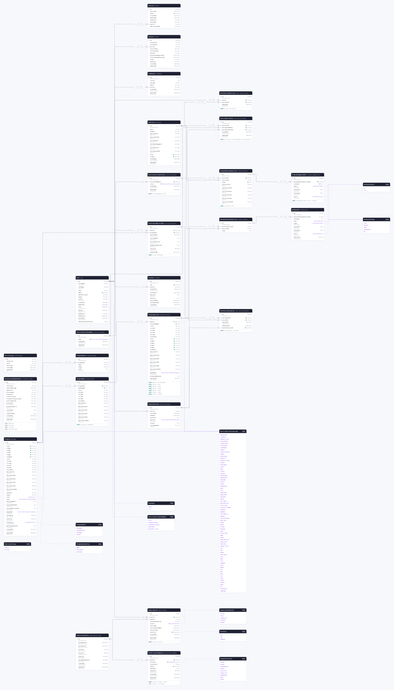

<details>
<summary>The whole schema as SQL</summary>

```sql
CREATE SCHEMA IF NOT EXISTS "public";

CREATE TYPE "UserRole" AS ENUM ('admin', 'user');

CREATE TYPE "ExercisePrivacy" AS ENUM ('PUBLIC', 'PRIVATE');

CREATE TYPE "ExerciseAttributeNameEnum" AS ENUM ('TYPE', 'PRIMARY_MUSCLE', 'SECONDARY_MUSCLE', 'EQUIPMENT', 'MECHANICS_TYPE');

CREATE TYPE "ExerciseAttributeValueEnum" AS ENUM ('BODYWEIGHT', 'STRENGTH', 'POWERLIFTING', 'CALISTHENIC', 'PLYOMETRICS', 'STRETCHING', 'STRONGMAN', 'CARDIO', 'STABILIZATION', 'POWER', 'RESISTANCE', 'CROSSFIT', 'WEIGHTLIFTING', 'BICEPS', 'SHOULDERS', 'CHEST', 'BACK', 'GLUTES', 'TRICEPS', 'HAMSTRINGS', 'QUADRICEPS', 'FOREARMS', 'CALVES', 'TRAPS', 'ABDOMINALS', 'NECK', 'LATS', 'ADDUCTORS', 'ABDUCTORS', 'OBLIQUES', 'GROIN', 'FULL_BODY', 'ROTATOR_CUFF', 'HIP_FLEXOR', 'ACHILLES_TENDON', 'FINGERS', 'DUMBBELL', 'KETTLEBELLS', 'BARBELL', 'SMITH_MACHINE', 'BODY_ONLY', 'OTHER', 'BANDS', 'EZ_BAR', 'MACHINE', 'DESK', 'PULLUP_BAR', 'NONE', 'CABLE', 'MEDICINE_BALL', 'SWISS_BALL', 'FOAM_ROLL', 'WEIGHT_PLATE', 'TRX', 'BOX', 'ROPES', 'SPIN_BIKE', 'STEP', 'BOSU', 'TYRE', 'SANDBAG', 'POLE', 'BENCH', 'WALL', 'BAR', 'RACK', 'CAR', 'SLED', 'CHAIN', 'SKIERG', 'ROPE', 'NA', 'ISOLATION', 'COMPOUND');

CREATE TYPE "WorkoutSetType" AS ENUM ('TIME', 'WEIGHT', 'REPS', 'BODYWEIGHT', 'NA');

CREATE TYPE "WorkoutSetUnit" AS ENUM ('kg', 'lbs');

CREATE TYPE "SubscriptionStatus" AS ENUM ('ACTIVE', 'TRIAL', 'CANCELLED', 'EXPIRED', 'PAUSED');

CREATE TYPE "Platform" AS ENUM ('WEB', 'IOS', 'ANDROID');

CREATE TYPE "PaymentProcessor" AS ENUM ('STRIPE', 'PAYPAL', 'LEMONSQUEEZY', 'PADDLE', 'APPLE_PAY', 'GOOGLE_PAY', 'REVENUECAT', 'NONE', 'OTHER');

CREATE TYPE "ProgramLevel" AS ENUM ('BEGINNER', 'INTERMEDIATE', 'ADVANCED', 'EXPERT');

CREATE TYPE "ProgramVisibility" AS ENUM ('DRAFT', 'PUBLISHED', 'ARCHIVED');

CREATE TABLE "user" (
    "id" TEXT NOT NULL,
    "firstName" TEXT NOT NULL DEFAULT '',
    "lastName" TEXT NOT NULL DEFAULT '',
    "name" TEXT NOT NULL,
    "email" TEXT NOT NULL,
    "emailVerified" BOOLEAN NOT NULL,
    "image" TEXT,
    "locale" TEXT DEFAULT 'fr',
    "createdAt" TIMESTAMP(3) NOT NULL,
    "updatedAt" TIMESTAMP(3) NOT NULL,
    "role" "UserRole" DEFAULT 'user',
    "banned" BOOLEAN DEFAULT false,
    "banReason" TEXT,
    "banExpires" TIMESTAMP(3),
    "isPremium" BOOLEAN DEFAULT false,
    "onboardingPreferences" JSONB,

    CONSTRAINT "user_pkey" PRIMARY KEY ("id")
);

CREATE TABLE "user_favorite_exercises" (
    "id" TEXT NOT NULL,
    "userId" TEXT NOT NULL,
    "exerciseId" TEXT NOT NULL,
    "updatedAt" TIMESTAMP(3) NOT NULL,

    CONSTRAINT "user_favorite_exercises_pkey" PRIMARY KEY ("id")
);

CREATE TABLE "session" (
    "id" TEXT NOT NULL,
    "expiresAt" TIMESTAMP(3) NOT NULL,
    "token" TEXT NOT NULL,
    "createdAt" TIMESTAMP(3) NOT NULL,
    "updatedAt" TIMESTAMP(3) NOT NULL,
    "ipAddress" TEXT,
    "userAgent" TEXT,
    "userId" TEXT NOT NULL,
    "impersonatedBy" TEXT,

    CONSTRAINT "session_pkey" PRIMARY KEY ("id")
);

CREATE TABLE "account" (
    "id" TEXT NOT NULL,
    "accountId" TEXT NOT NULL,
    "providerId" TEXT NOT NULL,
    "userId" TEXT NOT NULL,
    "accessToken" TEXT,
    "refreshToken" TEXT,
    "idToken" TEXT,
    "accessTokenExpiresAt" TIMESTAMP(3),
    "refreshTokenExpiresAt" TIMESTAMP(3),
    "scope" TEXT,
    "password" TEXT,
    "createdAt" TIMESTAMP(3) NOT NULL,
    "updatedAt" TIMESTAMP(3) NOT NULL,

    CONSTRAINT "account_pkey" PRIMARY KEY ("id")
);

CREATE TABLE "verification" (
    "id" TEXT NOT NULL,
    "identifier" TEXT NOT NULL,
    "value" TEXT NOT NULL,
    "expiresAt" TIMESTAMP(3) NOT NULL,
    "createdAt" TIMESTAMP(3),
    "updatedAt" TIMESTAMP(3),

    CONSTRAINT "verification_pkey" PRIMARY KEY ("id")
);

CREATE TABLE "feedbacks" (
    "id" TEXT NOT NULL,
    "review" INTEGER NOT NULL,
    "message" TEXT NOT NULL,
    "email" TEXT,
    "userId" TEXT,
    "createdAt" TIMESTAMP(3) NOT NULL DEFAULT CURRENT_TIMESTAMP,
    "updatedAt" TIMESTAMP(3) NOT NULL,

    CONSTRAINT "feedbacks_pkey" PRIMARY KEY ("id")
);

CREATE TABLE "exercises" (
    "id" TEXT NOT NULL,
    "name" TEXT NOT NULL,
    "nameEn" TEXT,
    "description" TEXT,
    "descriptionEn" TEXT,
    "fullVideoUrl" TEXT,
    "fullVideoImageUrl" TEXT,
    "introduction" TEXT,
    "introductionEn" TEXT,
    "slug" TEXT,
    "slugEn" TEXT,
    "createdAt" TIMESTAMP(3) NOT NULL DEFAULT CURRENT_TIMESTAMP,
    "updatedAt" TIMESTAMP(3) NOT NULL,

    CONSTRAINT "exercises_pkey" PRIMARY KEY ("id")
);

CREATE TABLE "exercise_attribute_names" (
    "id" TEXT NOT NULL,
    "name" "ExerciseAttributeNameEnum" NOT NULL,
    "createdAt" TIMESTAMP(3) NOT NULL DEFAULT CURRENT_TIMESTAMP,
    "updatedAt" TIMESTAMP(3) NOT NULL,

    CONSTRAINT "exercise_attribute_names_pkey" PRIMARY KEY ("id")
);

CREATE TABLE "exercise_attribute_values" (
    "id" TEXT NOT NULL,
    "attributeNameId" TEXT NOT NULL,
    "value" "ExerciseAttributeValueEnum" NOT NULL,
    "createdAt" TIMESTAMP(3) NOT NULL DEFAULT CURRENT_TIMESTAMP,
    "updatedAt" TIMESTAMP(3) NOT NULL,

    CONSTRAINT "exercise_attribute_values_pkey" PRIMARY KEY ("id")
);

CREATE TABLE "exercise_attributes" (
    "id" TEXT NOT NULL,
    "exerciseId" TEXT NOT NULL,
    "attributeNameId" TEXT NOT NULL,
    "attributeValueId" TEXT NOT NULL,
    "createdAt" TIMESTAMP(3) NOT NULL DEFAULT CURRENT_TIMESTAMP,
    "updatedAt" TIMESTAMP(3) NOT NULL,

    CONSTRAINT "exercise_attributes_pkey" PRIMARY KEY ("id")
);

CREATE TABLE "workout_sessions" (
    "id" TEXT NOT NULL,
    "userId" TEXT NOT NULL,
    "startedAt" TIMESTAMP(3) NOT NULL,
    "endedAt" TIMESTAMP(3),
    "duration" INTEGER,
    "muscles" "ExerciseAttributeValueEnum"[] DEFAULT ARRAY[]::"ExerciseAttributeValueEnum"[],
    "rating" INTEGER,
    "ratingComment" TEXT,

    CONSTRAINT "workout_sessions_pkey" PRIMARY KEY ("id")
);

CREATE TABLE "workout_session_exercises" (
    "id" TEXT NOT NULL,
    "workoutSessionId" TEXT NOT NULL,
    "exerciseId" TEXT NOT NULL,
    "order" INTEGER NOT NULL,

    CONSTRAINT "workout_session_exercises_pkey" PRIMARY KEY ("id")
);

CREATE TABLE "workout_sets" (
    "id" TEXT NOT NULL,
    "workoutSessionExerciseId" TEXT NOT NULL,
    "setIndex" INTEGER NOT NULL,
    "type" "WorkoutSetType" NOT NULL,
    "types" "WorkoutSetType"[] DEFAULT ARRAY[]::"WorkoutSetType"[],
    "valuesInt" INTEGER[] DEFAULT ARRAY[]::INTEGER[],
    "valuesSec" INTEGER[] DEFAULT ARRAY[]::INTEGER[],
    "units" "WorkoutSetUnit"[] DEFAULT ARRAY[]::"WorkoutSetUnit"[],
    "completed" BOOLEAN NOT NULL DEFAULT false,

    CONSTRAINT "workout_sets_pkey" PRIMARY KEY ("id")
);

CREATE TABLE "subscription_plans" (
    "id" TEXT NOT NULL,
    "priceMonthly" DECIMAL(10,2),
    "priceYearly" DECIMAL(10,2),
    "currency" TEXT NOT NULL DEFAULT 'EUR',
    "interval" TEXT NOT NULL DEFAULT 'month',
    "isActive" BOOLEAN NOT NULL DEFAULT true,
    "availableRegions" TEXT[] DEFAULT ARRAY[]::TEXT[],
    "createdAt" TIMESTAMP(3) NOT NULL DEFAULT CURRENT_TIMESTAMP,
    "updatedAt" TIMESTAMP(3) NOT NULL,

    CONSTRAINT "subscription_plans_pkey" PRIMARY KEY ("id")
);

CREATE TABLE "plan_provider_mappings" (
    "id" TEXT NOT NULL,
    "planId" TEXT NOT NULL,
    "provider" "PaymentProcessor" NOT NULL,
    "externalId" TEXT NOT NULL,
    "region" TEXT,
    "metadata" JSONB,
    "isActive" BOOLEAN NOT NULL DEFAULT true,
    "createdAt" TIMESTAMP(3) NOT NULL DEFAULT CURRENT_TIMESTAMP,
    "updatedAt" TIMESTAMP(3) NOT NULL,

    CONSTRAINT "plan_provider_mappings_pkey" PRIMARY KEY ("id")
);

CREATE TABLE "subscriptions" (
    "id" TEXT NOT NULL,
    "userId" TEXT NOT NULL,
    "planId" TEXT NOT NULL,
    "revenueCatUserId" TEXT,
    "status" "SubscriptionStatus" NOT NULL,
    "startedAt" TIMESTAMP(3) NOT NULL,
    "currentPeriodEnd" TIMESTAMP(3),
    "cancelledAt" TIMESTAMP(3),
    "platform" "Platform",
    "createdAt" TIMESTAMP(3) NOT NULL DEFAULT CURRENT_TIMESTAMP,
    "updatedAt" TIMESTAMP(3) NOT NULL,

    CONSTRAINT "subscriptions_pkey" PRIMARY KEY ("id")
);

CREATE TABLE "licenses" (
    "id" TEXT NOT NULL,
    "key" TEXT NOT NULL,
    "userId" TEXT,
    "validFrom" TIMESTAMP(3) NOT NULL DEFAULT CURRENT_TIMESTAMP,
    "validUntil" TIMESTAMP(3),
    "maxUsers" INTEGER DEFAULT 1,
    "features" JSONB,
    "activatedAt" TIMESTAMP(3),
    "lastCheckedAt" TIMESTAMP(3),
    "createdAt" TIMESTAMP(3) NOT NULL DEFAULT CURRENT_TIMESTAMP,

    CONSTRAINT "licenses_pkey" PRIMARY KEY ("id")
);

CREATE TABLE "revenuecat_webhook_events" (
    "id" TEXT NOT NULL,
    "eventType" TEXT NOT NULL,
    "eventTimestamp" TIMESTAMP(3) NOT NULL,
    "appUserId" TEXT NOT NULL,
    "environment" TEXT NOT NULL,
    "productId" TEXT,
    "transactionId" TEXT,
    "originalTransactionId" TEXT,
    "entitlementIds" TEXT,
    "processed" BOOLEAN NOT NULL DEFAULT false,
    "processingError" TEXT,
    "retryCount" INTEGER NOT NULL DEFAULT 0,
    "rawEventData" JSONB NOT NULL,
    "createdAt" TIMESTAMP(3) NOT NULL DEFAULT CURRENT_TIMESTAMP,
    "updatedAt" TIMESTAMP(3) NOT NULL,

    CONSTRAINT "revenuecat_webhook_events_pkey" PRIMARY KEY ("id")
);

CREATE TABLE "programs" (
    "id" TEXT NOT NULL,
    "slug" TEXT NOT NULL,
    "slugEn" TEXT NOT NULL,
    "slugEs" TEXT NOT NULL,
    "slugPt" TEXT NOT NULL,
    "slugRu" TEXT NOT NULL,
    "slugZhCn" TEXT NOT NULL,
    "title" TEXT NOT NULL,
    "titleEn" TEXT NOT NULL,
    "titleEs" TEXT NOT NULL,
    "titlePt" TEXT NOT NULL,
    "titleRu" TEXT NOT NULL,
    "titleZhCn" TEXT NOT NULL,
    "description" TEXT NOT NULL,
    "descriptionEn" TEXT NOT NULL,
    "descriptionEs" TEXT NOT NULL,
    "descriptionPt" TEXT NOT NULL,
    "descriptionRu" TEXT NOT NULL,
    "descriptionZhCn" TEXT NOT NULL,
    "category" TEXT NOT NULL,
    "image" TEXT NOT NULL,
    "level" "ProgramLevel" NOT NULL,
    "type" "ExerciseAttributeValueEnum" NOT NULL,
    "durationWeeks" INTEGER NOT NULL DEFAULT 4,
    "sessionsPerWeek" INTEGER NOT NULL DEFAULT 3,
    "sessionDurationMin" INTEGER NOT NULL DEFAULT 30,
    "equipment" "ExerciseAttributeValueEnum"[] DEFAULT ARRAY[]::"ExerciseAttributeValueEnum"[],
    "isPremium" BOOLEAN NOT NULL DEFAULT true,
    "isActive" BOOLEAN NOT NULL DEFAULT true,
    "visibility" "ProgramVisibility" NOT NULL DEFAULT 'DRAFT',
    "participantCount" INTEGER NOT NULL DEFAULT 0,
    "createdAt" TIMESTAMP(3) NOT NULL DEFAULT CURRENT_TIMESTAMP,
    "updatedAt" TIMESTAMP(3) NOT NULL,

    CONSTRAINT "programs_pkey" PRIMARY KEY ("id")
);

CREATE TABLE "program_coaches" (
    "id" TEXT NOT NULL,
    "programId" TEXT NOT NULL,
    "name" TEXT NOT NULL,
    "image" TEXT NOT NULL,
    "order" INTEGER NOT NULL DEFAULT 0,

    CONSTRAINT "program_coaches_pkey" PRIMARY KEY ("id")
);

CREATE TABLE "program_weeks" (
    "id" TEXT NOT NULL,
    "programId" TEXT NOT NULL,
    "weekNumber" INTEGER NOT NULL,
    "title" TEXT NOT NULL,
    "titleEn" TEXT NOT NULL,
    "titleEs" TEXT NOT NULL,
    "titlePt" TEXT NOT NULL,
    "titleRu" TEXT NOT NULL,
    "titleZhCn" TEXT NOT NULL,
    "description" TEXT NOT NULL,
    "descriptionEn" TEXT NOT NULL,
    "descriptionEs" TEXT NOT NULL,
    "descriptionPt" TEXT NOT NULL,
    "descriptionRu" TEXT NOT NULL,
    "descriptionZhCn" TEXT NOT NULL,

    CONSTRAINT "program_weeks_pkey" PRIMARY KEY ("id")
);

CREATE TABLE "program_sessions" (
    "id" TEXT NOT NULL,
    "weekId" TEXT NOT NULL,
    "sessionNumber" INTEGER NOT NULL,
    "title" TEXT NOT NULL,
    "titleEn" TEXT NOT NULL,
    "titleEs" TEXT NOT NULL,
    "titlePt" TEXT NOT NULL,
    "titleRu" TEXT NOT NULL,
    "titleZhCn" TEXT NOT NULL,
    "slug" TEXT NOT NULL,
    "slugEn" TEXT NOT NULL,
    "slugEs" TEXT NOT NULL,
    "slugPt" TEXT NOT NULL,
    "slugRu" TEXT NOT NULL,
    "slugZhCn" TEXT NOT NULL,
    "description" TEXT NOT NULL,
    "descriptionEn" TEXT NOT NULL,
    "descriptionEs" TEXT NOT NULL,
    "descriptionPt" TEXT NOT NULL,
    "descriptionRu" TEXT NOT NULL,
    "descriptionZhCn" TEXT NOT NULL,
    "equipment" "ExerciseAttributeValueEnum"[] DEFAULT ARRAY[]::"ExerciseAttributeValueEnum"[],
    "estimatedMinutes" INTEGER NOT NULL,
    "isPremium" BOOLEAN NOT NULL DEFAULT true,

    CONSTRAINT "program_sessions_pkey" PRIMARY KEY ("id")
);

CREATE TABLE "program_session_exercises" (
    "id" TEXT NOT NULL,
    "sessionId" TEXT NOT NULL,
    "exerciseId" TEXT NOT NULL,
    "order" INTEGER NOT NULL,
    "instructions" TEXT NOT NULL,
    "instructionsEn" TEXT NOT NULL,
    "instructionsEs" TEXT NOT NULL,
    "instructionsPt" TEXT NOT NULL,
    "instructionsRu" TEXT NOT NULL,
    "instructionsZhCn" TEXT NOT NULL,

    CONSTRAINT "program_session_exercises_pkey" PRIMARY KEY ("id")
);

CREATE TABLE "program_suggested_sets" (
    "id" TEXT NOT NULL,
    "programSessionExerciseId" TEXT NOT NULL,
    "setIndex" INTEGER NOT NULL,
    "types" "WorkoutSetType"[] DEFAULT ARRAY[]::"WorkoutSetType"[],
    "valuesInt" INTEGER[] DEFAULT ARRAY[]::INTEGER[],
    "valuesSec" INTEGER[] DEFAULT ARRAY[]::INTEGER[],
    "units" "WorkoutSetUnit"[] DEFAULT ARRAY[]::"WorkoutSetUnit"[],

    CONSTRAINT "program_suggested_sets_pkey" PRIMARY KEY ("id")
);

CREATE TABLE "user_program_enrollments" (
    "id" TEXT NOT NULL,
    "userId" TEXT NOT NULL,
    "programId" TEXT NOT NULL,
    "enrolledAt" TIMESTAMP(3) NOT NULL DEFAULT CURRENT_TIMESTAMP,
    "currentWeek" INTEGER NOT NULL DEFAULT 1,
    "currentSession" INTEGER NOT NULL DEFAULT 1,
    "completedSessions" INTEGER NOT NULL DEFAULT 0,
    "isActive" BOOLEAN NOT NULL DEFAULT true,
    "completedAt" TIMESTAMP(3),

    CONSTRAINT "user_program_enrollments_pkey" PRIMARY KEY ("id")
);

CREATE TABLE "user_session_progress" (
    "id" TEXT NOT NULL,
    "enrollmentId" TEXT NOT NULL,
    "sessionId" TEXT NOT NULL,
    "startedAt" TIMESTAMP(3) NOT NULL DEFAULT CURRENT_TIMESTAMP,
    "completedAt" TIMESTAMP(3),
    "workoutSessionId" TEXT,

    CONSTRAINT "user_session_progress_pkey" PRIMARY KEY ("id")
);

CREATE UNIQUE INDEX "user_email_key" ON "user"("email");

CREATE UNIQUE INDEX "user_favorite_exercises_userId_exerciseId_key" ON "user_favorite_exercises"("userId", "exerciseId");

CREATE UNIQUE INDEX "session_token_key" ON "session"("token");

CREATE UNIQUE INDEX "exercises_slug_key" ON "exercises"("slug");

CREATE UNIQUE INDEX "exercises_slugEn_key" ON "exercises"("slugEn");

CREATE UNIQUE INDEX "exercise_attribute_names_name_key" ON "exercise_attribute_names"("name");

CREATE UNIQUE INDEX "exercise_attribute_values_attributeNameId_value_key" ON "exercise_attribute_values"("attributeNameId", "value");

CREATE UNIQUE INDEX "exercise_attributes_exerciseId_attributeNameId_attributeVal_key" ON "exercise_attributes"("exerciseId", "attributeNameId", "attributeValueId");

CREATE INDEX "plan_provider_mappings_provider_externalId_idx" ON "plan_provider_mappings"("provider", "externalId");

CREATE UNIQUE INDEX "plan_provider_mappings_planId_provider_region_key" ON "plan_provider_mappings"("planId", "provider", "region");

CREATE UNIQUE INDEX "subscriptions_userId_platform_key" ON "subscriptions"("userId", "platform");

CREATE UNIQUE INDEX "licenses_key_key" ON "licenses"("key");

CREATE INDEX "revenuecat_webhook_events_appUserId_idx" ON "revenuecat_webhook_events"("appUserId");

CREATE INDEX "revenuecat_webhook_events_eventType_idx" ON "revenuecat_webhook_events"("eventType");

CREATE INDEX "revenuecat_webhook_events_processed_idx" ON "revenuecat_webhook_events"("processed");

CREATE INDEX "revenuecat_webhook_events_eventTimestamp_idx" ON "revenuecat_webhook_events"("eventTimestamp");

CREATE UNIQUE INDEX "programs_slug_key" ON "programs"("slug");

CREATE UNIQUE INDEX "programs_slugEn_key" ON "programs"("slugEn");

CREATE UNIQUE INDEX "programs_slugEs_key" ON "programs"("slugEs");

CREATE UNIQUE INDEX "programs_slugPt_key" ON "programs"("slugPt");

CREATE UNIQUE INDEX "programs_slugRu_key" ON "programs"("slugRu");

CREATE UNIQUE INDEX "programs_slugZhCn_key" ON "programs"("slugZhCn");

CREATE UNIQUE INDEX "program_weeks_programId_weekNumber_key" ON "program_weeks"("programId", "weekNumber");

CREATE UNIQUE INDEX "program_sessions_weekId_sessionNumber_key" ON "program_sessions"("weekId", "sessionNumber");

CREATE UNIQUE INDEX "program_sessions_weekId_slug_key" ON "program_sessions"("weekId", "slug");

CREATE UNIQUE INDEX "program_sessions_weekId_slugEn_key" ON "program_sessions"("weekId", "slugEn");

CREATE UNIQUE INDEX "program_sessions_weekId_slugEs_key" ON "program_sessions"("weekId", "slugEs");

CREATE UNIQUE INDEX "program_sessions_weekId_slugPt_key" ON "program_sessions"("weekId", "slugPt");

CREATE UNIQUE INDEX "program_sessions_weekId_slugRu_key" ON "program_sessions"("weekId", "slugRu");

CREATE UNIQUE INDEX "program_sessions_weekId_slugZhCn_key" ON "program_sessions"("weekId", "slugZhCn");

CREATE UNIQUE INDEX "program_session_exercises_sessionId_order_key" ON "program_session_exercises"("sessionId", "order");

CREATE UNIQUE INDEX "program_suggested_sets_programSessionExerciseId_setIndex_key" ON "program_suggested_sets"("programSessionExerciseId", "setIndex");

CREATE UNIQUE INDEX "user_program_enrollments_userId_programId_key" ON "user_program_enrollments"("userId", "programId");

CREATE UNIQUE INDEX "user_session_progress_workoutSessionId_key" ON "user_session_progress"("workoutSessionId");

CREATE UNIQUE INDEX "user_session_progress_enrollmentId_sessionId_key" ON "user_session_progress"("enrollmentId", "sessionId");

ALTER TABLE "user_favorite_exercises" ADD CONSTRAINT "user_favorite_exercises_userId_fkey" FOREIGN KEY ("userId") REFERENCES "user"("id") ON DELETE CASCADE ON UPDATE CASCADE;

ALTER TABLE "user_favorite_exercises" ADD CONSTRAINT "user_favorite_exercises_exerciseId_fkey" FOREIGN KEY ("exerciseId") REFERENCES "exercises"("id") ON DELETE CASCADE ON UPDATE CASCADE;

ALTER TABLE "session" ADD CONSTRAINT "session_userId_fkey" FOREIGN KEY ("userId") REFERENCES "user"("id") ON DELETE CASCADE ON UPDATE CASCADE;

ALTER TABLE "account" ADD CONSTRAINT "account_userId_fkey" FOREIGN KEY ("userId") REFERENCES "user"("id") ON DELETE CASCADE ON UPDATE CASCADE;

ALTER TABLE "feedbacks" ADD CONSTRAINT "feedbacks_userId_fkey" FOREIGN KEY ("userId") REFERENCES "user"("id") ON DELETE SET NULL ON UPDATE CASCADE;

ALTER TABLE "exercise_attribute_values" ADD CONSTRAINT "exercise_attribute_values_attributeNameId_fkey" FOREIGN KEY ("attributeNameId") REFERENCES "exercise_attribute_names"("id") ON DELETE RESTRICT ON UPDATE CASCADE;

ALTER TABLE "exercise_attributes" ADD CONSTRAINT "exercise_attributes_exerciseId_fkey" FOREIGN KEY ("exerciseId") REFERENCES "exercises"("id") ON DELETE CASCADE ON UPDATE CASCADE;

ALTER TABLE "exercise_attributes" ADD CONSTRAINT "exercise_attributes_attributeNameId_fkey" FOREIGN KEY ("attributeNameId") REFERENCES "exercise_attribute_names"("id") ON DELETE RESTRICT ON UPDATE CASCADE;

ALTER TABLE "exercise_attributes" ADD CONSTRAINT "exercise_attributes_attributeValueId_fkey" FOREIGN KEY ("attributeValueId") REFERENCES "exercise_attribute_values"("id") ON DELETE RESTRICT ON UPDATE CASCADE;

ALTER TABLE "workout_sessions" ADD CONSTRAINT "workout_sessions_userId_fkey" FOREIGN KEY ("userId") REFERENCES "user"("id") ON DELETE RESTRICT ON UPDATE CASCADE;

ALTER TABLE "workout_session_exercises" ADD CONSTRAINT "workout_session_exercises_workoutSessionId_fkey" FOREIGN KEY ("workoutSessionId") REFERENCES "workout_sessions"("id") ON DELETE CASCADE ON UPDATE CASCADE;

ALTER TABLE "workout_session_exercises" ADD CONSTRAINT "workout_session_exercises_exerciseId_fkey" FOREIGN KEY ("exerciseId") REFERENCES "exercises"("id") ON DELETE RESTRICT ON UPDATE CASCADE;

ALTER TABLE "workout_sets" ADD CONSTRAINT "workout_sets_workoutSessionExerciseId_fkey" FOREIGN KEY ("workoutSessionExerciseId") REFERENCES "workout_session_exercises"("id") ON DELETE CASCADE ON UPDATE CASCADE;

ALTER TABLE "plan_provider_mappings" ADD CONSTRAINT "plan_provider_mappings_planId_fkey" FOREIGN KEY ("planId") REFERENCES "subscription_plans"("id") ON DELETE CASCADE ON UPDATE CASCADE;

ALTER TABLE "subscriptions" ADD CONSTRAINT "subscriptions_userId_fkey" FOREIGN KEY ("userId") REFERENCES "user"("id") ON DELETE RESTRICT ON UPDATE CASCADE;

ALTER TABLE "subscriptions" ADD CONSTRAINT "subscriptions_planId_fkey" FOREIGN KEY ("planId") REFERENCES "subscription_plans"("id") ON DELETE RESTRICT ON UPDATE CASCADE;

ALTER TABLE "licenses" ADD CONSTRAINT "licenses_userId_fkey" FOREIGN KEY ("userId") REFERENCES "user"("id") ON DELETE SET NULL ON UPDATE CASCADE;

ALTER TABLE "program_coaches" ADD CONSTRAINT "program_coaches_programId_fkey" FOREIGN KEY ("programId") REFERENCES "programs"("id") ON DELETE CASCADE ON UPDATE CASCADE;

ALTER TABLE "program_weeks" ADD CONSTRAINT "program_weeks_programId_fkey" FOREIGN KEY ("programId") REFERENCES "programs"("id") ON DELETE CASCADE ON UPDATE CASCADE;

ALTER TABLE "program_sessions" ADD CONSTRAINT "program_sessions_weekId_fkey" FOREIGN KEY ("weekId") REFERENCES "program_weeks"("id") ON DELETE CASCADE ON UPDATE CASCADE;

ALTER TABLE "program_session_exercises" ADD CONSTRAINT "program_session_exercises_sessionId_fkey" FOREIGN KEY ("sessionId") REFERENCES "program_sessions"("id") ON DELETE CASCADE ON UPDATE CASCADE;

ALTER TABLE "program_session_exercises" ADD CONSTRAINT "program_session_exercises_exerciseId_fkey" FOREIGN KEY ("exerciseId") REFERENCES "exercises"("id") ON DELETE RESTRICT ON UPDATE CASCADE;

ALTER TABLE "program_suggested_sets" ADD CONSTRAINT "program_suggested_sets_programSessionExerciseId_fkey" FOREIGN KEY ("programSessionExerciseId") REFERENCES "program_session_exercises"("id") ON DELETE CASCADE ON UPDATE CASCADE;

ALTER TABLE "user_program_enrollments" ADD CONSTRAINT "user_program_enrollments_userId_fkey" FOREIGN KEY ("userId") REFERENCES "user"("id") ON DELETE CASCADE ON UPDATE CASCADE;

ALTER TABLE "user_program_enrollments" ADD CONSTRAINT "user_program_enrollments_programId_fkey" FOREIGN KEY ("programId") REFERENCES "programs"("id") ON DELETE RESTRICT ON UPDATE CASCADE;

ALTER TABLE "user_session_progress" ADD CONSTRAINT "user_session_progress_enrollmentId_fkey" FOREIGN KEY ("enrollmentId") REFERENCES "user_program_enrollments"("id") ON DELETE CASCADE ON UPDATE CASCADE;

ALTER TABLE "user_session_progress" ADD CONSTRAINT "user_session_progress_sessionId_fkey" FOREIGN KEY ("sessionId") REFERENCES "program_sessions"("id") ON DELETE RESTRICT ON UPDATE CASCADE;

ALTER TABLE "user_session_progress" ADD CONSTRAINT "user_session_progress_workoutSessionId_fkey" FOREIGN KEY ("workoutSessionId") REFERENCES "workout_sessions"("id") ON DELETE SET NULL ON UPDATE CASCADE;
```

</details>

## Contents

| Model                                                   | Table                       | Description |
| ------------------------------------------------------- | --------------------------- | ----------- |
| [User](#model-User)                                     | `user`                      |             |
| [UserFavoriteExercise](#model-UserFavoriteExercise)     | `user_favorite_exercises`   |             |
| [Session](#model-Session)                               | `session`                   |             |
| [Account](#model-Account)                               | `account`                   |             |
| [Verification](#model-Verification)                     | `verification`              |             |
| [Feedbacks](#model-Feedbacks)                           | `feedbacks`                 |             |
| [Exercise](#model-Exercise)                             | `exercises`                 |             |
| [ExerciseAttributeName](#model-ExerciseAttributeName)   | `exercise_attribute_names`  |             |
| [ExerciseAttributeValue](#model-ExerciseAttributeValue) | `exercise_attribute_values` |             |
| [ExerciseAttribute](#model-ExerciseAttribute)           | `exercise_attributes`       |             |
| [WorkoutSession](#model-WorkoutSession)                 | `workout_sessions`          |             |
| [WorkoutSessionExercise](#model-WorkoutSessionExercise) | `workout_session_exercises` |             |
| [WorkoutSet](#model-WorkoutSet)                         | `workout_sets`              |             |
| [SubscriptionPlan](#model-SubscriptionPlan)             | `subscription_plans`        |             |
| [PlanProviderMapping](#model-PlanProviderMapping)       | `plan_provider_mappings`    |             |
| [Subscription](#model-Subscription)                     | `subscriptions`             |             |
| [License](#model-License)                               | `licenses`                  |             |
| [RevenueCatWebhookEvent](#model-RevenueCatWebhookEvent) | `revenuecat_webhook_events` |             |
| [Program](#model-Program)                               | `programs`                  |             |
| [ProgramCoach](#model-ProgramCoach)                     | `program_coaches`           |             |
| [ProgramWeek](#model-ProgramWeek)                       | `program_weeks`             |             |
| [ProgramSession](#model-ProgramSession)                 | `program_sessions`          |             |
| [ProgramSessionExercise](#model-ProgramSessionExercise) | `program_session_exercises` |             |
| [ProgramSuggestedSet](#model-ProgramSuggestedSet)       | `program_suggested_sets`    |             |
| [UserProgramEnrollment](#model-UserProgramEnrollment)   | `user_program_enrollments`  |             |
| [UserSessionProgress](#model-UserSessionProgress)       | `user_session_progress`     |             |

| Enum                                                           | Name in the database         | Description |
| -------------------------------------------------------------- | ---------------------------- | ----------- |
| [UserRole](#enum-UserRole)                                     | `UserRole`                   |             |
| [ExercisePrivacy](#enum-ExercisePrivacy)                       | `ExercisePrivacy`            |             |
| [ExerciseAttributeNameEnum](#enum-ExerciseAttributeNameEnum)   | `ExerciseAttributeNameEnum`  |             |
| [ExerciseAttributeValueEnum](#enum-ExerciseAttributeValueEnum) | `ExerciseAttributeValueEnum` |             |
| [WorkoutSetType](#enum-WorkoutSetType)                         | `WorkoutSetType`             |             |
| [WorkoutSetUnit](#enum-WorkoutSetUnit)                         | `WorkoutSetUnit`             |             |
| [SubscriptionStatus](#enum-SubscriptionStatus)                 | `SubscriptionStatus`         |             |
| [Platform](#enum-Platform)                                     | `Platform`                   |             |
| [PaymentProcessor](#enum-PaymentProcessor)                     | `PaymentProcessor`           |             |
| [ProgramLevel](#enum-ProgramLevel)                             | `ProgramLevel`               |             |
| [ProgramVisibility](#enum-ProgramVisibility)                   | `ProgramVisibility`          |             |

## Models

<a id="model-User"></a>

### User

Table `user`.

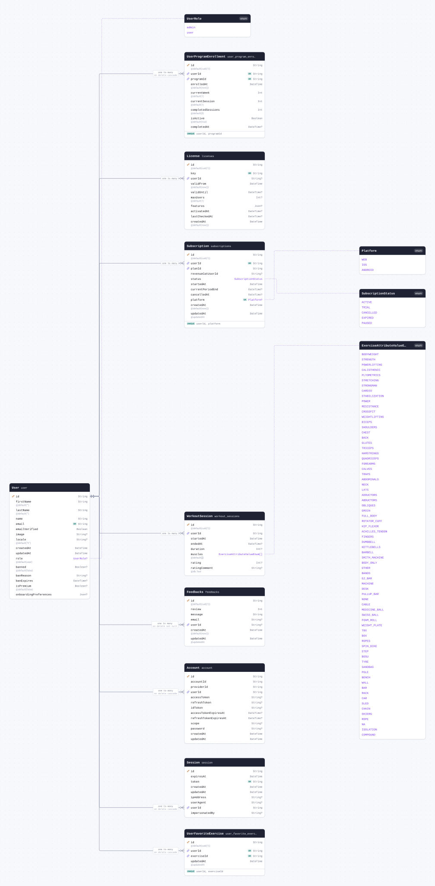

| Field                   | Type                         | Constraints     | Default | Description |
| ----------------------- | ---------------------------- | --------------- | ------- | ----------- |
| `id`                    | `String`                     | PK NOT NULL     |         |             |
| `firstName`             | `String`                     | NOT NULL        | `""`    |             |
| `lastName`              | `String`                     | NOT NULL        | `""`    |             |
| `name`                  | `String`                     | NOT NULL        |         |             |
| `email`                 | `String`                     | UNIQUE NOT NULL |         |             |
| `emailVerified`         | `Boolean`                    | NOT NULL        |         |             |
| `image`                 | `String`                     | NULL            |         |             |
| `locale`                | `String`                     | NULL            | `"fr"`  |             |
| `createdAt`             | `DateTime`                   | NOT NULL        |         |             |
| `updatedAt`             | `DateTime`                   | NOT NULL        |         |             |
| `role`                  | [`UserRole`](#enum-UserRole) | NULL            | `user`  |             |
| `banned`                | `Boolean`                    | NULL            | `false` |             |
| `banReason`             | `String`                     | NULL            |         |             |
| `banExpires`            | `DateTime`                   | NULL            |         |             |
| `isPremium`             | `Boolean`                    | NULL            | `false` |             |
| `onboardingPreferences` | `Json`                       | NULL            |         |             |

#### Referenced by

- `id` ← [UserFavoriteExercise.userId](#model-UserFavoriteExercise) (one-to-many, on delete Cascade)
- `id` ← [Session.userId](#model-Session) (one-to-many, on delete Cascade)
- `id` ← [Account.userId](#model-Account) (one-to-many, on delete Cascade)
- `id` ← [Feedbacks.userId](#model-Feedbacks) (one-to-many, on delete SetNull)
- `id` ← [WorkoutSession.userId](#model-WorkoutSession) (one-to-many)
- `id` ← [Subscription.userId](#model-Subscription) (one-to-many)
- `id` ← [License.userId](#model-License) (one-to-many)
- `id` ← [UserProgramEnrollment.userId](#model-UserProgramEnrollment) (one-to-many, on delete Cascade)

#### Definition

```sql
CREATE TABLE "user" (
    "id" TEXT NOT NULL,
    "firstName" TEXT NOT NULL DEFAULT '',
    "lastName" TEXT NOT NULL DEFAULT '',
    "name" TEXT NOT NULL,
    "email" TEXT NOT NULL,
    "emailVerified" BOOLEAN NOT NULL,
    "image" TEXT,
    "locale" TEXT DEFAULT 'fr',
    "createdAt" TIMESTAMP(3) NOT NULL,
    "updatedAt" TIMESTAMP(3) NOT NULL,
    "role" "UserRole" DEFAULT 'user',
    "banned" BOOLEAN DEFAULT false,
    "banReason" TEXT,
    "banExpires" TIMESTAMP(3),
    "isPremium" BOOLEAN DEFAULT false,
    "onboardingPreferences" JSONB,

    CONSTRAINT "user_pkey" PRIMARY KEY ("id")
);

CREATE UNIQUE INDEX "user_email_key" ON "user"("email");
```

<details>
<summary>Queries and their SQL</summary>

**findMany**: Every row

```ts
await prisma.user.findMany();
```

```sql
SELECT
  "public"."user"."id",
  "public"."user"."firstName",
  "public"."user"."lastName",
  "public"."user"."name",
  "public"."user"."email",
  "public"."user"."emailVerified",
  "public"."user"."image",
  "public"."user"."locale",
  "public"."user"."createdAt",
  "public"."user"."updatedAt",
  "public"."user"."role"::text,
  "public"."user"."banned",
  "public"."user"."banReason",
  "public"."user"."banExpires",
  "public"."user"."isPremium",
  "public"."user"."onboardingPreferences"
FROM
  "public"."user"
WHERE
  1 = 1
OFFSET
  $1
-- params: ["0"]
```

**count**: How many rows there are

```ts
await prisma.user.count();
```

```sql
SELECT
  COUNT(*) AS "_count$_all"
FROM
  (
    SELECT
      "public"."user"."id"
    FROM
      "public"."user"
    WHERE
      1 = 1
    OFFSET
      $1
  ) AS "sub"
-- params: ["0"]
```

**findMany**: Every row with its relations

```ts
await prisma.user.findMany({
  include: {
    sessions: true,
    accounts: true,
    feedbacks: true,
    WorkoutSession: true,
    FavoriteExercises: true,
    subscriptions: true,
    licenses: true,
    programEnrollments: true,
  },
});
```

```sql
SELECT
  "public"."user"."id",
  "public"."user"."firstName",
  "public"."user"."lastName",
  "public"."user"."name",
  "public"."user"."email",
  "public"."user"."emailVerified",
  "public"."user"."image",
  "public"."user"."locale",
  "public"."user"."createdAt",
  "public"."user"."updatedAt",
  "public"."user"."role"::text,
  "public"."user"."banned",
  "public"."user"."banReason",
  "public"."user"."banExpires",
  "public"."user"."isPremium",
  "public"."user"."onboardingPreferences"
FROM
  "public"."user"
WHERE
  1 = 1
OFFSET
  $1
-- params: ["0"]

SELECT
  "public"."session"."id",
  "public"."session"."expiresAt",
  "public"."session"."token",
  "public"."session"."createdAt",
  "public"."session"."updatedAt",
  "public"."session"."ipAddress",
  "public"."session"."userAgent",
  "public"."session"."userId",
  "public"."session"."impersonatedBy"
FROM
  "public"."session"
WHERE
  "public"."session"."userId" IN ($1)
OFFSET
  $2
-- params: ["<id of the rows above>","0"]

SELECT
  "public"."account"."id",
  "public"."account"."accountId",
  "public"."account"."providerId",
  "public"."account"."userId",
  "public"."account"."accessToken",
  "public"."account"."refreshToken",
  "public"."account"."idToken",
  "public"."account"."accessTokenExpiresAt",
  "public"."account"."refreshTokenExpiresAt",
  "public"."account"."scope",
  "public"."account"."password",
  "public"."account"."createdAt",
  "public"."account"."updatedAt"
FROM
  "public"."account"
WHERE
  "public"."account"."userId" IN ($1)
OFFSET
  $2
-- params: ["<id of the rows above>","0"]

SELECT
  "public"."feedbacks"."id",
  "public"."feedbacks"."review",
  "public"."feedbacks"."message",
  "public"."feedbacks"."email",
  "public"."feedbacks"."userId",
  "public"."feedbacks"."createdAt",
  "public"."feedbacks"."updatedAt"
FROM
  "public"."feedbacks"
WHERE
  "public"."feedbacks"."userId" IN ($1)
OFFSET
  $2
-- params: ["<id of the rows above>","0"]

SELECT
  "public"."workout_sessions"."id",
  "public"."workout_sessions"."userId",
  "public"."workout_sessions"."startedAt",
  "public"."workout_sessions"."endedAt",
  "public"."workout_sessions"."duration",
  "public"."workout_sessions"."muscles"::text[],
  "public"."workout_sessions"."rating",
  "public"."workout_sessions"."ratingComment"
FROM
  "public"."workout_sessions"
WHERE
  "public"."workout_sessions"."userId" IN ($1)
OFFSET
  $2
-- params: ["<id of the rows above>","0"]

SELECT
  "public"."user_favorite_exercises"."id",
  "public"."user_favorite_exercises"."userId",
  "public"."user_favorite_exercises"."exerciseId",
  "public"."user_favorite_exercises"."updatedAt"
FROM
  "public"."user_favorite_exercises"
WHERE
  "public"."user_favorite_exercises"."userId" IN ($1)
OFFSET
  $2
-- params: ["<id of the rows above>","0"]

SELECT
  "public"."subscriptions"."id",
  "public"."subscriptions"."userId",
  "public"."subscriptions"."planId",
  "public"."subscriptions"."revenueCatUserId",
  "public"."subscriptions"."status"::text,
  "public"."subscriptions"."startedAt",
  "public"."subscriptions"."currentPeriodEnd",
  "public"."subscriptions"."cancelledAt",
  "public"."subscriptions"."platform"::text,
  "public"."subscriptions"."createdAt",
  "public"."subscriptions"."updatedAt"
FROM
  "public"."subscriptions"
WHERE
  "public"."subscriptions"."userId" IN ($1)
OFFSET
  $2
-- params: ["<id of the rows above>","0"]

SELECT
  "public"."licenses"."id",
  "public"."licenses"."key",
  "public"."licenses"."userId",
  "public"."licenses"."validFrom",
  "public"."licenses"."validUntil",
  "public"."licenses"."maxUsers",
  "public"."licenses"."features",
  "public"."licenses"."activatedAt",
  "public"."licenses"."lastCheckedAt",
  "public"."licenses"."createdAt"
FROM
  "public"."licenses"
WHERE
  "public"."licenses"."userId" IN ($1)
OFFSET
  $2
-- params: ["<id of the rows above>","0"]

SELECT
  "public"."user_program_enrollments"."id",
  "public"."user_program_enrollments"."userId",
  "public"."user_program_enrollments"."programId",
  "public"."user_program_enrollments"."enrolledAt",
  "public"."user_program_enrollments"."currentWeek",
  "public"."user_program_enrollments"."currentSession",
  "public"."user_program_enrollments"."completedSessions",
  "public"."user_program_enrollments"."isActive",
  "public"."user_program_enrollments"."completedAt"
FROM
  "public"."user_program_enrollments"
WHERE
  "public"."user_program_enrollments"."userId" IN ($1)
OFFSET
  $2
-- params: ["<id of the rows above>","0"]
```

**findUnique**: One row by what is unique to it

```ts
await prisma.user.findUnique({ where: { id: "example" } });
```

```sql
SELECT
  "public"."user"."id",
  "public"."user"."firstName",
  "public"."user"."lastName",
  "public"."user"."name",
  "public"."user"."email",
  "public"."user"."emailVerified",
  "public"."user"."image",
  "public"."user"."locale",
  "public"."user"."createdAt",
  "public"."user"."updatedAt",
  "public"."user"."role"::text,
  "public"."user"."banned",
  "public"."user"."banReason",
  "public"."user"."banExpires",
  "public"."user"."isPremium",
  "public"."user"."onboardingPreferences"
FROM
  "public"."user"
WHERE
  (
    "public"."user"."id" = $1
    AND 1 = 1
  )
LIMIT
  $2
OFFSET
  $3
-- params: ["example","1","0"]
```

**create**: Create a row

```ts
await prisma.user.create({
  data: {
    id: "example",
    name: "example",
    email: "example",
    emailVerified: true,
    createdAt: new Date("2026-01-01T00:00:00.000Z"),
    updatedAt: new Date("2026-01-01T00:00:00.000Z"),
  },
});
```

```sql
INSERT INTO
  "public"."user" (
    "id",
    "firstName",
    "lastName",
    "name",
    "email",
    "emailVerified",
    "locale",
    "createdAt",
    "updatedAt",
    "role",
    "banned",
    "isPremium"
  )
VALUES
  (
    $1,
    $2,
    $3,
    $4,
    $5,
    $6,
    $7,
    $8,
    $9,
    CAST($10::text AS "public"."UserRole"),
    $11,
    $12
  )
RETURNING
  "public"."user"."id",
  "public"."user"."firstName",
  "public"."user"."lastName",
  "public"."user"."name",
  "public"."user"."email",
  "public"."user"."emailVerified",
  "public"."user"."image",
  "public"."user"."locale",
  "public"."user"."createdAt",
  "public"."user"."updatedAt",
  "public"."user"."role"::text,
  "public"."user"."banned",
  "public"."user"."banReason",
  "public"."user"."banExpires",
  "public"."user"."isPremium",
  "public"."user"."onboardingPreferences"
-- params: ["example","","","example","example",true,"fr","2026-01-01T00:00:00.000Z","2026-01-01T00:00:00.000Z","user",false,false]
```

**update**: Update a row

```ts
await prisma.user.update({ where: { id: "example" }, data: { firstName: "example" } });
```

```sql
UPDATE "public"."user"
SET
  "firstName" = $1
WHERE
  (
    "public"."user"."id" = $2
    AND 1 = 1
  )
RETURNING
  "public"."user"."id",
  "public"."user"."firstName",
  "public"."user"."lastName",
  "public"."user"."name",
  "public"."user"."email",
  "public"."user"."emailVerified",
  "public"."user"."image",
  "public"."user"."locale",
  "public"."user"."createdAt",
  "public"."user"."updatedAt",
  "public"."user"."role"::text,
  "public"."user"."banned",
  "public"."user"."banReason",
  "public"."user"."banExpires",
  "public"."user"."isPremium",
  "public"."user"."onboardingPreferences"
-- params: ["example","example"]
```

**delete**: Delete a row

```ts
await prisma.user.delete({ where: { id: "example" } });
```

```sql
DELETE FROM "public"."user"
WHERE
  (
    "public"."user"."id" = $1
    AND 1 = 1
  )
RETURNING
  "public"."user"."id",
  "public"."user"."firstName",
  "public"."user"."lastName",
  "public"."user"."name",
  "public"."user"."email",
  "public"."user"."emailVerified",
  "public"."user"."image",
  "public"."user"."locale",
  "public"."user"."createdAt",
  "public"."user"."updatedAt",
  "public"."user"."role"::text,
  "public"."user"."banned",
  "public"."user"."banReason",
  "public"."user"."banExpires",
  "public"."user"."isPremium",
  "public"."user"."onboardingPreferences"
-- params: ["example"]
```

</details>

<a id="model-UserFavoriteExercise"></a>

### UserFavoriteExercise

Table `user_favorite_exercises`.

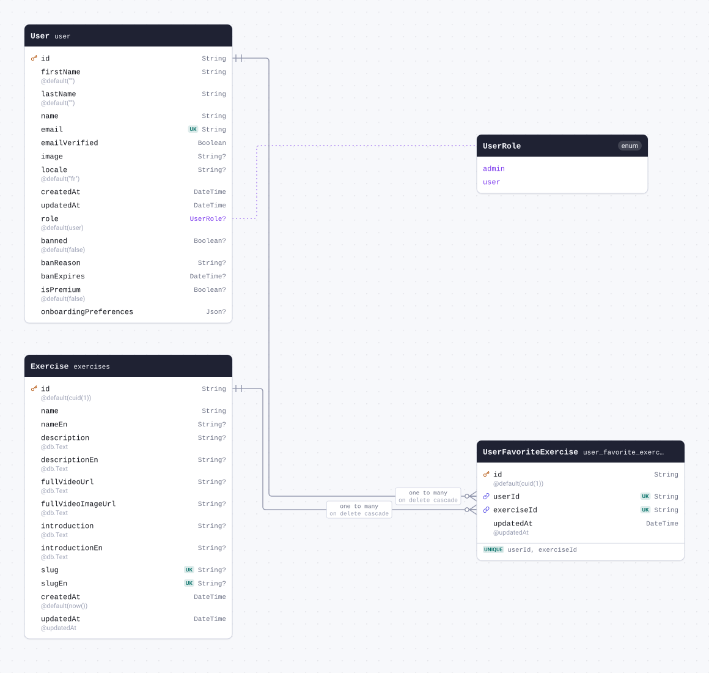

| Field        | Type       | Constraints                               | Default      | Description |
| ------------ | ---------- | ----------------------------------------- | ------------ | ----------- |
| `id`         | `String`   | PK NOT NULL                               | `cuid(1)`    |             |
| `userId`     | `String`   | NOT NULL → [User.id](#model-User)         |              |             |
| `exerciseId` | `String`   | NOT NULL → [Exercise.id](#model-Exercise) |              |             |
| `updatedAt`  | `DateTime` | NOT NULL                                  | `@updatedAt` |             |

#### Indexes

- `@@unique([userId, exerciseId])`

#### References

- `userId` → [User.id](#model-User) (many-to-one, on delete Cascade)
- `exerciseId` → [Exercise.id](#model-Exercise) (many-to-one, on delete Cascade)

#### Definition

```sql
CREATE TABLE "user_favorite_exercises" (
    "id" TEXT NOT NULL,
    "userId" TEXT NOT NULL,
    "exerciseId" TEXT NOT NULL,
    "updatedAt" TIMESTAMP(3) NOT NULL,

    CONSTRAINT "user_favorite_exercises_pkey" PRIMARY KEY ("id")
);

CREATE UNIQUE INDEX "user_favorite_exercises_userId_exerciseId_key" ON "user_favorite_exercises"("userId", "exerciseId");

ALTER TABLE "user_favorite_exercises" ADD CONSTRAINT "user_favorite_exercises_userId_fkey" FOREIGN KEY ("userId") REFERENCES "user"("id") ON DELETE CASCADE ON UPDATE CASCADE;

ALTER TABLE "user_favorite_exercises" ADD CONSTRAINT "user_favorite_exercises_exerciseId_fkey" FOREIGN KEY ("exerciseId") REFERENCES "exercises"("id") ON DELETE CASCADE ON UPDATE CASCADE;
```

<details>
<summary>Queries and their SQL</summary>

**findMany**: Every row

```ts
await prisma.userFavoriteExercise.findMany();
```

```sql
SELECT
  "public"."user_favorite_exercises"."id",
  "public"."user_favorite_exercises"."userId",
  "public"."user_favorite_exercises"."exerciseId",
  "public"."user_favorite_exercises"."updatedAt"
FROM
  "public"."user_favorite_exercises"
WHERE
  1 = 1
OFFSET
  $1
-- params: ["0"]
```

**count**: How many rows there are

```ts
await prisma.userFavoriteExercise.count();
```

```sql
SELECT
  COUNT(*) AS "_count$_all"
FROM
  (
    SELECT
      "public"."user_favorite_exercises"."id"
    FROM
      "public"."user_favorite_exercises"
    WHERE
      1 = 1
    OFFSET
      $1
  ) AS "sub"
-- params: ["0"]
```

**findMany**: Every row with its relations

```ts
await prisma.userFavoriteExercise.findMany({ include: { user: true, exercise: true } });
```

```sql
SELECT
  "public"."user_favorite_exercises"."id",
  "public"."user_favorite_exercises"."userId",
  "public"."user_favorite_exercises"."exerciseId",
  "public"."user_favorite_exercises"."updatedAt"
FROM
  "public"."user_favorite_exercises"
WHERE
  1 = 1
OFFSET
  $1
-- params: ["0"]

SELECT
  "public"."user"."id",
  "public"."user"."firstName",
  "public"."user"."lastName",
  "public"."user"."name",
  "public"."user"."email",
  "public"."user"."emailVerified",
  "public"."user"."image",
  "public"."user"."locale",
  "public"."user"."createdAt",
  "public"."user"."updatedAt",
  "public"."user"."role"::text,
  "public"."user"."banned",
  "public"."user"."banReason",
  "public"."user"."banExpires",
  "public"."user"."isPremium",
  "public"."user"."onboardingPreferences"
FROM
  "public"."user"
WHERE
  "public"."user"."id" IN ($1)
OFFSET
  $2
-- params: ["<userId of the rows above>","0"]

SELECT
  "public"."exercises"."id",
  "public"."exercises"."name",
  "public"."exercises"."nameEn",
  "public"."exercises"."description",
  "public"."exercises"."descriptionEn",
  "public"."exercises"."fullVideoUrl",
  "public"."exercises"."fullVideoImageUrl",
  "public"."exercises"."introduction",
  "public"."exercises"."introductionEn",
  "public"."exercises"."slug",
  "public"."exercises"."slugEn",
  "public"."exercises"."createdAt",
  "public"."exercises"."updatedAt"
FROM
  "public"."exercises"
WHERE
  "public"."exercises"."id" IN ($1)
OFFSET
  $2
-- params: ["<exerciseId of the rows above>","0"]
```

**findUnique**: One row by what is unique to it

```ts
await prisma.userFavoriteExercise.findUnique({ where: { id: "example" } });
```

```sql
SELECT
  "public"."user_favorite_exercises"."id",
  "public"."user_favorite_exercises"."userId",
  "public"."user_favorite_exercises"."exerciseId",
  "public"."user_favorite_exercises"."updatedAt"
FROM
  "public"."user_favorite_exercises"
WHERE
  (
    "public"."user_favorite_exercises"."id" = $1
    AND 1 = 1
  )
LIMIT
  $2
OFFSET
  $3
-- params: ["example","1","0"]
```

**create**: Create a row

```ts
await prisma.userFavoriteExercise.create({ data: { userId: "example", exerciseId: "example" } });
```

```sql
INSERT INTO
  "public"."user_favorite_exercises" ("id", "userId", "exerciseId", "updatedAt")
VALUES
  ($1, $2, $3, $4)
RETURNING
  "public"."user_favorite_exercises"."id",
  "public"."user_favorite_exercises"."userId",
  "public"."user_favorite_exercises"."exerciseId",
  "public"."user_favorite_exercises"."updatedAt"
-- params: ["<cuid(1)>","example","example","<now()>"]
```

**delete**: Delete a row

```ts
await prisma.userFavoriteExercise.delete({ where: { id: "example" } });
```

```sql
DELETE FROM "public"."user_favorite_exercises"
WHERE
  (
    "public"."user_favorite_exercises"."id" = $1
    AND 1 = 1
  )
RETURNING
  "public"."user_favorite_exercises"."id",
  "public"."user_favorite_exercises"."userId",
  "public"."user_favorite_exercises"."exerciseId",
  "public"."user_favorite_exercises"."updatedAt"
-- params: ["example"]
```

</details>

<a id="model-Session"></a>

### Session

Table `session`.


| Field            | Type       | Constraints                       | Default | Description |
| ---------------- | ---------- | --------------------------------- | ------- | ----------- |
| `id`             | `String`   | PK NOT NULL                       |         |             |
| `expiresAt`      | `DateTime` | NOT NULL                          |         |             |
| `token`          | `String`   | UNIQUE NOT NULL                   |         |             |
| `createdAt`      | `DateTime` | NOT NULL                          |         |             |
| `updatedAt`      | `DateTime` | NOT NULL                          |         |             |
| `ipAddress`      | `String`   | NULL                              |         |             |
| `userAgent`      | `String`   | NULL                              |         |             |
| `userId`         | `String`   | NOT NULL → [User.id](#model-User) |         |             |
| `impersonatedBy` | `String`   | NULL                              |         |             |

#### References

- `userId` → [User.id](#model-User) (many-to-one, on delete Cascade)

#### Definition

```sql
CREATE TABLE "session" (
    "id" TEXT NOT NULL,
    "expiresAt" TIMESTAMP(3) NOT NULL,
    "token" TEXT NOT NULL,
    "createdAt" TIMESTAMP(3) NOT NULL,
    "updatedAt" TIMESTAMP(3) NOT NULL,
    "ipAddress" TEXT,
    "userAgent" TEXT,
    "userId" TEXT NOT NULL,
    "impersonatedBy" TEXT,

    CONSTRAINT "session_pkey" PRIMARY KEY ("id")
);

CREATE UNIQUE INDEX "session_token_key" ON "session"("token");

ALTER TABLE "session" ADD CONSTRAINT "session_userId_fkey" FOREIGN KEY ("userId") REFERENCES "user"("id") ON DELETE CASCADE ON UPDATE CASCADE;
```

<details>
<summary>Queries and their SQL</summary>

**findMany**: Every row

```ts
await prisma.session.findMany();
```

```sql
SELECT
  "public"."session"."id",
  "public"."session"."expiresAt",
  "public"."session"."token",
  "public"."session"."createdAt",
  "public"."session"."updatedAt",
  "public"."session"."ipAddress",
  "public"."session"."userAgent",
  "public"."session"."userId",
  "public"."session"."impersonatedBy"
FROM
  "public"."session"
WHERE
  1 = 1
OFFSET
  $1
-- params: ["0"]
```

**count**: How many rows there are

```ts
await prisma.session.count();
```

```sql
SELECT
  COUNT(*) AS "_count$_all"
FROM
  (
    SELECT
      "public"."session"."id"
    FROM
      "public"."session"
    WHERE
      1 = 1
    OFFSET
      $1
  ) AS "sub"
-- params: ["0"]
```

**findMany**: Every row with its relations

```ts
await prisma.session.findMany({ include: { user: true } });
```

```sql
SELECT
  "public"."session"."id",
  "public"."session"."expiresAt",
  "public"."session"."token",
  "public"."session"."createdAt",
  "public"."session"."updatedAt",
  "public"."session"."ipAddress",
  "public"."session"."userAgent",
  "public"."session"."userId",
  "public"."session"."impersonatedBy"
FROM
  "public"."session"
WHERE
  1 = 1
OFFSET
  $1
-- params: ["0"]

SELECT
  "public"."user"."id",
  "public"."user"."firstName",
  "public"."user"."lastName",
  "public"."user"."name",
  "public"."user"."email",
  "public"."user"."emailVerified",
  "public"."user"."image",
  "public"."user"."locale",
  "public"."user"."createdAt",
  "public"."user"."updatedAt",
  "public"."user"."role"::text,
  "public"."user"."banned",
  "public"."user"."banReason",
  "public"."user"."banExpires",
  "public"."user"."isPremium",
  "public"."user"."onboardingPreferences"
FROM
  "public"."user"
WHERE
  "public"."user"."id" IN ($1)
OFFSET
  $2
-- params: ["<userId of the rows above>","0"]
```

**findUnique**: One row by what is unique to it

```ts
await prisma.session.findUnique({ where: { id: "example" } });
```

```sql
SELECT
  "public"."session"."id",
  "public"."session"."expiresAt",
  "public"."session"."token",
  "public"."session"."createdAt",
  "public"."session"."updatedAt",
  "public"."session"."ipAddress",
  "public"."session"."userAgent",
  "public"."session"."userId",
  "public"."session"."impersonatedBy"
FROM
  "public"."session"
WHERE
  (
    "public"."session"."id" = $1
    AND 1 = 1
  )
LIMIT
  $2
OFFSET
  $3
-- params: ["example","1","0"]
```

**create**: Create a row

```ts
await prisma.session.create({
  data: {
    id: "example",
    expiresAt: new Date("2026-01-01T00:00:00.000Z"),
    token: "example",
    createdAt: new Date("2026-01-01T00:00:00.000Z"),
    updatedAt: new Date("2026-01-01T00:00:00.000Z"),
    userId: "example",
  },
});
```

```sql
INSERT INTO
  "public"."session" (
    "id",
    "expiresAt",
    "token",
    "createdAt",
    "updatedAt",
    "userId"
  )
VALUES
  ($1, $2, $3, $4, $5, $6)
RETURNING
  "public"."session"."id",
  "public"."session"."expiresAt",
  "public"."session"."token",
  "public"."session"."createdAt",
  "public"."session"."updatedAt",
  "public"."session"."ipAddress",
  "public"."session"."userAgent",
  "public"."session"."userId",
  "public"."session"."impersonatedBy"
-- params: ["example","2026-01-01T00:00:00.000Z","example","2026-01-01T00:00:00.000Z","2026-01-01T00:00:00.000Z","example"]
```

**update**: Update a row

```ts
await prisma.session.update({
  where: { id: "example" },
  data: { expiresAt: new Date("2026-01-01T00:00:00.000Z") },
});
```

```sql
UPDATE "public"."session"
SET
  "expiresAt" = $1
WHERE
  (
    "public"."session"."id" = $2
    AND 1 = 1
  )
RETURNING
  "public"."session"."id",
  "public"."session"."expiresAt",
  "public"."session"."token",
  "public"."session"."createdAt",
  "public"."session"."updatedAt",
  "public"."session"."ipAddress",
  "public"."session"."userAgent",
  "public"."session"."userId",
  "public"."session"."impersonatedBy"
-- params: ["2026-01-01T00:00:00.000Z","example"]
```

**delete**: Delete a row

```ts
await prisma.session.delete({ where: { id: "example" } });
```

```sql
DELETE FROM "public"."session"
WHERE
  (
    "public"."session"."id" = $1
    AND 1 = 1
  )
RETURNING
  "public"."session"."id",
  "public"."session"."expiresAt",
  "public"."session"."token",
  "public"."session"."createdAt",
  "public"."session"."updatedAt",
  "public"."session"."ipAddress",
  "public"."session"."userAgent",
  "public"."session"."userId",
  "public"."session"."impersonatedBy"
-- params: ["example"]
```

</details>

<a id="model-Account"></a>

### Account

Table `account`.

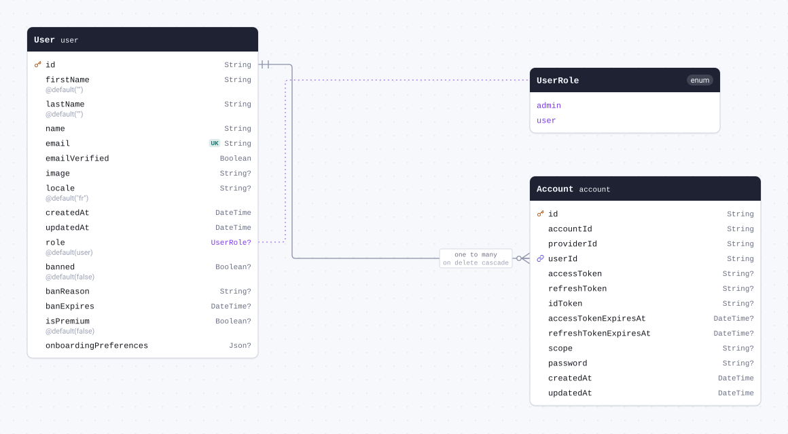

| Field                   | Type       | Constraints                       | Default | Description |
| ----------------------- | ---------- | --------------------------------- | ------- | ----------- |
| `id`                    | `String`   | PK NOT NULL                       |         |             |
| `accountId`             | `String`   | NOT NULL                          |         |             |
| `providerId`            | `String`   | NOT NULL                          |         |             |
| `userId`                | `String`   | NOT NULL → [User.id](#model-User) |         |             |
| `accessToken`           | `String`   | NULL                              |         |             |
| `refreshToken`          | `String`   | NULL                              |         |             |
| `idToken`               | `String`   | NULL                              |         |             |
| `accessTokenExpiresAt`  | `DateTime` | NULL                              |         |             |
| `refreshTokenExpiresAt` | `DateTime` | NULL                              |         |             |
| `scope`                 | `String`   | NULL                              |         |             |
| `password`              | `String`   | NULL                              |         |             |
| `createdAt`             | `DateTime` | NOT NULL                          |         |             |
| `updatedAt`             | `DateTime` | NOT NULL                          |         |             |

#### References

- `userId` → [User.id](#model-User) (many-to-one, on delete Cascade)

#### Definition

```sql
CREATE TABLE "account" (
    "id" TEXT NOT NULL,
    "accountId" TEXT NOT NULL,
    "providerId" TEXT NOT NULL,
    "userId" TEXT NOT NULL,
    "accessToken" TEXT,
    "refreshToken" TEXT,
    "idToken" TEXT,
    "accessTokenExpiresAt" TIMESTAMP(3),
    "refreshTokenExpiresAt" TIMESTAMP(3),
    "scope" TEXT,
    "password" TEXT,
    "createdAt" TIMESTAMP(3) NOT NULL,
    "updatedAt" TIMESTAMP(3) NOT NULL,

    CONSTRAINT "account_pkey" PRIMARY KEY ("id")
);

ALTER TABLE "account" ADD CONSTRAINT "account_userId_fkey" FOREIGN KEY ("userId") REFERENCES "user"("id") ON DELETE CASCADE ON UPDATE CASCADE;
```

<details>
<summary>Queries and their SQL</summary>

**findMany**: Every row

```ts
await prisma.account.findMany();
```

```sql
SELECT
  "public"."account"."id",
  "public"."account"."accountId",
  "public"."account"."providerId",
  "public"."account"."userId",
  "public"."account"."accessToken",
  "public"."account"."refreshToken",
  "public"."account"."idToken",
  "public"."account"."accessTokenExpiresAt",
  "public"."account"."refreshTokenExpiresAt",
  "public"."account"."scope",
  "public"."account"."password",
  "public"."account"."createdAt",
  "public"."account"."updatedAt"
FROM
  "public"."account"
WHERE
  1 = 1
OFFSET
  $1
-- params: ["0"]
```

**count**: How many rows there are

```ts
await prisma.account.count();
```

```sql
SELECT
  COUNT(*) AS "_count$_all"
FROM
  (
    SELECT
      "public"."account"."id"
    FROM
      "public"."account"
    WHERE
      1 = 1
    OFFSET
      $1
  ) AS "sub"
-- params: ["0"]
```

**findMany**: Every row with its relations

```ts
await prisma.account.findMany({ include: { user: true } });
```

```sql
SELECT
  "public"."account"."id",
  "public"."account"."accountId",
  "public"."account"."providerId",
  "public"."account"."userId",
  "public"."account"."accessToken",
  "public"."account"."refreshToken",
  "public"."account"."idToken",
  "public"."account"."accessTokenExpiresAt",
  "public"."account"."refreshTokenExpiresAt",
  "public"."account"."scope",
  "public"."account"."password",
  "public"."account"."createdAt",
  "public"."account"."updatedAt"
FROM
  "public"."account"
WHERE
  1 = 1
OFFSET
  $1
-- params: ["0"]

SELECT
  "public"."user"."id",
  "public"."user"."firstName",
  "public"."user"."lastName",
  "public"."user"."name",
  "public"."user"."email",
  "public"."user"."emailVerified",
  "public"."user"."image",
  "public"."user"."locale",
  "public"."user"."createdAt",
  "public"."user"."updatedAt",
  "public"."user"."role"::text,
  "public"."user"."banned",
  "public"."user"."banReason",
  "public"."user"."banExpires",
  "public"."user"."isPremium",
  "public"."user"."onboardingPreferences"
FROM
  "public"."user"
WHERE
  "public"."user"."id" IN ($1)
OFFSET
  $2
-- params: ["<userId of the rows above>","0"]
```

**findUnique**: One row by what is unique to it

```ts
await prisma.account.findUnique({ where: { id: "example" } });
```

```sql
SELECT
  "public"."account"."id",
  "public"."account"."accountId",
  "public"."account"."providerId",
  "public"."account"."userId",
  "public"."account"."accessToken",
  "public"."account"."refreshToken",
  "public"."account"."idToken",
  "public"."account"."accessTokenExpiresAt",
  "public"."account"."refreshTokenExpiresAt",
  "public"."account"."scope",
  "public"."account"."password",
  "public"."account"."createdAt",
  "public"."account"."updatedAt"
FROM
  "public"."account"
WHERE
  (
    "public"."account"."id" = $1
    AND 1 = 1
  )
LIMIT
  $2
OFFSET
  $3
-- params: ["example","1","0"]
```

**create**: Create a row

```ts
await prisma.account.create({
  data: {
    id: "example",
    accountId: "example",
    providerId: "example",
    userId: "example",
    createdAt: new Date("2026-01-01T00:00:00.000Z"),
    updatedAt: new Date("2026-01-01T00:00:00.000Z"),
  },
});
```

```sql
INSERT INTO
  "public"."account" (
    "id",
    "accountId",
    "providerId",
    "userId",
    "createdAt",
    "updatedAt"
  )
VALUES
  ($1, $2, $3, $4, $5, $6)
RETURNING
  "public"."account"."id",
  "public"."account"."accountId",
  "public"."account"."providerId",
  "public"."account"."userId",
  "public"."account"."accessToken",
  "public"."account"."refreshToken",
  "public"."account"."idToken",
  "public"."account"."accessTokenExpiresAt",
  "public"."account"."refreshTokenExpiresAt",
  "public"."account"."scope",
  "public"."account"."password",
  "public"."account"."createdAt",
  "public"."account"."updatedAt"
-- params: ["example","example","example","example","2026-01-01T00:00:00.000Z","2026-01-01T00:00:00.000Z"]
```

**update**: Update a row

```ts
await prisma.account.update({ where: { id: "example" }, data: { accountId: "example" } });
```

```sql
UPDATE "public"."account"
SET
  "accountId" = $1
WHERE
  (
    "public"."account"."id" = $2
    AND 1 = 1
  )
RETURNING
  "public"."account"."id",
  "public"."account"."accountId",
  "public"."account"."providerId",
  "public"."account"."userId",
  "public"."account"."accessToken",
  "public"."account"."refreshToken",
  "public"."account"."idToken",
  "public"."account"."accessTokenExpiresAt",
  "public"."account"."refreshTokenExpiresAt",
  "public"."account"."scope",
  "public"."account"."password",
  "public"."account"."createdAt",
  "public"."account"."updatedAt"
-- params: ["example","example"]
```

**delete**: Delete a row

```ts
await prisma.account.delete({ where: { id: "example" } });
```

```sql
DELETE FROM "public"."account"
WHERE
  (
    "public"."account"."id" = $1
    AND 1 = 1
  )
RETURNING
  "public"."account"."id",
  "public"."account"."accountId",
  "public"."account"."providerId",
  "public"."account"."userId",
  "public"."account"."accessToken",
  "public"."account"."refreshToken",
  "public"."account"."idToken",
  "public"."account"."accessTokenExpiresAt",
  "public"."account"."refreshTokenExpiresAt",
  "public"."account"."scope",
  "public"."account"."password",
  "public"."account"."createdAt",
  "public"."account"."updatedAt"
-- params: ["example"]
```

</details>

<a id="model-Verification"></a>

### Verification

Table `verification`.

| Field        | Type       | Constraints | Default | Description |
| ------------ | ---------- | ----------- | ------- | ----------- |
| `id`         | `String`   | PK NOT NULL |         |             |
| `identifier` | `String`   | NOT NULL    |         |             |
| `value`      | `String`   | NOT NULL    |         |             |
| `expiresAt`  | `DateTime` | NOT NULL    |         |             |
| `createdAt`  | `DateTime` | NULL        |         |             |
| `updatedAt`  | `DateTime` | NULL        |         |             |

#### Definition

```sql
CREATE TABLE "verification" (
    "id" TEXT NOT NULL,
    "identifier" TEXT NOT NULL,
    "value" TEXT NOT NULL,
    "expiresAt" TIMESTAMP(3) NOT NULL,
    "createdAt" TIMESTAMP(3),
    "updatedAt" TIMESTAMP(3),

    CONSTRAINT "verification_pkey" PRIMARY KEY ("id")
);
```

<details>
<summary>Queries and their SQL</summary>

**findMany**: Every row

```ts
await prisma.verification.findMany();
```

```sql
SELECT
  "public"."verification"."id",
  "public"."verification"."identifier",
  "public"."verification"."value",
  "public"."verification"."expiresAt",
  "public"."verification"."createdAt",
  "public"."verification"."updatedAt"
FROM
  "public"."verification"
WHERE
  1 = 1
OFFSET
  $1
-- params: ["0"]
```

**count**: How many rows there are

```ts
await prisma.verification.count();
```

```sql
SELECT
  COUNT(*) AS "_count$_all"
FROM
  (
    SELECT
      "public"."verification"."id"
    FROM
      "public"."verification"
    WHERE
      1 = 1
    OFFSET
      $1
  ) AS "sub"
-- params: ["0"]
```

**findUnique**: One row by what is unique to it

```ts
await prisma.verification.findUnique({ where: { id: "example" } });
```

```sql
SELECT
  "public"."verification"."id",
  "public"."verification"."identifier",
  "public"."verification"."value",
  "public"."verification"."expiresAt",
  "public"."verification"."createdAt",
  "public"."verification"."updatedAt"
FROM
  "public"."verification"
WHERE
  (
    "public"."verification"."id" = $1
    AND 1 = 1
  )
LIMIT
  $2
OFFSET
  $3
-- params: ["example","1","0"]
```

**create**: Create a row

```ts
await prisma.verification.create({
  data: {
    id: "example",
    identifier: "example",
    value: "example",
    expiresAt: new Date("2026-01-01T00:00:00.000Z"),
  },
});
```

```sql
INSERT INTO
  "public"."verification" ("id", "identifier", "value", "expiresAt")
VALUES
  ($1, $2, $3, $4)
RETURNING
  "public"."verification"."id",
  "public"."verification"."identifier",
  "public"."verification"."value",
  "public"."verification"."expiresAt",
  "public"."verification"."createdAt",
  "public"."verification"."updatedAt"
-- params: ["example","example","example","2026-01-01T00:00:00.000Z"]
```

**update**: Update a row

```ts
await prisma.verification.update({ where: { id: "example" }, data: { identifier: "example" } });
```

```sql
UPDATE "public"."verification"
SET
  "identifier" = $1
WHERE
  (
    "public"."verification"."id" = $2
    AND 1 = 1
  )
RETURNING
  "public"."verification"."id",
  "public"."verification"."identifier",
  "public"."verification"."value",
  "public"."verification"."expiresAt",
  "public"."verification"."createdAt",
  "public"."verification"."updatedAt"
-- params: ["example","example"]
```

**delete**: Delete a row

```ts
await prisma.verification.delete({ where: { id: "example" } });
```

```sql
DELETE FROM "public"."verification"
WHERE
  (
    "public"."verification"."id" = $1
    AND 1 = 1
  )
RETURNING
  "public"."verification"."id",
  "public"."verification"."identifier",
  "public"."verification"."value",
  "public"."verification"."expiresAt",
  "public"."verification"."createdAt",
  "public"."verification"."updatedAt"
-- params: ["example"]
```

</details>

<a id="model-Feedbacks"></a>

### Feedbacks

Table `feedbacks`.

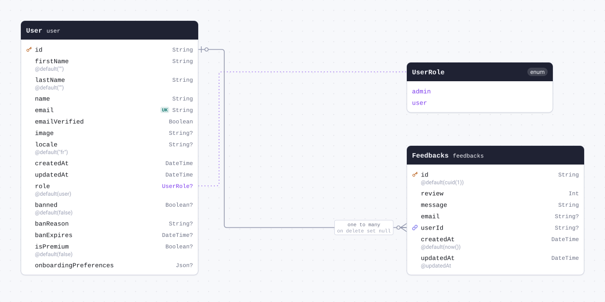

| Field       | Type       | Constraints                   | Default      | Description |
| ----------- | ---------- | ----------------------------- | ------------ | ----------- |
| `id`        | `String`   | PK NOT NULL                   | `cuid(1)`    |             |
| `review`    | `Int`      | NOT NULL                      |              |             |
| `message`   | `String`   | NOT NULL                      |              |             |
| `email`     | `String`   | NULL                          |              |             |
| `userId`    | `String`   | NULL → [User.id](#model-User) |              |             |
| `createdAt` | `DateTime` | NOT NULL                      | `now()`      |             |
| `updatedAt` | `DateTime` | NOT NULL                      | `@updatedAt` |             |

#### References

- `userId` → [User.id](#model-User) (many-to-one, on delete SetNull)

#### Definition

```sql
CREATE TABLE "feedbacks" (
    "id" TEXT NOT NULL,
    "review" INTEGER NOT NULL,
    "message" TEXT NOT NULL,
    "email" TEXT,
    "userId" TEXT,
    "createdAt" TIMESTAMP(3) NOT NULL DEFAULT CURRENT_TIMESTAMP,
    "updatedAt" TIMESTAMP(3) NOT NULL,

    CONSTRAINT "feedbacks_pkey" PRIMARY KEY ("id")
);

ALTER TABLE "feedbacks" ADD CONSTRAINT "feedbacks_userId_fkey" FOREIGN KEY ("userId") REFERENCES "user"("id") ON DELETE SET NULL ON UPDATE CASCADE;
```

<details>
<summary>Queries and their SQL</summary>

**findMany**: Every row

```ts
await prisma.feedbacks.findMany();
```

```sql
SELECT
  "public"."feedbacks"."id",
  "public"."feedbacks"."review",
  "public"."feedbacks"."message",
  "public"."feedbacks"."email",
  "public"."feedbacks"."userId",
  "public"."feedbacks"."createdAt",
  "public"."feedbacks"."updatedAt"
FROM
  "public"."feedbacks"
WHERE
  1 = 1
OFFSET
  $1
-- params: ["0"]
```

**count**: How many rows there are

```ts
await prisma.feedbacks.count();
```

```sql
SELECT
  COUNT(*) AS "_count$_all"
FROM
  (
    SELECT
      "public"."feedbacks"."id"
    FROM
      "public"."feedbacks"
    WHERE
      1 = 1
    OFFSET
      $1
  ) AS "sub"
-- params: ["0"]
```

**findMany**: Every row with its relations

```ts
await prisma.feedbacks.findMany({ include: { user: true } });
```

```sql
SELECT
  "public"."feedbacks"."id",
  "public"."feedbacks"."review",
  "public"."feedbacks"."message",
  "public"."feedbacks"."email",
  "public"."feedbacks"."userId",
  "public"."feedbacks"."createdAt",
  "public"."feedbacks"."updatedAt"
FROM
  "public"."feedbacks"
WHERE
  1 = 1
OFFSET
  $1
-- params: ["0"]

SELECT
  "public"."user"."id",
  "public"."user"."firstName",
  "public"."user"."lastName",
  "public"."user"."name",
  "public"."user"."email",
  "public"."user"."emailVerified",
  "public"."user"."image",
  "public"."user"."locale",
  "public"."user"."createdAt",
  "public"."user"."updatedAt",
  "public"."user"."role"::text,
  "public"."user"."banned",
  "public"."user"."banReason",
  "public"."user"."banExpires",
  "public"."user"."isPremium",
  "public"."user"."onboardingPreferences"
FROM
  "public"."user"
WHERE
  "public"."user"."id" IN ($1)
OFFSET
  $2
-- params: ["<userId of the rows above>","0"]
```

**findUnique**: One row by what is unique to it

```ts
await prisma.feedbacks.findUnique({ where: { id: "example" } });
```

```sql
SELECT
  "public"."feedbacks"."id",
  "public"."feedbacks"."review",
  "public"."feedbacks"."message",
  "public"."feedbacks"."email",
  "public"."feedbacks"."userId",
  "public"."feedbacks"."createdAt",
  "public"."feedbacks"."updatedAt"
FROM
  "public"."feedbacks"
WHERE
  (
    "public"."feedbacks"."id" = $1
    AND 1 = 1
  )
LIMIT
  $2
OFFSET
  $3
-- params: ["example","1","0"]
```

**create**: Create a row

```ts
await prisma.feedbacks.create({ data: { review: 1, message: "example" } });
```

```sql
INSERT INTO
  "public"."feedbacks" (
    "id",
    "review",
    "message",
    "createdAt",
    "updatedAt"
  )
VALUES
  ($1, $2, $3, $4, $5)
RETURNING
  "public"."feedbacks"."id",
  "public"."feedbacks"."review",
  "public"."feedbacks"."message",
  "public"."feedbacks"."email",
  "public"."feedbacks"."userId",
  "public"."feedbacks"."createdAt",
  "public"."feedbacks"."updatedAt"
-- params: ["<cuid(1)>","1","example","<now()>","<now()>"]
```

**update**: Update a row

```ts
await prisma.feedbacks.update({ where: { id: "example" }, data: { review: 1 } });
```

```sql
UPDATE "public"."feedbacks"
SET
  "review" = $1,
  "updatedAt" = $2
WHERE
  (
    "public"."feedbacks"."id" = $3
    AND 1 = 1
  )
RETURNING
  "public"."feedbacks"."id",
  "public"."feedbacks"."review",
  "public"."feedbacks"."message",
  "public"."feedbacks"."email",
  "public"."feedbacks"."userId",
  "public"."feedbacks"."createdAt",
  "public"."feedbacks"."updatedAt"
-- params: ["1",{"prisma__type":"generatorCall","prisma__value":{"name":"now","args":[],"returnType":{"type":"DateTime"}}},"example"]
```

**delete**: Delete a row

```ts
await prisma.feedbacks.delete({ where: { id: "example" } });
```

```sql
DELETE FROM "public"."feedbacks"
WHERE
  (
    "public"."feedbacks"."id" = $1
    AND 1 = 1
  )
RETURNING
  "public"."feedbacks"."id",
  "public"."feedbacks"."review",
  "public"."feedbacks"."message",
  "public"."feedbacks"."email",
  "public"."feedbacks"."userId",
  "public"."feedbacks"."createdAt",
  "public"."feedbacks"."updatedAt"
-- params: ["example"]
```

</details>

<a id="model-Exercise"></a>

### Exercise

Table `exercises`.

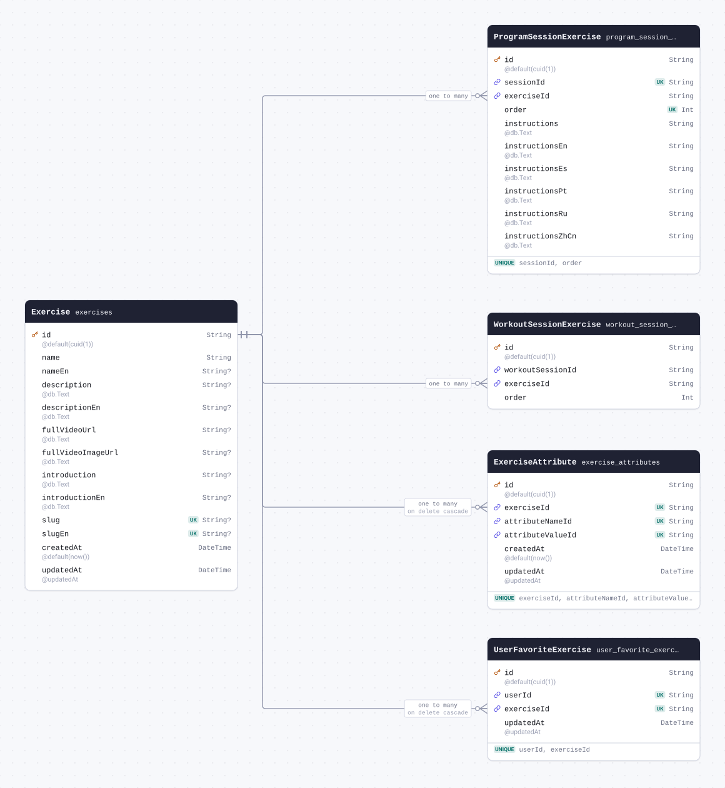

| Field               | Type                | Constraints | Default      | Description |
| ------------------- | ------------------- | ----------- | ------------ | ----------- |
| `id`                | `String`            | PK NOT NULL | `cuid(1)`    |             |
| `name`              | `String`            | NOT NULL    |              |             |
| `nameEn`            | `String`            | NULL        |              |             |
| `description`       | `String` `@db.Text` | NULL        |              |             |
| `descriptionEn`     | `String` `@db.Text` | NULL        |              |             |
| `fullVideoUrl`      | `String` `@db.Text` | NULL        |              |             |
| `fullVideoImageUrl` | `String` `@db.Text` | NULL        |              |             |
| `introduction`      | `String` `@db.Text` | NULL        |              |             |
| `introductionEn`    | `String` `@db.Text` | NULL        |              |             |
| `slug`              | `String`            | UNIQUE NULL |              |             |
| `slugEn`            | `String`            | UNIQUE NULL |              |             |
| `createdAt`         | `DateTime`          | NOT NULL    | `now()`      |             |
| `updatedAt`         | `DateTime`          | NOT NULL    | `@updatedAt` |             |

#### Referenced by

- `id` ← [UserFavoriteExercise.exerciseId](#model-UserFavoriteExercise) (one-to-many, on delete Cascade)
- `id` ← [ExerciseAttribute.exerciseId](#model-ExerciseAttribute) (one-to-many, on delete Cascade)
- `id` ← [WorkoutSessionExercise.exerciseId](#model-WorkoutSessionExercise) (one-to-many)
- `id` ← [ProgramSessionExercise.exerciseId](#model-ProgramSessionExercise) (one-to-many)

#### Definition

```sql
CREATE TABLE "exercises" (
    "id" TEXT NOT NULL,
    "name" TEXT NOT NULL,
    "nameEn" TEXT,
    "description" TEXT,
    "descriptionEn" TEXT,
    "fullVideoUrl" TEXT,
    "fullVideoImageUrl" TEXT,
    "introduction" TEXT,
    "introductionEn" TEXT,
    "slug" TEXT,
    "slugEn" TEXT,
    "createdAt" TIMESTAMP(3) NOT NULL DEFAULT CURRENT_TIMESTAMP,
    "updatedAt" TIMESTAMP(3) NOT NULL,

    CONSTRAINT "exercises_pkey" PRIMARY KEY ("id")
);

CREATE UNIQUE INDEX "exercises_slug_key" ON "exercises"("slug");

CREATE UNIQUE INDEX "exercises_slugEn_key" ON "exercises"("slugEn");
```

<details>
<summary>Queries and their SQL</summary>

**findMany**: Every row

```ts
await prisma.exercise.findMany();
```

```sql
SELECT
  "public"."exercises"."id",
  "public"."exercises"."name",
  "public"."exercises"."nameEn",
  "public"."exercises"."description",
  "public"."exercises"."descriptionEn",
  "public"."exercises"."fullVideoUrl",
  "public"."exercises"."fullVideoImageUrl",
  "public"."exercises"."introduction",
  "public"."exercises"."introductionEn",
  "public"."exercises"."slug",
  "public"."exercises"."slugEn",
  "public"."exercises"."createdAt",
  "public"."exercises"."updatedAt"
FROM
  "public"."exercises"
WHERE
  1 = 1
OFFSET
  $1
-- params: ["0"]
```

**count**: How many rows there are

```ts
await prisma.exercise.count();
```

```sql
SELECT
  COUNT(*) AS "_count$_all"
FROM
  (
    SELECT
      "public"."exercises"."id"
    FROM
      "public"."exercises"
    WHERE
      1 = 1
    OFFSET
      $1
  ) AS "sub"
-- params: ["0"]
```

**findMany**: Every row with its relations

```ts
await prisma.exercise.findMany({
  include: {
    attributes: true,
    WorkoutSessionExercise: true,
    ProgramSessionExercise: true,
    favoritesByUsers: true,
  },
});
```

```sql
SELECT
  "public"."exercises"."id",
  "public"."exercises"."name",
  "public"."exercises"."nameEn",
  "public"."exercises"."description",
  "public"."exercises"."descriptionEn",
  "public"."exercises"."fullVideoUrl",
  "public"."exercises"."fullVideoImageUrl",
  "public"."exercises"."introduction",
  "public"."exercises"."introductionEn",
  "public"."exercises"."slug",
  "public"."exercises"."slugEn",
  "public"."exercises"."createdAt",
  "public"."exercises"."updatedAt"
FROM
  "public"."exercises"
WHERE
  1 = 1
OFFSET
  $1
-- params: ["0"]

SELECT
  "public"."exercise_attributes"."id",
  "public"."exercise_attributes"."exerciseId",
  "public"."exercise_attributes"."attributeNameId",
  "public"."exercise_attributes"."attributeValueId",
  "public"."exercise_attributes"."createdAt",
  "public"."exercise_attributes"."updatedAt"
FROM
  "public"."exercise_attributes"
WHERE
  "public"."exercise_attributes"."exerciseId" IN ($1)
OFFSET
  $2
-- params: ["<id of the rows above>","0"]

SELECT
  "public"."workout_session_exercises"."id",
  "public"."workout_session_exercises"."workoutSessionId",
  "public"."workout_session_exercises"."exerciseId",
  "public"."workout_session_exercises"."order"
FROM
  "public"."workout_session_exercises"
WHERE
  "public"."workout_session_exercises"."exerciseId" IN ($1)
OFFSET
  $2
-- params: ["<id of the rows above>","0"]

SELECT
  "public"."program_session_exercises"."id",
  "public"."program_session_exercises"."sessionId",
  "public"."program_session_exercises"."exerciseId",
  "public"."program_session_exercises"."order",
  "public"."program_session_exercises"."instructions",
  "public"."program_session_exercises"."instructionsEn",
  "public"."program_session_exercises"."instructionsEs",
  "public"."program_session_exercises"."instructionsPt",
  "public"."program_session_exercises"."instructionsRu",
  "public"."program_session_exercises"."instructionsZhCn"
FROM
  "public"."program_session_exercises"
WHERE
  "public"."program_session_exercises"."exerciseId" IN ($1)
OFFSET
  $2
-- params: ["<id of the rows above>","0"]

SELECT
  "public"."user_favorite_exercises"."id",
  "public"."user_favorite_exercises"."userId",
  "public"."user_favorite_exercises"."exerciseId",
  "public"."user_favorite_exercises"."updatedAt"
FROM
  "public"."user_favorite_exercises"
WHERE
  "public"."user_favorite_exercises"."exerciseId" IN ($1)
OFFSET
  $2
-- params: ["<id of the rows above>","0"]
```

**findUnique**: One row by what is unique to it

```ts
await prisma.exercise.findUnique({ where: { id: "example" } });
```

```sql
SELECT
  "public"."exercises"."id",
  "public"."exercises"."name",
  "public"."exercises"."nameEn",
  "public"."exercises"."description",
  "public"."exercises"."descriptionEn",
  "public"."exercises"."fullVideoUrl",
  "public"."exercises"."fullVideoImageUrl",
  "public"."exercises"."introduction",
  "public"."exercises"."introductionEn",
  "public"."exercises"."slug",
  "public"."exercises"."slugEn",
  "public"."exercises"."createdAt",
  "public"."exercises"."updatedAt"
FROM
  "public"."exercises"
WHERE
  (
    "public"."exercises"."id" = $1
    AND 1 = 1
  )
LIMIT
  $2
OFFSET
  $3
-- params: ["example","1","0"]
```

**create**: Create a row

```ts
await prisma.exercise.create({ data: { name: "example" } });
```

```sql
INSERT INTO
  "public"."exercises" ("id", "name", "createdAt", "updatedAt")
VALUES
  ($1, $2, $3, $4)
RETURNING
  "public"."exercises"."id",
  "public"."exercises"."name",
  "public"."exercises"."nameEn",
  "public"."exercises"."description",
  "public"."exercises"."descriptionEn",
  "public"."exercises"."fullVideoUrl",
  "public"."exercises"."fullVideoImageUrl",
  "public"."exercises"."introduction",
  "public"."exercises"."introductionEn",
  "public"."exercises"."slug",
  "public"."exercises"."slugEn",
  "public"."exercises"."createdAt",
  "public"."exercises"."updatedAt"
-- params: ["<cuid(1)>","example","<now()>","<now()>"]
```

**update**: Update a row

```ts
await prisma.exercise.update({ where: { id: "example" }, data: { name: "example" } });
```

```sql
UPDATE "public"."exercises"
SET
  "name" = $1,
  "updatedAt" = $2
WHERE
  (
    "public"."exercises"."id" = $3
    AND 1 = 1
  )
RETURNING
  "public"."exercises"."id",
  "public"."exercises"."name",
  "public"."exercises"."nameEn",
  "public"."exercises"."description",
  "public"."exercises"."descriptionEn",
  "public"."exercises"."fullVideoUrl",
  "public"."exercises"."fullVideoImageUrl",
  "public"."exercises"."introduction",
  "public"."exercises"."introductionEn",
  "public"."exercises"."slug",
  "public"."exercises"."slugEn",
  "public"."exercises"."createdAt",
  "public"."exercises"."updatedAt"
-- params: ["example",{"prisma__type":"generatorCall","prisma__value":{"name":"now","args":[],"returnType":{"type":"DateTime"}}},"example"]
```

**delete**: Delete a row

```ts
await prisma.exercise.delete({ where: { id: "example" } });
```

```sql
DELETE FROM "public"."exercises"
WHERE
  (
    "public"."exercises"."id" = $1
    AND 1 = 1
  )
RETURNING
  "public"."exercises"."id",
  "public"."exercises"."name",
  "public"."exercises"."nameEn",
  "public"."exercises"."description",
  "public"."exercises"."descriptionEn",
  "public"."exercises"."fullVideoUrl",
  "public"."exercises"."fullVideoImageUrl",
  "public"."exercises"."introduction",
  "public"."exercises"."introductionEn",
  "public"."exercises"."slug",
  "public"."exercises"."slugEn",
  "public"."exercises"."createdAt",
  "public"."exercises"."updatedAt"
-- params: ["example"]
```

</details>

<a id="model-ExerciseAttributeName"></a>

### ExerciseAttributeName

Table `exercise_attribute_names`.

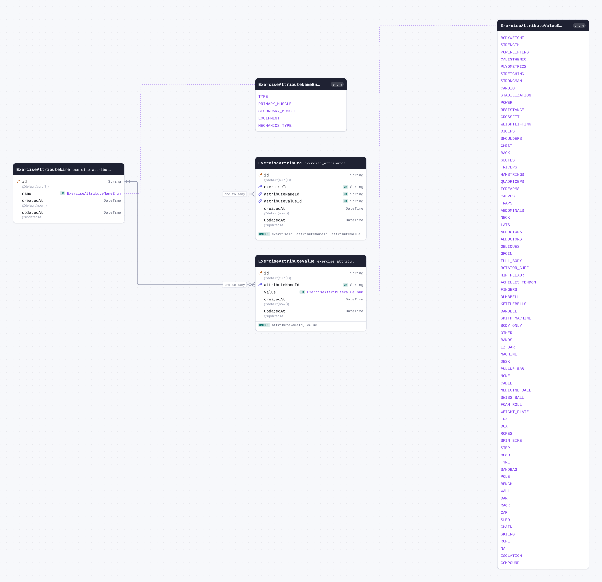

| Field       | Type                                                           | Constraints     | Default      | Description |
| ----------- | -------------------------------------------------------------- | --------------- | ------------ | ----------- |
| `id`        | `String`                                                       | PK NOT NULL     | `cuid(1)`    |             |
| `name`      | [`ExerciseAttributeNameEnum`](#enum-ExerciseAttributeNameEnum) | UNIQUE NOT NULL |              |             |
| `createdAt` | `DateTime`                                                     | NOT NULL        | `now()`      |             |
| `updatedAt` | `DateTime`                                                     | NOT NULL        | `@updatedAt` |             |

#### Referenced by

- `id` ← [ExerciseAttributeValue.attributeNameId](#model-ExerciseAttributeValue) (one-to-many)
- `id` ← [ExerciseAttribute.attributeNameId](#model-ExerciseAttribute) (one-to-many)

#### Definition

```sql
CREATE TABLE "exercise_attribute_names" (
    "id" TEXT NOT NULL,
    "name" "ExerciseAttributeNameEnum" NOT NULL,
    "createdAt" TIMESTAMP(3) NOT NULL DEFAULT CURRENT_TIMESTAMP,
    "updatedAt" TIMESTAMP(3) NOT NULL,

    CONSTRAINT "exercise_attribute_names_pkey" PRIMARY KEY ("id")
);

CREATE UNIQUE INDEX "exercise_attribute_names_name_key" ON "exercise_attribute_names"("name");
```

<details>
<summary>Queries and their SQL</summary>

**findMany**: Every row

```ts
await prisma.exerciseAttributeName.findMany();
```

```sql
SELECT
  "public"."exercise_attribute_names"."id",
  "public"."exercise_attribute_names"."name"::text,
  "public"."exercise_attribute_names"."createdAt",
  "public"."exercise_attribute_names"."updatedAt"
FROM
  "public"."exercise_attribute_names"
WHERE
  1 = 1
OFFSET
  $1
-- params: ["0"]
```

**count**: How many rows there are

```ts
await prisma.exerciseAttributeName.count();
```

```sql
SELECT
  COUNT(*) AS "_count$_all"
FROM
  (
    SELECT
      "public"."exercise_attribute_names"."id"
    FROM
      "public"."exercise_attribute_names"
    WHERE
      1 = 1
    OFFSET
      $1
  ) AS "sub"
-- params: ["0"]
```

**findMany**: Every row with its relations

```ts
await prisma.exerciseAttributeName.findMany({ include: { values: true, attributes: true } });
```

```sql
SELECT
  "public"."exercise_attribute_names"."id",
  "public"."exercise_attribute_names"."name"::text,
  "public"."exercise_attribute_names"."createdAt",
  "public"."exercise_attribute_names"."updatedAt"
FROM
  "public"."exercise_attribute_names"
WHERE
  1 = 1
OFFSET
  $1
-- params: ["0"]

SELECT
  "public"."exercise_attribute_values"."id",
  "public"."exercise_attribute_values"."attributeNameId",
  "public"."exercise_attribute_values"."value"::text,
  "public"."exercise_attribute_values"."createdAt",
  "public"."exercise_attribute_values"."updatedAt"
FROM
  "public"."exercise_attribute_values"
WHERE
  "public"."exercise_attribute_values"."attributeNameId" IN ($1)
OFFSET
  $2
-- params: ["<id of the rows above>","0"]

SELECT
  "public"."exercise_attributes"."id",
  "public"."exercise_attributes"."exerciseId",
  "public"."exercise_attributes"."attributeNameId",
  "public"."exercise_attributes"."attributeValueId",
  "public"."exercise_attributes"."createdAt",
  "public"."exercise_attributes"."updatedAt"
FROM
  "public"."exercise_attributes"
WHERE
  "public"."exercise_attributes"."attributeNameId" IN ($1)
OFFSET
  $2
-- params: ["<id of the rows above>","0"]
```

**findUnique**: One row by what is unique to it

```ts
await prisma.exerciseAttributeName.findUnique({ where: { id: "example" } });
```

```sql
SELECT
  "public"."exercise_attribute_names"."id",
  "public"."exercise_attribute_names"."name"::text,
  "public"."exercise_attribute_names"."createdAt",
  "public"."exercise_attribute_names"."updatedAt"
FROM
  "public"."exercise_attribute_names"
WHERE
  (
    "public"."exercise_attribute_names"."id" = $1
    AND 1 = 1
  )
LIMIT
  $2
OFFSET
  $3
-- params: ["example","1","0"]
```

**create**: Create a row

```ts
await prisma.exerciseAttributeName.create({ data: { name: "TYPE" } });
```

```sql
INSERT INTO
  "public"."exercise_attribute_names" ("id", "name", "createdAt", "updatedAt")
VALUES
  (
    $1,
    CAST($2::text AS "public"."ExerciseAttributeNameEnum"),
    $3,
    $4
  )
RETURNING
  "public"."exercise_attribute_names"."id",
  "public"."exercise_attribute_names"."name"::text,
  "public"."exercise_attribute_names"."createdAt",
  "public"."exercise_attribute_names"."updatedAt"
-- params: ["<cuid(1)>","TYPE","<now()>","<now()>"]
```

**update**: Update a row

```ts
await prisma.exerciseAttributeName.update({ where: { id: "example" }, data: { name: "TYPE" } });
```

```sql
UPDATE "public"."exercise_attribute_names"
SET
  "name" = CAST($1::text AS "public"."ExerciseAttributeNameEnum"),
  "updatedAt" = $2
WHERE
  (
    "public"."exercise_attribute_names"."id" = $3
    AND 1 = 1
  )
RETURNING
  "public"."exercise_attribute_names"."id",
  "public"."exercise_attribute_names"."name"::text,
  "public"."exercise_attribute_names"."createdAt",
  "public"."exercise_attribute_names"."updatedAt"
-- params: ["TYPE",{"prisma__type":"generatorCall","prisma__value":{"name":"now","args":[],"returnType":{"type":"DateTime"}}},"example"]
```

**delete**: Delete a row

```ts
await prisma.exerciseAttributeName.delete({ where: { id: "example" } });
```

```sql
DELETE FROM "public"."exercise_attribute_names"
WHERE
  (
    "public"."exercise_attribute_names"."id" = $1
    AND 1 = 1
  )
RETURNING
  "public"."exercise_attribute_names"."id",
  "public"."exercise_attribute_names"."name"::text,
  "public"."exercise_attribute_names"."createdAt",
  "public"."exercise_attribute_names"."updatedAt"
-- params: ["example"]
```

</details>

<a id="model-ExerciseAttributeValue"></a>

### ExerciseAttributeValue

Table `exercise_attribute_values`.

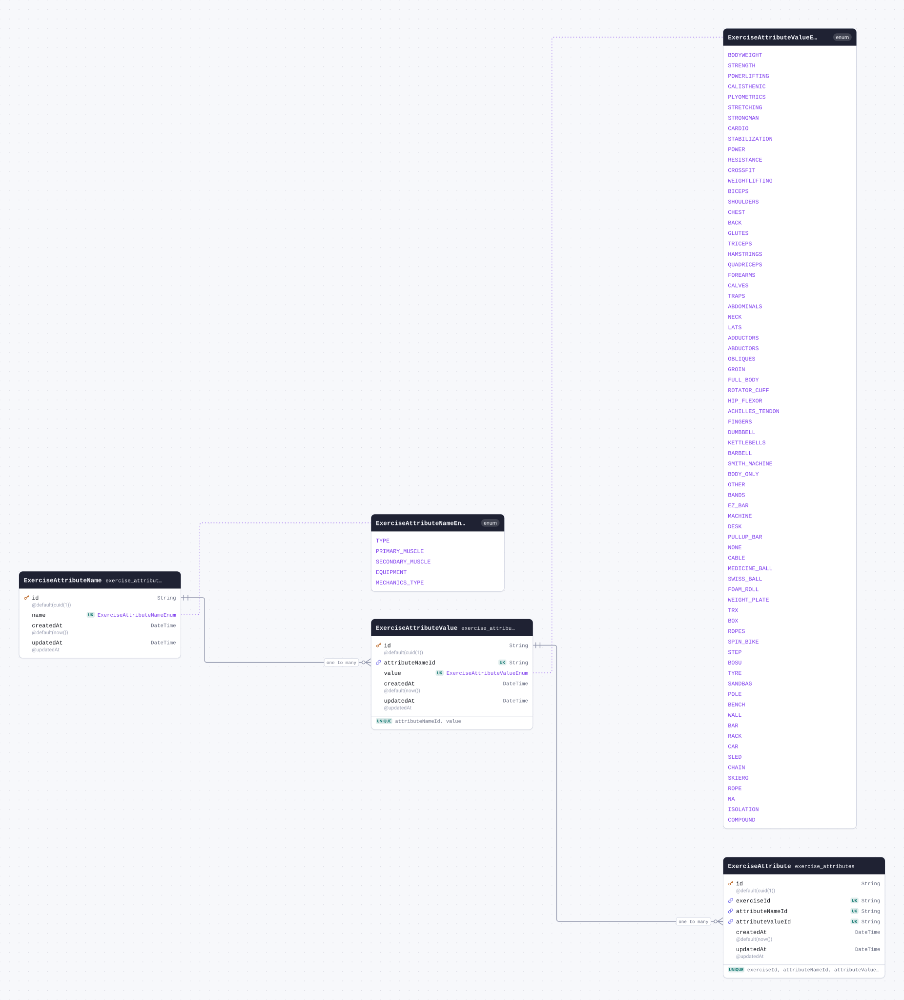

| Field             | Type                                                             | Constraints                                                         | Default      | Description |
| ----------------- | ---------------------------------------------------------------- | ------------------------------------------------------------------- | ------------ | ----------- |
| `id`              | `String`                                                         | PK NOT NULL                                                         | `cuid(1)`    |             |
| `attributeNameId` | `String`                                                         | NOT NULL → [ExerciseAttributeName.id](#model-ExerciseAttributeName) |              |             |
| `value`           | [`ExerciseAttributeValueEnum`](#enum-ExerciseAttributeValueEnum) | NOT NULL                                                            |              |             |
| `createdAt`       | `DateTime`                                                       | NOT NULL                                                            | `now()`      |             |
| `updatedAt`       | `DateTime`                                                       | NOT NULL                                                            | `@updatedAt` |             |

#### Indexes

- `@@unique([attributeNameId, value])`

#### References

- `attributeNameId` → [ExerciseAttributeName.id](#model-ExerciseAttributeName) (many-to-one)

#### Referenced by

- `id` ← [ExerciseAttribute.attributeValueId](#model-ExerciseAttribute) (one-to-many)

#### Definition

```sql
CREATE TABLE "exercise_attribute_values" (
    "id" TEXT NOT NULL,
    "attributeNameId" TEXT NOT NULL,
    "value" "ExerciseAttributeValueEnum" NOT NULL,
    "createdAt" TIMESTAMP(3) NOT NULL DEFAULT CURRENT_TIMESTAMP,
    "updatedAt" TIMESTAMP(3) NOT NULL,

    CONSTRAINT "exercise_attribute_values_pkey" PRIMARY KEY ("id")
);

CREATE UNIQUE INDEX "exercise_attribute_values_attributeNameId_value_key" ON "exercise_attribute_values"("attributeNameId", "value");

ALTER TABLE "exercise_attribute_values" ADD CONSTRAINT "exercise_attribute_values_attributeNameId_fkey" FOREIGN KEY ("attributeNameId") REFERENCES "exercise_attribute_names"("id") ON DELETE RESTRICT ON UPDATE CASCADE;
```

<details>
<summary>Queries and their SQL</summary>

**findMany**: Every row

```ts
await prisma.exerciseAttributeValue.findMany();
```

```sql
SELECT
  "public"."exercise_attribute_values"."id",
  "public"."exercise_attribute_values"."attributeNameId",
  "public"."exercise_attribute_values"."value"::text,
  "public"."exercise_attribute_values"."createdAt",
  "public"."exercise_attribute_values"."updatedAt"
FROM
  "public"."exercise_attribute_values"
WHERE
  1 = 1
OFFSET
  $1
-- params: ["0"]
```

**count**: How many rows there are

```ts
await prisma.exerciseAttributeValue.count();
```

```sql
SELECT
  COUNT(*) AS "_count$_all"
FROM
  (
    SELECT
      "public"."exercise_attribute_values"."id"
    FROM
      "public"."exercise_attribute_values"
    WHERE
      1 = 1
    OFFSET
      $1
  ) AS "sub"
-- params: ["0"]
```

**findMany**: Every row with its relations

```ts
await prisma.exerciseAttributeValue.findMany({
  include: { attributeName: true, attributes: true },
});
```

```sql
SELECT
  "public"."exercise_attribute_values"."id",
  "public"."exercise_attribute_values"."attributeNameId",
  "public"."exercise_attribute_values"."value"::text,
  "public"."exercise_attribute_values"."createdAt",
  "public"."exercise_attribute_values"."updatedAt"
FROM
  "public"."exercise_attribute_values"
WHERE
  1 = 1
OFFSET
  $1
-- params: ["0"]

SELECT
  "public"."exercise_attribute_names"."id",
  "public"."exercise_attribute_names"."name"::text,
  "public"."exercise_attribute_names"."createdAt",
  "public"."exercise_attribute_names"."updatedAt"
FROM
  "public"."exercise_attribute_names"
WHERE
  "public"."exercise_attribute_names"."id" IN ($1)
OFFSET
  $2
-- params: ["<attributeNameId of the rows above>","0"]

SELECT
  "public"."exercise_attributes"."id",
  "public"."exercise_attributes"."exerciseId",
  "public"."exercise_attributes"."attributeNameId",
  "public"."exercise_attributes"."attributeValueId",
  "public"."exercise_attributes"."createdAt",
  "public"."exercise_attributes"."updatedAt"
FROM
  "public"."exercise_attributes"
WHERE
  "public"."exercise_attributes"."attributeValueId" IN ($1)
OFFSET
  $2
-- params: ["<id of the rows above>","0"]
```

**findUnique**: One row by what is unique to it

```ts
await prisma.exerciseAttributeValue.findUnique({ where: { id: "example" } });
```

```sql
SELECT
  "public"."exercise_attribute_values"."id",
  "public"."exercise_attribute_values"."attributeNameId",
  "public"."exercise_attribute_values"."value"::text,
  "public"."exercise_attribute_values"."createdAt",
  "public"."exercise_attribute_values"."updatedAt"
FROM
  "public"."exercise_attribute_values"
WHERE
  (
    "public"."exercise_attribute_values"."id" = $1
    AND 1 = 1
  )
LIMIT
  $2
OFFSET
  $3
-- params: ["example","1","0"]
```

**create**: Create a row

```ts
await prisma.exerciseAttributeValue.create({
  data: { attributeNameId: "example", value: "BODYWEIGHT" },
});
```

```sql
INSERT INTO
  "public"."exercise_attribute_values" (
    "id",
    "attributeNameId",
    "value",
    "createdAt",
    "updatedAt"
  )
VALUES
  (
    $1,
    $2,
    CAST($3::text AS "public"."ExerciseAttributeValueEnum"),
    $4,
    $5
  )
RETURNING
  "public"."exercise_attribute_values"."id",
  "public"."exercise_attribute_values"."attributeNameId",
  "public"."exercise_attribute_values"."value"::text,
  "public"."exercise_attribute_values"."createdAt",
  "public"."exercise_attribute_values"."updatedAt"
-- params: ["<cuid(1)>","example","BODYWEIGHT","<now()>","<now()>"]
```

**update**: Update a row

```ts
await prisma.exerciseAttributeValue.update({
  where: { id: "example" },
  data: { value: "BODYWEIGHT" },
});
```

```sql
UPDATE "public"."exercise_attribute_values"
SET
  "value" = CAST($1::text AS "public"."ExerciseAttributeValueEnum"),
  "updatedAt" = $2
WHERE
  (
    "public"."exercise_attribute_values"."id" = $3
    AND 1 = 1
  )
RETURNING
  "public"."exercise_attribute_values"."id",
  "public"."exercise_attribute_values"."attributeNameId",
  "public"."exercise_attribute_values"."value"::text,
  "public"."exercise_attribute_values"."createdAt",
  "public"."exercise_attribute_values"."updatedAt"
-- params: ["BODYWEIGHT",{"prisma__type":"generatorCall","prisma__value":{"name":"now","args":[],"returnType":{"type":"DateTime"}}},"example"]
```

**delete**: Delete a row

```ts
await prisma.exerciseAttributeValue.delete({ where: { id: "example" } });
```

```sql
DELETE FROM "public"."exercise_attribute_values"
WHERE
  (
    "public"."exercise_attribute_values"."id" = $1
    AND 1 = 1
  )
RETURNING
  "public"."exercise_attribute_values"."id",
  "public"."exercise_attribute_values"."attributeNameId",
  "public"."exercise_attribute_values"."value"::text,
  "public"."exercise_attribute_values"."createdAt",
  "public"."exercise_attribute_values"."updatedAt"
-- params: ["example"]
```

</details>

<a id="model-ExerciseAttribute"></a>

### ExerciseAttribute

Table `exercise_attributes`.

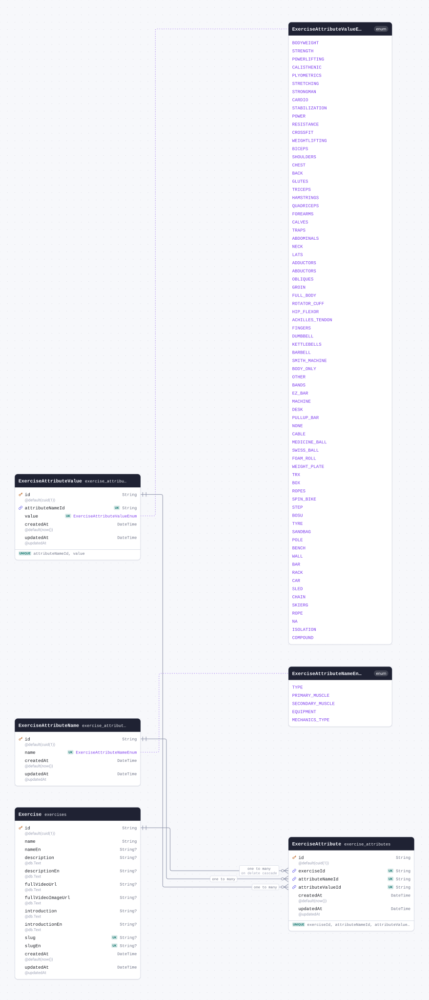

| Field              | Type       | Constraints                                                           | Default      | Description |
| ------------------ | ---------- | --------------------------------------------------------------------- | ------------ | ----------- |
| `id`               | `String`   | PK NOT NULL                                                           | `cuid(1)`    |             |
| `exerciseId`       | `String`   | NOT NULL → [Exercise.id](#model-Exercise)                             |              |             |
| `attributeNameId`  | `String`   | NOT NULL → [ExerciseAttributeName.id](#model-ExerciseAttributeName)   |              |             |
| `attributeValueId` | `String`   | NOT NULL → [ExerciseAttributeValue.id](#model-ExerciseAttributeValue) |              |             |
| `createdAt`        | `DateTime` | NOT NULL                                                              | `now()`      |             |
| `updatedAt`        | `DateTime` | NOT NULL                                                              | `@updatedAt` |             |

#### Indexes

- `@@unique([exerciseId, attributeNameId, attributeValueId])`

#### References

- `exerciseId` → [Exercise.id](#model-Exercise) (many-to-one, on delete Cascade)
- `attributeNameId` → [ExerciseAttributeName.id](#model-ExerciseAttributeName) (many-to-one)
- `attributeValueId` → [ExerciseAttributeValue.id](#model-ExerciseAttributeValue) (many-to-one)

#### Definition

```sql
CREATE TABLE "exercise_attributes" (
    "id" TEXT NOT NULL,
    "exerciseId" TEXT NOT NULL,
    "attributeNameId" TEXT NOT NULL,
    "attributeValueId" TEXT NOT NULL,
    "createdAt" TIMESTAMP(3) NOT NULL DEFAULT CURRENT_TIMESTAMP,
    "updatedAt" TIMESTAMP(3) NOT NULL,

    CONSTRAINT "exercise_attributes_pkey" PRIMARY KEY ("id")
);

CREATE UNIQUE INDEX "exercise_attributes_exerciseId_attributeNameId_attributeVal_key" ON "exercise_attributes"("exerciseId", "attributeNameId", "attributeValueId");

ALTER TABLE "exercise_attributes" ADD CONSTRAINT "exercise_attributes_exerciseId_fkey" FOREIGN KEY ("exerciseId") REFERENCES "exercises"("id") ON DELETE CASCADE ON UPDATE CASCADE;

ALTER TABLE "exercise_attributes" ADD CONSTRAINT "exercise_attributes_attributeNameId_fkey" FOREIGN KEY ("attributeNameId") REFERENCES "exercise_attribute_names"("id") ON DELETE RESTRICT ON UPDATE CASCADE;

ALTER TABLE "exercise_attributes" ADD CONSTRAINT "exercise_attributes_attributeValueId_fkey" FOREIGN KEY ("attributeValueId") REFERENCES "exercise_attribute_values"("id") ON DELETE RESTRICT ON UPDATE CASCADE;
```

<details>
<summary>Queries and their SQL</summary>

**findMany**: Every row

```ts
await prisma.exerciseAttribute.findMany();
```

```sql
SELECT
  "public"."exercise_attributes"."id",
  "public"."exercise_attributes"."exerciseId",
  "public"."exercise_attributes"."attributeNameId",
  "public"."exercise_attributes"."attributeValueId",
  "public"."exercise_attributes"."createdAt",
  "public"."exercise_attributes"."updatedAt"
FROM
  "public"."exercise_attributes"
WHERE
  1 = 1
OFFSET
  $1
-- params: ["0"]
```

**count**: How many rows there are

```ts
await prisma.exerciseAttribute.count();
```

```sql
SELECT
  COUNT(*) AS "_count$_all"
FROM
  (
    SELECT
      "public"."exercise_attributes"."id"
    FROM
      "public"."exercise_attributes"
    WHERE
      1 = 1
    OFFSET
      $1
  ) AS "sub"
-- params: ["0"]
```

**findMany**: Every row with its relations

```ts
await prisma.exerciseAttribute.findMany({
  include: { exercise: true, attributeName: true, attributeValue: true },
});
```

```sql
SELECT
  "public"."exercise_attributes"."id",
  "public"."exercise_attributes"."exerciseId",
  "public"."exercise_attributes"."attributeNameId",
  "public"."exercise_attributes"."attributeValueId",
  "public"."exercise_attributes"."createdAt",
  "public"."exercise_attributes"."updatedAt"
FROM
  "public"."exercise_attributes"
WHERE
  1 = 1
OFFSET
  $1
-- params: ["0"]

SELECT
  "public"."exercises"."id",
  "public"."exercises"."name",
  "public"."exercises"."nameEn",
  "public"."exercises"."description",
  "public"."exercises"."descriptionEn",
  "public"."exercises"."fullVideoUrl",
  "public"."exercises"."fullVideoImageUrl",
  "public"."exercises"."introduction",
  "public"."exercises"."introductionEn",
  "public"."exercises"."slug",
  "public"."exercises"."slugEn",
  "public"."exercises"."createdAt",
  "public"."exercises"."updatedAt"
FROM
  "public"."exercises"
WHERE
  "public"."exercises"."id" IN ($1)
OFFSET
  $2
-- params: ["<exerciseId of the rows above>","0"]

SELECT
  "public"."exercise_attribute_names"."id",
  "public"."exercise_attribute_names"."name"::text,
  "public"."exercise_attribute_names"."createdAt",
  "public"."exercise_attribute_names"."updatedAt"
FROM
  "public"."exercise_attribute_names"
WHERE
  "public"."exercise_attribute_names"."id" IN ($1)
OFFSET
  $2
-- params: ["<attributeNameId of the rows above>","0"]

SELECT
  "public"."exercise_attribute_values"."id",
  "public"."exercise_attribute_values"."attributeNameId",
  "public"."exercise_attribute_values"."value"::text,
  "public"."exercise_attribute_values"."createdAt",
  "public"."exercise_attribute_values"."updatedAt"
FROM
  "public"."exercise_attribute_values"
WHERE
  "public"."exercise_attribute_values"."id" IN ($1)
OFFSET
  $2
-- params: ["<attributeValueId of the rows above>","0"]
```

**findUnique**: One row by what is unique to it

```ts
await prisma.exerciseAttribute.findUnique({ where: { id: "example" } });
```

```sql
SELECT
  "public"."exercise_attributes"."id",
  "public"."exercise_attributes"."exerciseId",
  "public"."exercise_attributes"."attributeNameId",
  "public"."exercise_attributes"."attributeValueId",
  "public"."exercise_attributes"."createdAt",
  "public"."exercise_attributes"."updatedAt"
FROM
  "public"."exercise_attributes"
WHERE
  (
    "public"."exercise_attributes"."id" = $1
    AND 1 = 1
  )
LIMIT
  $2
OFFSET
  $3
-- params: ["example","1","0"]
```

**create**: Create a row

```ts
await prisma.exerciseAttribute.create({
  data: { exerciseId: "example", attributeNameId: "example", attributeValueId: "example" },
});
```

```sql
INSERT INTO
  "public"."exercise_attributes" (
    "id",
    "exerciseId",
    "attributeNameId",
    "attributeValueId",
    "createdAt",
    "updatedAt"
  )
VALUES
  ($1, $2, $3, $4, $5, $6)
RETURNING
  "public"."exercise_attributes"."id",
  "public"."exercise_attributes"."exerciseId",
  "public"."exercise_attributes"."attributeNameId",
  "public"."exercise_attributes"."attributeValueId",
  "public"."exercise_attributes"."createdAt",
  "public"."exercise_attributes"."updatedAt"
-- params: ["<cuid(1)>","example","example","example","<now()>","<now()>"]
```

**update**: Update a row

```ts
await prisma.exerciseAttribute.update({
  where: { id: "example" },
  data: { createdAt: new Date("2026-01-01T00:00:00.000Z") },
});
```

```sql
UPDATE "public"."exercise_attributes"
SET
  "createdAt" = $1,
  "updatedAt" = $2
WHERE
  (
    "public"."exercise_attributes"."id" = $3
    AND 1 = 1
  )
RETURNING
  "public"."exercise_attributes"."id",
  "public"."exercise_attributes"."exerciseId",
  "public"."exercise_attributes"."attributeNameId",
  "public"."exercise_attributes"."attributeValueId",
  "public"."exercise_attributes"."createdAt",
  "public"."exercise_attributes"."updatedAt"
-- params: ["2026-01-01T00:00:00.000Z",{"prisma__type":"generatorCall","prisma__value":{"name":"now","args":[],"returnType":{"type":"DateTime"}}},"example"]
```

**delete**: Delete a row

```ts
await prisma.exerciseAttribute.delete({ where: { id: "example" } });
```

```sql
DELETE FROM "public"."exercise_attributes"
WHERE
  (
    "public"."exercise_attributes"."id" = $1
    AND 1 = 1
  )
RETURNING
  "public"."exercise_attributes"."id",
  "public"."exercise_attributes"."exerciseId",
  "public"."exercise_attributes"."attributeNameId",
  "public"."exercise_attributes"."attributeValueId",
  "public"."exercise_attributes"."createdAt",
  "public"."exercise_attributes"."updatedAt"
-- params: ["example"]
```

</details>

<a id="model-WorkoutSession"></a>

### WorkoutSession

Table `workout_sessions`.

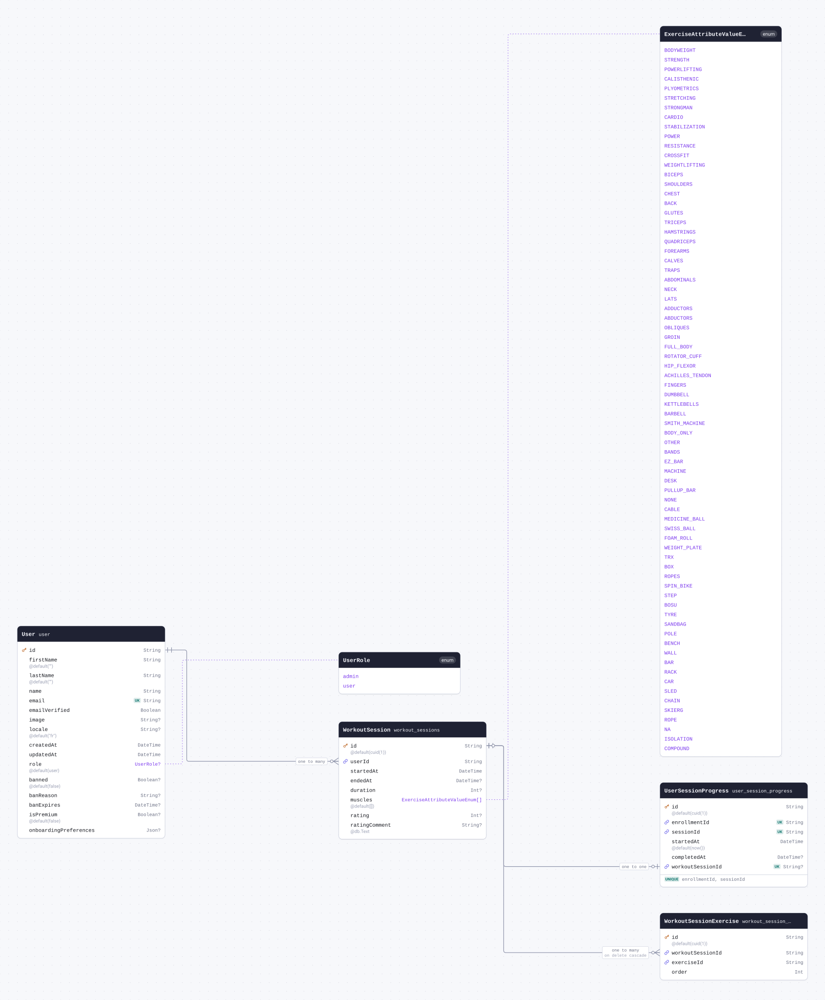

| Field           | Type                                                               | Constraints                       | Default   | Description |
| --------------- | ------------------------------------------------------------------ | --------------------------------- | --------- | ----------- |
| `id`            | `String`                                                           | PK NOT NULL                       | `cuid(1)` |             |
| `userId`        | `String`                                                           | NOT NULL → [User.id](#model-User) |           |             |
| `startedAt`     | `DateTime`                                                         | NOT NULL                          |           |             |
| `endedAt`       | `DateTime`                                                         | NULL                              |           |             |
| `duration`      | `Int`                                                              | NULL                              |           |             |
| `muscles`       | [`ExerciseAttributeValueEnum[]`](#enum-ExerciseAttributeValueEnum) | NOT NULL                          | `[]`      |             |
| `rating`        | `Int`                                                              | NULL                              |           |             |
| `ratingComment` | `String` `@db.Text`                                                | NULL                              |           |             |

#### References

- `userId` → [User.id](#model-User) (many-to-one)

#### Referenced by

- `id` ← [WorkoutSessionExercise.workoutSessionId](#model-WorkoutSessionExercise) (one-to-many, on delete Cascade)
- `id` ← [UserSessionProgress.workoutSessionId](#model-UserSessionProgress) (one-to-one)

#### Definition

```sql
CREATE TABLE "workout_sessions" (
    "id" TEXT NOT NULL,
    "userId" TEXT NOT NULL,
    "startedAt" TIMESTAMP(3) NOT NULL,
    "endedAt" TIMESTAMP(3),
    "duration" INTEGER,
    "muscles" "ExerciseAttributeValueEnum"[] DEFAULT ARRAY[]::"ExerciseAttributeValueEnum"[],
    "rating" INTEGER,
    "ratingComment" TEXT,

    CONSTRAINT "workout_sessions_pkey" PRIMARY KEY ("id")
);

ALTER TABLE "workout_sessions" ADD CONSTRAINT "workout_sessions_userId_fkey" FOREIGN KEY ("userId") REFERENCES "user"("id") ON DELETE RESTRICT ON UPDATE CASCADE;
```

<details>
<summary>Queries and their SQL</summary>

**findMany**: Every row

```ts
await prisma.workoutSession.findMany();
```

```sql
SELECT
  "public"."workout_sessions"."id",
  "public"."workout_sessions"."userId",
  "public"."workout_sessions"."startedAt",
  "public"."workout_sessions"."endedAt",
  "public"."workout_sessions"."duration",
  "public"."workout_sessions"."muscles"::text[],
  "public"."workout_sessions"."rating",
  "public"."workout_sessions"."ratingComment"
FROM
  "public"."workout_sessions"
WHERE
  1 = 1
OFFSET
  $1
-- params: ["0"]
```

**count**: How many rows there are

```ts
await prisma.workoutSession.count();
```

```sql
SELECT
  COUNT(*) AS "_count$_all"
FROM
  (
    SELECT
      "public"."workout_sessions"."id"
    FROM
      "public"."workout_sessions"
    WHERE
      1 = 1
    OFFSET
      $1
  ) AS "sub"
-- params: ["0"]
```

**findMany**: Every row with its relations

```ts
await prisma.workoutSession.findMany({
  include: { user: true, exercises: true, userSessionProgress: true },
});
```

```sql
SELECT
  "public"."workout_sessions"."id",
  "public"."workout_sessions"."userId",
  "public"."workout_sessions"."startedAt",
  "public"."workout_sessions"."endedAt",
  "public"."workout_sessions"."duration",
  "public"."workout_sessions"."muscles"::text[],
  "public"."workout_sessions"."rating",
  "public"."workout_sessions"."ratingComment"
FROM
  "public"."workout_sessions"
WHERE
  1 = 1
OFFSET
  $1
-- params: ["0"]

SELECT
  "public"."user"."id",
  "public"."user"."firstName",
  "public"."user"."lastName",
  "public"."user"."name",
  "public"."user"."email",
  "public"."user"."emailVerified",
  "public"."user"."image",
  "public"."user"."locale",
  "public"."user"."createdAt",
  "public"."user"."updatedAt",
  "public"."user"."role"::text,
  "public"."user"."banned",
  "public"."user"."banReason",
  "public"."user"."banExpires",
  "public"."user"."isPremium",
  "public"."user"."onboardingPreferences"
FROM
  "public"."user"
WHERE
  "public"."user"."id" IN ($1)
OFFSET
  $2
-- params: ["<userId of the rows above>","0"]

SELECT
  "public"."workout_session_exercises"."id",
  "public"."workout_session_exercises"."workoutSessionId",
  "public"."workout_session_exercises"."exerciseId",
  "public"."workout_session_exercises"."order"
FROM
  "public"."workout_session_exercises"
WHERE
  "public"."workout_session_exercises"."workoutSessionId" IN ($1)
OFFSET
  $2
-- params: ["<id of the rows above>","0"]

SELECT
  "public"."user_session_progress"."id",
  "public"."user_session_progress"."enrollmentId",
  "public"."user_session_progress"."sessionId",
  "public"."user_session_progress"."startedAt",
  "public"."user_session_progress"."completedAt",
  "public"."user_session_progress"."workoutSessionId"
FROM
  "public"."user_session_progress"
WHERE
  "public"."user_session_progress"."workoutSessionId" IN ($1)
OFFSET
  $2
-- params: ["<id of the rows above>","0"]
```

**findUnique**: One row by what is unique to it

```ts
await prisma.workoutSession.findUnique({ where: { id: "example" } });
```

```sql
SELECT
  "public"."workout_sessions"."id",
  "public"."workout_sessions"."userId",
  "public"."workout_sessions"."startedAt",
  "public"."workout_sessions"."endedAt",
  "public"."workout_sessions"."duration",
  "public"."workout_sessions"."muscles"::text[],
  "public"."workout_sessions"."rating",
  "public"."workout_sessions"."ratingComment"
FROM
  "public"."workout_sessions"
WHERE
  (
    "public"."workout_sessions"."id" = $1
    AND 1 = 1
  )
LIMIT
  $2
OFFSET
  $3
-- params: ["example","1","0"]
```

**create**: Create a row

```ts
await prisma.workoutSession.create({
  data: { userId: "example", startedAt: new Date("2026-01-01T00:00:00.000Z") },
});
```

```sql
INSERT INTO
  "public"."workout_sessions" ("id", "userId", "startedAt", "muscles")
VALUES
  (
    $1,
    $2,
    $3,
    CAST(
      $4::text[] AS "public"."ExerciseAttributeValueEnum" []
    )
  )
RETURNING
  "public"."workout_sessions"."id",
  "public"."workout_sessions"."userId",
  "public"."workout_sessions"."startedAt",
  "public"."workout_sessions"."endedAt",
  "public"."workout_sessions"."duration",
  "public"."workout_sessions"."muscles"::text[],
  "public"."workout_sessions"."rating",
  "public"."workout_sessions"."ratingComment"
-- params: ["<cuid(1)>","example","2026-01-01T00:00:00.000Z",[]]
```

**update**: Update a row

```ts
await prisma.workoutSession.update({
  where: { id: "example" },
  data: { startedAt: new Date("2026-01-01T00:00:00.000Z") },
});
```

```sql
UPDATE "public"."workout_sessions"
SET
  "startedAt" = $1
WHERE
  (
    "public"."workout_sessions"."id" = $2
    AND 1 = 1
  )
RETURNING
  "public"."workout_sessions"."id",
  "public"."workout_sessions"."userId",
  "public"."workout_sessions"."startedAt",
  "public"."workout_sessions"."endedAt",
  "public"."workout_sessions"."duration",
  "public"."workout_sessions"."muscles"::text[],
  "public"."workout_sessions"."rating",
  "public"."workout_sessions"."ratingComment"
-- params: ["2026-01-01T00:00:00.000Z","example"]
```

**delete**: Delete a row

```ts
await prisma.workoutSession.delete({ where: { id: "example" } });
```

```sql
DELETE FROM "public"."workout_sessions"
WHERE
  (
    "public"."workout_sessions"."id" = $1
    AND 1 = 1
  )
RETURNING
  "public"."workout_sessions"."id",
  "public"."workout_sessions"."userId",
  "public"."workout_sessions"."startedAt",
  "public"."workout_sessions"."endedAt",
  "public"."workout_sessions"."duration",
  "public"."workout_sessions"."muscles"::text[],
  "public"."workout_sessions"."rating",
  "public"."workout_sessions"."ratingComment"
-- params: ["example"]
```

</details>

<a id="model-WorkoutSessionExercise"></a>

### WorkoutSessionExercise

Table `workout_session_exercises`.

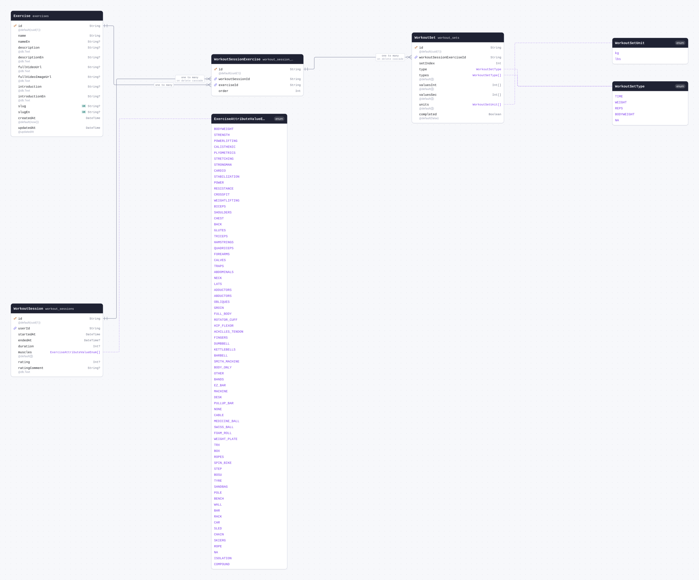

| Field              | Type     | Constraints                                           | Default   | Description |
| ------------------ | -------- | ----------------------------------------------------- | --------- | ----------- |
| `id`               | `String` | PK NOT NULL                                           | `cuid(1)` |             |
| `workoutSessionId` | `String` | NOT NULL → [WorkoutSession.id](#model-WorkoutSession) |           |             |
| `exerciseId`       | `String` | NOT NULL → [Exercise.id](#model-Exercise)             |           |             |
| `order`            | `Int`    | NOT NULL                                              |           |             |

#### References

- `workoutSessionId` → [WorkoutSession.id](#model-WorkoutSession) (many-to-one, on delete Cascade)
- `exerciseId` → [Exercise.id](#model-Exercise) (many-to-one)

#### Referenced by

- `id` ← [WorkoutSet.workoutSessionExerciseId](#model-WorkoutSet) (one-to-many, on delete Cascade)

#### Definition

```sql
CREATE TABLE "workout_session_exercises" (
    "id" TEXT NOT NULL,
    "workoutSessionId" TEXT NOT NULL,
    "exerciseId" TEXT NOT NULL,
    "order" INTEGER NOT NULL,

    CONSTRAINT "workout_session_exercises_pkey" PRIMARY KEY ("id")
);

ALTER TABLE "workout_session_exercises" ADD CONSTRAINT "workout_session_exercises_workoutSessionId_fkey" FOREIGN KEY ("workoutSessionId") REFERENCES "workout_sessions"("id") ON DELETE CASCADE ON UPDATE CASCADE;

ALTER TABLE "workout_session_exercises" ADD CONSTRAINT "workout_session_exercises_exerciseId_fkey" FOREIGN KEY ("exerciseId") REFERENCES "exercises"("id") ON DELETE RESTRICT ON UPDATE CASCADE;
```

<details>
<summary>Queries and their SQL</summary>

**findMany**: Every row

```ts
await prisma.workoutSessionExercise.findMany();
```

```sql
SELECT
  "public"."workout_session_exercises"."id",
  "public"."workout_session_exercises"."workoutSessionId",
  "public"."workout_session_exercises"."exerciseId",
  "public"."workout_session_exercises"."order"
FROM
  "public"."workout_session_exercises"
WHERE
  1 = 1
OFFSET
  $1
-- params: ["0"]
```

**count**: How many rows there are

```ts
await prisma.workoutSessionExercise.count();
```

```sql
SELECT
  COUNT(*) AS "_count$_all"
FROM
  (
    SELECT
      "public"."workout_session_exercises"."id"
    FROM
      "public"."workout_session_exercises"
    WHERE
      1 = 1
    OFFSET
      $1
  ) AS "sub"
-- params: ["0"]
```

**findMany**: Every row with its relations

```ts
await prisma.workoutSessionExercise.findMany({
  include: { workoutSession: true, exercise: true, sets: true },
});
```

```sql
SELECT
  "public"."workout_session_exercises"."id",
  "public"."workout_session_exercises"."workoutSessionId",
  "public"."workout_session_exercises"."exerciseId",
  "public"."workout_session_exercises"."order"
FROM
  "public"."workout_session_exercises"
WHERE
  1 = 1
OFFSET
  $1
-- params: ["0"]

SELECT
  "public"."workout_sessions"."id",
  "public"."workout_sessions"."userId",
  "public"."workout_sessions"."startedAt",
  "public"."workout_sessions"."endedAt",
  "public"."workout_sessions"."duration",
  "public"."workout_sessions"."muscles"::text[],
  "public"."workout_sessions"."rating",
  "public"."workout_sessions"."ratingComment"
FROM
  "public"."workout_sessions"
WHERE
  "public"."workout_sessions"."id" IN ($1)
OFFSET
  $2
-- params: ["<workoutSessionId of the rows above>","0"]

SELECT
  "public"."exercises"."id",
  "public"."exercises"."name",
  "public"."exercises"."nameEn",
  "public"."exercises"."description",
  "public"."exercises"."descriptionEn",
  "public"."exercises"."fullVideoUrl",
  "public"."exercises"."fullVideoImageUrl",
  "public"."exercises"."introduction",
  "public"."exercises"."introductionEn",
  "public"."exercises"."slug",
  "public"."exercises"."slugEn",
  "public"."exercises"."createdAt",
  "public"."exercises"."updatedAt"
FROM
  "public"."exercises"
WHERE
  "public"."exercises"."id" IN ($1)
OFFSET
  $2
-- params: ["<exerciseId of the rows above>","0"]

SELECT
  "public"."workout_sets"."id",
  "public"."workout_sets"."workoutSessionExerciseId",
  "public"."workout_sets"."setIndex",
  "public"."workout_sets"."type"::text,
  "public"."workout_sets"."types"::text[],
  "public"."workout_sets"."valuesInt",
  "public"."workout_sets"."valuesSec",
  "public"."workout_sets"."units"::text[],
  "public"."workout_sets"."completed"
FROM
  "public"."workout_sets"
WHERE
  "public"."workout_sets"."workoutSessionExerciseId" IN ($1)
OFFSET
  $2
-- params: ["<id of the rows above>","0"]
```

**findUnique**: One row by what is unique to it

```ts
await prisma.workoutSessionExercise.findUnique({ where: { id: "example" } });
```

```sql
SELECT
  "public"."workout_session_exercises"."id",
  "public"."workout_session_exercises"."workoutSessionId",
  "public"."workout_session_exercises"."exerciseId",
  "public"."workout_session_exercises"."order"
FROM
  "public"."workout_session_exercises"
WHERE
  (
    "public"."workout_session_exercises"."id" = $1
    AND 1 = 1
  )
LIMIT
  $2
OFFSET
  $3
-- params: ["example","1","0"]
```

**create**: Create a row

```ts
await prisma.workoutSessionExercise.create({
  data: { workoutSessionId: "example", exerciseId: "example", order: 1 },
});
```

```sql
INSERT INTO
  "public"."workout_session_exercises" ("id", "workoutSessionId", "exerciseId", "order")
VALUES
  ($1, $2, $3, $4)
RETURNING
  "public"."workout_session_exercises"."id",
  "public"."workout_session_exercises"."workoutSessionId",
  "public"."workout_session_exercises"."exerciseId",
  "public"."workout_session_exercises"."order"
-- params: ["<cuid(1)>","example","example","1"]
```

**update**: Update a row

```ts
await prisma.workoutSessionExercise.update({ where: { id: "example" }, data: { order: 1 } });
```

```sql
UPDATE "public"."workout_session_exercises"
SET
  "order" = $1
WHERE
  (
    "public"."workout_session_exercises"."id" = $2
    AND 1 = 1
  )
RETURNING
  "public"."workout_session_exercises"."id",
  "public"."workout_session_exercises"."workoutSessionId",
  "public"."workout_session_exercises"."exerciseId",
  "public"."workout_session_exercises"."order"
-- params: ["1","example"]
```

**delete**: Delete a row

```ts
await prisma.workoutSessionExercise.delete({ where: { id: "example" } });
```

```sql
DELETE FROM "public"."workout_session_exercises"
WHERE
  (
    "public"."workout_session_exercises"."id" = $1
    AND 1 = 1
  )
RETURNING
  "public"."workout_session_exercises"."id",
  "public"."workout_session_exercises"."workoutSessionId",
  "public"."workout_session_exercises"."exerciseId",
  "public"."workout_session_exercises"."order"
-- params: ["example"]
```

</details>

<a id="model-WorkoutSet"></a>

### WorkoutSet

Table `workout_sets`.

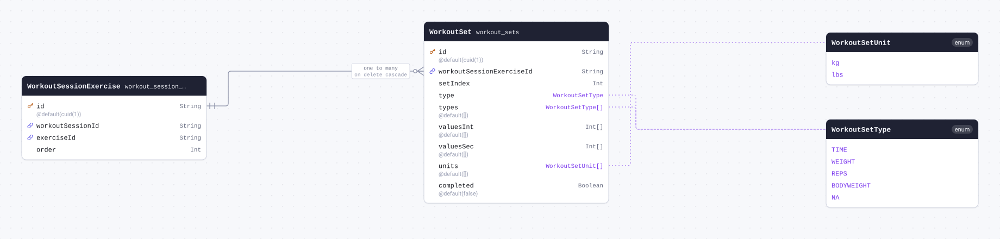

| Field                      | Type                                       | Constraints                                                           | Default   | Description |
| -------------------------- | ------------------------------------------ | --------------------------------------------------------------------- | --------- | ----------- |
| `id`                       | `String`                                   | PK NOT NULL                                                           | `cuid(1)` |             |
| `workoutSessionExerciseId` | `String`                                   | NOT NULL → [WorkoutSessionExercise.id](#model-WorkoutSessionExercise) |           |             |
| `setIndex`                 | `Int`                                      | NOT NULL                                                              |           |             |
| `type`                     | [`WorkoutSetType`](#enum-WorkoutSetType)   | NOT NULL                                                              |           |             |
| `types`                    | [`WorkoutSetType[]`](#enum-WorkoutSetType) | NOT NULL                                                              | `[]`      |             |
| `valuesInt`                | `Int[]`                                    | NOT NULL                                                              | `[]`      |             |
| `valuesSec`                | `Int[]`                                    | NOT NULL                                                              | `[]`      |             |
| `units`                    | [`WorkoutSetUnit[]`](#enum-WorkoutSetUnit) | NOT NULL                                                              | `[]`      |             |
| `completed`                | `Boolean`                                  | NOT NULL                                                              | `false`   |             |

#### References

- `workoutSessionExerciseId` → [WorkoutSessionExercise.id](#model-WorkoutSessionExercise) (many-to-one, on delete Cascade)

#### Definition

```sql
CREATE TABLE "workout_sets" (
    "id" TEXT NOT NULL,
    "workoutSessionExerciseId" TEXT NOT NULL,
    "setIndex" INTEGER NOT NULL,
    "type" "WorkoutSetType" NOT NULL,
    "types" "WorkoutSetType"[] DEFAULT ARRAY[]::"WorkoutSetType"[],
    "valuesInt" INTEGER[] DEFAULT ARRAY[]::INTEGER[],
    "valuesSec" INTEGER[] DEFAULT ARRAY[]::INTEGER[],
    "units" "WorkoutSetUnit"[] DEFAULT ARRAY[]::"WorkoutSetUnit"[],
    "completed" BOOLEAN NOT NULL DEFAULT false,

    CONSTRAINT "workout_sets_pkey" PRIMARY KEY ("id")
);

ALTER TABLE "workout_sets" ADD CONSTRAINT "workout_sets_workoutSessionExerciseId_fkey" FOREIGN KEY ("workoutSessionExerciseId") REFERENCES "workout_session_exercises"("id") ON DELETE CASCADE ON UPDATE CASCADE;
```

<details>
<summary>Queries and their SQL</summary>

**findMany**: Every row

```ts
await prisma.workoutSet.findMany();
```

```sql
SELECT
  "public"."workout_sets"."id",
  "public"."workout_sets"."workoutSessionExerciseId",
  "public"."workout_sets"."setIndex",
  "public"."workout_sets"."type"::text,
  "public"."workout_sets"."types"::text[],
  "public"."workout_sets"."valuesInt",
  "public"."workout_sets"."valuesSec",
  "public"."workout_sets"."units"::text[],
  "public"."workout_sets"."completed"
FROM
  "public"."workout_sets"
WHERE
  1 = 1
OFFSET
  $1
-- params: ["0"]
```

**count**: How many rows there are

```ts
await prisma.workoutSet.count();
```

```sql
SELECT
  COUNT(*) AS "_count$_all"
FROM
  (
    SELECT
      "public"."workout_sets"."id"
    FROM
      "public"."workout_sets"
    WHERE
      1 = 1
    OFFSET
      $1
  ) AS "sub"
-- params: ["0"]
```

**findMany**: Every row with its relations

```ts
await prisma.workoutSet.findMany({ include: { workoutSessionExercise: true } });
```

```sql
SELECT
  "public"."workout_sets"."id",
  "public"."workout_sets"."workoutSessionExerciseId",
  "public"."workout_sets"."setIndex",
  "public"."workout_sets"."type"::text,
  "public"."workout_sets"."types"::text[],
  "public"."workout_sets"."valuesInt",
  "public"."workout_sets"."valuesSec",
  "public"."workout_sets"."units"::text[],
  "public"."workout_sets"."completed"
FROM
  "public"."workout_sets"
WHERE
  1 = 1
OFFSET
  $1
-- params: ["0"]

SELECT
  "public"."workout_session_exercises"."id",
  "public"."workout_session_exercises"."workoutSessionId",
  "public"."workout_session_exercises"."exerciseId",
  "public"."workout_session_exercises"."order"
FROM
  "public"."workout_session_exercises"
WHERE
  "public"."workout_session_exercises"."id" IN ($1)
OFFSET
  $2
-- params: ["<workoutSessionExerciseId of the rows above>","0"]
```

**findUnique**: One row by what is unique to it

```ts
await prisma.workoutSet.findUnique({ where: { id: "example" } });
```

```sql
SELECT
  "public"."workout_sets"."id",
  "public"."workout_sets"."workoutSessionExerciseId",
  "public"."workout_sets"."setIndex",
  "public"."workout_sets"."type"::text,
  "public"."workout_sets"."types"::text[],
  "public"."workout_sets"."valuesInt",
  "public"."workout_sets"."valuesSec",
  "public"."workout_sets"."units"::text[],
  "public"."workout_sets"."completed"
FROM
  "public"."workout_sets"
WHERE
  (
    "public"."workout_sets"."id" = $1
    AND 1 = 1
  )
LIMIT
  $2
OFFSET
  $3
-- params: ["example","1","0"]
```

**create**: Create a row

```ts
await prisma.workoutSet.create({
  data: { workoutSessionExerciseId: "example", setIndex: 1, type: "TIME" },
});
```

```sql
INSERT INTO
  "public"."workout_sets" (
    "id",
    "workoutSessionExerciseId",
    "setIndex",
    "type",
    "types",
    "valuesInt",
    "valuesSec",
    "units",
    "completed"
  )
VALUES
  (
    $1,
    $2,
    $3,
    CAST($4::text AS "public"."WorkoutSetType"),
    CAST($5::text[] AS "public"."WorkoutSetType" []),
    $6,
    $7,
    CAST($8::text[] AS "public"."WorkoutSetUnit" []),
    $9
  )
RETURNING
  "public"."workout_sets"."id",
  "public"."workout_sets"."workoutSessionExerciseId",
  "public"."workout_sets"."setIndex",
  "public"."workout_sets"."type"::text,
  "public"."workout_sets"."types"::text[],
  "public"."workout_sets"."valuesInt",
  "public"."workout_sets"."valuesSec",
  "public"."workout_sets"."units"::text[],
  "public"."workout_sets"."completed"
-- params: ["<cuid(1)>","example","1","TIME",[],[],[],[],false]
```

**update**: Update a row

```ts
await prisma.workoutSet.update({ where: { id: "example" }, data: { setIndex: 1 } });
```

```sql
UPDATE "public"."workout_sets"
SET
  "setIndex" = $1
WHERE
  (
    "public"."workout_sets"."id" = $2
    AND 1 = 1
  )
RETURNING
  "public"."workout_sets"."id",
  "public"."workout_sets"."workoutSessionExerciseId",
  "public"."workout_sets"."setIndex",
  "public"."workout_sets"."type"::text,
  "public"."workout_sets"."types"::text[],
  "public"."workout_sets"."valuesInt",
  "public"."workout_sets"."valuesSec",
  "public"."workout_sets"."units"::text[],
  "public"."workout_sets"."completed"
-- params: ["1","example"]
```

**delete**: Delete a row

```ts
await prisma.workoutSet.delete({ where: { id: "example" } });
```

```sql
DELETE FROM "public"."workout_sets"
WHERE
  (
    "public"."workout_sets"."id" = $1
    AND 1 = 1
  )
RETURNING
  "public"."workout_sets"."id",
  "public"."workout_sets"."workoutSessionExerciseId",
  "public"."workout_sets"."setIndex",
  "public"."workout_sets"."type"::text,
  "public"."workout_sets"."types"::text[],
  "public"."workout_sets"."valuesInt",
  "public"."workout_sets"."valuesSec",
  "public"."workout_sets"."units"::text[],
  "public"."workout_sets"."completed"
-- params: ["example"]
```

</details>

<a id="model-SubscriptionPlan"></a>

### SubscriptionPlan

Table `subscription_plans`.

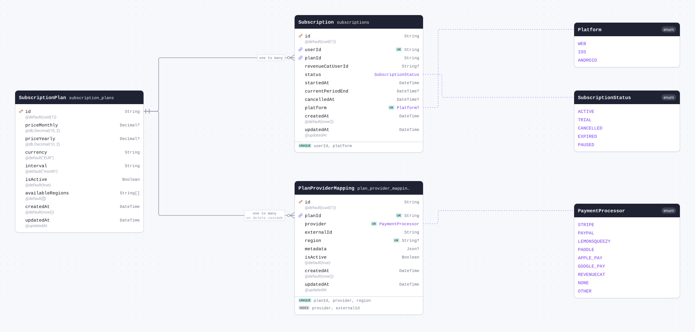

| Field              | Type                           | Constraints | Default      | Description |
| ------------------ | ------------------------------ | ----------- | ------------ | ----------- |
| `id`               | `String`                       | PK NOT NULL | `cuid(1)`    |             |
| `priceMonthly`     | `Decimal` `@db.Decimal(10, 2)` | NULL        |              |             |
| `priceYearly`      | `Decimal` `@db.Decimal(10, 2)` | NULL        |              |             |
| `currency`         | `String`                       | NOT NULL    | `"EUR"`      |             |
| `interval`         | `String`                       | NOT NULL    | `"month"`    |             |
| `isActive`         | `Boolean`                      | NOT NULL    | `true`       |             |
| `availableRegions` | `String[]`                     | NOT NULL    | `[]`         |             |
| `createdAt`        | `DateTime`                     | NOT NULL    | `now()`      |             |
| `updatedAt`        | `DateTime`                     | NOT NULL    | `@updatedAt` |             |

#### Referenced by

- `id` ← [PlanProviderMapping.planId](#model-PlanProviderMapping) (one-to-many, on delete Cascade)
- `id` ← [Subscription.planId](#model-Subscription) (one-to-many)

#### Definition

```sql
CREATE TABLE "subscription_plans" (
    "id" TEXT NOT NULL,
    "priceMonthly" DECIMAL(10,2),
    "priceYearly" DECIMAL(10,2),
    "currency" TEXT NOT NULL DEFAULT 'EUR',
    "interval" TEXT NOT NULL DEFAULT 'month',
    "isActive" BOOLEAN NOT NULL DEFAULT true,
    "availableRegions" TEXT[] DEFAULT ARRAY[]::TEXT[],
    "createdAt" TIMESTAMP(3) NOT NULL DEFAULT CURRENT_TIMESTAMP,
    "updatedAt" TIMESTAMP(3) NOT NULL,

    CONSTRAINT "subscription_plans_pkey" PRIMARY KEY ("id")
);
```

<details>
<summary>Queries and their SQL</summary>

**findMany**: Every row

```ts
await prisma.subscriptionPlan.findMany();
```

```sql
SELECT
  "public"."subscription_plans"."id",
  "public"."subscription_plans"."priceMonthly",
  "public"."subscription_plans"."priceYearly",
  "public"."subscription_plans"."currency",
  "public"."subscription_plans"."interval",
  "public"."subscription_plans"."isActive",
  "public"."subscription_plans"."availableRegions",
  "public"."subscription_plans"."createdAt",
  "public"."subscription_plans"."updatedAt"
FROM
  "public"."subscription_plans"
WHERE
  1 = 1
OFFSET
  $1
-- params: ["0"]
```

**count**: How many rows there are

```ts
await prisma.subscriptionPlan.count();
```

```sql
SELECT
  COUNT(*) AS "_count$_all"
FROM
  (
    SELECT
      "public"."subscription_plans"."id"
    FROM
      "public"."subscription_plans"
    WHERE
      1 = 1
    OFFSET
      $1
  ) AS "sub"
-- params: ["0"]
```

**findMany**: Every row with its relations

```ts
await prisma.subscriptionPlan.findMany({
  include: { subscriptions: true, providerMappings: true },
});
```

```sql
SELECT
  "public"."subscription_plans"."id",
  "public"."subscription_plans"."priceMonthly",
  "public"."subscription_plans"."priceYearly",
  "public"."subscription_plans"."currency",
  "public"."subscription_plans"."interval",
  "public"."subscription_plans"."isActive",
  "public"."subscription_plans"."availableRegions",
  "public"."subscription_plans"."createdAt",
  "public"."subscription_plans"."updatedAt"
FROM
  "public"."subscription_plans"
WHERE
  1 = 1
OFFSET
  $1
-- params: ["0"]

SELECT
  "public"."subscriptions"."id",
  "public"."subscriptions"."userId",
  "public"."subscriptions"."planId",
  "public"."subscriptions"."revenueCatUserId",
  "public"."subscriptions"."status"::text,
  "public"."subscriptions"."startedAt",
  "public"."subscriptions"."currentPeriodEnd",
  "public"."subscriptions"."cancelledAt",
  "public"."subscriptions"."platform"::text,
  "public"."subscriptions"."createdAt",
  "public"."subscriptions"."updatedAt"
FROM
  "public"."subscriptions"
WHERE
  "public"."subscriptions"."planId" IN ($1)
OFFSET
  $2
-- params: ["<id of the rows above>","0"]

SELECT
  "public"."plan_provider_mappings"."id",
  "public"."plan_provider_mappings"."planId",
  "public"."plan_provider_mappings"."provider"::text,
  "public"."plan_provider_mappings"."externalId",
  "public"."plan_provider_mappings"."region",
  "public"."plan_provider_mappings"."metadata",
  "public"."plan_provider_mappings"."isActive",
  "public"."plan_provider_mappings"."createdAt",
  "public"."plan_provider_mappings"."updatedAt"
FROM
  "public"."plan_provider_mappings"
WHERE
  "public"."plan_provider_mappings"."planId" IN ($1)
OFFSET
  $2
-- params: ["<id of the rows above>","0"]
```

**findUnique**: One row by what is unique to it

```ts
await prisma.subscriptionPlan.findUnique({ where: { id: "example" } });
```

```sql
SELECT
  "public"."subscription_plans"."id",
  "public"."subscription_plans"."priceMonthly",
  "public"."subscription_plans"."priceYearly",
  "public"."subscription_plans"."currency",
  "public"."subscription_plans"."interval",
  "public"."subscription_plans"."isActive",
  "public"."subscription_plans"."availableRegions",
  "public"."subscription_plans"."createdAt",
  "public"."subscription_plans"."updatedAt"
FROM
  "public"."subscription_plans"
WHERE
  (
    "public"."subscription_plans"."id" = $1
    AND 1 = 1
  )
LIMIT
  $2
OFFSET
  $3
-- params: ["example","1","0"]
```

**create**: Create a row

```ts
await prisma.subscriptionPlan.create({ data: {} });
```

```sql
INSERT INTO
  "public"."subscription_plans" (
    "id",
    "currency",
    "interval",
    "isActive",
    "availableRegions",
    "createdAt",
    "updatedAt"
  )
VALUES
  ($1, $2, $3, $4, $5, $6, $7)
RETURNING
  "public"."subscription_plans"."id",
  "public"."subscription_plans"."priceMonthly",
  "public"."subscription_plans"."priceYearly",
  "public"."subscription_plans"."currency",
  "public"."subscription_plans"."interval",
  "public"."subscription_plans"."isActive",
  "public"."subscription_plans"."availableRegions",
  "public"."subscription_plans"."createdAt",
  "public"."subscription_plans"."updatedAt"
-- params: ["<cuid(1)>","EUR","month",true,[],"<now()>","<now()>"]
```

**update**: Update a row

```ts
await prisma.subscriptionPlan.update({ where: { id: "example" }, data: { priceMonthly: "9.99" } });
```

```sql
UPDATE "public"."subscription_plans"
SET
  "priceMonthly" = $1,
  "updatedAt" = $2
WHERE
  (
    "public"."subscription_plans"."id" = $3
    AND 1 = 1
  )
RETURNING
  "public"."subscription_plans"."id",
  "public"."subscription_plans"."priceMonthly",
  "public"."subscription_plans"."priceYearly",
  "public"."subscription_plans"."currency",
  "public"."subscription_plans"."interval",
  "public"."subscription_plans"."isActive",
  "public"."subscription_plans"."availableRegions",
  "public"."subscription_plans"."createdAt",
  "public"."subscription_plans"."updatedAt"
-- params: ["9.99",{"prisma__type":"generatorCall","prisma__value":{"name":"now","args":[],"returnType":{"type":"DateTime"}}},"example"]
```

**delete**: Delete a row

```ts
await prisma.subscriptionPlan.delete({ where: { id: "example" } });
```

```sql
DELETE FROM "public"."subscription_plans"
WHERE
  (
    "public"."subscription_plans"."id" = $1
    AND 1 = 1
  )
RETURNING
  "public"."subscription_plans"."id",
  "public"."subscription_plans"."priceMonthly",
  "public"."subscription_plans"."priceYearly",
  "public"."subscription_plans"."currency",
  "public"."subscription_plans"."interval",
  "public"."subscription_plans"."isActive",
  "public"."subscription_plans"."availableRegions",
  "public"."subscription_plans"."createdAt",
  "public"."subscription_plans"."updatedAt"
-- params: ["example"]
```

</details>

<a id="model-PlanProviderMapping"></a>

### PlanProviderMapping

Table `plan_provider_mappings`.

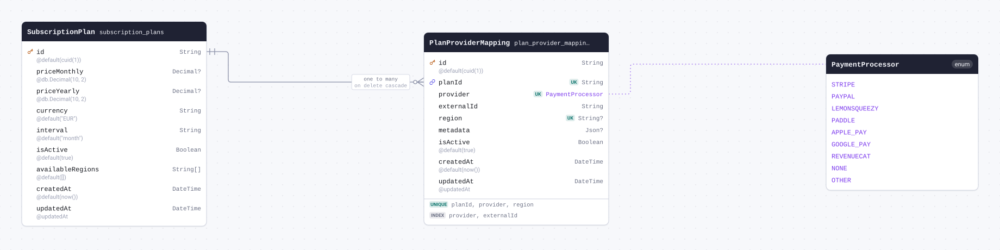

| Field        | Type                                         | Constraints                                               | Default      | Description |
| ------------ | -------------------------------------------- | --------------------------------------------------------- | ------------ | ----------- |
| `id`         | `String`                                     | PK NOT NULL                                               | `cuid(1)`    |             |
| `planId`     | `String`                                     | NOT NULL → [SubscriptionPlan.id](#model-SubscriptionPlan) |              |             |
| `provider`   | [`PaymentProcessor`](#enum-PaymentProcessor) | NOT NULL                                                  |              |             |
| `externalId` | `String`                                     | NOT NULL                                                  |              |             |
| `region`     | `String`                                     | NULL                                                      |              |             |
| `metadata`   | `Json`                                       | NULL                                                      |              |             |
| `isActive`   | `Boolean`                                    | NOT NULL                                                  | `true`       |             |
| `createdAt`  | `DateTime`                                   | NOT NULL                                                  | `now()`      |             |
| `updatedAt`  | `DateTime`                                   | NOT NULL                                                  | `@updatedAt` |             |

#### Indexes

- `@@index([provider, externalId])`
- `@@unique([planId, provider, region])`

#### References

- `planId` → [SubscriptionPlan.id](#model-SubscriptionPlan) (many-to-one, on delete Cascade)

#### Definition

```sql
CREATE TABLE "plan_provider_mappings" (
    "id" TEXT NOT NULL,
    "planId" TEXT NOT NULL,
    "provider" "PaymentProcessor" NOT NULL,
    "externalId" TEXT NOT NULL,
    "region" TEXT,
    "metadata" JSONB,
    "isActive" BOOLEAN NOT NULL DEFAULT true,
    "createdAt" TIMESTAMP(3) NOT NULL DEFAULT CURRENT_TIMESTAMP,
    "updatedAt" TIMESTAMP(3) NOT NULL,

    CONSTRAINT "plan_provider_mappings_pkey" PRIMARY KEY ("id")
);

CREATE INDEX "plan_provider_mappings_provider_externalId_idx" ON "plan_provider_mappings"("provider", "externalId");

CREATE UNIQUE INDEX "plan_provider_mappings_planId_provider_region_key" ON "plan_provider_mappings"("planId", "provider", "region");

ALTER TABLE "plan_provider_mappings" ADD CONSTRAINT "plan_provider_mappings_planId_fkey" FOREIGN KEY ("planId") REFERENCES "subscription_plans"("id") ON DELETE CASCADE ON UPDATE CASCADE;
```

<details>
<summary>Queries and their SQL</summary>

**findMany**: Every row

```ts
await prisma.planProviderMapping.findMany();
```

```sql
SELECT
  "public"."plan_provider_mappings"."id",
  "public"."plan_provider_mappings"."planId",
  "public"."plan_provider_mappings"."provider"::text,
  "public"."plan_provider_mappings"."externalId",
  "public"."plan_provider_mappings"."region",
  "public"."plan_provider_mappings"."metadata",
  "public"."plan_provider_mappings"."isActive",
  "public"."plan_provider_mappings"."createdAt",
  "public"."plan_provider_mappings"."updatedAt"
FROM
  "public"."plan_provider_mappings"
WHERE
  1 = 1
OFFSET
  $1
-- params: ["0"]
```

**count**: How many rows there are

```ts
await prisma.planProviderMapping.count();
```

```sql
SELECT
  COUNT(*) AS "_count$_all"
FROM
  (
    SELECT
      "public"."plan_provider_mappings"."id"
    FROM
      "public"."plan_provider_mappings"
    WHERE
      1 = 1
    OFFSET
      $1
  ) AS "sub"
-- params: ["0"]
```

**findMany**: Every row with its relations

```ts
await prisma.planProviderMapping.findMany({ include: { plan: true } });
```

```sql
SELECT
  "public"."plan_provider_mappings"."id",
  "public"."plan_provider_mappings"."planId",
  "public"."plan_provider_mappings"."provider"::text,
  "public"."plan_provider_mappings"."externalId",
  "public"."plan_provider_mappings"."region",
  "public"."plan_provider_mappings"."metadata",
  "public"."plan_provider_mappings"."isActive",
  "public"."plan_provider_mappings"."createdAt",
  "public"."plan_provider_mappings"."updatedAt"
FROM
  "public"."plan_provider_mappings"
WHERE
  1 = 1
OFFSET
  $1
-- params: ["0"]

SELECT
  "public"."subscription_plans"."id",
  "public"."subscription_plans"."priceMonthly",
  "public"."subscription_plans"."priceYearly",
  "public"."subscription_plans"."currency",
  "public"."subscription_plans"."interval",
  "public"."subscription_plans"."isActive",
  "public"."subscription_plans"."availableRegions",
  "public"."subscription_plans"."createdAt",
  "public"."subscription_plans"."updatedAt"
FROM
  "public"."subscription_plans"
WHERE
  "public"."subscription_plans"."id" IN ($1)
OFFSET
  $2
-- params: ["<planId of the rows above>","0"]
```

**findUnique**: One row by what is unique to it

```ts
await prisma.planProviderMapping.findUnique({ where: { id: "example" } });
```

```sql
SELECT
  "public"."plan_provider_mappings"."id",
  "public"."plan_provider_mappings"."planId",
  "public"."plan_provider_mappings"."provider"::text,
  "public"."plan_provider_mappings"."externalId",
  "public"."plan_provider_mappings"."region",
  "public"."plan_provider_mappings"."metadata",
  "public"."plan_provider_mappings"."isActive",
  "public"."plan_provider_mappings"."createdAt",
  "public"."plan_provider_mappings"."updatedAt"
FROM
  "public"."plan_provider_mappings"
WHERE
  (
    "public"."plan_provider_mappings"."id" = $1
    AND 1 = 1
  )
LIMIT
  $2
OFFSET
  $3
-- params: ["example","1","0"]
```

**create**: Create a row

```ts
await prisma.planProviderMapping.create({
  data: { planId: "example", provider: "STRIPE", externalId: "example" },
});
```

```sql
INSERT INTO
  "public"."plan_provider_mappings" (
    "id",
    "planId",
    "provider",
    "externalId",
    "isActive",
    "createdAt",
    "updatedAt"
  )
VALUES
  (
    $1,
    $2,
    CAST($3::text AS "public"."PaymentProcessor"),
    $4,
    $5,
    $6,
    $7
  )
RETURNING
  "public"."plan_provider_mappings"."id",
  "public"."plan_provider_mappings"."planId",
  "public"."plan_provider_mappings"."provider"::text,
  "public"."plan_provider_mappings"."externalId",
  "public"."plan_provider_mappings"."region",
  "public"."plan_provider_mappings"."metadata",
  "public"."plan_provider_mappings"."isActive",
  "public"."plan_provider_mappings"."createdAt",
  "public"."plan_provider_mappings"."updatedAt"
-- params: ["<cuid(1)>","example","STRIPE","example",true,"<now()>","<now()>"]
```

**update**: Update a row

```ts
await prisma.planProviderMapping.update({ where: { id: "example" }, data: { provider: "STRIPE" } });
```

```sql
UPDATE "public"."plan_provider_mappings"
SET
  "provider" = CAST($1::text AS "public"."PaymentProcessor"),
  "updatedAt" = $2
WHERE
  (
    "public"."plan_provider_mappings"."id" = $3
    AND 1 = 1
  )
RETURNING
  "public"."plan_provider_mappings"."id",
  "public"."plan_provider_mappings"."planId",
  "public"."plan_provider_mappings"."provider"::text,
  "public"."plan_provider_mappings"."externalId",
  "public"."plan_provider_mappings"."region",
  "public"."plan_provider_mappings"."metadata",
  "public"."plan_provider_mappings"."isActive",
  "public"."plan_provider_mappings"."createdAt",
  "public"."plan_provider_mappings"."updatedAt"
-- params: ["STRIPE",{"prisma__type":"generatorCall","prisma__value":{"name":"now","args":[],"returnType":{"type":"DateTime"}}},"example"]
```

**delete**: Delete a row

```ts
await prisma.planProviderMapping.delete({ where: { id: "example" } });
```

```sql
DELETE FROM "public"."plan_provider_mappings"
WHERE
  (
    "public"."plan_provider_mappings"."id" = $1
    AND 1 = 1
  )
RETURNING
  "public"."plan_provider_mappings"."id",
  "public"."plan_provider_mappings"."planId",
  "public"."plan_provider_mappings"."provider"::text,
  "public"."plan_provider_mappings"."externalId",
  "public"."plan_provider_mappings"."region",
  "public"."plan_provider_mappings"."metadata",
  "public"."plan_provider_mappings"."isActive",
  "public"."plan_provider_mappings"."createdAt",
  "public"."plan_provider_mappings"."updatedAt"
-- params: ["example"]
```

</details>

<a id="model-Subscription"></a>

### Subscription

Table `subscriptions`.

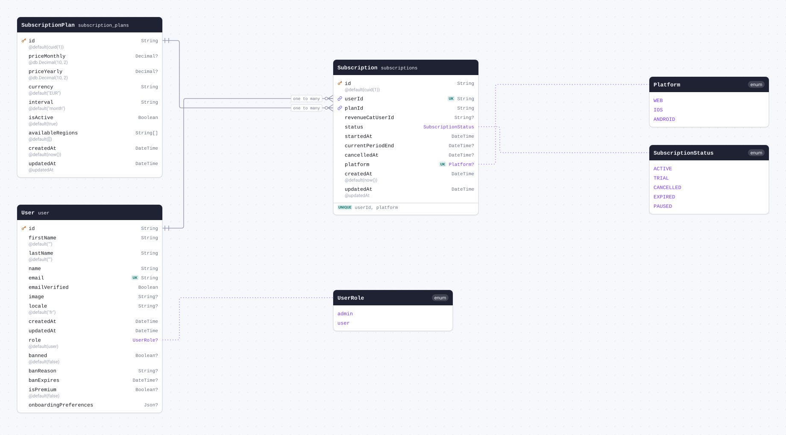

| Field              | Type                                             | Constraints                                               | Default      | Description |
| ------------------ | ------------------------------------------------ | --------------------------------------------------------- | ------------ | ----------- |
| `id`               | `String`                                         | PK NOT NULL                                               | `cuid(1)`    |             |
| `userId`           | `String`                                         | NOT NULL → [User.id](#model-User)                         |              |             |
| `planId`           | `String`                                         | NOT NULL → [SubscriptionPlan.id](#model-SubscriptionPlan) |              |             |
| `revenueCatUserId` | `String`                                         | NULL                                                      |              |             |
| `status`           | [`SubscriptionStatus`](#enum-SubscriptionStatus) | NOT NULL                                                  |              |             |
| `startedAt`        | `DateTime`                                       | NOT NULL                                                  |              |             |
| `currentPeriodEnd` | `DateTime`                                       | NULL                                                      |              |             |
| `cancelledAt`      | `DateTime`                                       | NULL                                                      |              |             |
| `platform`         | [`Platform`](#enum-Platform)                     | NULL                                                      |              |             |
| `createdAt`        | `DateTime`                                       | NOT NULL                                                  | `now()`      |             |
| `updatedAt`        | `DateTime`                                       | NOT NULL                                                  | `@updatedAt` |             |

#### Indexes

- `@@unique([userId, platform])`

#### References

- `userId` → [User.id](#model-User) (many-to-one)
- `planId` → [SubscriptionPlan.id](#model-SubscriptionPlan) (many-to-one)

#### Definition

```sql
CREATE TABLE "subscriptions" (
    "id" TEXT NOT NULL,
    "userId" TEXT NOT NULL,
    "planId" TEXT NOT NULL,
    "revenueCatUserId" TEXT,
    "status" "SubscriptionStatus" NOT NULL,
    "startedAt" TIMESTAMP(3) NOT NULL,
    "currentPeriodEnd" TIMESTAMP(3),
    "cancelledAt" TIMESTAMP(3),
    "platform" "Platform",
    "createdAt" TIMESTAMP(3) NOT NULL DEFAULT CURRENT_TIMESTAMP,
    "updatedAt" TIMESTAMP(3) NOT NULL,

    CONSTRAINT "subscriptions_pkey" PRIMARY KEY ("id")
);

CREATE UNIQUE INDEX "subscriptions_userId_platform_key" ON "subscriptions"("userId", "platform");

ALTER TABLE "subscriptions" ADD CONSTRAINT "subscriptions_userId_fkey" FOREIGN KEY ("userId") REFERENCES "user"("id") ON DELETE RESTRICT ON UPDATE CASCADE;

ALTER TABLE "subscriptions" ADD CONSTRAINT "subscriptions_planId_fkey" FOREIGN KEY ("planId") REFERENCES "subscription_plans"("id") ON DELETE RESTRICT ON UPDATE CASCADE;
```

<details>
<summary>Queries and their SQL</summary>

**findMany**: Every row

```ts
await prisma.subscription.findMany();
```

```sql
SELECT
  "public"."subscriptions"."id",
  "public"."subscriptions"."userId",
  "public"."subscriptions"."planId",
  "public"."subscriptions"."revenueCatUserId",
  "public"."subscriptions"."status"::text,
  "public"."subscriptions"."startedAt",
  "public"."subscriptions"."currentPeriodEnd",
  "public"."subscriptions"."cancelledAt",
  "public"."subscriptions"."platform"::text,
  "public"."subscriptions"."createdAt",
  "public"."subscriptions"."updatedAt"
FROM
  "public"."subscriptions"
WHERE
  1 = 1
OFFSET
  $1
-- params: ["0"]
```

**count**: How many rows there are

```ts
await prisma.subscription.count();
```

```sql
SELECT
  COUNT(*) AS "_count$_all"
FROM
  (
    SELECT
      "public"."subscriptions"."id"
    FROM
      "public"."subscriptions"
    WHERE
      1 = 1
    OFFSET
      $1
  ) AS "sub"
-- params: ["0"]
```

**findMany**: Every row with its relations

```ts
await prisma.subscription.findMany({ include: { user: true, plan: true } });
```

```sql
SELECT
  "public"."subscriptions"."id",
  "public"."subscriptions"."userId",
  "public"."subscriptions"."planId",
  "public"."subscriptions"."revenueCatUserId",
  "public"."subscriptions"."status"::text,
  "public"."subscriptions"."startedAt",
  "public"."subscriptions"."currentPeriodEnd",
  "public"."subscriptions"."cancelledAt",
  "public"."subscriptions"."platform"::text,
  "public"."subscriptions"."createdAt",
  "public"."subscriptions"."updatedAt"
FROM
  "public"."subscriptions"
WHERE
  1 = 1
OFFSET
  $1
-- params: ["0"]

SELECT
  "public"."user"."id",
  "public"."user"."firstName",
  "public"."user"."lastName",
  "public"."user"."name",
  "public"."user"."email",
  "public"."user"."emailVerified",
  "public"."user"."image",
  "public"."user"."locale",
  "public"."user"."createdAt",
  "public"."user"."updatedAt",
  "public"."user"."role"::text,
  "public"."user"."banned",
  "public"."user"."banReason",
  "public"."user"."banExpires",
  "public"."user"."isPremium",
  "public"."user"."onboardingPreferences"
FROM
  "public"."user"
WHERE
  "public"."user"."id" IN ($1)
OFFSET
  $2
-- params: ["<userId of the rows above>","0"]

SELECT
  "public"."subscription_plans"."id",
  "public"."subscription_plans"."priceMonthly",
  "public"."subscription_plans"."priceYearly",
  "public"."subscription_plans"."currency",
  "public"."subscription_plans"."interval",
  "public"."subscription_plans"."isActive",
  "public"."subscription_plans"."availableRegions",
  "public"."subscription_plans"."createdAt",
  "public"."subscription_plans"."updatedAt"
FROM
  "public"."subscription_plans"
WHERE
  "public"."subscription_plans"."id" IN ($1)
OFFSET
  $2
-- params: ["<planId of the rows above>","0"]
```

**findUnique**: One row by what is unique to it

```ts
await prisma.subscription.findUnique({ where: { id: "example" } });
```

```sql
SELECT
  "public"."subscriptions"."id",
  "public"."subscriptions"."userId",
  "public"."subscriptions"."planId",
  "public"."subscriptions"."revenueCatUserId",
  "public"."subscriptions"."status"::text,
  "public"."subscriptions"."startedAt",
  "public"."subscriptions"."currentPeriodEnd",
  "public"."subscriptions"."cancelledAt",
  "public"."subscriptions"."platform"::text,
  "public"."subscriptions"."createdAt",
  "public"."subscriptions"."updatedAt"
FROM
  "public"."subscriptions"
WHERE
  (
    "public"."subscriptions"."id" = $1
    AND 1 = 1
  )
LIMIT
  $2
OFFSET
  $3
-- params: ["example","1","0"]
```

**create**: Create a row

```ts
await prisma.subscription.create({
  data: {
    userId: "example",
    planId: "example",
    status: "ACTIVE",
    startedAt: new Date("2026-01-01T00:00:00.000Z"),
  },
});
```

```sql
INSERT INTO
  "public"."subscriptions" (
    "id",
    "userId",
    "planId",
    "status",
    "startedAt",
    "createdAt",
    "updatedAt"
  )
VALUES
  (
    $1,
    $2,
    $3,
    CAST($4::text AS "public"."SubscriptionStatus"),
    $5,
    $6,
    $7
  )
RETURNING
  "public"."subscriptions"."id",
  "public"."subscriptions"."userId",
  "public"."subscriptions"."planId",
  "public"."subscriptions"."revenueCatUserId",
  "public"."subscriptions"."status"::text,
  "public"."subscriptions"."startedAt",
  "public"."subscriptions"."currentPeriodEnd",
  "public"."subscriptions"."cancelledAt",
  "public"."subscriptions"."platform"::text,
  "public"."subscriptions"."createdAt",
  "public"."subscriptions"."updatedAt"
-- params: ["<cuid(1)>","example","example","ACTIVE","2026-01-01T00:00:00.000Z","<now()>","<now()>"]
```

**update**: Update a row

```ts
await prisma.subscription.update({
  where: { id: "example" },
  data: { revenueCatUserId: "example" },
});
```

```sql
UPDATE "public"."subscriptions"
SET
  "revenueCatUserId" = $1,
  "updatedAt" = $2
WHERE
  (
    "public"."subscriptions"."id" = $3
    AND 1 = 1
  )
RETURNING
  "public"."subscriptions"."id",
  "public"."subscriptions"."userId",
  "public"."subscriptions"."planId",
  "public"."subscriptions"."revenueCatUserId",
  "public"."subscriptions"."status"::text,
  "public"."subscriptions"."startedAt",
  "public"."subscriptions"."currentPeriodEnd",
  "public"."subscriptions"."cancelledAt",
  "public"."subscriptions"."platform"::text,
  "public"."subscriptions"."createdAt",
  "public"."subscriptions"."updatedAt"
-- params: ["example",{"prisma__type":"generatorCall","prisma__value":{"name":"now","args":[],"returnType":{"type":"DateTime"}}},"example"]
```

**delete**: Delete a row

```ts
await prisma.subscription.delete({ where: { id: "example" } });
```

```sql
DELETE FROM "public"."subscriptions"
WHERE
  (
    "public"."subscriptions"."id" = $1
    AND 1 = 1
  )
RETURNING
  "public"."subscriptions"."id",
  "public"."subscriptions"."userId",
  "public"."subscriptions"."planId",
  "public"."subscriptions"."revenueCatUserId",
  "public"."subscriptions"."status"::text,
  "public"."subscriptions"."startedAt",
  "public"."subscriptions"."currentPeriodEnd",
  "public"."subscriptions"."cancelledAt",
  "public"."subscriptions"."platform"::text,
  "public"."subscriptions"."createdAt",
  "public"."subscriptions"."updatedAt"
-- params: ["example"]
```

</details>

<a id="model-License"></a>

### License

Table `licenses`.

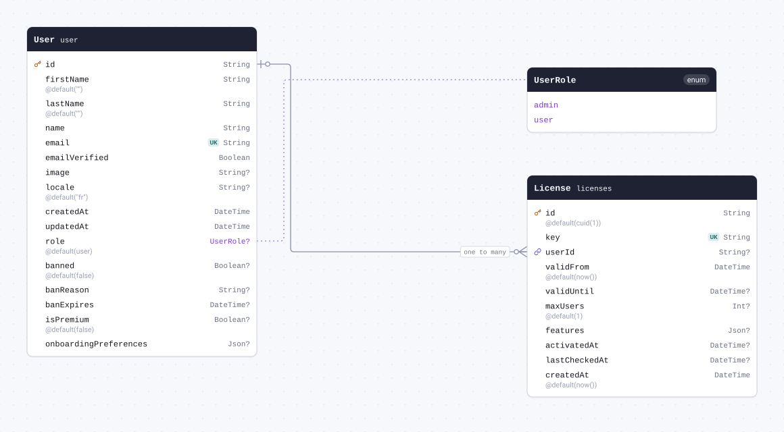

| Field           | Type       | Constraints                   | Default   | Description |
| --------------- | ---------- | ----------------------------- | --------- | ----------- |
| `id`            | `String`   | PK NOT NULL                   | `cuid(1)` |             |
| `key`           | `String`   | UNIQUE NOT NULL               |           |             |
| `userId`        | `String`   | NULL → [User.id](#model-User) |           |             |
| `validFrom`     | `DateTime` | NOT NULL                      | `now()`   |             |
| `validUntil`    | `DateTime` | NULL                          |           |             |
| `maxUsers`      | `Int`      | NULL                          | `1`       |             |
| `features`      | `Json`     | NULL                          |           |             |
| `activatedAt`   | `DateTime` | NULL                          |           |             |
| `lastCheckedAt` | `DateTime` | NULL                          |           |             |
| `createdAt`     | `DateTime` | NOT NULL                      | `now()`   |             |

#### References

- `userId` → [User.id](#model-User) (many-to-one)

#### Definition

```sql
CREATE TABLE "licenses" (
    "id" TEXT NOT NULL,
    "key" TEXT NOT NULL,
    "userId" TEXT,
    "validFrom" TIMESTAMP(3) NOT NULL DEFAULT CURRENT_TIMESTAMP,
    "validUntil" TIMESTAMP(3),
    "maxUsers" INTEGER DEFAULT 1,
    "features" JSONB,
    "activatedAt" TIMESTAMP(3),
    "lastCheckedAt" TIMESTAMP(3),
    "createdAt" TIMESTAMP(3) NOT NULL DEFAULT CURRENT_TIMESTAMP,

    CONSTRAINT "licenses_pkey" PRIMARY KEY ("id")
);

CREATE UNIQUE INDEX "licenses_key_key" ON "licenses"("key");

ALTER TABLE "licenses" ADD CONSTRAINT "licenses_userId_fkey" FOREIGN KEY ("userId") REFERENCES "user"("id") ON DELETE SET NULL ON UPDATE CASCADE;
```

<details>
<summary>Queries and their SQL</summary>

**findMany**: Every row

```ts
await prisma.license.findMany();
```

```sql
SELECT
  "public"."licenses"."id",
  "public"."licenses"."key",
  "public"."licenses"."userId",
  "public"."licenses"."validFrom",
  "public"."licenses"."validUntil",
  "public"."licenses"."maxUsers",
  "public"."licenses"."features",
  "public"."licenses"."activatedAt",
  "public"."licenses"."lastCheckedAt",
  "public"."licenses"."createdAt"
FROM
  "public"."licenses"
WHERE
  1 = 1
OFFSET
  $1
-- params: ["0"]
```

**count**: How many rows there are

```ts
await prisma.license.count();
```

```sql
SELECT
  COUNT(*) AS "_count$_all"
FROM
  (
    SELECT
      "public"."licenses"."id"
    FROM
      "public"."licenses"
    WHERE
      1 = 1
    OFFSET
      $1
  ) AS "sub"
-- params: ["0"]
```

**findMany**: Every row with its relations

```ts
await prisma.license.findMany({ include: { user: true } });
```

```sql
SELECT
  "public"."licenses"."id",
  "public"."licenses"."key",
  "public"."licenses"."userId",
  "public"."licenses"."validFrom",
  "public"."licenses"."validUntil",
  "public"."licenses"."maxUsers",
  "public"."licenses"."features",
  "public"."licenses"."activatedAt",
  "public"."licenses"."lastCheckedAt",
  "public"."licenses"."createdAt"
FROM
  "public"."licenses"
WHERE
  1 = 1
OFFSET
  $1
-- params: ["0"]

SELECT
  "public"."user"."id",
  "public"."user"."firstName",
  "public"."user"."lastName",
  "public"."user"."name",
  "public"."user"."email",
  "public"."user"."emailVerified",
  "public"."user"."image",
  "public"."user"."locale",
  "public"."user"."createdAt",
  "public"."user"."updatedAt",
  "public"."user"."role"::text,
  "public"."user"."banned",
  "public"."user"."banReason",
  "public"."user"."banExpires",
  "public"."user"."isPremium",
  "public"."user"."onboardingPreferences"
FROM
  "public"."user"
WHERE
  "public"."user"."id" IN ($1)
OFFSET
  $2
-- params: ["<userId of the rows above>","0"]
```

**findUnique**: One row by what is unique to it

```ts
await prisma.license.findUnique({ where: { id: "example" } });
```

```sql
SELECT
  "public"."licenses"."id",
  "public"."licenses"."key",
  "public"."licenses"."userId",
  "public"."licenses"."validFrom",
  "public"."licenses"."validUntil",
  "public"."licenses"."maxUsers",
  "public"."licenses"."features",
  "public"."licenses"."activatedAt",
  "public"."licenses"."lastCheckedAt",
  "public"."licenses"."createdAt"
FROM
  "public"."licenses"
WHERE
  (
    "public"."licenses"."id" = $1
    AND 1 = 1
  )
LIMIT
  $2
OFFSET
  $3
-- params: ["example","1","0"]
```

**create**: Create a row

```ts
await prisma.license.create({ data: { key: "example" } });
```

```sql
INSERT INTO
  "public"."licenses" ("id", "key", "validFrom", "maxUsers", "createdAt")
VALUES
  ($1, $2, $3, $4, $5)
RETURNING
  "public"."licenses"."id",
  "public"."licenses"."key",
  "public"."licenses"."userId",
  "public"."licenses"."validFrom",
  "public"."licenses"."validUntil",
  "public"."licenses"."maxUsers",
  "public"."licenses"."features",
  "public"."licenses"."activatedAt",
  "public"."licenses"."lastCheckedAt",
  "public"."licenses"."createdAt"
-- params: ["<cuid(1)>","example","<now()>","1","<now()>"]
```

**update**: Update a row

```ts
await prisma.license.update({ where: { id: "example" }, data: { key: "example" } });
```

```sql
UPDATE "public"."licenses"
SET
  "key" = $1
WHERE
  (
    "public"."licenses"."id" = $2
    AND 1 = 1
  )
RETURNING
  "public"."licenses"."id",
  "public"."licenses"."key",
  "public"."licenses"."userId",
  "public"."licenses"."validFrom",
  "public"."licenses"."validUntil",
  "public"."licenses"."maxUsers",
  "public"."licenses"."features",
  "public"."licenses"."activatedAt",
  "public"."licenses"."lastCheckedAt",
  "public"."licenses"."createdAt"
-- params: ["example","example"]
```

**delete**: Delete a row

```ts
await prisma.license.delete({ where: { id: "example" } });
```

```sql
DELETE FROM "public"."licenses"
WHERE
  (
    "public"."licenses"."id" = $1
    AND 1 = 1
  )
RETURNING
  "public"."licenses"."id",
  "public"."licenses"."key",
  "public"."licenses"."userId",
  "public"."licenses"."validFrom",
  "public"."licenses"."validUntil",
  "public"."licenses"."maxUsers",
  "public"."licenses"."features",
  "public"."licenses"."activatedAt",
  "public"."licenses"."lastCheckedAt",
  "public"."licenses"."createdAt"
-- params: ["example"]
```

</details>

<a id="model-RevenueCatWebhookEvent"></a>

### RevenueCatWebhookEvent

Table `revenuecat_webhook_events`.

| Field                   | Type                | Constraints | Default      | Description |
| ----------------------- | ------------------- | ----------- | ------------ | ----------- |
| `id`                    | `String`            | PK NOT NULL | `cuid(1)`    |             |
| `eventType`             | `String`            | NOT NULL    |              |             |
| `eventTimestamp`        | `DateTime`          | NOT NULL    |              |             |
| `appUserId`             | `String`            | NOT NULL    |              |             |
| `environment`           | `String`            | NOT NULL    |              |             |
| `productId`             | `String`            | NULL        |              |             |
| `transactionId`         | `String`            | NULL        |              |             |
| `originalTransactionId` | `String`            | NULL        |              |             |
| `entitlementIds`        | `String`            | NULL        |              |             |
| `processed`             | `Boolean`           | NOT NULL    | `false`      |             |
| `processingError`       | `String` `@db.Text` | NULL        |              |             |
| `retryCount`            | `Int`               | NOT NULL    | `0`          |             |
| `rawEventData`          | `Json`              | NOT NULL    |              |             |
| `createdAt`             | `DateTime`          | NOT NULL    | `now()`      |             |
| `updatedAt`             | `DateTime`          | NOT NULL    | `@updatedAt` |             |

#### Indexes

- `@@index([appUserId])`
- `@@index([eventType])`
- `@@index([processed])`
- `@@index([eventTimestamp])`

#### Definition

```sql
CREATE TABLE "revenuecat_webhook_events" (
    "id" TEXT NOT NULL,
    "eventType" TEXT NOT NULL,
    "eventTimestamp" TIMESTAMP(3) NOT NULL,
    "appUserId" TEXT NOT NULL,
    "environment" TEXT NOT NULL,
    "productId" TEXT,
    "transactionId" TEXT,
    "originalTransactionId" TEXT,
    "entitlementIds" TEXT,
    "processed" BOOLEAN NOT NULL DEFAULT false,
    "processingError" TEXT,
    "retryCount" INTEGER NOT NULL DEFAULT 0,
    "rawEventData" JSONB NOT NULL,
    "createdAt" TIMESTAMP(3) NOT NULL DEFAULT CURRENT_TIMESTAMP,
    "updatedAt" TIMESTAMP(3) NOT NULL,

    CONSTRAINT "revenuecat_webhook_events_pkey" PRIMARY KEY ("id")
);

CREATE INDEX "revenuecat_webhook_events_appUserId_idx" ON "revenuecat_webhook_events"("appUserId");

CREATE INDEX "revenuecat_webhook_events_eventType_idx" ON "revenuecat_webhook_events"("eventType");

CREATE INDEX "revenuecat_webhook_events_processed_idx" ON "revenuecat_webhook_events"("processed");

CREATE INDEX "revenuecat_webhook_events_eventTimestamp_idx" ON "revenuecat_webhook_events"("eventTimestamp");
```

<details>
<summary>Queries and their SQL</summary>

**findMany**: Every row

```ts
await prisma.revenueCatWebhookEvent.findMany();
```

```sql
SELECT
  "public"."revenuecat_webhook_events"."id",
  "public"."revenuecat_webhook_events"."eventType",
  "public"."revenuecat_webhook_events"."eventTimestamp",
  "public"."revenuecat_webhook_events"."appUserId",
  "public"."revenuecat_webhook_events"."environment",
  "public"."revenuecat_webhook_events"."productId",
  "public"."revenuecat_webhook_events"."transactionId",
  "public"."revenuecat_webhook_events"."originalTransactionId",
  "public"."revenuecat_webhook_events"."entitlementIds",
  "public"."revenuecat_webhook_events"."processed",
  "public"."revenuecat_webhook_events"."processingError",
  "public"."revenuecat_webhook_events"."retryCount",
  "public"."revenuecat_webhook_events"."rawEventData",
  "public"."revenuecat_webhook_events"."createdAt",
  "public"."revenuecat_webhook_events"."updatedAt"
FROM
  "public"."revenuecat_webhook_events"
WHERE
  1 = 1
OFFSET
  $1
-- params: ["0"]
```

**count**: How many rows there are

```ts
await prisma.revenueCatWebhookEvent.count();
```

```sql
SELECT
  COUNT(*) AS "_count$_all"
FROM
  (
    SELECT
      "public"."revenuecat_webhook_events"."id"
    FROM
      "public"."revenuecat_webhook_events"
    WHERE
      1 = 1
    OFFSET
      $1
  ) AS "sub"
-- params: ["0"]
```

**findUnique**: One row by what is unique to it

```ts
await prisma.revenueCatWebhookEvent.findUnique({ where: { id: "example" } });
```

```sql
SELECT
  "public"."revenuecat_webhook_events"."id",
  "public"."revenuecat_webhook_events"."eventType",
  "public"."revenuecat_webhook_events"."eventTimestamp",
  "public"."revenuecat_webhook_events"."appUserId",
  "public"."revenuecat_webhook_events"."environment",
  "public"."revenuecat_webhook_events"."productId",
  "public"."revenuecat_webhook_events"."transactionId",
  "public"."revenuecat_webhook_events"."originalTransactionId",
  "public"."revenuecat_webhook_events"."entitlementIds",
  "public"."revenuecat_webhook_events"."processed",
  "public"."revenuecat_webhook_events"."processingError",
  "public"."revenuecat_webhook_events"."retryCount",
  "public"."revenuecat_webhook_events"."rawEventData",
  "public"."revenuecat_webhook_events"."createdAt",
  "public"."revenuecat_webhook_events"."updatedAt"
FROM
  "public"."revenuecat_webhook_events"
WHERE
  (
    "public"."revenuecat_webhook_events"."id" = $1
    AND 1 = 1
  )
LIMIT
  $2
OFFSET
  $3
-- params: ["example","1","0"]
```

**create**: Create a row

```ts
await prisma.revenueCatWebhookEvent.create({
  data: {
    eventType: "example",
    eventTimestamp: new Date("2026-01-01T00:00:00.000Z"),
    appUserId: "example",
    environment: "example",
    rawEventData: {},
  },
});
```

```sql
INSERT INTO
  "public"."revenuecat_webhook_events" (
    "id",
    "eventType",
    "eventTimestamp",
    "appUserId",
    "environment",
    "processed",
    "retryCount",
    "rawEventData",
    "createdAt",
    "updatedAt"
  )
VALUES
  ($1, $2, $3, $4, $5, $6, $7, $8, $9, $10)
RETURNING
  "public"."revenuecat_webhook_events"."id",
  "public"."revenuecat_webhook_events"."eventType",
  "public"."revenuecat_webhook_events"."eventTimestamp",
  "public"."revenuecat_webhook_events"."appUserId",
  "public"."revenuecat_webhook_events"."environment",
  "public"."revenuecat_webhook_events"."productId",
  "public"."revenuecat_webhook_events"."transactionId",
  "public"."revenuecat_webhook_events"."originalTransactionId",
  "public"."revenuecat_webhook_events"."entitlementIds",
  "public"."revenuecat_webhook_events"."processed",
  "public"."revenuecat_webhook_events"."processingError",
  "public"."revenuecat_webhook_events"."retryCount",
  "public"."revenuecat_webhook_events"."rawEventData",
  "public"."revenuecat_webhook_events"."createdAt",
  "public"."revenuecat_webhook_events"."updatedAt"
-- params: ["<cuid(1)>","example","2026-01-01T00:00:00.000Z","example","example",false,"0","{}","<now()>","<now()>"]
```

**update**: Update a row

```ts
await prisma.revenueCatWebhookEvent.update({
  where: { id: "example" },
  data: { eventType: "example" },
});
```

```sql
UPDATE "public"."revenuecat_webhook_events"
SET
  "eventType" = $1,
  "updatedAt" = $2
WHERE
  (
    "public"."revenuecat_webhook_events"."id" = $3
    AND 1 = 1
  )
RETURNING
  "public"."revenuecat_webhook_events"."id",
  "public"."revenuecat_webhook_events"."eventType",
  "public"."revenuecat_webhook_events"."eventTimestamp",
  "public"."revenuecat_webhook_events"."appUserId",
  "public"."revenuecat_webhook_events"."environment",
  "public"."revenuecat_webhook_events"."productId",
  "public"."revenuecat_webhook_events"."transactionId",
  "public"."revenuecat_webhook_events"."originalTransactionId",
  "public"."revenuecat_webhook_events"."entitlementIds",
  "public"."revenuecat_webhook_events"."processed",
  "public"."revenuecat_webhook_events"."processingError",
  "public"."revenuecat_webhook_events"."retryCount",
  "public"."revenuecat_webhook_events"."rawEventData",
  "public"."revenuecat_webhook_events"."createdAt",
  "public"."revenuecat_webhook_events"."updatedAt"
-- params: ["example",{"prisma__type":"generatorCall","prisma__value":{"name":"now","args":[],"returnType":{"type":"DateTime"}}},"example"]
```

**delete**: Delete a row

```ts
await prisma.revenueCatWebhookEvent.delete({ where: { id: "example" } });
```

```sql
DELETE FROM "public"."revenuecat_webhook_events"
WHERE
  (
    "public"."revenuecat_webhook_events"."id" = $1
    AND 1 = 1
  )
RETURNING
  "public"."revenuecat_webhook_events"."id",
  "public"."revenuecat_webhook_events"."eventType",
  "public"."revenuecat_webhook_events"."eventTimestamp",
  "public"."revenuecat_webhook_events"."appUserId",
  "public"."revenuecat_webhook_events"."environment",
  "public"."revenuecat_webhook_events"."productId",
  "public"."revenuecat_webhook_events"."transactionId",
  "public"."revenuecat_webhook_events"."originalTransactionId",
  "public"."revenuecat_webhook_events"."entitlementIds",
  "public"."revenuecat_webhook_events"."processed",
  "public"."revenuecat_webhook_events"."processingError",
  "public"."revenuecat_webhook_events"."retryCount",
  "public"."revenuecat_webhook_events"."rawEventData",
  "public"."revenuecat_webhook_events"."createdAt",
  "public"."revenuecat_webhook_events"."updatedAt"
-- params: ["example"]
```

</details>

<a id="model-Program"></a>

### Program

Table `programs`.

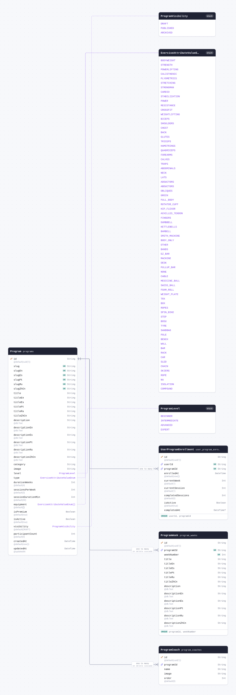

| Field                | Type                                                               | Constraints     | Default      | Description |
| -------------------- | ------------------------------------------------------------------ | --------------- | ------------ | ----------- |
| `id`                 | `String`                                                           | PK NOT NULL     | `cuid(1)`    |             |
| `slug`               | `String`                                                           | UNIQUE NOT NULL |              |             |
| `slugEn`             | `String`                                                           | UNIQUE NOT NULL |              |             |
| `slugEs`             | `String`                                                           | UNIQUE NOT NULL |              |             |
| `slugPt`             | `String`                                                           | UNIQUE NOT NULL |              |             |
| `slugRu`             | `String`                                                           | UNIQUE NOT NULL |              |             |
| `slugZhCn`           | `String`                                                           | UNIQUE NOT NULL |              |             |
| `title`              | `String`                                                           | NOT NULL        |              |             |
| `titleEn`            | `String`                                                           | NOT NULL        |              |             |
| `titleEs`            | `String`                                                           | NOT NULL        |              |             |
| `titlePt`            | `String`                                                           | NOT NULL        |              |             |
| `titleRu`            | `String`                                                           | NOT NULL        |              |             |
| `titleZhCn`          | `String`                                                           | NOT NULL        |              |             |
| `description`        | `String` `@db.Text`                                                | NOT NULL        |              |             |
| `descriptionEn`      | `String` `@db.Text`                                                | NOT NULL        |              |             |
| `descriptionEs`      | `String` `@db.Text`                                                | NOT NULL        |              |             |
| `descriptionPt`      | `String` `@db.Text`                                                | NOT NULL        |              |             |
| `descriptionRu`      | `String` `@db.Text`                                                | NOT NULL        |              |             |
| `descriptionZhCn`    | `String` `@db.Text`                                                | NOT NULL        |              |             |
| `category`           | `String`                                                           | NOT NULL        |              |             |
| `image`              | `String`                                                           | NOT NULL        |              |             |
| `level`              | [`ProgramLevel`](#enum-ProgramLevel)                               | NOT NULL        |              |             |
| `type`               | [`ExerciseAttributeValueEnum`](#enum-ExerciseAttributeValueEnum)   | NOT NULL        |              |             |
| `durationWeeks`      | `Int`                                                              | NOT NULL        | `4`          |             |
| `sessionsPerWeek`    | `Int`                                                              | NOT NULL        | `3`          |             |
| `sessionDurationMin` | `Int`                                                              | NOT NULL        | `30`         |             |
| `equipment`          | [`ExerciseAttributeValueEnum[]`](#enum-ExerciseAttributeValueEnum) | NOT NULL        | `[]`         |             |
| `isPremium`          | `Boolean`                                                          | NOT NULL        | `true`       |             |
| `isActive`           | `Boolean`                                                          | NOT NULL        | `true`       |             |
| `visibility`         | [`ProgramVisibility`](#enum-ProgramVisibility)                     | NOT NULL        | `DRAFT`      |             |
| `participantCount`   | `Int`                                                              | NOT NULL        | `0`          |             |
| `createdAt`          | `DateTime`                                                         | NOT NULL        | `now()`      |             |
| `updatedAt`          | `DateTime`                                                         | NOT NULL        | `@updatedAt` |             |

#### Referenced by

- `id` ← [ProgramCoach.programId](#model-ProgramCoach) (one-to-many, on delete Cascade)
- `id` ← [ProgramWeek.programId](#model-ProgramWeek) (one-to-many, on delete Cascade)
- `id` ← [UserProgramEnrollment.programId](#model-UserProgramEnrollment) (one-to-many)

#### Definition

```sql
CREATE TABLE "programs" (
    "id" TEXT NOT NULL,
    "slug" TEXT NOT NULL,
    "slugEn" TEXT NOT NULL,
    "slugEs" TEXT NOT NULL,
    "slugPt" TEXT NOT NULL,
    "slugRu" TEXT NOT NULL,
    "slugZhCn" TEXT NOT NULL,
    "title" TEXT NOT NULL,
    "titleEn" TEXT NOT NULL,
    "titleEs" TEXT NOT NULL,
    "titlePt" TEXT NOT NULL,
    "titleRu" TEXT NOT NULL,
    "titleZhCn" TEXT NOT NULL,
    "description" TEXT NOT NULL,
    "descriptionEn" TEXT NOT NULL,
    "descriptionEs" TEXT NOT NULL,
    "descriptionPt" TEXT NOT NULL,
    "descriptionRu" TEXT NOT NULL,
    "descriptionZhCn" TEXT NOT NULL,
    "category" TEXT NOT NULL,
    "image" TEXT NOT NULL,
    "level" "ProgramLevel" NOT NULL,
    "type" "ExerciseAttributeValueEnum" NOT NULL,
    "durationWeeks" INTEGER NOT NULL DEFAULT 4,
    "sessionsPerWeek" INTEGER NOT NULL DEFAULT 3,
    "sessionDurationMin" INTEGER NOT NULL DEFAULT 30,
    "equipment" "ExerciseAttributeValueEnum"[] DEFAULT ARRAY[]::"ExerciseAttributeValueEnum"[],
    "isPremium" BOOLEAN NOT NULL DEFAULT true,
    "isActive" BOOLEAN NOT NULL DEFAULT true,
    "visibility" "ProgramVisibility" NOT NULL DEFAULT 'DRAFT',
    "participantCount" INTEGER NOT NULL DEFAULT 0,
    "createdAt" TIMESTAMP(3) NOT NULL DEFAULT CURRENT_TIMESTAMP,
    "updatedAt" TIMESTAMP(3) NOT NULL,

    CONSTRAINT "programs_pkey" PRIMARY KEY ("id")
);

CREATE UNIQUE INDEX "programs_slug_key" ON "programs"("slug");

CREATE UNIQUE INDEX "programs_slugEn_key" ON "programs"("slugEn");

CREATE UNIQUE INDEX "programs_slugEs_key" ON "programs"("slugEs");

CREATE UNIQUE INDEX "programs_slugPt_key" ON "programs"("slugPt");

CREATE UNIQUE INDEX "programs_slugRu_key" ON "programs"("slugRu");

CREATE UNIQUE INDEX "programs_slugZhCn_key" ON "programs"("slugZhCn");
```

<details>
<summary>Queries and their SQL</summary>

**findMany**: Every row

```ts
await prisma.program.findMany();
```

```sql
SELECT
  "public"."programs"."id",
  "public"."programs"."slug",
  "public"."programs"."slugEn",
  "public"."programs"."slugEs",
  "public"."programs"."slugPt",
  "public"."programs"."slugRu",
  "public"."programs"."slugZhCn",
  "public"."programs"."title",
  "public"."programs"."titleEn",
  "public"."programs"."titleEs",
  "public"."programs"."titlePt",
  "public"."programs"."titleRu",
  "public"."programs"."titleZhCn",
  "public"."programs"."description",
  "public"."programs"."descriptionEn",
  "public"."programs"."descriptionEs",
  "public"."programs"."descriptionPt",
  "public"."programs"."descriptionRu",
  "public"."programs"."descriptionZhCn",
  "public"."programs"."category",
  "public"."programs"."image",
  "public"."programs"."level"::text,
  "public"."programs"."type"::text,
  "public"."programs"."durationWeeks",
  "public"."programs"."sessionsPerWeek",
  "public"."programs"."sessionDurationMin",
  "public"."programs"."equipment"::text[],
  "public"."programs"."isPremium",
  "public"."programs"."isActive",
  "public"."programs"."visibility"::text,
  "public"."programs"."participantCount",
  "public"."programs"."createdAt",
  "public"."programs"."updatedAt"
FROM
  "public"."programs"
WHERE
  1 = 1
OFFSET
  $1
-- params: ["0"]
```

**count**: How many rows there are

```ts
await prisma.program.count();
```

```sql
SELECT
  COUNT(*) AS "_count$_all"
FROM
  (
    SELECT
      "public"."programs"."id"
    FROM
      "public"."programs"
    WHERE
      1 = 1
    OFFSET
      $1
  ) AS "sub"
-- params: ["0"]
```

**findMany**: Every row with its relations

```ts
await prisma.program.findMany({ include: { weeks: true, enrollments: true, coaches: true } });
```

```sql
SELECT
  "public"."programs"."id",
  "public"."programs"."slug",
  "public"."programs"."slugEn",
  "public"."programs"."slugEs",
  "public"."programs"."slugPt",
  "public"."programs"."slugRu",
  "public"."programs"."slugZhCn",
  "public"."programs"."title",
  "public"."programs"."titleEn",
  "public"."programs"."titleEs",
  "public"."programs"."titlePt",
  "public"."programs"."titleRu",
  "public"."programs"."titleZhCn",
  "public"."programs"."description",
  "public"."programs"."descriptionEn",
  "public"."programs"."descriptionEs",
  "public"."programs"."descriptionPt",
  "public"."programs"."descriptionRu",
  "public"."programs"."descriptionZhCn",
  "public"."programs"."category",
  "public"."programs"."image",
  "public"."programs"."level"::text,
  "public"."programs"."type"::text,
  "public"."programs"."durationWeeks",
  "public"."programs"."sessionsPerWeek",
  "public"."programs"."sessionDurationMin",
  "public"."programs"."equipment"::text[],
  "public"."programs"."isPremium",
  "public"."programs"."isActive",
  "public"."programs"."visibility"::text,
  "public"."programs"."participantCount",
  "public"."programs"."createdAt",
  "public"."programs"."updatedAt"
FROM
  "public"."programs"
WHERE
  1 = 1
OFFSET
  $1
-- params: ["0"]

SELECT
  "public"."program_weeks"."id",
  "public"."program_weeks"."programId",
  "public"."program_weeks"."weekNumber",
  "public"."program_weeks"."title",
  "public"."program_weeks"."titleEn",
  "public"."program_weeks"."titleEs",
  "public"."program_weeks"."titlePt",
  "public"."program_weeks"."titleRu",
  "public"."program_weeks"."titleZhCn",
  "public"."program_weeks"."description",
  "public"."program_weeks"."descriptionEn",
  "public"."program_weeks"."descriptionEs",
  "public"."program_weeks"."descriptionPt",
  "public"."program_weeks"."descriptionRu",
  "public"."program_weeks"."descriptionZhCn"
FROM
  "public"."program_weeks"
WHERE
  "public"."program_weeks"."programId" IN ($1)
OFFSET
  $2
-- params: ["<id of the rows above>","0"]

SELECT
  "public"."user_program_enrollments"."id",
  "public"."user_program_enrollments"."userId",
  "public"."user_program_enrollments"."programId",
  "public"."user_program_enrollments"."enrolledAt",
  "public"."user_program_enrollments"."currentWeek",
  "public"."user_program_enrollments"."currentSession",
  "public"."user_program_enrollments"."completedSessions",
  "public"."user_program_enrollments"."isActive",
  "public"."user_program_enrollments"."completedAt"
FROM
  "public"."user_program_enrollments"
WHERE
  "public"."user_program_enrollments"."programId" IN ($1)
OFFSET
  $2
-- params: ["<id of the rows above>","0"]

SELECT
  "public"."program_coaches"."id",
  "public"."program_coaches"."programId",
  "public"."program_coaches"."name",
  "public"."program_coaches"."image",
  "public"."program_coaches"."order"
FROM
  "public"."program_coaches"
WHERE
  "public"."program_coaches"."programId" IN ($1)
OFFSET
  $2
-- params: ["<id of the rows above>","0"]
```

**findUnique**: One row by what is unique to it

```ts
await prisma.program.findUnique({ where: { id: "example" } });
```

```sql
SELECT
  "public"."programs"."id",
  "public"."programs"."slug",
  "public"."programs"."slugEn",
  "public"."programs"."slugEs",
  "public"."programs"."slugPt",
  "public"."programs"."slugRu",
  "public"."programs"."slugZhCn",
  "public"."programs"."title",
  "public"."programs"."titleEn",
  "public"."programs"."titleEs",
  "public"."programs"."titlePt",
  "public"."programs"."titleRu",
  "public"."programs"."titleZhCn",
  "public"."programs"."description",
  "public"."programs"."descriptionEn",
  "public"."programs"."descriptionEs",
  "public"."programs"."descriptionPt",
  "public"."programs"."descriptionRu",
  "public"."programs"."descriptionZhCn",
  "public"."programs"."category",
  "public"."programs"."image",
  "public"."programs"."level"::text,
  "public"."programs"."type"::text,
  "public"."programs"."durationWeeks",
  "public"."programs"."sessionsPerWeek",
  "public"."programs"."sessionDurationMin",
  "public"."programs"."equipment"::text[],
  "public"."programs"."isPremium",
  "public"."programs"."isActive",
  "public"."programs"."visibility"::text,
  "public"."programs"."participantCount",
  "public"."programs"."createdAt",
  "public"."programs"."updatedAt"
FROM
  "public"."programs"
WHERE
  (
    "public"."programs"."id" = $1
    AND 1 = 1
  )
LIMIT
  $2
OFFSET
  $3
-- params: ["example","1","0"]
```

**create**: Create a row

```ts
await prisma.program.create({
  data: {
    slug: "example",
    slugEn: "example",
    slugEs: "example",
    slugPt: "example",
    slugRu: "example",
    slugZhCn: "example",
    title: "example",
    titleEn: "example",
    titleEs: "example",
    titlePt: "example",
    titleRu: "example",
    titleZhCn: "example",
    description: "example",
    descriptionEn: "example",
    descriptionEs: "example",
    descriptionPt: "example",
    descriptionRu: "example",
    descriptionZhCn: "example",
    category: "example",
    image: "example",
    level: "BEGINNER",
    type: "BODYWEIGHT",
  },
});
```

```sql
INSERT INTO
  "public"."programs" (
    "id",
    "slug",
    "slugEn",
    "slugEs",
    "slugPt",
    "slugRu",
    "slugZhCn",
    "title",
    "titleEn",
    "titleEs",
    "titlePt",
    "titleRu",
    "titleZhCn",
    "description",
    "descriptionEn",
    "descriptionEs",
    "descriptionPt",
    "descriptionRu",
    "descriptionZhCn",
    "category",
    "image",
    "level",
    "type",
    "durationWeeks",
    "sessionsPerWeek",
    "sessionDurationMin",
    "equipment",
    "isPremium",
    "isActive",
    "visibility",
    "participantCount",
    "createdAt",
    "updatedAt"
  )
VALUES
  (
    $1,
    $2,
    $3,
    $4,
    $5,
    $6,
    $7,
    $8,
    $9,
    $10,
    $11,
    $12,
    $13,
    $14,
    $15,
    $16,
    $17,
    $18,
    $19,
    $20,
    $21,
    CAST($22::text AS "public"."ProgramLevel"),
    CAST(
      $23::text AS "public"."ExerciseAttributeValueEnum"
    ),
    $24,
    $25,
    $26,
    CAST(
      $27::text[] AS "public"."ExerciseAttributeValueEnum" []
    ),
    $28,
    $29,
    CAST($30::text AS "public"."ProgramVisibility"),
    $31,
    $32,
    $33
  )
RETURNING
  "public"."programs"."id",
  "public"."programs"."slug",
  "public"."programs"."slugEn",
  "public"."programs"."slugEs",
  "public"."programs"."slugPt",
  "public"."programs"."slugRu",
  "public"."programs"."slugZhCn",
  "public"."programs"."title",
  "public"."programs"."titleEn",
  "public"."programs"."titleEs",
  "public"."programs"."titlePt",
  "public"."programs"."titleRu",
  "public"."programs"."titleZhCn",
  "public"."programs"."description",
  "public"."programs"."descriptionEn",
  "public"."programs"."descriptionEs",
  "public"."programs"."descriptionPt",
  "public"."programs"."descriptionRu",
  "public"."programs"."descriptionZhCn",
  "public"."programs"."category",
  "public"."programs"."image",
  "public"."programs"."level"::text,
  "public"."programs"."type"::text,
  "public"."programs"."durationWeeks",
  "public"."programs"."sessionsPerWeek",
  "public"."programs"."sessionDurationMin",
  "public"."programs"."equipment"::text[],
  "public"."programs"."isPremium",
  "public"."programs"."isActive",
  "public"."programs"."visibility"::text,
  "public"."programs"."participantCount",
  "public"."programs"."createdAt",
  "public"."programs"."updatedAt"
-- params: ["<cuid(1)>","example","example","example","example","example","example","example","example","example","example","example","example","example","example","example","example","example","example","example","example","BEGINNER","BODYWEIGHT","4","3","30",[],true,true,"DRAFT","0","<now()>","<now()>"]
```

**update**: Update a row

```ts
await prisma.program.update({ where: { id: "example" }, data: { slug: "example" } });
```

```sql
UPDATE "public"."programs"
SET
  "slug" = $1,
  "updatedAt" = $2
WHERE
  (
    "public"."programs"."id" = $3
    AND 1 = 1
  )
RETURNING
  "public"."programs"."id",
  "public"."programs"."slug",
  "public"."programs"."slugEn",
  "public"."programs"."slugEs",
  "public"."programs"."slugPt",
  "public"."programs"."slugRu",
  "public"."programs"."slugZhCn",
  "public"."programs"."title",
  "public"."programs"."titleEn",
  "public"."programs"."titleEs",
  "public"."programs"."titlePt",
  "public"."programs"."titleRu",
  "public"."programs"."titleZhCn",
  "public"."programs"."description",
  "public"."programs"."descriptionEn",
  "public"."programs"."descriptionEs",
  "public"."programs"."descriptionPt",
  "public"."programs"."descriptionRu",
  "public"."programs"."descriptionZhCn",
  "public"."programs"."category",
  "public"."programs"."image",
  "public"."programs"."level"::text,
  "public"."programs"."type"::text,
  "public"."programs"."durationWeeks",
  "public"."programs"."sessionsPerWeek",
  "public"."programs"."sessionDurationMin",
  "public"."programs"."equipment"::text[],
  "public"."programs"."isPremium",
  "public"."programs"."isActive",
  "public"."programs"."visibility"::text,
  "public"."programs"."participantCount",
  "public"."programs"."createdAt",
  "public"."programs"."updatedAt"
-- params: ["example",{"prisma__type":"generatorCall","prisma__value":{"name":"now","args":[],"returnType":{"type":"DateTime"}}},"example"]
```

**delete**: Delete a row

```ts
await prisma.program.delete({ where: { id: "example" } });
```

```sql
DELETE FROM "public"."programs"
WHERE
  (
    "public"."programs"."id" = $1
    AND 1 = 1
  )
RETURNING
  "public"."programs"."id",
  "public"."programs"."slug",
  "public"."programs"."slugEn",
  "public"."programs"."slugEs",
  "public"."programs"."slugPt",
  "public"."programs"."slugRu",
  "public"."programs"."slugZhCn",
  "public"."programs"."title",
  "public"."programs"."titleEn",
  "public"."programs"."titleEs",
  "public"."programs"."titlePt",
  "public"."programs"."titleRu",
  "public"."programs"."titleZhCn",
  "public"."programs"."description",
  "public"."programs"."descriptionEn",
  "public"."programs"."descriptionEs",
  "public"."programs"."descriptionPt",
  "public"."programs"."descriptionRu",
  "public"."programs"."descriptionZhCn",
  "public"."programs"."category",
  "public"."programs"."image",
  "public"."programs"."level"::text,
  "public"."programs"."type"::text,
  "public"."programs"."durationWeeks",
  "public"."programs"."sessionsPerWeek",
  "public"."programs"."sessionDurationMin",
  "public"."programs"."equipment"::text[],
  "public"."programs"."isPremium",
  "public"."programs"."isActive",
  "public"."programs"."visibility"::text,
  "public"."programs"."participantCount",
  "public"."programs"."createdAt",
  "public"."programs"."updatedAt"
-- params: ["example"]
```

</details>

<a id="model-ProgramCoach"></a>

### ProgramCoach

Table `program_coaches`.

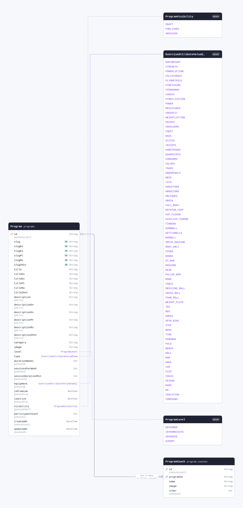

| Field       | Type     | Constraints                             | Default   | Description |
| ----------- | -------- | --------------------------------------- | --------- | ----------- |
| `id`        | `String` | PK NOT NULL                             | `cuid(1)` |             |
| `programId` | `String` | NOT NULL → [Program.id](#model-Program) |           |             |
| `name`      | `String` | NOT NULL                                |           |             |
| `image`     | `String` | NOT NULL                                |           |             |
| `order`     | `Int`    | NOT NULL                                | `0`       |             |

#### References

- `programId` → [Program.id](#model-Program) (many-to-one, on delete Cascade)

#### Definition

```sql
CREATE TABLE "program_coaches" (
    "id" TEXT NOT NULL,
    "programId" TEXT NOT NULL,
    "name" TEXT NOT NULL,
    "image" TEXT NOT NULL,
    "order" INTEGER NOT NULL DEFAULT 0,

    CONSTRAINT "program_coaches_pkey" PRIMARY KEY ("id")
);

ALTER TABLE "program_coaches" ADD CONSTRAINT "program_coaches_programId_fkey" FOREIGN KEY ("programId") REFERENCES "programs"("id") ON DELETE CASCADE ON UPDATE CASCADE;
```

<details>
<summary>Queries and their SQL</summary>

**findMany**: Every row

```ts
await prisma.programCoach.findMany();
```

```sql
SELECT
  "public"."program_coaches"."id",
  "public"."program_coaches"."programId",
  "public"."program_coaches"."name",
  "public"."program_coaches"."image",
  "public"."program_coaches"."order"
FROM
  "public"."program_coaches"
WHERE
  1 = 1
OFFSET
  $1
-- params: ["0"]
```

**count**: How many rows there are

```ts
await prisma.programCoach.count();
```

```sql
SELECT
  COUNT(*) AS "_count$_all"
FROM
  (
    SELECT
      "public"."program_coaches"."id"
    FROM
      "public"."program_coaches"
    WHERE
      1 = 1
    OFFSET
      $1
  ) AS "sub"
-- params: ["0"]
```

**findMany**: Every row with its relations

```ts
await prisma.programCoach.findMany({ include: { program: true } });
```

```sql
SELECT
  "public"."program_coaches"."id",
  "public"."program_coaches"."programId",
  "public"."program_coaches"."name",
  "public"."program_coaches"."image",
  "public"."program_coaches"."order"
FROM
  "public"."program_coaches"
WHERE
  1 = 1
OFFSET
  $1
-- params: ["0"]

SELECT
  "public"."programs"."id",
  "public"."programs"."slug",
  "public"."programs"."slugEn",
  "public"."programs"."slugEs",
  "public"."programs"."slugPt",
  "public"."programs"."slugRu",
  "public"."programs"."slugZhCn",
  "public"."programs"."title",
  "public"."programs"."titleEn",
  "public"."programs"."titleEs",
  "public"."programs"."titlePt",
  "public"."programs"."titleRu",
  "public"."programs"."titleZhCn",
  "public"."programs"."description",
  "public"."programs"."descriptionEn",
  "public"."programs"."descriptionEs",
  "public"."programs"."descriptionPt",
  "public"."programs"."descriptionRu",
  "public"."programs"."descriptionZhCn",
  "public"."programs"."category",
  "public"."programs"."image",
  "public"."programs"."level"::text,
  "public"."programs"."type"::text,
  "public"."programs"."durationWeeks",
  "public"."programs"."sessionsPerWeek",
  "public"."programs"."sessionDurationMin",
  "public"."programs"."equipment"::text[],
  "public"."programs"."isPremium",
  "public"."programs"."isActive",
  "public"."programs"."visibility"::text,
  "public"."programs"."participantCount",
  "public"."programs"."createdAt",
  "public"."programs"."updatedAt"
FROM
  "public"."programs"
WHERE
  "public"."programs"."id" IN ($1)
OFFSET
  $2
-- params: ["<programId of the rows above>","0"]
```

**findUnique**: One row by what is unique to it

```ts
await prisma.programCoach.findUnique({ where: { id: "example" } });
```

```sql
SELECT
  "public"."program_coaches"."id",
  "public"."program_coaches"."programId",
  "public"."program_coaches"."name",
  "public"."program_coaches"."image",
  "public"."program_coaches"."order"
FROM
  "public"."program_coaches"
WHERE
  (
    "public"."program_coaches"."id" = $1
    AND 1 = 1
  )
LIMIT
  $2
OFFSET
  $3
-- params: ["example","1","0"]
```

**create**: Create a row

```ts
await prisma.programCoach.create({
  data: { programId: "example", name: "example", image: "example" },
});
```

```sql
INSERT INTO
  "public"."program_coaches" ("id", "programId", "name", "image", "order")
VALUES
  ($1, $2, $3, $4, $5)
RETURNING
  "public"."program_coaches"."id",
  "public"."program_coaches"."programId",
  "public"."program_coaches"."name",
  "public"."program_coaches"."image",
  "public"."program_coaches"."order"
-- params: ["<cuid(1)>","example","example","example","0"]
```

**update**: Update a row

```ts
await prisma.programCoach.update({ where: { id: "example" }, data: { name: "example" } });
```

```sql
UPDATE "public"."program_coaches"
SET
  "name" = $1
WHERE
  (
    "public"."program_coaches"."id" = $2
    AND 1 = 1
  )
RETURNING
  "public"."program_coaches"."id",
  "public"."program_coaches"."programId",
  "public"."program_coaches"."name",
  "public"."program_coaches"."image",
  "public"."program_coaches"."order"
-- params: ["example","example"]
```

**delete**: Delete a row

```ts
await prisma.programCoach.delete({ where: { id: "example" } });
```

```sql
DELETE FROM "public"."program_coaches"
WHERE
  (
    "public"."program_coaches"."id" = $1
    AND 1 = 1
  )
RETURNING
  "public"."program_coaches"."id",
  "public"."program_coaches"."programId",
  "public"."program_coaches"."name",
  "public"."program_coaches"."image",
  "public"."program_coaches"."order"
-- params: ["example"]
```

</details>

<a id="model-ProgramWeek"></a>

### ProgramWeek

Table `program_weeks`.

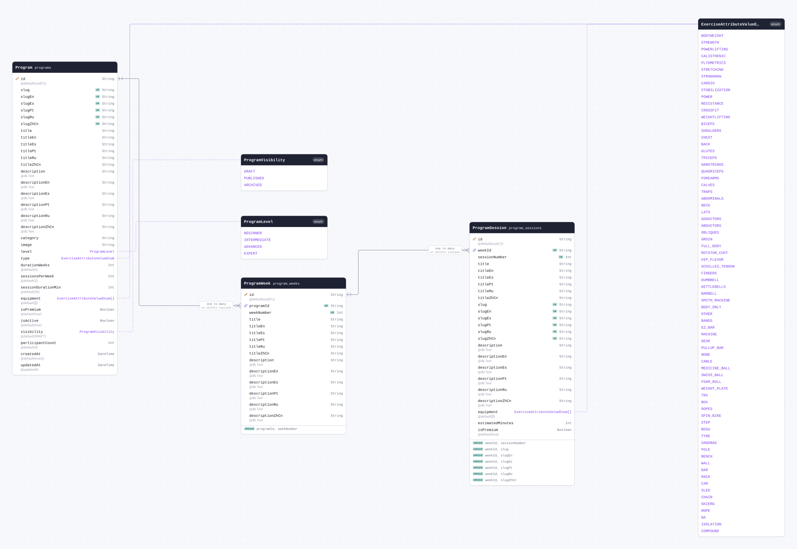

| Field             | Type                | Constraints                             | Default   | Description |
| ----------------- | ------------------- | --------------------------------------- | --------- | ----------- |
| `id`              | `String`            | PK NOT NULL                             | `cuid(1)` |             |
| `programId`       | `String`            | NOT NULL → [Program.id](#model-Program) |           |             |
| `weekNumber`      | `Int`               | NOT NULL                                |           |             |
| `title`           | `String`            | NOT NULL                                |           |             |
| `titleEn`         | `String`            | NOT NULL                                |           |             |
| `titleEs`         | `String`            | NOT NULL                                |           |             |
| `titlePt`         | `String`            | NOT NULL                                |           |             |
| `titleRu`         | `String`            | NOT NULL                                |           |             |
| `titleZhCn`       | `String`            | NOT NULL                                |           |             |
| `description`     | `String` `@db.Text` | NOT NULL                                |           |             |
| `descriptionEn`   | `String` `@db.Text` | NOT NULL                                |           |             |
| `descriptionEs`   | `String` `@db.Text` | NOT NULL                                |           |             |
| `descriptionPt`   | `String` `@db.Text` | NOT NULL                                |           |             |
| `descriptionRu`   | `String` `@db.Text` | NOT NULL                                |           |             |
| `descriptionZhCn` | `String` `@db.Text` | NOT NULL                                |           |             |

#### Indexes

- `@@unique([programId, weekNumber])`

#### References

- `programId` → [Program.id](#model-Program) (many-to-one, on delete Cascade)

#### Referenced by

- `id` ← [ProgramSession.weekId](#model-ProgramSession) (one-to-many, on delete Cascade)

#### Definition

```sql
CREATE TABLE "program_weeks" (
    "id" TEXT NOT NULL,
    "programId" TEXT NOT NULL,
    "weekNumber" INTEGER NOT NULL,
    "title" TEXT NOT NULL,
    "titleEn" TEXT NOT NULL,
    "titleEs" TEXT NOT NULL,
    "titlePt" TEXT NOT NULL,
    "titleRu" TEXT NOT NULL,
    "titleZhCn" TEXT NOT NULL,
    "description" TEXT NOT NULL,
    "descriptionEn" TEXT NOT NULL,
    "descriptionEs" TEXT NOT NULL,
    "descriptionPt" TEXT NOT NULL,
    "descriptionRu" TEXT NOT NULL,
    "descriptionZhCn" TEXT NOT NULL,

    CONSTRAINT "program_weeks_pkey" PRIMARY KEY ("id")
);

CREATE UNIQUE INDEX "program_weeks_programId_weekNumber_key" ON "program_weeks"("programId", "weekNumber");

ALTER TABLE "program_weeks" ADD CONSTRAINT "program_weeks_programId_fkey" FOREIGN KEY ("programId") REFERENCES "programs"("id") ON DELETE CASCADE ON UPDATE CASCADE;
```

<details>
<summary>Queries and their SQL</summary>

**findMany**: Every row

```ts
await prisma.programWeek.findMany();
```

```sql
SELECT
  "public"."program_weeks"."id",
  "public"."program_weeks"."programId",
  "public"."program_weeks"."weekNumber",
  "public"."program_weeks"."title",
  "public"."program_weeks"."titleEn",
  "public"."program_weeks"."titleEs",
  "public"."program_weeks"."titlePt",
  "public"."program_weeks"."titleRu",
  "public"."program_weeks"."titleZhCn",
  "public"."program_weeks"."description",
  "public"."program_weeks"."descriptionEn",
  "public"."program_weeks"."descriptionEs",
  "public"."program_weeks"."descriptionPt",
  "public"."program_weeks"."descriptionRu",
  "public"."program_weeks"."descriptionZhCn"
FROM
  "public"."program_weeks"
WHERE
  1 = 1
OFFSET
  $1
-- params: ["0"]
```

**count**: How many rows there are

```ts
await prisma.programWeek.count();
```

```sql
SELECT
  COUNT(*) AS "_count$_all"
FROM
  (
    SELECT
      "public"."program_weeks"."id"
    FROM
      "public"."program_weeks"
    WHERE
      1 = 1
    OFFSET
      $1
  ) AS "sub"
-- params: ["0"]
```

**findMany**: Every row with its relations

```ts
await prisma.programWeek.findMany({ include: { program: true, sessions: true } });
```

```sql
SELECT
  "public"."program_weeks"."id",
  "public"."program_weeks"."programId",
  "public"."program_weeks"."weekNumber",
  "public"."program_weeks"."title",
  "public"."program_weeks"."titleEn",
  "public"."program_weeks"."titleEs",
  "public"."program_weeks"."titlePt",
  "public"."program_weeks"."titleRu",
  "public"."program_weeks"."titleZhCn",
  "public"."program_weeks"."description",
  "public"."program_weeks"."descriptionEn",
  "public"."program_weeks"."descriptionEs",
  "public"."program_weeks"."descriptionPt",
  "public"."program_weeks"."descriptionRu",
  "public"."program_weeks"."descriptionZhCn"
FROM
  "public"."program_weeks"
WHERE
  1 = 1
OFFSET
  $1
-- params: ["0"]

SELECT
  "public"."programs"."id",
  "public"."programs"."slug",
  "public"."programs"."slugEn",
  "public"."programs"."slugEs",
  "public"."programs"."slugPt",
  "public"."programs"."slugRu",
  "public"."programs"."slugZhCn",
  "public"."programs"."title",
  "public"."programs"."titleEn",
  "public"."programs"."titleEs",
  "public"."programs"."titlePt",
  "public"."programs"."titleRu",
  "public"."programs"."titleZhCn",
  "public"."programs"."description",
  "public"."programs"."descriptionEn",
  "public"."programs"."descriptionEs",
  "public"."programs"."descriptionPt",
  "public"."programs"."descriptionRu",
  "public"."programs"."descriptionZhCn",
  "public"."programs"."category",
  "public"."programs"."image",
  "public"."programs"."level"::text,
  "public"."programs"."type"::text,
  "public"."programs"."durationWeeks",
  "public"."programs"."sessionsPerWeek",
  "public"."programs"."sessionDurationMin",
  "public"."programs"."equipment"::text[],
  "public"."programs"."isPremium",
  "public"."programs"."isActive",
  "public"."programs"."visibility"::text,
  "public"."programs"."participantCount",
  "public"."programs"."createdAt",
  "public"."programs"."updatedAt"
FROM
  "public"."programs"
WHERE
  "public"."programs"."id" IN ($1)
OFFSET
  $2
-- params: ["<programId of the rows above>","0"]

SELECT
  "public"."program_sessions"."id",
  "public"."program_sessions"."weekId",
  "public"."program_sessions"."sessionNumber",
  "public"."program_sessions"."title",
  "public"."program_sessions"."titleEn",
  "public"."program_sessions"."titleEs",
  "public"."program_sessions"."titlePt",
  "public"."program_sessions"."titleRu",
  "public"."program_sessions"."titleZhCn",
  "public"."program_sessions"."slug",
  "public"."program_sessions"."slugEn",
  "public"."program_sessions"."slugEs",
  "public"."program_sessions"."slugPt",
  "public"."program_sessions"."slugRu",
  "public"."program_sessions"."slugZhCn",
  "public"."program_sessions"."description",
  "public"."program_sessions"."descriptionEn",
  "public"."program_sessions"."descriptionEs",
  "public"."program_sessions"."descriptionPt",
  "public"."program_sessions"."descriptionRu",
  "public"."program_sessions"."descriptionZhCn",
  "public"."program_sessions"."equipment"::text[],
  "public"."program_sessions"."estimatedMinutes",
  "public"."program_sessions"."isPremium"
FROM
  "public"."program_sessions"
WHERE
  "public"."program_sessions"."weekId" IN ($1)
OFFSET
  $2
-- params: ["<id of the rows above>","0"]
```

**findUnique**: One row by what is unique to it

```ts
await prisma.programWeek.findUnique({ where: { id: "example" } });
```

```sql
SELECT
  "public"."program_weeks"."id",
  "public"."program_weeks"."programId",
  "public"."program_weeks"."weekNumber",
  "public"."program_weeks"."title",
  "public"."program_weeks"."titleEn",
  "public"."program_weeks"."titleEs",
  "public"."program_weeks"."titlePt",
  "public"."program_weeks"."titleRu",
  "public"."program_weeks"."titleZhCn",
  "public"."program_weeks"."description",
  "public"."program_weeks"."descriptionEn",
  "public"."program_weeks"."descriptionEs",
  "public"."program_weeks"."descriptionPt",
  "public"."program_weeks"."descriptionRu",
  "public"."program_weeks"."descriptionZhCn"
FROM
  "public"."program_weeks"
WHERE
  (
    "public"."program_weeks"."id" = $1
    AND 1 = 1
  )
LIMIT
  $2
OFFSET
  $3
-- params: ["example","1","0"]
```

**create**: Create a row

```ts
await prisma.programWeek.create({
  data: {
    programId: "example",
    weekNumber: 1,
    title: "example",
    titleEn: "example",
    titleEs: "example",
    titlePt: "example",
    titleRu: "example",
    titleZhCn: "example",
    description: "example",
    descriptionEn: "example",
    descriptionEs: "example",
    descriptionPt: "example",
    descriptionRu: "example",
    descriptionZhCn: "example",
  },
});
```

```sql
INSERT INTO
  "public"."program_weeks" (
    "id",
    "programId",
    "weekNumber",
    "title",
    "titleEn",
    "titleEs",
    "titlePt",
    "titleRu",
    "titleZhCn",
    "description",
    "descriptionEn",
    "descriptionEs",
    "descriptionPt",
    "descriptionRu",
    "descriptionZhCn"
  )
VALUES
  (
    $1,
    $2,
    $3,
    $4,
    $5,
    $6,
    $7,
    $8,
    $9,
    $10,
    $11,
    $12,
    $13,
    $14,
    $15
  )
RETURNING
  "public"."program_weeks"."id",
  "public"."program_weeks"."programId",
  "public"."program_weeks"."weekNumber",
  "public"."program_weeks"."title",
  "public"."program_weeks"."titleEn",
  "public"."program_weeks"."titleEs",
  "public"."program_weeks"."titlePt",
  "public"."program_weeks"."titleRu",
  "public"."program_weeks"."titleZhCn",
  "public"."program_weeks"."description",
  "public"."program_weeks"."descriptionEn",
  "public"."program_weeks"."descriptionEs",
  "public"."program_weeks"."descriptionPt",
  "public"."program_weeks"."descriptionRu",
  "public"."program_weeks"."descriptionZhCn"
-- params: ["<cuid(1)>","example","1","example","example","example","example","example","example","example","example","example","example","example","example"]
```

**update**: Update a row

```ts
await prisma.programWeek.update({ where: { id: "example" }, data: { weekNumber: 1 } });
```

```sql
UPDATE "public"."program_weeks"
SET
  "weekNumber" = $1
WHERE
  (
    "public"."program_weeks"."id" = $2
    AND 1 = 1
  )
RETURNING
  "public"."program_weeks"."id",
  "public"."program_weeks"."programId",
  "public"."program_weeks"."weekNumber",
  "public"."program_weeks"."title",
  "public"."program_weeks"."titleEn",
  "public"."program_weeks"."titleEs",
  "public"."program_weeks"."titlePt",
  "public"."program_weeks"."titleRu",
  "public"."program_weeks"."titleZhCn",
  "public"."program_weeks"."description",
  "public"."program_weeks"."descriptionEn",
  "public"."program_weeks"."descriptionEs",
  "public"."program_weeks"."descriptionPt",
  "public"."program_weeks"."descriptionRu",
  "public"."program_weeks"."descriptionZhCn"
-- params: ["1","example"]
```

**delete**: Delete a row

```ts
await prisma.programWeek.delete({ where: { id: "example" } });
```

```sql
DELETE FROM "public"."program_weeks"
WHERE
  (
    "public"."program_weeks"."id" = $1
    AND 1 = 1
  )
RETURNING
  "public"."program_weeks"."id",
  "public"."program_weeks"."programId",
  "public"."program_weeks"."weekNumber",
  "public"."program_weeks"."title",
  "public"."program_weeks"."titleEn",
  "public"."program_weeks"."titleEs",
  "public"."program_weeks"."titlePt",
  "public"."program_weeks"."titleRu",
  "public"."program_weeks"."titleZhCn",
  "public"."program_weeks"."description",
  "public"."program_weeks"."descriptionEn",
  "public"."program_weeks"."descriptionEs",
  "public"."program_weeks"."descriptionPt",
  "public"."program_weeks"."descriptionRu",
  "public"."program_weeks"."descriptionZhCn"
-- params: ["example"]
```

</details>

<a id="model-ProgramSession"></a>

### ProgramSession

Table `program_sessions`.

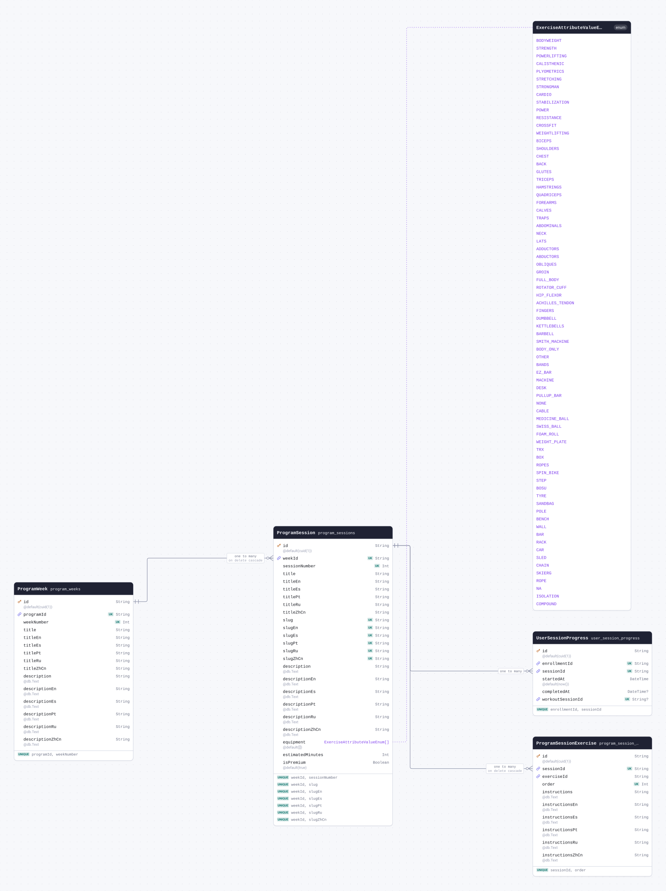

| Field              | Type                                                               | Constraints                                     | Default   | Description |
| ------------------ | ------------------------------------------------------------------ | ----------------------------------------------- | --------- | ----------- |
| `id`               | `String`                                                           | PK NOT NULL                                     | `cuid(1)` |             |
| `weekId`           | `String`                                                           | NOT NULL → [ProgramWeek.id](#model-ProgramWeek) |           |             |
| `sessionNumber`    | `Int`                                                              | NOT NULL                                        |           |             |
| `title`            | `String`                                                           | NOT NULL                                        |           |             |
| `titleEn`          | `String`                                                           | NOT NULL                                        |           |             |
| `titleEs`          | `String`                                                           | NOT NULL                                        |           |             |
| `titlePt`          | `String`                                                           | NOT NULL                                        |           |             |
| `titleRu`          | `String`                                                           | NOT NULL                                        |           |             |
| `titleZhCn`        | `String`                                                           | NOT NULL                                        |           |             |
| `slug`             | `String`                                                           | NOT NULL                                        |           |             |
| `slugEn`           | `String`                                                           | NOT NULL                                        |           |             |
| `slugEs`           | `String`                                                           | NOT NULL                                        |           |             |
| `slugPt`           | `String`                                                           | NOT NULL                                        |           |             |
| `slugRu`           | `String`                                                           | NOT NULL                                        |           |             |
| `slugZhCn`         | `String`                                                           | NOT NULL                                        |           |             |
| `description`      | `String` `@db.Text`                                                | NOT NULL                                        |           |             |
| `descriptionEn`    | `String` `@db.Text`                                                | NOT NULL                                        |           |             |
| `descriptionEs`    | `String` `@db.Text`                                                | NOT NULL                                        |           |             |
| `descriptionPt`    | `String` `@db.Text`                                                | NOT NULL                                        |           |             |
| `descriptionRu`    | `String` `@db.Text`                                                | NOT NULL                                        |           |             |
| `descriptionZhCn`  | `String` `@db.Text`                                                | NOT NULL                                        |           |             |
| `equipment`        | [`ExerciseAttributeValueEnum[]`](#enum-ExerciseAttributeValueEnum) | NOT NULL                                        | `[]`      |             |
| `estimatedMinutes` | `Int`                                                              | NOT NULL                                        |           |             |
| `isPremium`        | `Boolean`                                                          | NOT NULL                                        | `true`    |             |

#### Indexes

- `@@unique([weekId, sessionNumber])`
- `@@unique([weekId, slug])`
- `@@unique([weekId, slugEn])`
- `@@unique([weekId, slugEs])`
- `@@unique([weekId, slugPt])`
- `@@unique([weekId, slugRu])`
- `@@unique([weekId, slugZhCn])`

#### References

- `weekId` → [ProgramWeek.id](#model-ProgramWeek) (many-to-one, on delete Cascade)

#### Referenced by

- `id` ← [ProgramSessionExercise.sessionId](#model-ProgramSessionExercise) (one-to-many, on delete Cascade)
- `id` ← [UserSessionProgress.sessionId](#model-UserSessionProgress) (one-to-many)

#### Definition

```sql
CREATE TABLE "program_sessions" (
    "id" TEXT NOT NULL,
    "weekId" TEXT NOT NULL,
    "sessionNumber" INTEGER NOT NULL,
    "title" TEXT NOT NULL,
    "titleEn" TEXT NOT NULL,
    "titleEs" TEXT NOT NULL,
    "titlePt" TEXT NOT NULL,
    "titleRu" TEXT NOT NULL,
    "titleZhCn" TEXT NOT NULL,
    "slug" TEXT NOT NULL,
    "slugEn" TEXT NOT NULL,
    "slugEs" TEXT NOT NULL,
    "slugPt" TEXT NOT NULL,
    "slugRu" TEXT NOT NULL,
    "slugZhCn" TEXT NOT NULL,
    "description" TEXT NOT NULL,
    "descriptionEn" TEXT NOT NULL,
    "descriptionEs" TEXT NOT NULL,
    "descriptionPt" TEXT NOT NULL,
    "descriptionRu" TEXT NOT NULL,
    "descriptionZhCn" TEXT NOT NULL,
    "equipment" "ExerciseAttributeValueEnum"[] DEFAULT ARRAY[]::"ExerciseAttributeValueEnum"[],
    "estimatedMinutes" INTEGER NOT NULL,
    "isPremium" BOOLEAN NOT NULL DEFAULT true,

    CONSTRAINT "program_sessions_pkey" PRIMARY KEY ("id")
);

CREATE UNIQUE INDEX "program_sessions_weekId_sessionNumber_key" ON "program_sessions"("weekId", "sessionNumber");

CREATE UNIQUE INDEX "program_sessions_weekId_slug_key" ON "program_sessions"("weekId", "slug");

CREATE UNIQUE INDEX "program_sessions_weekId_slugEn_key" ON "program_sessions"("weekId", "slugEn");

CREATE UNIQUE INDEX "program_sessions_weekId_slugEs_key" ON "program_sessions"("weekId", "slugEs");

CREATE UNIQUE INDEX "program_sessions_weekId_slugPt_key" ON "program_sessions"("weekId", "slugPt");

CREATE UNIQUE INDEX "program_sessions_weekId_slugRu_key" ON "program_sessions"("weekId", "slugRu");

CREATE UNIQUE INDEX "program_sessions_weekId_slugZhCn_key" ON "program_sessions"("weekId", "slugZhCn");

ALTER TABLE "program_sessions" ADD CONSTRAINT "program_sessions_weekId_fkey" FOREIGN KEY ("weekId") REFERENCES "program_weeks"("id") ON DELETE CASCADE ON UPDATE CASCADE;
```

<details>
<summary>Queries and their SQL</summary>

**findMany**: Every row

```ts
await prisma.programSession.findMany();
```

```sql
SELECT
  "public"."program_sessions"."id",
  "public"."program_sessions"."weekId",
  "public"."program_sessions"."sessionNumber",
  "public"."program_sessions"."title",
  "public"."program_sessions"."titleEn",
  "public"."program_sessions"."titleEs",
  "public"."program_sessions"."titlePt",
  "public"."program_sessions"."titleRu",
  "public"."program_sessions"."titleZhCn",
  "public"."program_sessions"."slug",
  "public"."program_sessions"."slugEn",
  "public"."program_sessions"."slugEs",
  "public"."program_sessions"."slugPt",
  "public"."program_sessions"."slugRu",
  "public"."program_sessions"."slugZhCn",
  "public"."program_sessions"."description",
  "public"."program_sessions"."descriptionEn",
  "public"."program_sessions"."descriptionEs",
  "public"."program_sessions"."descriptionPt",
  "public"."program_sessions"."descriptionRu",
  "public"."program_sessions"."descriptionZhCn",
  "public"."program_sessions"."equipment"::text[],
  "public"."program_sessions"."estimatedMinutes",
  "public"."program_sessions"."isPremium"
FROM
  "public"."program_sessions"
WHERE
  1 = 1
OFFSET
  $1
-- params: ["0"]
```

**count**: How many rows there are

```ts
await prisma.programSession.count();
```

```sql
SELECT
  COUNT(*) AS "_count$_all"
FROM
  (
    SELECT
      "public"."program_sessions"."id"
    FROM
      "public"."program_sessions"
    WHERE
      1 = 1
    OFFSET
      $1
  ) AS "sub"
-- params: ["0"]
```

**findMany**: Every row with its relations

```ts
await prisma.programSession.findMany({
  include: { week: true, exercises: true, userProgress: true },
});
```

```sql
SELECT
  "public"."program_sessions"."id",
  "public"."program_sessions"."weekId",
  "public"."program_sessions"."sessionNumber",
  "public"."program_sessions"."title",
  "public"."program_sessions"."titleEn",
  "public"."program_sessions"."titleEs",
  "public"."program_sessions"."titlePt",
  "public"."program_sessions"."titleRu",
  "public"."program_sessions"."titleZhCn",
  "public"."program_sessions"."slug",
  "public"."program_sessions"."slugEn",
  "public"."program_sessions"."slugEs",
  "public"."program_sessions"."slugPt",
  "public"."program_sessions"."slugRu",
  "public"."program_sessions"."slugZhCn",
  "public"."program_sessions"."description",
  "public"."program_sessions"."descriptionEn",
  "public"."program_sessions"."descriptionEs",
  "public"."program_sessions"."descriptionPt",
  "public"."program_sessions"."descriptionRu",
  "public"."program_sessions"."descriptionZhCn",
  "public"."program_sessions"."equipment"::text[],
  "public"."program_sessions"."estimatedMinutes",
  "public"."program_sessions"."isPremium"
FROM
  "public"."program_sessions"
WHERE
  1 = 1
OFFSET
  $1
-- params: ["0"]

SELECT
  "public"."program_weeks"."id",
  "public"."program_weeks"."programId",
  "public"."program_weeks"."weekNumber",
  "public"."program_weeks"."title",
  "public"."program_weeks"."titleEn",
  "public"."program_weeks"."titleEs",
  "public"."program_weeks"."titlePt",
  "public"."program_weeks"."titleRu",
  "public"."program_weeks"."titleZhCn",
  "public"."program_weeks"."description",
  "public"."program_weeks"."descriptionEn",
  "public"."program_weeks"."descriptionEs",
  "public"."program_weeks"."descriptionPt",
  "public"."program_weeks"."descriptionRu",
  "public"."program_weeks"."descriptionZhCn"
FROM
  "public"."program_weeks"
WHERE
  "public"."program_weeks"."id" IN ($1)
OFFSET
  $2
-- params: ["<weekId of the rows above>","0"]

SELECT
  "public"."program_session_exercises"."id",
  "public"."program_session_exercises"."sessionId",
  "public"."program_session_exercises"."exerciseId",
  "public"."program_session_exercises"."order",
  "public"."program_session_exercises"."instructions",
  "public"."program_session_exercises"."instructionsEn",
  "public"."program_session_exercises"."instructionsEs",
  "public"."program_session_exercises"."instructionsPt",
  "public"."program_session_exercises"."instructionsRu",
  "public"."program_session_exercises"."instructionsZhCn"
FROM
  "public"."program_session_exercises"
WHERE
  "public"."program_session_exercises"."sessionId" IN ($1)
OFFSET
  $2
-- params: ["<id of the rows above>","0"]

SELECT
  "public"."user_session_progress"."id",
  "public"."user_session_progress"."enrollmentId",
  "public"."user_session_progress"."sessionId",
  "public"."user_session_progress"."startedAt",
  "public"."user_session_progress"."completedAt",
  "public"."user_session_progress"."workoutSessionId"
FROM
  "public"."user_session_progress"
WHERE
  "public"."user_session_progress"."sessionId" IN ($1)
OFFSET
  $2
-- params: ["<id of the rows above>","0"]
```

**findUnique**: One row by what is unique to it

```ts
await prisma.programSession.findUnique({ where: { id: "example" } });
```

```sql
SELECT
  "public"."program_sessions"."id",
  "public"."program_sessions"."weekId",
  "public"."program_sessions"."sessionNumber",
  "public"."program_sessions"."title",
  "public"."program_sessions"."titleEn",
  "public"."program_sessions"."titleEs",
  "public"."program_sessions"."titlePt",
  "public"."program_sessions"."titleRu",
  "public"."program_sessions"."titleZhCn",
  "public"."program_sessions"."slug",
  "public"."program_sessions"."slugEn",
  "public"."program_sessions"."slugEs",
  "public"."program_sessions"."slugPt",
  "public"."program_sessions"."slugRu",
  "public"."program_sessions"."slugZhCn",
  "public"."program_sessions"."description",
  "public"."program_sessions"."descriptionEn",
  "public"."program_sessions"."descriptionEs",
  "public"."program_sessions"."descriptionPt",
  "public"."program_sessions"."descriptionRu",
  "public"."program_sessions"."descriptionZhCn",
  "public"."program_sessions"."equipment"::text[],
  "public"."program_sessions"."estimatedMinutes",
  "public"."program_sessions"."isPremium"
FROM
  "public"."program_sessions"
WHERE
  (
    "public"."program_sessions"."id" = $1
    AND 1 = 1
  )
LIMIT
  $2
OFFSET
  $3
-- params: ["example","1","0"]
```

**create**: Create a row

```ts
await prisma.programSession.create({
  data: {
    weekId: "example",
    sessionNumber: 1,
    title: "example",
    titleEn: "example",
    titleEs: "example",
    titlePt: "example",
    titleRu: "example",
    titleZhCn: "example",
    slug: "example",
    slugEn: "example",
    slugEs: "example",
    slugPt: "example",
    slugRu: "example",
    slugZhCn: "example",
    description: "example",
    descriptionEn: "example",
    descriptionEs: "example",
    descriptionPt: "example",
    descriptionRu: "example",
    descriptionZhCn: "example",
    estimatedMinutes: 1,
  },
});
```

```sql
INSERT INTO
  "public"."program_sessions" (
    "id",
    "weekId",
    "sessionNumber",
    "title",
    "titleEn",
    "titleEs",
    "titlePt",
    "titleRu",
    "titleZhCn",
    "slug",
    "slugEn",
    "slugEs",
    "slugPt",
    "slugRu",
    "slugZhCn",
    "description",
    "descriptionEn",
    "descriptionEs",
    "descriptionPt",
    "descriptionRu",
    "descriptionZhCn",
    "equipment",
    "estimatedMinutes",
    "isPremium"
  )
VALUES
  (
    $1,
    $2,
    $3,
    $4,
    $5,
    $6,
    $7,
    $8,
    $9,
    $10,
    $11,
    $12,
    $13,
    $14,
    $15,
    $16,
    $17,
    $18,
    $19,
    $20,
    $21,
    CAST(
      $22::text[] AS "public"."ExerciseAttributeValueEnum" []
    ),
    $23,
    $24
  )
RETURNING
  "public"."program_sessions"."id",
  "public"."program_sessions"."weekId",
  "public"."program_sessions"."sessionNumber",
  "public"."program_sessions"."title",
  "public"."program_sessions"."titleEn",
  "public"."program_sessions"."titleEs",
  "public"."program_sessions"."titlePt",
  "public"."program_sessions"."titleRu",
  "public"."program_sessions"."titleZhCn",
  "public"."program_sessions"."slug",
  "public"."program_sessions"."slugEn",
  "public"."program_sessions"."slugEs",
  "public"."program_sessions"."slugPt",
  "public"."program_sessions"."slugRu",
  "public"."program_sessions"."slugZhCn",
  "public"."program_sessions"."description",
  "public"."program_sessions"."descriptionEn",
  "public"."program_sessions"."descriptionEs",
  "public"."program_sessions"."descriptionPt",
  "public"."program_sessions"."descriptionRu",
  "public"."program_sessions"."descriptionZhCn",
  "public"."program_sessions"."equipment"::text[],
  "public"."program_sessions"."estimatedMinutes",
  "public"."program_sessions"."isPremium"
-- params: ["<cuid(1)>","example","1","example","example","example","example","example","example","example","example","example","example","example","example","example","example","example","example","example","example",[],"1",true]
```

**update**: Update a row

```ts
await prisma.programSession.update({ where: { id: "example" }, data: { sessionNumber: 1 } });
```

```sql
UPDATE "public"."program_sessions"
SET
  "sessionNumber" = $1
WHERE
  (
    "public"."program_sessions"."id" = $2
    AND 1 = 1
  )
RETURNING
  "public"."program_sessions"."id",
  "public"."program_sessions"."weekId",
  "public"."program_sessions"."sessionNumber",
  "public"."program_sessions"."title",
  "public"."program_sessions"."titleEn",
  "public"."program_sessions"."titleEs",
  "public"."program_sessions"."titlePt",
  "public"."program_sessions"."titleRu",
  "public"."program_sessions"."titleZhCn",
  "public"."program_sessions"."slug",
  "public"."program_sessions"."slugEn",
  "public"."program_sessions"."slugEs",
  "public"."program_sessions"."slugPt",
  "public"."program_sessions"."slugRu",
  "public"."program_sessions"."slugZhCn",
  "public"."program_sessions"."description",
  "public"."program_sessions"."descriptionEn",
  "public"."program_sessions"."descriptionEs",
  "public"."program_sessions"."descriptionPt",
  "public"."program_sessions"."descriptionRu",
  "public"."program_sessions"."descriptionZhCn",
  "public"."program_sessions"."equipment"::text[],
  "public"."program_sessions"."estimatedMinutes",
  "public"."program_sessions"."isPremium"
-- params: ["1","example"]
```

**delete**: Delete a row

```ts
await prisma.programSession.delete({ where: { id: "example" } });
```

```sql
DELETE FROM "public"."program_sessions"
WHERE
  (
    "public"."program_sessions"."id" = $1
    AND 1 = 1
  )
RETURNING
  "public"."program_sessions"."id",
  "public"."program_sessions"."weekId",
  "public"."program_sessions"."sessionNumber",
  "public"."program_sessions"."title",
  "public"."program_sessions"."titleEn",
  "public"."program_sessions"."titleEs",
  "public"."program_sessions"."titlePt",
  "public"."program_sessions"."titleRu",
  "public"."program_sessions"."titleZhCn",
  "public"."program_sessions"."slug",
  "public"."program_sessions"."slugEn",
  "public"."program_sessions"."slugEs",
  "public"."program_sessions"."slugPt",
  "public"."program_sessions"."slugRu",
  "public"."program_sessions"."slugZhCn",
  "public"."program_sessions"."description",
  "public"."program_sessions"."descriptionEn",
  "public"."program_sessions"."descriptionEs",
  "public"."program_sessions"."descriptionPt",
  "public"."program_sessions"."descriptionRu",
  "public"."program_sessions"."descriptionZhCn",
  "public"."program_sessions"."equipment"::text[],
  "public"."program_sessions"."estimatedMinutes",
  "public"."program_sessions"."isPremium"
-- params: ["example"]
```

</details>

<a id="model-ProgramSessionExercise"></a>

### ProgramSessionExercise

Table `program_session_exercises`.

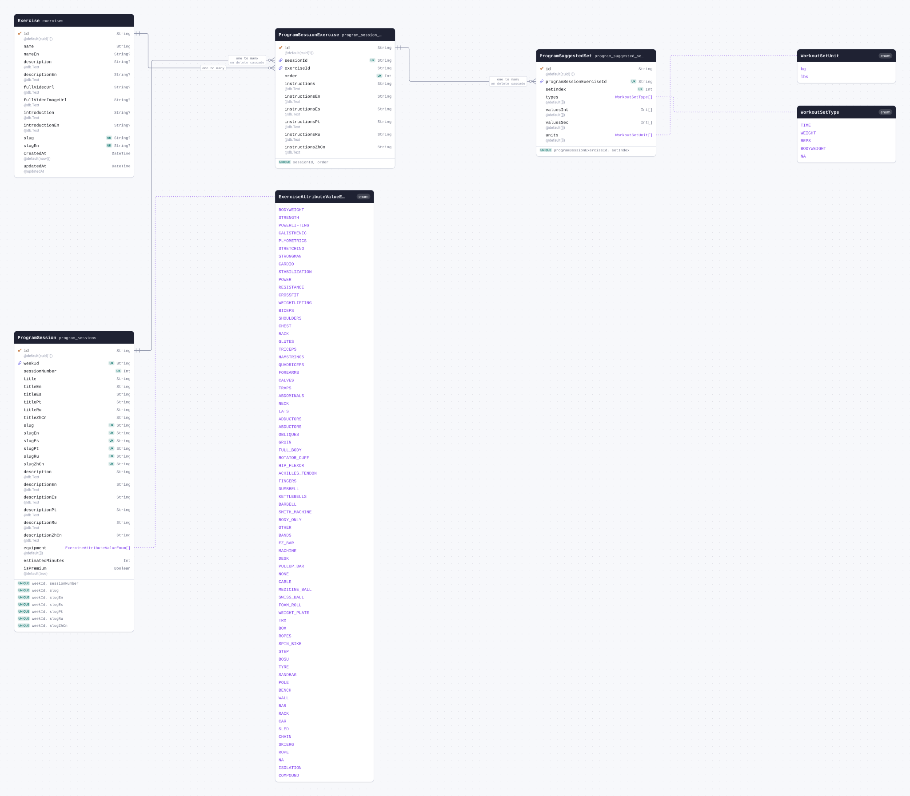

| Field              | Type                | Constraints                                           | Default   | Description |
| ------------------ | ------------------- | ----------------------------------------------------- | --------- | ----------- |
| `id`               | `String`            | PK NOT NULL                                           | `cuid(1)` |             |
| `sessionId`        | `String`            | NOT NULL → [ProgramSession.id](#model-ProgramSession) |           |             |
| `exerciseId`       | `String`            | NOT NULL → [Exercise.id](#model-Exercise)             |           |             |
| `order`            | `Int`               | NOT NULL                                              |           |             |
| `instructions`     | `String` `@db.Text` | NOT NULL                                              |           |             |
| `instructionsEn`   | `String` `@db.Text` | NOT NULL                                              |           |             |
| `instructionsEs`   | `String` `@db.Text` | NOT NULL                                              |           |             |
| `instructionsPt`   | `String` `@db.Text` | NOT NULL                                              |           |             |
| `instructionsRu`   | `String` `@db.Text` | NOT NULL                                              |           |             |
| `instructionsZhCn` | `String` `@db.Text` | NOT NULL                                              |           |             |

#### Indexes

- `@@unique([sessionId, order])`

#### References

- `sessionId` → [ProgramSession.id](#model-ProgramSession) (many-to-one, on delete Cascade)
- `exerciseId` → [Exercise.id](#model-Exercise) (many-to-one)

#### Referenced by

- `id` ← [ProgramSuggestedSet.programSessionExerciseId](#model-ProgramSuggestedSet) (one-to-many, on delete Cascade)

#### Definition

```sql
CREATE TABLE "program_session_exercises" (
    "id" TEXT NOT NULL,
    "sessionId" TEXT NOT NULL,
    "exerciseId" TEXT NOT NULL,
    "order" INTEGER NOT NULL,
    "instructions" TEXT NOT NULL,
    "instructionsEn" TEXT NOT NULL,
    "instructionsEs" TEXT NOT NULL,
    "instructionsPt" TEXT NOT NULL,
    "instructionsRu" TEXT NOT NULL,
    "instructionsZhCn" TEXT NOT NULL,

    CONSTRAINT "program_session_exercises_pkey" PRIMARY KEY ("id")
);

CREATE UNIQUE INDEX "program_session_exercises_sessionId_order_key" ON "program_session_exercises"("sessionId", "order");

ALTER TABLE "program_session_exercises" ADD CONSTRAINT "program_session_exercises_sessionId_fkey" FOREIGN KEY ("sessionId") REFERENCES "program_sessions"("id") ON DELETE CASCADE ON UPDATE CASCADE;

ALTER TABLE "program_session_exercises" ADD CONSTRAINT "program_session_exercises_exerciseId_fkey" FOREIGN KEY ("exerciseId") REFERENCES "exercises"("id") ON DELETE RESTRICT ON UPDATE CASCADE;
```

<details>
<summary>Queries and their SQL</summary>

**findMany**: Every row

```ts
await prisma.programSessionExercise.findMany();
```

```sql
SELECT
  "public"."program_session_exercises"."id",
  "public"."program_session_exercises"."sessionId",
  "public"."program_session_exercises"."exerciseId",
  "public"."program_session_exercises"."order",
  "public"."program_session_exercises"."instructions",
  "public"."program_session_exercises"."instructionsEn",
  "public"."program_session_exercises"."instructionsEs",
  "public"."program_session_exercises"."instructionsPt",
  "public"."program_session_exercises"."instructionsRu",
  "public"."program_session_exercises"."instructionsZhCn"
FROM
  "public"."program_session_exercises"
WHERE
  1 = 1
OFFSET
  $1
-- params: ["0"]
```

**count**: How many rows there are

```ts
await prisma.programSessionExercise.count();
```

```sql
SELECT
  COUNT(*) AS "_count$_all"
FROM
  (
    SELECT
      "public"."program_session_exercises"."id"
    FROM
      "public"."program_session_exercises"
    WHERE
      1 = 1
    OFFSET
      $1
  ) AS "sub"
-- params: ["0"]
```

**findMany**: Every row with its relations

```ts
await prisma.programSessionExercise.findMany({
  include: { session: true, exercise: true, suggestedSets: true },
});
```

```sql
SELECT
  "public"."program_session_exercises"."id",
  "public"."program_session_exercises"."sessionId",
  "public"."program_session_exercises"."exerciseId",
  "public"."program_session_exercises"."order",
  "public"."program_session_exercises"."instructions",
  "public"."program_session_exercises"."instructionsEn",
  "public"."program_session_exercises"."instructionsEs",
  "public"."program_session_exercises"."instructionsPt",
  "public"."program_session_exercises"."instructionsRu",
  "public"."program_session_exercises"."instructionsZhCn"
FROM
  "public"."program_session_exercises"
WHERE
  1 = 1
OFFSET
  $1
-- params: ["0"]

SELECT
  "public"."program_sessions"."id",
  "public"."program_sessions"."weekId",
  "public"."program_sessions"."sessionNumber",
  "public"."program_sessions"."title",
  "public"."program_sessions"."titleEn",
  "public"."program_sessions"."titleEs",
  "public"."program_sessions"."titlePt",
  "public"."program_sessions"."titleRu",
  "public"."program_sessions"."titleZhCn",
  "public"."program_sessions"."slug",
  "public"."program_sessions"."slugEn",
  "public"."program_sessions"."slugEs",
  "public"."program_sessions"."slugPt",
  "public"."program_sessions"."slugRu",
  "public"."program_sessions"."slugZhCn",
  "public"."program_sessions"."description",
  "public"."program_sessions"."descriptionEn",
  "public"."program_sessions"."descriptionEs",
  "public"."program_sessions"."descriptionPt",
  "public"."program_sessions"."descriptionRu",
  "public"."program_sessions"."descriptionZhCn",
  "public"."program_sessions"."equipment"::text[],
  "public"."program_sessions"."estimatedMinutes",
  "public"."program_sessions"."isPremium"
FROM
  "public"."program_sessions"
WHERE
  "public"."program_sessions"."id" IN ($1)
OFFSET
  $2
-- params: ["<sessionId of the rows above>","0"]

SELECT
  "public"."exercises"."id",
  "public"."exercises"."name",
  "public"."exercises"."nameEn",
  "public"."exercises"."description",
  "public"."exercises"."descriptionEn",
  "public"."exercises"."fullVideoUrl",
  "public"."exercises"."fullVideoImageUrl",
  "public"."exercises"."introduction",
  "public"."exercises"."introductionEn",
  "public"."exercises"."slug",
  "public"."exercises"."slugEn",
  "public"."exercises"."createdAt",
  "public"."exercises"."updatedAt"
FROM
  "public"."exercises"
WHERE
  "public"."exercises"."id" IN ($1)
OFFSET
  $2
-- params: ["<exerciseId of the rows above>","0"]

SELECT
  "public"."program_suggested_sets"."id",
  "public"."program_suggested_sets"."programSessionExerciseId",
  "public"."program_suggested_sets"."setIndex",
  "public"."program_suggested_sets"."types"::text[],
  "public"."program_suggested_sets"."valuesInt",
  "public"."program_suggested_sets"."valuesSec",
  "public"."program_suggested_sets"."units"::text[]
FROM
  "public"."program_suggested_sets"
WHERE
  "public"."program_suggested_sets"."programSessionExerciseId" IN ($1)
OFFSET
  $2
-- params: ["<id of the rows above>","0"]
```

**findUnique**: One row by what is unique to it

```ts
await prisma.programSessionExercise.findUnique({ where: { id: "example" } });
```

```sql
SELECT
  "public"."program_session_exercises"."id",
  "public"."program_session_exercises"."sessionId",
  "public"."program_session_exercises"."exerciseId",
  "public"."program_session_exercises"."order",
  "public"."program_session_exercises"."instructions",
  "public"."program_session_exercises"."instructionsEn",
  "public"."program_session_exercises"."instructionsEs",
  "public"."program_session_exercises"."instructionsPt",
  "public"."program_session_exercises"."instructionsRu",
  "public"."program_session_exercises"."instructionsZhCn"
FROM
  "public"."program_session_exercises"
WHERE
  (
    "public"."program_session_exercises"."id" = $1
    AND 1 = 1
  )
LIMIT
  $2
OFFSET
  $3
-- params: ["example","1","0"]
```

**create**: Create a row

```ts
await prisma.programSessionExercise.create({
  data: {
    sessionId: "example",
    exerciseId: "example",
    order: 1,
    instructions: "example",
    instructionsEn: "example",
    instructionsEs: "example",
    instructionsPt: "example",
    instructionsRu: "example",
    instructionsZhCn: "example",
  },
});
```

```sql
INSERT INTO
  "public"."program_session_exercises" (
    "id",
    "sessionId",
    "exerciseId",
    "order",
    "instructions",
    "instructionsEn",
    "instructionsEs",
    "instructionsPt",
    "instructionsRu",
    "instructionsZhCn"
  )
VALUES
  ($1, $2, $3, $4, $5, $6, $7, $8, $9, $10)
RETURNING
  "public"."program_session_exercises"."id",
  "public"."program_session_exercises"."sessionId",
  "public"."program_session_exercises"."exerciseId",
  "public"."program_session_exercises"."order",
  "public"."program_session_exercises"."instructions",
  "public"."program_session_exercises"."instructionsEn",
  "public"."program_session_exercises"."instructionsEs",
  "public"."program_session_exercises"."instructionsPt",
  "public"."program_session_exercises"."instructionsRu",
  "public"."program_session_exercises"."instructionsZhCn"
-- params: ["<cuid(1)>","example","example","1","example","example","example","example","example","example"]
```

**update**: Update a row

```ts
await prisma.programSessionExercise.update({ where: { id: "example" }, data: { order: 1 } });
```

```sql
UPDATE "public"."program_session_exercises"
SET
  "order" = $1
WHERE
  (
    "public"."program_session_exercises"."id" = $2
    AND 1 = 1
  )
RETURNING
  "public"."program_session_exercises"."id",
  "public"."program_session_exercises"."sessionId",
  "public"."program_session_exercises"."exerciseId",
  "public"."program_session_exercises"."order",
  "public"."program_session_exercises"."instructions",
  "public"."program_session_exercises"."instructionsEn",
  "public"."program_session_exercises"."instructionsEs",
  "public"."program_session_exercises"."instructionsPt",
  "public"."program_session_exercises"."instructionsRu",
  "public"."program_session_exercises"."instructionsZhCn"
-- params: ["1","example"]
```

**delete**: Delete a row

```ts
await prisma.programSessionExercise.delete({ where: { id: "example" } });
```

```sql
DELETE FROM "public"."program_session_exercises"
WHERE
  (
    "public"."program_session_exercises"."id" = $1
    AND 1 = 1
  )
RETURNING
  "public"."program_session_exercises"."id",
  "public"."program_session_exercises"."sessionId",
  "public"."program_session_exercises"."exerciseId",
  "public"."program_session_exercises"."order",
  "public"."program_session_exercises"."instructions",
  "public"."program_session_exercises"."instructionsEn",
  "public"."program_session_exercises"."instructionsEs",
  "public"."program_session_exercises"."instructionsPt",
  "public"."program_session_exercises"."instructionsRu",
  "public"."program_session_exercises"."instructionsZhCn"
-- params: ["example"]
```

</details>

<a id="model-ProgramSuggestedSet"></a>

### ProgramSuggestedSet

Table `program_suggested_sets`.

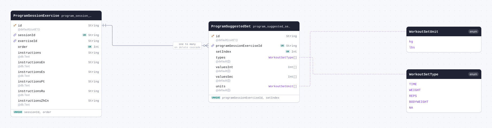

| Field                      | Type                                       | Constraints                                                           | Default   | Description |
| -------------------------- | ------------------------------------------ | --------------------------------------------------------------------- | --------- | ----------- |
| `id`                       | `String`                                   | PK NOT NULL                                                           | `cuid(1)` |             |
| `programSessionExerciseId` | `String`                                   | NOT NULL → [ProgramSessionExercise.id](#model-ProgramSessionExercise) |           |             |
| `setIndex`                 | `Int`                                      | NOT NULL                                                              |           |             |
| `types`                    | [`WorkoutSetType[]`](#enum-WorkoutSetType) | NOT NULL                                                              | `[]`      |             |
| `valuesInt`                | `Int[]`                                    | NOT NULL                                                              | `[]`      |             |
| `valuesSec`                | `Int[]`                                    | NOT NULL                                                              | `[]`      |             |
| `units`                    | [`WorkoutSetUnit[]`](#enum-WorkoutSetUnit) | NOT NULL                                                              | `[]`      |             |

#### Indexes

- `@@unique([programSessionExerciseId, setIndex])`

#### References

- `programSessionExerciseId` → [ProgramSessionExercise.id](#model-ProgramSessionExercise) (many-to-one, on delete Cascade)

#### Definition

```sql
CREATE TABLE "program_suggested_sets" (
    "id" TEXT NOT NULL,
    "programSessionExerciseId" TEXT NOT NULL,
    "setIndex" INTEGER NOT NULL,
    "types" "WorkoutSetType"[] DEFAULT ARRAY[]::"WorkoutSetType"[],
    "valuesInt" INTEGER[] DEFAULT ARRAY[]::INTEGER[],
    "valuesSec" INTEGER[] DEFAULT ARRAY[]::INTEGER[],
    "units" "WorkoutSetUnit"[] DEFAULT ARRAY[]::"WorkoutSetUnit"[],

    CONSTRAINT "program_suggested_sets_pkey" PRIMARY KEY ("id")
);

CREATE UNIQUE INDEX "program_suggested_sets_programSessionExerciseId_setIndex_key" ON "program_suggested_sets"("programSessionExerciseId", "setIndex");

ALTER TABLE "program_suggested_sets" ADD CONSTRAINT "program_suggested_sets_programSessionExerciseId_fkey" FOREIGN KEY ("programSessionExerciseId") REFERENCES "program_session_exercises"("id") ON DELETE CASCADE ON UPDATE CASCADE;
```

<details>
<summary>Queries and their SQL</summary>

**findMany**: Every row

```ts
await prisma.programSuggestedSet.findMany();
```

```sql
SELECT
  "public"."program_suggested_sets"."id",
  "public"."program_suggested_sets"."programSessionExerciseId",
  "public"."program_suggested_sets"."setIndex",
  "public"."program_suggested_sets"."types"::text[],
  "public"."program_suggested_sets"."valuesInt",
  "public"."program_suggested_sets"."valuesSec",
  "public"."program_suggested_sets"."units"::text[]
FROM
  "public"."program_suggested_sets"
WHERE
  1 = 1
OFFSET
  $1
-- params: ["0"]
```

**count**: How many rows there are

```ts
await prisma.programSuggestedSet.count();
```

```sql
SELECT
  COUNT(*) AS "_count$_all"
FROM
  (
    SELECT
      "public"."program_suggested_sets"."id"
    FROM
      "public"."program_suggested_sets"
    WHERE
      1 = 1
    OFFSET
      $1
  ) AS "sub"
-- params: ["0"]
```

**findMany**: Every row with its relations

```ts
await prisma.programSuggestedSet.findMany({ include: { programSessionExercise: true } });
```

```sql
SELECT
  "public"."program_suggested_sets"."id",
  "public"."program_suggested_sets"."programSessionExerciseId",
  "public"."program_suggested_sets"."setIndex",
  "public"."program_suggested_sets"."types"::text[],
  "public"."program_suggested_sets"."valuesInt",
  "public"."program_suggested_sets"."valuesSec",
  "public"."program_suggested_sets"."units"::text[]
FROM
  "public"."program_suggested_sets"
WHERE
  1 = 1
OFFSET
  $1
-- params: ["0"]

SELECT
  "public"."program_session_exercises"."id",
  "public"."program_session_exercises"."sessionId",
  "public"."program_session_exercises"."exerciseId",
  "public"."program_session_exercises"."order",
  "public"."program_session_exercises"."instructions",
  "public"."program_session_exercises"."instructionsEn",
  "public"."program_session_exercises"."instructionsEs",
  "public"."program_session_exercises"."instructionsPt",
  "public"."program_session_exercises"."instructionsRu",
  "public"."program_session_exercises"."instructionsZhCn"
FROM
  "public"."program_session_exercises"
WHERE
  "public"."program_session_exercises"."id" IN ($1)
OFFSET
  $2
-- params: ["<programSessionExerciseId of the rows above>","0"]
```

**findUnique**: One row by what is unique to it

```ts
await prisma.programSuggestedSet.findUnique({ where: { id: "example" } });
```

```sql
SELECT
  "public"."program_suggested_sets"."id",
  "public"."program_suggested_sets"."programSessionExerciseId",
  "public"."program_suggested_sets"."setIndex",
  "public"."program_suggested_sets"."types"::text[],
  "public"."program_suggested_sets"."valuesInt",
  "public"."program_suggested_sets"."valuesSec",
  "public"."program_suggested_sets"."units"::text[]
FROM
  "public"."program_suggested_sets"
WHERE
  (
    "public"."program_suggested_sets"."id" = $1
    AND 1 = 1
  )
LIMIT
  $2
OFFSET
  $3
-- params: ["example","1","0"]
```

**create**: Create a row

```ts
await prisma.programSuggestedSet.create({
  data: { programSessionExerciseId: "example", setIndex: 1 },
});
```

```sql
INSERT INTO
  "public"."program_suggested_sets" (
    "id",
    "programSessionExerciseId",
    "setIndex",
    "types",
    "valuesInt",
    "valuesSec",
    "units"
  )
VALUES
  (
    $1,
    $2,
    $3,
    CAST($4::text[] AS "public"."WorkoutSetType" []),
    $5,
    $6,
    CAST($7::text[] AS "public"."WorkoutSetUnit" [])
  )
RETURNING
  "public"."program_suggested_sets"."id",
  "public"."program_suggested_sets"."programSessionExerciseId",
  "public"."program_suggested_sets"."setIndex",
  "public"."program_suggested_sets"."types"::text[],
  "public"."program_suggested_sets"."valuesInt",
  "public"."program_suggested_sets"."valuesSec",
  "public"."program_suggested_sets"."units"::text[]
-- params: ["<cuid(1)>","example","1",[],[],[],[]]
```

**update**: Update a row

```ts
await prisma.programSuggestedSet.update({ where: { id: "example" }, data: { setIndex: 1 } });
```

```sql
UPDATE "public"."program_suggested_sets"
SET
  "setIndex" = $1
WHERE
  (
    "public"."program_suggested_sets"."id" = $2
    AND 1 = 1
  )
RETURNING
  "public"."program_suggested_sets"."id",
  "public"."program_suggested_sets"."programSessionExerciseId",
  "public"."program_suggested_sets"."setIndex",
  "public"."program_suggested_sets"."types"::text[],
  "public"."program_suggested_sets"."valuesInt",
  "public"."program_suggested_sets"."valuesSec",
  "public"."program_suggested_sets"."units"::text[]
-- params: ["1","example"]
```

**delete**: Delete a row

```ts
await prisma.programSuggestedSet.delete({ where: { id: "example" } });
```

```sql
DELETE FROM "public"."program_suggested_sets"
WHERE
  (
    "public"."program_suggested_sets"."id" = $1
    AND 1 = 1
  )
RETURNING
  "public"."program_suggested_sets"."id",
  "public"."program_suggested_sets"."programSessionExerciseId",
  "public"."program_suggested_sets"."setIndex",
  "public"."program_suggested_sets"."types"::text[],
  "public"."program_suggested_sets"."valuesInt",
  "public"."program_suggested_sets"."valuesSec",
  "public"."program_suggested_sets"."units"::text[]
-- params: ["example"]
```

</details>

<a id="model-UserProgramEnrollment"></a>

### UserProgramEnrollment

Table `user_program_enrollments`.

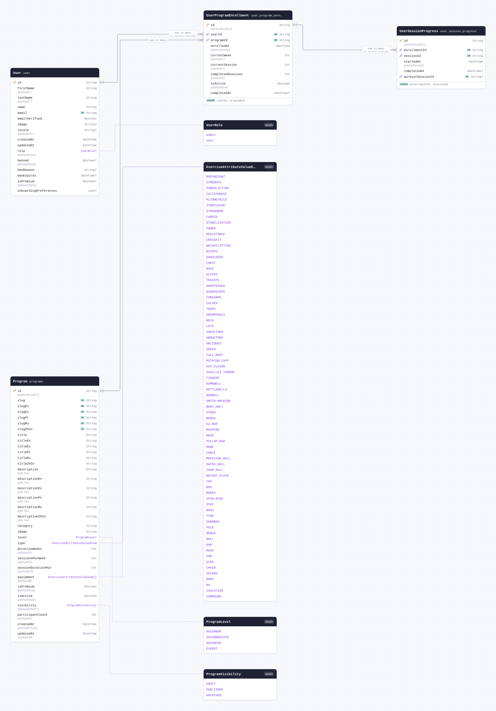

| Field               | Type       | Constraints                             | Default   | Description |
| ------------------- | ---------- | --------------------------------------- | --------- | ----------- |
| `id`                | `String`   | PK NOT NULL                             | `cuid(1)` |             |
| `userId`            | `String`   | NOT NULL → [User.id](#model-User)       |           |             |
| `programId`         | `String`   | NOT NULL → [Program.id](#model-Program) |           |             |
| `enrolledAt`        | `DateTime` | NOT NULL                                | `now()`   |             |
| `currentWeek`       | `Int`      | NOT NULL                                | `1`       |             |
| `currentSession`    | `Int`      | NOT NULL                                | `1`       |             |
| `completedSessions` | `Int`      | NOT NULL                                | `0`       |             |
| `isActive`          | `Boolean`  | NOT NULL                                | `true`    |             |
| `completedAt`       | `DateTime` | NULL                                    |           |             |

#### Indexes

- `@@unique([userId, programId])`

#### References

- `userId` → [User.id](#model-User) (many-to-one, on delete Cascade)
- `programId` → [Program.id](#model-Program) (many-to-one)

#### Referenced by

- `id` ← [UserSessionProgress.enrollmentId](#model-UserSessionProgress) (one-to-many, on delete Cascade)

#### Definition

```sql
CREATE TABLE "user_program_enrollments" (
    "id" TEXT NOT NULL,
    "userId" TEXT NOT NULL,
    "programId" TEXT NOT NULL,
    "enrolledAt" TIMESTAMP(3) NOT NULL DEFAULT CURRENT_TIMESTAMP,
    "currentWeek" INTEGER NOT NULL DEFAULT 1,
    "currentSession" INTEGER NOT NULL DEFAULT 1,
    "completedSessions" INTEGER NOT NULL DEFAULT 0,
    "isActive" BOOLEAN NOT NULL DEFAULT true,
    "completedAt" TIMESTAMP(3),

    CONSTRAINT "user_program_enrollments_pkey" PRIMARY KEY ("id")
);

CREATE UNIQUE INDEX "user_program_enrollments_userId_programId_key" ON "user_program_enrollments"("userId", "programId");

ALTER TABLE "user_program_enrollments" ADD CONSTRAINT "user_program_enrollments_userId_fkey" FOREIGN KEY ("userId") REFERENCES "user"("id") ON DELETE CASCADE ON UPDATE CASCADE;

ALTER TABLE "user_program_enrollments" ADD CONSTRAINT "user_program_enrollments_programId_fkey" FOREIGN KEY ("programId") REFERENCES "programs"("id") ON DELETE RESTRICT ON UPDATE CASCADE;
```

<details>
<summary>Queries and their SQL</summary>

**findMany**: Every row

```ts
await prisma.userProgramEnrollment.findMany();
```

```sql
SELECT
  "public"."user_program_enrollments"."id",
  "public"."user_program_enrollments"."userId",
  "public"."user_program_enrollments"."programId",
  "public"."user_program_enrollments"."enrolledAt",
  "public"."user_program_enrollments"."currentWeek",
  "public"."user_program_enrollments"."currentSession",
  "public"."user_program_enrollments"."completedSessions",
  "public"."user_program_enrollments"."isActive",
  "public"."user_program_enrollments"."completedAt"
FROM
  "public"."user_program_enrollments"
WHERE
  1 = 1
OFFSET
  $1
-- params: ["0"]
```

**count**: How many rows there are

```ts
await prisma.userProgramEnrollment.count();
```

```sql
SELECT
  COUNT(*) AS "_count$_all"
FROM
  (
    SELECT
      "public"."user_program_enrollments"."id"
    FROM
      "public"."user_program_enrollments"
    WHERE
      1 = 1
    OFFSET
      $1
  ) AS "sub"
-- params: ["0"]
```

**findMany**: Every row with its relations

```ts
await prisma.userProgramEnrollment.findMany({
  include: { user: true, program: true, sessionProgress: true },
});
```

```sql
SELECT
  "public"."user_program_enrollments"."id",
  "public"."user_program_enrollments"."userId",
  "public"."user_program_enrollments"."programId",
  "public"."user_program_enrollments"."enrolledAt",
  "public"."user_program_enrollments"."currentWeek",
  "public"."user_program_enrollments"."currentSession",
  "public"."user_program_enrollments"."completedSessions",
  "public"."user_program_enrollments"."isActive",
  "public"."user_program_enrollments"."completedAt"
FROM
  "public"."user_program_enrollments"
WHERE
  1 = 1
OFFSET
  $1
-- params: ["0"]

SELECT
  "public"."user"."id",
  "public"."user"."firstName",
  "public"."user"."lastName",
  "public"."user"."name",
  "public"."user"."email",
  "public"."user"."emailVerified",
  "public"."user"."image",
  "public"."user"."locale",
  "public"."user"."createdAt",
  "public"."user"."updatedAt",
  "public"."user"."role"::text,
  "public"."user"."banned",
  "public"."user"."banReason",
  "public"."user"."banExpires",
  "public"."user"."isPremium",
  "public"."user"."onboardingPreferences"
FROM
  "public"."user"
WHERE
  "public"."user"."id" IN ($1)
OFFSET
  $2
-- params: ["<userId of the rows above>","0"]

SELECT
  "public"."programs"."id",
  "public"."programs"."slug",
  "public"."programs"."slugEn",
  "public"."programs"."slugEs",
  "public"."programs"."slugPt",
  "public"."programs"."slugRu",
  "public"."programs"."slugZhCn",
  "public"."programs"."title",
  "public"."programs"."titleEn",
  "public"."programs"."titleEs",
  "public"."programs"."titlePt",
  "public"."programs"."titleRu",
  "public"."programs"."titleZhCn",
  "public"."programs"."description",
  "public"."programs"."descriptionEn",
  "public"."programs"."descriptionEs",
  "public"."programs"."descriptionPt",
  "public"."programs"."descriptionRu",
  "public"."programs"."descriptionZhCn",
  "public"."programs"."category",
  "public"."programs"."image",
  "public"."programs"."level"::text,
  "public"."programs"."type"::text,
  "public"."programs"."durationWeeks",
  "public"."programs"."sessionsPerWeek",
  "public"."programs"."sessionDurationMin",
  "public"."programs"."equipment"::text[],
  "public"."programs"."isPremium",
  "public"."programs"."isActive",
  "public"."programs"."visibility"::text,
  "public"."programs"."participantCount",
  "public"."programs"."createdAt",
  "public"."programs"."updatedAt"
FROM
  "public"."programs"
WHERE
  "public"."programs"."id" IN ($1)
OFFSET
  $2
-- params: ["<programId of the rows above>","0"]

SELECT
  "public"."user_session_progress"."id",
  "public"."user_session_progress"."enrollmentId",
  "public"."user_session_progress"."sessionId",
  "public"."user_session_progress"."startedAt",
  "public"."user_session_progress"."completedAt",
  "public"."user_session_progress"."workoutSessionId"
FROM
  "public"."user_session_progress"
WHERE
  "public"."user_session_progress"."enrollmentId" IN ($1)
OFFSET
  $2
-- params: ["<id of the rows above>","0"]
```

**findUnique**: One row by what is unique to it

```ts
await prisma.userProgramEnrollment.findUnique({ where: { id: "example" } });
```

```sql
SELECT
  "public"."user_program_enrollments"."id",
  "public"."user_program_enrollments"."userId",
  "public"."user_program_enrollments"."programId",
  "public"."user_program_enrollments"."enrolledAt",
  "public"."user_program_enrollments"."currentWeek",
  "public"."user_program_enrollments"."currentSession",
  "public"."user_program_enrollments"."completedSessions",
  "public"."user_program_enrollments"."isActive",
  "public"."user_program_enrollments"."completedAt"
FROM
  "public"."user_program_enrollments"
WHERE
  (
    "public"."user_program_enrollments"."id" = $1
    AND 1 = 1
  )
LIMIT
  $2
OFFSET
  $3
-- params: ["example","1","0"]
```

**create**: Create a row

```ts
await prisma.userProgramEnrollment.create({ data: { userId: "example", programId: "example" } });
```

```sql
INSERT INTO
  "public"."user_program_enrollments" (
    "id",
    "userId",
    "programId",
    "enrolledAt",
    "currentWeek",
    "currentSession",
    "completedSessions",
    "isActive"
  )
VALUES
  ($1, $2, $3, $4, $5, $6, $7, $8)
RETURNING
  "public"."user_program_enrollments"."id",
  "public"."user_program_enrollments"."userId",
  "public"."user_program_enrollments"."programId",
  "public"."user_program_enrollments"."enrolledAt",
  "public"."user_program_enrollments"."currentWeek",
  "public"."user_program_enrollments"."currentSession",
  "public"."user_program_enrollments"."completedSessions",
  "public"."user_program_enrollments"."isActive",
  "public"."user_program_enrollments"."completedAt"
-- params: ["<cuid(1)>","example","example","<now()>","1","1","0",true]
```

**update**: Update a row

```ts
await prisma.userProgramEnrollment.update({
  where: { id: "example" },
  data: { enrolledAt: new Date("2026-01-01T00:00:00.000Z") },
});
```

```sql
UPDATE "public"."user_program_enrollments"
SET
  "enrolledAt" = $1
WHERE
  (
    "public"."user_program_enrollments"."id" = $2
    AND 1 = 1
  )
RETURNING
  "public"."user_program_enrollments"."id",
  "public"."user_program_enrollments"."userId",
  "public"."user_program_enrollments"."programId",
  "public"."user_program_enrollments"."enrolledAt",
  "public"."user_program_enrollments"."currentWeek",
  "public"."user_program_enrollments"."currentSession",
  "public"."user_program_enrollments"."completedSessions",
  "public"."user_program_enrollments"."isActive",
  "public"."user_program_enrollments"."completedAt"
-- params: ["2026-01-01T00:00:00.000Z","example"]
```

**delete**: Delete a row

```ts
await prisma.userProgramEnrollment.delete({ where: { id: "example" } });
```

```sql
DELETE FROM "public"."user_program_enrollments"
WHERE
  (
    "public"."user_program_enrollments"."id" = $1
    AND 1 = 1
  )
RETURNING
  "public"."user_program_enrollments"."id",
  "public"."user_program_enrollments"."userId",
  "public"."user_program_enrollments"."programId",
  "public"."user_program_enrollments"."enrolledAt",
  "public"."user_program_enrollments"."currentWeek",
  "public"."user_program_enrollments"."currentSession",
  "public"."user_program_enrollments"."completedSessions",
  "public"."user_program_enrollments"."isActive",
  "public"."user_program_enrollments"."completedAt"
-- params: ["example"]
```

</details>

<a id="model-UserSessionProgress"></a>

### UserSessionProgress

Table `user_session_progress`.

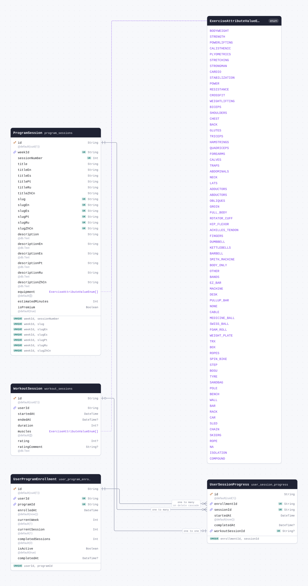

| Field              | Type       | Constraints                                                         | Default   | Description |
| ------------------ | ---------- | ------------------------------------------------------------------- | --------- | ----------- |
| `id`               | `String`   | PK NOT NULL                                                         | `cuid(1)` |             |
| `enrollmentId`     | `String`   | NOT NULL → [UserProgramEnrollment.id](#model-UserProgramEnrollment) |           |             |
| `sessionId`        | `String`   | NOT NULL → [ProgramSession.id](#model-ProgramSession)               |           |             |
| `startedAt`        | `DateTime` | NOT NULL                                                            | `now()`   |             |
| `completedAt`      | `DateTime` | NULL                                                                |           |             |
| `workoutSessionId` | `String`   | UNIQUE NULL → [WorkoutSession.id](#model-WorkoutSession)            |           |             |

#### Indexes

- `@@unique([enrollmentId, sessionId])`

#### References

- `enrollmentId` → [UserProgramEnrollment.id](#model-UserProgramEnrollment) (many-to-one, on delete Cascade)
- `sessionId` → [ProgramSession.id](#model-ProgramSession) (many-to-one)
- `workoutSessionId` → [WorkoutSession.id](#model-WorkoutSession) (one-to-one)

#### Definition

```sql
CREATE TABLE "user_session_progress" (
    "id" TEXT NOT NULL,
    "enrollmentId" TEXT NOT NULL,
    "sessionId" TEXT NOT NULL,
    "startedAt" TIMESTAMP(3) NOT NULL DEFAULT CURRENT_TIMESTAMP,
    "completedAt" TIMESTAMP(3),
    "workoutSessionId" TEXT,

    CONSTRAINT "user_session_progress_pkey" PRIMARY KEY ("id")
);

CREATE UNIQUE INDEX "user_session_progress_workoutSessionId_key" ON "user_session_progress"("workoutSessionId");

CREATE UNIQUE INDEX "user_session_progress_enrollmentId_sessionId_key" ON "user_session_progress"("enrollmentId", "sessionId");

ALTER TABLE "user_session_progress" ADD CONSTRAINT "user_session_progress_enrollmentId_fkey" FOREIGN KEY ("enrollmentId") REFERENCES "user_program_enrollments"("id") ON DELETE CASCADE ON UPDATE CASCADE;

ALTER TABLE "user_session_progress" ADD CONSTRAINT "user_session_progress_sessionId_fkey" FOREIGN KEY ("sessionId") REFERENCES "program_sessions"("id") ON DELETE RESTRICT ON UPDATE CASCADE;

ALTER TABLE "user_session_progress" ADD CONSTRAINT "user_session_progress_workoutSessionId_fkey" FOREIGN KEY ("workoutSessionId") REFERENCES "workout_sessions"("id") ON DELETE SET NULL ON UPDATE CASCADE;
```

<details>
<summary>Queries and their SQL</summary>

**findMany**: Every row

```ts
await prisma.userSessionProgress.findMany();
```

```sql
SELECT
  "public"."user_session_progress"."id",
  "public"."user_session_progress"."enrollmentId",
  "public"."user_session_progress"."sessionId",
  "public"."user_session_progress"."startedAt",
  "public"."user_session_progress"."completedAt",
  "public"."user_session_progress"."workoutSessionId"
FROM
  "public"."user_session_progress"
WHERE
  1 = 1
OFFSET
  $1
-- params: ["0"]
```

**count**: How many rows there are

```ts
await prisma.userSessionProgress.count();
```

```sql
SELECT
  COUNT(*) AS "_count$_all"
FROM
  (
    SELECT
      "public"."user_session_progress"."id"
    FROM
      "public"."user_session_progress"
    WHERE
      1 = 1
    OFFSET
      $1
  ) AS "sub"
-- params: ["0"]
```

**findMany**: Every row with its relations

```ts
await prisma.userSessionProgress.findMany({
  include: { enrollment: true, session: true, workoutSession: true },
});
```

```sql
SELECT
  "public"."user_session_progress"."id",
  "public"."user_session_progress"."enrollmentId",
  "public"."user_session_progress"."sessionId",
  "public"."user_session_progress"."startedAt",
  "public"."user_session_progress"."completedAt",
  "public"."user_session_progress"."workoutSessionId"
FROM
  "public"."user_session_progress"
WHERE
  1 = 1
OFFSET
  $1
-- params: ["0"]

SELECT
  "public"."user_program_enrollments"."id",
  "public"."user_program_enrollments"."userId",
  "public"."user_program_enrollments"."programId",
  "public"."user_program_enrollments"."enrolledAt",
  "public"."user_program_enrollments"."currentWeek",
  "public"."user_program_enrollments"."currentSession",
  "public"."user_program_enrollments"."completedSessions",
  "public"."user_program_enrollments"."isActive",
  "public"."user_program_enrollments"."completedAt"
FROM
  "public"."user_program_enrollments"
WHERE
  "public"."user_program_enrollments"."id" IN ($1)
OFFSET
  $2
-- params: ["<enrollmentId of the rows above>","0"]

SELECT
  "public"."program_sessions"."id",
  "public"."program_sessions"."weekId",
  "public"."program_sessions"."sessionNumber",
  "public"."program_sessions"."title",
  "public"."program_sessions"."titleEn",
  "public"."program_sessions"."titleEs",
  "public"."program_sessions"."titlePt",
  "public"."program_sessions"."titleRu",
  "public"."program_sessions"."titleZhCn",
  "public"."program_sessions"."slug",
  "public"."program_sessions"."slugEn",
  "public"."program_sessions"."slugEs",
  "public"."program_sessions"."slugPt",
  "public"."program_sessions"."slugRu",
  "public"."program_sessions"."slugZhCn",
  "public"."program_sessions"."description",
  "public"."program_sessions"."descriptionEn",
  "public"."program_sessions"."descriptionEs",
  "public"."program_sessions"."descriptionPt",
  "public"."program_sessions"."descriptionRu",
  "public"."program_sessions"."descriptionZhCn",
  "public"."program_sessions"."equipment"::text[],
  "public"."program_sessions"."estimatedMinutes",
  "public"."program_sessions"."isPremium"
FROM
  "public"."program_sessions"
WHERE
  "public"."program_sessions"."id" IN ($1)
OFFSET
  $2
-- params: ["<sessionId of the rows above>","0"]

SELECT
  "public"."workout_sessions"."id",
  "public"."workout_sessions"."userId",
  "public"."workout_sessions"."startedAt",
  "public"."workout_sessions"."endedAt",
  "public"."workout_sessions"."duration",
  "public"."workout_sessions"."muscles"::text[],
  "public"."workout_sessions"."rating",
  "public"."workout_sessions"."ratingComment"
FROM
  "public"."workout_sessions"
WHERE
  "public"."workout_sessions"."id" IN ($1)
OFFSET
  $2
-- params: ["<workoutSessionId of the rows above>","0"]
```

**findUnique**: One row by what is unique to it

```ts
await prisma.userSessionProgress.findUnique({ where: { id: "example" } });
```

```sql
SELECT
  "public"."user_session_progress"."id",
  "public"."user_session_progress"."enrollmentId",
  "public"."user_session_progress"."sessionId",
  "public"."user_session_progress"."startedAt",
  "public"."user_session_progress"."completedAt",
  "public"."user_session_progress"."workoutSessionId"
FROM
  "public"."user_session_progress"
WHERE
  (
    "public"."user_session_progress"."id" = $1
    AND 1 = 1
  )
LIMIT
  $2
OFFSET
  $3
-- params: ["example","1","0"]
```

**create**: Create a row

```ts
await prisma.userSessionProgress.create({
  data: { enrollmentId: "example", sessionId: "example" },
});
```

```sql
INSERT INTO
  "public"."user_session_progress" ("id", "enrollmentId", "sessionId", "startedAt")
VALUES
  ($1, $2, $3, $4)
RETURNING
  "public"."user_session_progress"."id",
  "public"."user_session_progress"."enrollmentId",
  "public"."user_session_progress"."sessionId",
  "public"."user_session_progress"."startedAt",
  "public"."user_session_progress"."completedAt",
  "public"."user_session_progress"."workoutSessionId"
-- params: ["<cuid(1)>","example","example","<now()>"]
```

**update**: Update a row

```ts
await prisma.userSessionProgress.update({
  where: { id: "example" },
  data: { startedAt: new Date("2026-01-01T00:00:00.000Z") },
});
```

```sql
UPDATE "public"."user_session_progress"
SET
  "startedAt" = $1
WHERE
  (
    "public"."user_session_progress"."id" = $2
    AND 1 = 1
  )
RETURNING
  "public"."user_session_progress"."id",
  "public"."user_session_progress"."enrollmentId",
  "public"."user_session_progress"."sessionId",
  "public"."user_session_progress"."startedAt",
  "public"."user_session_progress"."completedAt",
  "public"."user_session_progress"."workoutSessionId"
-- params: ["2026-01-01T00:00:00.000Z","example"]
```

**delete**: Delete a row

```ts
await prisma.userSessionProgress.delete({ where: { id: "example" } });
```

```sql
DELETE FROM "public"."user_session_progress"
WHERE
  (
    "public"."user_session_progress"."id" = $1
    AND 1 = 1
  )
RETURNING
  "public"."user_session_progress"."id",
  "public"."user_session_progress"."enrollmentId",
  "public"."user_session_progress"."sessionId",
  "public"."user_session_progress"."startedAt",
  "public"."user_session_progress"."completedAt",
  "public"."user_session_progress"."workoutSessionId"
-- params: ["example"]
```

</details>

## Enums

<a id="enum-UserRole"></a>

### UserRole

- `admin`
- `user`

#### Definition

```sql
CREATE TYPE "UserRole" AS ENUM ('admin', 'user');
```

<a id="enum-ExercisePrivacy"></a>

### ExercisePrivacy

- `PUBLIC`
- `PRIVATE`

#### Definition

```sql
CREATE TYPE "ExercisePrivacy" AS ENUM ('PUBLIC', 'PRIVATE');
```

<a id="enum-ExerciseAttributeNameEnum"></a>

### ExerciseAttributeNameEnum

- `TYPE`
- `PRIMARY_MUSCLE`
- `SECONDARY_MUSCLE`
- `EQUIPMENT`
- `MECHANICS_TYPE`

#### Definition

```sql
CREATE TYPE "ExerciseAttributeNameEnum" AS ENUM ('TYPE', 'PRIMARY_MUSCLE', 'SECONDARY_MUSCLE', 'EQUIPMENT', 'MECHANICS_TYPE');
```

<a id="enum-ExerciseAttributeValueEnum"></a>

### ExerciseAttributeValueEnum

- `BODYWEIGHT`
- `STRENGTH`
- `POWERLIFTING`
- `CALISTHENIC`
- `PLYOMETRICS`
- `STRETCHING`
- `STRONGMAN`
- `CARDIO`
- `STABILIZATION`
- `POWER`
- `RESISTANCE`
- `CROSSFIT`
- `WEIGHTLIFTING`
- `BICEPS`
- `SHOULDERS`
- `CHEST`
- `BACK`
- `GLUTES`
- `TRICEPS`
- `HAMSTRINGS`
- `QUADRICEPS`
- `FOREARMS`
- `CALVES`
- `TRAPS`
- `ABDOMINALS`
- `NECK`
- `LATS`
- `ADDUCTORS`
- `ABDUCTORS`
- `OBLIQUES`
- `GROIN`
- `FULL_BODY`
- `ROTATOR_CUFF`
- `HIP_FLEXOR`
- `ACHILLES_TENDON`
- `FINGERS`
- `DUMBBELL`
- `KETTLEBELLS`
- `BARBELL`
- `SMITH_MACHINE`
- `BODY_ONLY`
- `OTHER`
- `BANDS`
- `EZ_BAR`
- `MACHINE`
- `DESK`
- `PULLUP_BAR`
- `NONE`
- `CABLE`
- `MEDICINE_BALL`
- `SWISS_BALL`
- `FOAM_ROLL`
- `WEIGHT_PLATE`
- `TRX`
- `BOX`
- `ROPES`
- `SPIN_BIKE`
- `STEP`
- `BOSU`
- `TYRE`
- `SANDBAG`
- `POLE`
- `BENCH`
- `WALL`
- `BAR`
- `RACK`
- `CAR`
- `SLED`
- `CHAIN`
- `SKIERG`
- `ROPE`
- `NA`
- `ISOLATION`
- `COMPOUND`

#### Definition

```sql
CREATE TYPE "ExerciseAttributeValueEnum" AS ENUM ('BODYWEIGHT', 'STRENGTH', 'POWERLIFTING', 'CALISTHENIC', 'PLYOMETRICS', 'STRETCHING', 'STRONGMAN', 'CARDIO', 'STABILIZATION', 'POWER', 'RESISTANCE', 'CROSSFIT', 'WEIGHTLIFTING', 'BICEPS', 'SHOULDERS', 'CHEST', 'BACK', 'GLUTES', 'TRICEPS', 'HAMSTRINGS', 'QUADRICEPS', 'FOREARMS', 'CALVES', 'TRAPS', 'ABDOMINALS', 'NECK', 'LATS', 'ADDUCTORS', 'ABDUCTORS', 'OBLIQUES', 'GROIN', 'FULL_BODY', 'ROTATOR_CUFF', 'HIP_FLEXOR', 'ACHILLES_TENDON', 'FINGERS', 'DUMBBELL', 'KETTLEBELLS', 'BARBELL', 'SMITH_MACHINE', 'BODY_ONLY', 'OTHER', 'BANDS', 'EZ_BAR', 'MACHINE', 'DESK', 'PULLUP_BAR', 'NONE', 'CABLE', 'MEDICINE_BALL', 'SWISS_BALL', 'FOAM_ROLL', 'WEIGHT_PLATE', 'TRX', 'BOX', 'ROPES', 'SPIN_BIKE', 'STEP', 'BOSU', 'TYRE', 'SANDBAG', 'POLE', 'BENCH', 'WALL', 'BAR', 'RACK', 'CAR', 'SLED', 'CHAIN', 'SKIERG', 'ROPE', 'NA', 'ISOLATION', 'COMPOUND');
```

<a id="enum-WorkoutSetType"></a>

### WorkoutSetType

- `TIME`
- `WEIGHT`
- `REPS`
- `BODYWEIGHT`
- `NA`

#### Definition

```sql
CREATE TYPE "WorkoutSetType" AS ENUM ('TIME', 'WEIGHT', 'REPS', 'BODYWEIGHT', 'NA');
```

<a id="enum-WorkoutSetUnit"></a>

### WorkoutSetUnit

- `kg`
- `lbs`

#### Definition

```sql
CREATE TYPE "WorkoutSetUnit" AS ENUM ('kg', 'lbs');
```

<a id="enum-SubscriptionStatus"></a>

### SubscriptionStatus

- `ACTIVE`
- `TRIAL`
- `CANCELLED`
- `EXPIRED`
- `PAUSED`

#### Definition

```sql
CREATE TYPE "SubscriptionStatus" AS ENUM ('ACTIVE', 'TRIAL', 'CANCELLED', 'EXPIRED', 'PAUSED');
```

<a id="enum-Platform"></a>

### Platform

- `WEB`
- `IOS`
- `ANDROID`

#### Definition

```sql
CREATE TYPE "Platform" AS ENUM ('WEB', 'IOS', 'ANDROID');
```

<a id="enum-PaymentProcessor"></a>

### PaymentProcessor

- `STRIPE`
- `PAYPAL`
- `LEMONSQUEEZY`
- `PADDLE`
- `APPLE_PAY`
- `GOOGLE_PAY`
- `REVENUECAT`
- `NONE`
- `OTHER`

#### Definition

```sql
CREATE TYPE "PaymentProcessor" AS ENUM ('STRIPE', 'PAYPAL', 'LEMONSQUEEZY', 'PADDLE', 'APPLE_PAY', 'GOOGLE_PAY', 'REVENUECAT', 'NONE', 'OTHER');
```

<a id="enum-ProgramLevel"></a>

### ProgramLevel

- `BEGINNER`
- `INTERMEDIATE`
- `ADVANCED`
- `EXPERT`

#### Definition

```sql
CREATE TYPE "ProgramLevel" AS ENUM ('BEGINNER', 'INTERMEDIATE', 'ADVANCED', 'EXPERT');
```

<a id="enum-ProgramVisibility"></a>

### ProgramVisibility

- `DRAFT`
- `PUBLISHED`
- `ARCHIVED`

#### Definition

```sql
CREATE TYPE "ProgramVisibility" AS ENUM ('DRAFT', 'PUBLISHED', 'ARCHIVED');
```
